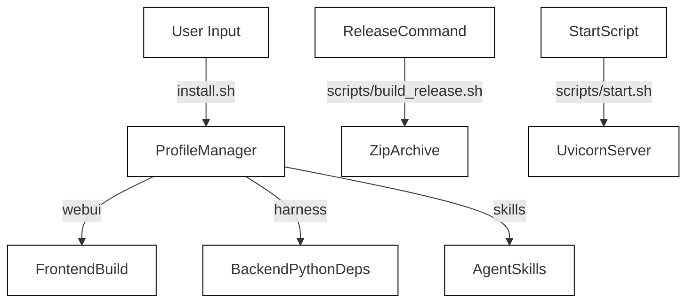
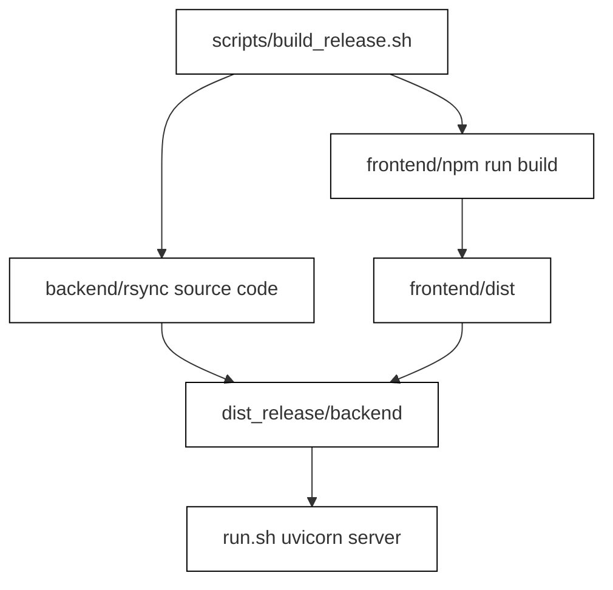

<!-- source: DeepWiki mcp.deepwiki.com · repo OpenDCAI/DataFlow-WebUI · page 9 Installation, Build and Operations · fetched 2026-11-02 -->

# Installation, Build and Operations

Relevant source files

The following files were used as context for generating this wiki page:

- [.github/workflows/release.yml](.github/workflows/release.yml)
- [.gitignore](.gitignore)
- [frontend/.gitignore](frontend/.gitignore)
- [install.sh](install.sh)
- [installers/lib/common.sh](installers/lib/common.sh)
- [scripts/build_release.sh](scripts/build_release.sh)
- [scripts/start.sh](scripts/start.sh)

The purpose of this page is to provide a high-level overview of how DataFlow-WebUI is installed, packaged, tested, and deployed across development, testing, and production environments. This covers the installation profile framework [install.sh:1-12](), testing and continuous integration mechanisms, and release packaging scripts [scripts/build_release.sh:1-12](). 

For deep technical details, see the respective child pages:
- [Installer and Profiles](#9.1)
- [Testing and CI](#9.2)
- [Release and Deployment](#9.3)

Sources: `install.sh:1-12`, `scripts/build_release.sh:1-12`, `scripts/start.sh:1-12`

---

## 9.1 Installer and Profiles

The installation system revolves around a single entry point script, `install.sh`, which parses profile declarations stored as JSON files under `installers/profiles/` [install.sh:1-12](). Supported profiles include `webui` (full stack canvas + backend + MCP), `harness` (headless backend + MCP), and `skills` (standalone agent files) [install.sh:4-7](). 

Shared helper routines in `installers/lib/common.sh` handle prerequisite checks (`python`, `node`, `uv`, `pip`), boundary snapshots to prevent unwanted file system modifications, and receipt generation for safe uninstallation [installers/lib/common.sh:47-165](). 

For complete technical specifications on manifest options, boundary fingerprinting, dry-runs, and uninstallation, see [Installer and Profiles](#9.1).

Sources: `install.sh:1-487`, `installers/lib/common.sh:1-213`

---

## 9.2 Testing and CI

Testing operations encompass both backend validation and workflow automation. The backend test suite relies on `pytest`, utilizing shared fixtures (`conftest.py`) to test registry states, pipeline compilation, and validation error handlers. 

Continuous integration is orchestrated through GitHub Actions workflows—such as `.github/workflows/release.yml`—which execute build scripts, verify archive integrity, and automate release publishing [/.github/workflows/release.yml:1-44](). Local development targets are similarly structured through Makefiles and check scripts (e.g., skill validation checks).

For details on test fixtures, registry test cases, and CI check pipelines, see [Testing and CI](#9.2).

Sources: `/.github/workflows/release.yml:1-45`

---

## 9.3 Release and Deployment

Release packaging is automated via `scripts/build_release.sh`, which compiles the Vue.js frontend, packages backend code while excluding development caches and tests, and produces a portable zip archive [`scripts/build_release.sh:38-146`](). 

The release runner scripts (`run.sh` and `run.bat`) enforce secure local binding defaults (`127.0.0.1`) to prevent arbitrary code execution vulnerabilities over local networks [`scripts/build_release.sh:101-140`](). Production deployments can also leverage Docker, Nginx configurations, or FastAPI's static SPA file serving.

For full deployment documentation, release package structures, and Nginx configurations, see [Release and Deployment](#9.3).

Sources: `scripts/build_release.sh:1-182`

---

