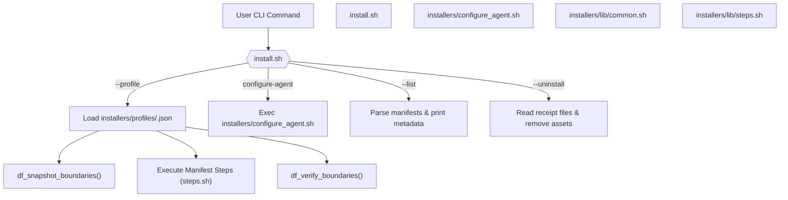

<!-- source: DeepWiki mcp.deepwiki.com · repo OpenDCAI/DataFlow-WebUI · page 9.1 Installer and Profiles · fetched 2026-11-02 -->

# Installer and Profiles

<details>
<summary>Relevant source files</summary>

The following files were used as context for generating this wiki page:

- [backend/requirements.txt](backend/requirements.txt)
- [docs/profiles/webui.md](docs/profiles/webui.md)
- [install.sh](install.sh)
- [installers/config.sh](installers/config.sh)
- [installers/lib/common.sh](installers/lib/common.sh)
- [installers/lib/steps.sh](installers/lib/steps.sh)
- [installers/profiles/harness.json](installers/profiles/harness.json)
- [installers/profiles/webui.json](installers/profiles/webui.json)
- [scripts/setup_all.sh](scripts/setup_all.sh)
- [scripts/start.sh](scripts/start.sh)

</details>


### Purpose and Scope
This document describes the technical architecture and implementation details of the DataFlow-Harness installation and deployment system. It covers the CLI argument parsing in `install.sh`, central configuration parameters in `installers/config.sh`, declarative profile manifests (`webui.json` and `harness.json`), shared shell utilities and step functions (`installers/lib/common.sh` and `installers/lib/steps.sh`), boundary verification, receipt tracking for uninstalls, dry-run behaviors, and service lifecycle management via `scripts/start.sh`.

Sources: `install.sh`, `installers/config.sh`, `installers/lib/common.sh`, `installers/lib/steps.sh`, `scripts/start.sh`

---

### 1. The `install.sh` CLI and Option Parsing

The unified entry point for all installation workflows is `install.sh` [install.sh:1-16](). It validates the environment, processes CLI flags, and executes actions based on declarative profile JSON files.


*Figure 1: CLI Dispatch and Execution Flow mapping user commands to underlying script routines.*

Sources: `install.sh:79-136`, `installers/lib/common.sh:136-165`

The CLI processes configuration overrides and flags through a `while` loop [install.sh:84-101](). Supported options include `--profile`, `--check`, `--dry-run`, `--force`, `--uv`, `--pip`, `--verbose`, `--scope`, `--uninstall`, and `--list` [install.sh:44-57](). If `configure-agent` is passed as the leading argument, execution is handed off to `installers/configure_agent.sh` [install.sh:79-82]().

Sources: `install.sh:44-101`

---

### 2. Central Configuration (`installers/config.sh`)

All runtime network ports, path constants, and package manager policies are defined in `installers/config.sh` to ensure consistency between installation scripts, release builders, and documentation [installers/config.sh:1-7]().

| Variable Name | Default Value | Role / Description |
| --- | --- | --- |
| `DF_PORT` | `8000` (overridable via `DATAFLOW_PORT`) | Backend service port [installers/config.sh:17]() |
| `DF_MCP_PATH` | `/mcp` | Model Context Protocol endpoint path [installers/config.sh:18]() |
| `DF_NODE_PM` | `npm` | Pinned package manager for frontend dependencies [installers/config.sh:26]() |
| `DF_PYTHON` | `python3` (overridable via `DATAFLOW_PYTHON`) | Selected Python interpreter [installers/config.sh:33]() |
| `DF_PYTHON_INSTALLER` | `uv` (overridable via `DATAFLOW_PYTHON_INSTALLER`) | Python package installer backend (`uv` or `pip`) [installers/config.sh:34]() |
| `DF_SKILLS_PROJECT_DIR` | `.claude/skills` | Default project-scoped skill destination [installers/config.sh:40]() |
| `DF_RECEIPT_DIR` | `.dataflow-install` | Directory for tracking install receipts per target [installers/config.sh:46]() |

Sources: `installers/config.sh:1-48`

---

### 3. Profile JSON Definitions (`webui.json`, `harness.json`)

Profiles decouple installation orchestration logic from the installation plan. Each profile is a declarative JSON manifest stored under `installers/profiles/`.

- **`harness.json`**: Installs the backend Python stack (`open-dataflow`, requirements), initializes the core data directory, and renders agent assets without building or touching frontend code [installers/profiles/harness.json:1-114](). It declares a strict `must_not_touch` array preventing mutations to frontend components or IDE config files [installers/profiles/harness.json:100-107]().
- **`webui.json`**: Extends the harness profile by adding a frontend dependency installation step (`npm install`) and a production build step (`npm run build` targeting `frontend/dist`) [installers/profiles/webui.json:1-132]().

Sources: `installers/profiles/harness.json:1-114`, `installers/profiles/webui.json:1-132`

---

### 4. Library Helpers and Steps (`common.sh` and `steps.sh`)

The installer functionality is modularized into shared helper libraries sourced by `install.sh`.

```mermaid
graph TD
  ProfileManifest["webui.json / harness.json"] -->|json["d['steps']"]| StepExecutor["install.sh step runner"]
  StepExecutor -->|df_pip_install| PipStep["installers/lib/steps.sh: df_pip_install()"]
  StepExecutor -->|df_build_frontend| BuildStep["installers/lib/steps.sh: df_build_frontend()"]
  StepExecutor -->|df_init_dataflow_core| CoreStep["installers/lib/steps.sh: df_init_dataflow_core()"]
  PipStep -->|python3 evaluation| JSONHelper["installers/lib/common.sh: df_json()"]
  BuildStep -->|npm execution| NPMExec["npm install & build"]
  CoreStep -->|cli execution| DataFlowCore["dataflow.cli init"]

  subCode1["installers/profiles/webui.json"]
  subCode2["installers/lib/steps.sh"]
  subCode3["installers/lib/common.sh"]
```
*Figure 2: Profile execution dataflow mapping JSON manifest steps to shell implementation functions.*

Sources: `installers/lib/common.sh:30-45`, `installers/lib/steps.sh:22-108`, `installers/profiles/webui.json:46-92`

- **`df_json()`**: Evaluates Python expressions against a JSON file using `python3` to extract metadata without requiring external dependencies like `jq` [installers/lib/common.sh:30-45]().
- **`df_check_prereq()`**: Validates system tools (`python`, `node`, `npm`, `pip`, `uv`) against minimum required version thresholds via `df_version_ge()` [installers/lib/common.sh:48-98]().
- **`df_uv_system_flag()`**: Inspects `sys.prefix` versus `sys.base_prefix` to determine whether `--system` flag is required when invoking `uv pip install` inside conda or native environments [installers/lib/steps.sh:9-20]().
- **`df_init_dataflow_core()`**: Ensures `backend/data/dataflow_core/` is initialized, invoking `python -m dataflow.cli init` within the target directory while guarding against incomplete directories [installers/lib/steps.sh:54-86]().

Sources: `installers/lib/common.sh:30-98`, `installers/lib/steps.sh:9-86`

---

### 5. Boundary Protections and Dry-Run Behavior

To ensure profiles never write outside their intended scopes, `common.sh` implements boundary snapshotting:

1. **`df_snapshot_boundaries()`**: Records the pre-install file existence, modification times, and content hashes of every path declared in the profile's `must_not_touch` array [installers/lib/common.sh:136-154]().
2. **`df_verify_boundaries()`**: Compares post-install snapshots against pre-install state, raising errors if protected paths were modified [installers/lib/common.sh:156-165]().
3. **Dry-Run Mode (`DF_DRY_RUN=1`)**: When active, functions like `df_pip_install()` and `df_init_dataflow_core()` invoke `plan()` to print intended command strings without executing mutations [installers/lib/steps.sh:22-29](), [installers/lib/steps.sh:56-59]().

Sources: `installers/lib/common.sh:100-165`, `installers/lib/steps.sh:22-29`

---

### 6. Uninstall and Receipt Management

Installation creates verifiable records to allow precise cleanup during removal.

- **Receipt Tracking**: During asset creation, `df_receipt_add()` records absolute paths and content hashes into `.dataflow-install/receipt-<slug>` [installers/lib/steps.sh:124-134]().
- **Uninstall Execution**: When `./install.sh --uninstall` runs, it reads existing receipts [install.sh:139-146](), verifies each recorded file against its stored hash to ensure it has not been modified by the user, and safely removes managed assets while leaving user pipelines (`backend/data/`) untouched [install.sh:139-172]().

Sources: `install.sh:139-172`, `installers/lib/steps.sh:124-140`

---

### 7. Service Lifecycle (`scripts/start.sh`)

The backend execution script `scripts/start.sh` manages the FastAPI/Uvicorn server lifecycle.

- **Pre-flight Checks**: `preflight()` verifies that `app.main` can be imported cleanly using the active Python interpreter (`DF_PYTHON`) within the `backend/` working directory [scripts/start.sh:41-52]().
- **Startup Modes**:
  - *Foreground*: Runs `uvicorn app.main:app --reload` directly in the active shell [scripts/start.sh:78-84]().
  - *Daemon*: Spawns Uvicorn in the background, redirecting output to `.backend.log` and writing the process ID to `.backend.pid` [scripts/start.sh:86-96]().
- **Health Polling**: `wait_ready()` polls `http://localhost:$PORT/api/v1/datasets/` for up to 30 seconds to confirm successful initialization [scripts/start.sh:62-75]().

Sources: `scripts/start.sh:41-122`

---

