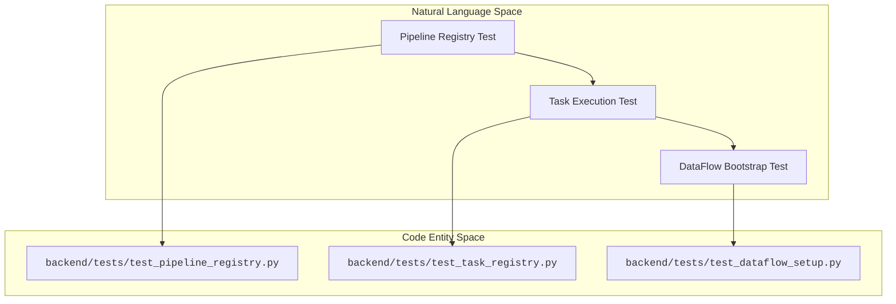
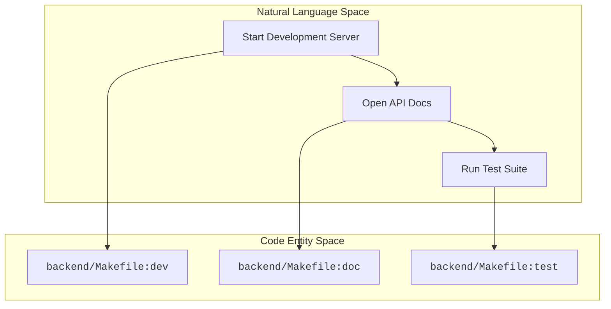
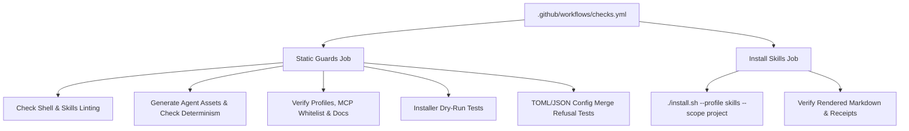

<!-- source: DeepWiki mcp.deepwiki.com · repo OpenDCAI/DataFlow-WebUI · page 9.2 Testing and CI · fetched 2026-11-02 -->

# Testing and CI

<details>
<summary>Relevant source files</summary>

The following files were used as context for generating this wiki page:

- [.github/workflows/checks.yml](.github/workflows/checks.yml)
- [backend/Makefile](backend/Makefile)
- [backend/app/api/v1/envelope.py](backend/app/api/v1/envelope.py)
- [backend/app/api/v1/errors.py](backend/app/api/v1/errors.py)
- [backend/app/api/v1/handlers.py](backend/app/api/v1/handlers.py)
- [backend/app/api/v1/resp.py](backend/app/api/v1/resp.py)
- [backend/app/core/dataflow_setup.py](backend/app/core/dataflow_setup.py)
- [backend/pytest.ini](backend/pytest.ini)
- [backend/requirements-dev.txt](backend/requirements-dev.txt)
- [backend/tests/test_dataflow_setup.py](backend/tests/test_dataflow_setup.py)
- [backend/tests/test_pipeline_registry.py](backend/tests/test_pipeline_registry.py)
- [backend/tests/test_task_registry.py](backend/tests/test_task_registry.py)
- [frontend/src/components/manage/mainFlow/panels/piplinePanel.vue](frontend/src/components/manage/mainFlow/panels/piplinePanel.vue)
- [frontend/src/js/i18n.js](frontend/src/js/i18n.js)
- [frontend/src/views/client/home/index.vue](frontend/src/views/client/home/index.vue)

</details>


The testing and continuous integration (CI) architecture of DataFlow-WebUI combines a robust `pytest`-based backend validation suite with a strict GitHub Actions workflow (`checks.yml`). This framework enforces static guards, schema validation, skill/manifest consistency, profile rendering assertions, and backend logic correctness across the stack before code is merged or released.

---

## 1. Backend Pytest Suite

The backend testing environment relies on `pytest` and `pytest-asyncio` as declared in `backend/requirements-dev.txt` [backend/requirements-dev.txt:1-4](). Tests focus heavily on isolated contract validation for core registries (`PipelineRegistry`, `TaskRegistry`), bootstrap utilities (`dataflow_setup`), and state handlers.

### Test Architecture and Fixtures
Backend tests use custom pytest fixtures to mock container dependencies and establish temporary state directories. For instance, contract tests in `backend/tests/test_pipeline_registry.py` isolate the `PipelineRegistry` by stubbing container registries (like `_DatasetRegistry`) and using `tmp_path` for isolated JSON persistence [backend/tests/test_pipeline_registry.py:25-42]():

```python
@pytest.fixture
def pipeline_registry(tmp_path):
    original_dataset_registry = container.dataset_registry
    original_operator_registry = container.operator_registry
    original_serving_registry = container.serving_registry
    container.dataset_registry = _DatasetRegistry()
    container.operator_registry = SimpleNamespace(get_op_details=lambda *_args, **_kwargs: None)
    container.serving_registry = None

    registry_path = tmp_path / "pipelines.json"
    try:
        registry = PipelineRegistry(path=str(registry_path))
        yield registry, registry_path
    finally:
        container.dataset_registry = original_dataset_registry
        container.operator_registry = original_operator_registry
        container.serving_registry = original_serving_registry
```

### Key Test Modules
- **`test_pipeline_registry.py`**: Verifies pipeline CRUD operations, schema validation, dataset reference checking, and name normalization/rejection rules [backend/tests/test_pipeline_registry.py:57-133]().
- **`test_task_registry.py`**: Validates task state transitions (`pending` -> `running` -> `success` / `failed`), execution snapshot tracking, and statistical aggregations [backend/tests/test_task_registry.py:16-174]().
- **`test_dataflow_setup.py`**: Tests core directory bootstrap logic, checking that `dataflow_core_ready` correctly inspects required directories (`api_pipelines`, `example_data`), and verifying fallback behaviour if CLI initialization fails [backend/tests/test_dataflow_setup.py:22-78]().



*Sources: [backend/requirements-dev.txt:1-4](), [backend/tests/test_pipeline_registry.py:25-133](), [backend/tests/test_task_registry.py:16-174](), [backend/tests/test_dataflow_setup.py:22-78]()*

---

## 2. Backend Makefile Targets

The backend provides a lightweight `Makefile` in the `backend/` directory to standardize common developer actions such as serving and testing [backend/Makefile:1-12]().

| Target | Command | Description |
| :--- | :--- | :--- |
| `dev` | `uvicorn app.main:app --reload --port 8000 --reload-dir app --host=0.0.0.0` | Starts the FastAPI backend development server with hot-reloading enabled [backend/Makefile:3-4](). |
| `doc` | Opens browser to `http://0.0.0.0:8000/docs` | Triggers a python utility to launch the interactive Swagger API documentation in the default web browser [backend/Makefile:8-10](). |
| `test` | `pytest -q` | Executes the backend test suite quietly using `pytest` [backend/Makefile:12-12](). |



*Sources: [backend/Makefile:1-12]()*

---

## 3. GitHub Actions Checks Workflow

The continuous integration pipeline defined in `.github/workflows/checks.yml` acts as the primary gatekeeper for code quality, structural integrity, and asset generation[.github/workflows/checks.yml:1-166](). It is divided into two primary jobs: `static` guards and `install-skills` integration checks [.github/workflows/checks.yml:16-133]().

### Static Guards Job
The `static` job runs on `ubuntu-latest` with Python 3.10 and executes a comprehensive sequence of safety verifications:
1. **Shell Syntax and Linting**: Installs `shellcheck` and validates shell scripts via `installers/checks/check_shell.sh` [.github/workflows/checks.yml:26-36]().
2. **Skill Linting**: Validates manifests, frontmatter, links, and directives in agent skills using `installers/checks/check_skills.py` [.github/workflows/checks.yml:38-39]().
3. **Asset Generation & Determinism**: Generates agent assets using `installers/generate_agent_assets.py` and asserts determinism by running with `--check` against a temporary directory [.github/workflows/checks.yml:44-48]().
4. **Route & Profile Consistency**: Verifies that MCP tool whitelists resolve to real backend routes (`check_mcp_whitelist.py`), profile manifests are self-consistent (`check_profiles.py`), and documentation links resolve (`check_docs.py`) [.github/workflows/checks.yml:50-57]().
5. **Installer Dry-Run**: Exercises `install.sh` with `--dry-run --pip` across all profiles (`webui`, `harness`, `skills`), asserting that no files are modified or written to `.dataflow-install` [.github/workflows/checks.yml:59-78]().
6. **Config Merge Assertions**: Verifies TOML and JSON configuration merge logic against invalid structures, command/stdio redirects, and duplicate table keys using modules like `installers/lib/codex_config.py` and `installers/lib/mcp_json_config.py` [.github/workflows/checks.yml:80-125]().

### Install Skills Profile Job
The `install-skills` job performs a real end-to-end installation of the `skills` profile at the project scope, asserting directory structure creation, correct profile-specific markdown rendering (e.g., ensuring MCP-only guidance is omitted when the MCP server is absent), and receipt generation (`.dataflow-install/receipt-*`) [.github/workflows/checks.yml:130-166]().



*Sources: [.github/workflows/checks.yml:1-166]()*

---

