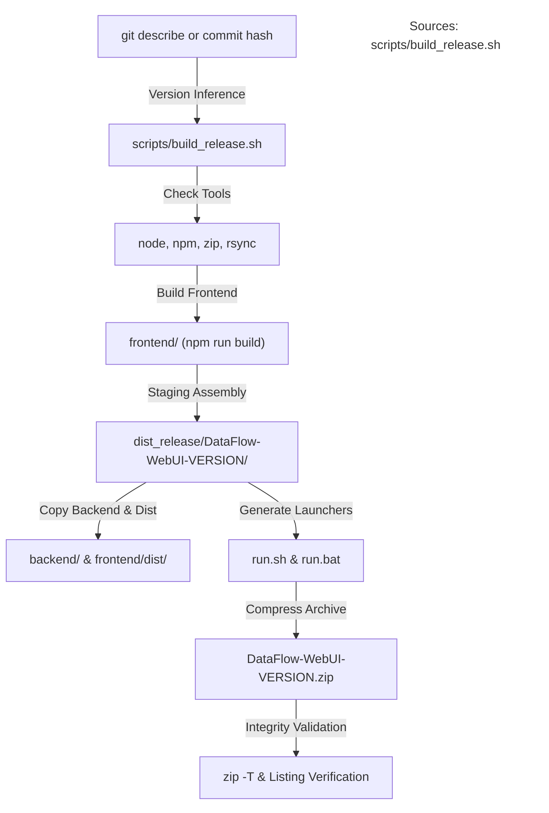
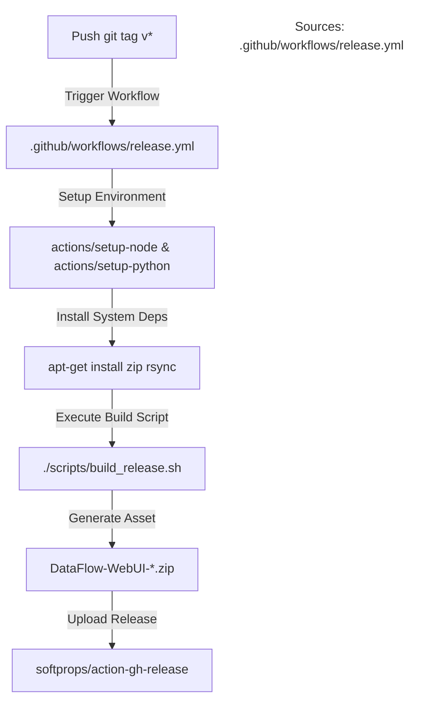
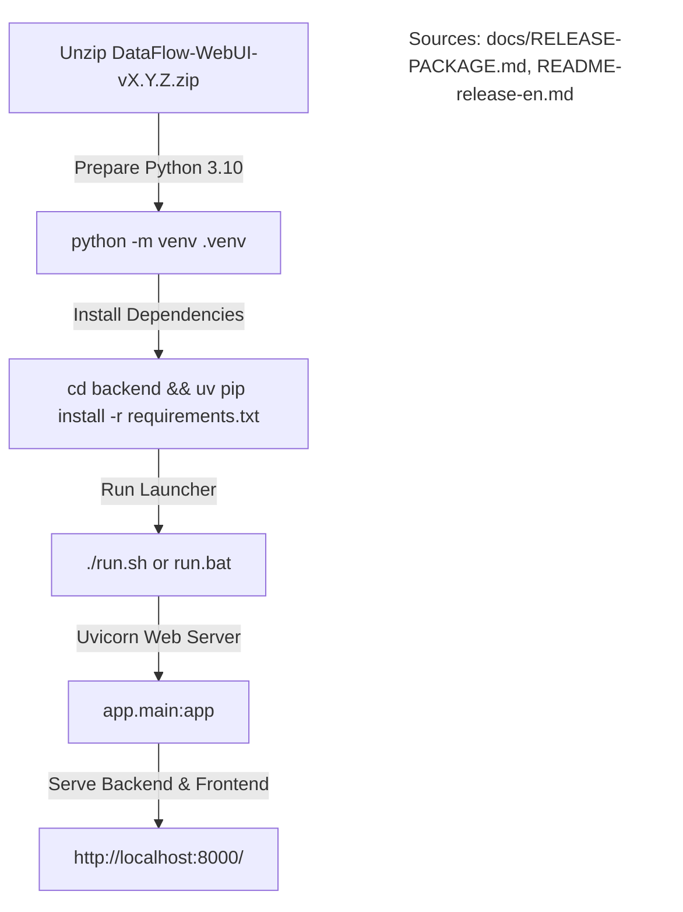
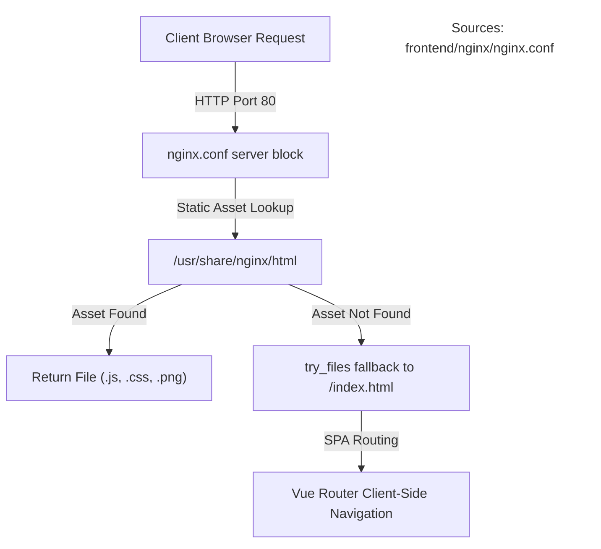

<!-- source: DeepWiki mcp.deepwiki.com · repo OpenDCAI/DataFlow-WebUI · page 9.3 Release and Deployment · fetched 2026-11-02 -->

# Release and Deployment

Relevant source files

The following files were used as context for generating this wiki page:

- [.github/workflows/release.yml](.github/workflows/release.yml)
- [.gitignore](.gitignore)
- [README-release-en.md](README-release-en.md)
- [README-release-zh.md](README-release-zh.md)
- [backend/tests/test_dataset_registry.py](backend/tests/test_dataset_registry.py)
- [backend/tests/test_text2sql_database_api.py](backend/tests/test_text2sql_database_api.py)
- [docs/RELEASE-PACKAGE.md](docs/RELEASE-PACKAGE.md)
- [frontend/.eslintrc.cjs](frontend/.eslintrc.cjs)
- [frontend/.gitignore](frontend/.gitignore)
- [frontend/.prettierrc.json](frontend/.prettierrc.json)
- [frontend/.vscode/extensions.json](frontend/.vscode/extensions.json)
- [frontend/Dockerfile](frontend/Dockerfile)
- [frontend/docker-compose.yml](frontend/docker-compose.yml)
- [frontend/global.d.ts](frontend/global.d.ts)
- [frontend/index.html](frontend/index.html)
- [frontend/jsconfig.json](frontend/jsconfig.json)
- [frontend/nginx/nginx.conf](frontend/nginx/nginx.conf)
- [scripts/build_release.sh](scripts/build_release.sh)

## Purpose and Scope
This page documents the release packaging mechanisms, continuous integration workflows, release user guidance, and containerized deployment configurations for DataFlow-WebUI. It covers the script `scripts/build_release.sh`, the GitHub Actions release workflow, release package execution semantics, and frontend Nginx deployment patterns.

---

## 1. Release Build Script (`scripts/build_release.sh`)
The release packaging pipeline is fully automated via `scripts/build_release.sh` [scripts/build_release.sh:1-181](). It infers the version string, validates required host tools, compiles the Vue frontend, assembles the staging directory, generates cross-platform launcher scripts, creates a compressed ZIP archive, and performs rigorous archive integrity checks.

*Sources: `scripts/build_release.sh` [scripts/build_release.sh:1-182]*

### Implementation Details
- **Version Inference**: If an explicit version argument is omitted, the script attempts to resolve a git tag via `git describe --tags --exact-match`. If no tag matches, it falls back to a development hash `dev-<short-sha>` [scripts/build_release.sh:17-24]().
- **Dependency Checks**: It verifies the presence of `node`, `npm`, `zip`, and `rsync` in the system path, failing early if any tool is missing [scripts/build_release.sh:32-37]().
- **Frontend Build**: It navigates to the `frontend/` directory, installs dependencies via `npm ci` or `npm install --no-package-lock`, and executes `npm run build` to output static assets into `frontend/dist/` [scripts/build_release.sh:42-60]().
- **Staging Assembly**: It copies backend source files while excluding development artifacts (`__pycache__`, `.venv`, `.pytest_cache`, `tests`, `cache_local`) using `rsync`, and packages only the compiled `frontend/dist/` assets [scripts/build_release.sh:65-80]().
- **Launcher Generation**: It programmatically writes `run.sh` and `run.bat` scripts to the package root. To protect against accidental remote code execution given the lack of authentication, these scripts default to binding `127.0.0.1` unless `DATAFLOW_HOST` is explicitly overridden [scripts/build_release.sh:96-141]().
- **Archive Validation**: It tests archive integrity using `zip -T` and cross-references the ZIP file contents against a mandatory manifest (`run.sh`, `run.bat`, `docs/RELEASE-PACKAGE.md`, `backend/app/main.py`, `frontend/dist/index.html`) [scripts/build_release.sh:148-180]().

*Sources: `scripts/build_release.sh` [scripts/build_release.sh:1-182]*

---

## 2. CI/CD Release Automation
Automated releases are orchestrated via the GitHub Actions workflow defined in `.github/workflows/release.yml` [.github/workflows/release.yml:1-44]().

*Sources: `.github/workflows/release.yml` [.github/workflows/release.yml:1-45]*

### Workflow Configuration
- **Triggers**: The pipeline executes exclusively when a tag matching the glob `v*` is pushed to the repository [.github/workflows/release.yml:4-6]().
- **Environment Setup**: It provisions Node.js version `20` and Python version `3.10` [.github/workflows/release.yml:19-28]().
- **System Dependencies**: It updates package lists and installs `zip` and `rsync` on the runner VM [.github/workflows/release.yml:29-33]().
- **Packaging and Publishing**: It invokes `scripts/build_release.sh` with the GitHub reference name and publishes the resulting ZIP archive to GitHub Releases via `softprops/action-gh-release` [.github/workflows/release.yml:34-44]().

*Sources: `.github/workflows/release.yml` [.github/workflows/release.yml:1-45]*

---

## 3. Release Package Structure and Execution
Users who download precompiled release packages rather than cloning the source repository follow instructions provided in `docs/RELEASE-PACKAGE.md` [docs/RELEASE-PACKAGE.md:1-150](), `README-release-en.md` [README-release-en.md:1-37](), and `README-release-zh.md` [README-release-zh.md:1-32]().

*Sources: `docs/RELEASE-PACKAGE.md` [docs/RELEASE-PACKAGE.md:1-150](), `README-release-en.md` [README-release-en.md:1-38]*

### Operational Guidelines
- **Python Runtime**: Requires Python `3.10` inside an isolated environment (`venv` or `conda`) [README-release-en.md:6-17]().
- **Dependency Management**: Dependencies are installed via `uv pip install -r requirements.txt` (or fallback `pip`). The requirements pin `setuptools<82` for legacy `pkg_resources` compatibility and `mcp<2` for `fastapi-mcp` v1 API compatibility [README-release-en.md:20-31]().
- **Startup Execution**: Running `./run.sh` or `run.bat` switches to the `backend/` directory and invokes `uvicorn app.main:app` [scripts/build_release.sh:117-118](), serving both REST/WebSocket APIs and the prebuilt static Single Page Application (SPA).
- **Agent Integration**: Manual MCP configuration files (such as `.mcp.json` or `~/.codex/config.toml`) must be created by the user to connect external coding agents via Server-Sent Events (SSE) at `http://localhost:8000/mcp` [docs/RELEASE-PACKAGE.md:54-74]().

*Sources: `docs/RELEASE-PACKAGE.md` [docs/RELEASE-PACKAGE.md:1-150](), `README-release-en.md` [README-release-en.md:1-37](), `scripts/build_release.sh` [scripts/build_release.sh:117-118]*

---

## 4. Docker and Nginx Frontend Deployment
For containerized or decoupled frontend deployments, the Vue SPA is built and served via Nginx using the configuration defined in `frontend/nginx/nginx.conf` [frontend/nginx/nginx.conf:1-11]().

*Sources: `frontend/nginx/nginx.conf` [frontend/nginx/nginx.conf:1-11]*

### Nginx Configuration Specifications
- **Server Block**: Listens on port `80` with a catch-all `server_name _` [frontend/nginx/nginx.conf:2-3]().
- **Root Directory**: Serves static files from `/usr/share/nginx/html` [frontend/nginx/nginx.conf:6]().
- **SPA Routing Fallback**: Uses `try_files $uri $uri/ /index.html;` to ensure client-side Vue Router paths correctly resolve to the SPA entry point [frontend/nginx/nginx.conf:7]().
- **CORS Headers**: Attaches `add_header Access-Control-Allow-Origin *;` to permit cross-origin resource access during decoupled API communication [frontend/nginx/nginx.conf:9]().

*Sources: `frontend/nginx/nginx.conf` [frontend/nginx/nginx.conf:1-11]*

---

## 5. Security Model and Binding Safeguards
DataFlow-WebUI enforces strict binding defaults in release packages due to its architectural security profile:
- **Authentication**: The platform enforces **no authentication** layer [README-release-en.md:35]().
- **Execution Risk**: Pipeline execution utilizes Ray to execute arbitrary Python code, making it equivalent to remote code execution [README-release-en.md:35]().
- **Binding Policy**: Launchers (`run.sh` / `run.bat`) default to binding `127.0.0.1` [scripts/build_release.sh:108](). If a user explicitly configures `DATAFLOW_HOST=0.0.0.0`, the server emits a security warning highlighting the unauthenticated arbitrary execution risk [scripts/build_release.sh:111-114]().

*Sources: `scripts/build_release.sh` [scripts/build_release.sh:98-114](), `README-release-en.md` [README-release-en.md:35-37]*

---

