# Page: Overview

# Overview

<details>
<summary>Relevant source files</summary>

The following files were used as context for generating this wiki page:

- [README.md](README.md)
- [README_zh.md](README_zh.md)
- [backend/app/api/v1/endpoints/datasets.py](backend/app/api/v1/endpoints/datasets.py)
- [backend/app/main.py](backend/app/main.py)
- [backend/app/schemas/dataset.py](backend/app/schemas/dataset.py)
- [backend/app/services/dataset_registry.py](backend/app/services/dataset_registry.py)
- [docs/architecture/overview.md](docs/architecture/overview.md)

</details>


DataFlow-WebUI (also referred to as **DataFlow-Harness**) is a full-stack platform combining a visual WebUI canvas, a Model Context Protocol (MCP) server, and agent-facing skills to build, run, and manage AI/ML data processing pipelines powered by the upstream `open-dataflow` framework [README.md:1-18]().

For detailed technical sub-topics, refer to the child pages:
- **Architecture Overview**: See [Architecture Overview](#1.1) for details on the Vue.js frontend (`frontend/`), FastAPI backend (`backend/app/main.py`), MCP server (`backend/app/mcp_server.py`), and agent skills layer (`skills/canonical/`) [docs/architecture/overview.md:1-25]().
- **Getting Started**: See [Getting Started](#1.2) for installation via `install.sh` profiles, prerequisites, and startup scripts (`scripts/start.sh`) [README.md:65-139]().
- **Configuration**: See [Configuration](#1.3) for the `Settings` class (`backend/app/core/config.py`), environment variables, and registry file paths [docs/architecture/overview.md:52-62]().

Sources: [README.md:1-22](), [backend/app/main.py:1-49](), [docs/architecture/overview.md:1-25]()

## Purpose and Deployment Profiles

The platform ships three independent deployment profiles (`webui`, `harness`, `skills`) defined in `installers/profiles/` to support visual canvas users, headless terminal agents, and pure skill rendering [README.md:19-38]():

| Profile | Description | Components Installed | Server Port |
|---|---|---|---|
| `webui` | Visual DAG canvas + backend + MCP | Python packages (`uv` / pip) + Node.js 20+ frontend (`frontend/dist`) | 8000 (`backend/app/main.py`) |
| `harness` | Backend + MCP, no browser UI | Python packages via `uv`, headless API & MCP server | 8000 (`backend/app/main.py`) |
| `skills` | Agent skills only | No package installation required (Python 3.9+ for skill generation) | None |

Sources: [README.md:26-38](), [backend/app/main.py:17-48]()

## System Architecture

The platform architecture bridges human visual interaction and AI coding agents to execution engines (`open-dataflow`) through a layered FastAPI application structure and MCP protocol handlers [docs/architecture/overview.md:1-24]().

### Component Boundaries and Code Entities

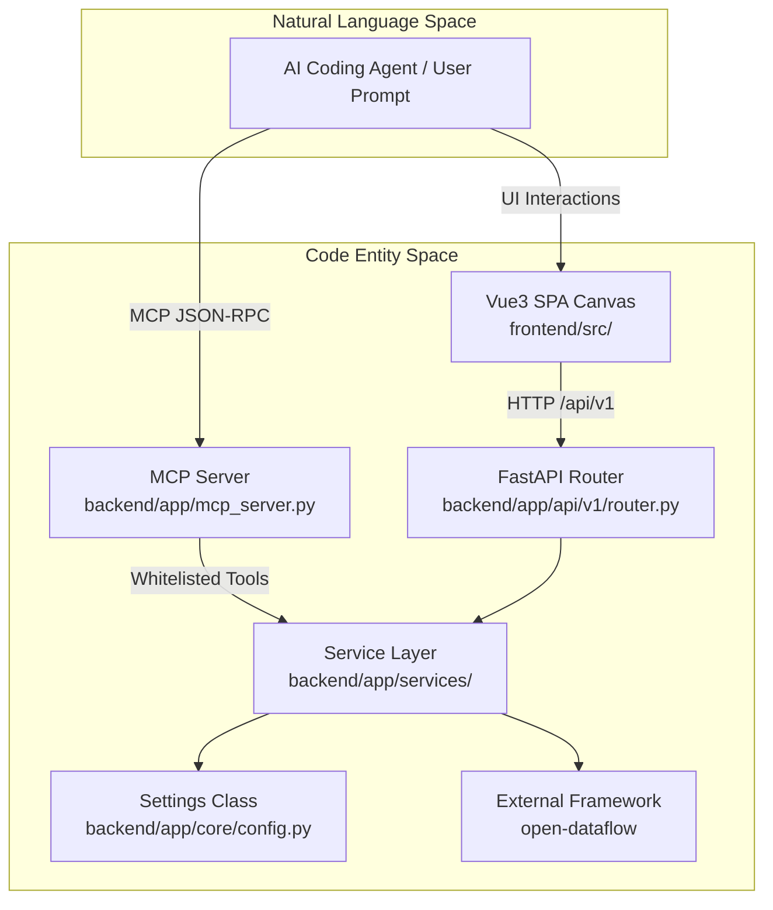

**Figure 1: Bridging Natural Language to Code Entities**

Sources: [backend/app/main.py:1-48](), [docs/architecture/overview.md:1-35]()

### Data Flow and Registry Architecture

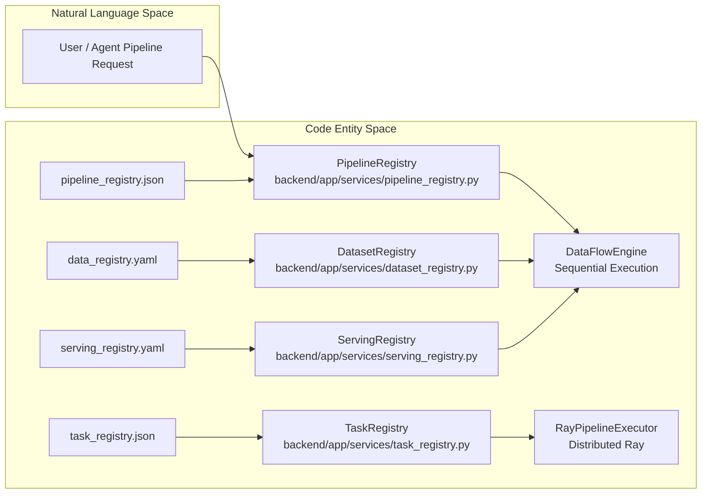

**Figure 2: Registry and Execution Architecture**

Sources: [backend/app/services/dataset_registry.py:59-112](), [backend/app/core/config.py:18-31]()

## Summary of Child Pages

- **1.1 Architecture Overview**: Details the communication between Vue.js frontend, FastAPI backend (`backend/app/main.py`), MCP server, and agent skills layer, alongside the `webui`/`harness`/`skills` profile splits [docs/architecture/overview.md:1-25]().
- **1.2 Getting Started**: Covers prerequisites, installation using `install.sh`, environment activation, and `scripts/start.sh` execution [README.md:65-139]().
- **1.3 Configuration**: Explains the `Settings` class (`backend/app/core/config.py`), environment variable overrides, and file-based registry directories [docs/architecture/overview.md:52-62]().

Sources: [README.md:65-148](), [backend/app/main.py:1-49](), [docs/architecture/overview.md:1-62]()

---

# Page: Architecture Overview

# Architecture Overview

<details>
<summary>Relevant source files</summary>

The following files were used as context for generating this wiki page:

- [README.md](README.md)
- [README_zh.md](README_zh.md)
- [backend/app/api/v1/endpoints/datasets.py](backend/app/api/v1/endpoints/datasets.py)
- [backend/app/api/v1/endpoints/preferences.py](backend/app/api/v1/endpoints/preferences.py)
- [backend/app/api/v1/router.py](backend/app/api/v1/router.py)
- [backend/app/core/logger_setup.py](backend/app/core/logger_setup.py)
- [backend/app/main.py](backend/app/main.py)
- [backend/app/schemas/dataset.py](backend/app/schemas/dataset.py)
- [backend/app/schemas/preferences.py](backend/app/schemas/preferences.py)
- [backend/app/services/dataset_registry.py](backend/app/services/dataset_registry.py)
- [docs/architecture/overview.md](docs/architecture/overview.md)

</details>


## Purpose and Scope

This document provides a comprehensive overview of the DataFlow-Harness and DataFlow-WebUI system architecture, explaining how the frontend (`Vue.js`), backend (`FastAPI`), Model Context Protocol (`MCP`) server, and agent skills layer interact. It details the layered design (API endpoints, service layer, registry/storage layer) and the deployment profile split (`webui`, `harness`, `skills`).

For detailed configuration information, see [Configuration](#1.3). For core concepts like pipelines and operators, see [Core Concepts](#2). For API endpoint specifications, see [API Reference](#5).

Sources: [README.md:1-45](), [docs/architecture/overview.md:1-28]()

---

## Deployment Profiles: WebUI, Harness, and Skills

The codebase ships with three independent installation and runtime profiles. They share the same underlying backend and canonical skill sources but target different operational boundaries:

| Profile | Components Included | Runtime Requirements | Primary Use Case |
|---|---|---|---|
| `webui` | Visual DAG canvas (`frontend/`), FastAPI backend (`backend/`), MCP server (`backend/app/mcp_server.py`) | Python 3.10+, Node.js 20+, `uv` or `pip` | Full-stack visual pipeline authoring in a browser. |
| `harness` | FastAPI backend, MCP server, agent skills layer (no browser UI) | Python 3.10+ | Headless execution, agent-driven automation via terminal or IDE. |
| `skills` | Agent skills layer only (no server, no package installation) | Python 3.9+ (for generating skill files) | Pure agent instruction rendering without running a background server. |

Dependency direction is strictly one-way: `frontend → backend → open-dataflow`. Skills depend on nothing at build time; at runtime, MCP-aware skills interact with the FastAPI backend and its registered tools.

Sources: [README.md:19-36](), [docs/architecture/overview.md:5-28]()

---

## System Overview and Code Entity Mapping

The following diagram bridges the Natural Language Space (system layers) to the Code Entity Space (actual files and classes), illustrating how components communicate across HTTP REST, JSON-RPC (`/mcp`), and local module imports.

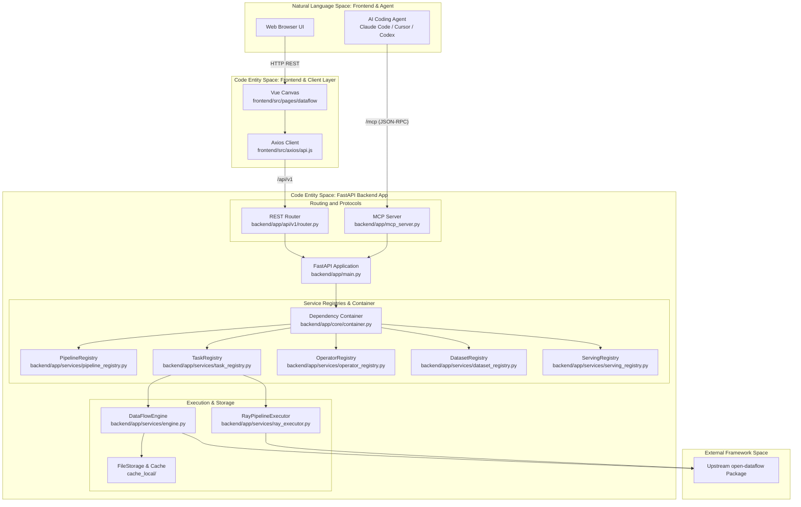

Sources: [backend/app/main.py:1-48](), [backend/app/api/v1/router.py:1-28](), [docs/architecture/overview.md:1-24]()

---

## Layered Backend Architecture

The backend follows a **three-tier layered service architecture** running under FastAPI (`backend/app/main.py`):

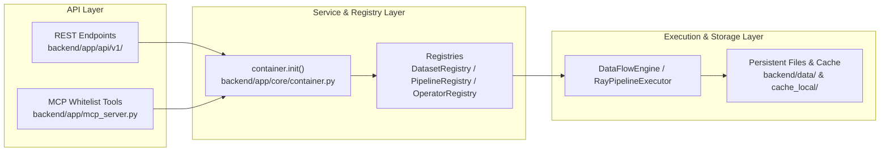

### 1. API and Protocol Endpoints Layer
- **REST API (`/api/v1`)**: Exposes standardized endpoints for pipelines, tasks, operators, datasets, servings, prompts, preferences, and database managers via `backend/app/api/v1/router.py` [backend/app/api/v1/router.py:1-28](). Responses adhere to the `ApiResponse` envelope schema.
- **MCP Server (`/mcp`)**: Mounted directly onto the FastAPI application before static asset catch-alls [backend/app/main.py:40-41](). It exposes a curated whitelist of JSON-RPC tools (`operation_id` mapped) that allow AI coding agents to inspect the operator catalog, validate pipelines, and commit changes [docs/architecture/overview.md:31-44]().

### 2. Service and Registry Layer
Managed centrally via `backend/app/core/container.py`, the service layer coordinates metadata operations:
- `PipelineRegistry`: Manages pipeline persistence and AST parsing via `PipelineFileAnalyzer`.
- `TaskRegistry`: Tracks execution state, logs, and process results [docs/architecture/overview.md:14]().
- `OperatorRegistry`: Discovers upstream operators and caches metadata (`ops.json`) [backend/main.py:61-68]().
- `DatasetRegistry`: Handles dataset registration, file scanning (`example_data/`), and format previews [backend/app/services/dataset_registry.py:59-112]().
- `ServingRegistry`: Manages LLM and embedding serving instances [docs/architecture/overview.md:14]().

### 3. Execution and Storage Layer
- `DataFlowEngine`: Orchestrates operator parameter decoding, prompt resolution, and sequential stepping.
- `RayPipelineExecutor`: Coordinates distributed or asynchronous task execution.
- **File-based Storage**: Persists state as JSON/YAML files under `backend/data/` and execution steps under `cache_local/` [docs/architecture/overview.md:54-62]().

Sources: [backend/app/main.py:1-48](), [backend/app/api/v1/router.py:1-28](), [backend/app/services/dataset_registry.py:59-112](), [docs/architecture/overview.md:1-50]()

---

## Frontend Application Architecture

The frontend is a Vue.js 3 Single Page Application (SPA) utilizing Vue Flow for visual canvas rendering.

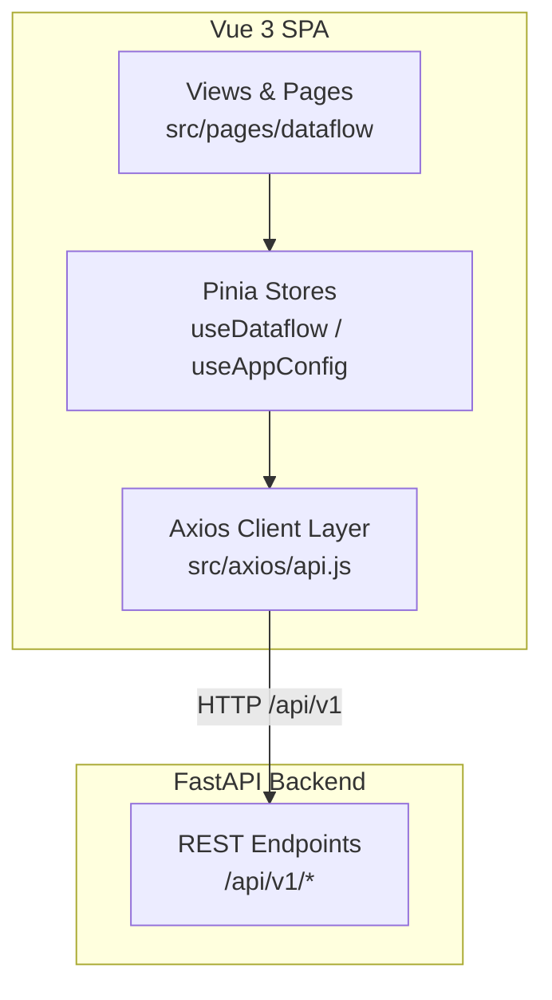

- **Communication Rule**: The frontend talks to the backend exclusively over `/api/v1` via Axios. It never directly accesses Python modules or upstream `open-dataflow` internals [docs/architecture/overview.md:31-33]().
- **State Management**: Pinia stores (`useDataflow`, `useTheme`, `useAppConfig`) maintain reactive UI states, pipeline graph configurations, and user preferences.

Sources: [frontend/src/axios/api.js:1-50](), [docs/architecture/overview.md:31-35]()

---

## Configuration and Storage Ownership

System configuration and data persistence are cleanly separated across distinct ownership boundaries:

| Configuration / Data Category | Location Path | Description |
|---|---|---|
| Install-time settings & ports | `installers/config.sh` | Shell-based installer configuration [docs/architecture/overview.md:56](). |
| Backend runtime paths | `backend/app/core/config.py` | Defines `DATA_REGISTRY`, `TASK_REGISTRY`, `PIPELINE_REGISTRY`, `CACHE_DIR` [docs/architecture/overview.md:57](). |
| Project Agent Configuration | `.mcp.json`, `.cursor/`, `.codex/` | Project-level agent settings generated by `configure-agent` [docs/architecture/overview.md:58](). |
| Runtime Storage Data | `backend/data/`, `cache_local/` | Git-ignored persistent JSON/YAML records and step outputs [docs/architecture/overview.md:61](). |

Sources: [backend/app/core/config.py:1-35](), [docs/architecture/overview.md:52-62]()

---

# Page: Getting Started

# Getting Started

<details>
<summary>Relevant source files</summary>

The following files were used as context for generating this wiki page:

- [backend/README.md](backend/README.md)
- [backend/requirements.txt](backend/requirements.txt)
- [docs/profiles/harness.md](docs/profiles/harness.md)
- [frontend/README.md](frontend/README.md)
- [frontend/docs/README_zh.md](frontend/docs/README_zh.md)
- [frontend/docs/assets/logo.png](frontend/docs/assets/logo.png)
- [install.sh](install.sh)
- [installers/lib/common.sh](installers/lib/common.sh)
- [installers/profiles/harness.json](installers/profiles/harness.json)
- [installers/profiles/webui.json](installers/profiles/webui.json)
- [scripts/start.sh](scripts/start.sh)

</details>


## Purpose and Scope

This document provides technical instructions for installing, configuring, and running DataFlow-WebUI and DataFlow-Harness using the unified installation script (`install.sh`) with profile-based configurations (`harness`, `webui`, and `skills`) [install.sh:1-12] [installers/profiles/harness.json:1-10] [installers/profiles/webui.json:1-14]. It covers prerequisite validation, boundary snapshotting, backend startup via `scripts/start.sh`, frontend development servers, and a walkthrough for executing an initial data processing pipeline.

For system architecture details, see [Architecture Overview](#1.1). For runtime settings and environment variables, see [Configuration](#1.3).

---

## Installation via `install.sh` Profiles

The system uses a profile-driven installation model managed by `install.sh` and JSON manifests located in `installers/profiles/` [install.sh:1-16]. Depending on your requirements, you can install the complete WebUI stack or the backend-only harness.

### Profile Taxonomy

| Profile ID | Description | Installs | Does Not Install |
|------------|-------------|----------|------------------|
| `webui` | Full Visual DAG canvas + backend + MCP + skills | Python packages, open-dataflow, Node.js dependencies, frontend build artifacts (`frontend/dist/`), core data directory | Agent MCP configuration (handled separately via `configure-agent`) [installers/profiles/webui.json:1-18] |
| `harness` | Backend FastAPI + MCP server + validation + skills | Python packages, open-dataflow, core data directory, harness skills | Node.js, npm, frontend dependencies, or frontend build artifacts [installers/profiles/harness.json:1-21] |
| `skills` | Standalone agent skills only | Standalone agent workflow skills | Python packages, FastAPI server, or Node.js dependencies [install.sh:39-43] |

### Installation Execution Flow

The following diagram bridges the natural language installation command to the underlying shell functions and profile manifest JSON definitions in `installers/profiles/`:

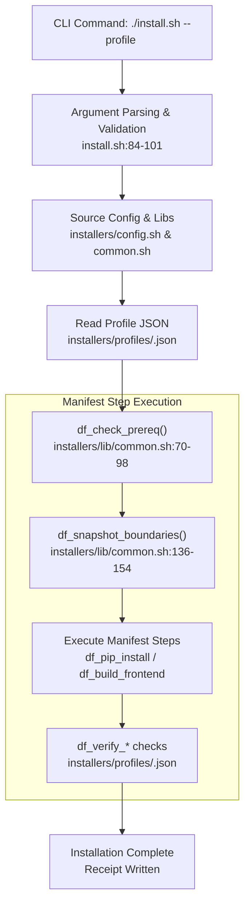

**Sources:** [install.sh:1-101](), [installers/lib/common.sh:70-154](), [installers/profiles/harness.json:1-114](), [installers/profiles/webui.json:1-132]()

---

## Prerequisites

Before running the installer, verify that your target environment satisfies the required runtime dependencies:

| Prerequisite | Minimum Version | Verified By Check Command | Purpose |
|--------------|----------------|---------------------------|---------|
| **Python** | 3.10+ | `$DF_PYTHON --version` | Backend runtime & `open-dataflow` execution [installers/profiles/harness.json:25-32] |
| **Node.js** | 20+ | `node -v` | Required only for `webui` profile to build frontend assets [installers/profiles/webui.json:30-34] |
| **npm** | Latest | `npm -v` | Frontend dependency installation [installers/profiles/webui.json:36-39] |
| **uv / pip** | Latest | `uv --version` or `pip --version` | Python package manager (`uv` used by default) [install.sh:91-92] |

To install the harness profile on a machine without Node.js:
```bash
./install.sh --profile harness
```

To install the full webui profile:
```bash
./install.sh --profile webui
```

**Sources:** [backend/README.md:1-29](), [docs/profiles/harness.md:20-33](), [installers/profiles/harness.json:25-32](), [installers/profiles/webui.json:22-40]()

---

## Running Backend and Frontend Servers

### Backend Server Execution (`scripts/start.sh`)

The backend FastAPI server and MCP endpoint are managed via `scripts/start.sh`, which performs pre-flight import checks and manages daemon processes [scripts/start.sh:1-60].

```bash
# Start backend in foreground (Ctrl+C to stop)
./scripts/start.sh

# Start backend as a background daemon (PID written to .backend.pid)
./scripts/start.sh --daemon

# Check status or stop daemon
./scripts/start.sh --status
./scripts/start.sh --stop
```

The pre-flight check in `scripts/start.sh` attempts to import `app.main` using the designated Python interpreter (`$DF_PYTHON`) inside the `backend/` directory [scripts/start.sh:41-52]:

```bash
if ! ( cd "$BACKEND_DIR" && "$DF_PYTHON" -c "import app.main" ) >/dev/null 2>&1; then
  err "Cannot import app.main with '$DF_PYTHON'. Run ./install.sh --profile harness first."
  exit 1
fi
```

### Frontend Development Server

If you are developing frontend components under `frontend/src/`, you can run the Vite development server with hot-reloading:

```bash
cd frontend
npm install
npm run dev
```

The development server proxies API requests to the backend server running on port `8000` as configured in `frontend/vite.config.js` [frontend/README.md:113-136].

### Server Architecture & Startup Flow

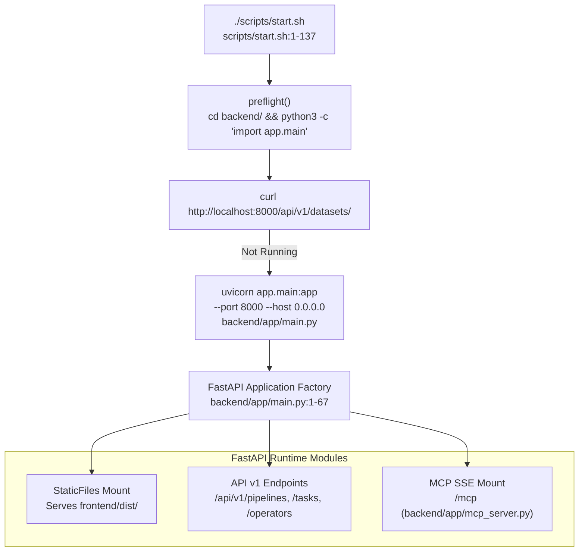

**Sources:** [backend/README.md:35-55](), [frontend/README.md:113-158](), [scripts/start.sh:1-136](), [backend/app/main.py:1-69]()

---

## First Pipeline Walkthrough

Once the backend and frontend are running, you can create and execute your first data processing pipeline using either the WebUI canvas or the REST/MCP API.

### Walkthrough Steps

1. **Verify Operator Catalog**: Ensure the operator registry is initialized by querying the operator endpoints:
   ```bash
   curl -sf http://localhost:8000/api/v1/operators/categories
   ```
   *Expect categories such as `core_text`, `general_text`, and `reasoning` [docs/profiles/harness.md:105-116].*

2. **Access the Canvas**: Navigate to `http://localhost:8000/` in your browser [docs/profiles/harness.md:63].
3. **Create Pipeline**: Click **New Pipeline**, select an input dataset from `backend/data/` (or upload via `/api/v1/datasets/upload`), and drag processing operators onto the DAG canvas.
4. **Validate Pipeline**: Trigger static validation via `/api/v1/pipelines/validate`, which executes `PipelineFileAnalyzer` AST parsing and static checks [backend/README.md:3-4].
5. **Execute Task**: Run the pipeline asynchronously. Execution records, log streams, and operator progress are tracked via `TaskRegistry` and written to `backend/cache_local/` [docs/profiles/harness.md:72-74].

**Sources:** [backend/README.md:3-4](), [docs/profiles/harness.md:63-116](), [installers/profiles/webui.json:127-130]()

---

# Page: Configuration

# Configuration

<details>
<summary>Relevant source files</summary>

The following files were used as context for generating this wiki page:

- [backend/app/api/v1/endpoints/text2sql_database.py](backend/app/api/v1/endpoints/text2sql_database.py)
- [backend/app/core/config.py](backend/app/core/config.py)
- [backend/app/core/container.py](backend/app/core/container.py)
- [backend/app/schemas/text2sql_database.py](backend/app/schemas/text2sql_database.py)
- [backend/app/services/text2sql_database_registry.py](backend/app/services/text2sql_database_registry.py)
- [frontend/.env.production](frontend/.env.production)
- [frontend/src/assets/nav/dbManager.svg](frontend/src/assets/nav/dbManager.svg)
- [frontend/src/axios/config.js](frontend/src/axios/config.js)
- [frontend/src/components/manage/mainFlow/panels/datasetPanel/preview/dataInfo.vue](frontend/src/components/manage/mainFlow/panels/datasetPanel/preview/dataInfo.vue)

</details>


This page explains the configuration system in DataFlow-WebUI, focusing on the `Settings` class (`backend/app/core/config.py`), environment configuration, registry file locations, cache directories, the preset pipeline whitelist, dynamic DataFlow extensions, and frontend Axios and environment configuration.

For information about the overall system architecture and how configuration fits into the broader system, see [Architecture Overview](#1.1). For details on how registries use these configuration paths, see [Pipeline Registry](#3.1), [Dataset Management](#3.5), and [Serving Management](#3.6).

---

## Settings Class

The backend uses a centralized `Settings` class inheriting from Pydantic's `BaseSettings` to manage all operational parameters and file locations [backend/app/core/config.py:5-34](). This class is instantiated as a global singleton `settings` object available across the application [backend/app/core/config.py:58]().

```python
class Settings(BaseSettings):
    ENV: str = "dev"
    CORS_ORIGINS: list[str] = [...]
    BASE_DIR: str = ...
    # Registry paths, cache dirs, whitelists, extensions
```

Sources: [backend/app/core/config.py:5-58]()

---

## Core Configuration Fields

The `Settings` class defines foundational parameters controlling environment behavior and runtime constraints:

| Field | Type | Default | Description |
|-------|------|---------|-------------|
| `ENV` | `str` | `"dev"` | Environment mode (`dev` or `production`) |
| `CORS_ORIGINS` | `list[str]` | `[]` | Allowed Cross-Origin Resource Sharing domains |
| `BASE_DIR` | `str` | Computed | Project root directory computed from `__file__` |
| `DEFAULT_SERVING_FILLING` | `bool` | `True` | Auto-fill missing fields in serving instances |

The project root `BASE_DIR` is derived by traversing three parent directories upward from `backend/app/core/config.py`: [backend/app/core/config.py:19]()

```python
BASE_DIR: str = os.path.dirname(os.path.dirname(os.path.dirname(os.path.abspath(__file__))))
```

Sources: [backend/app/core/config.py:6-33]()

---

## Registry File Paths

The persistence layer relies on explicit file paths mapped in the `Settings` class:

### Registry Configuration Fields

| Field | Path | Format | Purpose |
|-------|------|--------|---------|
| `DATA_REGISTRY` | `data/data_registry.yaml` | YAML | Dataset metadata storage |
| `PIPELINE_REGISTRY` | `data/pipeline_registry.json` | JSON | Pipeline definitions and configurations |
| `TASK_REGISTRY` | `data/task_registry.json` | JSON | Execution records and task status tracking |
| `SERVING_REGISTRY` | `data/serving_registry.yaml` | YAML | LLM and embedding serving configurations |
| `TEXT2SQL_DATABASE_REGISTRY` | `data/text2sql_database_registry.yaml` | YAML | SQLite database registrations for Text2SQL |
| `TEXT2SQL_DATABASE_MANAGER_REGISTRY` | `data/text2sql_database_manager_registry.yaml` | YAML | `DatabaseManager` class parameter setups |

Sources: [backend/app/core/config.py:21-26]()

---

## Directory Paths and Cache Layouts

Transient caches, logs, and compiled assets are mapped to dedicated directories:

| Field | Path | Purpose |
|-------|------|---------|
| `DATAFLOW_CORE_DIR` | `data/dataflow_core` | Core dataflow component storage |
| `OPS_JSON_PATH` | `data/ops.json` | Cached operator metadata catalog |
| `PREFERENCES_PATH` | `data/user_preferences.json` | User preference persistence cache |
| `SQLITE_DB_DIR` | `data/text2sql_dbs` | Storage directory for SQLite database files |
| `CACHE_DIR` | `cache_local` | Intermediate step outputs for pipeline executions |

During pipeline execution under `CACHE_DIR`, subdirectories are created as `{task_id}_output/` containing step files such as `dataflow_cache_step_N.jsonl`.

Sources: [backend/app/core/config.py:27-31]()

---

## Preset Pipeline Whitelist

The `Settings` class maintains a set whitelist (`_PRESET_PIPELINE_NAME_WHITELIST`) that restricts which built-in pipeline templates are exposed in the frontend template list [backend/app/core/config.py:36-52](). Only pipelines matching these names (e.g., `"Agentic Rag Pipeline"`, `"Chemistry Smiles"`, `"Text2Sql Pipeline Gen"`) are surfaced to the user interface canvas selector.

Sources: [backend/app/core/config.py:36-52]()

---

## DataFlow Extensions

The configuration supports plugging in custom pipeline extensions via `_DATAFLOW_EXTENSIONS` [backend/app/core/config.py:53-56](). During container initialization (`AppContainer.init()`), the system iterates through this list and dynamically imports each module using `importlib.import_module(ext)` [backend/app/core/container.py:33-39]().

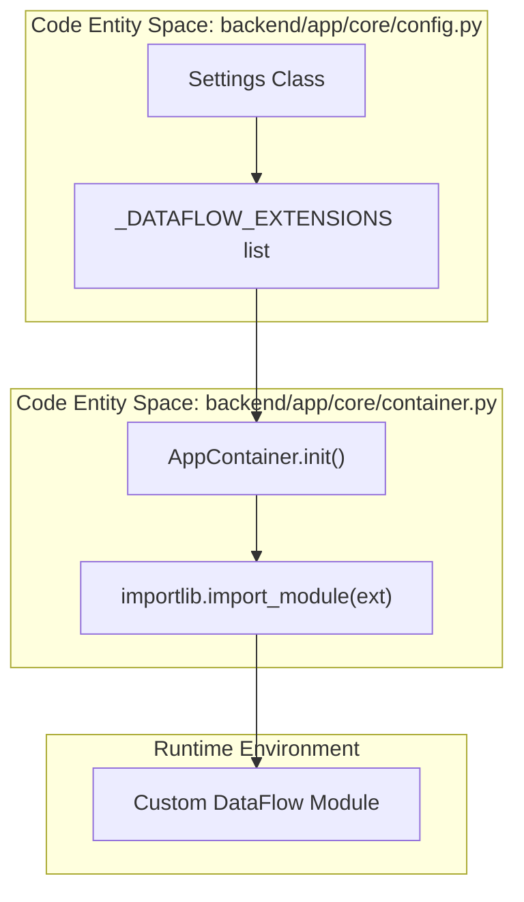

Sources: [backend/app/core/config.py:53-56](), [backend/app/core/container.py:33-39]()

---

## Configuration Hierarchy and Loading Flow

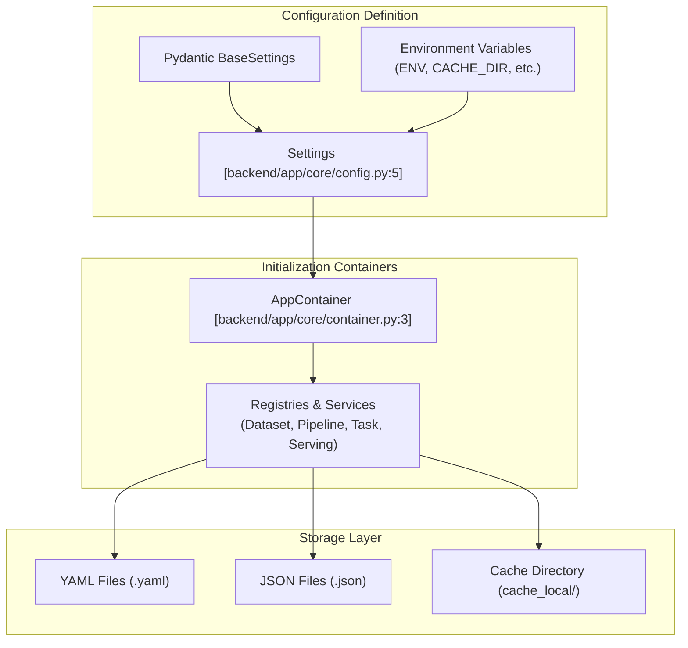

Sources: [backend/app/core/config.py:5-34](), [backend/app/core/container.py:3-56]()

---

## Frontend Axios and Environment Configuration

The Vue 3 frontend configures HTTP requests via an Axios instance located at `frontend/src/axios/config.js` [frontend/src/axios/config.js:1-39](). 

### Base URL and Proxy Resolution
In development mode, requests are intercepted or proxied via Vite (`baseURL = ''`). In production mode, `ax.defaults.baseURL` falls back to `import.meta.env.VITE_BACKEND_URL` (defaulting to `/` as defined in `frontend/.env.production`) [frontend/src/axios/config.js:8-12](), [frontend/.env.production:1]().

### Request Interceptors
The Axios instance includes a request interceptor that handles `x-www-form-urlencoded` and `multipart/form-data` payloads by translating object configurations into native `FormData` instances [frontend/src/axios/config.js:14-33]().

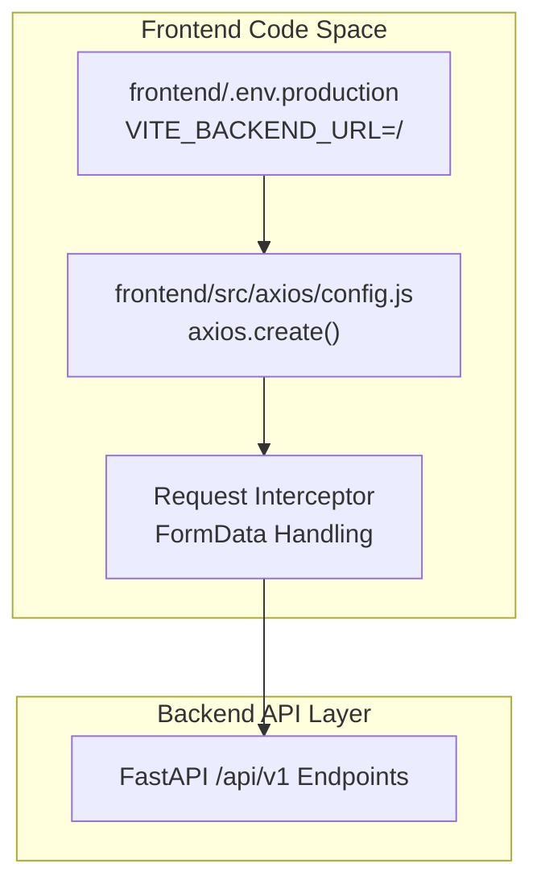

Sources: [frontend/src/axios/config.js:1-39](), [frontend/.env.production:1]()

---

## Customization and Best Practices

- **Environment Variables**: Pydantic's `BaseSettings` automatically absorbs matching environment variables (e.g., `export CACHE_DIR=/mnt/cache`).
- **Path Construction**: Always construct paths relative to `settings.BASE_DIR` using `os.path.join()` to guarantee cross-platform compatibility.
- **Singleton Import**: Import the pre-instantiated `settings` object directly from `app.core.config` rather than re-instantiating `Settings()`.

Sources: [backend/app/core/config.py:1-58]()

---

# Page: Core Concepts

# Core Concepts

<details>
<summary>Relevant source files</summary>

The following files were used as context for generating this wiki page:

- [backend/app/api/v1/endpoints/operators.py](backend/app/api/v1/endpoints/operators.py)
- [backend/app/api/v1/endpoints/pipelines.py](backend/app/api/v1/endpoints/pipelines.py)
- [backend/app/schemas/operator.py](backend/app/schemas/operator.py)
- [backend/app/schemas/pipelines.py](backend/app/schemas/pipelines.py)
- [backend/app/services/operator_registry.py](backend/app/services/operator_registry.py)
- [backend/app/services/pipeline_registry.py](backend/app/services/pipeline_registry.py)

</details>


This page defines the fundamental concepts and terminology used throughout DataFlow-WebUI: pipelines, operators, datasets, servings, prompts, and the execution model. As a parent overview, this page outlines how these entities interact, while detailed technical specifications are documented in the respective child pages.

The platform coordinates several core entities to build, validate, and execute data processing workflows.

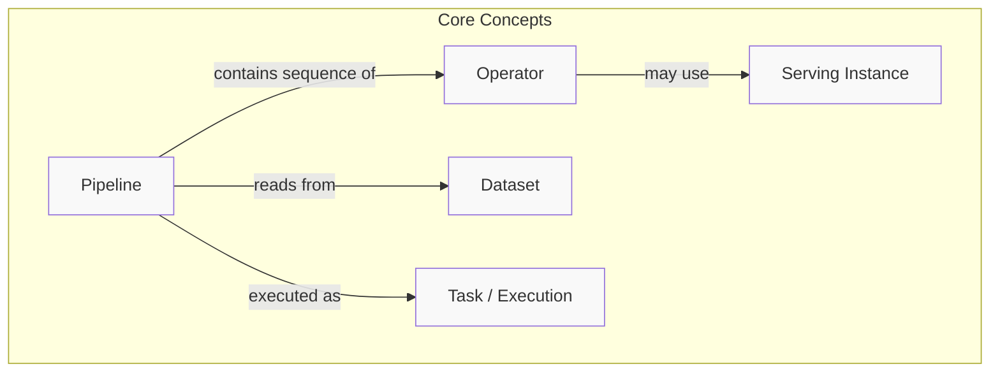

**Diagram: Core Concept Relationships**

Sources: [backend/app/schemas/pipelines.py:37-67]()

---

## 2.1. Pipelines

A **Pipeline** defines an ordered sequence of processing steps (`operators`) operating on an input dataset (`input_dataset`). Pipelines can be authored interactively through the web UI canvas, saved via REST endpoints, or loaded as preset templates from backend code definitions via AST parsing.

Static validation checks field flow compatibility, dataset schema alignment, and serving references before execution. For pipeline structure, templates, DAG semantics, and lifecycle management from creation through validation to execution, see [Pipelines](#2.1).

Sources: [backend/app/schemas/pipelines.py:55-67](), [backend/app/services/pipeline_registry.py:17-47]()

---

## 2.2. Operators

**Operators** represent discrete processing units that transform input data fields. They are organized in a multi-level taxonomy (`level_1` and `level_2`) and expose parameter schemas for initialization (`init`) and execution (`run`) derived via Python introspection.

Operators also declare allowed prompt templates and category guidance for AI agents. For operator types, schemas, discovery via `OPERATOR_REGISTRY`, and agent tips, see [Operators](#2.2).

Sources: [backend/app/services/operator_registry.py:108-139](), [backend/app/schemas/operator.py:38-57]()

---

## 2.3. Datasets

**Datasets** serve as the initial input sources for pipeline runs. The platform supports various data storage formats (JSON, JSONL, Parquet, CSV, and media assets), parsing metadata, scanning example directories, and extracting column headers for runtime validation.

For supported formats, metadata handling, scanning of example data, and column previews, see [Datasets](#2.3).

Sources: [backend/app/schemas/pipelines.py:50-54]()

---

## 2.4. Execution Model

The **Execution Model** manages task scheduling, tracking states (`queued`, `running`, `completed`, `failed`, `cancelled`), and coordinating synchronous execution or distributed workers (via Ray). 

It monitors operator-level execution progress and manages intermediate result caching in local storage directories. For execution lifecycles, task states, progress tracking, and result caching, see [Execution Model](#2.4).

Sources: [backend/app/schemas/pipelines.py:28-34](), [backend/app/schemas/pipelines.py:109-119]()

---

# Page: Pipelines

# Pipelines

<details>
<summary>Relevant source files</summary>

The following files were used as context for generating this wiki page:

- [backend/app/api/v1/endpoints/pipelines.py](backend/app/api/v1/endpoints/pipelines.py)
- [backend/app/schemas/pipelines.py](backend/app/schemas/pipelines.py)
- [backend/app/services/pipeline_registry.py](backend/app/services/pipeline_registry.py)
- [backend/tests/test_pipeline_registry.py](backend/tests/test_pipeline_registry.py)
- [frontend/src/components/manage/mainFlow/panels/piplinePanel.vue](frontend/src/components/manage/mainFlow/panels/piplinePanel.vue)
- [frontend/src/js/i18n.js](frontend/src/js/i18n.js)
- [frontend/src/views/client/home/index.vue](frontend/src/views/client/home/index.vue)

</details>


This wiki page covers the technical architecture, data structures, templates, DAG semantics, and complete lifecycle of pipelines within the DataFlow-WebUI platform. A pipeline represents the fundamental unit of work orchestrating dataset inputs and sequential operator execution.

---

## 1. Overview and Scope

A pipeline in DataFlow-WebUI encapsulates an end-to-end data processing workflow consisting of an input data source, an ordered sequence of processing operators, and execution metadata. Pipelines are managed centrally through `PipelineRegistry` and persisted as JSON documents [`backend/app/services/pipeline_registry.py:1-15`](). They can originate either as pre-built template pipelines discovered from Python source files or as user-defined custom workflows created via the frontend canvas [`backend/app/api/v1/endpoints/pipelines.py:21-43`]().

Sources: `[backend/app/services/pipeline_registry.py:1-15]`, `[backend/app/api/v1/endpoints/pipelines.py:21-43]`

---

## 2. Pipeline Data Structure and Schemas

The data model for pipelines spans several Pydantic schemas defining the wrapper container, configuration state, operator sequence, and static validation results [`backend/app/schemas/pipelines.py:1-143`]().

### Core Schema (`PipelineOut`)
The complete pipeline object returned by API endpoints includes identifiers, human-readable names, nested configurations, tags, timestamps, and execution status [`backend/app/schemas/pipelines.py:82-94`]().

### Pipeline Configuration (`PipelineConfig`)
The configuration object houses the execution topology [`backend/app/schemas/pipelines.py:55-68`]`:
- `file_path`: String path pointing to source Python files for templates, or empty for user-created pipelines.
- `input_dataset`: Union of a dataset identifier string (`str`) or an explicit configuration object (`PipelineInputDataset`).
- `operators`: Ordered list of `PipelineOperator` instances determining execution sequence.

### Operator Structure (`PipelineOperator`)
Each operator entry specifies its class name from the operator registry, enriched parameter dictionaries for initialization and execution phases, and 2D canvas coordinates (`location`) [`backend/app/schemas/pipelines.py:37-49`]().

### Diagram: Natural Language Space to Code Entity Space (Pipeline Data Model)

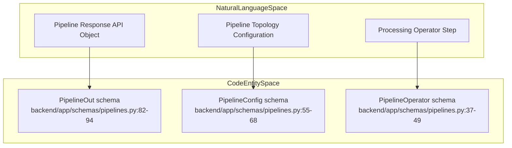

Sources: `[backend/app/schemas/pipelines.py:37-94]`

---

## 3. Pipeline Types: Templates and User Pipelines

### Template Pipelines
Template pipelines are automatically discovered from Python files located in `dataflow_core/api_pipelines/`. They are marked with tags `["api", "template"]` and maintain a valid `file_path` reference [`backend/app/services/pipeline_registry.py:257-347`](). Only templates matching names in the system whitelist are exposed in the user interface [`backend/app/services/pipeline_registry.py:459-497`]().

### User-Created Pipelines
User pipelines are authored dynamically via the frontend canvas component (`piplinePanel.vue`) and submitted to `POST /pipelines` [`frontend/src/components/manage/mainFlow/panels/piplinePanel.vue:108-125`](). They contain empty `file_path` strings and arbitrary user-configured operator arrangements [`backend/app/schemas/pipelines.py:55-68`]().

Sources: `[backend/app/services/pipeline_registry.py:257-347]`, `[backend/app/services/pipeline_registry.py:459-497]`, `[backend/app/schemas/pipelines.py:55-68]`, `[frontend/src/components/manage/mainFlow/panels/piplinePanel.vue:108-125]`

---

## 4. Pipeline Lifecycle and Execution Flow

The pipeline lifecycle transitions from file discovery or creation through static validation to execution and teardown [`backend/app/services/pipeline_registry.py:257-347`]().

### Diagram: Natural Language Space to Code Entity Space (Lifecycle Execution)

```mermaid
graph LR
    subgraph "NaturalLanguageSpace"
        CreateRequest[""Create Pipeline Request""]
        StaticCheck[""Static Validation Check""]
        ExecutionTrigger[""Trigger Async Execution""]
    end

    subgraph "CodeEntitySpace"
        CreateRoute[""create_pipeline()<br/>backend/app/api/v1/endpoints/pipelines.py:44-61""]
        ValidateRoute[""validate_pipeline_config()<br/>backend/app/api/v1/endpoints/pipelines.py:70-80""]
        RegistryMethods[""PipelineRegistry persistence<br/>backend/app/services/pipeline_registry.py""]
    end

    CreateRequest --> CreateRoute
    CreateRoute --> RegistryMethods
    StaticCheck --> ValidateRoute
```

Sources: `[backend/app/api/v1/endpoints/pipelines.py:44-80]`, `[backend/app/services/pipeline_registry.py:1-15]`

---

## 5. DAG Semantics and Static Validation

Pipelines enforce directed acyclic graph (DAG) semantics implicitly through an ordered list of operators in `PipelineConfig` (`operators`) [`backend/app/schemas/pipelines.py:55-68`](). 

The `POST /pipelines/validate` endpoint triggers `validate_pipeline_config()` to evaluate schema integrity, dataset existence, field flow progression across sequential operators, prompt template bindings, and LLM serving references [`backend/app/api/v1/endpoints/pipelines.py:70-80`](). Validation returns a `PipelineValidationResult` containing structured `PipelineValidationIssue` elements categorized into errors and warnings, complete with repair hints [`backend/app/schemas/pipelines.py:121-143`]().

Sources: `[backend/app/schemas/pipelines.py:55-68]`, `[backend/app/schemas/pipelines.py:121-143]`, `[backend/app/api/v1/endpoints/pipelines.py:70-80]`

---

## 6. AST Parsing and File Analysis

Template pipelines are parsed statically using the `PipelineFileAnalyzer` class [`backend/app/services/pipeline_registry.py:18-23`](). 

The analyzer parses Python abstract syntax trees (AST) to extract:
1. **Execution Order**: Extracted from `forward()` method calls matching `self.xxx.run()` [`backend/app/services/pipeline_registry.py:35-47`]().
2. **Initialization Parameters**: Extracted from `__init__()` keyword arguments assigned to class attributes [`backend/app/services/pipeline_registry.py:49-61`]().
3. **Runtime Parameters**: Extracted from keyword arguments passed during `.run()` method invocations [`backend/app/services/pipeline_registry.py:63-91`]().

Sources: `[backend/app/services/pipeline_registry.py:18-91]`

---

## 7. API Reference Summary

The FastAPI router for pipelines is mounted under `/pipelines` and provides standard CRUD operations and validation helpers [`backend/app/api/v1/endpoints/pipelines.py:19-119`]().

| Endpoint | Method | Function Name | Description |
|---|---|---|---|
| `/pipelines/` | GET | `list_pipelines` | Returns all registered pipelines [`backend/app/api/v1/endpoints/pipelines.py:21-31`] |
| `/pipelines/templates` | GET | `list_template_pipelines` | Returns pre-built template pipelines [`backend/app/api/v1/endpoints/pipelines.py:33-43`] |
| `/pipelines/` | POST | `create_pipeline` | Creates a new pipeline configuration [`backend/app/api/v1/endpoints/pipelines.py:44-62`] |
| `/pipelines/validate` | POST | `validate_pipeline_config` | Performs static DAG and field validation [`backend/app/api/v1/endpoints/pipelines.py:64-80`] |
| `/pipelines/{pipeline_id}` | GET | `get_pipeline` | Fetches a single pipeline by UUID [`backend/app/api/v1/endpoints/pipelines.py:81-86`] |
| `/pipelines/{pipeline_id}` | PUT | `update_pipeline` | Updates an existing pipeline definition [`backend/app/api/v1/endpoints/pipelines.py:88-106`] |
| `/pipelines/{pipeline_id}` | DELETE | `delete_pipeline` | Deletes a pipeline from registry storage [`backend/app/api/v1/endpoints/pipelines.py:107-119`] |

Sources: `[backend/app/api/v1/endpoints/pipelines.py:19-119]`

---

# Page: Operators

# Operators

<details>
<summary>Relevant source files</summary>

The following files were used as context for generating this wiki page:

- [backend/app/api/v1/endpoints/agent.py](backend/app/api/v1/endpoints/agent.py)
- [backend/app/api/v1/endpoints/operators.py](backend/app/api/v1/endpoints/operators.py)
- [backend/app/mcp_server.py](backend/app/mcp_server.py)
- [backend/app/schemas/operator.py](backend/app/schemas/operator.py)
- [backend/app/services/agent_session.py](backend/app/services/agent_session.py)
- [backend/app/services/operator_category_guide.py](backend/app/services/operator_category_guide.py)
- [backend/app/services/operator_registry.py](backend/app/services/operator_registry.py)

</details>


## Purpose and Scope

This page covers the technical design and implementation of **Operators** in the DataFlow-WebUI / DataFlow-Harness platform. Operators represent the atomic execution steps within a data processing pipeline. Each operator is encapsulated as a self-contained Python class within the underlying `dataflow` engine packages, exposing explicit initialization (`__init__`) and execution (`run`) parameter signatures, prompt restrictions (`ALLOWED_PROMPTS`), and hierarchical category metadata.

This document details:
- The operator class structure and method signatures (`__init__`, `run`, static description helpers).
- The three-level taxonomy (`level_1` and `level_2` categories).
- Parameter introspection, schema generation, and JSON caching via `OperatorRegistry`.
- Prompt template restrictions and automatic pipeline enrichment.
- Category guidance mechanics (`CATEGORY_GUIDE`) and agent-facing endpoint validations.

---

## Operator Structure and Parameter Schemas

Operators are implemented as Python classes that inherit or conform to standard execution contracts. Every operator exposes two primary parameter phases: construction-time initialization parameters and execution-time runtime parameters.

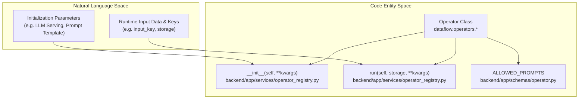

**Sources:** `[backend/app/services/operator_registry.py:119-121]`, `[backend/app/schemas/operator.py:18-36]`

### Init and Run Parameters

- **Init Parameters (`__init__`)**: Configured when the operator is instantiated in a pipeline definition. These parameters remain static throughout execution and are stored in the pipeline configuration JSON. Common examples include `prompt_template`, `llm_serving`, `embedding_serving`, and `database_manager`.
- **Run Parameters (`run`)**: Evaluated dynamically when the operator processes records via `FileStorage`. Examples include `input_key`, `input_keys`, `output_key`, and `output_meta_key`.

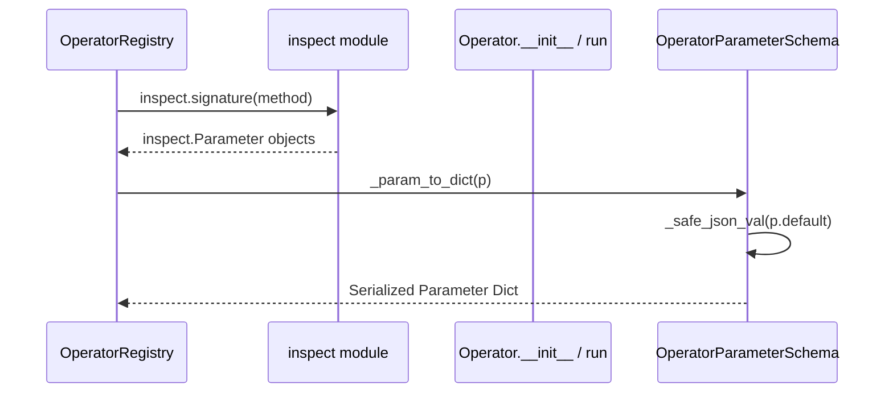

**Sources:** `[backend/app/services/operator_registry.py:35-58]`, `[backend/app/schemas/operator.py:18-36]`

---

## Taxonomy and Hierarchy

Operators are organized in a multi-level taxonomy derived directly from their module import paths (`dataflow.operators.<level_1>.<level_2>.<operator_name>`).

| Taxonomy Level | Description | Code Representation / Example |
| :--- | :--- | :--- |
| `level_1` | Top-level semantic category | `core_text`, `general_text`, `text_sft`, `reasoning`, `code`, `knowledge_cleaning` |
| `level_2` | Functional subcategory | `generate`, `filter`, `transform`, `evaluator` |
| Concrete Name | Python class name | `Text2QAGenerator`, `CharNumberFilter`, `PandasOperator` |

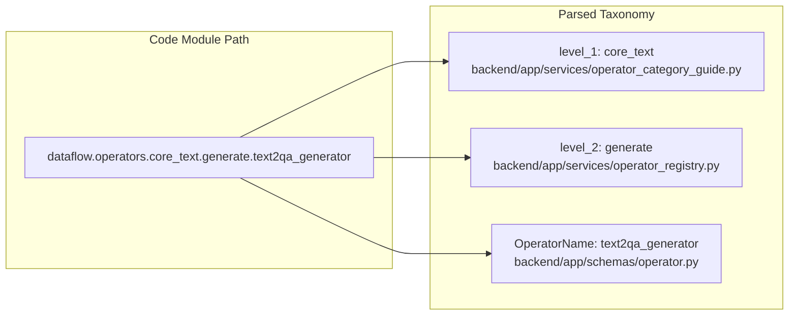

**Sources:** `[backend/app/services/operator_registry.py:92-114]`, `[backend/app/services/operator_category_guide.py:15-34]`

---

## Discovery and Registration via OPERATOR_REGISTRY

The backend discovers and catalogs operators through `OperatorRegistry`, which interfaces with `OPERATOR_REGISTRY` and `PROMPT_REGISTRY` imported from the core `dataflow` package.

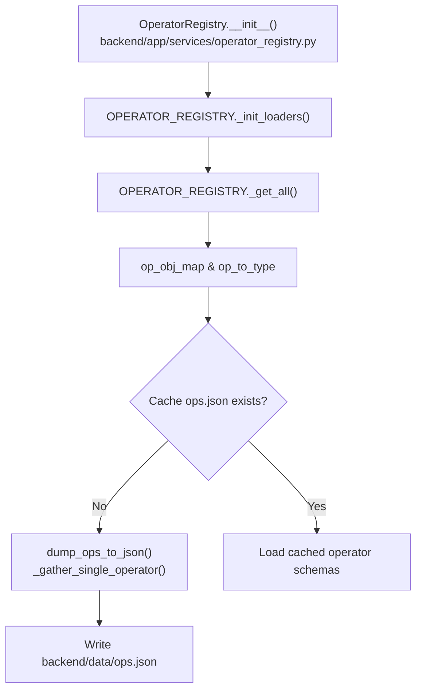

**Sources:** `[backend/app/services/operator_registry.py:144-162]`, `[backend/app/services/operator_registry.py:202-234]`

---

## Prompt Restrictions and ALLOWED_PROMPTS

Many generation operators restrict permissible prompt templates using the `ALLOWED_PROMPTS` class attribute. During operator schema generation, these class references are introspected and converted to string names.

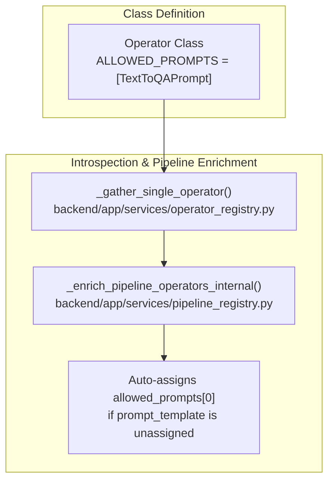

**Sources:** `[backend/app/services/operator_registry.py:115-116]`, `[backend/app/services/pipeline_registry.py:813-816]`

---

## Category Guidance for Agents and MCP Integration

To prevent context window overflow when LLM coding agents interact with the catalog via the Model Context Protocol (`MCP`), operator retrieval is strictly category-scoped.

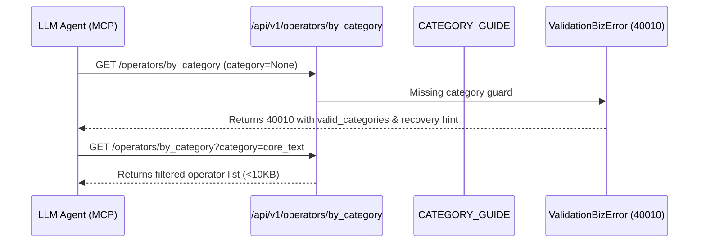

**Sources:** `[backend/app/api/v1/endpoints/operators.py:108-153]`, `[backend/app/services/operator_category_guide.py:15-34]`

The authoritative `CATEGORY_GUIDE` (`[backend/app/services/operator_category_guide.py:15-178]()`) governs agent behavior by defining `use_for`, `not_for`, and representative `examples` for each `level_1` category. Endpoints such as `list_operators` enforce category parameter validation, raising a `ValidationBizError` (`[backend/app/api/v1/endpoints/operators.py:135-153]()`) if an agent attempts to pull the full ~145-operator catalog without scope parameters.

---

---

# Page: Datasets

# Datasets

<details>
<summary>Relevant source files</summary>

The following files were used as context for generating this wiki page:

- [README-release-en.md](README-release-en.md)
- [README-release-zh.md](README-release-zh.md)
- [backend/app/api/v1/endpoints/datasets.py](backend/app/api/v1/endpoints/datasets.py)
- [backend/app/main.py](backend/app/main.py)
- [backend/app/schemas/dataset.py](backend/app/schemas/dataset.py)
- [backend/app/services/dataset_registry.py](backend/app/services/dataset_registry.py)
- [backend/tests/test_dataset_registry.py](backend/tests/test_dataset_registry.py)
- [backend/tests/test_text2sql_database_api.py](backend/tests/test_text2sql_database_api.py)
- [docs/RELEASE-PACKAGE.md](docs/RELEASE-PACKAGE.md)

</details>


## Purpose and Scope

This document explains datasets as input data sources in DataFlow-WebUI. It covers dataset metadata structure, supported file formats, registration mechanisms, automatic discovery, and visualization capabilities. For information about how datasets are used within pipeline execution, see [Execution Model](#2.4). For API-level details about dataset endpoints, see [Dataset Endpoints](#5.4). For implementation details of the dataset service layer, see [Dataset Management](#3.5).

Sources: [backend/app/services/dataset_registry.py:59-316]()

## What is a Dataset?

A dataset represents an input data source that pipelines process. Datasets are files on the filesystem that have been registered in the system through the `DatasetRegistry` class (`backend/app/services/dataset_registry.py`). Each dataset has:

- A unique identifier (MD5 hash of file path)
- Metadata (name, pipeline association, file type, file size, sample count)
- A physical file location (`root` path)
- File integrity tracking via content hash

Datasets serve as the entry point for pipeline execution. When a pipeline runs, it loads data from the specified dataset through the `FileStorage` abstraction.

Sources: [backend/app/services/dataset_registry.py:59-316]()

## Dataset Metadata Structure

Each dataset record contains the following fields defined in `DatasetIn` and `DatasetOut` schemas (`backend/app/schemas/dataset.py`):

| Field | Type | Description |
|-------|------|-------------|
| `id` | string | MD5 hash (first 10 chars) of the file path, used as unique identifier |
| `name` | string | Human-readable dataset name |
| `root` | string | Absolute file path to the dataset file |
| `pipeline` | string | Pipeline name this dataset is associated with (e.g., "uploaded", "text2sql") |
| `type` | string | File extension (e.g., "json", "jsonl", "csv", "parquet") |
| `hash` | string | MD5 hash of file contents for integrity verification |
| `file_size` | integer | File size in bytes |
| `num_samples` | integer | Number of entries/rows in the dataset |
| `added_at` | string | ISO timestamp of when the dataset was registered |
| `meta` | object | Additional metadata (extensible) |

The `id` is computed deterministically from the file path, ensuring that re-registering the same file path updates the existing record rather than creating a duplicate.

Sources: [backend/app/schemas/dataset.py:1-18](), [backend/app/services/dataset_registry.py:171-196]()

## Dataset Registry Architecture

The following diagram bridges the natural language conceptual space to the code entity space, illustrating how FastAPI endpoint functions in `backend/app/api/v1/endpoints/datasets.py` interact with backend service classes like `DatasetRegistry` and `VisualizeDatasetService` in `backend/app/services/dataset_registry.py`.

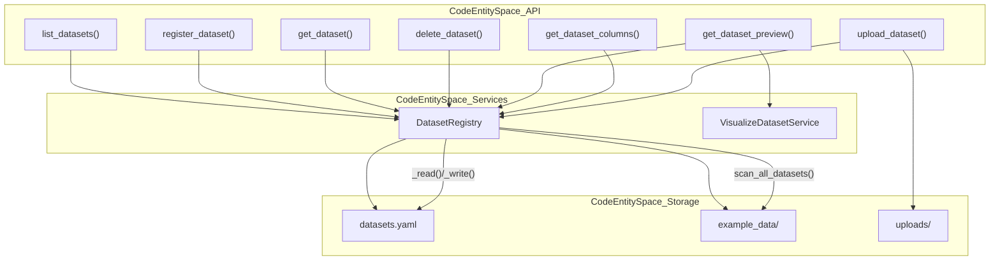

Sources: [backend/app/api/v1/endpoints/datasets.py:1-162](), [backend/app/services/dataset_registry.py:59-316]()

## Supported File Formats

DataFlow-WebUI supports multiple file formats for datasets, categorized by their capabilities:

### Pandas-Compatible Formats (Full Preview Support)

| Format | Extension | Read Function | Preview | Columns | Visualization |
|--------|-----------|---------------|---------|---------|---------------|
| CSV | `.csv` | `pd.read_csv` | ✓ | ✓ | ✓ |
| JSON | `.json` | `pd.read_json` | ✓ | ✓ | ✓ |
| JSONL | `.jsonl` | `pd.read_json(lines=True)` | ✓ | ✓ | ✓ |
| Parquet | `.parquet` | `pd.read_parquet` | ✓ | ✓ | ✓ |
| Excel | `.xlsx`, `.xls` | `pd.read_excel` | ✓ | ✓ | ✓ |
| Pickle | `.pkl`, `.pickle` | `pd.read_pickle` | ✗ | ✗ | ✓ |

### File-Type Formats (Direct Download)

| Format | Extension | Media Type | Use Case |
|--------|-----------|------------|----------|
| Text | `.txt` | `text/plain` | Plain text documents |
| Markdown | `.md` | `text/markdown` | Formatted documentation |
| JPEG | `.jpg`, `.jpeg` | `image/jpeg` | Image datasets |
| PNG | `.png` | `image/png` | Image datasets |
| PDF | `.pdf` | `application/pdf` | Document datasets |
| Word | `.doc`, `.docx` | `application/msword` | Document datasets |
| PowerPoint | `.ppt`, `.pptx` | `application/vnd.ms-powerpoint` | Presentation datasets |

The `VisualizeDatasetService` (`backend/app/services/dataset_registry.py`) maps file extensions to appropriate handlers in `pandas_read_func_map` and `media_type_map`.

Sources: [backend/app/services/dataset_registry.py:8-56]()

## Dataset Registration

Datasets can be registered through three mechanisms:

### 1. Manual Registration

Users can register a dataset by providing a `DatasetIn` payload (`backend/app/schemas/dataset.py`) with the file path via the `/` POST endpoint (`backend/app/api/v1/endpoints/datasets.py`).

The registration process:
1. Computes `id` from MD5 hash of `root` path [backend/app/services/dataset_registry.py:174]()
2. Verifies file exists and computes content hash [backend/app/services/dataset_registry.py:177]()
3. Calculates `file_size` using `os.path.getsize()` [backend/app/services/dataset_registry.py:180]()
4. Counts entries using `_count_file_entries()` [backend/app/services/dataset_registry.py:183]()
5. Extracts file type from extension [backend/app/services/dataset_registry.py:188]()
6. Stores timestamp [backend/app/services/dataset_registry.py:189]()
7. Writes to `datasets.yaml` [backend/app/services/dataset_registry.py:195]()

Sources: [backend/app/api/v1/endpoints/datasets.py:18-24](), [backend/app/services/dataset_registry.py:171-196]()

### 2. Automatic Scanning

The `DatasetRegistry.scan_all_datasets()` method automatically scans the `example_data/` directory on initialization:

```mermaid
graph LR
    DatasetRegistry_init["DatasetRegistry.__init__"] --> scan_all_datasets["DatasetRegistry.scan_all_datasets()"]
    scan_all_datasets --> walk["os.walk(example_data/)"]
    walk --> add_or_update["DatasetRegistry.add_or_update()"]
    add_or_update --> YAML["datasets.yaml"]
```

The scanner:
- Walks through `DATAFLOW_CORE_DIR/example_data/` directory [backend/app/services/dataset_registry.py:73]()
- Iterates through each pipeline subdirectory [backend/app/services/dataset_registry.py:80-83]()
- Discovers all files recursively using `os.walk()` [backend/app/services/dataset_registry.py:86-88]()
- Creates dataset records with naming pattern `{pipeline_name}-{filename}` [backend/app/services/dataset_registry.py:90-95]()
- Registers each discovered file via `add_or_update()` [backend/app/services/dataset_registry.py:99]()
- Logs statistics for each pipeline [backend/app/services/dataset_registry.py:108-111]()

Sources: [backend/app/services/dataset_registry.py:66-112]()

### 3. File Upload

Users can upload files through the `upload_dataset` endpoint (`backend/app/api/v1/endpoints/datasets.py`), which:
1. Creates an `uploads/` directory under the data directory [backend/app/api/v1/endpoints/datasets.py:140-142]()
2. Saves the uploaded file [backend/app/api/v1/endpoints/datasets.py:145-147]()
3. Registers the dataset with `pipeline: "uploaded"` [backend/app/api/v1/endpoints/datasets.py:150-157]()

Sources: [backend/app/api/v1/endpoints/datasets.py:127-162]()

## Entry Counting Strategy

The `DatasetRegistry._count_file_entries()` method determines the number of samples in a dataset based on file type:

| File Type | Counting Strategy |
|-----------|-------------------|
| CSV, JSONL, TXT, LOG | Line count (`sum(1 for _ in f)`) |
| JSON | Length of list if array, key count if object, 1 if primitive |
| Other formats | Default to 1 entry |

Sources: [backend/app/services/dataset_registry.py:129-155]()

## Dataset Preview and Column Extraction

### Preview Mechanism

The `DatasetRegistry.preview()` method provides sample data for supported formats (JSON, JSONL, Parquet):

- **JSONL**: Reads line-by-line, parsing each as JSON [backend/app/services/dataset_registry.py:236-241]()
- **JSON**: Loads full file, slices if list [backend/app/services/dataset_registry.py:242-251]()
- **Parquet**: Uses `pd.read_parquet(nrows=num_lines)` [backend/app/services/dataset_registry.py:252-256]()

Sources: [backend/app/services/dataset_registry.py:211-261]()

### Column Extraction

The `DatasetRegistry.get_columns()` method extracts field names for structured formats:
- **JSONL**: Reads first line, extracts keys from parsed object [backend/app/services/dataset_registry.py:286-294]()
- **JSON**: Extracts keys from first list element or top-level object [backend/app/services/dataset_registry.py:295-306]()
- **Parquet**: Uses `pd.read_parquet(nrows=1)` and `df.columns` [backend/app/services/dataset_registry.py:307-311]()

Sources: [backend/app/services/dataset_registry.py:263-316]()

## Dataset Visualization Service

The `VisualizeDatasetService` class (`backend/app/services/dataset_registry.py`) provides two visualization paths:

1. **Pandas Visualization**: `VisualizeDatasetService.get_pandas_read_function()` validates file existence, selects the correct reader from `pandas_read_func_map`, reads the requested slice, and converts it to JSON (`orient="records"`) [backend/app/services/dataset_registry.py:32-45]().
2. **File-Type Visualization**: `VisualizeDatasetService.get_other_visualization_data()` maps non-tabular formats to media types for direct serving via `FileResponse` [backend/app/services/dataset_registry.py:50-56](), [backend/app/api/v1/endpoints/datasets.py:74-88]().

Sources: [backend/app/services/dataset_registry.py:8-56](), [backend/app/api/v1/endpoints/datasets.py:74-88]()

## Dataset Storage and Persistence

The `DatasetRegistry` uses YAML for human-readable, version-controllable storage:
- **File Location**: Configured via `settings.DATA_REGISTRY` [backend/app/services/dataset_registry.py:61]()
- **Initialization**: `_ensure()` creates file with empty structure if missing [backend/app/services/dataset_registry.py:115-119]()
- **Operations**: `_read()` and `_write()` handle serialization using `yaml.safe_load()` and `yaml.safe_dump()` [backend/app/services/dataset_registry.py:121-127]()

Sources: [backend/app/services/dataset_registry.py:61-127]()

## Dataset Lifecycle

```stateDiagram-v2
    [*] --> Discovered: scan_all_datasets()
    [*] --> Uploaded: upload_dataset()
    [*] --> Registered: register_dataset()
    
    Discovered --> InRegistry: add_or_update()
    Uploaded --> InRegistry
    Registered --> InRegistry
    
    state InRegistry {
        [*] --> Available
        Available --> Previewed: get_dataset_preview()
        Previewed --> Available
        Available --> Columns: get_dataset_columns()
        Columns --> Available
    }
    
    InRegistry --> UsedByPipeline: Pipeline references ds_id
    InRegistry --> Deleted: delete_dataset()
    Deleted --> [*]
```

Sources: [backend/app/services/dataset_registry.py:59-316](), [backend/app/api/v1/endpoints/datasets.py:1-162]()

## Integration with Pipeline Execution

Datasets connect to pipeline execution through the `input_dataset` field in pipeline configurations. When a pipeline executes, the `DataFlowEngine` resolves the dataset metadata from `DatasetRegistry`, initializes a `FileStorage` instance with the dataset's `root` path, and passes data to operators.

Sources: [backend/app/services/dataset_registry.py:59-316]()

---

# Page: Execution Model

# Execution Model

<details>
<summary>Relevant source files</summary>

The following files were used as context for generating this wiki page:

- [backend/app/api/v1/endpoints/tasks.py](backend/app/api/v1/endpoints/tasks.py)
- [backend/app/services/dataflow_engine.py](backend/app/services/dataflow_engine.py)
- [backend/app/services/param_coercion.py](backend/app/services/param_coercion.py)
- [backend/app/services/ray_pipeline_executor.py](backend/app/services/ray_pipeline_executor.py)
- [backend/app/services/task_registry.py](backend/app/services/task_registry.py)

</details>


This document explains how pipelines are executed in DataFlow-WebUI, covering the complete execution lifecycle from submission through completion. It describes the synchronous and asynchronous execution modes, the state machine governing execution status, and how results are tracked and retrieved. For information about pipeline structure and configuration, see [Pipelines](#2.1). For details on operator behavior, see [Operators](#2.2).

---

## Execution Lifecycle Overview

Pipeline execution follows a well-defined lifecycle managed by `TaskRegistry` [backend/app/services/task_registry.py:14-205]() and executed by either `DataFlowEngine` [backend/app/services/dataflow_engine.py:176-773]() (synchronous) or `RayPipelineExecutor` [backend/app/services/ray_pipeline_executor.py]() (asynchronous). The system tracks execution at both the pipeline level and the individual operator level, providing real-time status updates through a polling mechanism.

**State Transition Diagram**

```mermaid
stateDiagram-v2
    [*] --> queued: "submit_execution()"
    
    queued --> running: "Executor picks up task"
    
    running --> completed: "All operators succeed"
    running --> failed: "Operator error / Engine error"
    running --> cancelled: "kill_execution()"
    
    completed --> [*]
    failed --> [*]
    cancelled --> [*]
    
    note right of queued
        TaskRegistry creates record
        status = "queued"
        task_id generated
    end note
    
    note right of running
        Operators execute sequentially
        operators_detail updated
        Real-time status writes
    end note
    
    note right of completed
        All operators completed
        Results in cache_local/
        status = "completed"
    end note
```

Sources: [backend/app/services/task_registry.py:81-109](), [backend/app/services/task_registry.py:140-146]()

---

## Execution States

The system defines primary execution states managed across the backend services:

| State | Description | Transitions From | Transitions To |
|-------|-------------|------------------|----------------|
| `queued` | Task created, waiting to execute | Initial state | `running`, `cancelled` |
| `running` | Actively executing operators | `queued` | `completed`, `failed`, `cancelled` |
| `completed` | Successfully finished all operators | `running` | Terminal state |
| `failed` | Error during initialization or execution | `running` | Terminal state |
| `cancelled` | User terminated execution | `queued`, `running` | Terminal state |

Each execution task maintains status at two levels:

1. **Pipeline-level status**: The overall state of the entire execution managed by `TaskRegistry` [backend/app/services/task_registry.py:14-205]().
2. **Operator-level status**: Individual status for each operator stored in `operators_detail` [backend/app/services/ray_pipeline_executor.py:181-182]().

### Operator-Level Status

Each operator in the `operators_detail` dictionary tracks its own lifecycle:

```python
operators_detail[op_key] = {
    "name": str,           # Operator class name
    "index": int,          # Position in execution sequence
    "status": str,         # initializing/initialized/running/completed/failed/cancelled
    "started_at": str,     # ISO timestamp when operator starts
    "completed_at": str,   # ISO timestamp when operator finishes
    "sample_count": int,   # Number of samples processed
    "progress": str,       # Progress bar text (if available)
    "progress_percentage": float,  # Numeric progress (0-100)
    "error": str           # Error message if status=failed
}
```

Sources: [backend/app/services/ray_pipeline_executor.py:181-182](), [backend/app/services/task_registry.py:115-151]()

---

## Task Registry Coordination

The `TaskRegistry` [backend/app/services/task_registry.py:14-205]() serves as the central coordinator for all pipeline executions, persisting state to `task_registry.json`. It provides the interface between the API layer [backend/app/api/v1/endpoints/tasks.py:1-200]() and the execution engines.

**Task Registry Architecture**

```mermaid
graph TB
    API["tasks.py<br/>/tasks/execute<br/>/tasks/execute-async"]
    
    TaskRegistry["TaskRegistry<br/>data/task_registry.json"]
    
    SyncPath["Synchronous Path<br/>start_execution()"]
    AsyncPath["Asynchronous Path<br/>start_execution_async()"]
    
    DataFlowEngine["DataFlowEngine.run()<br/>Direct execution"]
    RayExecutor["RayPipelineExecutor<br/>submit_execution()"]
    
    RayWorker["Ray Worker<br/>_execute_pipeline_remote()"]
    
    FileSystem["File System<br/>task_registry.json<br/>cache_local/{task_id}_output/"]
    
    API --> TaskRegistry
    TaskRegistry --> SyncPath
    TaskRegistry --> AsyncPath
    
    SyncPath --> DataFlowEngine
    AsyncPath --> RayExecutor
    
    RayExecutor --> RayWorker
    
    DataFlowEngine --> FileSystem
    RayWorker --> FileSystem
    
    TaskRegistry -.->|"read/write"| FileSystem
```

Sources: [backend/app/services/task_registry.py:14-205](), [backend/app/api/v1/endpoints/tasks.py:1-200]()

### Task Record Structure

Each task stored in `task_registry.json` contains runtime states, execution outputs, and log mappings:

```json
{
  "tasks": {
    "abc123def456": {
      "task_id": "abc123def456",
      "pipeline_id": "my_pipeline",
      "pipeline_config": { /* full config snapshot */ },
      "status": "running",
      "output": {
        "operators_detail": { /* operator statuses */ },
        "operator_logs": { /* logs per operator */ },
        "execution_results": [ /* per-operator results */ ]
      },
      "logs": [ /* global execution logs */ ],
      "started_at": "2024-01-15T10:30:00",
      "completed_at": null
    }
  }
}
```

Sources: [backend/app/services/task_registry.py:81-109](), [backend/app/services/task_registry.py:115-151]()

---

## Synchronous Execution

Synchronous execution uses `DataFlowEngine` [backend/app/services/dataflow_engine.py:176-773]() to execute pipelines directly in the API request thread. This mode is simpler but blocks the caller until completion.

### Execution Flow

```mermaid
sequenceDiagram
    participant Client
    participant API as "tasks.py<br/>POST /tasks/execute"
    participant TaskReg as "TaskRegistry"
    participant Engine as "DataFlowEngine"
    participant Storage as "FileStorage"
    participant Operator as "Operator Instance"
    participant Cache as "cache_local/"
    
    Client->>API: "POST /tasks/execute?pipeline_id=X"
    API->>TaskReg: "start_execution(pipeline_id)"
    TaskReg->>TaskReg: "_generate_task_id()"
    TaskReg->>TaskReg: "create task record (status=queued)"
    TaskReg-->>API: "task_id, pipeline_config"
    
    API->>Engine: "run(pipeline_config, task_id)"
    
    Engine->>Storage: "FileStorage()"
    Storage-->>Engine: "storage instance"
    
    loop "For each operator"
        Engine->>Engine: "Initialize operator with dependencies"
        Engine->>TaskReg: "Update operators_detail (status=running)"
        Engine->>Storage: "storage.step()"
        Storage-->>Engine: "storage advanced"
        Engine->>Operator: "operator.run(storage=storage)"
        Operator->>Cache: "Write to cache_step_N.jsonl"
        Operator-->>Engine: "execution complete"
        Engine->>TaskReg: "Update operators_detail (status=completed)"
    end
    
    Engine->>TaskReg: "Update task (status=completed)"
    Engine-->>API: "PipelineExecutionResult"
    API-->>Client: "200 OK with result"
```

Sources: [backend/app/services/dataflow_engine.py:176-773](), [backend/app/services/task_registry.py:210-220]()

### DataFlowEngine Phases

The engine execution handles phases via `DataFlowEngine`:

1. **Storage Initialization**: Resolves dataset inputs using `FileStorage` [backend/app/services/dataflow_engine.py:3](), setting up task-specific output folders under `cache_local/`.
2. **Operator Initialization**: Resolves parameters using coercion logic [backend/app/services/param_coercion.py:99-146]() and maps serving instances (`APILLMServing_request` [backend/app/services/dataflow_engine.py:1]()), `DatabaseManager` [backend/app/services/dataflow_engine.py:2](), and prompt templates from `PROMPT_REGISTRY` [backend/app/services/dataflow_engine.py:5]().
3. **Sequential Execution**: Iterates over operators, invoking `step()` and running each operator instance [backend/app/services/dataflow_engine.py:176-773]().

Sources: [backend/app/services/dataflow_engine.py:1-314](), [backend/app/services/param_coercion.py:99-146]()

### Error Handling

Errors during execution are caught and wrapped in `DataFlowEngineError` [backend/app/services/dataflow_engine.py:28-44](), capturing stack traces, operator contexts, and original exceptions.

Sources: [backend/app/services/dataflow_engine.py:28-44]()

---

## Asynchronous Execution

Asynchronous execution uses Ray via `RayPipelineExecutor` to run pipelines in distributed worker processes.

### Async Execution Flow

```mermaid
sequenceDiagram
    participant Client
    participant API as "tasks.py<br/>POST /tasks/execute-async"
    participant TaskReg as "TaskRegistry"
    participant RayExec as "RayPipelineExecutor"
    participant Ray as "Ray Cluster"
    participant Worker as "Ray Worker"
    participant File as "task_registry.json"
    
    Client->>API: "POST /tasks/execute-async?pipeline_id=X"
    API->>TaskReg: "start_execution_async()"
    
    TaskReg->>TaskReg: "_generate_task_id()"
    TaskReg->>File: "Write task (status=queued)"
    TaskReg->>TaskReg: "decode_hashed_arguments()"
    
    TaskReg->>RayExec: "submit_execution(config, runtime, task_id)"
    RayExec->>Ray: "_execute_pipeline_remote.remote()"
    Ray-->>RayExec: "ObjectRef"
    RayExec-->>TaskReg: "task_id"
    TaskReg-->>API: "{task_id, status: queued}"
    API-->>Client: "200 OK immediately"
    
    Ray->>Worker: "Schedule on worker"
    Worker->>Worker: "dataflow_pipeline_execute()"
    Worker->>File: "Update status=running"
    
    loop "Execute operators"
        Worker->>Worker: "operator.run()"
        Worker->>File: "Update operators_detail"
    end
    
    Worker->>File: "Update status=completed"
```

Sources: [backend/app/services/ray_pipeline_executor.py:162-200](), [backend/app/services/task_registry.py:210-220]()

### Dependency Pre-Resolution

To avoid registry access issues in Ray worker processes, the main coordinator pre-resolves all configurations and parameters into a `dataflow_runtime` dictionary payload before remote invocation [backend/app/services/dataflow_engine.py:165-314]().

Sources: [backend/app/services/dataflow_engine.py:165-314]()

---

## Status Tracking and Monitoring

### Polling-Based Status Updates

The frontend client monitors task progress by polling `GET /execution/{task_id}/status` [backend/app/api/v1/endpoints/tasks.py:32-51](), which reads task statuses and operator granular metrics directly from `TaskRegistry`.

Sources: [backend/app/api/v1/endpoints/tasks.py:32-51](), [backend/app/services/task_registry.py:111-113]()

### Progress Bar Capture with LogStream

`LogStream` [backend/app/services/ray_pipeline_executor.py:45-97]() captures standard output streams in real-time, parsing `tqdm` progress indications, numeric percentages, and iteration rates to update `operators_detail` throttled to prevent excessive disk writes.

Sources: [backend/app/services/ray_pipeline_executor.py:45-97]()

---

## Result Storage and Retrieval

Execution outputs are serialized into JSONL files under `cache_local/{task_id}_output/` using `FileStorage` [backend/app/services/dataflow_engine.py:3]() stepping logic. Results can be queried via `GET /execution/{task_id}/result` [backend/app/api/v1/endpoints/tasks.py:58-85]() or downloaded via `GET /execution/{task_id}/download` [backend/app/api/v1/endpoints/tasks.py:118-187]().

Sources: [backend/app/services/dataflow_engine.py:3](), [backend/app/api/v1/endpoints/tasks.py:58-187]()

---

## Task Cancellation

Running tasks can be terminated using `TaskRegistry.kill_execution()` which signals `RayPipelineExecutor` to issue a forced `ray.cancel(..., force=True)` and transitions task and active operator states to `"cancelled"`.

Sources: [backend/app/services/task_registry.py:518-588](), [backend/app/services/ray_pipeline_executor.py:909-940]()

---

# Page: Backend Services

# Backend Services

<details>
<summary>Relevant source files</summary>

The following files were used as context for generating this wiki page:

- [backend/app/api/v1/endpoints/datasets.py](backend/app/api/v1/endpoints/datasets.py)
- [backend/app/api/v1/endpoints/text2sql_database.py](backend/app/api/v1/endpoints/text2sql_database.py)
- [backend/app/core/container.py](backend/app/core/container.py)
- [backend/app/main.py](backend/app/main.py)
- [backend/app/schemas/dataset.py](backend/app/schemas/dataset.py)
- [backend/app/schemas/text2sql_database.py](backend/app/schemas/text2sql_database.py)
- [backend/app/services/dataset_registry.py](backend/app/services/dataset_registry.py)
- [backend/app/services/text2sql_database_registry.py](backend/app/services/text2sql_database_registry.py)

</details>


This section provides a high-level overview of the backend service layer and dependency container in `DataFlow-WebUI`. The service layer acts as the intermediary between FastAPI REST endpoints and the core execution engine, managing registries, persistent state, dependency injection, and pipeline execution orchestration.

For detailed technical specifications, implementation internals, and advanced usage of individual registries and services, please refer to the respective child pages linked throughout this document.

---

## Dependency Container and Architecture

The backend utilizes a centralized application container (`AppContainer`) defined in `backend/app/core/container.py` to instantiate and manage all registries and services in a controlled, deterministic order [backend/app/core/container.py:3-57](). This prevents circular imports and initialization race conditions between services like `DatasetRegistry`, `PipelineRegistry`, `OperatorRegistry`, and `TaskRegistry` [backend/app/core/container.py:4-44]().

```mermaid
graph TB
    subgraph "APIEndpoints"
        API["FastAPI Routers<br/>backend/app/api/v1/router.py"]
    end
    
    subgraph "DependencyContainer"
        Container["AppContainer<br/>backend/app/core/container.py"]
    end
    
    subgraph "RegistriesAndServices"
        PipelineReg["PipelineRegistry"]
        TaskReg["TaskRegistry"]
        Engine["DataFlowEngine"]
        OpReg["OperatorRegistry"]
        DatasetReg["DatasetRegistry"]
        ServingReg["ServingRegistry"]
        Text2SQLReg["Text2SQLDatabaseRegistry"]
    end
    
    API -->|"Accesses via"| Container
    Container --> PipelineReg
    Container --> TaskReg
    Container --> Engine
    Container --> OpReg
    Container --> DatasetReg
    Container --> ServingReg
    Container --> Text2SQLReg
```
**Sources:** [backend/app/core/container.py:3-57]()

---

## 3.1 Pipeline Registry

The `PipelineRegistry` manages pipeline definitions, JSON persistence, and automatic discovery of pipeline files from the `api_pipelines` directory [backend/app/services/pipeline_registry.py:1-232](). It uses `PipelineFileAnalyzer` to perform AST (Abstract Syntax Tree) parsing on Python pipeline definitions, extracting initialization parameters, run parameters, and operator execution sequences [backend/app/services/pipeline_registry.py:17-232](). It also performs static pipeline validation (checking field flow, serving references, and generating repair hints).

For details, see [Pipeline Registry](#3.1).

**Sources:** [backend/app/services/pipeline_registry.py:1-870]()

---

## 3.2 Task Registry and Execution

The `TaskRegistry` oversees the full lifecycle of pipeline executions, maintaining execution records, log collections, execution status updates, and statistics [backend/app/services/task_registry.py:1-152](). It coordinates with `RayPipelineExecutor` for distributed asynchronous tasks, handles task cancellation (`kill_execution`), and persists status updates to disk [backend/app/services/task_registry.py:436-588]().

For details, see [Task Registry and Execution](#3.2).

**Sources:** [backend/app/services/task_registry.py:1-588]()

---

## 3.3 DataFlow Engine

The `DataFlowEngine` serves as the primary orchestration engine for executing pipelines [backend/app/services/dataflow_engine.py:1-700](). It handles argument decoding, resolves dependencies such as LLM/embedding servings, database managers, and prompt templates, manages `FileStorage` step progression, coerces parameters, and catches execution exceptions [backend/app/services/dataflow_engine.py:68-200]().

For details, see [DataFlow Engine](#3.3).

**Sources:** [backend/app/services/dataflow_engine.py:1-700]()

---

## 3.4 Operator Registry

The `OperatorRegistry` discovers and reflects over available operators in the dataflow core library, caching their parameter schemas into `ops.{lang}.json` files [backend/app/services/operator_registry.py](). It provides categorical metadata, allowed prompt mappings, and parameter descriptions that are served to both the frontend UI and MCP agents [backend/app/services/pipeline_registry.py:747-870]().

For details, see [Operator Registry](#3.4).

**Sources:** [backend/app/services/operator_registry.py](), [backend/app/services/pipeline_registry.py:747-870]()

---

## 3.5 Dataset Management

The `DatasetRegistry` manages dataset metadata via YAML persistence (`datasets.yaml`) and automatically scans the `example_data` directory upon initialization [backend/app/services/dataset_registry.py:59-112](). It computes sample counts and file hashes, while `VisualizeDatasetService` handles dataframe previews across multiple file types (`json`, `jsonl`, `parquet`, `csv`) alongside file uploads [backend/app/services/dataset_registry.py:8-58](), [backend/app/api/v1/endpoints/datasets.py:1-162]().

For details, see [Dataset Management](#3.5).

**Sources:** [backend/app/services/dataset_registry.py:1-316](), [backend/app/api/v1/endpoints/datasets.py:1-162]()

---

## 3.6 Serving Management

The `ServingRegistry` manages configuration instances for LLM and embedding serving endpoints stored in YAML format [backend/app/services/serving_registry.py](). It provides serving class introspection, secure API key masking for API responses, and test generation utilities to verify connectivity with model providers [backend/app/services/dataflow_engine.py:73-143]().

For details, see [Serving Management](#3.6).

**Sources:** [backend/app/services/serving_registry.py](), [backend/app/services/dataflow_engine.py:73-143]()

---

## 3.7 Prompts, JSON Schemas and Preferences

Supporting registries such as `prompt_registry` and `user_prompt_registry` manage reusable prompt templates [backend/app/core/container.py:10-18](). The `json_schema_manager` handles saved JSON Schemas referenced via `schema_ref:` attributes in operators, and the preferences service stores user-specific UI or application preferences [backend/app/core/container.py:17]().

For details, see [Prompts, JSON Schemas and Preferences](#3.7).

**Sources:** [backend/app/core/container.py:3-57]()

---

## 3.8 Text2SQL Database Registry

The `Text2SQLDatabaseRegistry` and `Text2SQLDatabaseManagerRegistry` manage SQLite database uploads and database manager configurations [backend/app/services/text2sql_database_registry.py:40-346](). They store metadata in YAML files, maintain the SQLite database directory (`SQLITE_DB_DIR`), and construct `DatabaseManager` instances for Text2SQL operators [backend/app/services/text2sql_database_registry.py:169-178](), [backend/app/api/v1/endpoints/text2sql_database.py:1-197]().

For details, see [Text2SQL Database Registry](#3.8).

**Sources:** [backend/app/services/text2sql_database_registry.py:1-346](), [backend/app/api/v1/endpoints/text2sql_database.py:1-197]()

---

# Page: Pipeline Registry

# Pipeline Registry

<details>
<summary>Relevant source files</summary>

The following files were used as context for generating this wiki page:

- [backend/app/api/v1/endpoints/pipelines.py](backend/app/api/v1/endpoints/pipelines.py)
- [backend/app/schemas/pipelines.py](backend/app/schemas/pipelines.py)
- [backend/app/services/pipeline_registry.py](backend/app/services/pipeline_registry.py)
- [backend/tests/test_pipeline_validation.py](backend/tests/test_pipeline_validation.py)

</details>


## Purpose and Scope

The **Pipeline Registry** (`PipelineRegistry`) is a core backend service responsible for managing pipeline metadata, automatic discovery of template pipelines from `dataflow_core/api_pipelines/`, enrichment of operator configurations, and static pipeline validation. It stores pipeline definitions as structured JSON data in `data/pipeline_registry.json`.

This document details the `PipelineRegistry` service class, its companion `PipelineFileAnalyzer` AST parsing utility (`[backend/app/services/pipeline_registry.py:19-187]()`), operator enrichment routines, and the static validation engine (`[backend/app/api/v1/endpoints/pipelines.py:64-80]()`, `[backend/tests/test_pipeline_validation.py:129-181]()`).

Sources: [backend/app/services/pipeline_registry.py:1-870](), [backend/app/api/v1/endpoints/pipelines.py:64-80]()

---

## Storage Architecture and JSON Persistence

The `PipelineRegistry` persists all pipeline metadata to a single JSON file located at `data/pipeline_registry.json`. 

### Storage File Structure

```mermaid
graph TB
    subgraph "Storage Layer"
        PipelineJSON["pipeline_registry.json"]
    end
    
    subgraph "JSON Structure"
        Root["Root Object<br/>{ pipelines: {...} }"]
        PipelinesObj["Pipelines Dict<br/>{ pipeline_id_1: {...}, pipeline_id_2: {...} }"]
        PipelineEntry["Pipeline Entry<br/>{ id, name, config, tags, created_at, updated_at, status }"]
        ConfigObj["PipelineConfig<br/>{ file_path, input_dataset, operators }"]
    end
    
    PipelineJSON --> Root
    Root --> PipelinesObj
    PipelinesObj --> PipelineEntry
    PipelineEntry --> ConfigObj
```
Sources: [backend/app/services/pipeline_registry.py:234-255]()

### Storage Methods

The registry uses internal methods to read and write state:
- `_read()`: Loads the entire registry dictionary from disk (`[backend/app/services/pipeline_registry.py:247-250]()`).
- `_write(data)`: Serializes and writes the dictionary back to disk (`[backend/app/services/pipeline_registry.py:252-255]()`).
- `_init_registry_file()`: Bootstraps the file if missing by scanning template pipelines (`[backend/app/services/pipeline_registry.py:257-347]()`).

Sources: [backend/app/services/pipeline_registry.py:234-255]()

---

## Pipeline File Analysis with `PipelineFileAnalyzer`

The `PipelineFileAnalyzer` dataclass (`[backend/app/services/pipeline_registry.py:18-28]`) uses Python's `ast` module to statically inspect pipeline script files without executing them.

### Analysis Workflow

```mermaid
graph LR
    PyFile["Pipeline Script<br/>(api_pipelines/*.py)"] --> Analyzer["PipelineFileAnalyzer.from_file()"]
    
    subgraph "AST Extraction Methods"
        ExecOrder["execution_order()"]
        InitParams["init_params_by_class()"]
        RunParams["run_params_by_class()"]
    end
    
    Analyzer --> ExecOrder
    Analyzer --> InitParams
    Analyzer --> RunParams
    
    ExecOrder --> OpNames["List[str] Operator Names"]
    InitParams --> InitDict["Dict[str, Dict] Init Args"]
    RunParams --> RunDict["Dict[str, Dict] Run Args"]
```
Sources: [backend/app/services/pipeline_registry.py:19-90]()

### AST Parsing Helpers
- `_build_var_to_class_map()`: Maps instance variables in `__init__` (e.g., `self.my_op = MyOperator()`) to their class names (`[backend/app/services/pipeline_registry.py:103-126]()`).
- `_collect_run_calls()`: Traverses the `forward()` method to collect operator execution order via `self.xxx.run()` expressions (`[backend/app/services/pipeline_registry.py:128-140]()`).
- `_node_to_value()`: Recursively converts AST nodes into literal Python values or type references (`[backend/app/services/pipeline_registry.py:193-231]()`).

Sources: [backend/app/services/pipeline_registry.py:103-231]()

---

## Scanning `api_pipelines` and Template Management

On startup, `PipelineRegistry` scans the `dataflow_core/api_pipelines/` directory to discover and register built-in template pipelines.

### Initialization and Update Flow

```mermaid
flowchart TD
    Init["PipelineRegistry.__init__()"] --> CheckExists{"pipeline_registry.json exists?"}
    CheckExists -->|No| InitFile["_init_registry_file()"]
    CheckExists -->|Yes| UpdateAPI["_update_all_api_pipelines_operators()"]
    
    InitFile --> ScanDir["Scan api_pipelines/"]
    ScanDir --> Analyze["PipelineFileAnalyzer.from_file()"]
    Analyze --> Extract["Extract Execution Order & Params"]
    Extract --> Dataset["_find_dataset_id()"]
    Dataset --> Save["_write() to JSON"]
    Save --> Ready["Registry Initialized"]
    UpdateAPI --> Ready
```
Sources: [backend/app/services/pipeline_registry.py:234-457]()

### Template Whitelisting and Visibility
Templates are tagged with `["api", "template"]` (`[backend/app/services/pipeline_registry.py:313]()`). The `_is_visible_pipeline()` method filters template exposure using `_PRESET_PIPELINE_NAME_WHITELIST` (`[backend/app/services/pipeline_registry.py:459-509]()`).

Sources: [backend/app/services/pipeline_registry.py:459-509]()

---

## Operator Enrichment

Operator enrichment merges minimal operator definitions (`name` and `params`) with complete parameter schemas retrieved from `OperatorRegistry`.

### Enrichment Pipeline

```mermaid
graph TB
    Minimal["Minimal Operator<br/>{ name: 'PromptedGenerator', params: {...} }"] --> Enrich["_enrich_pipeline_operators_internal()"]
    
    subgraph "Resolution Sources"
        Code["PipelineFileAnalyzer AST extraction"]
        Stored["User-stored parameters"]
        OpReg["OperatorRegistry.get_op_details()"]
    end
    
    Code --> Enrich
    Stored --> Enrich
    OpReg --> Enrich
    
    Enrich --> Enriched["Enriched Operator<br/>{ name, params: { init: [...], run: [...] }, location }"]
```
Sources: [backend/app/services/pipeline_registry.py:747-869]()

Parameter priority follows a strict fallback cascade: Pipeline Python AST values take top precedence, followed by stored user overrides, and finally operator defaults (`[backend/app/services/pipeline_registry.py:804-845]`).

Sources: [backend/app/services/pipeline_registry.py:747-869]()

---

## Static Pipeline Validation

The static validation engine (`validate_pipeline_config()`, `[backend/app/api/v1/endpoints/pipelines.py:70-80]()`) inspects pipeline definitions before execution to detect configuration errors, missing input fields, invalid serving references, and field flow disruptions.

### Validation Architecture and Issues

```mermaid
graph LR
    Config["PipelineConfig Model"] --> Validate["validate_pipeline_config()"]
    
    subgraph "Validation Checks"
        DatasetCheck["Dataset & Column Extraction"]
        FieldFlow["Field Flow & Input Key Check"]
        ServingRef["Serving Instance Reference Check"]
    end
    
    Validate --> DatasetCheck
    Validate --> FieldFlow
    Validate --> ServingRef
    
    DatasetCheck --> Result["PipelineValidationResult<br/>{ valid, errors, warnings, final_available_fields }"]
    FieldFlow --> Issue["PipelineValidationIssue<br/>{ level, code, message, repair_hint, suggested_fields }"]
    ServingRef --> Issue
```
Sources: [backend/app/schemas/pipelines.py:121-142](), [backend/tests/test_pipeline_validation.py:129-181]()

### Key Validation Checks and Repair Hints
1. **Missing Input Fields**: If an operator expects an input key (`input_key`) absent from the available dataset columns or prior operator outputs, `validate_pipeline_config()` flags a `missing_input_field` error (`[backend/tests/test_pipeline_validation.py:129-154]()`).
2. **Field Suggestions (Levenshtein/Similarity)**: When a field name typo occurs (e.g., `texts` instead of `text`), validation computes `suggested_fields` and provides a `repair_hint` (`[backend/tests/test_pipeline_validation.py:157-181]()`).
3. **Serving Reference Verification**: Validates that referenced `llm_serving` or embedding serving instances exist in `ServingRegistry` (`[backend/tests/test_pipeline_validation.py:109-115]()`).

Sources: [backend/app/schemas/pipelines.py:121-142](), [backend/tests/test_pipeline_validation.py:1-181]()

---

## CRUD Operations and API Endpoints

Pipelines are managed through REST endpoints defined in `[backend/app/api/v1/endpoints/pipelines.py]()` and backed by `PipelineRegistry` methods:

| Endpoint | Method | Registry Method | Description |
|---|---|---|---|
| `/api/v1/pipelines/` | `GET` | `list_pipelines()` | List all non-hidden registered pipelines (`[backend/app/api/v1/endpoints/pipelines.py:21-30]()`) |
| `/api/v1/pipelines/templates` | `GET` | `list_templates()` | List template pipelines (`[backend/app/api/v1/endpoints/pipelines.py:33-42]()`) |
| `/api/v1/pipelines/` | `POST` | `create_pipeline()` | Create and enrich a new pipeline (`[backend/app/api/v1/endpoints/pipelines.py:44-61]()`) |
| `/api/v1/pipelines/validate` | `POST` | `validate_pipeline_config()` | Perform static pipeline configuration validation (`[backend/app/api/v1/endpoints/pipelines.py:64-80]()`) |
| `/api/v1/pipelines/{id}` | `GET` | `get_pipeline()` | Get pipeline details by ID (`[backend/app/api/v1/endpoints/pipelines.py:81-86]()`) |
| `/api/v1/pipelines/{id}` | `PUT` | `update_pipeline()` | Update pipeline config and metadata (`[backend/app/api/v1/endpoints/pipelines.py:88-105]()`) |
| `/api/v1/pipelines/{id}` | `DELETE` | `delete_pipeline()` | Delete pipeline from registry (`[backend/app/api/v1/endpoints/pipelines.py:107-118]()`) |

Sources: [backend/app/api/v1/endpoints/pipelines.py:1-118](), [backend/app/services/pipeline_registry.py:540-744]()

---

## Data Models and Schemas

Core Pydantic models governing pipeline definitions and validation are defined in `[backend/app/schemas/pipelines.py]()`:
- `PipelineConfig`: Contains `file_path`, `input_dataset`, and `operators` list (`[backend/app/schemas/pipelines.py:55-68]()`).
- `PipelineIn` / `PipelineUpdateIn`: Request payloads for creation and updating (`[backend/app/schemas/pipelines.py:70-81]()`).
- `PipelineValidationIssue`: Structured error/warning item detailing `code`, `operator_name`, `field_name`, `suggested_fields`, and `repair_hint` (`[backend/app/schemas/pipelines.py:121-133]()`).
- `PipelineValidationResult`: Aggregated validation outcome including `valid`, `errors`, `warnings`, and `final_available_fields` (`[backend/app/schemas/pipelines.py:135-142]()`).

Sources: [backend/app/schemas/pipelines.py:1-142]()

---

## Integration Points and Container Registration

`PipelineRegistry` is instantiated as a singleton inside the dependency injection container:
```python
# In app/core/container.py
container.pipeline_registry = PipelineRegistry()
```
It integrates directly with `OperatorRegistry` for schema lookups, `DatasetRegistry` for input column inspection, and `ServingRegistry` for LLM serving verification.

Sources: [backend/app/services/pipeline_registry.py:12-13](), [backend/tests/test_pipeline_validation.py:13-115]()

---

# Page: Task Registry and Execution

# Task Registry and Execution

<details>
<summary>Relevant source files</summary>

The following files were used as context for generating this wiki page:

- [backend/app/api/v1/endpoints/tasks.py](backend/app/api/v1/endpoints/tasks.py)
- [backend/app/schemas/task.py](backend/app/schemas/task.py)
- [backend/app/services/task_registry.py](backend/app/services/task_registry.py)
- [backend/tests/__init__.py](backend/tests/__init__.py)
- [backend/tests/conftest.py](backend/tests/conftest.py)

</details>


## Purpose and Scope
This page details the implementation of the task registry and execution management subsystems in DataFlow-WebUI. It covers the `TaskRegistry` lifecycle management service (`[backend/app/services/task_registry.py:14-204]()`), task execution endpoints (`[backend/app/api/v1/endpoints/tasks.py:19-353]()`), data schemas (`[backend/app/schemas/task.py:1-35]()`), status monitoring, log collection, result retrieval, kill handling, and integration with the distributed execution layer.

Sources: [backend/app/services/task_registry.py:1-204](), [backend/app/api/v1/endpoints/tasks.py:1-353](), [backend/app/schemas/task.py:1-35]()

---

## Task Registry Architecture and Data Model

The task execution system coordinates between FastAPI endpoints (`[backend/app/api/v1/endpoints/tasks.py]()`), the persistent JSON-backed task registry (`[backend/app/services/task_registry.py:14-53]()`), and distributed execution workers. Tasks represent individual pipeline or operator execution instances.

### Bridge Diagram: Task Operations to Code Entities
The following diagram maps natural language system concepts to their concrete code entities in the backend codebase.

```mermaid
graph TD
    subgraph "NaturalLanguageSpace"
        UI[""Task Dashboard / API Client""]
        Registry[""Task Persistence Store""]
        Executor[""Execution Dispatcher""]
    end

    subgraph "CodeEntitySpace"
        TasksApi[""backend/app/api/v1/endpoints/tasks.py: router""]
        TaskRegClass[""backend/app/services/task_registry.py: TaskRegistry""]
        CreateMethod[""TaskRegistry.create() : task_registry.py:81-109""]
        ListMethod[""TaskRegistry.list() : task_registry.py:61-79""]
        UpdateMethod[""TaskRegistry.update() : task_registry.py:115-151""]
        StatsMethod[""TaskRegistry.get_statistics() : task_registry.py:174-204""]
    end

    UI --> TasksApi
    Registry --> TaskRegClass
    TasksApi --> CreateMethod
    TasksApi --> ListMethod
    TasksApi --> UpdateMethod
    TasksApi --> StatsMethod
    TaskRegClass --> CreateMethod
    TaskRegClass --> ListMethod
    TaskRegClass --> UpdateMethod
    TaskRegClass --> StatsMethod

    style UI fill:#f9f9f9
    style TasksApi fill:#f9f9f9
    style TaskRegClass fill:#f9f9f9
```

Sources: [backend/app/services/task_registry.py:14-204](), [backend/app/api/v1/endpoints/tasks.py:19-353]()

### Task Record and Pydantic Schemas

Tasks are structured via Pydantic models (`[backend/app/schemas/task.py:1-35]`) and persisted as JSON dictionaries.

| Model / Field | Type | Description | Code Location |
|--------------|------|-------------|---|
| `TaskCreate` | Model | Input payload for creating a task (`dataset_id`, `executor_name`, `executor_type`, `meta`) | `[backend/app/schemas/task.py:5-11]()` |
| `TaskUpdate` | Model | Payload for updating task status, output ID, error message | `[backend/app/schemas/task.py:12-18]()` |
| `TaskOut` | Model | Complete task output schema including timing and statuses | `[backend/app/schemas/task.py:19-34]()` |
| `id` | string | 12-character MD5 hex identifier generated via timestamp and random bytes | `[backend/app/services/task_registry.py:54-59]()` |
| `status` | string | Task state: `pending`, `queued`, `running`, `success`, `failed`, `cancelled` | `[backend/app/schemas/task.py:14]()` |

Sources: [backend/app/schemas/task.py:1-35](), [backend/app/services/task_registry.py:54-59]()

---

## Task Lifecycle and State Machine

Tasks transition through distinct operational states managed by `TaskRegistry` update logic (`[backend/app/services/task_registry.py:115-151]()`).

```mermaid
stateDiagram-v2
    [*] --> pending: "TaskRegistry.create()"
    pending --> queued: "Queue submission"
    queued --> running: "Worker starts execution"
    
    running --> success: "Execution completed"
    running --> failed: "Exception raised"
    running --> cancelled: "User termination / kill"
    
    success --> [*]
    failed --> [*]
    cancelled --> [*]

    note right of pending
        "Initial state in task_registry.json"
    end note
    note right of running
        "started_at timestamp populated"
    end note
    note right of success
        "finished_at timestamp populated"
    end
```

Sources: [backend/app/services/task_registry.py:96-101](), [backend/app/services/task_registry.py:139-146]()

---

## TaskRegistry Service Implementation

The `TaskRegistry` class (`[backend/app/services/task_registry.py:14-204]()`) manages file initialization, atomic reads/writes, unique ID generation, and task statistics.

### Key Methods

- `_ensure(self)`: Ensures registry file existence and handles corrupted JSON backups (`[backend/app/services/task_registry.py:21-42]()`).
- `_generate_task_id(self)`: Combines an ISO timestamp and 8 random bytes to create a 12-character MD5 hash (`[backend/app/services/task_registry.py:54-59]()`).
- `list(self, status, executor_type)`: Retrieves and filters tasks, sorted by creation date in reverse order (`[backend/app/services/task_registry.py:61-79]()`).
- `create(self, task)`: Initializes task fields (`status="pending"`, `created_at`) and writes to storage (`[backend/app/services/task_registry.py:81-109]()`).
- `update(self, task_id, updates)`: Modifies task properties and automatically manages `started_at` and `finished_at` based on status changes (`[backend/app/services/task_registry.py:115-151]()`).
- `get_statistics(self)`: Computes aggregate counts across task statuses and executor types (`[backend/app/services/task_registry.py:174-204]()`).

Sources: [backend/app/services/task_registry.py:14-204]()

---

## API Endpoints and Execution Operations

Task operations are exposed under `/api/v1` routes (`[backend/app/api/v1/endpoints/tasks.py:19-353]()`).

### Bridge Diagram: Execution API to Service Layer

```mermaid
graph TD
    subgraph "NaturalLanguageSpace"
        ClientReq[""HTTP Client / Frontend Task Panel""]
        StatusQuery[""Operator Status Query""]
        ResultDownload[""Result File Download""]
    end

    subgraph "CodeEntitySpace"
        ListExec[""list_executions() : tasks.py:23-31""]
        GetStatus[""get_execution_status() : tasks.py:32-57""]
        GetResult[""get_task_result() : tasks.py:58-85""]
        GetLog[""get_execution_log() : tasks.py:87-116""]
        DownloadRes[""download_task_result() : tasks.py:118-193""]
        RegGet[""container.task_registry.get() : task_registry.py:111-113""]
    end

    ClientReq --> ListExec
    StatusQuery --> GetStatus
    ResultDownload --> DownloadRes
    GetStatus --> RegGet
    GetResult --> RegGet
    GetLog --> RegGet

    style ClientReq fill:#f9f9f9
    style ListExec fill:#f9f9f9
    style GetStatus fill:#f9f9f9
    style DownloadRes fill:#f9f9f9
```

Sources: [backend/app/api/v1/endpoints/tasks.py:19-193](), [backend/app/services/task_registry.py:111-113]()

---

## Testing and Conformance

Unit tests validate task registry behavior using pytest fixtures (`[backend/tests/conftest.py:10-40]()`), ensuring isolated file creation and cleanup across test runs.

Sources: [backend/tests/conftest.py:1-40]()

---

# Page: DataFlow Engine

# DataFlow Engine

<details>
<summary>Relevant source files</summary>

The following files were used as context for generating this wiki page:

- [backend/app/services/dataflow_engine.py](backend/app/services/dataflow_engine.py)
- [backend/app/services/param_coercion.py](backend/app/services/param_coercion.py)
- [backend/app/services/ray_pipeline_executor.py](backend/app/services/ray_pipeline_executor.py)

</details>


## Purpose and Scope

The **DataFlow Engine** is the core execution orchestrator responsible for running AI/ML data processing pipelines in the DataFlow-WebUI backend. It coordinates argument decoding, serving, database-manager, and prompt dependency resolution, manages `FileStorage` step progression between operators, applies robust parameter coercion and dynamic code parameter compilation, and provides comprehensive execution tracking and error handling.

This document covers the internal implementation of `DataFlowEngine` [backend/app/services/dataflow_engine.py:176-789](), parameter coercion logic [backend/app/services/param_coercion.py:99-146](), and execution log streaming/monitoring [backend/app/services/ray_pipeline_executor.py:45-160]().

Sources: [backend/app/services/dataflow_engine.py:1-789](), [backend/app/services/param_coercion.py:99-146]()

---

## Overview and Class Structure

The `DataFlowEngine` class [backend/app/services/dataflow_engine.py:176-179]() serves as the central orchestrator. It executes pipelines sequentially or via distributed executors like `RayPipelineExecutor` [backend/app/services/ray_pipeline_executor.py:162-350]().

### Core Classes and Types

```mermaid
classDiagram
    class DataFlowEngine {
        +Dict execution_map
        +__init__()
        +run(pipeline_config, dataflow_runtime, task_id, execution_path) Dict
        +init_serving_instance(serving_id, is_embedding) APILLMServing_request
        +init_database_manager(db_manager_id) DatabaseManager
        +decode_hashed_arguments(pipeline_config, task_id) Dict
    }
    
    class DataFlowEngineError {
        +str message
        +Dict context
        +Exception original_error
        +str traceback_str
        +__init__(message, context, original_error)
        +to_dict() Dict
    }
    
    class ExecutionStatus {
        +str pid
        +str status
        +str start_time
        +str end_time
    }
    
    DataFlowEngine --> DataFlowEngineError : "raises"
    DataFlowEngine --> ExecutionStatus : "uses"
    DataFlowEngine --> FileStorage : "manages"
```

Sources: [backend/app/services/dataflow_engine.py:28-179]()

---

## Argument Decoding and `decode_hashed_arguments`

The engine pre-resolves pipeline configurations prior to execution using `decode_hashed_arguments` [backend/app/services/dataflow_engine.py:166-314](). This method parses operator inputs, handles hashed references, and prepares runtime dictionaries without instantiating heavy run-time resources (such as active LLM sessions or database pools).

Sources: [backend/app/services/dataflow_engine.py:166-314]()

---

## Dependency Resolution

`DataFlowEngine` resolves three major categories of runtime dependencies during operator setup:

1. **Serving Instances**: Initialized via `init_serving_instance` [backend/app/services/dataflow_engine.py:181-280](), mapping LLM or embedding configurations from `container.serving_registry` to client wrappers like `APILLMServing_request`.
2. **Prompt Templates**: Resolved via `PROMPT_REGISTRY` lookups, extracting class names using `extract_class_name` [backend/app/services/dataflow_engine.py:46-64]().
3. **Database Managers**: Initialized via `init_database_manager` [backend/app/services/dataflow_engine.py:282-314](), integrating Text2SQL database configurations from `container.text2sql_database_manager_registry`.

### Dependency Resolution Flow

```mermaid
graph TB
    subgraph "CodeEntitySpace"
        EngineRun["DataFlowEngine.run"]
        InitServing["DataFlowEngine.init_serving_instance"]
        InitDB["DataFlowEngine.init_database_manager"]
        PromptReg["PROMPT_REGISTRY.get"]
        OpReg["OPERATOR_REGISTRY.get"]
    end
    
    EngineRun --> InitServing
    EngineRun --> InitDB
    EngineRun --> PromptReg
    EngineRun --> OpReg
```

Sources: [backend/app/services/dataflow_engine.py:181-314](), [backend/app/services/dataflow_engine.py:468-528]()

---

## Parameter Coercion and Dynamic Code Parameters

To support dynamic operators and UI-driven parameter inputs, the engine relies on parameter coercion and dynamic code normalization modules.

### Parameter Coercion (`coerce_param_value`)
The function `coerce_param_value` [backend/app/services/param_coercion.py:99-146]() enforces expected operator parameter types using Pydantic `TypeAdapter` validation (`validate_python` / `validate_json`), resolving `schema_ref:<id>` references through `_resolve_schema_ref` [backend/app/services/param_coercion.py:19-49](), and falling back to runtime defaults via `_fallback_coerce_by_default` [backend/app/services/param_coercion.py:57-97]().

### Dynamic Code Parameters
Operators accepting custom logic (such as filters or mappers defined via Python code) pass through `_normalize_dynamic_code_param_value` [backend/app/services/dataflow_engine.py:79-121]() and are compiled using `_compile_dynamic_code_callable` [backend/app/services/dataflow_engine.py:124-167](), supporting `lambda` expressions and `def` functions.

```mermaid
graph TB
    subgraph "CodeEntitySpace"
        Coerce["coerce_param_value"]
        ResolveSchema["_resolve_schema_ref"]
        NormalizeCode["_normalize_dynamic_code_param_value"]
        CompileCode["_compile_dynamic_code_callable"]
    end
    
    Coerce --> ResolveSchema
    Coerce --> NormalizeCode
    NormalizeCode --> CompileCode
```

Sources: [backend/app/services/dataflow_engine.py:79-167](), [backend/app/services/param_coercion.py:19-146]()

---

## FileStorage Stepping and Execution Flow

The engine manages data persistence between operators using `FileStorage` [backend/app/services/dataflow_engine.py:384-436](). As the pipeline progresses through operators, `storage.step()` [backend/app/services/dataflow_engine.py:575]() advances the file pointers, writing sequential output cache files (`dataflow_cache_step_*.jsonl`) into the task cache directory.

```mermaid
stateDiagram-v2
    [*] --> InitStorage
    InitStorage --> InitOperators : "Load Dataset & Cache Path"
    InitOperators --> ExecuteOperators : "Instantiate Operators"
    
    state ExecuteOperators {
        [*] --> StepStorage
        StepStorage --> RunOperator : "operator.run(**run_params)"
        RunOperator --> UpdateStatus : "Capture stdout/stderr & count samples"
        UpdateStatus --> [*]
    }
    
    ExecuteOperators --> Success : "All operators completed"
    ExecuteOperators --> Failure : "Exception raised"
    Success --> [*]
    Failure --> [*]
```

Sources: [backend/app/services/dataflow_engine.py:384-689]()

---

## Error Handling and Logging

`DataFlowEngine` wraps execution anomalies in `DataFlowEngineError` [backend/app/services/dataflow_engine.py:28-44](), capturing contextual metadata (operator index, failure reason, and traceback). Real-time logs are captured via `LogStream` [backend/app/services/ray_pipeline_executor.py:45-98]() and written back via `update_execution_status` [backend/app/services/dataflow_engine.py:346-366]().

Sources: [backend/app/services/dataflow_engine.py:28-44](), [backend/app/services/dataflow_engine.py:346-366](), [backend/app/services/ray_pipeline_executor.py:45-98]()

---

# Page: Operator Registry

# Operator Registry

<details>
<summary>Relevant source files</summary>

The following files were used as context for generating this wiki page:

- [backend/app/api/v1/endpoints/operators.py](backend/app/api/v1/endpoints/operators.py)
- [backend/app/schemas/operator.py](backend/app/schemas/operator.py)
- [backend/app/services/operator_registry.py](backend/app/services/operator_registry.py)

</details>


## Purpose and Scope

The `OperatorRegistry` service is responsible for discovering, cataloging, and exposing metadata about all available operators in the DataFlow system [backend/app/services/operator_registry.py:144-162](). It uses Python introspection to extract parameter schemas from operator classes, caches the metadata for performance, and provides REST API endpoints (`/api/v1/operators`) for the frontend UI and Model Context Protocol (MCP) coding agents to query operator information [backend/app/services/operator_registry.py:1-253](), [backend/app/api/v1/endpoints/operators.py:1-315](). 

This service enables the frontend to dynamically populate the operator library panel and allows MCP agents to discover category-scoped operators without overflowing their context window [backend/app/api/v1/endpoints/operators.py:78-153](). For information about execution, see [DataFlow Engine](#3.3). For operator data models, see [Operator Data Models](#6.2).

Sources: [backend/app/services/operator_registry.py:1-253](), [backend/app/api/v1/endpoints/operators.py:1-315]()

---

## System Architecture

### Component Overview

```mermaid
graph TB
    subgraph "Core Framework Layer"
        OPERATOR_REGISTRY["OPERATOR_REGISTRY<br/>dataflow.utils.registry"]
        PROMPT_REGISTRY["PROMPT_REGISTRY<br/>dataflow.utils.registry"]
        OperatorClasses["Operator Classes<br/>dataflow.operators.*"]
    end
    
    subgraph "Service Layer"
        OperatorRegistry["OperatorRegistry<br/>backend/app/services/operator_registry.py"]
        
        subgraph "Private Helpers"
            safe_json_val["_safe_json_val()<br/>Convert inspect values"]
            param_to_dict["_param_to_dict()<br/>Parameter to dict"]
            get_method_params["_get_method_params()<br/>Extract method signature"]
            call_get_desc["_call_get_desc_static()<br/>Get operator description"]
            gather_single["_gather_single_operator()<br/>Full operator metadata"]
        end
        
        subgraph "Public Methods"
            get_op_list["get_op_list()<br/>Simplified list"]
            refresh["refresh()<br/>Reload operators"]
        end
    end
    
    subgraph "API Layer"
        list_operators_all["list_operators_all<br/>GET /operators/"]
        list_operators["list_operators<br/>GET /operators/by_category"]
        build_agent_tips["_build_operator_agent_tips<br/>Agent helper tips"]
    end
    
    subgraph "Cache Storage"
        ops_json["ops_{lang}.json<br/>backend/data/ops_{lang}.json"]
    end
    
    subgraph "Consumers"
        Frontend["Vue 3 Frontend<br/>Operator Library Panel"]
        MCPAgents["MCP Coding Agents<br/>Category-scoped catalog"]
    end
    
    OPERATOR_REGISTRY --> OperatorRegistry
    PROMPT_REGISTRY --> OperatorRegistry
    OperatorClasses --> OPERATOR_REGISTRY
    
    OperatorRegistry --> safe_json_val
    OperatorRegistry --> param_to_dict
    OperatorRegistry --> get_method_params
    OperatorRegistry --> call_get_desc
    OperatorRegistry --> gather_single
    
    get_op_list --> list_operators_all
    get_op_list --> list_operators
    gather_single --> build_agent_tips
    
    list_operators_all --> Frontend
    list_operators --> MCPAgents
    build_agent_tips --> list_operators
```

Sources: [backend/app/services/operator_registry.py:1-253](), [backend/app/api/v1/endpoints/operators.py:1-66]()

---

## Initialization and Operator Discovery

### OperatorRegistry Initialization

The `OperatorRegistry` class initializes by loading all operators from the core framework's `OPERATOR_REGISTRY` [backend/app/services/operator_registry.py:144-162]().

```mermaid
sequenceDiagram
    participant App as FastAPI App Startup
    participant Container as container
    participant OpReg as OperatorRegistry
    participant CoreReg as OPERATOR_REGISTRY
    participant OpClasses as Operator Classes<br/>dataflow.operators.*
    
    App->>Container: Initialize container.operator_registry
    Container->>OpReg: __init__()
    OpReg->>CoreReg: _init_loaders()
    CoreReg->>OpClasses: Import operator modules
    OpClasses-->>CoreReg: Register operator classes
    OpReg->>CoreReg: _get_all()
    CoreReg-->>OpReg: Return loaded operators
    OpReg->>CoreReg: get_obj_map()
    CoreReg-->>OpReg: op_obj_map dictionary
    OpReg->>CoreReg: get_type_of_objects()
    CoreReg-->>OpReg: op_to_type dictionary
    Note over OpReg: Cache mappings in memory
```

The initialization process executes [backend/app/services/operator_registry.py:149-161]():
1. Triggering `_init_loaders()` on `OPERATOR_REGISTRY` to import all operator modules.
2. Invoking `_get_all()` to materialize operators.
3. Fetching `op_obj_map` (mapping operator names to classes) and `op_to_type` (mapping operator names to their module classification paths).

Sources: [backend/app/services/operator_registry.py:149-161]()

---

## Parameter Introspection

### Method Signature Extraction

The registry uses Python's `inspect` module to inspect operator constructors (`__init__`) and execution methods (`run`), converting runtime parameters into JSON-serializable dictionaries [backend/app/services/operator_registry.py:19-58]().

```mermaid
graph TB
    OpClass["Operator Class<br/>dataflow.operators.*"]
    
    subgraph "Introspection Pipeline"
        get_method["_get_method_params()<br/>Extract signature"]
        inspect_sig["inspect.signature(method)"]
        param_list["List[inspect.Parameter]"]
        param_to_dict["_param_to_dict()<br/>Convert to dict"]
        safe_json["_safe_json_val()<br/>Handle special values"]
    end
    
    subgraph "Output Structure"
        param_dict["Parameter Dict<br/>{name, default_value, kind}"]
        init_params["init: List[OperatorParameterSchema]"]
        run_params["run: List[OperatorParameterSchema]"]
    end
    
    OpClass --> get_method
    get_method --> inspect_sig
    inspect_sig --> param_list
    param_list --> param_to_dict
    param_to_dict --> safe_json
    safe_json --> param_dict
    
    param_dict --> init_params
    param_dict --> run_params
```

Key transformations implemented in `_safe_json_val()` [backend/app/services/operator_registry.py:19-33]():
- Converts `inspect.Parameter.empty` into `None` (JSON null).
- Converts types and callables into their string representations.
- Falls back to `str()` for non-JSON-serializable types.

Sources: [backend/app/services/operator_registry.py:19-58]()

---

## Operator Metadata Structure and Agent Hints

### Full Operator Metadata and Agent Guidance

The `_gather_single_operator()` function constructs metadata for each operator [backend/app/services/operator_registry.py:92-139](), while `_build_operator_agent_tips()` enriches operator details with LLM/MCP agent-specific hints [backend/app/api/v1/endpoints/operators.py:32-65]() defined in `OperatorDetailSchema` [backend/app/schemas/operator.py:38-57]().

```mermaid
graph LR
    subgraph "Source Data"
        OpClass["Operator Class"]
        StaticDesc["_call_get_desc_static()"]
        InitParams["__init__() parameters"]
        RunParams["run() parameters"]
    end
    
    subgraph "OperatorDetailSchema"
        node["node: int"]
        name["name: str"]
        type_info["type: {level_1, level_2}"]
        description["description: str"]
        parameter["parameter: {init, run}"]
        agent_tips["agent_tips: List[str]"]
        field_hint["field_binding_hint: str"]
        mcp_hint["mcp_context_hint: str"]
    end
    
    OpClass --> node
    OpClass --> name
    OpClass --> type_info
    StaticDesc --> description
    InitParams --> parameter
    RunParams --> parameter
    parameter --> agent_tips
    parameter --> field_hint
    type_info --> mcp_hint
```

Agent tips generated dynamically include warnings about `llm_serving` / `embedding_serving` dependencies, `prompt_template` usage, dynamic code parameters (`process_fn`, `filter_rules`), and input/output field binding conventions [backend/app/api/v1/endpoints/operators.py:32-65]().

Sources: [backend/app/services/operator_registry.py:92-139](), [backend/app/api/v1/endpoints/operators.py:32-65](), [backend/app/schemas/operator.py:38-57]()

---

## Type Classification System

### Three-Level Hierarchy

Operators are categorized via a three-level hierarchy parsed from their module import paths [backend/app/services/operator_registry.py:98-113]().

```mermaid
graph TD
    ModulePath["Module Path<br/>dataflow.operators.core_text.generate.text2qa_generator"]
    
    subgraph "Classification Components"
        prefix["[0] dataflow"]
        operators["[1] operators"]
        level1["[2] level_1 category (e.g. core_text)"]
        level2["[3] level_2 type (e.g. generate)"]
        concrete["[4] concrete operator name"]
    end
    
    subgraph "Mapping Result"
        type_dict["type: {level_1, level_2}"]
    end
    
    ModulePath --> prefix
    ModulePath --> operators
    ModulePath --> level1
    ModulePath --> level2
    ModulePath --> concrete
    
    level1 --> type_dict
    level2 --> type_dict
```

Extraction logic checks module components: `type1 = parts[2]` and `type2 = parts[3]` if available [backend/app/services/operator_registry.py:100-113]().

Sources: [backend/app/services/operator_registry.py:98-113]()

---

## API Endpoints and MCP Context Protection

### Operator Endpoints Architecture

DataFlow-WebUI provides two primary operator listing endpoints with distinct access policies for the frontend UI vs. MCP coding agents [backend/app/api/v1/endpoints/operators.py:68-153]().

```mermaid
graph TB
    subgraph "API Routes"
        ep_all["GET /operators/<br/>list_operators_all()"]
        ep_cat["GET /operators/by_category<br/>list_operators()"]
    end
    
    subgraph "Access Control & Validation"
        frontend_access["Frontend Palette<br/>Full ~145-op catalog"]
        mcp_guard["MCP Server Whitelist<br/>Category REQUIRED"]
        biz_error["ValidationBizError (Code 40010)<br/>Returns valid_categories & recovery hint"]
    end
    
    subgraph "Service Layer"
        container_reg["container.operator_registry.get_op_list()"]
    end
    
    ep_all --> frontend_access
    frontend_access --> container_reg
    
    ep_cat --> mcp_guard
    mcp_guard -->|Category missing/invalid| biz_error
    mcp_guard -->|Valid category| container_reg
```

**MCP Guard Mechanism**:
- `list_operators_all` (`GET /operators/`) returns the full operator catalog for the frontend operator library sidebar [backend/app/api/v1/endpoints/operators.py:78-97]().
- `list_operators` (`GET /operators/by_category`, operation ID `list_operators`) requires a `category` parameter [backend/app/api/v1/endpoints/operators.py:108-153](). If called without a category or with `'all'` / `'unknown'`, it raises a `ValidationBizError` (code `40010`) containing `valid_categories` and a `next_action` hint, preventing MCP agents from flooding their context window with ~145 operators [backend/app/api/v1/endpoints/operators.py:135-153]().

Sources: [backend/app/api/v1/endpoints/operators.py:68-160]()

---

## Description Extraction

### Staticmethod Invocation

Descriptions are retrieved by invoking `get_desc(lang=lang)` as a staticmethod on operator classes [backend/app/services/operator_registry.py:61-90]().

```mermaid
graph TB
    OpClass["Operator Class"]
    
    subgraph "Reflection Check"
        get_dict["cls.__dict__.get('get_desc')"]
        check_static["isinstance(func_obj, staticmethod)?"]
        inspect_params["inspect.signature(fn).parameters"]
    end
    
    subgraph "Invocations"
        fn_lang["fn(lang)"]
        fn_self_lang["fn(None, lang)"]
        fallback["Return fallback string"]
    end
    
    OpClass --> get_dict
    get_dict --> check_static
    check_static -->|No| fallback
    check_static -->|Yes| inspect_params
    
    inspect_params -->|['lang']| fn_lang
    inspect_params -->|['self', 'lang']| fn_self_lang
    inspect_params -->|Mismatch| fallback
```

Sources: [backend/app/services/operator_registry.py:61-90]()

---

## Configuration and Caching

### File Paths and Storage

The cache file path is resolved via application settings [backend/app/services/operator_registry.py:7-14]():
- `BACKEND_DIR`: `Path(__file__).parent.parent.parent` [backend/app/services/operator_registry.py:12]()
- `OPS_JSON_PATH`: `BACKEND_DIR / settings.OPS_JSON_PATH` [backend/app/services/operator_registry.py:13]()
- `RESOURCE_DIR`: `OPS_JSON_PATH.parent` [backend/app/services/operator_registry.py:14]()

Sources: [backend/app/services/operator_registry.py:7-14]()

---

## Integration with Services and Data Flow

### End-to-End Service Interaction

```mermaid
graph TB
    subgraph "Code Entity Space"
        container["container.operator_registry<br/>OperatorRegistry"]
        op_reg["OPERATOR_REGISTRY<br/>dataflow.utils.registry"]
        api_ops["app.api.v1.endpoints.operators<br/>list_operators / list_operators_all"]
        schemas["app.schemas.operator<br/>OperatorDetailSchema / OperatorSchema"]
    end
    
    subgraph "Consumers (Natural Language & UI Space)"
        vue_frontend["Vue 3 Frontend<br/>Canvas & Operator Palette"]
        mcp_server["FastAPI MCP Server<br/>Agent Tool Integration"]
    end
    
    container --> op_reg
    api_ops --> container
    api_ops --> schemas
    container --> api_ops
    
    api_ops -->|GET /operators/| vue_frontend
    api_ops -->|GET /operators/by_category| mcp_server
```

Sources: [backend/app/services/operator_registry.py:1-253](), [backend/app/api/v1/endpoints/operators.py:1-160](), [backend/app/schemas/operator.py:1-82]()

---

# Page: Dataset Management

# Dataset Management

<details>
<summary>Relevant source files</summary>

The following files were used as context for generating this wiki page:

- [backend/app/api/v1/endpoints/datasets.py](backend/app/api/v1/endpoints/datasets.py)
- [backend/app/main.py](backend/app/main.py)
- [backend/app/schemas/dataset.py](backend/app/schemas/dataset.py)
- [backend/app/services/dataset_registry.py](backend/app/services/dataset_registry.py)

</details>


## Purpose and Scope

This document describes the Dataset Management subsystem, which handles registration, storage, and visualization of datasets used as inputs to pipelines. The system provides automatic discovery of datasets from the `example_data` directory, metadata storage in YAML format, and preview functionality for supported file formats.

For information about how datasets are used during pipeline execution, see [DataFlow Engine](#3.3). For details on the REST API endpoints, see [Dataset Endpoints](#5.4).

Sources: [backend/app/services/dataset_registry.py:59-316](), [backend/app/api/v1/endpoints/datasets.py:1-162]()

---

## System Overview

The Dataset Management subsystem consists of three main components:

| Component | Class | Responsibility |
|-----------|-------|----------------|
| **Storage** | `DatasetRegistry` | Manages dataset metadata in YAML, automatic scanning, CRUD operations |
| **Visualization** | `VisualizeDatasetService` | Provides data preview and format-specific reading capabilities |
| **API Layer** | `/datasets` endpoints | Exposes REST API for dataset operations |

Datasets are stored as metadata records that reference actual data files on disk. The system calculates and tracks file hashes, sizes, and entry counts automatically. Supported formats include JSON, JSONL, Parquet, CSV, Excel, and various media types.

Sources: [backend/app/services/dataset_registry.py:59-316](), [backend/app/api/v1/endpoints/datasets.py:1-162]()

---

## DatasetRegistry Service

### Storage Format and Location

`DatasetRegistry` persists dataset metadata to a YAML file at the path specified by `settings.DATA_REGISTRY` (typically `data/datasets.yaml`). The structure follows this schema:

```yaml
datasets:
  abc123def4:  # MD5 hash of file path (first 10 chars)
    id: abc123def4
    name: "example-data.jsonl"
    root: "/path/to/file.jsonl"
    pipeline: "text_classification"
    type: "jsonl"
    hash: "file_md5_hash"
    file_size: 12345
    num_samples: 100
    added_at: "2024-01-01T12:00:00"
    meta: {}
```

The `id` field is generated by hashing the file path, ensuring that the same file always gets the same ID. This allows `add_or_update()` to function as an upsert operation.

Sources: [backend/app/services/dataset_registry.py:115-128](), [backend/app/services/dataset_registry.py:171-196]()

---

### Automatic Dataset Scanning

During initialization, `DatasetRegistry` automatically scans the `DATAFLOW_CORE_DIR/example_data` directory to discover and register all datasets:

```mermaid
graph TB
    Init["DatasetRegistry.__init__()"]
    Scan["scan_all_datasets()"]
    ExampleData["DATAFLOW_CORE_DIR/example_data/"]
    
    subgraph "DirectoryStructure"
        Pipeline1["pipeline_1/"]
        Pipeline2["pipeline_2/"]
        Files1["file1.jsonl<br/>file2.csv"]
        Files2["data.parquet<br/>test.json"]
    end
    
    Pipeline1 --> Files1
    Pipeline2 --> Files2
    ExampleData --> Pipeline1
    ExampleData --> Pipeline2
    
    Init --> Scan
    Scan --> ExampleData
    
    Files1 --> Register1["add_or_update({<br/>  name: 'pipeline_1-file1.jsonl',<br/>  root: '/path/to/file1.jsonl',<br/>  pipeline: 'pipeline_1'<br/>})"]
    Files2 --> Register2["add_or_update({<br/>  name: 'pipeline_2-data.parquet',<br/>  root: '/path/to/data.parquet',<br/>  pipeline: 'pipeline_2'<br/>})"]
    
    Register1 --> YAML["datasets.yaml"]
    Register2 --> YAML
```

The scanner walks through each pipeline directory, creating dataset records with names in the format `{pipeline_name}-{filename}`. This happens automatically when the registry is instantiated with `scan=True` (default behavior).

Sources: [backend/app/services/dataset_registry.py:60-113]()

---

### Dataset Metadata Calculation

When registering or updating a dataset, `DatasetRegistry` automatically computes several metadata fields:

```mermaid
graph LR
    File["Data File"]
    AddUpdate["add_or_update(ds_dict)"]
    
    subgraph "MetadataCalculation"
        Hash["_load_file_hash()<br/>MD5 checksum"]
        Size["os.path.getsize()<br/>File size in bytes"]
        Count["_count_file_entries()<br/>Number of records"]
        Type["Extract extension<br/>from file path"]
    end
    
    File --> AddUpdate
    AddUpdate --> Hash
    AddUpdate --> Size
    AddUpdate --> Count
    AddUpdate --> Type
    
    Hash --> Record["Dataset Record"]
    Size --> Record
    Count --> Record
    Type --> Record
    
    Record --> YAML["datasets.yaml"]
```

#### Entry Counting Logic

The `_count_file_entries()` method uses format-specific strategies:

| Format | Counting Strategy |
|--------|------------------|
| `csv`, `jsonl`, `txt`, `log` | Line count |
| `json` | If list: `len(data)`, if dict: `len(data.keys())`, else: `1` |
| Other formats | Defaults to `1` entry |

Sources: [backend/app/services/dataset_registry.py:129-156](), [backend/app/services/dataset_registry.py:163-169](), [backend/app/services/dataset_registry.py:171-196]()

---

## Dataset Operations

### Registration and Updates

The `add_or_update()` method provides upsert functionality. When called, it:

1. Generates a stable ID from the file path hash
2. Verifies the file exists at the specified path
3. Computes metadata (hash, size, entry count)
4. Extracts file type from extension
5. Stores or updates the record in YAML

```python
# Example usage from API
ds_dict = {
    "name": "my_dataset",
    "root": "/path/to/data.jsonl",
    "pipeline": "custom_pipeline",
    "meta": {"description": "Custom dataset"}
}
dataset_record = container.dataset_registry.add_or_update(ds_dict)
```

If the file doesn't exist, a `FileNotFoundError` is raised.

Sources: [backend/app/services/dataset_registry.py:171-196]()

---

### Retrieval and Listing

The registry provides two retrieval methods:

| Method | Description | Returns |
|--------|-------------|---------|
| `list()` | Returns all registered datasets | `List[Dict]` with full metadata |
| `get(ds_id)` | Returns a single dataset by ID | `Dict` or `None` if not found |

Both methods read directly from the YAML file, ensuring consistency with the persisted state.

Sources: [backend/app/services/dataset_registry.py:157-161](), [backend/app/services/dataset_registry.py:198-199]()

---

### Deletion

The `remove(ds_id)` method deletes a dataset record from the registry. Note that this only removes the metadata entry; it does not delete the actual data file from disk.

Sources: [backend/app/services/dataset_registry.py:59-316]()

---

## Dataset Visualization

### VisualizeDatasetService

`VisualizeDatasetService` provides format-specific data reading capabilities for previewing datasets in the UI. It maintains two mapping dictionaries:

#### Pandas Read Function Map

```python
pandas_read_func_map = {
    "csv": pd.read_csv,
    "excel": pd.read_excel,
    "json": pd.read_json,
    "parquet": pd.read_parquet,
    "pickle": pd.read_pickle,
    "jsonl": lambda path: pd.read_json(path, lines=True),
}
```

#### Media Type Map

```python
media_type_map = {
    "txt": "text/plain",
    "md": "text/markdown",
    "jpg": "image/jpeg",
    "png": "image/png",
    "pdf": "application/pdf",
    "doc": "application/msword",
    "docx": "application/vnd.openxmlformats-officedocument.wordprocessingml.document",
    # ... more types
}
```

Sources: [backend/app/services/dataset_registry.py:8-56]()

---

### Preview and Column Extraction

The registry provides methods for inspecting dataset contents and extracting column information.

```mermaid
graph TB
    Dataset["Dataset Record"]
    
    subgraph "PreviewMethods"
        Preview["preview(ds_id, num_lines)"]
        Columns["get_columns(ds_id)"]
    end
    
    subgraph "SupportedFormats"
        JSON["json"]
        JSONL["jsonl"]
        Parquet["parquet"]
    end
    
    Dataset --> Preview
    Dataset --> Columns
    
    Preview --> JSON
    Preview --> JSONL
    Preview --> Parquet
    
    Columns --> JSON
    Columns --> JSONL
    Columns --> Parquet
    
    JSON --> PreviewResult["List[Dict]<br/>First N records"]
    JSONL --> PreviewResult
    Parquet --> PreviewResult
    
    JSON --> ColumnResult["List[str]<br/>Field names"]
    JSONL --> ColumnResult
    Parquet --> ColumnResult
```

Sources: [backend/app/services/dataset_registry.py:59-316]()

---

## API Endpoints

The `/datasets` router exposes REST endpoints for managing datasets, checking directory structures, fetching previews, and performing file uploads.

```mermaid
graph LR
    Client["API Client"]
    
    subgraph "DatasetEndpoints"
        List["GET /datasets/<br/>list_datasets"]
        Register["POST /datasets/<br/>register_dataset"]
        Get["GET /datasets/{ds_id}<br/>get_dataset"]
        Delete["DELETE /datasets/{ds_id}<br/>delete_dataset"]
        Preview["GET /datasets/preview/{ds_id}<br/>get_dataset_preview"]
        Columns["GET /datasets/columns/{ds_id}<br/>get_dataset_columns"]
        Upload["POST /datasets/upload<br/>upload_dataset"]
        ListDir["GET /datasets/list_dir<br/>listDir"]
        PandasSample["GET /datasets/pandas_type_sample/{ds_id}<br/>get_pandas_data"]
        FileSample["GET /datasets/file_type_sample/{ds_id}<br/>get_file_type_data"]
    end
    
    Client --> List
    Client --> Register
    Client --> Get
    Client --> Delete
    Client --> Preview
    Client --> Columns
    Client --> Upload
    Client --> ListDir
    Client --> PandasSample
    Client --> FileSample
    
    List --> Registry["DatasetRegistry"]
    Register --> Registry
    Get --> Registry
    Delete --> Registry
    Preview --> Registry
    Columns --> Registry
    
    PandasSample --> Visualize["VisualizeDatasetService"]
    FileSample --> Visualize
```

### Key Endpoint Details

| Endpoint | Method | Purpose | Returns |
|----------|--------|---------|---------|
| `/` | GET | List all datasets | `List[DatasetOut]` with metadata |
| `/` | POST | Register/update dataset | `DatasetOut` |
| `/{ds_id}` | GET | Get single dataset | `DatasetOut` |
| `/{ds_id}` | DELETE | Remove dataset | Success message |
| `/preview/{ds_id}` | GET | Get first N records | `List[Dict]` |
| `/columns/{ds_id}` | GET | Get column names | `List[str]` |
| `/upload` | POST | Upload file and register | `DatasetOut` |
| `/list_dir` | GET | List directory contents | `List[Dict]` with name/is_dir |
| `/pandas_type_sample/{ds_id}` | GET | Pandas-readable preview (JSON string) | `str` |
| `/file_type_sample/{ds_id}` | GET | Download file with media type | `FileResponse` |

Sources: [backend/app/api/v1/endpoints/datasets.py:1-162]()

---

## File Upload Workflow

The upload endpoint provides a way to add datasets via file upload rather than by referencing existing files:

```mermaid
sequenceDiagram
    participant Client
    participant API as "/datasets/upload"
    participant FS as "File System"
    participant Registry as "DatasetRegistry"
    
    Client->>API: "POST with multipart/form-data<br/>file, name (optional)"
    API->>FS: "Create uploads/ directory"
    API->>FS: "Save file to uploads/{filename}"
    
    API->>Registry: "add_or_update({<br/>  name: name or filename,<br/>  root: uploads/filename,<br/>  pipeline: 'uploaded',<br/>  meta: {}<br/>})"
    
    Registry->>Registry: "Calculate hash, size, entries"
    Registry->>Registry: "Write to datasets.yaml"
    Registry-->>API: "Dataset record"
    
    API-->>Client: "201 Created<br/>DatasetOut"
```

The uploaded files are stored in a dedicated `uploads/` directory adjacent to `datasets.yaml`. The pipeline field is set to `"uploaded"` to distinguish user-uploaded datasets from scanned example data.

Sources: [backend/app/api/v1/endpoints/datasets.py:127-162]()

---

## Dataset Lifecycle Diagram

```mermaid
stateDiagram-v2
    [*] --> Discovered: "Automatic scan of<br/>example_data/"
    [*] --> Uploaded: "User uploads file"
    [*] --> Registered: "API POST /datasets"
    
    Discovered --> InRegistry: "add_or_update()<br/>Calculate metadata"
    Uploaded --> InRegistry
    Registered --> InRegistry
    
    state InRegistry {
        [*] --> Stored: "datasets.yaml"
        Stored --> Updated: "User updates metadata"
        Updated --> Stored
    }
    
    InRegistry --> Previewed: "GET /preview/{ds_id}"
    Previewed --> InRegistry
    
    InRegistry --> Inspected: "GET /columns/{ds_id}"
    Inspected --> InRegistry
    
    InRegistry --> UsedInPipeline: "Referenced in<br/>PipelineInputDataset"
    UsedInPipeline --> InRegistry
    
    InRegistry --> Deleted: "DELETE /{ds_id}"
    Deleted --> [*]
```

Sources: [backend/app/services/dataset_registry.py:59-316](), [backend/app/api/v1/endpoints/datasets.py:1-162]()

---

# Page: Serving Management

# Serving Management

<details>
<summary>Relevant source files</summary>

The following files were used as context for generating this wiki page:

- [backend/app/api/v1/endpoints/serving.py](backend/app/api/v1/endpoints/serving.py)
- [backend/app/schemas/serving.py](backend/app/schemas/serving.py)
- [backend/app/services/serving_registry.py](backend/app/services/serving_registry.py)

</details>


The Serving Management system provides backend services for managing LLM and embedding serving instances (`ServingRegistry`) used by operators during pipeline execution. This page documents the `ServingRegistry` class, serving class introspection (`get_serving_classes()`), API key masking (`_mask_key`), YAML persistence (`serving_registry.yaml`), and configuration testing capabilities.

For API endpoint documentation, see [Serving Endpoints](#5.5). For the frontend UI component, see [Management Views and Panels](#4.4).

---

## Overview

The serving management system consists of three primary components:

| Component | Purpose | Code Entity / Storage |
|-----------|---------|-----------------------|
| `ServingRegistry` | Manages serving instance configurations and CRUD operations | `backend/app/services/serving_registry.py:26-98()` |
| `SERVING_CLS_REGISTRY` | Registry of available serving classes (`APILLMServing_request`) | `backend/app/services/serving_registry.py:22-23()` |
| Serving API Endpoints | REST API for serving operations and key masking | `backend/app/api/v1/endpoints/serving.py:28-180()` |

The system specializes in managing API-based LLM serving instances with special handling for API keys, masking security, and dynamic parameter resolution.

**Sources:** [backend/app/services/serving_registry.py:1-157](), [backend/app/api/v1/endpoints/serving.py:1-263]()

---

## System Architecture

```mermaid
graph TB
    subgraph "API Layer"
        ListInstances["list_serving_instances()<br/>backend/app/api/v1/endpoints/serving.py"]
        ListClasses["list_serving_classes()<br/>backend/app/api/v1/endpoints/serving.py"]
        GetDetail["get_serving_detail()<br/>backend/app/api/v1/endpoints/serving.py"]
        CreateInstance["create_serving_instance()<br/>backend/app/api/v1/endpoints/serving.py"]
        UpdateInstance["update_serving_instance()<br/>backend/app/api/v1/endpoints/serving.py"]
        DeleteInstance["delete_serving_instance()<br/>backend/app/api/v1/endpoints/serving.py"]
    end
    
    subgraph "Service Layer"
        ServingRegistry["ServingRegistry<br/>backend/app/services/serving_registry.py"]
        
        ServingRegistry --> GetAll["_get_all()"]
        ServingRegistry --> Get["_get(id)"]
        ServingRegistry --> Set["_set(name, cls_name, params)"]
        ServingRegistry --> Update["_update(id, ...)"]
        ServingRegistry --> Delete["_delete(id)"]
        ServingRegistry --> GetClasses["get_serving_classes()"]
    end
    
    subgraph "Core Framework"
        SERVING_CLS_REGISTRY["SERVING_CLS_REGISTRY<br/>backend/app/services/serving_registry.py"]
        ServingModule["dataflow.serving module"]
        
        SERVING_CLS_REGISTRY --> ServingModule
    end
    
    subgraph "Storage"
        YAMLFile["serving_registry.yaml<br/>YAML persistence"]
    end
    
    ListInstances --> GetAll
    ListClasses --> GetClasses
    GetDetail --> Get
    CreateInstance --> Set
    UpdateInstance --> Update
    DeleteInstance --> Delete
    
    GetAll --> YAMLFile
    Get --> YAMLFile
    Set --> YAMLFile
    Update --> YAMLFile
    Delete --> YAMLFile
    
    GetClasses --> SERVING_CLS_REGISTRY
```

**Architecture Notes:**

- **API Layer**: FastAPI endpoints expose serving management operations and mask API keys via `_mask_key` [backend/app/api/v1/endpoints/serving.py:23-26]().
- **Service Layer**: `ServingRegistry` handles YAML persistence and class reflection.
- **Core Framework**: `SERVING_CLS_REGISTRY` maps class names like `APILLMServing_request` to runtime Python classes.
- **Storage**: `serving_registry.yaml` stores instance definitions.

**Sources:** [backend/app/api/v1/endpoints/serving.py:1-263](), [backend/app/services/serving_registry.py:1-157]()

---

## ServingRegistry Class

The `ServingRegistry` class manages serving instance metadata and provides CRUD operations. It is instantiated via dependency injection through the container pattern.

### Initialization

```python
class ServingRegistry:
    def __init__(self, path: str | None = None):
        self.path = path or settings.SERVING_REGISTRY
        self._ensure()
```

The registry ensures the YAML file exists on initialization [backend/app/services/serving_registry.py:26-30](), creating an empty file via `_ensure()` if necessary [backend/app/services/serving_registry.py:32-35]().

**Sources:** [backend/app/services/serving_registry.py:26-35]()

### YAML Storage Format

The `serving_registry.yaml` file stores serving instances in the following structure:

```yaml
{id1}:
  name: "APILLMServing_1"
  cls_name: "APILLMServing_request"
  params:
    - name: "model"
      type: "str"
      default_value: "gpt-3.5-turbo"
      value: "gpt-4"
      required: true
    - name: "api_key"
      type: "str"
      value: "sk-..."
      required: true
```

**Field Descriptions:**

| Field | Type | Description |
|-------|------|-------------|
| `id` | string | 16-character hex string generated by `os.urandom(8).hex()` [backend/app/services/serving_registry.py:52]() |
| `name` | string | User-defined instance name |
| `cls_name` | string | Serving class name from `SERVING_CLS_REGISTRY` [backend/app/services/serving_registry.py:22-23]() |
| `params` | list | Parameter configurations (`ServingParamSchema`) [backend/app/schemas/serving.py:4-11]() |

**Sources:** [backend/app/services/serving_registry.py:6-17](), [backend/app/services/serving_registry.py:48-58]()

### CRUD Operations

#### Creating Instances

The `_set()` method creates a new serving instance [backend/app/services/serving_registry.py:50-60](). The create endpoint merges user-provided parameters with class defaults before storage.

#### Reading and Masking Instances

`_get(id)` retrieves specific instances [backend/app/services/serving_registry.py:42-48](), while `list_serving_instances()` retrieves all items [backend/app/api/v1/endpoints/serving.py:33-63](). Sensitive keys undergo masking via `_mask_key(key)`:

```python
def _mask_key(key: str) -> str:
    if not key or len(key) <= 8:
        return "****"
    return key[:3] + "****" + key[-4:]
```

**Sources:** [backend/app/api/v1/endpoints/serving.py:23-27](), [backend/app/services/serving_registry.py:37-48]()

#### Updating Instances

The `_update()` method supports partial updates [backend/app/services/serving_registry.py:62-89](). 
- `name` can be updated.
- `cls_name` is immutable and raises `ValueError` if modified [backend/app/services/serving_registry.py:69-70]().
- `params` updates merge with existing parameters, preserving metadata while updating values [backend/app/services/serving_registry.py:71-85]().

#### Deleting Instances

```python
def _delete(self, id: str) -> bool:
    data = self._get_all()
    if id not in data:
        return False
    del data[id]
    with open(self.path, 'w') as f:
        yaml.dump(data, f)
    return True
```

**Sources:** [backend/app/services/serving_registry.py:91-98](), [backend/app/api/v1/endpoints/serving.py:163-179]()

---

## Serving Class Discovery

### SERVING_CLS_REGISTRY

The `SERVING_CLS_REGISTRY` maps class names to serving class objects [backend/app/services/serving_registry.py:22-23]():

```python
SERVING_MODULE = importlib.import_module("dataflow.serving")
SERVING_MODULE_ALL = ["APILLMServing_request"]
SERVING_CLS_REGISTRY = dict(zip(SERVING_MODULE_ALL,
                               [getattr(SERVING_MODULE, cls_name) 
                                for cls_name in SERVING_MODULE_ALL]))
```

**Sources:** [backend/app/services/serving_registry.py:18-23]()

### Parameter Schema Introspection

The `get_serving_classes()` method uses Python's `inspect` module to extract parameter schemas from class `__init__` methods [backend/app/services/serving_registry.py:100-157](). It records parameter names, type annotations, default values, and requirement flags.

**Sources:** [backend/app/services/serving_registry.py:100-157]()

---

## API Key Handling and Testing

```mermaid
sequenceDiagram
    participant Frontend as "Frontend UI"
    participant API as "Serving API"
    participant Registry as "ServingRegistry"
    
    Frontend->>API: "POST /serving/{id}/test"
    API->>Registry: "_get(id)"
    Registry-->>API: "Serving configuration with api_key"
    API->>API: "Extract api_key and set os.environ[key_name_var]"
    API->>API: "Instantiate serving class and call generate_from_input([prompt])"
    API-->>Frontend: "ServingResponseSchema (response)"
```

**Testing Workflow:**
1. The test endpoint retrieves the instance configuration via `container.serving_registry._get(id)` [backend/app/api/v1/endpoints/serving.py:208-263]().
2. Injects the API key into `os.environ` [backend/app/api/v1/endpoints/serving.py:224-245]().
3. Instantiates the serving class from `SERVING_CLS_REGISTRY` and executes a test generation prompt [backend/app/api/v1/endpoints/serving.py:246-263]().

**Sources:** [backend/app/api/v1/endpoints/serving.py:208-263](), [backend/app/schemas/serving.py:38-39]()

---

# Page: Prompts, JSON Schemas and Preferences

# Prompts, JSON Schemas and Preferences

<details>
<summary>Relevant source files</summary>

The following files were used as context for generating this wiki page:

- [backend/app/api/v1/endpoints/preferences.py](backend/app/api/v1/endpoints/preferences.py)
- [backend/app/api/v1/endpoints/prompts.py](backend/app/api/v1/endpoints/prompts.py)
- [backend/app/api/v1/router.py](backend/app/api/v1/router.py)
- [backend/app/core/logger_setup.py](backend/app/core/logger_setup.py)
- [backend/app/schemas/json_schema.py](backend/app/schemas/json_schema.py)
- [backend/app/schemas/preferences.py](backend/app/schemas/preferences.py)
- [backend/app/schemas/prompt.py](backend/app/schemas/prompt.py)
- [backend/app/services/json_schema_manager.py](backend/app/services/json_schema_manager.py)
- [backend/app/services/prompt_registry.py](backend/app/services/prompt_registry.py)
- [backend/app/services/user_prompt_registry.py](backend/app/services/user_prompt_registry.py)

</details>


This page covers the supporting registries and managers within the DataFlow-WebUI backend service layer: `prompt_registry` and `user_prompt_registry` for prompt templates, `json_schema_manager` for saved JSON schemas referenced via `schema_ref:`, and the preferences service for global user configuration.

---

## 1. Prompt Registries (`PromptRegistry` & `UserPromptRegistry`)

The platform implements a dual approach to prompts:
1. **Built-in Prompts (`PromptRegistry`)**: Leverages DataFlow's core `PROMPT_REGISTRY` and `OPERATOR_REGISTRY` to inspect built-in prompt classes, their parameters, operator mappings, and source code [backend/app/services/prompt_registry.py:56-65]().
2. **User-Defined Prompt Templates (`UserPromptRegistry`)**: Manages custom f-string prompt templates persisted locally under the resource directory, decoupled from the core framework [backend/app/services/user_prompt_registry.py:1-23]().

### Data Flow & Architecture

```mermaid
graph TD
    sub5["Client Space"] -->|HTTP /api/v1/prompts/*| sub1
    
    sub1["API Router"] --> sub2["PromptRegistry"]
    sub1 --> sub3["UserPromptRegistry"]
    
    sub2 -->|Reflects| sub4["PROMPT_REGISTRY / OPERATOR_REGISTRY"]
    sub3 -->|Reads/Writes| sub6["backend/resources/prompts/user_templates.json"]

    style sub1 fill:none,stroke:#000,stroke-width:1px
    style sub2 fill:none,stroke:#000,stroke-width:1px
    style sub3 fill:none,stroke:#000,stroke-width:1px
    style sub4 fill:none,stroke:#000,stroke-width:1px
    style sub5 fill:none,stroke:#000,stroke-width:1px
    style sub6 fill:none,stroke:#000,stroke-width:1px
```

*Sources: [backend/app/api/v1/endpoints/prompts.py:20-145](), [backend/app/services/prompt_registry.py:56-65](), [backend/app/services/user_prompt_registry.py:34-36]()*

### Core Functions & Implementation

- **`PromptRegistry`**: Inspects operator classes for `ALLOWED_PROMPTS`, extracts method signatures via `inspect.signature`, and retrieves docstrings and class source code [backend/app/services/prompt_registry.py:69-166]().
- **`UserPromptRegistry`**: Performs CRUD operations on user templates stored in `user_templates.json` [backend/app/services/user_prompt_registry.py:73-156](). It supports variable extraction using regular expressions and safe inline template rendering via `render_template` [backend/app/services/user_prompt_registry.py:38-70]().

---

## 2. JSON Schema Manager (`JsonSchemaManager`)

The `JsonSchemaManager` provides persistent storage and lifecycle management for JSON schemas used across operator configurations and validation references (`schema_ref:`).

### Storage & Data Model

Stored locally at `backend/resources/schemas/schemas.json` [backend/app/services/json_schema_manager.py:10-13](), each schema entry is tracked with a unique identifier (`schema_xxxxxxx`), schema body, and optional example payload.

```mermaid
graph TD
    sub1["JsonSchemaManager"] -->|_load_schemas / _save_schemas| sub2["backend/resources/schemas/schemas.json"]
    sub3["JsonSchemaCreate / Update"] -->|Payload| sub1

    style sub1 fill:none,stroke:#000,stroke-width:1px
    style sub2 fill:none,stroke:#000,stroke-width:1px
    style sub3 fill:none,stroke:#000,stroke-width:1px
```

*Sources: [backend/app/services/json_schema_manager.py:16-49](), [backend/app/schemas/json_schema.py:6-20]()*

### Key Methods

- `create(name, description, schema, example)`: Generates an 8-character hex UUID (`schema_...`), records timestamps, and persists to disk [backend/app/services/json_schema_manager.py:51-71]().
- `update(schema_id, **kwargs)`: Selectively updates fields (`name`, `description`, `schema`, `example`) and updates `updated_at` [backend/app/services/json_schema_manager.py:81-104]().
- `delete(schema_id)` / `delete_by_name(name)`: Removes records and syncs storage [backend/app/services/json_schema_manager.py:106-123]().

---

## 3. Preferences Service

Global user interface and operational preferences are managed via lightweight JSON storage configured by `settings.PREFERENCES_PATH` [backend/app/api/v1/endpoints/preferences.py:8-10]().

### API Endpoints & State Flow

```mermaid
graph TD
    sub1["Frontend Pinia Store"] -->|GET/POST /api/v1/preferences| sub2["preferences.py Endpoint"]
    sub2 -->|_read_preferences / _write_preferences| sub3["settings.PREFERENCES_PATH"]

    style sub1 fill:none,stroke:#000,stroke-width:1px
    style sub2 fill:none,stroke:#000,stroke-width:1px
    style sub3 fill:none,stroke:#000,stroke-width:1px
```

*Sources: [backend/app/api/v1/endpoints/preferences.py:13-59](), [backend/app/schemas/preferences.py:5-13]()*

The schema (`UserPreferences`) enforces typed configurations for UI localization and theme selection:
- `language`: Literal `"zh"` or `"en"` [backend/app/schemas/preferences.py:8-10]()
- `theme`: Literal `"light"` or `"dark"` [backend/app/schemas/preferences.py:11-13]()

---

## Summary of Associated Files

| Component | Service Class / Module | Storage Path | Key Schemas |
| :--- | :--- | :--- | :--- |
| **Built-in Prompts** | `PromptRegistry` [backend/app/services/prompt_registry.py:56]() | N/A (Reflection) | `GetPromptSchema`, `PromptInfoOut` [backend/app/schemas/prompt.py:4-35]() |
| **User Prompts** | `UserPromptRegistry` [backend/app/services/user_prompt_registry.py:73]() | `backend/resources/prompts/user_templates.json` [backend/app/services/user_prompt_registry.py:36]() | `UserPromptTemplateOut` [backend/app/schemas/prompt.py:66]() |
| **JSON Schemas** | `JsonSchemaManager` [backend/app/services/json_schema_manager.py:16]() | `backend/resources/schemas/schemas.json` [backend/app/services/json_schema_manager.py:13]() | `JsonSchemaOut` [backend/app/schemas/json_schema.py:22]() |
| **Preferences** | Endpoints [backend/app/api/v1/endpoints/preferences.py:13]() | `settings.PREFERENCES_PATH` [backend/app/api/v1/endpoints/preferences.py:16]() | `UserPreferences` [backend/app/schemas/preferences.py:5]() |

*Sources: [backend/app/services/prompt_registry.py:56](), [backend/app/services/user_prompt_registry.py:36-73](), [backend/app/services/json_schema_manager.py:13-16](), [backend/app/api/v1/endpoints/preferences.py:13-16]()*

---

# Page: Text2SQL Database Registry

# Text2SQL Database Registry

<details>
<summary>Relevant source files</summary>

The following files were used as context for generating this wiki page:

- [README-release-en.md](README-release-en.md)
- [README-release-zh.md](README-release-zh.md)
- [backend/app/api/v1/endpoints/text2sql_database.py](backend/app/api/v1/endpoints/text2sql_database.py)
- [backend/app/core/container.py](backend/app/core/container.py)
- [backend/app/schemas/text2sql_database.py](backend/app/schemas/text2sql_database.py)
- [backend/app/services/text2sql_database_registry.py](backend/app/services/text2sql_database_registry.py)
- [backend/tests/test_dataset_registry.py](backend/tests/test_dataset_registry.py)
- [backend/tests/test_text2sql_database_api.py](backend/tests/test_text2sql_database_api.py)
- [docs/RELEASE-PACKAGE.md](docs/RELEASE-PACKAGE.md)

</details>


## Purpose and Scope
This section details the Text2SQL database and database-manager registries within the DataFlow-WebUI backend. It covers SQLite database file persistence, security validation, metadata management via YAML configurations, REST API endpoints under `/api/v1/text2sql_database` and `/api/v1/text2sql_database_manager`, and how `DatabaseManager` instances are constructed for use by operators [backend/app/services/text2sql_database_registry.py:1-211](), [backend/app/api/v1/endpoints/text2sql_database.py:1-197]().

---

## 1. Registries Architecture and Storage Layout
The Text2SQL subsystem relies on two primary registry services managed by the application container [backend/app/core/container.py:14-15]():
1. `Text2SQLDatabaseRegistry`: Manages uploaded SQLite database files, ensuring validation, safe disk storage, and metadata persistence in a YAML registry file [backend/app/services/text2sql_database_registry.py:40-178]().
2. `Text2SQLDatabaseManagerRegistry`: Manages configurations for `DatabaseManager` instances, which select and expose subsets of registered databases for pipeline operators [backend/app/services/text2sql_database_registry.py:180-211]().

```mermaid
graph TD
    subgraph "Natural Language Space"
        A[""User Uploads SQLite Database""] --> B[""Create Database Manager Config""]
        B --> C[""Bind Selected Databases to Operator""]
    end

    subgraph "Code Entity Space"
        D["text2sql_database.py:upload_sqlite_file"] --> E["Text2SQLDatabaseRegistry"]
        E --> F["Text2SQLDatabaseManagerRegistry"]
        F --> G["text2sql_database_registry.py:get_manager"]
    end

    A --> D
    B --> F
    C --> G

    classDef default stroke:#333,fill:#fff;
```
*Sources: [backend/app/core/container.py:14-15](), [backend/app/services/text2sql_database_registry.py:40-211](), [backend/app/api/v1/endpoints/text2sql_database.py:57-85]() *

---

## 2. SQLite File Validation and Sanitization
When a user uploads a SQLite database file, `Text2SQLDatabaseRegistry.upload_sqlite_file` performs rigorous checks to prevent path traversal, invalid file types, and non-SQLite content [backend/app/services/text2sql_database_registry.py:102-154]().

- **Filename Sanitization**: `_safe_filename` extracts the base name and strips dangerous characters using regular expressions, allowing only alphanumeric characters, dots, underscores, and hyphens [backend/app/services/text2sql_database_registry.py:23-26]().
- **Extension Enforcement**: Uploaded files must end with `.db`, `.sqlite`, or `.sqlite3` [backend/app/services/text2sql_database_registry.py:115-116]().
- **Binary Header Verification**: `_validate_sqlite_file` opens the file in binary mode and verifies that the first 16 bytes match the SQLite format header: `SQLite format 3\x00` [backend/app/services/text2sql_database_registry.py:95-100]().
- **Duplicate Prevention**: The file's base name (excluding extension) acts as the `db_id`. Uploading a duplicate `db_id` is explicitly rejected [backend/app/services/text2sql_database_registry.py:118-122]().

Sources: [backend/app/services/text2sql_database_registry.py:23-154](), [backend/tests/test_text2sql_database_api.py:99-152]()

---

## 3. DatabaseManager Introspection and Construction
`Text2SQLDatabaseManagerRegistry` handles CRUD operations for database manager profiles [backend/app/services/text2sql_database_registry.py:180-211](). It interfaces with the `dataflow.utils.text2sql.database_manager` module to inspect available manager classes and their initialization parameters [backend/app/services/text2sql_database_registry.py:12-21]().

```mermaid
graph TD
    subgraph "Natural Language Space"
        H[""Inspect Manager Classes""] --> I[""Build DatabaseManager Instance""]
        I --> J[""Provide Filtered Databases to Operator""]
    end

    subgraph "Code Entity Space"
        K["text2sql.py:list_database_manager_classes"] --> L["Text2SQLDatabaseManagerRegistry.get_manager_classes"]
        L --> M["text2sql_database_registry.py:get_manager"]
        M --> N["DatabaseManager"]
    end

    H --> K
    I --> M

    classDef default stroke:#333,fill:#fff;
```
*Sources: [backend/app/services/text2sql_database_registry.py:12-21](), [backend/app/services/text2sql_database_registry.py:169-178](), [backend/app/api/v1/endpoints/text2sql_database.py:120-130]() *

The `get_manager` method on `Text2SQLDatabaseRegistry` initializes the underlying `DatabaseManager` pointing to `sqlite_root`, and filters the available databases based on the provided list of `selected_db_ids` [backend/app/services/text2sql_database_registry.py:169-178]().

Sources: [backend/app/services/text2sql_database_registry.py:12-21](), [backend/app/services/text2sql_database_registry.py:169-178](), [backend/app/api/v1/endpoints/text2sql_database.py:120-130]()

---

## 4. API Endpoints and Routing
The Text2SQL endpoints are split into two routers mounted under `/api/v1/text2sql_database` and `/api/v1/text2sql_database_manager` [backend/app/api/v1/endpoints/text2sql_database.py:16-17]().

| Endpoint Route | HTTP Method | Description | Source Reference |
| :--- | :--- | :--- | :--- |
| `/api/v1/text2sql_database/` | `GET` | Lists all uploaded SQLite databases (excluding raw filesystem paths). | [backend/app/api/v1/endpoints/text2sql_database.py:20-35]() |
| `/api/v1/text2sql_database/{db_id}` | `GET` | Retrieves detailed metadata for a specific database. | [backend/app/api/v1/endpoints/text2sql_database.py:38-54]() |
| `/api/v1/text2sql_database/upload` | `POST` | Uploads and registers a new SQLite database file. | [backend/app/api/v1/endpoints/text2sql_database.py:57-85]() |
| `/api/v1/text2sql_database/{db_id}` | `DELETE` | Deletes a registered database and removes its file from disk. | [backend/app/api/v1/endpoints/text2sql_database.py:87-103]() |
| `/api/v1/text2sql_database_manager/` | `GET` | Lists all saved `DatabaseManager` configurations. | [backend/app/api/v1/endpoints/text2sql_database.py:105-116]() |
| `/api/v1/text2sql_database_manager/classes`| `GET` | Returns introspection data for available `DatabaseManager` classes and parameters. | [backend/app/api/v1/endpoints/text2sql_database.py:119-130]() |
| `/api/v1/text2sql_database_manager/` | `POST` | Creates a new `DatabaseManager` configuration with selected database IDs. | [backend/app/api/v1/endpoints/text2sql_database.py:151-178]() |

Sources: [backend/app/api/v1/endpoints/text2sql_database.py:16-178]()

---

## 5. Pydantic Schemas
Data validation and response serialization are governed by schemas defined in `backend/app/schemas/text2sql_database.py`:
- `Text2SQLDatabaseSchema`: Represents database metadata (`id`, `name`, `file_name`, `uploaded_at`, `size`, `description`) [backend/app/schemas/text2sql_database.py:5-12]().
- `Text2SQLDatabaseManagerCreateSchema`: Validates creation payloads, requiring `name`, `cls_name`, `db_type`, and a list of `selected_db_ids` [backend/app/schemas/text2sql_database.py:26-31]().
- `Text2SQLDatabaseManagerClassSchema`: Exposes class introspection results including initialization parameters (`params`) [backend/app/schemas/text2sql_database.py:44-47]().

Sources: [backend/app/schemas/text2sql_database.py:1-48]()

---

# Page: Frontend Application

# Frontend Application

<details>
<summary>Relevant source files</summary>

The following files were used as context for generating this wiki page:

- [frontend/package.json](frontend/package.json)
- [frontend/public/favicon.ico](frontend/public/favicon.ico)
- [frontend/src/assets/logo/logo.ico](frontend/src/assets/logo/logo.ico)
- [frontend/src/components/manage/mainFlow/nodes/baseNode.vue](frontend/src/components/manage/mainFlow/nodes/baseNode.vue)
- [frontend/src/components/manage/mainFlow/panels/datasetPanel/commonDataset/index.vue](frontend/src/components/manage/mainFlow/panels/datasetPanel/commonDataset/index.vue)
- [frontend/src/router/Manage/index.js](frontend/src/router/Manage/index.js)
- [frontend/src/router/index.js](frontend/src/router/index.js)
- [frontend/src/style/dataflow.scss](frontend/src/style/dataflow.scss)
- [frontend/src/views/manage/index.vue](frontend/src/views/manage/index.vue)
- [frontend/yarn.lock](frontend/yarn.lock)

</details>


## Purpose and Scope

The frontend application provides the web-based graphical user interface for DataFlow-WebUI, built as a single-page application (SPA) using Vue 3, Vite, and Vue Flow. It enables users to visually construct, configure, execute, and monitor AI/ML data processing pipelines, as well as manage supporting resources like datasets, LLM serving instances, prompt templates, and database connections. 

As a PARENT wiki page, this document outlines the high-level architecture, build tooling, routing, and component layout of the frontend. Deep technical details are delegated to specialized child pages:
- For canvas layout, operator placement, and execution monitoring, see [Main Pipeline Editor](#4.1).
- For Vue Flow node components, edge synchronization, and rendering hooks, see [Pipeline Visualization](#4.2).
- For the generated Axios client and data models, see [API Client Layer](#4.3).
- For management views and side panels, see [Management Views and Panels](#4.4).
- For Pinia stores, localization, and global state, see [State Management](#4.5).

Sources: [frontend/package.json:1-42](), [frontend/src/router/index.js:1-31]()

## Build Tooling, Routing, and Architecture Overview

The frontend codebase is located in the `frontend/` directory and is built with **Vite 5** [frontend/package.json:40-40](), leveraging **Vue 3** [frontend/package.json:29-29]() and **Pinia** [frontend/package.json:28-28]() for state management. Routing is handled by **Vue Router 4** [frontend/package.json:30-30]() using hash history modes [frontend/src/router/index.js:1-10](). 

The application architecture separates client views (`/`) from management workspaces (`/m`), which host the core data preparation canvas, serving manager, DB manager, and prompt manager [frontend/src/router/Manage/index.js:1-66]().

```mermaid
graph TB
    subgraph "Frontend Entry Space"
        MainRouter["createRouter()<br/>frontend/src/router/index.js"]
        ManageRouter["Manage Route<br/>frontend/src/router/Manage/index.js"]
    end
    
    subgraph "Layout and Views Space"
        ManageIndex["Manage Layout<br/>frontend/src/views/manage/index.vue"]
        DataflowView["Dataflow View<br/>views/manage/dataflow/index.vue"]
        ServingView["Serving View<br/>views/manage/serving/index.vue"]
        DBManagerView["DBManager View<br/>views/manage/dbManager/index.vue"]
    end
    
    subgraph "State & API Space"
        PiniaStores["Pinia Stores<br/>useDataflow / useAppConfig / useTheme"]
        ApiClient["Axios API Client<br/>frontend/src/axios/api.js"]
    end

    MainRouter --> ManageRouter
    ManageRouter --> ManageIndex
    ManageIndex --> DataflowView
    ManageIndex --> ServingView
    ManageIndex --> DBManagerView
    
    DataflowView --> PiniaStores
    ServingView --> PiniaStores
    PiniaStores --> ApiClient
```

Sources: [frontend/src/router/index.js:1-31](), [frontend/src/router/Manage/index.js:1-66](), [frontend/src/views/manage/index.vue:1-166]()

---

## 4.1. Main Pipeline Editor

The main pipeline editor is hosted at `views/manage/dataflow/index.vue` and serves as the primary workspace for designing DAGs. It manages the Vue Flow canvas layout, operator drop zones, topological sorting (`sortPipeline`), persistence, and execution lifecycle polling. It also integrates resizable panels for task logs and AI chat assistance.

For full details on canvas mechanics, DAG validation, and execution controls, see [Main Pipeline Editor](#4.1).

Sources: [frontend/src/router/Manage/index.js:9-12]()

---

## 4.2. Pipeline Visualization

Pipeline visualization relies on **Vue Flow** integration (`@vue-flow/core`) to render interactive nodes and edges. Custom node components such as `baseNode.vue` handle structured headers, status badges, port handles, and deletion triggers. Business hooks like `usePipelineOperation` and `useEdgeSync` handle automatic parameter edge wiring and rendering state.

For implementation specifics on node types, handles, and styling, see [Pipeline Visualization](#4.2).

Sources: [frontend/src/components/manage/mainFlow/nodes/baseNode.vue:1-122]()

---

## 4.3. API Client Layer

Communication with the FastAPI backend is mediated through an Axios-based generated client layer (`frontend/src/axios/api.js` and `frontend/src/axios/model.js`). This layer exposes type-safe class wrappers for datasets, operators, tasks, pipelines, and serving instances, complete with promise envelopes, error interceptors, and upload progress tracking.

For detailed method signatures, request/response envelopes, and data models, see [API Client Layer](#4.3).

Sources: [frontend/package.json:12-12]()

---

## 4.4. Management Views and Panels

Beyond the primary canvas, the frontend provides non-canvas management interfaces mounted under `/m/`. These include the Serving Manager, DB Manager, Prompt Manager, JSON Schema Manager, Data Visualization, and Settings views. Side panels like `commonDataset/index.vue` allow users to inspect database schemas, upload files, and preview records before injecting them into pipelines.

For an inventory of auxiliary views and side panels, see [Management Views and Panels](#4.4).

Sources: [frontend/src/views/manage/index.vue:61-128](), [frontend/src/components/manage/mainFlow/panels/datasetPanel/commonDataset/index.vue:1-68]()

---

## 4.5. State Management

Global state across the Vue application is coordinated via Pinia stores. Key stores include `useDataflow` (managing datasets, active pipelines, and operator catalogs), `useAppConfig` (handling internationalization/localization strings via `local()`), and `useTheme` (controlling dark/light themes, accent colors, and gradients). Global hooks and event buses bridge components with the API layer.

For details on store architecture and state reactivity, see [State Management](#4.5).

Sources: [frontend/src/views/manage/index.vue:38-40](), [frontend/src/components/manage/mainFlow/panels/datasetPanel/commonDataset/index.vue:71-74]()

---

# Page: Main Pipeline Editor

# Main Pipeline Editor

<details>
<summary>Relevant source files</summary>

The following files were used as context for generating this wiki page:

- [frontend/src/components/manage/mainFlow/pipeline/index.vue](frontend/src/components/manage/mainFlow/pipeline/index.vue)
- [frontend/src/components/manage/mainFlow/tools/currentPipelineBlock.vue](frontend/src/components/manage/mainFlow/tools/currentPipelineBlock.vue)
- [frontend/src/stores/dataflow.js](frontend/src/stores/dataflow.js)
- [frontend/src/views/manage/dataflow/index.vue](frontend/src/views/manage/dataflow/index.vue)

</details>


## Purpose and Scope

The Main Pipeline Editor is the primary user interface for creating, configuring, and executing data processing pipelines in DataFlow-WebUI. This page documents the `dataflowPage` component located at [frontend/src/views/manage/dataflow/index.vue:1-97](), which provides a visual canvas for building directed acyclic graphs (DAGs) of operators, connecting them to datasets, monitoring execution in real-time, and interacting with the resizable AI assistant chat panel.

This page covers the editor's UI components, user interactions, state management, execution workflows, and AI chat panel integration. For backend pipeline execution details, see [2.4](). For the Vue Flow rendering logic, see [4.2](). For API communication details, see [4.3]().

Sources: [frontend/src/views/manage/dataflow/index.vue:1-97]()

---

## Component Architecture

The `dataflowPage` component acts as an orchestrator, managing multiple sub-components and coordinating between the visual canvas, modal panels, execution tools, and the AI chat panel.

### Component Hierarchy

```mermaid
graph TB
    DataflowPage["dataflowPage<br/>(index.vue)"]
    
    subgraph Canvas["Canvas Area"]
        MainFlow["mainFlow<br/>Vue Flow canvas"]
        OperatorNode["operatorNode<br/>Operator visual nodes"]
        DatabaseNode["databaseNode<br/>Dataset source node"]
    end
    
    subgraph Panels["Modal Panels & Chat"]
        PipelinePanel["pipelinePanel<br/>Pipeline selection/creation"]
        DatasetPanel["datasetPanel<br/>Dataset picker"]
        OperatorPanel["operatorPanel<br/>Operator library"]
        ExecResultPanel["execResultPanel<br/>Execution results viewer"]
        TaskPanel["taskPanel<br/>Task history"]
        ChatPanel["chatPanel<br/>AI assistant chat view"]
    end
    
    subgraph ControlUI["Control Interface"]
        CommandBar["fv-command-bar<br/>Action toolbar"]
        CurrentPipeline["currentPipelineBlock<br/>Pipeline info display"]
        ChatResizer["df-chat-resizer<br/>Resize handle"]
    end
    
    subgraph Hooks["Business Logic & Stores"]
        PipelineOp["usePipelineOperation<br/>addPipelineNode()<br/>renderPipeline()"]
        EdgeSync["useEdgeSync<br/>syncRunValue()<br/>autoConnectRunEdges()"]
        DataflowStore["useDataflow<br/>Pinia store"]
    end
    
    DataflowPage --> MainFlow
    DataflowPage --> PipelinePanel
    DataflowPage --> DatasetPanel
    DataflowPage --> OperatorPanel
    DataflowPage --> ExecResultPanel
    DataflowPage --> TaskPanel
    DataflowPage --> ChatPanel
    DataflowPage --> CommandBar
    DataflowPage --> CurrentPipeline
    DataflowPage --> ChatResizer
    
    MainFlow --> OperatorNode
    MainFlow --> DatabaseNode
    
    DataflowPage --> PipelineOp
    DataflowPage --> EdgeSync
    DataflowPage --> DataflowStore
    MainFlow --> PipelineOp
```

Sources: [frontend/src/views/manage/dataflow/index.vue:1-97](), [frontend/src/stores/dataflow.js:1-115]()

### Component Registration and Layout

The main component layout establishes a flexible grid structure containing the pipeline management drawer, the central Vue Flow canvas, control toolbars, and the resizable AI chat interface on the right.

Sources: [frontend/src/views/manage/dataflow/index.vue:1-97]()

---

## Data Model and State

The component maintains reactive state for managing UI visibility, execution tracking, chat drawer dimensions, and canvas elements.

### Core Data Properties

```mermaid
graph LR
    DataflowPage["dataflowPage.data()"]
    
    subgraph FlowState["Flow State"]
        FlowId["flowId: 'df-main-flow'"]
        Nodes["nodes: []<br/>Canvas nodes"]
        Edges["edges: []<br/>Canvas connections"]
    end
    
    subgraph PipelineState["Pipeline State"]
        CurrentPipeline["currentPipeline: null<br/>Active pipeline object"]
        SourceDatabase["sourceDatabase: null<br/>Selected dataset"]
    end
    
    subgraph ChatState["Chat & UI State"]
        Show["show: {<br/>dataset, pipeline, operator,<br/>serving, execResult, taskPanel, chat}"]
        ChatWidth["chatWidth: number<br/>Resizable panel width"]
        IsResizingChat["isResizingChat: boolean<br/>Drag state"]
    end
    
    DataflowPage --> FlowState
    DataflowPage --> PipelineState
    DataflowPage --> ChatState
```

Sources: [frontend/src/views/manage/dataflow/index.vue:85-97]()

Sources: [frontend/src/views/manage/dataflow/index.vue:1-97]()

---

## AI Assistant Chat Panel Integration

The AI Assistant integration allows natural language interaction directly alongside the pipeline editor. It is rendered inside a resizable side container (`df-chat-container`) controlled by visibility flags and a dedicated resizing handle.

### Chat Panel Architecture and Interaction

```mermaid
sequenceDiagram
    participant User
    participant ChatResizer as "df-chat-resizer<br/>(mousedown.prevent)"
    participant DataflowPage as "dataflowPage<br/>(index.vue)"
    participant ChatPanel as "chatPanel<br/>(AI Assistant)"
    
    User->>ChatResizer: Drag left/right to resize
    ChatResizer->>DataflowPage: startChatResize()
    DataflowPage->>DataflowPage: Listen to mousemove / mouseup
    DataflowPage->>DataflowPage: Update chatWidth (px)
    User->>DataflowPage: Toggle Robot icon button
    DataflowPage->>DataflowPage: show.chat = !show.chat (v-show)
    Note over DataflowPage,ChatPanel: Component uses v-show to preserve conversation history
    DataflowPage->>ChatPanel: Render chat interface
```

### Chat Panel Features
- **Persistence via `v-show`**: The chat panel uses `v-show` instead of `v-if` [frontend/src/views/manage/dataflow/index.vue:86](), ensuring that the component remains mounted and conversation history is retained when toggling visibility.
- **Resizable Width**: A dedicated handle (`df-chat-resizer`) [frontend/src/views/manage/dataflow/index.vue:89-94]() captures mouse events to dynamically adjust the width of the chat container.

Sources: [frontend/src/views/manage/dataflow/index.vue:85-96]()

---

## Command Bar Interface

The command bar provides primary control actions, navigation triggers, and operational switches via `fv-command-bar`.

### Command Bar Actions & Right-Side Controls

- **Dataset Selection Button**: Opens dataset panel [frontend/src/views/manage/dataflow/index.vue:7]()
- **Pipeline Sidebar Toggle**: Opens pipeline list [frontend/src/views/manage/dataflow/index.vue:3-5]()
- **Auto Connection Switch**: Toggles `isAutoConnectionModel` [frontend/src/views/manage/dataflow/index.vue:27-32]()
- **Serving Button**: Configures LLM serving instances [frontend/src/views/manage/dataflow/index.vue:33-45]()
- **Save & Run Button**: Persists and executes the active pipeline configuration [frontend/src/views/manage/dataflow/index.vue:46-58]()
- **Stop Execution Button**: Cancels running tasks via `stopExecution()` [frontend/src/views/manage/dataflow/index.vue:59-64]()
- **AI Assistant Button**: Toggles `show.chat` visibility [frontend/src/views/manage/dataflow/index.vue:70-77]()

Sources: [frontend/src/views/manage/dataflow/index.vue:11-83]()

---

## Canvas Operations and Edge Synchronization

The canvas uses `mainFlow` and Vue Flow to manage nodes, data edges (`node`), and run parameter binding edges (`run_key`).

### Edge Connection & Auto-Sync Mapping

```mermaid
graph TB
    UserConnect["User connects operator handles<br/>@connect event"]
    
    ValidateConnection["onConnect()<br/>Validate types & direction"]
    
    CheckAuto["isAutoConnection enabled?"]
    
    CreateEdge["fv-command-bar & VueFlow<br/>Add edge to edges[]"]
    
    AutoRunSync["useEdgeSync.autoConnectRunEdges()<br/>syncRunValue()"]
    
    UserConnect --> ValidateConnection
    ValidateConnection --> CreateEdge
    CreateEdge --> CheckAuto
    CheckAuto -- Yes --> AutoRunSync
    CheckAuto -- No --> EndProc["Complete"]
    AutoRunSync --> EndProc
```

Sources: [frontend/src/views/manage/dataflow/index.vue:6-10](), [frontend/src/stores/dataflow.js:1-115]()

---

## Pipeline Lifecycle and Execution Monitoring

Pipelines progress through saving, validation, topological sorting via `sortPipeline()`, and asynchronous execution monitored through polling.

### Execution State Lifecycle

- **Idle**: Ready for user inputs and parameter edits.
- **Validating / Saving**: Serializes DAG structure and persists via backend API endpoints.
- **Running**: Triggers backend execution tasks and polls execution status.
- **Completed / Failed**: Updates UI locks and displays results via `execResultPanel` or download links.

Sources: [frontend/src/views/manage/dataflow/index.vue:3-10](), [frontend/src/components/manage/mainFlow/tools/currentPipelineBlock.vue:1-27]()

Sources: [frontend/src/views/manage/dataflow/index.vue:1-97](), [frontend/src/components/manage/mainFlow/tools/currentPipelineBlock.vue:1-27]()

---

# Page: Pipeline Visualization

# Pipeline Visualization

<details>
<summary>Relevant source files</summary>

The following files were used as context for generating this wiki page:

- [backend/app/services/agents/claude_adapter.py](backend/app/services/agents/claude_adapter.py)
- [backend/app/services/pipeline_compile_check.py](backend/app/services/pipeline_compile_check.py)
- [frontend/package.json](frontend/package.json)
- [frontend/src/assets/ui/pipeline.jpg](frontend/src/assets/ui/pipeline.jpg)
- [frontend/src/components/general/loading.vue](frontend/src/components/general/loading.vue)
- [frontend/src/components/general/timeRounder.vue](frontend/src/components/general/timeRounder.vue)
- [frontend/src/components/manage/chatPanel/index.vue](frontend/src/components/manage/chatPanel/index.vue)
- [frontend/src/components/manage/mainFlow/edges/baseConnectionLine.vue](frontend/src/components/manage/mainFlow/edges/baseConnectionLine.vue)
- [frontend/src/components/manage/mainFlow/edges/baseEdge.vue](frontend/src/components/manage/mainFlow/edges/baseEdge.vue)
- [frontend/src/components/manage/mainFlow/index.vue](frontend/src/components/manage/mainFlow/index.vue)
- [frontend/src/components/manage/mainFlow/nodes/baseNode.vue](frontend/src/components/manage/mainFlow/nodes/baseNode.vue)
- [frontend/src/components/manage/mainFlow/nodes/databaseNode.vue](frontend/src/components/manage/mainFlow/nodes/databaseNode.vue)
- [frontend/src/components/manage/mainFlow/nodes/operatorNode/index.vue](frontend/src/components/manage/mainFlow/nodes/operatorNode/index.vue)
- [frontend/src/hooks/dataflow/useEdgeSync.js](frontend/src/hooks/dataflow/useEdgeSync.js)
- [frontend/src/hooks/dataflow/usePipelineOperation.js](frontend/src/hooks/dataflow/usePipelineOperation.js)
- [frontend/src/style/dataflow.scss](frontend/src/style/dataflow.scss)
- [frontend/yarn.lock](frontend/yarn.lock)

</details>


## Purpose and Scope

This page documents the pipeline visualization system, which provides the interactive visual canvas for building and viewing AI/ML data processing pipelines. It leverages Vue Flow (`@vue-flow/core`) to render node-based graphs comprising base nodes, operator nodes (`operatorNode`), database nodes (`databaseNode`), custom edges (`baseEdge`), and connection lines (`baseConnectionLine`).

Sources: [frontend/package.json:17-18](), [frontend/src/components/manage/mainFlow/index.vue:32-44]()

---

## Vue Flow Integration and Theming

The visualization layer is mounted via `MainFlow` (`frontend/src/components/manage/mainFlow/index.vue`), which hosts the `<VueFlow>` instance. It supports dynamic theming (light and dark mode) by mapping CSS variables like `--node-background`, `--node-border-color`, and `--node-shadow-color` inside `baseNode.vue` and applying `@vue-flow/core/dist/style.css` and `@vue-flow/core/dist/theme-default.css`.

### Natural Language Space to Code Entity Space: UI Components & Flows

```mermaid
graph TD
    subgraph "Natural Language Space"
        A["Pipeline Canvas"] --> B["Database Node"]
        A --> C["Operator Node"]
        A --> D["Custom Edge & Connection Line"]
    end
    
    subgraph "Code Entity Space"
        B --> E["databaseNode.vue<br/>(frontend/src/components/manage/mainFlow/nodes/databaseNode.vue)"]
        C --> F["operatorNode/index.vue<br/>(frontend/src/components/manage/mainFlow/nodes/operatorNode/index.vue)"]
        D --> G["baseEdge.vue & baseConnectionLine.vue<br/>(frontend/src/components/manage/mainFlow/edges/)"]
        E & F --> H["baseNode.vue<br/>(frontend/src/components/manage/mainFlow/nodes/baseNode.vue)"]
        H --> I["MainFlow Component<br/>(frontend/src/components/manage/mainFlow/index.vue)"]
    end
```
Sources: [frontend/src/components/manage/mainFlow/index.vue:1-44](), [frontend/src/components/manage/mainFlow/nodes/baseNode.vue:1-122](), [frontend/src/components/manage/mainFlow/nodes/databaseNode.vue:1-83](), [frontend/src/components/manage/mainFlow/nodes/operatorNode/index.vue:1-75]()

---

## Node Components: Base, Operator, and Database Nodes

Nodes are structured hierarchically: `baseNode.vue` acts as the generic container providing the banner, icon block, delete controls, and default source/target handles (`Handle` from `@vue-flow/core`).

### Operator Nodes (`operatorNode`)

`operatorNode/index.vue` extends base node rendering by injecting init parameters, prompt template comboboxes (`fv-combobox`), run parameters with individual handles (`Handle`), and real-time execution logs/progress bars (`fv-progress-bar`, `fv-progress-ring`).

### Database Nodes (`databaseNode`)

`databaseNode.vue` represents the input dataset source (`db-node`). It loads dataset columns via API (`$api.datasets.get_dataset_columns`) and populates run parameters dynamically so that downstream operators can link to dataset columns.

Sources: [frontend/src/components/manage/mainFlow/nodes/baseNode.vue:1-121](), [frontend/src/components/manage/mainFlow/nodes/databaseNode.vue:1-179](), [frontend/src/components/manage/mainFlow/nodes/operatorNode/index.vue:1-74]()

---

## Edges and Connection Lines

Edges govern sequence order and data flow mapping between nodes.

### Base Edges (`baseEdge`)

`baseEdge.vue` implements custom SVG Bezier paths (`getBezierPath`) enhanced with linear gradients (`#edge-gradient`) and drop shadow filters (`#edge-glow`), coupled with `EdgeLabelRenderer` for HTML-rendered edge labels.

### Connection Lines (`baseConnectionLine`)

`baseConnectionLine.vue` renders the interactive line displayed while dragging a connection between handles, featuring a customized SVG circle indicator at the target coordinate.

Sources: [frontend/src/components/manage/mainFlow/edges/baseEdge.vue:1-124](), [frontend/src/components/manage/mainFlow/edges/baseConnectionLine.vue:1-85]()

---

## Pipeline Rendering via `usePipelineOperation`

The `usePipelineOperation` composable translates declarative pipeline configuration objects into visual graphs on the Vue Flow canvas.

### Natural Language Space to Code Entity Space: Rendering Pipeline Flow

```mermaid
sequenceDiagram
    participant NL as "Pipeline Config"
    participant Hook as "usePipelineOperation<br/>(frontend/src/hooks/dataflow/usePipelineOperation.js)"
    participant API as "Operator API<br/>($api.operators)"
    participant Flow as "Vue Flow Instance<br/>(@vue-flow/core)"
    
    NL->>Hook: renderPipeline(pipelineConfig, flowId, ...)
    Hook->>Flow: flow.$reset() and setViewport()
    Hook->>Hook: Find input_dataset and emit confirm-dataset
    loop For each operator in config.operators
        Hook->>API: get_operator_detail_by_name(item.name)
        API-->>Hook: Return operator schema & params
        Hook->>Hook: Cache parameters & assign pipeline_idx
    end
    Hook->>Hook: Sort operators and layout horizontally (LAYOUT.startX)
    loop For each formatted operator
        Hook->>Hook: addPipelineNode(item, flowId)
        Hook->>Flow: flow.addNodes(newNode)
    end
    loop For each consecutive pair
        Hook->>Flow: flow.addEdges({ type: 'base-edge', source, target })
    end
```
Sources: [frontend/src/hooks/dataflow/usePipelineOperation.js:9-179]()

---

## Edge Synchronization (`useEdgeSync`)

The `useEdgeSync` hook provides automatic connection and synchronization logic. When auto-connection mode is enabled (`isAutoConnection`), drawing a node edge triggers `autoConnectRunEdges()`, which maps matching parameters between connected nodes. Updating run parameter values invokes `syncRunValue()`, propagating data flow across connected `run_key` edges.

Sources: [frontend/src/components/manage/mainFlow/index.vue:27-32](), [frontend/src/components/manage/mainFlow/index.vue:186](), [frontend/src/hooks/dataflow/useEdgeSync.js:1-1]()

---

# Page: API Client Layer

# API Client Layer

<details>
<summary>Relevant source files</summary>

The following files were used as context for generating this wiki page:

- [frontend/.env.production](frontend/.env.production)
- [frontend/src/assets/nav/dbManager.svg](frontend/src/assets/nav/dbManager.svg)
- [frontend/src/axios/api.js](frontend/src/axios/api.js)
- [frontend/src/axios/config.js](frontend/src/axios/config.js)
- [frontend/src/axios/model.js](frontend/src/axios/model.js)
- [frontend/src/components/manage/mainFlow/panels/datasetPanel/preview/dataInfo.vue](frontend/src/components/manage/mainFlow/panels/datasetPanel/preview/dataInfo.vue)

</details>


## Purpose and Scope

The API Client Layer provides a typed, Promise-based HTTP communication interface between the Vue.js frontend and FastAPI backend. This layer abstracts all backend API interactions into static class methods organized by resource type, with comprehensive request/response schemas defined in TypeScript-compatible model classes.

This document covers the structure and usage of the Axios-based API client located in [frontend/src/axios/api.js](), configured via [frontend/src/axios/config.js](), and typed through [frontend/src/axios/model.js](). For information about how the API client is consumed by components, see [State Management](#4.5). For backend API endpoint specifications, see [API Reference](#5).

Sources: [frontend/src/axios/api.js:1-3009](), [frontend/src/axios/config.js:1-39](), [frontend/src/axios/model.js:1-1980]()

---

## Architecture Overview

The API client layer consists of core configuration, generated resource methods, and model schemas:

| File | Purpose | Lines of Code |
|------|---------|---------------|
| `frontend/src/axios/config.js` | Axios instance setup, baseURL handling, and request interceptors | ~40 |
| `frontend/src/axios/api.js` | API method definitions organized by resource type | ~3000 |
| `frontend/src/axios/model.js` | TypeScript-compatible data model classes and response wrappers | ~1980 |

Each API resource (datasets, operators, pipelines, tasks, serving, etc.) is represented as a static class containing methods that map 1:1 to backend REST endpoints.

Title: "Natural Language to Code Entity Mapping: API Client Layer Architecture"
```mermaid
graph TB
    subgraph "NaturalLanguageSpace"
        FrontendComponents["Frontend Components<br/>(Vue 3 / Pinia Stores)"]
        BackendREST["Backend REST API<br/>(FastAPI Endpoints)"]
    end

    subgraph "CodeEntitySpace"
        ConfigJS["frontend/src/axios/config.js<br/>axios.create() & Interceptors"]
        ApiJS["frontend/src/axios/api.js<br/>datasets, pipelines, tasks classes"]
        ModelJS["frontend/src/axios/model.js<br/>ApiResponse and Domain Models"]
    end

    FrontendComponents -->|"calls static methods"| ApiJS
    ApiJS -->|"uses model structures"| ModelJS
    ApiJS -->|"configures requests"| ConfigJS
    ConfigJS -->|"HTTP requests"| BackendREST
```

Sources: [frontend/src/axios/api.js:1-3009](), [frontend/src/axios/config.js:1-39](), [frontend/src/axios/model.js:1-1980]()

---

## Axios Configuration and Interceptors

The base Axios instance is initialized in [frontend/src/axios/config.js]() [frontend/src/axios/config.js:3-3](). It dynamically configures `baseURL` depending on whether the application is running in production (`import.meta.env.MODE == 'production'`) or development mode [frontend/src/axios/config.js:8-12](). In development, requests are proxied via Vite to the backend, keeping `baseURL` empty [frontend/src/axios/config.js:10-12]().

A request interceptor handles automatic `FormData` serialization when `Content-Type` headers include `x-www-form-urlencoded` or `multipart/form-data` [frontend/src/axios/config.js:14-33]().

Title: "Request Interceptor Pipeline Flow"
```mermaid
graph TD
    Start["Request Config Initiated"] --> CheckContentType{"Content-Type check"}
    CheckContentType -->|Multipart/URL-Encoded| BuildFormData["Iterate config.data<br/>Append to FormData"]
    BuildFormData --> AttachConfig["Assign FormData to config.data"]
    CheckContentType -->|JSON/Other| PassThrough["Pass config unchanged"]
    AttachConfig --> SendAxios["Dispatch HTTP Request via Axios"]
    PassThrough --> SendAxios
```

Sources: [frontend/src/axios/config.js:1-39]()

---

## API Resource Classes

The API client organizes methods into nine static classes, each representing a distinct backend resource type:

### Class Structure

Title: "Code Entity Relationships for API Resource Classes"
```mermaid
classDiagram
    class datasets {
        +list_datasets(cancelSource, uploadProgress, downloadProgress)
        +register_dataset(datasetin, cancelSource, uploadProgress, downloadProgress)
        +listDir(path, cancelSource, uploadProgress, downloadProgress)
        +get_dataset(pathds_id, cancelSource, uploadProgress, downloadProgress)
        +delete_dataset(pathds_id, cancelSource, uploadProgress, downloadProgress)
    }
    
    class operators {
        +list_operators(lang, cancelSource)
        +list_operators_details(lang, cancelSource)
        +get_operator_detail_by_name(pathop_name, lang, cancelSource)
    }
    
    class pipelines {
        +list_pipelines(cancelSource)
        +create_pipeline(pipelinein, cancelSource)
        +list_template_pipelines(cancelSource)
        +get_pipeline(pathpipeline_id, cancelSource)
        +update_pipeline(pathpipeline_id, pipelineupdatein, cancelSource)
        +delete_pipeline(pathpipeline_id, cancelSource)
    }
    
    class tasks {
        +list_executions(cancelSource)
        +get_execution_status(pathtask_id, cancelSource)
        +get_task_result(pathtask_id, step, limit, cancelSource)
        +get_execution_log(pathtask_id, operator_name, cancelSource)
        +download_task_result(pathtask_id, step, cancelSource)
        +execute_pipeline(pipeline_id, cancelSource)
        +execute_pipeline_async(pipeline_id, cancelSource)
        +kill_execution(pathtask_id, cancelSource)
    }

    class AxiosConfig {
        +defaults.baseURL
        +interceptors.request.use()
    }

    datasets --> AxiosConfig
    operators --> AxiosConfig
    pipelines --> AxiosConfig
    tasks --> AxiosConfig
```

Sources: [frontend/src/axios/api.js:11-3007](), [frontend/src/axios/config.js:1-39]()

---

### Endpoint to Backend Mapping

Each API class method maps directly to a backend REST endpoint:

| Class | Method | HTTP Method | Backend Endpoint |
|-------|--------|-------------|------------------|
| `datasets` | `list_datasets()` | GET | `/api/v1/datasets/` |
| `datasets` | `register_dataset()` | POST | `/api/v1/datasets/` |
| `datasets` | `get_dataset()` | GET | `/api/v1/datasets/{ds_id}` |
| `datasets` | `upload_dataset()` | POST | `/api/v1/datasets/upload` |
| `operators` | `list_operators()` | GET | `/api/v1/operators/` |
| `operators` | `list_operators_details()` | GET | `/api/v1/operators/details` |
| `pipelines` | `list_pipelines()` | GET | `/api/v1/pipelines/` |
| `pipelines` | `create_pipeline()` | POST | `/api/v1/pipelines/` |
| `pipelines` | `update_pipeline()` | PUT | `/api/v1/pipelines/{pipeline_id}` |
| `tasks` | `execute_pipeline_async()` | POST | `/api/v1/tasks/execute-async` |
| `tasks` | `get_execution_status()` | GET | `/api/v1/tasks/execution/{task_id}/status` |
| `tasks` | `get_task_result()` | GET | `/api/v1/tasks/execution/{task_id}/result` |

Sources: [frontend/src/axios/api.js:531-607](), [frontend/src/axios/api.js:770-790](), [frontend/src/axios/api.js:1584-1628]()

---

## Request Handling Pattern

All API methods follow a consistent request handling pattern implemented as asynchronous functions returning Promises:

Title: "Sequence Diagram for API Request Execution"
```mermaid
sequenceDiagram
    participant Component as "Component/Store"
    participant APIMethod as "datasets.register_dataset()"
    participant AxiosConfig as "frontend/src/axios/config.js"
    participant Backend as "Backend Endpoint (/api/v1/datasets)"
    
    Component->>APIMethod: Call with datasetin payload
    Note over APIMethod: Build options object & Content-Type
    APIMethod->>AxiosConfig: axios(options)
    AxiosConfig->>Backend: HTTP POST Request
    
    alt Success Response
        Backend-->>AxiosConfig: 200 OK + JSON data
        AxiosConfig-->>APIMethod: resolved AxiosResponse
        APIMethod-->>Component: resolve(res.data)
    else Error Response
        Backend-->>AxiosConfig: 4xx/5xx Error Response
        AxiosConfig-->>APIMethod: rejected error object
        APIMethod-->>Component: reject(err.response.data)
    end
```

Sources: [frontend/src/axios/api.js:19-111](), [frontend/src/axios/config.js:1-39]()

---

## Data Model Schemas

The [frontend/src/axios/model.js]() file contains TypeScript-compatible class definitions representing request/response schemas:

Title: "Data Model Schema Hierarchy"
```mermaid
graph TB
    subgraph "Core Data Models - frontend/src/axios/model.js"
        PipelineIn["PipelineIn"]
        PipelineOut["PipelineOut"]
        DatasetIn["DatasetIn"]
        DatasetOut["DatasetOut"]
        OperatorDetailSchema["OperatorDetailSchema"]
        ApiResponseGeneric["ApiResponse_T_"]
    end
    
    ApiResponseGeneric -.wraps.-> PipelineOut
    ApiResponseGeneric -.wraps.-> DatasetOut
    ApiResponseGeneric -.wraps.-> OperatorDetailSchema
```

Sources: [frontend/src/axios/model.js:1-1980]()

---

## Response Handling and Error Handling

The API client implements two response handling strategies based on content type (`json` vs `blob`) [frontend/src/axios/api.js:40-49](), and a three-level error rejection model (structured API errors, HTTP response objects, and network errors) [frontend/src/axios/api.js:50-59](). Components receive structured error payloads thrown from the Promise rejection catch blocks.

Sources: [frontend/src/axios/api.js:40-59]()

---

## Summary Table

### Complete API Resource Method Reference

| Resource Class | Method Count | Primary Use Cases |
|----------------|--------------|-------------------|
| `datasets` | 9 | Dataset CRUD, preview, column inspection, file upload [frontend/src/axios/api.js:11-3188]() |
| `operators` | 3 | Operator discovery, schema introspection [frontend/src/axios/api.js:1-3188]() |
| `pipelines` | 6 | Pipeline CRUD, template listing [frontend/src/axios/api.js:1-3188]() |
| `tasks` | 8 | Pipeline execution, status monitoring, result retrieval [frontend/src/axios/api.js:1-3188]() |
| `serving` | 7 | LLM serving instance management, testing [frontend/src/axios/api.js:1-3188]() |

Sources: [frontend/src/axios/api.js:1-3188](), [frontend/src/axios/model.js:1-2075]()

---

# Page: Management Views and Panels

# Management Views and Panels

<details>
<summary>Relevant source files</summary>

The following files were used as context for generating this wiki page:

- [backend/app/api/v1/endpoints/json_schemas.py](backend/app/api/v1/endpoints/json_schemas.py)
- [frontend/src/assets/flow/database.svg](frontend/src/assets/flow/database.svg)
- [frontend/src/assets/flow/pipeline.svg](frontend/src/assets/flow/pipeline.svg)
- [frontend/src/assets/flow/save.svg](frontend/src/assets/flow/save.svg)
- [frontend/src/components/general/basePanel.vue](frontend/src/components/general/basePanel.vue)
- [frontend/src/components/manage/mainFlow/panels/datasetPanel/index.vue](frontend/src/components/manage/mainFlow/panels/datasetPanel/index.vue)
- [frontend/src/components/manage/mainFlow/panels/datasetPanel/text2sqlDataset/index.vue](frontend/src/components/manage/mainFlow/panels/datasetPanel/text2sqlDataset/index.vue)
- [frontend/src/components/manage/mainFlow/panels/execResultPanel/index.vue](frontend/src/components/manage/mainFlow/panels/execResultPanel/index.vue)
- [frontend/src/components/manage/mainFlow/panels/execResultPanel/preview/sampleChart.vue](frontend/src/components/manage/mainFlow/panels/execResultPanel/preview/sampleChart.vue)
- [frontend/src/components/manage/mainFlow/panels/operatorPanel.vue](frontend/src/components/manage/mainFlow/panels/operatorPanel.vue)
- [frontend/src/components/manage/mainFlow/panels/taskPanel.vue](frontend/src/components/manage/mainFlow/panels/taskPanel.vue)
- [frontend/src/views/manage/dbManager/index.vue](frontend/src/views/manage/dbManager/index.vue)
- [frontend/src/views/manage/prompts/index.vue](frontend/src/views/manage/prompts/index.vue)
- [frontend/src/views/manage/schemas/index.vue](frontend/src/views/manage/schemas/index.vue)
- [frontend/src/views/manage/serving/index.vue](frontend/src/views/manage/serving/index.vue)
- [frontend/src/views/manage/settings/index.vue](frontend/src/views/manage/settings/index.vue)
- [frontend/vite.config.js](frontend/vite.config.js)

</details>


Non-canvas views and side panels provide the administrative, configuration, and inspection interfaces in the DataFlow-WebUI frontend. These components manage serving instances, datasets, operators, tasks, execution results, JSON schemas, prompt templates, application preferences, and database managers.

---

## 1. Serving Management UI

The Serving Management UI ([frontend/src/views/manage/serving/index.vue:1-573]()) provides a web interface for managing LLM serving instances. Users can create, edit, delete, and test serving configurations through a collapsible panel interface. The component handles parameter type conversion, validates inputs, and implements a locking mechanism to prevent concurrent operations.

For backend serving management details, see [Serving Management](#3.6). For REST API endpoints used by this component, see [Serving Endpoints](#5.5).

```mermaid
graph TB
    ServingPage["ServingPage Component<br/>frontend/src/views/manage/serving/index.vue"]
    
    subgraph "Component Data"
        CreateProps["createProps<br/>Available serving classes"]
        ChoosenClsItem["choosenClsItem<br/>Selected class for new serving"]
        ServingName["servingName<br/>Name input for new serving"]
        ServingList["servingList<br/>Existing serving instances"]
        DefaultValues["defaultValues<br/>Type-based defaults"]
        FormatValues["formatValues<br/>Type converters"]
        Show["show.add<br/>Toggle add panel"]
        Lock["lock<br/>{add, edit, test, delete}"]
    end
    
    subgraph "Pinia Stores"
        AppConfig["useAppConfig<br/>local() localization"]
        Theme["useTheme<br/>theme, color, gradient"]
        Dataflow["useDataflow<br/>getServingList()"]
    end
    
    subgraph "API Client"
        ServingAPI["$api.serving"]
        ListClasses["list_serving_classes()"]
        CreateInstance["create_serving_instance()"]
        UpdateInstance["update_serving_instance()"]
        DeleteInstance["delete_serving_instance()"]
        TestInstance["test_serving_instance()"]
    end
    
    ServingPage --> CreateProps
    ServingPage --> ChoosenClsItem
    ServingPage --> ServingName
    ServingPage --> ServingList
    ServingPage --> DefaultValues
    ServingPage --> FormatValues
    ServingPage --> Show
    ServingPage --> Lock
    
    ServingPage --> AppConfig
    ServingPage --> Theme
    ServingPage --> Dataflow
    
    ServingPage --> ServingAPI
    ServingAPI --> ListClasses
    ServingAPI --> CreateInstance
    ServingAPI --> UpdateInstance
    ServingAPI --> DeleteInstance
    ServingAPI --> TestInstance
```

Sources: [frontend/src/views/manage/serving/index.vue:1-573]()

---

## 2. Dataset and Text2SQL Dataset Panels

The dataset management panel (`datasetPanel`, [frontend/src/components/manage/mainFlow/panels/datasetPanel/index.vue:1-101]()) acts as a unified hub for browsing and registering data sources. It features an `fv-pivot` component that switches between Common Datasets and Text2SQL Databases.

```mermaid
graph TB
    DatasetPanel["DatasetPanel<br/>frontend/src/components/manage/mainFlow/panels/datasetPanel/index.vue"]
    Pivot["fv-pivot<br/>Tab Controller"]
    CommonDataset["CommonDataset View<br/>commonDataset/index.vue"]
    Text2SqlDataset["Text2SQLDataset View<br/>text2sqlDataset/index.vue"]
    
    DatasetPanel --> Pivot
    Pivot -->|Key: 'Common'| CommonDataset
    Pivot -->|Key: 'text2sql'| Text2SqlDataset
```

The Text2SQL dataset panel (`text2sqlDataset`, [frontend/src/components/manage/mainFlow/panels/datasetPanel/text2sqlDataset/index.vue:1-333]()) provides file upload capabilities for SQLite databases (`.db`, `.sqlite`), metadata configuration (database name and description), table inspection, and removal workflows.

Sources: [frontend/src/components/manage/mainFlow/panels/datasetPanel/index.vue:1-101](), [frontend/src/components/manage/mainFlow/panels/datasetPanel/text2sqlDataset/index.vue:1-333]()

---

## 3. Operator Panel

The Operator Panel (`operatorPanel`, [frontend/src/components/manage/mainFlow/panels/operatorPanel.vue:1-289]()) renders as a side drawer listing available operators categorized by functional type (Parser, Filter, Generate, Evaluate, Refine, All).

```mermaid
graph TB
    OperatorDrawer["operatorPanel.vue<br/>baseDrawer"]
    Pivot["fv-pivot<br/>Category Navigation"]
    SearchBox["fv-text-box<br/>Operator Search"]
    ExpanderList["fv-expander<br/>Group Operators"]
    ListNodes["listBaseNode.vue<br/>Draggable Operators"]
    
    OperatorDrawer --> Pivot
    OperatorDrawer --> SearchBox
    OperatorDrawer --> ExpanderList
    ExpanderList --> ListNodes
```

Operators are filterable via search inputs and pivot tabs, and support HTML5 drag-and-drop interactions (`dragstart`) to place nodes onto the pipeline canvas [frontend/src/components/manage/mainFlow/panels/operatorPanel.vue:32-33]().

Sources: [frontend/src/components/manage/mainFlow/panels/operatorPanel.vue:1-289]()

---

## 4. Task and Execution Result Panels

### Task Panel
The Task Panel (`taskPanel`, [frontend/src/components/manage/mainFlow/panels/taskPanel.vue:1-124]()) retrieves and lists asynchronous task records associated with the active pipeline (`pipeline_id`). Each entry displays the task ID, completion timestamp, status indicator, and a view trigger button.

### Execution Result Panel
The Execution Result Panel (`execResultPanel`, [frontend/src/components/manage/mainFlow/panels/execResultPanel/index.vue:1-289]()) presents detailed debugging and output information for a completed or running task.

```mermaid
graph TB
    ExecResultPanel["execResultPanel/index.vue<br/>basePanel"]
    LeftBlock["left-block"]
    RightBlock["right-block"]
    
    InfoBar["info-bar-block<br/>Task ID & timeRounder"]
    TableInfo["tableInfo.vue<br/>Sampled Data Table"]
    StepLogs["Step-level Logs"]
    
    SampleChart["sampleChart.vue<br/>Chart.js Sample Count Chart"]
    GlobalLogs["Global Task Logs"]
    
    ExecResultPanel --> LeftBlock
    ExecResultPanel --> RightBlock
    
    LeftBlock --> InfoBar
    LeftBlock --> TableInfo
    LeftBlock --> StepLogs
    
    RightBlock --> SampleChart
    RightBlock --> GlobalLogs
```

Sample counts per step are rendered using Chart.js in `sampleChart.vue` [frontend/src/components/manage/mainFlow/panels/execResultPanel/preview/sampleChart.vue:1-168](), combining bar and line datasets for intuitive flow inspection.

Sources: [frontend/src/components/manage/mainFlow/panels/taskPanel.vue:1-124](), [frontend/src/components/manage/mainFlow/panels/execResultPanel/index.vue:1-289](), [frontend/src/components/manage/mainFlow/panels/execResultPanel/preview/sampleChart.vue:1-168]()

---

## 5. Supporting Management Views (Schemas, Prompts, Settings, and DB Manager)

### Settings View
The Settings View ([frontend/src/views/manage/settings/index.vue:1-295]()) offers user preference configuration for interface language (`en` / `cn`) and theme mode (`light` / `dark`), synchronizing changes immediately with the backend via `/api/v1/preferences` [frontend/src/views/manage/settings/index.vue:109-112]().

### DB Manager View
The DB Manager View ([frontend/src/views/manage/dbManager/index.vue:1-571]()) administers database manager instances, allowing operators to bind multiple Text2SQL dataset sources (`selected_db_ids`) for text-to-SQL generation and validation pipelines [frontend/src/views/manage/dbManager/index.vue:51-54]().

### Schemas and Prompts Views
- **JSON Schema Manager ([frontend/src/views/manage/schemas/index.vue:1-727]()):** Provides schema creation, JSON validation, formatting helpers, and example data editors referenced via `schema_ref`.
- **Prompts View ([frontend/src/views/manage/prompts/index.vue]()):** Manages prompt templates for generation operators.

Sources: [frontend/src/views/manage/settings/index.vue:1-295](), [frontend/src/views/manage/dbManager/index.vue:1-571](), [frontend/src/views/manage/schemas/index.vue:1-727]()

---

# Page: State Management

# State Management

<details>
<summary>Relevant source files</summary>

The following files were used as context for generating this wiki page:

- [backend/tests/test_pipeline_registry.py](backend/tests/test_pipeline_registry.py)
- [frontend/src/assets/nav/dataflow.svg](frontend/src/assets/nav/dataflow.svg)
- [frontend/src/components/manage/mainFlow/panels/piplinePanel.vue](frontend/src/components/manage/mainFlow/panels/piplinePanel.vue)
- [frontend/src/hooks/general/useGlobal.js](frontend/src/hooks/general/useGlobal.js)
- [frontend/src/js/i18n.js](frontend/src/js/i18n.js)
- [frontend/src/stores/dataflow.js](frontend/src/stores/dataflow.js)
- [frontend/src/stores/theme.js](frontend/src/stores/theme.js)
- [frontend/src/style/global.scss](frontend/src/style/global.scss)
- [frontend/src/views/client/home/index.vue](frontend/src/views/client/home/index.vue)
- [frontend/src/views/manage/dataflow/index.vue](frontend/src/views/manage/dataflow/index.vue)

</details>


## Purpose and Scope

This page details the frontend state management architecture of DataFlow-WebUI, centered around **Pinia** stores (`useDataflow`, `useAppConfig`, `useTheme`), global composition hooks (`useGlobal`), internationalization (`i18n`), and reactive data flow between Vue 3 components, stores, and the REST API layer.

---

## Store Architecture Overview

Global state is segregated into three specialized Pinia stores managed via composition API syntax: `useDataflow` [frontend/src/stores/dataflow.js:6](), `useAppConfig`, and `useTheme` [frontend/src/stores/theme.js:5]().

```mermaid
graph TB
    subgraph "Pinia Stores (Code Entity Space)"
        useDataflow["useDataflow()"]
        useAppConfig["useAppConfig()"]
        useTheme["useTheme()"]
    end
    
    subgraph "Domain Entities (Data Space)"
        dfState["datasets, operators, groupOperators, pipelines, servingList, currentServing"]
        configState["local() localization function"]
        themeState["theme, color, gradient, color01"]
    end
    
    subgraph "Actions & Hooks"
        dfActions["getOperators(), getDatasets(), getServingList(), getPipelines()"]
        globalHook["useGlobal() -> proxy access ($api, $axios, $router)"]
    end
    
    subgraph "API Client Layer"
        ApiClient["axios / api.js client"]
    end
    
    useDataflow --> dfState
    useDataflow --> dfActions
    useAppConfig --> configState
    useTheme --> themeState
    
    dfActions --> ApiClient
```
*Diagram 1: Store Architecture and Data Separation*

**Sources:** [frontend/src/stores/dataflow.js:6-174](), [frontend/src/stores/theme.js:5-60](), [frontend/src/hooks/general/useGlobal.js:4-22]()

---

## `useDataflow` Store

The `useDataflow` store [frontend/src/stores/dataflow.js:6]() acts as the core domain store for pipelines, operators, datasets, text2sql databases, and serving instances.

### State Properties & Actions

* **`operators` / `groupOperators`**: Populated by `getOperators(lang)` [frontend/src/stores/dataflow.js:73-115] which queries `proxy.$api.operators.list_operators(lang)` and organizes operators into category groups (`level_1` and `level_2`).
* **`datasets`**: Fetched via `getDatasets()` [frontend/src/stores/dataflow.js:131-149] interacting with `proxy.$api.datasets.list_datasets()`.
* **`text2sqlDatasets`**: Managed by `getText2SqlDatasets()` [frontend/src/stores/dataflow.js:151-162] via `proxy.$api.text2sql_database.list_databases()`.
* **`servingList` / `currentServing`**: Managed by `getServingList()` [frontend/src/stores/dataflow.js:164-174] via `proxy.$api.serving.list_serving_instances_api_v1_serving__get()`.

```mermaid
graph LR
    subgraph "Components"
        DataflowView["index.vue<br/>(dataflowPage)"]
        PipelinePanel["piplinePanel.vue"]
    end
    
    subgraph "Store Actions"
        GetOps["useDataflow.getOperators()"]
        GetDs["useDataflow.getDatasets()"]
        CreatePipe["piplinePanel.addPipeline()"]
    end
    
    subgraph "Backend API Layer"
        OpApi["GET /api/v1/operators/"]
        DsApi["GET /api/v1/datasets/"]
        PipeApi["POST /api/v1/pipelines/"]
    end
    
    DataflowView --> GetOps
    DataflowView --> GetDs
    PipelinePanel --> CreatePipe
    GetOps --> OpApi
    GetDs --> DsApi
    CreatePipe --> PipeApi
```
*Diagram 2: Component-Store-API Interaction Flow*

**Sources:** [frontend/src/stores/dataflow.js:6-174](), [frontend/src/components/manage/mainFlow/panels/piplinePanel.vue:88-153]()

---

## `useAppConfig` and Internationalization (`i18n`)

The `useAppConfig` store handles global configuration state, specifically exposing the localization translation function `local()`.

### Localization Mechanics
* Translation dictionary strings reside in `frontend/src/js/i18n.js` [frontend/src/js/i18n.js:1-261], covering keys for UI labels (e.g., `"Confirm"`, `"Delete"`, `"New Pipeline"`).
* Components consume `local` via Pinia's `mapState(useAppConfig, ['local'])` [frontend/src/components/manage/mainFlow/panels/piplinePanel.vue:76].

**Sources:** [frontend/src/js/i18n.js:1-261](), [frontend/src/components/manage/mainFlow/panels/piplinePanel.vue:76]()

---

## `useTheme` Store

The `useTheme` store [frontend/src/stores/theme.js:5]() manages visual styling properties, dark/light modes, and dynamic color transformations via `onecolor`.

### State and Computed Properties
* **`theme`**: Computed string representing current mode (`'light'` or `'dark'`) [frontend/src/stores/theme.js:7-13].
* **`color`**: Primary theme color (`rgba(81, 99, 209, 1)`) [frontend/src/stores/theme.js:6-14].
* **`gradient`**: Computed CSS gradient string derived from `themeColor` using HSL transformations [frontend/src/stores/theme.js:20-33].

**Sources:** [frontend/src/stores/theme.js:5-60]()

---

## Global Hooks (`useGlobal`)

The `useGlobal` composition hook [frontend/src/hooks/general/useGlobal.js:4-22] provides a standardized wrapper around Vue's `getCurrentInstance()` to expose global Vue prototype properties inside setup functions.

### Exposed Properties
* `$api`, `$axios`, `$router`, `$Go`, `$Back`, `$Jump`, `$Guid`, `$infoBox`, `$barWarning` [frontend/src/hooks/general/useGlobal.js:13-21].

**Sources:** [frontend/src/hooks/general/useGlobal.js:4-22]()

---

## Data Flow Architecture and Synchronization

Data flows unidirectionally from user interactions in views (`dataflow/index.vue`) [frontend/src/views/manage/dataflow/index.vue:1-97] into Pinia actions, through Axios API clients, back to store states, and reactively down into computed properties and UI components.

```mermaid
sequenceDiagram
    participant User
    participant View as "index.vue<br/>(dataflowPage)"
    participant Store as "useDataflow<br/>Pinia Store"
    participant API as "api.js / Axios"
    participant Backend as "FastAPI Backend"

    User->>View: Click "Save & Run"
    View->>Store: executePipeline() action
    Store->>API: axios POST /api/v1/tasks/execute-async
    API->>Backend: REST Request
    Backend-->>API: Return { task_id, status }
    API-->>Store: Resolve promise with response
    Store->>Store: Update execution state
    Store-->>View: Reactive state change
    View->>View: Trigger watchExecution() polling loop
```
*Diagram 3: Execution Trigger Sequence and Data Flow*

**Sources:** [frontend/src/views/manage/dataflow/index.vue:52-58](), [frontend/src/stores/dataflow.js:6-174]()

---

# Page: API Reference

# API Reference

<details>
<summary>Relevant source files</summary>

The following files were used as context for generating this wiki page:

- [backend/Makefile](backend/Makefile)
- [backend/app/api/v1/endpoints/preferences.py](backend/app/api/v1/endpoints/preferences.py)
- [backend/app/api/v1/envelope.py](backend/app/api/v1/envelope.py)
- [backend/app/api/v1/errors.py](backend/app/api/v1/errors.py)
- [backend/app/api/v1/handlers.py](backend/app/api/v1/handlers.py)
- [backend/app/api/v1/resp.py](backend/app/api/v1/resp.py)
- [backend/app/api/v1/router.py](backend/app/api/v1/router.py)
- [backend/app/core/logger_setup.py](backend/app/core/logger_setup.py)
- [backend/app/schemas/preferences.py](backend/app/schemas/preferences.py)

</details>


This page provides a high-level reference for the REST API under `/api/v1` exposed by the FastAPI backend [backend/app/api/v1/router.py:1-28](). The API follows RESTful conventions and uses JSON for request and response bodies, wrapped in a standard response envelope structure defined by `ApiResponse` [backend/app/api/v1/envelope.py:6-11](). 

As a parent page, this document outlines core API conventions, error handling mechanisms, router organization, and links to detailed child pages for each resource domain.

---

## Response Envelope Conventions

All API endpoints wrap their payloads in a consistent response envelope (`ApiResponse`), providing uniform status codes, messages, data payloads, and metadata [backend/app/api/v1/envelope.py:6-11](). Helper functions such as `ok()` simplify returning successful responses [backend/app/api/v1/resp.py:5-6]().

```typescript
{
  "success": boolean,    // True if successful
  "code": number,        // Business error code (0 for success)
  "message": string,     // Human-readable message
  "data": T,             // Response payload
  "meta": object         // Optional metadata (e.g., pagination or HTTP status)
}
```

**Sources:** [backend/app/api/v1/envelope.py:1-11](), [backend/app/api/v1/resp.py:1-15]()

---

## Error Handling and Exception Management

The application installs custom exception handlers on the FastAPI instance to catch business errors (`ApiError`), validation errors (`RequestValidationError`), HTTP exceptions (`StarletteHTTPException`), and unhandled exceptions [backend/app/api/v1/handlers.py:20-77](). 

Standard business errors are defined in `app.api.v1.errors` with specific subclasses like `NotFoundError`, `ConflictError`, and `ValidationBizError` [backend/app/api/v1/errors.py:4-21](). Non-MCP protocol paths are caught and returned inside the standard `ApiResponse` structure [backend/app/api/v1/handlers.py:12-77]().

```mermaid
graph TB
    subgraph "Exception Flow"
        Request["HTTP Request"] --> FastAPI["FastAPI Application"]
        FastAPI -->|"Raises Exception"| Handlers["install_exception_handlers<br/>(backend/app/api/v1/handlers.py)"]
        Handlers -->|"ApiError / ValidationError"| ApiErrorClass["ApiError subclass<br/>(backend/app/api/v1/errors.py)"]
        ApiErrorClass --> EnvelopeResp["ApiResponse & JSONResponse<br/>(backend/app/api/v1/envelope.py)"]
    end
```

**Sources:** [backend/app/api/v1/handlers.py:20-77](), [backend/app/api/v1/errors.py:4-21]()

---

## Router Organization

The top-level API router (`api_router`) mounted at `/api/v1` aggregates routers across multiple resource domains, including datasets, operators, tasks, pipelines, prompts, serving instances, text2sql databases, preferences, agent sessions, and JSON schemas [backend/app/api/v1/router.py:14-26]().

```mermaid
graph LR
    subgraph "Code Entity Space"
        Router["api_router<br/>(backend/app/api/v1/router.py)"]
        Datasets["datasets.router<br/>(/datasets)"]
        Operators["operators.router<br/>(/operators)"]
        Tasks["tasks.router<br/>(/tasks)"]
        Pipelines["pipelines.router<br/>(/pipelines)"]
        Prompts["prompts.router<br/>(/prompts)"]
        Serving["serving.router<br/>(/serving)"]
        Text2SQL["text2sql_database.router<br/>(/text2sql_database)"]
        Preferences["preferences.router<br/>(/preferences)"]
        Agent["agent.router<br/>(/agent)"]
        Schemas["json_schemas.router<br/>(/json_schemas)"]
    end

    Router --> Datasets
    Router --> Operators
    Router --> Tasks
    Router --> Pipelines
    Router --> Prompts
    Router --> Serving
    Router --> Text2SQL
    Router --> Preferences
    Router --> Agent
    Router --> Schemas
```

**Sources:** [backend/app/api/v1/router.py:1-28]()

---

## Per-Resource API Endpoints

For detailed documentation, parameter schemas, and request/response examples, refer to the following child pages:

- **Pipeline Endpoints**: Documenting `/pipelines` endpoints such as listing, template loading, creation, validation, fetching, updates, and deletion [backend/app/api/v1/router.py:19](). For details, see [Pipeline Endpoints](#5.1).
- **Task Execution Endpoints**: Documenting `/tasks` and execution endpoints for sync/async runs, status polling, result retrieval, log streams, file downloads, statistics, and task cancellation [backend/app/api/v1/router.py:18](). For details, see [Task Execution Endpoints](#5.2).
- **Operator Endpoints**: Documenting `/operators` endpoints for listing, categorizing, retrieving operator details, category recommendations, and handling validation scoping [backend/app/api/v1/router.py:17](). For details, see [Operator Endpoints](#5.3).
- **Dataset Endpoints**: Documenting `/datasets` endpoints for dataset registration, directory scanning, previewing, column extraction, sample loading, and file uploads [backend/app/api/v1/router.py:16](). For details, see [Dataset Endpoints](#5.4).
- **Serving Endpoints**: Documenting `/serving` endpoints for listing model instances and classes, CRUD operations, key masking, and test generation [backend/app/api/v1/router.py:21](). For details, see [Serving Endpoints](#5.5).
- **Agent, Prompt and Schema Endpoints**: Documenting `/agent` chat sessions, `/prompts`, `/json_schemas`, `/preferences`, and `/text2sql_database` routes [backend/app/api/v1/router.py:9-12,20,22,24,26](). For details, see [Agent, Prompt and Schema Endpoints](#5.6).

**Sources:** [backend/app/api/v1/router.py:1-28](), [backend/app/api/v1/endpoints/preferences.py:11-60](), [backend/app/schemas/preferences.py:5-13]()

---

# Page: Pipeline Endpoints

# Pipeline Endpoints

<details>
<summary>Relevant source files</summary>

The following files were used as context for generating this wiki page:

- [backend/app/api/v1/endpoints/pipelines.py](backend/app/api/v1/endpoints/pipelines.py)
- [backend/app/schemas/pipelines.py](backend/app/schemas/pipelines.py)
- [backend/app/services/pipeline_registry.py](backend/app/services/pipeline_registry.py)

</details>


This document provides a comprehensive reference for all REST API endpoints under the `/pipelines` path. These endpoints enable CRUD operations on pipeline definitions, template retrieval, and static configuration validation. For execution-related endpoints, see [Task Execution Endpoints](#5.2). For information about the underlying `PipelineRegistry` service implementation, see [Pipeline Registry](#3.1).

Sources: [backend/app/api/v1/endpoints/pipelines.py](), [backend/app/schemas/pipelines.py]()

---

## Endpoint Overview and Code Entity Mapping

The pipeline endpoints provide full lifecycle management for pipeline definitions. All endpoints are mounted under `/api/v1/pipelines` within `backend/app/api/v1/endpoints/pipelines.py` and delegate operations to `PipelineRegistry` managed via the dependency container.

```mermaid
graph TB
    subgraph "NaturalLanguageSpace"
        UI[""WebUI Pipeline Editor""]
        MCP[""MCP Agent Session""]
    end

    subgraph "HTTPRouteLayer"
        GET_L[""GET /api/v1/pipelines/"<br/>list_pipelines()]
        POST_C[""POST /api/v1/pipelines/"<br/>create_pipeline()]
        POST_V[""POST /api/v1/pipelines/validate"<br/>validate_pipeline_config()]
        GET_I[""GET /api/v1/pipelines/{pipeline_id}"<br/>get_pipeline()]
    end

    subgraph "ServiceLayer"
        Reg[""PipelineRegistry"<br/>backend/app/services/pipeline_registry.py""]
        Analyzer[""PipelineFileAnalyzer"<br/>backend/app/services/pipeline_registry.py""]
    end

    UI --> GET_L
    UI --> POST_C
    UI --> POST_V
    MCP --> POST_C
    MCP --> POST_V

    GET_L --> Reg
    POST_C --> Reg
    POST_V --> Reg
    GET_I --> Analyzer
    Reg --> Analyzer
```

Sources: [backend/app/api/v1/endpoints/pipelines.py:19-118](), [backend/app/services/pipeline_registry.py:19-91]()

| HTTP Method | Path | Operation ID | Purpose | Code Entity / Function |
|------------|------|--------------|---------|------------------------|
| GET | `/` | `list_pipelines` | Retrieve all registered pipelines | `list_pipelines()` [backend/app/api/v1/endpoints/pipelines.py:21-30]() |
| GET | `/templates` | `list_template_pipelines` | Retrieve only template pipelines | `list_template_pipelines()` [backend/app/api/v1/endpoints/pipelines.py:33-43]() |
| POST | `/` | `create_pipeline` | Create a new pipeline definition | `create_pipeline()` [backend/app/api/v1/endpoints/pipelines.py:44-62]() |
| POST | `/validate` | `validate_pipeline_config` | Static validation of pipeline structure | `validate_pipeline_config()` [backend/app/api/v1/endpoints/pipelines.py:64-80]() |
| GET | `/{pipeline_id}` | `get_pipeline` | Retrieve a specific pipeline by ID | `get_pipeline()` [backend/app/api/v1/endpoints/pipelines.py:81-86]() |
| PUT | `/{pipeline_id}` | `update_pipeline` | Update an existing pipeline | `update_pipeline()` [backend/app/api/v1/endpoints/pipelines.py:88-106]() |
| DELETE | `/{pipeline_id}` | `delete_pipeline` | Delete a pipeline by ID | `delete_pipeline()` [backend/app/api/v1/endpoints/pipelines.py:107-118]() |

Sources: [backend/app/api/v1/endpoints/pipelines.py:21-118]()

---

## Core Data Models and Schemas

### Schema Hierarchy

```mermaid
graph TB
    subgraph "RequestSchemas"
        PipelineIn[""PipelineIn"<br/>backend/app/schemas/pipelines.py""]
        PipelineUpdateIn[""PipelineUpdateIn"<br/>backend/app/schemas/pipelines.py""]
        PipelineConfig[""PipelineConfig"<br/>backend/app/schemas/pipelines.py""]
    end

    subgraph "ResponseSchemas"
        PipelineOut[""PipelineOut"<br/>backend/app/schemas/pipelines.py""]
        PipelineValidationResult[""PipelineValidationResult"<br/>backend/app/schemas/pipelines.py""]
    end

    subgraph "NestedModels"
        PipelineOperator[""PipelineOperator"<br/>backend/app/schemas/pipelines.py""]
        PipelineInputDataset[""PipelineInputDataset"<br/>backend/app/schemas/pipelines.py""]
        PipelineValidationIssue[""PipelineValidationIssue"<br/>backend/app/schemas/pipelines.py""]
    end

    PipelineIn --> PipelineConfig
    PipelineUpdateIn --> PipelineConfig
    PipelineOut --> PipelineConfig
    PipelineConfig --> PipelineOperator
    PipelineConfig --> PipelineInputDataset
    PipelineValidationResult --> PipelineValidationIssue
```

Sources: [backend/app/schemas/pipelines.py:55-142]()

### PipelineIn & PipelineUpdateIn

Request models for payload validation during creation and modification.

| Field | Type | Required | Description |
|-------|------|----------|-------------|
| `name` | `str` | Yes (`PipelineIn`) / No (`PipelineUpdateIn`) | Pipeline display name |
| `config` | `PipelineConfig` | Yes (`PipelineIn`) / No (`PipelineUpdateIn`) | Complete pipeline configuration |
| `tags` | `List[str]` | No | Classification tags (default: `[]`) |

Sources: [backend/app/schemas/pipelines.py:70-81]()

### PipelineOut

Response model containing full pipeline metadata.

| Field | Type | Description |
|-------|------|-------------|
| `id` | `str` | UUID generated by the registry |
| `name` | `str` | Pipeline display name |
| `config` | `PipelineConfig` | Complete configuration structure |
| `tags` | `List[str]` | Classification tags |
| `created_at` | `str` | ISO format timestamp |
| `updated_at` | `str` | ISO format timestamp |
| `status` | `ExecutionStatus` | Current lifecycle state (e.g., `queued`, `running`) |

Sources: [backend/app/schemas/pipelines.py:82-94]()

### PipelineValidationResult & PipelineValidationIssue

Schema for static checks performed by `validate_pipeline_config`.

| Field | Type | Description |
|-------|------|-------------|
| `valid` | `bool` | Indicates whether the configuration passed all error checks |
| `errors` | `List[PipelineValidationIssue]` | Blocking issues preventing execution |
| `warnings` | `List[PipelineValidationIssue]` | Non-blocking issues or optimization hints |
| `dataset_id` | `Optional[str]` | Resolved input dataset ID |
| `available_input_fields` | `List[str]` | Columns extracted from the input dataset |
| `final_available_fields` | `List[str]` | Cumulative fields available after operator sequence execution |

Sources: [backend/app/schemas/pipelines.py:121-142]()

---

## Detailed Endpoint Reference

### GET /pipelines/

Retrieves all registered pipeline definitions.

- **Operation ID:** `list_pipelines` [backend/app/api/v1/endpoints/pipelines.py:21]()
- **Response Model:** `ApiResponse[List[PipelineOut]]` [backend/app/api/v1/endpoints/pipelines.py:21]()
- **Implementation:** Calls `container.pipeline_registry.list_pipelines()` [backend/app/api/v1/endpoints/pipelines.py:25](), which loads the JSON persistence store and filters based on visibility rules.

Sources: [backend/app/api/v1/endpoints/pipelines.py:21-30]()

### GET /pipelines/templates

Retrieves all preset pipeline templates.

- **Operation ID:** `list_template_pipelines` [backend/app/api/v1/endpoints/pipelines.py:33]()
- **Response Model:** `ApiResponse[List[PipelineOut]]` [backend/app/api/v1/endpoints/pipelines.py:33]()
- **Implementation:** Calls `container.pipeline_registry.list_templates()` [backend/app/api/v1/endpoints/pipelines.py:37]().

Sources: [backend/app/api/v1/endpoints/pipelines.py:33-43]()

### POST /pipelines/

Creates a new pipeline definition with automatic parameter enrichment.

- **Operation ID:** `create_pipeline` [backend/app/api/v1/endpoints/pipelines.py:44]()
- **Request Body:** `PipelineIn` [backend/app/api/v1/endpoints/pipelines.py:45]()
- **Response Model:** `ApiResponse[PipelineOut]` [backend/app/api/v1/endpoints/pipelines.py:44]()
- **Implementation:** Parses frontend parameters via `container.pipeline_registry._parse_frontend_params()` [backend/app/api/v1/endpoints/pipelines.py:52](), then invokes `container.pipeline_registry.create_pipeline()` [backend/app/api/v1/endpoints/pipelines.py:54]().

Sources: [backend/app/api/v1/endpoints/pipelines.py:44-62]()

### POST /pipelines/validate

Performs static analysis on a pipeline configuration.

- **Operation ID:** `validate_pipeline_config` [backend/app/api/v1/endpoints/pipelines.py:67]()
- **Request Body:** `PipelineConfig` [backend/app/api/v1/endpoints/pipelines.py:70]()
- **Response Model:** `ApiResponse[PipelineValidationResult]` [backend/app/api/v1/endpoints/pipelines.py:66]()
- **Implementation:** Delegates to `container.pipeline_registry.validate_pipeline_config()` [backend/app/api/v1/endpoints/pipelines.py:72](), verifying datasets, field flow across operators, and serving references.

Sources: [backend/app/api/v1/endpoints/pipelines.py:64-80]()

### GET /pipelines/{pipeline_id}

Retrieves a specific pipeline by ID. For API-tagged pipelines, checks if the underlying source file changed using `PipelineFileAnalyzer`.

- **Operation ID:** `get_pipeline` [backend/app/api/v1/endpoints/pipelines.py:81]()
- **Response Model:** `ApiResponse[PipelineOut]` [backend/app/api/v1/endpoints/pipelines.py:81]()
- **Implementation:** Calls `container.pipeline_registry.get_pipeline(pipeline_id)` [backend/app/api/v1/endpoints/pipelines.py:83](). Raises `404` if not found.

Sources: [backend/app/api/v1/endpoints/pipelines.py:81-86]()

### PUT /pipelines/{pipeline_id}

Updates an existing pipeline configuration (partial update semantics).

- **Operation ID:** `update_pipeline` [backend/app/api/v1/endpoints/pipelines.py:88]()
- **Request Body:** `PipelineUpdateIn` [backend/app/api/v1/endpoints/pipelines.py:89]()
- **Response Model:** `ApiResponse[PipelineOut]` [backend/app/api/v1/endpoints/pipelines.py:88]()
- **Implementation:** Calls `container.pipeline_registry.update_pipeline()` [backend/app/api/v1/endpoints/pipelines.py:97]().

Sources: [backend/app/api/v1/endpoints/pipelines.py:88-106]()

### DELETE /pipelines/{pipeline_id}

Permanently deletes a pipeline definition from the registry.

- **Operation ID:** `delete_pipeline` [backend/app/api/v1/endpoints/pipelines.py:107]()
- **Response Model:** `ApiResponse[Dict]` [backend/app/api/v1/endpoints/pipelines.py:107]()
- **Implementation:** Calls `container.pipeline_registry.delete_pipeline(pipeline_id)` [backend/app/api/v1/endpoints/pipelines.py:110]().

Sources: [backend/app/api/v1/endpoints/pipelines.py:107-118]()

---

## Validation and Analysis Dataflow

```mermaid
graph TB
    subgraph "CodeEntitySpace"
        ValRoute[""validate_pipeline_config()"<br/>backend/app/api/v1/endpoints/pipelines.py:70""]
        RegValidate[""PipelineRegistry.validate_pipeline_config()"<br/>backend/app/services/pipeline_registry.py""]
        Analyzer[""PipelineFileAnalyzer"<br/>backend/app/services/pipeline_registry.py:19""]
        SchemaOut[""PipelineValidationResult"<br/>backend/app/schemas/pipelines.py:135""]
    end

    ValRoute --> RegValidate
    RegValidate --> Analyzer
    RegValidate --> SchemaOut
```

Sources: [backend/app/api/v1/endpoints/pipelines.py:70-73](), [backend/app/services/pipeline_registry.py:19-28](), [backend/app/schemas/pipelines.py:135-142]()

Sources: [backend/app/api/v1/endpoints/pipelines.py](), [backend/app/schemas/pipelines.py](), [backend/app/services/pipeline_registry.py]()

---

# Page: Task Execution Endpoints

# Task Execution Endpoints

<details>
<summary>Relevant source files</summary>

The following files were used as context for generating this wiki page:

- [backend/app/api/v1/endpoints/tasks.py](backend/app/api/v1/endpoints/tasks.py)
- [backend/app/services/task_registry.py](backend/app/services/task_registry.py)

</details>


This document provides comprehensive reference documentation for all task execution API endpoints in the DataFlow-WebUI system. These endpoints enable clients to execute pipelines, monitor execution progress, retrieve results, and manage running tasks.

**Scope**: This page covers the REST API endpoints under the `/tasks` route prefix. For information about pipeline definition and configuration, see [Pipeline Endpoints](#5.1). For details on the underlying execution engine, see [DataFlow Engine](#3.3) and [Distributed Execution with Ray](#7.1).

---

## Overview

The task execution API provides both synchronous and asynchronous pipeline execution capabilities. All endpoints are defined in [backend/app/api/v1/endpoints/tasks.py]() and delegate to [TaskRegistry](backend/app/services/task_registry.py) for execution management and state tracking.

### Execution Flow Architecture

```mermaid
graph TB
    Client["Client Application"]
    
    subgraph "API Layer - tasks.py"
        ExecuteSync["/execute<br/>POST"]
        ExecuteAsync["/execute-async<br/>POST"]
        GetStatus["/execution/{task_id}/status<br/>GET"]
        GetResult["/execution/{task_id}/result<br/>GET"]
        GetLog["/execution/{task_id}/log<br/>GET"]
        Download["/execution/{task_id}/download<br/>GET"]
        Kill["/execution/{task_id}/kill<br/>POST"]
        ListExec["/executions<br/>GET"]
    end
    
    subgraph "Service Layer"
        TaskRegistry["TaskRegistry<br/>task_registry.py"]
        DataFlowEngine["DataFlowEngine<br/>dataflow_engine.py"]
        RayExecutor["RayPipelineExecutor<br/>ray_pipeline_executor.py"]
    end
    
    subgraph "Storage"
        TaskRegistryJSON["task_registry.json<br/>Execution records"]
        CacheLocal["cache_local/<br/>Result files"]
    end
    
    Client -->|"POST /execute"| ExecuteSync
    Client -->|"POST /execute-async"| ExecuteAsync
    Client -->|"GET /status"| GetStatus
    Client -->|"GET /result"| GetResult
    Client -->|"GET /log"| GetLog
    Client -->|"GET /download"| Download
    Client -->|"POST /kill"| Kill
    Client -->|"GET /executions"| ListExec
    
    ExecuteSync --> TaskRegistry
    ExecuteAsync --> TaskRegistry
    GetStatus --> TaskRegistry
    GetResult --> TaskRegistry
    GetLog --> TaskRegistry
    Download --> TaskRegistry
    Kill --> TaskRegistry
    ListExec --> TaskRegistry
    
    ExecuteSync --> DataFlowEngine
    ExecuteAsync --> RayExecutor
    Kill --> RayExecutor
    
    TaskRegistry --> TaskRegistryJSON
    DataFlowEngine --> CacheLocal
    RayExecutor --> CacheLocal
    GetResult --> CacheLocal
    Download --> CacheLocal
```

Sources: [backend/app/api/v1/endpoints/tasks.py](), [backend/app/services/task_registry.py](), [backend/app/services/dataflow_engine.py](), [backend/app/services/ray_pipeline_executor.py]()

---

## Execution Lifecycle States

All task executions progress through a defined set of states tracked by the `ExecutionStatus` enum:

| Status | Description | Transitions To |
|--------|-------------|----------------|
| `queued` | Task created, waiting for execution to begin | `running` |
| `running` | Pipeline is actively executing operators | `completed`, `failed`, `cancelled` |
| `completed` | All operators executed successfully | (terminal) |
| `failed` | Execution stopped due to error | (terminal) |
| `cancelled` | User terminated execution via kill endpoint | (terminal) |

Sources: [backend/app/schemas/pipelines.py:28-34]()

```mermaid
stateDiagram-v2
    [*] --> queued: "POST /execute or /execute-async"
    
    queued --> running: "Execution starts"
    
    running --> completed: "All operators succeed"
    running --> failed: "Operator error"
    running --> cancelled: "POST /kill"
    
    completed --> [*]
    failed --> [*]
    cancelled --> [*]
```

Sources: [backend/app/schemas/pipelines.py:28-34](), [backend/app/services/task_registry.py:140-145]()

---

## Pipeline Execution Endpoints

### POST /execute - Synchronous Execution

Executes a pipeline synchronously, blocking until completion. Returns the complete execution result including all operator outputs and logs.

**Route**: `POST /tasks/execute`

**Parameters**:
| Parameter | Type | Location | Required | Description |
|-----------|------|----------|----------|-------------|
| `pipeline_id` | string | query | Yes | ID of the pipeline to execute |

**Request Example**:
```http
POST /api/v1/tasks/execute?pipeline_id=abc123
```

**Response Schema** (`PipelineExecutionResult`):
```json
{
  "code": 200,
  "message": "Pipeline execution completed",
  "data": {
    "task_id": "a1b2c3d4e5f6",
    "pipeline_id": "abc123",
    "pipeline_config": {},
    "status": "completed",
    "output": {
      "operators_executed": 3,
      "operators_detail": {},
      "operator_logs": {},
      "execution_results": [],
      "success": true
    },
    "logs": [],
    "started_at": "2024-01-15T10:30:00",
    "completed_at": "2024-01-15T10:35:00"
  }
}
```

**Implementation Flow**:
1. Endpoint validates `pipeline_id` exists in `PipelineRegistry` [backend/app/services/task_registry.py:213-217]()
2. Calls `TaskRegistry.start_execution()` to create task record with status `queued` [backend/app/services/task_registry.py:210-211]()
3. Calls `DataFlowEngine.run()` which executes operators sequentially
4. Engine updates task record in real-time during execution
5. Returns complete result when execution finishes

Sources: [backend/app/api/v1/endpoints/tasks.py](), [backend/app/services/task_registry.py:210-243](), [backend/app/schemas/pipelines.py:109-118]()

---

### POST /execute-async - Asynchronous Execution

Submits a pipeline for asynchronous execution using Ray. Returns immediately with a `task_id` for status polling.

**Route**: `POST /tasks/execute-async`

**Parameters**:
| Parameter | Type | Location | Required | Description |
|-----------|------|----------|----------|-------------|
| `pipeline_id` | string | query | Yes | ID of the pipeline to execute |

**Request Example**:
```http
POST /api/v1/tasks/execute-async?pipeline_id=abc123
```

**Response Schema**:
```json
{
  "code": 200,
  "message": "Success",
  "data": {
    "task_id": "a1b2c3d4e5f6",
    "status": "queued",
    "message": "Pipeline execution submitted to Ray"
  }
}
```

**Implementation Flow**:

```mermaid
sequenceDiagram
    participant Client
    participant Endpoint as "/execute-async"
    participant TaskRegistry
    participant RayExecutor
    participant RayWorker as "Ray Worker Process"
    participant TaskFile as "task_registry.json"
    
    Client->>Endpoint: "POST /execute-async"
    Endpoint->>TaskRegistry: "start_execution_async()"
    TaskRegistry->>TaskRegistry: "_generate_task_id()"
    TaskRegistry->>TaskFile: "Write task (status: queued)"
    TaskRegistry->>RayExecutor: "submit_execution()"
    RayExecutor->>RayWorker: "_execute_pipeline_remote.remote()"
    RayExecutor-->>TaskRegistry: "task_id"
    TaskRegistry-->>Endpoint: "{task_id, status: queued}"
    Endpoint-->>Client: "Response with task_id"
    
    Note over RayWorker,TaskFile: "Async execution in background"
    RayWorker->>TaskFile: "Update status: running"
    RayWorker->>RayWorker: "Execute operators"
    RayWorker->>TaskFile: "Update operators_detail"
    RayWorker->>TaskFile: "Update status: completed"
```

Sources: [backend/app/api/v1/endpoints/tasks.py](), [backend/app/services/task_registry.py:436-516](), [backend/app/services/ray_pipeline_executor.py:827-877]()

**Key Differences from Synchronous Execution**:
- Returns immediately without waiting for completion
- Execution runs in Ray worker process (requires Ray cluster)
- Task status tracked via `task_registry.json` file [backend/app/services/task_registry.py:44-53]()
- Client must poll `/execution/{task_id}/status` for progress

Sources: [backend/app/services/ray_pipeline_executor.py:670-708](), [backend/app/services/ray_pipeline_executor.py:710-825]()

---

## Status and Monitoring Endpoints

### GET /execution/{task_id}/status - Execution Status

Retrieves detailed execution status including operator-level progress and logs.

**Route**: `GET /tasks/execution/{task_id}/status`

**Parameters**:
| Parameter | Type | Location | Required | Description |
|-----------|------|----------|----------|-------------|
| `task_id` | string | path | Yes | Unique task identifier |

**Request Example**:
```http
GET /api/v1/tasks/execution/a1b2c3d4e5f6/status
```

**Response Schema**:
```json
{
  "code": 200,
  "data": {
    "task_id": "a1b2c3d4e5f6",
    "pipeline_id": "abc123",
    "pipeline_config": {},
    "status": "running",
    "operators_detail": {
      "OperatorName_0": {
        "name": "OperatorName",
        "index": 0,
        "status": "completed",
        "started_at": "2024-01-15T10:30:00",
        "completed_at": "2024-01-15T10:32:00",
        "sample_count": 1000,
        "progress": "100%|██████████| 1000/1000 [00:05<00:00, 200.00it/s]",
        "progress_percentage": 100.0
      }
    },
    "operator_logs": {},
    "logs": [],
    "started_at": "2024-01-15T10:30:00",
    "completed_at": null
  }
}
```

**Operator Status Fields**:

| Field | Type | Description |
|-------|------|-------------|
| `name` | string | Operator class name |
| `index` | integer | Position in pipeline execution sequence (0-based) |
| `status` | string | One of: `initializing`, `initialized`, `running`, `completed`, `failed`, `cancelled` |
| `started_at` | string | ISO timestamp when operator execution began |
| `completed_at` | string | ISO timestamp when operator finished (if applicable) |
| `sample_count` | integer | Number of records processed (if available) |
| `progress` | string | Human-readable progress description (e.g., tqdm output) |
| `progress_percentage` | float | Numeric progress percentage (0-100) |
| `error` | string | Error message (only if status is `failed`) |

Sources: [backend/app/api/v1/endpoints/tasks.py:32-56](), [backend/app/services/task_registry.py]()

**Real-Time Progress Tracking**:

The `operators_detail` object is updated in real-time during execution via the `LogStream` class, which captures stdout/stderr and parses progress bars:

```mermaid
graph LR
    Operator["Operator.run()"]
    LogStream["LogStream<br/>ray_pipeline_executor.py"]
    TaskFile["task_registry.json"]
    StatusAPI["/status endpoint"]
    Client["Client (polling)"]
    
    Operator -->|"stdout/stderr"| LogStream
    LogStream -->|"Parse progress bars"| LogStream
    LogStream -->|"Update operators_detail"| TaskFile
    Client -->|"Poll every 3s"| StatusAPI
    StatusAPI -->|"Read latest"| TaskFile
    StatusAPI -->|"Return status"| Client
```

Sources: [backend/app/services/ray_pipeline_executor.py:41-94](), [backend/app/services/ray_pipeline_executor.py:118-156](), [backend/app/services/ray_pipeline_executor.py:464-468]()

---

### GET /execution/{task_id}/log - Execution Logs

Retrieves logs for a task execution, optionally filtered by operator.

**Route**: `GET /tasks/execution/{task_id}/log`

**Parameters**:
| Parameter | Type | Location | Required | Description |
|-----------|------|----------|----------|-------------|
| `task_id` | string | path | Yes | Unique task identifier |
| `operator_name` | string | query | No | Filter logs for specific operator |

**Request Examples**:
```http
GET /api/v1/tasks/execution/a1b2c3d4e5f6/log
GET /api/v1/tasks/execution/a1b2c3d4e5f6/log?operator_name=TextFilter_0
```

**Response Schema**:
```json
{
  "code": 200,
  "data": [
    "[2024-01-15T10:30:00] Starting pipeline execution",
    "[2024-01-15T10:30:01] Initializing operator: TextFilter",
    "[2024-01-15T10:30:05] TextFilter completed successfully"
  ]
}
```

**Implementation Details**:
- Without `operator_name`: Returns global pipeline logs from `execution_data["logs"]`
- With `operator_name`: Returns operator-specific logs from `execution_data["output"]["operator_logs"][operator_name]`
- Logs are progressively appended during execution via `add_log()` function

Sources: [backend/app/api/v1/endpoints/tasks.py:87-115](), [backend/app/services/task_registry.py](), [backend/app/services/ray_pipeline_executor.py:203-210]()

---

### GET /execution/{task_id}/result - Execution Results

Retrieves execution results with sample data from a specific pipeline step.

**Route**: `GET /tasks/execution/{task_id}/result`

**Parameters**:
| Parameter | Type | Location | Required | Description |
|-----------|------|----------|----------|-------------|
| `task_id` | string | path | Yes | Unique task identifier |
| `step` | integer | query | No | Operator index (0-based). If omitted, returns last completed step |
| `limit` | integer | query | No | Number of sample records to return (default: 5) |

**Request Example**:
```http
GET /api/v1/tasks/execution/a1b2c3d4e5f6/result?step=1&limit=10
```

**Response Schema**:
```json
{
  "code": 200,
  "data": {
    "task_id": "a1b2c3d4e5f6",
    "pipeline_id": "abc123",
    "status": "running",
    "step": 1,
    "operator_name": "TextFilter",
    "operator_status": "completed",
    "sample_data": [
      {"text": "example 1", "score": 0.95}
    ],
    "sample_count": 1,
    "total_count": 1000,
    "file_exists": true,
    "cache_file": "/path/to/cache_local/dataflow_cache_step_step1.jsonl"
  }
}
```

Sources: [backend/app/api/v1/endpoints/tasks.py:58-84](), [backend/app/services/task_registry.py]()

---

### GET /execution/{task_id}/download - Download Result File

Downloads the complete result file for a specific pipeline step as a `.jsonl` file.

**Route**: `GET /tasks/execution/{task_id}/download`

**Parameters**:
| Parameter | Type | Location | Required | Description |
|-----------|------|----------|----------|-------------|
| `task_id` | string | path | Yes | Unique task identifier |
| `step` | integer | query | No | Operator index (0-based). If omitted, downloads last completed step |

**Request Example**:
```http
GET /api/v1/tasks/execution/a1b2c3d4e5f6/download?step=2
```

**Response**: File download with headers:
```http
HTTP/1.1 200 OK
Content-Type: application/jsonl
Content-Disposition: attachment; filename="a1b2c3d4e5f6_OperatorName_step3.jsonl"
```

Sources: [backend/app/api/v1/endpoints/tasks.py:118-192](), [backend/app/core/config.py]()

---

## Control Endpoints

### POST /execution/{task_id}/kill - Terminate Execution

Terminates a running pipeline execution by cancelling the Ray task and updating status to `cancelled`.

**Route**: `POST /tasks/execution/{task_id}/kill`

**Parameters**:
| Parameter | Type | Location | Required | Description |
|-----------|------|----------|----------|-------------|
| `task_id` | string | path | Yes | Unique task identifier |

**Request Example**:
```http
POST /api/v1/tasks/execution/a1b2c3d4e5f6/kill
```

**Response Schema**:
```json
{
  "code": 200,
  "data": {
    "task_id": "a1b2c3d4e5f6",
    "status": "cancelled",
    "message": "Task successfully killed"
  }
}
```

**Implementation Flow**:

```mermaid
sequenceDiagram
    participant Client
    participant KillEndpoint as "/kill endpoint"
    participant TaskRegistry
    participant RayExecutor
    participant TaskFile as "task_registry.json"
    participant Worker as "Ray Worker"
    
    Client->>KillEndpoint: "POST /kill"
    KillEndpoint->>TaskRegistry: "kill_execution(task_id)"
    TaskRegistry->>TaskFile: "Read task record"
    TaskRegistry->>TaskRegistry: "Verify status is killable"
    TaskRegistry->>RayExecutor: "kill_execution(task_id)"
    RayExecutor->>Worker: "ray.cancel(task_ref, force=True)"
    RayExecutor-->>TaskRegistry: "killed_via_ray=True"
    TaskRegistry->>TaskRegistry: "Update status to cancelled"
    TaskRegistry->>TaskRegistry: "Update operators_detail"
    TaskRegistry->>TaskFile: "Write updated record"
    TaskRegistry-->>KillEndpoint: "success=True"
    KillEndpoint-->>Client: "{status: cancelled}"
```

Sources: [backend/app/api/v1/endpoints/tasks.py](), [backend/app/services/task_registry.py:518-588](), [backend/app/services/ray_pipeline_executor.py:909-940]()

---

## Query Endpoints

### GET /executions - List All Executions

Retrieves all task execution records sorted by creation time (most recent first).

**Route**: `GET /tasks/executions`

**Parameters**: None

**Request Example**:
```http
GET /api/v1/tasks/executions
```

Sources: [backend/app/api/v1/endpoints/tasks.py:23-30](), [backend/app/services/task_registry.py:61-79]()

---

## Data Models Reference

### ExecutionStatus Enum

Defines the lifecycle states for task execution.

Sources: [backend/app/schemas/pipelines.py:28-34]()

```python
class ExecutionStatus(str, Enum):
    queued = "queued"
    running = "running"
    completed = "completed"
    failed = "failed"
    cancelled = "cancelled"
```

---

## Endpoint Summary Table

| Method | Route | Operation ID | Purpose | Blocking |
|--------|-------|--------------|---------|----------|
| POST | `/execute` | `execute_pipeline` | Execute pipeline synchronously | Yes |
| POST | `/execute-async` | `execute_pipeline_async` | Submit pipeline to Ray for async execution | No |
| GET | `/executions` | `list_executions` | List all execution records | No |
| GET | `/execution/{task_id}/status` | `get_execution_status` | Get detailed execution status with operator progress | No |
| GET | `/execution/{task_id}/result` | `get_task_result` | Get execution results with sample data | No |
| GET | `/execution/{task_id}/log` | `get_execution_log` | Get execution logs (global or operator-specific) | No |
| GET | `/execution/{task_id}/download` | `download_task_result` | Download complete result file for a step | No |
| POST | `/execution/{task_id}/kill` | `kill_execution` | Terminate running execution | No |

Sources: [backend/app/api/v1/endpoints/tasks.py:1-353]()

---

## Code Entity Mapping

This diagram maps API endpoints to their underlying implementation classes and storage files:

```mermaid
graph TB
    subgraph "API Routes - tasks.py"
        R1["/execute<br/>execute_pipeline()"]
        R2["/execute-async<br/>execute_pipeline_async()"]
        R3["/execution/{task_id}/status<br/>get_execution_status()"]
        R4["/execution/{task_id}/result<br/>get_task_result()"]
        R5["/execution/{task_id}/log<br/>get_execution_log()"]
        R6["/execution/{task_id}/download<br/>download_task_result()"]
        R7["/execution/{task_id}/kill<br/>kill_execution()"]
        R8["/executions<br/>list_executions()"]
    end
    
    subgraph "Service Layer Classes"
        TR["TaskRegistry<br/>task_registry.py"]
        DFE["DataFlowEngine<br/>dataflow_engine.py"]
        RPE["RayPipelineExecutor<br/>ray_pipeline_executor.py"]
    end
    
    subgraph "Service Methods"
        M1["TaskRegistry.start_execution()"]
        M2["TaskRegistry.start_execution_async()"]
        M3["TaskRegistry.get_execution_status()"]
        M4["TaskRegistry.get_execution_result()"]
        M5["TaskRegistry.get_execution_logs()"]
        M6["TaskRegistry.kill_execution()"]
        M7["TaskRegistry.list_executions()"]
        M8["DataFlowEngine.run()"]
        M9["RayPipelineExecutor.submit_execution()"]
        M10["RayPipelineExecutor.kill_execution()"]
    end
    
    subgraph "Storage Files"
        F1["task_registry.json"]
        F2["cache_local/*.jsonl"]
    end
    
    R1 --> M1
    R1 --> M8
    R2 --> M2
    R2 --> M9
    R3 --> M3
    R4 --> M4
    R5 --> M5
    R6 --> M4
    R7 --> M6
    R8 --> M7
    
    M1 --> TR
    M2 --> TR
    M3 --> TR
    M4 --> TR
    M5 --> TR
    M6 --> TR
    M7 --> TR
    M8 --> DFE
    M9 --> RPE
    M10 --> RPE
    
    M6 --> M10
    
    TR --> F1
    DFE --> F2
    RPE --> F2
    M4 --> F2
```

Sources: [backend/app/api/v1/endpoints/tasks.py](), [backend/app/services/task_registry.py](), [backend/app/services/dataflow_engine.py](), [backend/app/services/ray_pipeline_executor.py]()

---

# Page: Operator Endpoints

# Operator Endpoints

<details>
<summary>Relevant source files</summary>

The following files were used as context for generating this wiki page:

- [backend/app/api/v1/endpoints/operators.py](backend/app/api/v1/endpoints/operators.py)
- [backend/app/schemas/operator.py](backend/app/schemas/operator.py)
- [backend/app/services/operator_registry.py](backend/app/services/operator_registry.py)
- [backend/tests/test_operators_mcp_context.py](backend/tests/test_operators_mcp_context.py)

</details>


This page documents the REST API endpoints under `/api/v1/operators` for operator discovery, introspection, category filtering, recommendation, and AI agent scoping. The operator endpoints enable the frontend operator palette and provide structured, context-bounded operator catalogs and recommendation metadata for MCP agents.

For information about executing pipelines containing these operators, see [Task Execution Endpoints](#5.2). For details on how operators are discovered and reflected in the backend, see [Operator Registry](#3.4).

---

## Overview

The `/operators` router defines endpoints for full listing, category-scoped listing, operator details, and category recommendations:

| Endpoint | Purpose | Response Type | Target Consumer |
|----------|---------|---------------|-----------------|
| `GET /operators/` | Return all registered operators (full ~145-op catalog) | `ApiResponse[List[OperatorSchema]]` | Web UI operator sidebar |
| `GET /operators/by_category` | Return operators within a single category (`category` required) | `ApiResponse[List[OperatorSchema]]` | MCP Agents (whilested) |
| `GET /operators/categories` | Return valid top-level operator categories with metadata | `ApiResponse[List[Any]]` | Web UI & Agents |
| `GET /operators/details` | Return full operator catalog with parameter schemas | `OperatorDetailsResponseSchema` | Web UI introspection / Docs |
| `GET /operators/details/{op_name}` | Return single operator detailed metadata | `ApiResponse[OperatorDetailSchema]` | Web UI / Agents |
| `POST /operators/recommend_categories` | Recommend top-level categories based on task description | `ApiResponse[OperatorCategoryRecommendationSchema]` | MCP Agents |

All endpoints support localization via the `lang` query parameter (default: `"zh"`).

**Sources:** [backend/app/api/v1/endpoints/operators.py:68-245]()

---

## Endpoint Request/Response Flow

```mermaid
sequenceDiagram
    participant Client as "Frontend / MCP Agent"
    participant API as "FastAPI Router<br/>/api/v1/operators"
    participant Container as "container<br/>.operator_registry"
    participant Service as "OperatorRegistry"
    participant Guide as "OperatorCategoryGuide"
    
    Note over Client,Guide: Category-Scoped Agent Listing Flow
    Client->>API: "GET /operators/by_category?category=core_text"
    API->>Container: "operator_registry.get_op_list(lang)"
    Container-->>API: "list of operator dicts"
    API->>API: "valid_categories(op_list)"
    alt Category missing or invalid
        API-->>Client: "ValidationBizError (40010) with valid_categories & recovery hint"
    else Category valid
        API-->>Client: "ApiResponse[List[OperatorSchema]] filtered by level_1"
    end

    Note over Client,Guide: Recommendation Flow
    Client->>API: "POST /operators/recommend_categories"
    API->>Guide: "recommend_categories(body, op_list)"
    Guide-->>API: "recommended categories & query budget"
    API-->>Client: "ApiResponse[OperatorCategoryRecommendationSchema]"
```

**Sources:** [backend/app/api/v1/endpoints/operators.py:108-230](), [backend/app/services/operator_category_guide.py:1-100]()

---

## Detailed Endpoint Reference

### GET /operators/

Returns a simplified list of all registered operators across the entire framework.

- **Operation ID:** `list_operators_all`
- **Scope:** Restricted from MCP server configuration to prevent agents from loading the full ~145-operator catalog into context. Used primarily by the Vue frontend's operator sidebar [backend/app/api/v1/endpoints/operators.py:72-85]().
- **Parameters:**
  - `lang` (str, default `"zh"`): Language code.
  - `category` (str, optional): Optional level-1 category filter.
- **Response:** `ApiResponse[List[OperatorSchema]]`

**Sources:** [backend/app/api/v1/endpoints/operators.py:68-97]()

---

### GET /operators/by_category

Returns registered operators within a single top-level category. `category` is **required**.

- **Operation ID:** `list_operators`
- **Scope:** Agent-facing variant exposed via MCP [backend/app/api/v1/endpoints/operators.py:102-130]().
- **Validation BizError (`40010`):** If `category` is omitted, `all`, `*`, `unknown`, or `any`, the endpoint raises a structured `ValidationBizError` containing valid categories and next actions so agents can recover [backend/app/api/v1/endpoints/operators.py:135-153](). If an unknown category is passed, `difflib` suggestions are returned [backend/app/api/v1/endpoints/operators.py:155-170]().
- **Parameters:**
  - `category` (str, required): One of the `level_1` categories (e.g., `core_text`, `reasoning`).
  - `lang` (str, default `"zh"`).
- **Response:** `ApiResponse[List[OperatorSchema]]`

**Sources:** [backend/app/api/v1/endpoints/operators.py:99-175]()

---

### GET /operators/categories

Returns the list of valid top-level categories, descriptions, and usage guidance.

- **Operation ID:** `list_operator_categories`
- **Parameters:**
  - `lang` (str, default `"zh"`).
- **Response:** List of category metadata structures used by agents to select a domain before calling `list_operators`.

**Sources:** [backend/app/api/v1/endpoints/operators.py:177-195]()

---

### GET /operators/details/{op_name}

Retrieves detailed information, parameter schemas, and injected agent tips for a single operator by name.

- **Operation ID:** `get_operator_detail_by_name`
- **Parameters:**
  - `op_name` (str, path parameter, required): Exact name of the operator.
  - `lang` (str, default `"zh"`).
- **Injected Agent Metadata:** The response appends `agent_tips`, `field_binding_hint`, and `mcp_context_hint` to assist LLM agents in binding parameters correctly (e.g., warning about `llm_serving`, `prompt_template`, `input_key`, and dynamic lambda strings) [backend/app/api/v1/endpoints/operators.py:32-65]().
- **Response:** `ApiResponse[OperatorDetailSchema]`

**Sources:** [backend/app/api/v1/endpoints/operators.py:32-65](), [backend/app/api/v1/endpoints/operators.py:197-230]()

---

### POST /operators/recommend_categories

Analyzes a task description and dataset columns to recommend the most relevant top-level operator categories.

- **Operation ID:** `recommend_operator_categories`
- **Request Body:** `OperatorCategoryRecommendationRequest` (requires `task_description`, optional `dataset_columns`, `max_categories` bounded between 1 and 3) [backend/app/schemas/operator.py:65-69]().
- **Response:** `ApiResponse[OperatorCategoryRecommendationSchema]` containing recommended categories, scores, reasons, and a `query_budget` [backend/app/schemas/operator.py:71-76]().

**Sources:** [backend/app/api/v1/endpoints/operators.py:232-245](), [backend/app/schemas/operator.py:59-76]()

---

## ValidationBizError Scoping for Agents

When agents interact with the `/operators` endpoints via MCP, preventing context window overflow is critical. The `ValidationBizError` class is used to enforce strict category scoping:

```mermaid
graph TD
    Request["Agent calls list_operators(category=None)"] --> Check{"Category provided?"}
    Check -- No / Wildcard --> RaiseError["Raise ValidationBizError<br/>code: 40010"]
    RaiseError --> Payload["Include valid_categories<br/>and step-by-step next_action"]
    Payload --> Recovery["Agent reads valid categories<br/>and invokes list_operators?category=core_text"]
    Check -- Yes --> Success["Return filtered operator list"]
```

**Sources:** [backend/app/api/v1/endpoints/operators.py:135-153](), [backend/tests/test_operators_mcp_context.py:70-81]()

---

## Data Models and Schemas

### OperatorSchema and OperatorDetailSchema

```python
class OperatorSchema(BaseModel):
    name: str
    type: Dict[str, str]
    allowed_prompts: Optional[List[str]] = []
    description: Optional[str] = None

class OperatorDetailSchema(OperatorSchema):
    node: int
    parameter: ParameterGroupsSchema
    required: str
    depends_on: List[Any]
    mode: str
    agent_tips: Optional[List[str]] = []
    field_binding_hint: Optional[str] = None
    mcp_context_hint: Optional[str] = None
```

**Sources:** [backend/app/schemas/operator.py:7-56]()

---

## Service Layer Integration

The operator endpoints rely on `OperatorRegistry` (for reflection and caching) and `OperatorCategoryGuide` (for agent recommendations and category metadata):

```mermaid
graph LR
    Router["app.api.v1.endpoints.operators"] --> Registry["container.operator_registry<br/>(OperatorRegistry)"]
    Router --> Guide["app.services.operator_category_guide"]
    Registry --> CoreReg["OPERATOR_REGISTRY<br/>(dataflow.utils.registry)"]
    Guide --> OpJSON["ops.json cache"]
```

**Sources:** [backend/app/api/v1/endpoints/operators.py:21-28](), [backend/app/services/operator_registry.py:144-161]()

---

# Page: Dataset Endpoints

# Dataset Endpoints

<details>
<summary>Relevant source files</summary>

The following files were used as context for generating this wiki page:

- [backend/app/api/v1/endpoints/datasets.py](backend/app/api/v1/endpoints/datasets.py)
- [backend/app/main.py](backend/app/main.py)
- [backend/app/schemas/dataset.py](backend/app/schemas/dataset.py)
- [backend/app/services/dataset_registry.py](backend/app/services/dataset_registry.py)

</details>


## Purpose and Scope

This document provides comprehensive technical documentation for all dataset-related REST API endpoints exposed at `/api/v1/datasets` (`backend/app/api/v1/endpoints/datasets.py`). These endpoints enable discovery, registration, management, preview, and visualization of datasets within the DataFlow system. Datasets serve as input sources for pipeline execution and are managed through the `DatasetRegistry` and `VisualizeDatasetService` classes, with metadata persisted in YAML format.

For information about how datasets are referenced in pipeline configurations, see [Pipelines](#2.1). For details on the underlying service layer implementation, see [Dataset Management](#3.5).

---

## Endpoint Architecture Overview

The dataset endpoints follow a layered architecture where the FastAPI router delegates to the `DatasetRegistry` service for metadata operations and the `VisualizeDatasetService` for preview/visualization functionality. All dataset metadata is persisted via YAML with automatic file scanning from the `example_data` directory.

```mermaid
graph TB
    Client["API Client<br/>(Frontend/External)"]
    
    subgraph "FastAPI Router Layer"
        Router["APIRouter<br/>backend/app/api/v1/endpoints/datasets.py"]
        
        ListEP["GET /<br/>list_datasets()"]
        RegisterEP["POST /<br/>register_dataset()"]
        GetEP["GET /{ds_id}<br/>get_dataset()"]
        DeleteEP["DELETE /{ds_id}<br/>delete_dataset()"]
        PreviewEP["GET /preview/{ds_id}<br/>get_dataset_preview()"]
        ColumnsEP["GET /columns/{ds_id}<br/>get_dataset_columns()"]
        PandasEP["GET /pandas_type_sample/{ds_id}<br/>get_pandas_data()"]
        FileEP["GET /file_type_sample/{ds_id}<br/>get_file_type_data()"]
        UploadEP["POST /upload<br/>upload_dataset()"]
        ListDirEP["GET /list_dir<br/>list_dir()"]
    end
    
    subgraph "Service Layer"
        Container["container<br/>app.core.container"]
        Registry["DatasetRegistry<br/>dataset_registry"]
        VisService["VisualizeDatasetService<br/>dataset_visualize_service"]
    end
    
    subgraph "Storage Layer"
        YAML["datasets.yaml<br/>YAML metadata storage"]
        ExampleData["example_data/<br/>Auto-scanned datasets"]
        Uploads["uploads/<br/>User-uploaded files"]
    end
    
    Client --> Router
    Router --> ListEP
    Router --> RegisterEP
    Router --> GetEP
    Router --> DeleteEP
    Router --> PreviewEP
    Router --> ColumnsEP
    Router --> PandasEP
    Router --> FileEP
    Router --> UploadEP
    Router --> ListDirEP
    
    ListEP --> Registry
    RegisterEP --> Registry
    GetEP --> Registry
    DeleteEP --> Registry
    PreviewEP --> Registry
    ColumnsEP --> Registry
    
    PandasEP --> VisService
    FileEP --> VisService
    
    UploadEP --> Uploads
    UploadEP --> Registry
    
    ListDirEP -.->|"Direct filesystem access"| ExampleData
    
    Registry --> YAML
    Registry --> ExampleData
    
    Container --> Registry
    Container --> VisService
```

Sources: `[backend/app/api/v1/endpoints/datasets.py:1-162]()`, `[backend/app/services/dataset_registry.py:59-316]()`

---

## Supported File Formats

The dataset system supports multiple file formats with different capabilities for preview and visualization handled via `VisualizeDatasetService.pandas_read_func_map` and `media_type_map`:

| Format | Extension | Preview Support | Column Extraction | Pandas Visualization | Use Case |
|--------|-----------|----------------|-------------------|---------------------|----------|
| JSON | `.json` | ✅ Yes | ✅ Yes | ✅ Yes | Structured data, single objects or arrays |
| JSON Lines | `.jsonl` | ✅ Yes | ✅ Yes | ✅ Yes | Streaming data, large datasets |
| Parquet | `.parquet` | ✅ Yes | ✅ Yes | ✅ Yes | Columnar storage, efficient compression |
| CSV | `.csv` | ❌ No | ❌ No | ✅ Yes | Tabular data |
| Excel | `.excel` | ❌ No | ❌ No | ✅ Yes | Spreadsheet data |
| Pickle | `.pickle` | ❌ No | ❌ No | ✅ Yes | Serialized Python objects |
| Text | `.txt` | ❌ No | ❌ No | ❌ No | Plain text |
| Image | `.jpg`, `.png`, `.gif` | ❌ No | ❌ No | ❌ No | Image data |
| Documents | `.pdf`, `.doc`, `.docx`, `.ppt`, `.pptx` | ❌ No | ❌ No | ❌ No | Document files |

Sources: `[backend/app/services/dataset_registry.py:10-30]()`, `[backend/app/services/dataset_registry.py:229-230]`, `[backend/app/services/dataset_registry.py:280-281]`

---

## Dataset Schemas (`DatasetIn` and `DatasetOut`)

Dataset payloads and responses are governed by Pydantic models defined in `backend/app/schemas/dataset.py`:

- `DatasetIn`: Base input model requiring `name`, `root`, `pipeline`, and optional `meta` dictionary `[backend/app/schemas/dataset.py:5-13]()`.
- `DatasetOut`: Extended model inheriting from `DatasetIn` that adds `id`, `num_samples`, `file_size`, and `hash` `[backend/app/schemas/dataset.py:14-18]()`.

| Field | Type | Description | Generated By |
|-------|------|-------------|--------------|
| `id` | `string` | MD5 hash of file path (first 10 characters) | `DatasetRegistry.add_or_update()` `[backend/app/services/dataset_registry.py:174]()` |
| `name` | `string` | Human-readable dataset name | User or auto-generated |
| `root` | `string` | Absolute file path to dataset file | User provided |
| `pipeline` | `string` | Associated pipeline name or "uploaded" | User or scan process |
| `type` | `string` | File extension (lowercase) | Extracted from `root` |
| `hash` | `string` | MD5 hash of file contents | `_load_file_hash()` `[backend/app/services/dataset_registry.py:163]()` |
| `file_size` | `integer` | File size in bytes | `os.path.getsize()` |
| `num_samples` | `integer` | Number of entries/lines in file | `_count_file_entries()` `[backend/app/services/dataset_registry.py:129]()` |
| `meta` | `object` | Additional user-defined metadata | User provided |

Sources: `[backend/app/schemas/dataset.py:1-18]()`, `[backend/app/services/dataset_registry.py:171-196]()`

---

## Endpoint Reference

### List All Datasets
- **Route:** `GET /` (`list_datasets`) `[backend/app/api/v1/endpoints/datasets.py:13-16]()`
- **Description:** Returns a list of all registered datasets via `container.dataset_registry.list()` `[backend/app/services/dataset_registry.py:157-161]()`.
- **Response Model:** `ApiResponse[list[DatasetOut]]`

### Register or Update Dataset
- **Route:** `POST /` (`register_dataset`) `[backend/app/api/v1/endpoints/datasets.py:18-24]()`
- **Description:** Registers or updates a dataset based on its root path. Computes file hash, size, and entry count.
- **Request Body:** `DatasetIn` `[backend/app/schemas/dataset.py:5-13]()`
- **Response Model:** `ApiResponse[DatasetOut]` `[backend/app/schemas/dataset.py:14-18]()`

### List Directory Contents
- **Route:** `GET /list_dir` (`listDir`) `[backend/app/api/v1/endpoints/datasets.py:26-43]()`
- **Description:** Lists files in a given directory path and checks if they are directories, sorting directories first.
- **Query Parameters:** `path: str` `[backend/app/api/v1/endpoints/datasets.py:27]()`
- **Response Model:** `ApiResponse[list[dict]]`

### Get Dataset by ID
- **Route:** `GET /{ds_id}` (`get_dataset`) `[backend/app/api/v1/endpoints/datasets.py:45-50]()`
- **Description:** Retrieves dataset metadata by MD5 ID prefix. Raises `404` if not found.
- **Response Model:** `ApiResponse[DatasetOut]`

### Delete Dataset
- **Route:** `DELETE /{ds_id}` (`delete_dataset`) `[backend/app/api/v1/endpoints/datasets.py:52-58]()`
- **Description:** Removes a dataset metadata record from the registry (does not delete the physical file).
- **Response Model:** `ApiResponse[dict]`

### Preview Dataset Content
- **Route:** `GET /preview/{ds_id}` (`get_dataset_preview`) `[backend/app/api/v1/endpoints/datasets.py:90-107]()`
- **Description:** Returns preview records (default `num_lines=5`) for supported formats (JSON, JSONL, Parquet).
- **Response Model:** `ApiResponse[list[dict]]`

### Get Dataset Columns
- **Route:** `GET /columns/{ds_id}` (`get_dataset_columns`) `[backend/app/api/v1/endpoints/datasets.py:109-125]()`
- **Description:** Extracts column names from JSON, JSONL, or Parquet datasets.
- **Response Model:** `ApiResponse[list[str]]`

### Upload Dataset File
- **Route:** `POST /upload` (`upload_dataset`) `[backend/app/api/v1/endpoints/datasets.py:127-162]()`
- **Description:** Uploads a file via multipart form-data, saves it under the `uploads/` directory, and registers it automatically with `pipeline="uploaded"`.
- **Response Model:** `ApiResponse[DatasetOut]`

Sources: `[backend/app/api/v1/endpoints/datasets.py:1-162]()`

---

## Visualization Endpoints

### Pandas-Based Visualization
- **Route:** `GET /pandas_type_sample/{ds_id}` (`get_pandas_data`) `[backend/app/api/v1/endpoints/datasets.py:62-70]()`
- **Parameters:** `ds_id`, `start: int = 0`, `end: int = 5` `[backend/app/api/v1/endpoints/datasets.py:63]()`
- **Implementation:** Delegates to `VisualizeDatasetService.get_pandas_read_function(ds, start, end)`, returning a JSON string of records serialized via pandas `[backend/app/services/dataset_registry.py:32-45]()`.

### File-Based Visualization
- **Route:** `GET /file_type_sample/{ds_id}` (`get_file_type_data`) `[backend/app/api/v1/endpoints/datasets.py:74-88]()`
- **Implementation:** Uses `VisualizeDatasetService.get_other_visualization_data(ds)` to retrieve the file path and mapped media type, returning a FastAPI `FileResponse` `[backend/app/services/dataset_registry.py:50-56]()`.

Sources: `[backend/app/api/v1/endpoints/datasets.py:62-88]()`, `[backend/app/services/dataset_registry.py:8-56]()`

---

## Automatic Dataset Discovery

The `DatasetRegistry` automatically scans `DATAFLOW_CORE_DIR/example_data` on initialization to discover and register example datasets `[backend/app/services/dataset_registry.py:66-112]()`.

```mermaid
graph TB
    Init["DatasetRegistry.__init__()"]
    Scan["scan_all_datasets()"]
    ExampleData["DATAFLOW_CORE_DIR/example_data/"]
    
    subgraph "Scanning Process"
        WalkPipelines["Walk pipeline directories"]
        WalkFiles["Walk files in each pipeline"]
        CreateEntry["Create dataset entry:<br/>name = {pipeline}-{filename}<br/>root = absolute_path<br/>pipeline = pipeline_name"]
        AddOrUpdate["add_or_update(ds_dict)"]
        ComputeMeta["Compute:<br/>- id (MD5 hash)<br/>- hash (file hash)<br/>- file_size<br/>- num_samples<br/>- type"]
    end
    
    WriteYAML["Write to datasets.yaml"]
    
    Init --> Scan
    Scan --> ExampleData
    ExampleData --> WalkPipelines
    WalkPipelines --> WalkFiles
    WalkFiles --> CreateEntry
    CreateEntry --> AddOrUpdate
    AddOrUpdate --> ComputeMeta
    ComputeMeta --> WriteYAML
```

Sources: `[backend/app/services/dataset_registry.py:60-112]()`

---

## Data Flow Diagram

```mermaid
sequenceDiagram
    participant Client as "API Client"
    participant Router as "datasets.py<br/>router"
    participant Registry as "DatasetRegistry"
    participant VisService as "VisualizeDatasetService"
    participant YAML as "datasets.yaml"
    participant FileSystem as "File System"
    
    Note over Client,FileSystem: Registration Flow
    Client->>Router: POST /datasets/<br/>{name, root, pipeline, meta}
    Router->>Registry: add_or_update(ds_dict)
    Registry->>FileSystem: Check file exists
    FileSystem-->>Registry: File metadata
    Registry->>Registry: Compute id (MD5 of path)
    Registry->>Registry: Compute hash (MD5 of content)
    Registry->>Registry: Compute file_size
    Registry->>Registry: _count_file_entries()
    Registry->>YAML: Write dataset entry
    YAML-->>Registry: Success
    Registry-->>Router: DatasetOut
    Router-->>Client: 201 Created with dataset
```

Sources: `[backend/app/api/v1/endpoints/datasets.py:18-24]()`, `[backend/app/services/dataset_registry.py:171-196]()`

---

## Entry Count Calculation

`DatasetRegistry._count_file_entries(file_path)` calculates sample counts based on extension:
- `csv`, `jsonl`, `txt`, `log`: Line counting iterator `[backend/app/services/dataset_registry.py:135-138]()`.
- `json`: Loaded via `json.load()`, returning list length or dict key count `[backend/app/services/dataset_registry.py:139-149]()`.
- Other types: Defaults to `1` `[backend/app/services/dataset_registry.py:150-152]()`.

Sources: `[backend/app/services/dataset_registry.py:129-155]()`

---

# Page: Serving Endpoints

# Serving Endpoints

<details>
<summary>Relevant source files</summary>

The following files were used as context for generating this wiki page:

- [backend/app/api/v1/endpoints/serving.py](backend/app/api/v1/endpoints/serving.py)
- [backend/app/schemas/serving.py](backend/app/schemas/serving.py)
- [backend/app/services/serving_registry.py](backend/app/services/serving_registry.py)

</details>


This document provides a comprehensive technical reference for the `/serving` REST API endpoints (`backend/app/api/v1/endpoints/serving.py`) that manage LLM serving instances. These endpoints enable creation, retrieval, updating, deletion, and testing of serving configurations used by operators in pipeline execution.

For information about the underlying `ServingRegistry` service implementation, see [3.6](). For details about how serving instances are used during pipeline execution, see [3.3]().

---

## Overview

The serving endpoints manage LLM serving instances, which provide language model capabilities to operators during pipeline execution via `APILLMServing_request` (`backend/app/services/serving_registry.py`). All endpoints are prefixed with `/api/v1/serving` and tagged as `"serving"` in the FastAPI router configuration.

Sources: `[backend/app/api/v1/endpoints/serving.py:20-21]`, `[backend/app/services/serving_registry.py:18-24]()`

---

## Endpoint Summary

| Method | Path | Operation ID | Purpose |
|--------|------|--------------|---------|
| GET | `/` | `list_serving` | List all serving instances with masked API keys |
| GET | `/plural_alias` | `list_servings` | Backward-compatible alias for `list_serving` |
| GET | `/classes` | `list_serving_classes` | List available serving classes via introspection |
| GET | `/{id}` | `get_serving_detail` | Get specific serving instance configuration |
| POST | `/` | `create_serving_instance` | Create new serving instance in the registry |
| PUT | `/{id}` | `update_serving_instance` | Update serving instance parameters |
| DELETE | `/{id}` | `delete_serving_instance` | Delete serving instance by identifier |

Sources: `[backend/app/api/v1/endpoints/serving.py:28-180]()`

---

## Serving Data Models and Schemas

Request and response payloads are validated and serialized using Pydantic models defined in `backend/app/schemas/serving.py`.

### ServingParamSchema
Defines individual parameter configurations (`[backend/app/schemas/serving.py:4-11]()`).
- `name`: `str` — Parameter name.
- `type`: `Optional[str]` — Parameter type annotation (e.g., `"str"`, `"int"`).
- `default_value`: `Any` — Default value derived from class introspection.
- `value`: `Any` — User-supplied value.
- `required`: `Optional[bool]` — Indicates if the parameter is mandatory.
- `masked`: `Optional[bool]` — Indicates if the value has been masked.

### ServingDetailSchema & ServingClassSchema
- `ServingDetailSchema` combines query and creation attributes to represent a full instance (`[backend/app/schemas/serving.py:25-26]()`).
- `ServingClassSchema` exposes available `cls_name` strings and their respective `params` list (`[backend/app/schemas/serving.py:28-31]()`).

Sources: `[backend/app/schemas/serving.py:1-38]()`

---

## Endpoint Details

### GET `/` - List Serving Instances
Returns all registered serving instances from `ServingRegistry._get_all()`. For `APILLMServing_request` items, sensitive API keys are masked using `_mask_key()`.

Response Model: `ApiResponse[List[ServingDetailSchema]]`

Sources: `[backend/app/api/v1/endpoints/serving.py:28-65]()`

### GET `/classes` - List Serving Classes
Introspects registered serving classes in `SERVING_CLS_REGISTRY` via `ServingRegistry.get_serving_classes()` to return available initialization parameters.

Response Model: `ApiResponse[List[ServingClassSchema]]`

Sources: `[backend/app/api/v1/endpoints/serving.py:76-96]`, `[backend/app/services/serving_registry.py:100-157]()`

### GET `/{id}` - Get Serving Detail
Retrieves a single serving instance by its 16-character hex `id` using `ServingRegistry._get(id)`. Masks API keys if applicable.

Sources: `[backend/app/api/v1/endpoints/serving.py:99-126]()`

### POST `/` - Create Serving Instance
Creates a new serving instance via `ServingRegistry._set()`, persisting entries to `serving_registry.yaml`.

Sources: `[backend/app/api/v1/endpoints/serving.py:181-196]`, `[backend/app/services/serving_registry.py:50-60]()`

### PUT `/{id}` - Update Serving Instance
Updates parameters for an existing instance via `ServingRegistry._update()`. Note that `cls_name` modifications are explicitly rejected with an exception (`[backend/app/services/serving_registry.py:69-70]()`).

Sources: `[backend/app/api/v1/endpoints/serving.py:128-161]`, `[backend/app/services/serving_registry.py:62-89]()`

### DELETE `/{id}` - Delete Serving Instance
Removes the specified instance from the YAML storage via `ServingRegistry._delete()`.

Sources: `[backend/app/api/v1/endpoints/serving.py:163-179]`, `[backend/app/services/serving_registry.py:91-98]()`

---

## Security Architecture: Key Masking and Code Entity Mapping

To prevent accidental exposure of credentials in API responses, the backend applies `_mask_key()` to `api_key` parameter values when serving GET requests.

```mermaid
graph TB
    subgraph "NaturalLanguageSpace"
        User["UserOrClientRequest"]
        SecurityPolicy["ApiKeySecurityPolicy"]
    end

    subgraph "CodeEntitySpace"
        Route["list_serving_instances<br/>backend/app/api/v1/endpoints/serving.py"]
        DetailRoute["get_serving_detail<br/>backend/app/api/v1/endpoints/serving.py"]
        MaskFunc["_mask_key(key: str)<br/>backend/app/api/v1/endpoints/serving.py:23"]
        Reg["ServingRegistry<br/>backend/app/services/serving_registry.py"]
        Storage["serving_registry.yaml"]
    end

    User -->|"GET /api/v1/serving/"| Route
    User -->|"GET /api/v1/serving/{id}"| DetailRoute
    Route -->|"_get_all()"| Reg
    DetailRoute -->|"_get(id)"| Reg
    Reg -->|"Read YAML"| Storage
    Route -->|"Checks cls_name == APILLMServing_request"| MaskFunc
    DetailRoute -->|"Masks api_key value"| MaskFunc
    SecurityPolicy -.->|"Enforced by"| MaskFunc
```

Sources: `[backend/app/api/v1/endpoints/serving.py:23-27]`, `[backend/app/api/v1/endpoints/serving.py:33-63]`, `[backend/app/api/v1/endpoints/serving.py:105-124]()`

---

## Serving Class Discovery and Introspection

The backend dynamically inspects Python classes imported from `dataflow.serving` via `ServingRegistry.get_serving_classes()`.

```mermaid
graph TB
    subgraph "NaturalLanguageSpace"
        ModelDiscovery["ModelClassDiscovery"]
        ParameterInspection["ParameterIntrospection"]
    end

    subgraph "CodeEntitySpace"
        Mod["SERVING_MODULE<br/>dataflow.serving"]
        ClsReg["SERVING_CLS_REGISTRY<br/>backend/app/services/serving_registry.py:22"]
        RegistrySvc["ServingRegistry<br/>backend/app/services/serving_registry.py"]
        GetIntrospect["get_serving_classes()<br/>backend/app/services/serving_registry.py:100"]
        Sig["inspect.signature(cls.__init__)<br/>backend/app/services/serving_registry.py:108"]
        APIEndpoint["list_serving_classes<br/>backend/app/api/v1/endpoints/serving.py:82"]
    end

    Mod -->|"Imports SERVING_MODULE_ALL"| ClsReg
    ClsReg -->|"Class reference lookup"| RegistrySvc
    RegistrySvc -->|"Invokes"| GetIntrospect
    GetIntrospect -->|"Calls"| Sig
    Sig -->|"Extracts annotations & defaults"| APIEndpoint
    ModelDiscovery -.->|"Mapped to"| ClsReg
    ParameterInspection -.->|"Mapped to"| Sig
```

Sources: `[backend/app/services/serving_registry.py:18-24]`, `[backend/app/services/serving_registry.py:100-157]`, `[backend/app/api/v1/endpoints/serving.py:82-96]()`

---

## Storage Format and Registry Integration

Serving instances are serialized to YAML at the path defined by `settings.SERVING_REGISTRY`. 

```yaml
a1b2c3d4e5f6g7h8:
  name: "APILLMServing_1"
  cls_name: "APILLMServing_request"
  params:
    - name: "base_url"
      type: "str"
      default_value: null
      value: "https://api.openai.com/v1"
      required: true
    - name: "api_key"
      type: "str"
      default_value: ""
      value: "sk-..."
      required: true
```

Sources: `[backend/app/services/serving_registry.py:1-17]`, `[backend/app/services/serving_registry.py:28-36]()`

---

# Page: Agent, Prompt and Schema Endpoints

# Agent, Prompt and Schema Endpoints

<details>
<summary>Relevant source files</summary>

The following files were used as context for generating this wiki page:

- [backend/app/api/v1/endpoints/agent.py](backend/app/api/v1/endpoints/agent.py)
- [backend/app/api/v1/endpoints/preferences.py](backend/app/api/v1/endpoints/preferences.py)
- [backend/app/api/v1/endpoints/prompts.py](backend/app/api/v1/endpoints/prompts.py)
- [backend/app/api/v1/endpoints/text2sql_database.py](backend/app/api/v1/endpoints/text2sql_database.py)
- [backend/app/api/v1/router.py](backend/app/api/v1/router.py)
- [backend/app/core/container.py](backend/app/core/container.py)
- [backend/app/core/logger_setup.py](backend/app/core/logger_setup.py)
- [backend/app/mcp_server.py](backend/app/mcp_server.py)
- [backend/app/schemas/preferences.py](backend/app/schemas/preferences.py)
- [backend/app/schemas/prompt.py](backend/app/schemas/prompt.py)
- [backend/app/schemas/text2sql_database.py](backend/app/schemas/text2sql_database.py)
- [backend/app/services/agent_session.py](backend/app/services/agent_session.py)
- [backend/app/services/operator_category_guide.py](backend/app/services/operator_category_guide.py)
- [backend/app/services/prompt_registry.py](backend/app/services/prompt_registry.py)
- [backend/app/services/text2sql_database_registry.py](backend/app/services/text2sql_database_registry.py)

</details>


This page documents the REST API endpoints, service implementations, and data schemas for AI Agent integration, prompt template registries, JSON schemas, user preferences, and Text2SQL database and manager registries under the `/api/v1` namespace [backend/app/api/v1/router.py:14-28]().

---

## 1. Agent Sessions, WebSocket & Editor Sync (`/agent`)

The agent routing layer coordinates AI coding assistants (such as Claude Code or custom agents via MCP) and real-time frontend synchronization. The Model Context Protocol (MCP) server is mounted on the FastAPI application via `fastapi_mcp` [backend/app/mcp_server.py:15-58](). 

Key capabilities include exposing registry operations as MCP tools and synchronizing pipeline structures instantly to the frontend Vue Flow canvas using the `/api/v1/agent/render` route (`render_pipeline_in_editor`) [backend/app/mcp_server.py:77-130](). When an agent builds or updates a pipeline, it invokes `render_pipeline_in_editor`, which translates the configuration into nodes and edges and broadcasts or pushes them over WebSockets to active user sessions [backend/app/mcp_server.py:89-123]().

Diagram: Agent Editor Sync Architecture

```mermaid
graph TD
    subgraph Natural Language Space
        A["Agent/MCP Client"] -->| "Invoke Tool" | B["render_pipeline_in_editor"]
    end
    subgraph Code Entity Space
        B --> C["backend/app/mcp_server.py"]
        C --> D["PipelineRegistry.get_pipeline"]
        D --> E["_config_to_vue_flow"]
        E --> F["WebSocket Manager (ws_manager)"]
        F --> G["Vue Flow Canvas / Frontend Editor"]
    end
```

Sources: [backend/app/mcp_server.py:15-130](), [backend/app/api/v1/endpoints/agent.py:1-1]()

---

## 2. Prompt Management Endpoints (`/prompts`)

The prompt subsystem handles both built-in operator prompt templates and user-defined local templates. It bridges the backend `PROMPT_REGISTRY` and `OPERATOR_REGISTRY` [backend/app/services/prompt_registry.py:56-65]() with API consumers.

### Endpoints Overview
- **User Prompts (CRUD)**: `/api/v1/prompts/user` provides listing, creation, retrieval, updating, and deletion of user prompt templates (`UserPromptTemplateOut`), alongside `/api/v1/prompts/user/preview` for zero-persistence template f-string rendering previews [backend/app/api/v1/endpoints/prompts.py:20-91](), [backend/app/schemas/prompt.py:42-80]().
- **Built-in Prompts**: Read-only browsing routes include `/api/v1/prompts/operator-mapping`, `/api/v1/prompts/prompt-info`, `/api/v1/prompts/prompt-info/{prompt_name}`, `/api/v1/prompts/{operator_name}`, and `/api/v1/prompts/source/{prompt_name}` [backend/app/api/v1/endpoints/prompts.py:96-145]().

Diagram: Prompt Registry & API Data Flow

```mermaid
graph TD
    subgraph Natural Language Space
        A["User Prompt & Operator Mapping UI"] -->| "HTTP Request" | B["backend/app/api/v1/endpoints/prompts.py"]
    end
    subgraph Code Entity Space
        B -->| "Delegates to" | C["PromptRegistry"]
        C -->| "Inspects Classes" | D["PROMPT_REGISTRY"]
        C -->| "Inspects ALLOWED_PROMPTS" | E["OPERATOR_REGISTRY"]
        C -->| "Returns Schemas" | F["app.schemas.prompt.PromptInfoOut"]
    end
```

Sources: [backend/app/api/v1/endpoints/prompts.py:1-145](), [backend/app/services/prompt_registry.py:56-167](), [backend/app/schemas/prompt.py:1-80]()

---

## 3. JSON Schema Endpoints (`/json_schemas`)

JSON schemas referenced via `schema_ref:` attributes across operators and pipelines are managed via the `JsonSchemaManager` service instantiated within the global dependency container (`AppContainer`) [backend/app/core/container.py:17,54](). The router is registered under `/json_schemas` [backend/app/api/v1/router.py:12,26]() to supply schema validation definitions to both the UI and backend validator.

Sources: [backend/app/core/container.py:17-54](), [backend/app/api/v1/router.py:12-26]()

---

## 4. User Preferences Endpoints (`/preferences`)

The global user preferences router (`/api/v1/preferences`) [backend/app/api/v1/endpoints/preferences.py:11]() manages UI settings such as display language (`zh` or `en`) and theme mode (`light` or `dark`) [backend/app/schemas/preferences.py:5-16](). 

Preferences are stored persistently in a JSON file whose location is defined by `settings.PREFERENCES_PATH` [backend/app/api/v1/endpoints/preferences.py:16-33]().

### Key Functions
- `_read_preferences()`: Reads configuration from disk or returns default states if the file is absent [backend/app/api/v1/endpoints/preferences.py:13-24]().
- `_write_preferences(prefs)`: Overwrites the preference state file atomically [backend/app/api/v1/endpoints/preferences.py:26-34]().

Sources: [backend/app/api/v1/endpoints/preferences.py:1-60](), [backend/app/schemas/preferences.py:1-16]()

---

## 5. Text2SQL Database & Manager Endpoints (`/text2sql_database`)

Text2SQL operator workflows require SQLite files and `DatabaseManager` configurations. These are administered via two separate routers: `/text2sql_database` and `/text2sql_database_manager` [backend/app/api/v1/endpoints/text2sql_database.py:16-17]().

### Registry Backends
- `Text2SQLDatabaseRegistry`: Manages SQLite file uploads, validation against header bytes (`SQLite format 3\x00`), and file metadata persistence in YAML (`settings.TEXT2SQL_DATABASE_REGISTRY`) [backend/app/services/text2sql_database_registry.py:40-154]().
- `Text2SQLDatabaseManagerRegistry`: Manages `DatabaseManager` wrapper configurations, persistence, parameter introspection, and binding selected database IDs (`selected_db_ids`) [backend/app/services/text2sql_database_registry.py:180-211](), [backend/app/schemas/text2sql_database.py:26-47]().

Diagram: Text2SQL Registry & Container Initialization

```mermaid
graph TD
    subgraph Natural Language Space
        A["Database Management View"] -->| "Upload / Configure" | B["text2sql_database.py Router"]
    end
    subgraph Code Entity Space
        B --> C["AppContainer"]
        C -->| "Holds" | D["Text2SQLDatabaseRegistry"]
        C -->| "Holds" | E["Text2SQLDatabaseManagerRegistry"]
        D -->| "Validates & Stores" | F["SQLITE_DB_DIR / .sqlite"]
        E -->| "Builds" | G["DatabaseManager"]
    end
```

Sources: [backend/app/api/v1/endpoints/text2sql_database.py:1-197](), [backend/app/services/text2sql_database_registry.py:40-211](), [backend/app/schemas/text2sql_database.py:1-48](), [backend/app/core/container.py:14-15,52-53]()

---

# Page: Data Models and Schemas

# Data Models and Schemas

<details>
<summary>Relevant source files</summary>

The following files were used as context for generating this wiki page:

- [backend/app/api/v1/endpoints/pipelines.py](backend/app/api/v1/endpoints/pipelines.py)
- [backend/app/schemas/pipelines.py](backend/app/schemas/pipelines.py)
- [backend/app/schemas/task.py](backend/app/schemas/task.py)
- [backend/app/services/pipeline_registry.py](backend/app/services/pipeline_registry.py)
- [backend/tests/__init__.py](backend/tests/__init__.py)
- [backend/tests/conftest.py](backend/tests/conftest.py)

</details>


## Purpose and Scope

This page provides a high-level reference for the Pydantic models, data schemas, API response envelopes, and error handling structures implemented in the DataFlow-WebUI codebase. These data structures ensure type safety, validation, and serialization across the FastAPI backend, service registries, and Vue 3 frontend.

As a parent page, this document summarizes the main structural categories. For comprehensive details, please refer to the dedicated child pages:
- **Pipeline Data Models**: See [Pipeline Data Models](#6.1) for `PipelineConfig`, `PipelineOperator`, `PipelineInputDataset`, execution models, and validation issue structures [backend/app/schemas/pipelines.py:1-142]().
- **Operator Data Models**: See [Operator Data Models](#6.2) for `OperatorSchema`, `OperatorDetailSchema`, parameter structures, and metadata extraction [backend/app/schemas/operator.py:1-55]().
- **API Envelope and Error Handling**: See [API Envelope and Error Handling](#6.3) for response wrappers (`ApiResponse`), business error types, and exception handlers.

---

## High-Level Architecture and Data Flow

The following diagram bridges the **Natural Language Space** (conceptual workflow definitions and user inputs) to the **Code Entity Space** (concrete Pydantic models and backend endpoints in `backend/app/schemas/` and `backend/app/api/v1/`).

```mermaid
graph TB
    subgraph "NaturalLanguageSpace"
        UserCanvas["User Pipeline Canvas & Forms"]
        NaturalLanguagePrompt["Agent Prompt / Chat Request"]
    end

    subgraph "CodeEntitySpace"
        PipelineInSchema["PipelineIn / PipelineConfig<br/>(backend/app/schemas/pipelines.py)"]
        OperatorDetailSchema["OperatorDetailSchema<br/>(backend/app/schemas/operator.py)"]
        PipelineEndpoints["POST /api/v1/pipelines<br/>(backend/app/api/v1/endpoints/pipelines.py)"]
        TaskRegistry["TaskRegistry & DataFlowEngine<br/>(backend/app/services/)"]
    end

    UserCanvas -->|"Submits configuration"| PipelineInSchema
    NaturalLanguagePrompt -->|"Executes via MCP"| PipelineEndpoints
    PipelineInSchema -->|"Validated by FastAPI"| PipelineEndpoints
    OperatorDetailSchema -->|"Enriches operator params"| PipelineEndpoints
    PipelineEndpoints -->|"Dispatches execution"| TaskRegistry

    style UserCanvas fill:#none,stroke:#333,stroke-width:2px
    style PipelineInSchema fill:#none,stroke:#333,stroke-width:2px
```
Sources: [backend/app/schemas/pipelines.py:1-142](), [backend/app/api/v1/endpoints/pipelines.py:1-118]()

---

## 6.1 Pipeline Data Models

Pipeline data models define how workflows, execution steps, and validation results are structured. They manage everything from the canvas coordinates of an operator to the sequential array of steps executed by the runtime engine.

- **`PipelineOperator` & `PipelineInputDataset`**: Represent individual nodes and input sources placed on the canvas, recording locations `(x, y)` and parameters [backend/app/schemas/pipelines.py:37-53]().
- **`PipelineConfig`**: Core structure combining `file_path`, `input_dataset`, and an ordered `operators` list [backend/app/schemas/pipelines.py:55-68]().
- **`PipelineIn`, `PipelineUpdateIn`, & `PipelineOut`**: Encapsulate payloads for creating, updating, and querying saved pipelines with metadata and `ExecutionStatus` [backend/app/schemas/pipelines.py:70-94]().
- **`PipelineValidationResult` & `PipelineValidationIssue`**: Convey static diagnostics, syntax warnings, field-flow mismatches, and repair hints during configuration validation [backend/app/schemas/pipelines.py:121-142]().

For detailed specifications, field definitions, and validation workflows, see [Pipeline Data Models](#6.1).

Sources: [backend/app/schemas/pipelines.py:1-142](), [backend/app/api/v1/endpoints/pipelines.py:64-80]()

---

## 6.2 Operator Data Models

Operator data models represent the metadata, types, and parameter signatures of data processing operators discovered across the system. 

- **`OperatorSchema`**: A lightweight model used for catalog listing in the frontend UI, containing operator names, classification types (`level_1`, `level_2`), and allowed prompts [backend/app/schemas/operator.py:1-10]().
- **`OperatorParameterSchema` & `ParameterGroupsSchema`**: Introspect method signatures to separate initialization parameters (`__init__`) from runtime parameters (`run`) [backend/app/schemas/operator.py:16-31]().
- **`OperatorDetailSchema`**: Comprehensive metadata including detailed descriptions and full parameter specs [backend/app/schemas/operator.py:34-48]().

For detailed introspection mechanics and schema generation flows, see [Operator Data Models](#6.2).

Sources: [backend/app/schemas/operator.py:1-55](), [backend/app/services/pipeline_registry.py:1-62]()

---

## 6.3 API Envelope and Error Handling

The API envelope and error-handling layer ensure consistent response formatting and robust exception management across all REST endpoints.

```mermaid
graph TB
    subgraph "NaturalLanguageSpace"
        ClientRequest["API Client / WebUI Axios Request"]
    end

    subgraph "CodeEntitySpace"
        FastAPIEndpoint["FastAPI Router Endpoint<br/>(backend/app/api/v1/endpoints/)"]
        ResponseEnvelope["ApiResponse Envelope<br/>(backend/app/api/v1/envelope.py)"]
        ErrorHandlers["Exception Handlers & ValidationBizError<br/>(backend/app/core/)"]
        LoggerSetup["get_logger() Setup<br/>(backend/app/core/logger_setup.py)"]
    end

    ClientRequest -->|"HTTP call"| FastAPIEndpoint
    FastAPIEndpoint -->|"Wraps output"| ResponseEnvelope
    FastAPIEndpoint -->|"Raises business error"| ErrorHandlers
    ErrorHandlers -->|"Structured JSON error"| ClientRequest
    FastAPIEndpoint -->|"Records execution trace"| LoggerSetup

    style ClientRequest fill:#none,stroke:#333,stroke-width:2px
    style ResponseEnvelope fill:#none,stroke:#333,stroke-width:2px
```
Sources: [backend/app/api/v1/envelope.py:1-11](), [backend/app/api/v1/endpoints/pipelines.py:21-62]()

- **Standard Response Envelope**: Wraps payloads in an `ApiResponse` structure using helper functions like `ok()` and `created()` [backend/app/api/v1/endpoints/pipelines.py:11-12]().
- **Business Errors**: Specialized exception types (such as validation or dataflow engine errors) that translate to clear HTTP status codes.
- **Exception Handlers & Logging**: Centralized handlers catch unhandled exceptions and record structured logs via `get_logger()` [backend/app/api/v1/endpoints/pipelines.py:13-16]().

For complete implementation details on response codes, error types, and middleware handlers, see [API Envelope and Error Handling](#6.3).

Sources: [backend/app/api/v1/endpoints/pipelines.py:11-30](), [backend/app/api/v1/envelope.py:1-11]()

---

# Page: Pipeline Data Models

# Pipeline Data Models

<details>
<summary>Relevant source files</summary>

The following files were used as context for generating this wiki page:

- [backend/app/api/v1/endpoints/pipelines.py](backend/app/api/v1/endpoints/pipelines.py)
- [backend/app/schemas/pipelines.py](backend/app/schemas/pipelines.py)
- [backend/app/services/pipeline_registry.py](backend/app/services/pipeline_registry.py)

</details>


This document provides a comprehensive technical reference for all Pydantic data models related to pipelines in DataFlow-WebUI. These schemas define the exact structure for pipeline configurations, operator sequences, input datasets, API request/response payloads, execution requests/results, and static validation diagnostic issues. They act as the strict serialization and validation contract shared between the Vue.js frontend canvas, the FastAPI REST backend (`backend/app/api/v1/endpoints/pipelines.py`), and the execution services.

For operator-specific structural parameters, see [Operator Data Models](#6.2). For API endpoint routing implementations, see [Pipeline Endpoints](#5.1) and [Task Execution Endpoints](#5.2).

---

## Model Hierarchy Overview

The following diagram bridges natural language configuration concepts to their underlying Pydantic code entities (`[backend/app/schemas/pipelines.py:37-142]()`), showing how pipeline components compose and relate during API serialization and backend processing:

```mermaid
graph TB
    subgraph "EnumTypes"
        Pipeline["Pipeline<br/>(backend/app/schemas/pipelines.py:7-26)"]
        ExecutionStatus["ExecutionStatus<br/>(backend/app/schemas/pipelines.py:28-34)"]
    end
    
    subgraph "CoreConfigurationModels"
        PipelineInputDataset["PipelineInputDataset<br/>(backend/app/schemas/pipelines.py:50-53)"]
        PipelineOperator["PipelineOperator<br/>(backend/app/schemas/pipelines.py:37-48)"]
        PipelineConfig["PipelineConfig<br/>(backend/app/schemas/pipelines.py:55-67)"]
    end
    
    subgraph "RequestModels"
        PipelineIn["PipelineIn<br/>(backend/app/schemas/pipelines.py:70-74)"]
        PipelineUpdateIn["PipelineUpdateIn<br/>(backend/app/schemas/pipelines.py:76-80)"]
        PipelineExecutionRequest["PipelineExecutionRequest<br/>(backend/app/schemas/pipelines.py:96-106)"]
    end
    
    subgraph "ResponseAndValidationModels"
        PipelineOut["PipelineOut<br/>(backend/app/schemas/pipelines.py:82-93)"]
        PipelineExecutionResult["PipelineExecutionResult<br/>(backend/app/schemas/pipelines.py:109-118)"]
        PipelineValidationIssue["PipelineValidationIssue<br/>(backend/app/schemas/pipelines.py:121-133)"]
        PipelineValidationResult["PipelineValidationResult<br/>(backend/app/schemas/pipelines.py:135-143)"]
    end
    
    PipelineConfig --> PipelineInputDataset
    PipelineConfig --> PipelineOperator
    
    PipelineIn --> PipelineConfig
    PipelineUpdateIn -.->|optional| PipelineConfig
    PipelineExecutionRequest -.->|optional| PipelineConfig
    
    PipelineOut --> PipelineConfig
    PipelineOut --> ExecutionStatus
    
    PipelineExecutionResult --> ExecutionStatus
    PipelineValidationResult --> PipelineValidationIssue
```

**Sources:** [backend/app/schemas/pipelines.py:7-142]()

---

## Enum Types

### Pipeline Type Enum

The `Pipeline` enum (`[backend/app/schemas/pipelines.py:7-26]()`) defines categories of pipeline types available in the system. These tags help organize and classify pipelines by their domain or use case.

| Enum Value | Description |
|------------|-------------|
| `undefined` | Default/uncategorized pipeline |
| `agentic_rag` | Agentic Retrieval-Augmented Generation pipelines |
| `chemistry` | Chemistry domain pipelines |
| `code` | Code processing pipelines |
| `conversation` | Conversational AI pipelines |
| `core_speech` | Speech processing core pipelines |
| `db` | Database-related pipelines |
| `core_text` | Text processing core pipelines |
| `core_vision` | Vision processing core pipelines |
| `general_text` | General text processing pipelines |
| `knowledge_cleaning` | Knowledge base cleaning pipelines |
| `text2sql` | Text-to-SQL generation pipelines |
| `reasoning` | Reasoning task pipelines |
| `code_generation` | Code generation pipelines |
| `translation` | Translation task pipelines |
| `text_pt` | Text pre-training pipelines |
| `text_sft` | Text supervised fine-tuning pipelines |

**Sources:** [backend/app/schemas/pipelines.py:7-26]()

### ExecutionStatus Enum

The `ExecutionStatus` enum (`[backend/app/schemas/pipelines.py:28-34]()`) tracks the lifecycle state of pipeline executions. These states are used by both `PipelineOut` and `PipelineExecutionResult` models.

| Status | Description |
|--------|-------------|
| `queued` | Execution has been submitted but not yet started |
| `running` | Pipeline is currently executing |
| `completed` | Execution finished successfully |
| `failed` | Execution encountered an error and terminated |
| `cancelled` | User manually terminated the execution |

**Sources:** [backend/app/schemas/pipelines.py:28-34]()

---

## Core Configuration Models

### PipelineOperator

The `PipelineOperator` model (`[backend/app/schemas/pipelines.py:37-48]()`) represents a single processing step (operator) within a pipeline canvas graph.

| Field | Type | Required | Default | Description |
|-------|------|----------|---------|-------------|
| `name` | `str` | Yes | - | Operator class name from `OPERATOR_REGISTRY` |
| `params` | `Any` | No | `{}` | Operator-specific parameter configuration |
| `location` | `tuple[float, float]` | No | `(0, 0)` | Canvas position as `(x, y)` coordinate values |

**Example:**
```json
{
  "name": "ContentExtractorOp",
  "params": {
    "init_params": {"llm_serving": "openai-gpt4"},
    "run_params": {"field": "content"}
  },
  "location": [250, 150]
}
```

**Sources:** [backend/app/schemas/pipelines.py:37-48]()

### PipelineInputDataset

The `PipelineInputDataset` model (`[backend/app/schemas/pipelines.py:50-53]()`) represents the input dataset configuration node on the frontend canvas.

| Field | Type | Required | Default | Description |
|-------|------|----------|---------|-------------|
| `id` | `str` | Yes | - | Dataset identifier from `DatasetRegistry` |
| `location` | `tuple[float, float]` | No | `(0, 0)` | Canvas position as `(x, y)` coordinates |

**Example:**
```json
{
  "id": "example_conversations",
  "location": [50, 150]
}
```

**Sources:** [backend/app/schemas/pipelines.py:50-53]()

### PipelineConfig

The `PipelineConfig` model (`[backend/app/schemas/pipelines.py:55-67]`) defines the complete logical configuration of a pipeline graph, linking input data sources to sequential operator steps.

| Field | Type | Required | Description |
|-------|------|----------|-------------|
| `file_path` | `str` | Yes | Path to the pipeline Python file (relative to `api_pipelines/`) |
| `input_dataset` | `Union[str, PipelineInputDataset]` | Yes | Dataset ID string or full dataset configuration object |
| `operators` | `List[PipelineOperator]` | No (defaults to `[]`) | Ordered list of operators to execute sequentially |

**Sources:** [backend/app/schemas/pipelines.py:55-67]()

---

## Request and Response Models

### PipelineIn and PipelineUpdateIn

`PipelineIn` (`[backend/app/schemas/pipelines.py:70-74]()`) and `PipelineUpdateIn` (`[backend/app/schemas/pipelines.py:76-80]()`) manage payload validation for creation and partial updates via `POST /api/v1/pipelines/` and `PUT /api/v1/pipelines/{pipeline_id}` endpoints (`[backend/app/api/v1/endpoints/pipelines.py:44-105]()`).

| Field | Type (`PipelineIn`) | Type (`PipelineUpdateIn`) | Description |
|-------|--------------------|-------------------------|-------------|
| `name` | `str` (Required) | `Optional[str]` | Human-readable pipeline name |
| `config` | `PipelineConfig` (Required) | `Optional[PipelineConfig]` | Pipeline logical configuration |
| `tags` | `List[str]` (Default: `[]`) | `Optional[List[str]]` | Classification tag list |

**Sources:** [backend/app/schemas/pipelines.py:70-80](), [backend/app/api/v1/endpoints/pipelines.py:44-105]()

### PipelineOut

The `PipelineOut` model (`[backend/app/schemas/pipelines.py:82-93]()`) represents the fully enriched pipeline record returned by registry query endpoints (`[backend/app/api/v1/endpoints/pipelines.py:21-86]()`).

| Field | Type | Description |
|-------|------|-------------|
| `id` | `str` | System-generated unique identifier (UUID) |
| `name` | `str` | Pipeline name |
| `config` | `PipelineConfig` | Complete pipeline configuration |
| `tags` | `List[str]` | Classification tags |
| `created_at` | `str` | ISO 8601 timestamp of creation |
| `updated_at` | `str` | ISO 8601 timestamp of last modification |
| `status` | `ExecutionStatus` | Current execution status enum value |

**Sources:** [backend/app/schemas/pipelines.py:82-93](), [backend/app/api/v1/endpoints/pipelines.py:21-86]()

---

## Execution and Validation Models

### PipelineExecutionRequest & Result

- **`PipelineExecutionRequest`** (`[backend/app/schemas/pipelines.py:96-106]()`): Accepts either a stored `pipeline_id` or an ad-hoc `config` payload for execution.
- **`PipelineExecutionResult`** (`[backend/app/schemas/pipelines.py:109-118]()`): Captures execution output, execution logs list, task identifier, and start/completion timestamps.

**Sources:** [backend/app/schemas/pipelines.py:96-118]()

### Pipeline Validation Models

The static analysis engine checks operator fields, prompt templates, and dataset schemas, returning `PipelineValidationResult` containing a list of `PipelineValidationIssue` diagnostic objects (`[backend/app/schemas/pipelines.py:121-142]()`).

| Model | Key Fields | Description |
|-------|------------|-------------|
| `PipelineValidationIssue` | `level`, `code`, `message`, `operator_index`, `operator_name`, `param_name`, `field_name`, `available_fields`, `suggested_fields`, `repair_hint` | Detailed individual warning or error issue with field auto-correction hints |
| `PipelineValidationResult` | `valid`, `errors`, `warnings`, `dataset_id`, `available_input_fields`, `final_available_fields` | Aggregated static check outcome and field flow propagation tracking |

**Sources:** [backend/app/schemas/pipelines.py:121-142]()

---

## Model Processing Data Flow

The following diagram illustrates code entity interactions when data models traverse through `pipeline_registry.py` and `pipelines.py`:

```mermaid
sequenceDiagram
    participant FE as "VueFrontend<br/>(api.js)"
    participant EP as "FastAPIEndpoint<br/>(pipelines.py)"
    participant PR as "PipelineRegistry<br/>(pipeline_registry.py)"
    participant SC as "PydanticSchemas<br/>(pipelines.py)"
    
    FE->>EP: "POST /api/v1/pipelines/ (PipelineIn)"
    EP->>SC: "Validate payload against PipelineIn"
    SC-->>EP: "Deserialized PipelineIn instance"
    EP->>PR: "create_pipeline(pipeline_in_data)"
    PR->>SC: "Construct PipelineOut with UUID & timestamps"
    SC-->>PR: "PipelineOut instance"
    PR-->>EP: "Stored PipelineOut record"
    EP-->>FE: "ApiResponse[PipelineOut]"
```

**Sources:** [backend/app/api/v1/endpoints/pipelines.py:44-55](), [backend/app/schemas/pipelines.py:70-93](), [backend/app/services/pipeline_registry.py:1-25]()

---

## Model Summary Table

| Model Name | Module Location | Primary Responsibility |
|------------|-----------------|------------------------|
| `Pipeline` | `app.schemas.pipelines` | Enum of domain classification tags |
| `ExecutionStatus` | `app.schemas.pipelines` | Enum of run lifecycle states |
| `PipelineOperator` | `app.schemas.pipelines` | Individual operator config & canvas pos |
| `PipelineInputDataset` | `app.schemas.pipelines` | Input source id & canvas pos |
| `PipelineConfig` | `app.schemas.pipelines` | Complete DAG operators + dataset config |
| `PipelineIn` | `app.schemas.pipelines` | Creation request payload validation |
| `PipelineUpdateIn` | `app.schemas.pipelines` | Partial update request payload validation |
| `PipelineOut` | `app.schemas.pipelines` | Full persisted pipeline response structure |
| `PipelineExecutionRequest` | `app.schemas.pipelines` | Task trigger specification payload |
| `PipelineExecutionResult` | `app.schemas.pipelines` | Task status, logs, and execution outputs |
| `PipelineValidationIssue` | `app.schemas.pipelines` | Static check issue & repair suggestion |
| `PipelineValidationResult` | `app.schemas.pipelines` | Static check aggregate status & field flow |

**Sources:** [backend/app/schemas/pipelines.py:1-142]()

---

# Page: Operator Data Models

# Operator Data Models

<details>
<summary>Relevant source files</summary>

The following files were used as context for generating this wiki page:

- [backend/app/api/v1/endpoints/operators.py](backend/app/api/v1/endpoints/operators.py)
- [backend/app/schemas/operator.py](backend/app/schemas/operator.py)
- [backend/app/services/operator_registry.py](backend/app/services/operator_registry.py)

</details>


## Purpose and Scope

This document details the Pydantic data models and schemas used to represent operator metadata throughout the DataFlow-WebUI system. These schemas define the structure of operator information exposed through API endpoints, stored in cache files, consumed by the frontend, and utilized by MCP agents for tool discovery and validation.

For conceptual information about what operators are and how they function, see [Operators](#2.2). For details on how the `OperatorRegistry` service introspects operator classes and generates this metadata, see [Operator Registry](#3.4). For API endpoint specifications that return these schemas, see [Operator Endpoints](#5.3).

---

## Schema Hierarchy Overview

The operator data models form a nested hierarchy that captures operator metadata at different levels of detail. The system provides simplified schemas for listing operations, detailed schemas for complete operator specifications, and category recommendation schemas for agent-assisted workflows.

### Schema Structure Diagram

```mermaid
graph TB
    OperatorSchema["OperatorSchema"]
    OperatorDetailSchema["OperatorDetailSchema"]
    ParameterGroupsSchema["ParameterGroupsSchema"]
    OperatorParameterSchema["OperatorParameterSchema"]
    OperatorDetailsResponseSchema["OperatorDetailsResponseSchema"]
    
    OperatorSchema --> |"name"| Name["name: str"]
    OperatorSchema --> |"type"| Type["type: Dict[str, str]"]
    OperatorSchema --> |"allowed_prompts"| Prompts1["allowed_prompts: List[str]"]
    OperatorSchema --> |"description"| Desc1["description: str"]
    
    OperatorDetailSchema --> |"extends"| OperatorSchema
    OperatorDetailSchema --> |"parameter"| ParameterGroupsSchema
    OperatorDetailSchema --> |"node"| Node["node: int"]
    OperatorDetailSchema --> |"required"| Required["required: str"]
    OperatorDetailSchema --> |"depends_on"| DependsOn["depends_on: List[Any]"]
    OperatorDetailSchema --> |"mode"| Mode["mode: str"]
    OperatorDetailSchema --> |"agent_tips"| AgentTips["agent_tips: List[str]"]
    OperatorDetailSchema --> |"field_binding_hint"| FieldHint["field_binding_hint: str"]
    OperatorDetailSchema --> |"mcp_context_hint"| ContextHint["mcp_context_hint: str"]
    
    ParameterGroupsSchema --> |"init"| InitParams["init: List[OperatorParameterSchema]"]
    ParameterGroupsSchema --> |"run"| RunParams["run: List[OperatorParameterSchema]"]
    
    InitParams --> OperatorParameterSchema
    RunParams --> OperatorParameterSchema
    
    OperatorParameterSchema --> ParamName["name: str"]
    OperatorParameterSchema --> ParamDefault["default_value: Any"]
    OperatorParameterSchema --> ParamKind["kind: str"]
    
    OperatorDetailsResponseSchema --> |"category buckets"| Bucket["Dict[str, List[OperatorDetailSchema]]"]
```

Sources: [backend/app/schemas/operator.py:1-82]()

---

## OperatorSchema (Simplified)

`OperatorSchema` provides a lightweight representation of an operator, used by the `GET /operators` endpoint for listing operations. This schema omits detailed parameter information to reduce payload size.

### Schema Definition

| Field | Type | Description |
|-------|------|-------------|
| `name` | `str` | Unique operator identifier (e.g., `"text2qa_generator"`) |
| `type` | `Dict[str, str]` | Two-level classification: `{"level_1": "core_text", "level_2": "generate"}` |
| `allowed_prompts` | `List[str]` | Names of prompt templates this operator accepts (e.g., `["TextToQAPrompt"]`) |
| `description` | `str` | Human-readable operator description, obtained via `get_desc()` method |

### Natural Language to Code Entity Mapping

```mermaid
graph LR
    NatLang["Natural Language Request"] --> |"Resolves operator name & type"| OpSchema["OperatorSchema"]
    OpSchema --> |"Maps to class"| OpClass["OPERATOR_REGISTRY map"]
    OpClass --> |"Introspected by"| RegService["OperatorRegistry.get_op_list()"]
    RegService --> |"Defined in"| SchemaFile["backend/app/schemas/operator.py"]
```

Sources: [backend/app/schemas/operator.py:6-13](), [backend/app/services/operator_registry.py:173-199]()

---

## OperatorParameterSchema and ParameterGroupsSchema

`OperatorParameterSchema` represents a single parameter in an operator's `__init__` or `run` method, derived from Python's `inspect.Parameter`. `ParameterGroupsSchema` groups these parameters by method context (`init` vs `run`).

### Schema Definition

| Schema | Field | Type | Description |
|--------|-------|------+-------------|
| `OperatorParameterSchema` | `name` | `str` | Parameter name (e.g., `"llm_serving"`) |
| | `default_value` | `Any` | Default value or `None` if no default |
| | `kind` | `str` | Parameter kind (e.g., `"POSITIONAL_OR_KEYWORD"`) |
| `ParameterGroupsSchema` | `init` | `List[OperatorParameterSchema]` | Constructor parameter specs |
| | `run` | `List[OperatorParameterSchema]` | Execution parameter specs |

### Introspection and Safe JSON Conversion

```mermaid
graph TB
    InspectParam["inspect.Parameter"] --> |"processed by"| SafeJson["_safe_json_val()"]
    SafeJson --> |"converts non-serializable"| ParamDict["_param_to_dict()"]
    ParamDict --> |"structured as"| ParamSchema["OperatorParameterSchema"]
    ParamSchema --> |"grouped in"| GroupSchema["ParameterGroupsSchema"]
    GroupSchema --> |"contained in"| DetailSchema["OperatorDetailSchema"]
```

Sources: [backend/app/schemas/operator.py:18-36](), [backend/app/services/operator_registry.py:19-41]()

---

## OperatorDetailSchema

`OperatorDetailSchema` provides complete operator specifications, including parameter details, type classification, description, and agent-specific assistance hints (`agent_tips`, `field_binding_hint`, `mcp_context_hint`).

### Schema Definition

| Field | Type | Description |
|-------|------|-------------|
| `node` | `int` | Sequential display index |
| `name` | `str` | Operator identifier |
| `type` | `Dict[str, str]` | Two-level type classification |
| `allowed_prompts` | `List[str]` | Allowed prompt template names |
| `description` | `str` | Full operator description |
| `parameter` | `ParameterGroupsSchema` | Complete parameter specifications (`init` and `run`) |
| `required` | `str` | Required dependencies (reserved) |
| `depends_on` | `List[Any]` | Operator dependencies (reserved) |
| `mode` | `str` | Execution mode (reserved) |
| `agent_tips` | `List[str]` | Agent-facing guidance rules |
| `field_binding_hint` | `str` | Input/output column mapping hint |
| `mcp_context_hint` | `str` | Context window conservation hint |

Sources: [backend/app/schemas/operator.py:38-57](), [backend/app/api/v1/endpoints/operators.py:32-65]()

---

## Category Recommendation Schemas

To assist MCP agents in selecting correct operator categories without overloading the context window with the entire ~145-operator catalog, the system provides recommendation structures.

### Schema Structure

| Schema | Field | Type | Description |
|--------|-------|------+-------------|
| `OperatorCategoryRecommendationRequest` | `task_description` | `str` | Description of the user's data processing task |
| | `dataset_columns` | `List[str]` | Available dataset columns |
| | `max_categories` | `int` | Maximum recommended categories (1-3) |
| `OperatorCategoryRecommendationSchema` | `recommended_categories` | `List[OperatorCategoryRecommendationItem]` | Scored categories with reasoning |
| | `avoid_categories` | `List[OperatorCategoryRecommendationItem]` | Categories to avoid |
| | `next_action` | `str` | Suggested next tool call step |
| | `query_budget` | `Dict[str, Any]` | Token/query budget tracking metrics |

Sources: [backend/app/schemas/operator.py:59-76]()

---

## Schema Generation and Caching Flow

Operator metadata schemas are generated by introspecting classes registered in `OPERATOR_REGISTRY` and caching them via `OperatorRegistry`.

```mermaid
sequenceDiagram
    participant API as "operators.py"
    participant Reg as "OperatorRegistry"
    participant Core as "OPERATOR_REGISTRY"
    participant Cache as "ops.json"
    
    API->>Reg: get_op_list() / _gather_single_operator()
    Reg->>Core: get_obj_map() & get_type_of_objects()
    Core-->>Reg: Operator classes & module paths
    Reg->>Reg: inspect.signature() & _safe_json_val()
    Reg->>Cache: Serialize OperatorDetailSchema records
    Cache-->>API: Return OperatorDetailsResponseSchema
```

Sources: [backend/app/services/operator_registry.py:92-162](), [backend/app/api/v1/endpoints/operators.py:78-132]()

---

# Page: API Envelope and Error Handling

# API Envelope and Error Handling

<details>
<summary>Relevant source files</summary>

The following files were used as context for generating this wiki page:

- [backend/Makefile](backend/Makefile)
- [backend/app/api/v1/endpoints/preferences.py](backend/app/api/v1/endpoints/preferences.py)
- [backend/app/api/v1/envelope.py](backend/app/api/v1/envelope.py)
- [backend/app/api/v1/errors.py](backend/app/api/v1/errors.py)
- [backend/app/api/v1/handlers.py](backend/app/api/v1/handlers.py)
- [backend/app/api/v1/resp.py](backend/app/api/v1/resp.py)
- [backend/app/api/v1/router.py](backend/app/api/v1/router.py)
- [backend/app/core/logger_setup.py](backend/app/core/logger_setup.py)
- [backend/app/schemas/preferences.py](backend/app/schemas/preferences.py)

</details>


## Purpose and Scope
This page covers section 6.3 of the DataFlow-WebUI architecture, detailing the `resp`, `envelope`, `errors`, and `handlers` modules under `backend/app/api/v1/`, alongside the application logging configuration found in `backend/app/core/logger_setup.py`. It explains the standard JSON response envelope structure, business error taxonomy, global exception handling strategies (including MCP protocol path exemptions), and structured logging setup.

---

## 1. Standard Response Envelope
To maintain a consistent contract between the FastAPI backend and the Vue 3 frontend, all standard API responses are wrapped in a generic envelope defined by `ApiResponse` [backend/app/api/v1/envelope.py:6-11]().

The envelope contains the following core fields:
- `success`: A boolean indicator (`true` or `false`) denoting whether the request succeeded [backend/app/api/v1/envelope.py:7]().
- `code`: An integer business status code where `0` indicates success, and non-zero values correspond to domain-specific error codes [backend/app/api/v1/envelope.py:8]().
- `message`: A human-readable description (defaulting to `"OK"`) [backend/app/api/v1/envelope.py:9]().
- `data`: The payload containing the requested resource or result, typed generically [backend/app/api/v1/envelope.py:10]().
- `meta`: An optional dictionary for metadata such as pagination or environmental hints [backend/app/api/v1/envelope.py:11]().

Helper functions in `backend/app/api/v1/resp.py` simplify response generation across endpoints:
- `ok()`: Wraps payload data into a successful `ApiResponse` with HTTP 200 [backend/app/api/v1/resp.py:5-6]().
- `created()`: Serializes a success response for resource creation [backend/app/api/v1/resp.py:8-12]().
- `no_content()`: Returns an empty content response [backend/app/api/v1/resp.py:14-15]().

```mermaid
graph TD
    subgraph "NaturalLanguageSpace"
        A["EndpointBusinessLogic"] -->|ReturnsPayload| B["ResponseUtilityFunctions"]
    end
    subgraph "CodeEntitySpace"
        B -->|Calls| C["ok() (backend/app/api/v1/resp.py:5-6)"]
        C -->|Instantiates| D["ApiResponse (backend/app/api/v1/envelope.py:6-11)"]
        D -->|SerializesTo| E["JSONResponse"]
    end
```

Sources: `backend/app/api/v1/envelope.py`, `backend/app/api/v1/resp.py`

---

## 2. Business Error Hierarchy
Domain-specific exceptions are modeled as a hierarchy extending from a base `ApiError` class in `backend/app/api/v1/errors.py`. Each exception defines a message, business error code, intended HTTP status code, and optional error payload data [backend/app/api/v1/errors.py:4-10]().

The predefined error classes include:
- `ApiError`: The base class for all operational and business logic failures [backend/app/api/v1/errors.py:4-10]().
- `NotFoundError`: Raised when a requested entity (such as a pipeline, dataset, or serving instance) does not exist, mapping to HTTP 404 with code `40401` [backend/app/api/v1/errors.py:11-13]().
- `ConflictError`: Raised upon resource conflicts or duplicate registrations, mapping to HTTP 409 with code `40901` [backend/app/api/v1/errors.py:15-17]().
- `ValidationBizError`: Raised when input parameters or workflow schemas fail business validation checks, mapping to HTTP 400 with code `40001` [backend/app/api/v1/errors.py:19-21]().

Sources: `backend/app/api/v1/errors.py`

---

## 3. Global Exception Handling and Protocol Routing
Global exception handlers are registered onto the FastAPI application instance via `install_exception_handlers()` in `backend/app/api/v1/handlers.py` [backend/app/api/v1/handlers.py:20-77](). 

### Protocol Path Exemption
Certain components—such as the Model Context Protocol (MCP) server mounted at `/mcp`—implement their own wire protocols (e.g., JSON-RPC 2.0 over SSE). The helper function `_is_protocol_path()` checks if the request URL starts with `/mcp` [backend/app/api/v1/handlers.py:12-17](). If true, the exception handlers bypass the standard WebUI `ApiResponse` envelope to prevent wire-protocol schema validation errors on the client side [backend/app/api/v1/handlers.py:36,52,68]().

### Exception Mapping
For standard WebUI routes:
- `ApiError`: Caught and converted into an `ApiResponse` payload with `success=False`, preserving the custom error `code`, `message`, and `data` [backend/app/api/v1/handlers.py:22-32]().
- `RequestValidationError`: Handled by returning code `42200` with validation error details [backend/app/api/v1/handlers.py:34-48]().
- `StarletteHTTPException`: Mapped to a structured error envelope using the HTTP status code multiplied by 100 [backend/app/api/v1/handlers.py:50-64]().
- Unhandled `Exception`: Caught as a fallback, returning code `50000` with an internal error message [backend/app/api/v1/handlers.py:66-77]().

Note that standard WebUI error responses consistently return HTTP status `200 OK` at the transport layer while communicating business and operational failures via `success: false` and the internal `code` field in the envelope body, whereas HTTP headers and metadata retain the original status [backend/app/api/v1/handlers.py:22-77]().

```mermaid
graph TD
    subgraph "NaturalLanguageSpace"
        A["IncomingApiRequest"] -->|Triggers| B["ExceptionRaisedDuringExecution"]
    end
    subgraph "CodeEntitySpace"
        B -->|CaughtBy| C["install_exception_handlers (backend/app/api/v1/handlers.py:20-78)"]
        C -->|Evaluates| D["_is_protocol_path (backend/app/api/v1/handlers.py:12-17)"]
        D -->|PathIsMCP| E["RawProtocolResponse"]
        D -->|StandardPath| F["ApiResponseWrappedJSONResponse (backend/app/api/v1/handlers.py:22-77)"]
    end
```

Sources: `backend/app/api/v1/handlers.py`

---

## 4. Logging Setup with Loguru
Logging is configured via the `loguru` library in `backend/app/core/logger_setup.py` [backend/app/core/logger_setup.py:1-19](). 

The `setup_logging()` function removes default handlers and attaches a custom stdout handler with colored output formatting, timestamp tracking, module names, function names, and line numbers at the `INFO` level [backend/app/core/logger_setup.py:4-13](). The `get_logger()` helper provides a compatible interface for modules across the backend application [backend/app/core/logger_setup.py:15-18]().

Sources: `backend/app/core/logger_setup.py`

---

# Page: Advanced Topics

# Advanced Topics

<details>
<summary>Relevant source files</summary>

The following files were used as context for generating this wiki page:

- [backend/app/services/dataflow_engine.py](backend/app/services/dataflow_engine.py)
- [backend/app/services/param_coercion.py](backend/app/services/param_coercion.py)
- [backend/app/services/ray_pipeline_executor.py](backend/app/services/ray_pipeline_executor.py)

</details>


This section covers advanced architectural features and implementation details for power users, system administrators, and contributors who need a deep understanding of DataFlow-WebUI's underlying execution mechanisms. Topics span distributed background task execution, static pipeline analysis via AST parsing, real-time logging and progress tracking, and file-based caching storage abstractions.

For information about basic pipeline creation and configuration, see [Pipelines](#2.1). For API endpoint usage, see [Task Execution Endpoints](#5.2). For extending the system with custom operators, see [Development Guide](#10).

---

## 7.1 Distributed Execution with Ray

DataFlow-WebUI leverages [Ray](https://www.ray.io/) to handle asynchronous, non-blocking background execution of data processing pipelines. The `RayPipelineExecutor` class coordinates task submissions from FastAPI endpoints to isolated worker processes, ensuring that long-running LLM workflows do not starve the main server loop [backend/app/services/ray_pipeline_executor.py:1-40]().

The execution coordinator communicates with `TaskRegistry` via file-backed state updates, managing task lifecycles from initial queueing through execution to completion or cancellation [backend/app/services/ray_pipeline_executor.py:162-210](), [backend/app/services/task_registry.py:250-320]().

Title: Ray Distributed Execution Architecture
```mermaid
graph TB
    ClientRequest["POST /api/v1/tasks/execute-async"]
    FastAPIApp["app.api.v1.endpoints.tasks"]
    TaskReg["app.services.task_registry.TaskRegistry"]
    RayExec["app.services.ray_pipeline_executor.RayPipelineExecutor"]
    RayRemote["_execute_pipeline_remote.remote()"]
    RayWorker["Ray Worker Process"]
    TaskFile["task_registry.json"]

    ClientRequest --> FastAPIApp
    FastAPIApp --> TaskReg
    TaskReg --> RayExec
    RayExec --> RayRemote
    RayRemote --> RayWorker
    RayWorker --> TaskFile
    TaskFile -.->|"Status Polling"| FastAPIApp
```

For details, see [Distributed Execution with Ray](#7.1).

Sources: [backend/app/services/ray_pipeline_executor.py:1-210](), [backend/app/services/task_registry.py:250-320]()

---

## 7.2 Pipeline File Analysis and Validation

To achieve zero-configuration pipeline discovery, DataFlow-WebUI scans Python pipeline files under `api_pipelines/` and inspects their structure using Python's Abstract Syntax Tree (AST) module. The `PipelineFileAnalyzer` class extracts operator execution orders, initialization arguments, and runtime parameters statically [backend/app/services/pipeline_registry.py:17-150]().

Additionally, static validation routines such as `pipeline_compile_check` verify structural integrity, field referencing, serving bindings, and dynamic lambda/def code parameters before execution is permitted [backend/app/services/ray_pipeline_executor.py:23-24](), [backend/app/services/pipeline_registry.py:300-450]().

Title: Pipeline AST Analysis Flow
```mermaid
graph TB
    ScanDir["Scan api_pipelines Directory"]
    Analyzer["app.services.pipeline_registry.PipelineFileAnalyzer"]
    ParseAST["ast.parse() AST Traversal"]
    ExtractOrder["Extract execution_order()"]
    ExtractParams["Extract init_params_by_class()"]
    CompileCheck["app.services.pipeline_compile_check.compile_check()"]
    PipelineReg["app.services.pipeline_registry.PipelineRegistry"]

    ScanDir --> Analyzer
    Analyzer --> ParseAST
    ParseAST --> ExtractOrder
    ParseAST --> ExtractParams
    ExtractOrder --> CompileCheck
    ExtractParams --> CompileCheck
    CompileCheck --> PipelineReg
```

For details, see [Pipeline File Analysis and Validation](#7.2).

Sources: [backend/app/services/pipeline_registry.py:17-150](), [backend/app/services/ray_pipeline_executor.py:23-24]()

---

## 7.3 Real-time Execution Monitoring

Monitoring active pipeline executions requires capturing standard output and standard error streams in real time while parsing progress indicators such as `tqdm` status bars. The `LogStream` class subclasses `io.StringIO` to intercept worker stdout, parse percentage completion metrics, and throttle updates to disk [backend/app/services/ray_pipeline_executor.py:45-98]().

Operator-level metrics, logs, and statuses are written continuously to task files, allowing the frontend application to poll execution states and render live progress bars and log panels [backend/app/services/ray_pipeline_executor.py:162-200](), [backend/app/services/task_registry.py:259-293]().

Title: Real-time Monitoring and Log Streaming
```mermaid
graph TB
    OpRun["Operator.run(**params)"]
    LogStreamCap["app.services.ray_pipeline_executor.LogStream"]
    ParseLogs["parse_and_clean_logs()"]
    UpdateStatus["update_execution_status()"]
    TaskFileStorage["task_registry.json"]
    FrontendPoll["GET /execution/{task_id}/status"]

    OpRun --> LogStreamCap
    LogStreamCap --> ParseLogs
    ParseLogs --> UpdateStatus
    UpdateStatus --> TaskFileStorage
    TaskFileStorage -.->|"Polling"| FrontendPoll
```

For details, see [Real-time Execution Monitoring](#7.3).

Sources: [backend/app/services/ray_pipeline_executor.py:45-200](), [backend/app/services/task_registry.py:259-293]()

---

## 7.4 Storage and Caching

Data flow between sequential pipeline operators is managed via the `FileStorage` abstraction (`dataflow.utils.storage`) [backend/app/services/dataflow_engine.py:3](), [backend/app/services/ray_pipeline_executor.py:4](). Each operator consumes records from an input cache file and serializes outputs to the subsequent step's file [backend/app/services/ray_pipeline_executor.py:219-235](), [backend/app/services/ray_pipeline_executor.py:449-567]().

Intermediate datasets are stored as line-delimited JSON (`.jsonl`) files under `backend/data/cache_local/{task_id}_output/`. This structured layout enables direct step inspection, selective result sample retrieval, and complete execution artifact downloads [backend/app/services/task_registry.py:326-434](), [backend/app/api/v1/endpoints/tasks.py:118-192]().

Title: FileStorage and Cache Stepping Architecture
```mermaid
graph LR
    InputDataset["Example Dataset (step0.jsonl)"]
    OpZero["Operator 0"]
    StepOne["dataflow_cache_step_step1.jsonl"]
    OpOne["Operator 1"]
    StepTwo["dataflow_cache_step_step2.jsonl"]

    InputDataset --> OpZero
    OpZero --> StepOne
    StepOne --> OpOne
    OpOne --> StepTwo
```

For details, see [Storage and Caching](#7.4).

Sources: [backend/app/services/dataflow_engine.py:3](), [backend/app/services/ray_pipeline_executor.py:219-235](), [backend/app/services/task_registry.py:326-434](), [backend/app/api/v1/endpoints/tasks.py:118-192]()

---

# Page: Distributed Execution with Ray

# Distributed Execution with Ray

<details>
<summary>Relevant source files</summary>

The following files were used as context for generating this wiki page:

- [backend/app/api/v1/endpoints/tasks.py](backend/app/api/v1/endpoints/tasks.py)
- [backend/app/services/dataflow_engine.py](backend/app/services/dataflow_engine.py)
- [backend/app/services/param_coercion.py](backend/app/services/param_coercion.py)
- [backend/app/services/ray_pipeline_executor.py](backend/app/services/ray_pipeline_executor.py)
- [backend/app/services/task_registry.py](backend/app/services/task_registry.py)

</details>


This document explains how DataFlow-WebUI implements distributed pipeline execution using [Ray](https://www.ray.io/), a framework for building distributed applications. Ray enables asynchronous, non-blocking pipeline execution where workers run in separate processes, isolated from the main FastAPI server.

For information about the synchronous execution path, see [DataFlow Engine](#3.3). For details on how task status is tracked and persisted, see [Task Registry and Execution](#3.2). For monitoring and real-time status updates, see [Real-time Execution Monitoring](#7.3).

---

## Overview

The Ray integration provides:

- **Asynchronous execution**: Pipelines run in isolated Ray workers without blocking the API server
- **Task isolation**: Each execution runs in a separate process with its own Python environment
- **Cancellation support**: Running tasks can be forcibly terminated via `ray.cancel()`
- **File-based coordination**: Main process and Ray workers coordinate through `task_registry.json` updates
- **Real-time progress tracking**: Custom `LogStream` class captures stdout/stderr and parses progress bars

The system uses a **single-worker architecture** (`max_concurrency=1`) to prevent resource contention, meaning only one pipeline executes at a time.

Sources: [backend/app/services/ray_pipeline_executor.py:1-944](), [backend/app/services/task_registry.py:436-516]()

---

## System Architecture

```mermaid
graph TB
subgraph "FastAPI Main Process"
    API["/tasks/execute-async<br/>tasks.py:272-306"]
    TaskReg["TaskRegistry<br/>task_registry.py"]
    RayExec["RayPipelineExecutor<br/>ray_pipeline_executor.py:670-944"]
end

subgraph "Ray Cluster"
    RayCore["Ray Core<br/>ray.init()"]
    RemoteFunc["@ray.remote<br/>_execute_pipeline_remote<br/>:710-825"]
    Worker["Ray Worker Process<br/>Isolated Python env"]
end

subgraph "Execution Logic"
    DFExec["dataflow_pipeline_execute()<br/>:158-668"]
    Engine["DataFlowEngine components"]
    Storage["FileStorage"]
end

subgraph "Coordination Layer"
    TaskJSON["task_registry.json<br/>File-based state"]
    CacheDir["cache_local/<br/>Result files"]
end

API --> TaskReg
TaskReg --> RayExec
RayExec --> RayCore
RayCore --> RemoteFunc
RemoteFunc --> Worker
Worker --> DFExec
DFExec --> Engine
DFExec --> Storage

DFExec -.->|"update_execution_status()"| TaskJSON
TaskReg -.->|"_read() / _write()"| TaskJSON
Storage --> CacheDir

API -.->|"Poll status"| TaskReg
TaskReg -.->|"Read latest"| TaskJSON
```

**Diagram: Ray Execution Architecture**

The main FastAPI process submits tasks to Ray, which schedules execution in isolated worker processes. Workers execute `dataflow_pipeline_execute()` and update status by directly modifying `task_registry.json`. The API polls this file to report status to the frontend.

Sources: [backend/app/services/ray_pipeline_executor.py:670-944](), [backend/app/services/task_registry.py:436-516](), [backend/app/api/v1/endpoints/tasks.py:272-306]()

---

## RayPipelineExecutor Class

The `RayPipelineExecutor` class manages the Ray cluster lifecycle and task submission.

### Key Attributes

| Attribute | Type | Purpose |
|-----------|------|---------|
| `max_concurrency` | `int` | Maximum parallel executions (hardcoded to 1) |
| `_initialized` | `bool` | Tracks whether Ray has been initialized |
| `_task_refs` | `Dict[str, ray.ObjectRef]` | Maps task_id to Ray task references for cancellation |

### Key Methods

| Method | Purpose | Returns |
|--------|---------|---------|
| `_ensure_initialized()` | Lazy-initializes Ray cluster on first use | `None` |
| `submit_execution()` | Submits pipeline to Ray for async execution | `str` (task_id) |
| `_execute_pipeline_remote()` | Static method decorated with `@ray.remote`, executes in worker | `Dict[str, Any]` |
| `kill_execution()` | Cancels running Ray task using `ray.cancel()` | `bool` |
| `shutdown()` | Shuts down Ray cluster | `None` |

Sources: [backend/app/services/ray_pipeline_executor.py:670-707]()

---

## Ray Initialization

Ray is initialized lazily on the first task submission using `_ensure_initialized()`:

```python
def _ensure_initialized(self):
    if not self._initialized:
        if not ray.is_initialized():
            ray.init(
                num_cpus=self.max_concurrency,  # 1 CPU
                ignore_reinit_error=True,
                log_to_driver=True,
                logging_level="info"
            )
        self._initialized = True
```

**Configuration:**
- `num_cpus=1`: Limits to single concurrent execution
- `ignore_reinit_error=True`: Allows reinitialization if Ray was previously shut down
- `log_to_driver=True`: Routes Ray worker logs to main process stdout

Sources: [backend/app/services/ray_pipeline_executor.py:689-708]()

---

## Remote Execution with @ray.remote

The core execution logic runs in a Ray worker via the `@ray.remote` decorator:

```mermaid
sequenceDiagram
participant Main as "Main Process<br/>RayPipelineExecutor"
participant Ray as "Ray Scheduler"
participant Worker as "Ray Worker<br/>_execute_pipeline_remote"
participant Exec as "dataflow_pipeline_execute()"
participant File as "task_registry.json"

Main->>Ray: submit_execution()<br/>_execute_pipeline_remote.remote()
Ray->>Worker: Schedule execution
Note over Main: Returns task_id immediately<br/>(non-blocking)

Worker->>Worker: Set environment<br/>os.environ["RAY_WORKER"] = "1"
Worker->>Worker: os.chdir(settings.BASE_DIR)
Worker->>File: Update status = "running"
Worker->>Exec: dataflow_pipeline_execute()

loop For each operator
    Exec->>Exec: operator.run()
    Exec->>File: update_execution_status()<br/>Update operators_detail
end

Exec-->>Worker: Return result dict
Worker->>File: Update final status<br/>("completed" or "failed")
Worker-->>Ray: Return result

Note over Main,File: Frontend polls<br/>GET /execution/{task_id}/status<br/>reads from task_registry.json
```

**Diagram: Remote Execution Flow**

The `@ray.remote` decorator on `_execute_pipeline_remote()` [backend/app/services/ray_pipeline_executor.py:710-825]() creates a serializable function that Ray can execute in a worker process. The method:

1. Sets `RAY_WORKER` environment variable to identify worker context
2. Changes working directory to `settings.BASE_DIR` for consistent file paths
3. Updates status to "running" in `task_registry.json`
4. Calls `dataflow_pipeline_execute()` with full pipeline configuration
5. Updates final status ("completed" or "failed") to the file

Sources: [backend/app/services/ray_pipeline_executor.py:710-825](), [backend/app/services/ray_pipeline_executor.py:158-668]()

---

## Task Submission Flow

```mermaid
flowchart TD
Start["API: POST /tasks/execute-async<br/>tasks.py:272"] --> ValidatePipeline["Validate pipeline_id<br/>PipelineRegistry.get_pipeline()"]
ValidatePipeline --> GenerateTaskID["TaskRegistry.start_execution_async()<br/>Generate task_id"]

GenerateTaskID --> CreateTask["Create task record<br/>task_registry.create()"]
CreateTask --> InitState["Initialize task state<br/>status='queued'<br/>logs=[]<br/>operators_detail={}"]

InitState --> WriteFile["Write to task_registry.json<br/>TaskRegistry._write()"]
WriteFile --> DecodeArgs["DataFlowEngine.decode_hashed_arguments()<br/>Resolve serving/dataset dependencies"]

DecodeArgs --> SubmitRay["ray_executor.submit_execution()<br/>Submit to Ray"]
SubmitRay --> CreateRemote["_execute_pipeline_remote.remote()<br/>Returns ObjectRef"]

CreateRemote --> StoreRef["Store ObjectRef<br/>_task_refs[task_id] = future"]
StoreRef --> ReturnAPI["Return to API<br/>{task_id, status: 'queued'}"]

CreateRemote -.->|"Async"| RayWorker["Ray Worker picks up task"]
RayWorker --> Execute["Execute pipeline<br/>dataflow_pipeline_execute()"]
```

**Diagram: Task Submission Process**

### Key Steps

1. **API Layer** [backend/app/api/v1/endpoints/tasks.py:272-306](): Receives POST request with `pipeline_id`
2. **Task Creation** [backend/app/services/task_registry.py:436-516](): 
   - Generates unique `task_id` via `_generate_task_id()`
   - Creates initial task record with status "queued"
   - Writes to `task_registry.json`
3. **Dependency Resolution** [backend/app/services/task_registry.py:501]():
   - `DataFlowEngine.decode_hashed_arguments()` resolves serving instances, datasets, prompts
   - Creates `dataflow_runtime` dict with resolved dependencies
4. **Ray Submission** [backend/app/services/ray_pipeline_executor.py:827-876]():
   - Calls `ray_executor.submit_execution()`
   - Returns `ObjectRef` immediately (non-blocking)
   - Stores reference in `_task_refs` for later cancellation
5. **API Response**: Returns `{task_id, status: "queued"}` to client

Sources: [backend/app/api/v1/endpoints/tasks.py:272-306](), [backend/app/services/task_registry.py:436-516](), [backend/app/services/ray_pipeline_executor.py:827-876]()

---

## File-Based Coordination

The main process and Ray workers coordinate through direct file I/O on `task_registry.json`:

| Operation | Performed By | File Location | Purpose |
|-----------|--------------|---------------|---------|
| **Create task** | Main Process | [backend/app/services/task_registry.py:81-109]() | Initial task record with status "queued" |
| **Update to "running"** | Ray Worker | [backend/app/services/ray_pipeline_executor.py:781-790]() | Mark execution start |
| **Real-time updates** | Ray Worker | [backend/app/services/ray_pipeline_executor.py:180-200]() | Update `operators_detail` during execution |
| **Final update** | Ray Worker | [backend/app/services/ray_pipeline_executor.py:796-804]() | Write complete result with status "completed"/"failed" |
| **Status polling** | Main Process | [backend/app/services/task_registry.py:259-293]() | Read latest status for API responses |
| **Cancellation** | Main Process | [backend/app/services/task_registry.py:518-588]() | Mark as "cancelled" after Ray task killed |

### update_execution_status() Function

The `update_execution_status()` function [backend/app/services/ray_pipeline_executor.py:180-200]() enables real-time status updates from the Ray worker:

```python
def update_execution_status(status: str = None, partial_output: Dict[str, Any] = None):
    """实时更新执行状态到文件"""
    try:
        with open(execution_path, "r", encoding="utf-8") as f:
            data = json.load(f)
        if task_id in data.get("tasks", {}):
            if status:
                data["tasks"][task_id]["status"] = status
            if partial_output:
                if "output" not in data["tasks"][task_id]:
                    data["tasks"][task_id]["output"] = {}
                data["tasks"][task_id]["output"].update(partial_output)
            with open(execution_path, "w", encoding="utf-8") as f:
                json.dump(data, f, indent=2)
    except Exception as e:
        logger.error(f"Failed to update execution status: {e}")
```

**Usage:** Called by Ray worker to update:
- Operator-level status (initializing → running → completed/failed)
- Progress percentages from `LogStream`
- Log messages per operator

Sources: [backend/app/services/ray_pipeline_executor.py:180-200](), [backend/app/services/ray_pipeline_executor.py:461-468](), [backend/app/services/ray_pipeline_executor.py:557-561]()

---

## Real-Time Logging with LogStream

The `LogStream` class captures stdout/stderr from operators and parses progress information:

```mermaid
graph LR
subgraph "Operator Execution"
    OpRun["operator.run(storage=storage)"]
    Stdout["stdout"]
    Stderr["stderr"]
end

subgraph "LogStream Capture"
    LS["LogStream instance<br/>per operator"]
    ParseProgress["parse progress bars<br/>regex: r'(\d+%\|)|(it/s)'"]
    ExtractPct["Extract percentage<br/>r'(\d+(?:\.\d+)?)%'"]
end

subgraph "Update Mechanism"
    UpdateDict["operators_detail[op_key]<br/>['progress_percentage'] = pct<br/>['progress'] = line"]
    Throttle["Throttle updates<br/>max every 0.5s"]
    UpdateFile["update_execution_status()<br/>Write to task_registry.json"]
end

OpRun --> Stdout
OpRun --> Stderr
Stdout --> LS
Stderr --> LS

LS --> ParseProgress
ParseProgress --> ExtractPct
ExtractPct --> UpdateDict
UpdateDict --> Throttle
Throttle --> UpdateFile
```

**Diagram: LogStream Progress Tracking**

### Implementation

The `LogStream` class [backend/app/services/ray_pipeline_executor.py:41-94]() extends `io.StringIO` and overrides `write()`:

**Key attributes:**
- `op_key`: Operator identifier (e.g., `FilterOperator_0`)
- `operators_detail`: Shared dict containing all operator states
- `update_func`: Reference to `update_execution_status()`
- `update_interval`: Throttle to 0.5 seconds between disk writes

**Progress bar parsing:**
- **Pattern matching**: `r'(\d+%\|)|(it/s)|(s/it)'` detects tqdm-style progress bars
- **Percentage extraction**: `r'(\d+(?:\.\d+)?)%'` extracts numeric percentage
- **Carriage return handling**: Strips `\r` characters to avoid log pollution

Sources: [backend/app/services/ray_pipeline_executor.py:41-94](), [backend/app/services/ray_pipeline_executor.py:118-156]()

---

## Task Cancellation

Ray tasks can be forcibly terminated using `ray.cancel()`:

```mermaid
sequenceDiagram
participant Client as "Frontend"
participant API as "API: POST /execution/{task_id}/kill"
participant TaskReg as "TaskRegistry.kill_execution()"
participant RayExec as "RayPipelineExecutor.kill_execution()"
participant Ray as "Ray Cluster"
participant File as "task_registry.json"

Client->>API: POST /execution/{task_id}/kill
API->>TaskReg: kill_execution(task_id)

TaskReg->>File: Read current task state
TaskReg->>TaskReg: Verify status not terminal<br/>(success/failed/cancelled)

TaskReg->>RayExec: kill_execution(task_id)
RayExec->>RayExec: Lookup task_refs[task_id]
RayExec->>Ray: ray.cancel(task_ref,<br/>force=True, recursive=True)
Ray-->>RayExec: Task cancelled
RayExec->>RayExec: del task_refs[task_id]
RayExec-->>TaskReg: True

TaskReg->>TaskReg: Update task status = "cancelled"<br/>finished_at = now<br/>error_message = "killed by user"
TaskReg->>TaskReg: Update operators_detail<br/>status = "cancelled" for running ops
TaskReg->>File: Write updated task record

TaskReg-->>API: True
API-->>Client: {status: "cancelled"}
```

**Diagram: Task Cancellation Flow**

### Implementation Details

**RayPipelineExecutor.kill_execution()** [backend/app/services/ray_pipeline_executor.py:909-940]():
```python
def kill_execution(self, task_id: str) -> bool:
    if task_id not in self._task_refs:
        return False
    
    task_ref = self._task_refs[task_id]
    ray.cancel(task_ref, force=True, recursive=True)
    del self._task_refs[task_id]
    return True
```

**Key parameters:**
- `force=True`: Forcibly terminates even if task is running
- `recursive=True`: Cancels all child tasks (if any)

**TaskRegistry.kill_execution()** [backend/app/services/task_registry.py:518-588]():
1. Reads latest task state from file
2. Validates task is not already terminal
3. Calls Ray executor to cancel task
4. Updates task status to "cancelled"
5. Updates all running operators to "cancelled" status
6. Writes back to `task_registry.json`

Sources: [backend/app/services/ray_pipeline_executor.py:909-940](), [backend/app/services/task_registry.py:518-588](), [backend/app/api/v1/endpoints/tasks.py:309-343]()

---

## Execution Lifecycle States

```mermaid
stateDiagram-v2
[*] --> queued: start_execution_async()

queued --> running: Ray worker starts<br/>_execute_pipeline_remote

state running {
    [*] --> initializing: Setup storage
    initializing --> op_running: For each operator
    op_running --> op_completed: Operator succeeds
    op_running --> op_failed: Operator fails
    op_completed --> op_running: Next operator
    op_completed --> [*]: All ops done
}

running --> completed: All operators succeed<br/>dataflow_pipeline_execute returns
running --> failed: Any operator fails<br/>Exception caught
running --> cancelled: kill_execution() called<br/>ray.cancel()

completed --> [*]
failed --> [*]
cancelled --> [*]
```

**Diagram: Task State Transitions**

### State Descriptions

| State | Description | Set By | File Location |
|-------|-------------|--------|---------------|
| **queued** | Task created, waiting for Ray worker | TaskRegistry | [backend/app/services/task_registry.py:493]() |
| **running** | Worker executing operators | Ray Worker | [backend/app/services/ray_pipeline_executor.py:785]() |
| **completed** | All operators succeeded | Ray Worker | [backend/app/services/ray_pipeline_executor.py:601]() |
| **failed** | An operator failed or exception occurred | Ray Worker | [backend/app/services/ray_pipeline_executor.py:640]() |
| **cancelled** | Task killed by user | TaskRegistry | [backend/app/services/task_registry.py:553]() |

Sources: [backend/app/services/ray_pipeline_executor.py:255-259](), [backend/app/services/ray_pipeline_executor.py:431](), [backend/app/services/ray_pipeline_executor.py:461-462](), [backend/app/services/ray_pipeline_executor.py:541-542]()

---

## Configuration and Environment

### Ray Initialization Configuration

[backend/app/services/ray_pipeline_executor.py:699-704]():
```python
ray.init(
    num_cpus=self.max_concurrency,  # 1
    ignore_reinit_error=True,
    log_to_driver=True,
    logging_level="info"
)
```

### Worker Environment Setup

The Ray worker sets specific environment variables and working directory:

- `RAY_WORKER="1"` [backend/app/services/ray_pipeline_executor.py:745](): Identifies worker context
- `DF_API_KEY_{serving_id}` [backend/app/services/ray_pipeline_executor.py:302](): API keys for LLM serving instances

Working directory is set via `os.chdir(settings.BASE_DIR)` to ensure paths resolve correctly.

Sources: [backend/app/services/ray_pipeline_executor.py:744-765](), [backend/app/services/ray_pipeline_executor.py:699-704]()

---

## Global Executor Instance

The singleton executor instance is defined at the module level:

```python
ray_executor = RayPipelineExecutor(max_concurrency=1)
```

Sources: [backend/app/services/ray_pipeline_executor.py:944](), [backend/app/services/task_registry.py:451]()

---

## Error Handling

Errors during Ray execution are captured as `DataFlowEngineError` instances containing execution context and operator logs. Failed runs serialize the exception details into `task_registry.json` for API inspection.

Sources: [backend/app/services/ray_pipeline_executor.py:23-39](), [backend/app/services/ray_pipeline_executor.py:609-668]()

---

## Comparison: Synchronous vs Asynchronous Execution

| Aspect | Synchronous | Asynchronous (Ray) |
|--------|-------------|-------------------|
| **API Endpoint** | `/tasks/execute` | `/tasks/execute-async` |
| **Execution Context** | FastAPI worker thread | Ray worker process |
| **Blocking** | Yes - API waits for completion | No - returns immediately |
| **Status Updates** | Only at completion | Real-time via file polling |
| **Progress Tracking** | Not available | Yes - via `LogStream` |
| **Cancellation** | Not supported | Yes - via `ray.cancel()` |

Sources: [backend/app/api/v1/endpoints/tasks.py:196-306]()

---

# Page: Pipeline File Analysis and Validation

# Pipeline File Analysis and Validation

<details>
<summary>Relevant source files</summary>

The following files were used as context for generating this wiki page:

- [backend/app/api/v1/endpoints/pipelines.py](backend/app/api/v1/endpoints/pipelines.py)
- [backend/app/schemas/pipelines.py](backend/app/schemas/pipelines.py)
- [backend/app/services/dataflow_engine.py](backend/app/services/dataflow_engine.py)
- [backend/app/services/param_coercion.py](backend/app/services/param_coercion.py)
- [backend/app/services/pipeline_registry.py](backend/app/services/pipeline_registry.py)
- [backend/app/services/ray_pipeline_executor.py](backend/app/services/ray_pipeline_executor.py)
- [backend/tests/test_pipeline_validation.py](backend/tests/test_pipeline_validation.py)

</details>


## Overview
The pipeline file analysis and validation system combines Python Abstract Syntax Tree (AST) parsing via `PipelineFileAnalyzer` with static validation checks (`validate_pipeline_config`) to ensure pipeline correctness before execution. It automatically discovers pipelines in `api_pipelines/`, tracks field flow across operator sequences, verifies serving instance references, and validates dynamic code parameters and JSON schema references.

Sources: [backend/app/services/pipeline_registry.py:17-231](), [backend/app/api/v1/endpoints/pipelines.py:64-80]()

---

## PipelineFileAnalyzer Class Structure

```mermaid
classDiagram
    class PipelineFileAnalyzer {
        +str file_path
        +str source
        +ast.AST tree
        +from_file(file_path) PipelineFileAnalyzer
        +operators() List~Dict~
        +execution_order() List~str~
        +init_params_by_class() Dict~str,Dict~
        +run_params_by_class() Dict~str,Dict~
    }
    
    class PipelineRegistry {
        +validate_pipeline_config(config_dict) PipelineValidationResult
        +_enrich_pipeline_operators_internal(pipeline_data)
        +_find_dataset_id(file_path)
    }
    
    class ast_Module {
        <<Python stdlib>>
        parse(source)
        walk(tree)
    }
    
    PipelineRegistry --> PipelineFileAnalyzer : uses
    PipelineFileAnalyzer --> ast_Module : leverages
```

**PipelineFileAnalyzer Attributes:**

| Attribute | Type | Description |
|-----------|------|-------------|
| `file_path` | `str` | Absolute path to the pipeline Python file |
| `source` | `str` | Raw source code content |
| `tree` | `ast.AST` | Parsed AST representation |

Sources: [backend/app/services/pipeline_registry.py:17-27]()

---

## Execution Order and Parameter Extraction

The analyzer parses method bodies within pipeline class definitions:
- **`execution_order()`**: Extracts operator class names in the order they appear via `self.xxx.run()` inside `forward()` [backend/app/services/pipeline_registry.py:35-47]().
- **`init_params_by_class()`**: Extracts keyword arguments passed to operator constructors in `__init__` [backend/app/services/pipeline_registry.py:49-61]().
- **`run_params_by_class()`**: Extracts keyword arguments passed to `.run()` calls in `forward()` [backend/app/services/pipeline_registry.py:63-90]().

Sources: [backend/app/services/pipeline_registry.py:35-90]()

---

## Pipeline Static Validation (`validate_pipeline_config`)

The `PipelineRegistry.validate_pipeline_config()` method performs static analysis on pipeline configurations without running them [backend/app/services/pipeline_registry.py:460-538](). It validates dataset accessibility, tracks field evolution across operators, verifies serving references, and checks parameter schemas.

```mermaid
classDiagram
    class PipelineRegistry {
        +validate_pipeline_config(config_dict) PipelineValidationResult
        +_find_dataset_id(file_path) str
    }
    
    class PipelineValidationResult {
        +bool valid
        +List~PipelineValidationIssue~ errors
        +List~PipelineValidationIssue~ warnings
        +str dataset_id
        +List~str~ available_input_fields
        +List~str~ final_available_fields
    }
    
    class PipelineValidationIssue {
        +str level
        +str code
        +str message
        +int operator_index
        +str operator_name
        +str param_name
        +str field_name
        +List~str~ available_fields
        +List~str~ suggested_fields
        +str repair_hint
    }
    
    PipelineRegistry --> PipelineValidationResult : returns
    PipelineValidationResult --> PipelineValidationIssue : contains
```

Sources: [backend/app/services/pipeline_registry.py:460-538](), [backend/app/schemas/pipelines.py:121-142]()

### Field Flow and Missing Field Detection

During validation, the engine simulates field propagation. If an operator requires an `input_key` or references a field not present in the current available fields, it generates a `missing_input_field` error with `suggested_fields` (using string similarity) and `repair_hint`.

```mermaid
flowchart TD
    Start["validate_pipeline_config()"] --> GetDataset["Load input_dataset & columns"]
    GetDataset --> InitFields["available_fields = dataset_columns"]
    InitFields --> LoopOps["Iterate operators in sequence"]
    LoopOps --> CheckInputKey{Operator specifies<br/>input_key?}
    CheckInputKey -->|Yes| MatchField{input_key in<br/>available_fields?}
    MatchField -->|No| EmitError["Create validation error<br/>code='missing_input_field'<br/>suggest similar fields"]
    EmitError --> UpdateFields
    MatchField -->|Yes| UpdateFields["Add operator output_key<br/>to available_fields"]
    CheckInputKey -->|No| UpdateFields
    UpdateFields --> MoreOps{More operators?}
    MoreOps -->|Yes| LoopOps
    MoreOps -->|No| ReturnResult["Return PipelineValidationResult"]
```

Sources: [backend/app/services/pipeline_registry.py:460-538](), [backend/tests/test_pipeline_validation.py:129-181]()

---

## Dynamic Code Parameters and Coercion

DataFlow supports dynamic code parameters (such as `lambda` functions or custom `def` blocks) in operator initialization or run parameters. The backend processes these through `_normalize_dynamic_code_param_value` and `_compile_dynamic_code_callable` in `DataFlowEngine`. Additionally, string references prefixed with `schema_ref:` are dereferenced to saved JSON schemas via `_resolve_schema_ref`.

```mermaid
flowchart TD
    Start["Raw Parameter Value"] --> ParseJSON["_maybe_parse_json_container()"]
    ParseJSON --> CheckType{Parameter Type?}
    CheckType -->|Callable| ReturnCallable["Return callable directly"]
    CheckType -->|String| CheckCodeStr["Check prefix: 'lambda ' or 'def '"]
    CheckCodeStr -->|Valid| NormalizeList["Return [code_string]"]
    CheckCodeStr -->|Invalid| RaiseErr1["Raise DataFlowEngineError"]
    CheckType -->|Dict| CheckCodeDict["Extract 'code' key"]
    CheckCodeDict -->|Valid| NormalizeList
    CheckCodeDict -->|Missing| RaiseErr2["Raise DataFlowEngineError"]
    CheckType -->|List| NormalizeItems["Recursively normalize items"]
    
    NormalizeList --> Compile["_compile_dynamic_code_callable()"]
    Compile --> EvalOrExec["eval() for lambda / exec() for def"]
    EvalOrExec --> ReturnCompiled["Return compiled Python callable"]
```

Sources: [backend/app/services/dataflow_engine.py:67-167](), [backend/app/services/param_coercion.py:19-145]()

---

## API Endpoint Integration (`/validate`)

The `/pipelines/validate` REST endpoint exposes static validation capabilities to the frontend and MCP agents.

```mermaid
sequenceDiagram
    participant Client as Frontend / MCP Agent
    participant Endpoint as POST /api/v1/pipelines/validate
    participant Registry as PipelineRegistry
    participant Validator as validate_pipeline_config()
    
    Client->>Endpoint: Submit PipelineConfig payload
    Endpoint->>Registry: validate_pipeline_config(payload)
    Registry->>Validator: Run AST & field flow checks
    Validator-->>Registry: PipelineValidationResult
    Registry-->>Endpoint: Validation Summary (valid, errors, warnings)
    Endpoint-->>Client: ApiResponse[PipelineValidationResult]
```

Sources: [backend/app/api/v1/endpoints/pipelines.py:64-80](), [backend/app/schemas/pipelines.py:135-142]()

---

# Page: Real-time Execution Monitoring

# Real-time Execution Monitoring

<details>
<summary>Relevant source files</summary>

The following files were used as context for generating this wiki page:

- [backend/app/services/dataflow_engine.py](backend/app/services/dataflow_engine.py)
- [backend/app/services/param_coercion.py](backend/app/services/param_coercion.py)
- [backend/app/services/ray_pipeline_executor.py](backend/app/services/ray_pipeline_executor.py)
- [frontend/src/assets/flow/operator.svg](frontend/src/assets/flow/operator.svg)
- [frontend/src/assets/flow/task.svg](frontend/src/assets/flow/task.svg)
- [frontend/src/components/manage/mainFlow/panels/execResultPanel/index.vue](frontend/src/components/manage/mainFlow/panels/execResultPanel/index.vue)
- [frontend/src/components/manage/mainFlow/panels/execResultPanel/preview/sampleChart.vue](frontend/src/components/manage/mainFlow/panels/execResultPanel/preview/sampleChart.vue)
- [frontend/src/components/manage/mainFlow/panels/taskPanel.vue](frontend/src/components/manage/mainFlow/panels/taskPanel.vue)
- [frontend/src/components/manage/mainFlow/pipeline/execLabel.vue](frontend/src/components/manage/mainFlow/pipeline/execLabel.vue)

</details>


## Purpose and Scope

This document explains the real-time execution monitoring system in DataFlow-WebUI. The system enables users to track pipeline execution progress as it happens, providing operator-level status updates, progress percentages, logs, and the ability to stop running pipelines.

For information about pipeline execution mechanics, see [Task Registry and Execution](#3.2). For distributed execution with Ray, see [Distributed Execution with Ray](#7.1). For storage and caching of results, see [Storage and Caching](#7.4).

---

## Monitoring Architecture Overview

The monitoring system uses a **polling-based architecture** with **file-based coordination** between the frontend, backend API, and Ray workers. The frontend polls status endpoints periodically, while Ray workers update a shared JSON file with execution progress via `update_execution_status` inside `backend/app/services/ray_pipeline_executor.py`.

```mermaid
graph TB
    subgraph "Frontend (Vue.js)"
        UI["dataflowPage Component<br/>frontend/src/views/manage/dataflow/index.vue"]
        Timer["setInterval Timer<br/>3 second polling"]
    end
    
    subgraph "Backend API (FastAPI)"
        StatusAPI["/tasks/execution/{task_id}/status<br/>backend/app/api/v1/endpoints/tasks.py"]
        ResultAPI["/tasks/execution/{task_id}/result"]
        LogAPI["/tasks/execution/{task_id}/log"]
        KillAPI["/tasks/execution/{task_id}/kill"]
    end
    
    subgraph "Task Registry Layer"
        TaskReg["TaskRegistry<br/>backend/app/services/task_registry.py"]
        RegFile["task_registry.json<br/>(shared coordination file)"]
    end
    
    subgraph "Ray Worker Process"
        Executor["dataflow_pipeline_execute<br/>backend/app/services/ray_pipeline_executor.py"]
        LogStream["LogStream<br/>backend/app/services/ray_pipeline_executor.py:45-97"]
        UpdateFunc["update_execution_status<br/>backend/app/services/ray_pipeline_executor.py"]
        OpsDetail["operators_detail<br/>(in-memory dict)"]
    end
    
    UI --> Timer
    Timer -->|"GET /status<br/>every 3s"| StatusAPI
    UI -->|"GET /result"| ResultAPI
    UI -->|"GET /log"| LogAPI
    UI -->|"POST /kill"| KillAPI
    
    StatusAPI --> TaskReg
    ResultAPI --> TaskReg
    LogAPI --> TaskReg
    KillAPI --> TaskReg
    
    TaskReg -->|read/write| RegFile
    
    Executor --> LogStream
    Executor --> OpsDetail
    LogStream -->|"parse progress<br/>update in-memory"| OpsDetail
    Executor -->|"periodic writes"| UpdateFunc
    UpdateFunc -->|"write JSON"| RegFile
    
    style RegFile fill:#f9f9f9
    style OpsDetail fill:#f9f9f9
```

**Key Design Decisions:**

| Aspect | Choice | Rationale |
|--------|--------|-----------|
| **Communication Pattern** | Polling (not WebSocket) | Simplicity; avoids connection management |
| **Coordination Mechanism** | File-based (JSON) | Simple, debuggable, survives process crashes |
| **Update Frequency** | 3 seconds | Balance between responsiveness and load |
| **Progress Capture** | Custom `LogStream` | Real-time progress bar parsing without buffering delays |

Sources: `frontend/src/views/manage/dataflow/index.vue:680-707](), [backend/app/services/ray_pipeline_executor.py:45-97](), [backend/app/services/task_registry.py:259-293]()

---

## File-Based Coordination Mechanism

The system uses `task_registry.json` as a shared coordination file between the main process and Ray workers. This file serves as the single source of truth for execution state.

### Registry File Structure

```mermaid
graph LR
    subgraph "task_registry.json Structure"
        Root["{ tasks: {...} }"]
        TaskID["task_id: string"]
        Status["status: queued|running|completed|failed|cancelled"]
        Timestamps["started_at: ISO8601<br/>completed_at: ISO8601"]
        Output["output: {...}"]
        Logs["logs: string[]"]
        
        OpsDetail["operators_detail: {<br/>  op_name_idx: {<br/>    name, index, status,<br/>    progress, progress_percentage,<br/>    sample_count, started_at,<br/>    completed_at, error<br/>  }<br/>}"]
        
        OpLogs["operator_logs: {<br/>  op_name_idx: string[]<br/>}"]
    end
    
    Root --> TaskID
    TaskID --> Status
    TaskID --> Timestamps
    TaskID --> Output
    TaskID --> Logs
    
    Output --> OpsDetail
    Output --> OpLogs
```

Sources: `backend/app/services/ray_pipeline_executor.py:180-200]()

### Update Mechanism

The `update_execution_status` function in the Ray worker writes updates to the file:

```mermaid
sequenceDiagram
    participant RayWorker as Ray Worker (dataflow_pipeline_execute)
    participant UpdateFunc as update_execution_status
    participant File as task_registry.json
    participant Frontend as Frontend (dataflowPage)
    
    Note over RayWorker: Operator starts
    RayWorker->>UpdateFunc: Update status="running"<br/>operators_detail
    UpdateFunc->>File: Read JSON
    UpdateFunc->>File: Update task_id entry
    UpdateFunc->>File: Write JSON
    
    Note over RayWorker: Progress updates (throttled)
    loop Every 0.5s (if progress changed)
        RayWorker->>UpdateFunc: Update progress_percentage
        UpdateFunc->>File: Read + Update + Write
    end
    
    Note over Frontend: Polling
    loop Every 3s
        Frontend->>File: Read via GET /status API
        File-->>Frontend: Current state
    end
    
    Note over RayWorker: Operator completes
    RayWorker->>UpdateFunc: Update status="completed"
    UpdateFunc->>File: Read + Update + Write
```

Sources: `backend/app/services/ray_pipeline_executor.py:180-200](), [backend/app/services/ray_pipeline_executor.py:461-468](), [backend/app/services/ray_pipeline_executor.py:541-561]()

---

## Operator-Level Status Tracking

Each operator's execution is tracked individually using the `operators_detail` dictionary. This enables fine-grained progress visibility in the UI.

### Operator Status Lifecycle

```mermaid
stateDiagram-v2
    [*] --> initializing: Operator added to pipeline
    initialized --> running: operator.run() called
    running --> running: Progress updates (0-100%)
    running --> completed: Execution successful
    running --> failed: Exception raised
    running --> cancelled: User kills task
    completed --> [*]
    failed --> [*]
    cancelled --> [*]
    
    note right of initializing
        operators_detail[op_key] = {
          "name": op_name,
          "index": op_idx,
          "status": "initializing"
        }
    end note
    
    note right of running
        Additional fields:
        - started_at
        - progress
        - progress_percentage
        - sample_count
    end note
    
    note right of completed
        Additional fields:
        - completed_at
        - sample_count
    end note
```

Sources: `backend/app/services/ray_pipeline_executor.py:177](), [backend/app/services/ray_pipeline_executor.py:254-259](), [backend/app/services/ray_pipeline_executor.py:461-542]()

### Operator Detail Schema

| Field | Type | Description | When Set |
|-------|------|-------------|----------|
| `name` | `string` | Operator class name | Initialization |
| `index` | `int` | Position in pipeline (0-based) | Initialization |
| `status` | `string` | Current status (see states above) | Throughout lifecycle |
| `started_at` | `string` | ISO8601 timestamp | When `operator.run()` starts |
| `completed_at` | `string` | ISO8601 timestamp | When operator finishes |
| `progress` | `string` | Last progress bar line (e.g., "45%\|███▌  \|") | During execution (from stdout) |
| `progress_percentage` | `float` | Numeric percentage (0-100) | During execution (parsed from progress) |
| `sample_count` | `int` | Number of samples processed | After completion (from cache file) |
| `error` | `string` | Error message | On failure |

Sources: `backend/app/services/ray_pipeline_executor.py:177-182]()

---

## LogStream: Real-Time Progress Capture

The `LogStream` class (`backend/app/services/ray_pipeline_executor.py:45-97`) is a custom `io.StringIO` subclass that intercepts stdout/stderr during operator execution. It parses progress bars in real-time and updates the execution status without waiting for buffering.

### LogStream Architecture

```mermaid
graph TB
    subgraph "Operator Execution Context"
        OpRun["operator.run(storage=storage)"]
        Stdout["stdout writes<br/>(print, tqdm, etc.)"]
        Stderr["stderr writes"]
    end
    
    subgraph "LogStream Interception"
        Stream1["LogStream(op_key, operators_detail, ...)"]
        WriteMethod["write(s: str)<br/>backend/app/services/ray_pipeline_executor.py:65-70"]
        ProcessProgress["_process_progress(text)<br/>backend/app/services/ray_pipeline_executor.py:72-97"]
    end
    
    subgraph "Progress Parsing"
        ProgressPattern["progress_pattern.search(s)<br/>regex: (\d+%\|)|(it/s)|(s/it)"]
        PercentPattern["percentage_pattern.search(s)<br/>regex: (\d+(?:\.\d+)?)%"]
        ExtractPct["Extract float percentage"]
    end
    
    subgraph "State Updates"
        InMemory["operators_detail[op_key]<br/>['progress_percentage'] = pct"]
        Throttle["Throttle: update at most every 0.5s"]
        UpdateFunc["update_execution_status()<br/>write to task_registry.json"]
    end
    
    OpRun -->|"redirect_stdout"| Stream1
    Stdout --> WriteMethod
    
    WriteMethod --> ProcessProgress
    ProcessProgress --> ProgressPattern
    ProgressPattern -->|"contains progress indicator"| PercentPattern
    PercentPattern --> ExtractPct
    ExtractPct --> InMemory
    InMemory --> Throttle
    Throttle -->|"if 0.5s elapsed"| UpdateFunc
    
    style InMemory fill:#f9f9f9
```

Sources: `backend/app/services/ray_pipeline_executor.py:45-97]()

### Progress Parsing Logic

The `LogStream` uses two regex patterns (`backend/app/services/ray_pipeline_executor.py:62-63`) to detect and extract progress:

- **Pattern 1 (Progress Indicator):** `re.compile(r'(\d+%\|)|(it/s)|(s/it)')`
- **Pattern 2 (Percentage):** `re.compile(r'(\d+(?:\.\d+)?)%')`

Post-processing is handled by `parse_and_clean_logs` (`backend/app/services/ray_pipeline_executor.py:122-159`), which cleans up duplicate carriage returns and extracts the final percentage.

Sources: `backend/app/services/ray_pipeline_executor.py:41-94](), [backend/app/services/ray_pipeline_executor.py:122-159]()

---

## Frontend Polling Mechanism

The frontend component polls the backend API every 3 seconds to retrieve execution status updates and refresh the UI (`frontend/src/views/manage/dataflow/index.vue`). Panels such as `taskPanel.vue` and `execResultPanel/index.vue` display these results alongside `sampleChart.vue`.

### Polling Implementation

```mermaid
graph TB
    subgraph "Frontend Component State"
        ExecInfo["executionInfo: {<br/>  task_id: string,<br/>  currentStep: number,<br/>  runningResult: object<br/>}"]
        Timer["timer.exec: IntervalID"]
    end
    
    subgraph "Polling Logic (watchExecution)"
        Start["Start: executionInfo.task_id set"]
        ClearPrev["clearInterval(timer.exec)"]
        SetInterval["timer.exec = setInterval(async () => {...}, 3000)"]
        GetExec["await getExecution(task_id)<br/>frontend/src/stores/dataflow.js"]
        CheckStatus{"execution.status?"}
        ClearTimer["clearInterval(timer.exec)"]
        ShowError["Show error notification"]
    end
    
    Start --> ClearPrev
    ClearPrev --> SetInterval
    SetInterval --> GetExec
    GetExec --> CheckStatus
    
    CheckStatus -->|"completed / cancelled"| ClearTimer
    CheckStatus -->|"failed"| ShowError
    ShowError --> ClearTimer
    CheckStatus -->|"running/queued"| SetInterval
```

Sources: `frontend/src/views/manage/dataflow/index.vue:681-706]()

---

## Monitoring API Endpoints

The backend provides RESTful endpoints under `backend/app/api/v1/endpoints/tasks.py` for the frontend to query execution state.

### Endpoint Summary

```mermaid
graph LR
    subgraph "API Endpoints (/api/v1/tasks)"
        E1["/execution/{task_id}/status<br/>GET"]
        E2["/execution/{task_id}/result<br/>GET"]
        E3["/execution/{task_id}/log<br/>GET"]
        E4["/execution/{task_id}/kill<br/>POST"]
    end
    
    subgraph "TaskRegistry Methods"
        M1["get_execution_status(task_id)<br/>backend/app/services/task_registry.py"]
        M2["get_execution_result(task_id, step, limit)"]
        M3["get_execution_logs(task_id, operator_name)"]
        M4["kill_execution(task_id)"]
    end
    
    E1 --> M1
    E2 --> M2
    E3 --> M3
    E4 --> M4
```

Sources: `backend/app/api/v1/endpoints/tasks.py:1-343](), [backend/app/services/task_registry.py:259-434]()

---

## Error Handling and Edge Cases

If a Ray worker crashes or encounters errors during execution:
1. `DataFlowEngineError` catches structured exceptions `[backend/app/services/ray_pipeline_executor.py:27-43]()`.
2. Stale execution states are flagged in `task_registry.json`.
3. Missing cache files are handled gracefully by checking step directories sequentially `[backend/app/services/task_registry.py:380-403]()`.

Sources: `backend/app/services/ray_pipe_executor.py:27-43](), [backend/app/services/task_registry.py:380-403]()

---

# Page: Storage and Caching

# Storage and Caching

<details>
<summary>Relevant source files</summary>

The following files were used as context for generating this wiki page:

- [backend/app/core/config.py](backend/app/core/config.py)
- [backend/app/services/dataflow_engine.py](backend/app/services/dataflow_engine.py)
- [backend/app/services/param_coercion.py](backend/app/services/param_coercion.py)
- [backend/app/services/ray_pipeline_executor.py](backend/app/services/ray_pipeline_executor.py)

</details>


This page provides full technical documentation for the storage and caching architecture used throughout pipeline execution in DataFlow-WebUI. It covers the `dataflow.utils.storage.FileStorage` abstraction, the layout of the `cache_local` directory, sequential data flow between operators using `dataflow_cache_step_*.jsonl` files, and result persistence/download mechanisms.

For the high-level execution lifecycle, see [Execution Model](#2.4). For orchestrating engine services, see [DataFlow Engine](#3.3). For task execution REST APIs, see [Task Execution Endpoints](#5.2).

---

## Overview

The platform uses a file-based caching mechanism to store, pass, and inspect intermediate dataframes between pipeline operators. Rather than relying on volatile in-memory buffers, every operator in a pipeline reads its input records from a designated step cache file and flushes its processed output into the subsequent step's cache file. 

This layout provides:
- **Resumability and Debugging**: Intermediate checkpoints are persisted as flat files on disk, making individual pipeline stages independently readable and inspectable.
- **Ray Compatibility**: File paths are cleanly serializable and passable across distributed Ray actor boundaries (`RayPipelineExecutor`).
- **Standardized Formats**: The system standardizes on line-oriented JSON (`.jsonl`) streams for lightweight parsing and memory efficiency.

Sources: [backend/app/services/dataflow_engine.py:1-25](), [backend/app/services/ray_pipeline_executor.py:1-10]()

---

## FileStorage Abstraction

### Initialization and Parameters

The core storage utility is implemented by the `FileStorage` class (`dataflow.utils.storage.FileStorage`). During execution preparation within `DataFlowEngine`, a master storage instance is instantiated to coordinate the sequence.

```mermaid
graph TB
    subgraph "Code Entities"
        Engine["DataFlowEngine<br/>[backend/app/services/dataflow_engine.py:176]()"]
        Storage["FileStorage<br/>[dataflow.utils.storage.FileStorage]()"]
        Config["Settings<br/>[backend/app/core/config.py:5]()"]
    end
    
    Config -->|CACHE_DIR| Engine
    Engine -->|Instantiates| Storage
    Storage -->|Manages Paths| Step["step()<br/>[backend/app/services/dataflow_engine.py:575]()"]

    style Engine fill:#fff,stroke:#333,stroke-width:2px
    style Storage fill:#fff,stroke:#333,stroke-width:2px
    style Config fill:#fff,stroke:#333,stroke-width:2px
    style Step fill:#fff,stroke:#333,stroke-width:2px
```

When initializing `FileStorage`, parameters dictate the input source and cache directory layout:

| Parameter | Type | Description |
|-----------|------|-------------|
| `first_entry_file_name` | `str` | Absolute path to the source dataset (`dataset['root']`). |
| `cache_path` | `str` | Target directory for intermediate cache files (`cache_local/{task_id}_output`). |
| `file_name_prefix` | `str` | Prefix for generated files (defaults to `dataflow_cache_step`). |
| `cache_type` | `str` | File extension/format (defaults to `jsonl`). |

Sources: [backend/app/services/dataflow_engine.py:384-425]()

### Sequential Advancement via `step()`

To hand off data between operators, `FileStorage` exposes a `.step()` iterator method. 

```python
# Iteration loop inside DataFlowEngine.run() or RayPipelineExecutor
for op_idx, (operator, run_params, op_name, op_key) in enumerate(run_op):
    run_params["storage"] = storage.step()
    operator.run(**run_params)
```

Each invocation of `storage.step()` increments the internal step pointer, returning a configured sub-storage view where:
1. The **input stream** reads from the output of step `N-1`.
2. The **output stream** writes to the cache file of step `N`.

Sources: [backend/app/services/dataflow_engine.py:575-576](), [backend/app/services/ray_pipeline_executor.py:455-456]()

---

## Cache Directory Layout (`cache_local`)

All task executions write cache artifacts inside the local caching folder defined by `settings.CACHE_DIR` (`backend/app/core/config.py:31`). Each task is assigned an isolated directory named after its `task_id`.

```mermaid
graph TD
    Root["BASE_DIR<br/>[backend/app/core/config.py:19]()"] --> CacheLocal["settings.CACHE_DIR<br/>[backend/app/core/config.py:31]()"]
    CacheLocal --> TaskDir["{task_id}_output/<br/>[backend/app/services/dataflow_engine.py:410]()"]
    
    TaskDir --> Step0["dataflow_cache_step_step0.jsonl<br/>(Input Dataset)"]
    TaskDir --> Step1["dataflow_cache_step_step1.jsonl<br/>(Operator 0 Output)"]
    TaskDir --> Step2["dataflow_cache_step_step2.jsonl<br/>(Operator 1 Output)"]

    style Root fill:#fff,stroke:#333,stroke-width:2px
    style CacheLocal fill:#fff,stroke:#333,stroke-width:2px
    style TaskDir fill:#fff,stroke:#333,stroke-width:2px
    style Step0 fill:#fff,stroke:#333,stroke-width:2px
    style Step1 fill:#fff,stroke:#333,stroke-width:2px
    style Step2 fill:#fff,stroke:#333,stroke-width:2px
```

### File Naming Conventions
Files strictly adhere to the pattern `{file_name_prefix}_step{N}.jsonl`:
- **Step 0**: Represents the input dataset. If the source dataset is already a `.jsonl` file, it may be referenced directly or copied as step 0.
- **Step N** ($N \ge 1$): Contains the serialized records output by the operator at index $N-1$.

Sources: [backend/app/services/dataflow_engine.py:410-420](), [backend/app/core/config.py:31-32]()

---

## Sequential Data Flow

During execution, data flows through operators via files managed by `FileStorage`. The sequence below illustrates coordination between `DataFlowEngine`, `FileStorage`, and operators.

```mermaid
sequenceDiagram
    participant Engine as "DataFlowEngine<br/>[backend/app/services/dataflow_engine.py]"
    participant Storage as "FileStorage<br/>[dataflow.utils.storage]"
    participant Op as "PipelineOperator<br/>(OperatorABC)"
    participant Disk as "File System<br/>(cache_local/)"

    Engine->>Storage: FileStorage(first_entry_file_name, cache_path)
    Note over Engine,Storage: Initialize execution context
    
    loop For each operator in sequence
        Engine->>Storage: storage.step()
        Storage-->>Engine: Sub-storage instance (In: Step K, Out: Step K+1)
        Engine->>Op: run(storage=sub_storage, **run_params)
        
        Op->>Storage: read_lines()
        Storage->>Disk: Open dataflow_cache_step_stepK.jsonl
        Disk-->>Storage: Line records
        Storage-->>Op: Parsed records
        
        Note over Op: Process records (Filter/Map/LLM)
        
        Op->>Storage: write_line(record)
        Storage->>Disk: Flush to dataflow_cache_step_stepK+1.jsonl
        Op-->>Engine: Execution Success
    end

    style Engine fill:#fff,stroke:#333,stroke-width:2px
    style Storage fill:#fff,stroke:#333,stroke-width:2px
    style Op fill:#fff,stroke:#333,stroke-width:2px
    style Disk fill:#fff,stroke:#333,stroke-width:2px
```

Sources: [backend/app/services/dataflow_engine.py:568-689](), [backend/app/services/ray_pipeline_executor.py:449-586]()

---

## Result Persistence and Retrieval

### Accessing Intermediate Results
Task execution results and metadata are maintained by `TaskRegistry`. When an API caller requests execution details or samples, the service queries the step output files directly from the cache path.

```mermaid
flowchart TD
    API["GET /api/v1/executions/{task_id}/result<br/>[backend/app/api/v1/endpoints/tasks.py]()"] --> Registry["TaskRegistry.get_execution_result()<br/>[backend/app/services/task_registry.py]()"]
    Registry --> Resolve["Resolve step file:<br/>cache_local/{task_id}_output/dataflow_cache_step_step{N}.jsonl"]
    Resolve --> Check{"File Exists?"}
    Check -->|Yes| Read["Stream lines up to limit,<br/>Parse JSON records"]
    Check -->|No| Empty["Return empty sample set"]
    Read --> Count["Count total lines for sample_count"]
    Count --> Response["Return Envelope:<br/>sample_data, sample_count, total_count"]

    style API fill:#fff,stroke:#333,stroke-width:2px
    style Registry fill:#fff,stroke:#333,stroke-width:2px
    style Resolve fill:#fff,stroke:#333,stroke-width:2px
    style Check fill:#fff,stroke:#333,stroke-width:2px
    style Read fill:#fff,stroke:#333,stroke-width:2px
    style Empty fill:#fff,stroke:#333,stroke-width:2px
    style Count fill:#fff,stroke:#333,stroke-width:2px
    style Response fill:#fff,stroke:#333,stroke-width:2px
```

Sources: [backend/app/services/task_registry.py:326-434]()

### Downloading Results
Full intermediate or final cache files can be downloaded using the download endpoint, which wraps the cache file in a FastAPI `FileResponse`.

```python
# Conceptual download route mapping
@router.get("/execution/{task_id}/download")
def download_task_result(task_id: str, step: int = None):
    # Resolves target step file path under cache_path
    # Returns FileResponse with media_type="application/jsonl"
```

Sources: [backend/app/api/v1/endpoints/tasks.py:118-192]()

---

## Distributed Execution & Working Directory Alignment

When pipelines are executed asynchronously via Ray (`RayPipelineExecutor`), worker nodes execute code inside isolated processes. To guarantee that relative paths in `FileStorage` resolve successfully, the executor forces the worker working directory to match the application base directory:

```python
# Inside Ray worker initialization routine
correct_dir = settings.BASE_DIR
os.chdir(correct_dir)
```

Additionally, runtime configuration dictionaries serialize storage paths (`dataflow_runtime['storage']`) so Ray remote tasks instantiate `FileStorage` with identical filesystem targets.

Sources: [backend/app/services/ray_pipeline_executor.py:750-764](), [backend/app/services/ray_pipeline_executor.py:224-232]()

---

## Cache Lifecycle and Cleanup

- **Persistence**: Cache directories under `cache_local/` are retained indefinitely after task completion or failure. This ensures that users can inspect failing operator checkpoints or download outputs post-execution.
- **Manual Management**: Because automatic garbage collection is currently omitted, high-volume pipeline usage requires periodic manual clearing of `cache_local/` directories to reclaim disk space.

Sources: [backend/app/services/dataflow_engine.py:410-414](), [backend/app/services/task_registry.py:326-434]()

---

# Page: Agents, Skills and MCP

# Agents, Skills and MCP

<details>
<summary>Relevant source files</summary>

The following files were used as context for generating this wiki page:

- [CLAUDE.md](CLAUDE.md)
- [backend/app/api/v1/endpoints/agent.py](backend/app/api/v1/endpoints/agent.py)
- [backend/app/mcp_server.py](backend/app/mcp_server.py)
- [backend/app/services/agent_session.py](backend/app/services/agent_session.py)
- [backend/app/services/operator_category_guide.py](backend/app/services/operator_category_guide.py)
- [docs/architecture/adr-001-source-of-truth.md](docs/architecture/adr-001-source-of-truth.md)
- [docs/migration/from-dataflow-skills.md](docs/migration/from-dataflow-skills.md)
- [docs/profiles/skills.md](docs/profiles/skills.md)
- [installers/checks/check_skills.py](installers/checks/check_skills.py)
- [installers/generate_agent_assets.py](installers/generate_agent_assets.py)
- [skills/canonical/dataflow-dev/SKILL.md](skills/canonical/dataflow-dev/SKILL.md)
- [skills/canonical/generating-dataflow-pipeline/SKILL.md](skills/canonical/generating-dataflow-pipeline/SKILL.md)

</details>


## Purpose and Scope

This page provides a high-level overview of the agent-facing layer in DataFlow-WebUI. This layer bridges natural language coding agents with the underlying pipeline execution engine, operator registry, and FastAPI backend. It encompasses three core pillars:
1. The **Model Context Protocol (MCP) Server** and real-time agent session management [backend/app/mcp_server.py:15-58]().
2. **Agent Adapters and Configuration** supporting Claude Code, Cursor, and Codex [backend/app/services/agent_session.py:137-162]().
3. The **Canonical Skills System**, which establishes `skills/canonical/` as the single source of truth for agent capabilities [docs/architecture/adr-001-source-of-truth.md:50-64]().

As a parent page, this document outlines architectural relationships and summarizes each sub-topic. For deep technical details, implementation specifics, and configuration guides, follow the links to the respective child pages.

---

## 1. MCP Server and Agent Sessions

The MCP server exposes DataFlow's backend capabilities as standardized Model Context Protocol tools [backend/app/mcp_server.py:1-58](). Mounted on FastAPI at `/mcp`, it utilizes `fastapi_mcp` to wrap a strict whitelist of read and write endpoints—including operator category discovery, operator retrieval, dataset column inspection, pipeline validation, and pipeline creation [backend/app/mcp_server.py:25-52](). 

A custom route, `render_pipeline_in_editor`, is registered alongside standard endpoints to allow agents to push generated or modified pipeline configurations directly into active frontend DAG editors via WebSocket broadcasting [backend/app/mcp_server.py:61-129](). Concurrently, `AgentSessionManager` maintains sub-processes for coding agents, serializing history to disk and streaming events back to the Vue 3 frontend Chat Panel [backend/app/api/v1/endpoints/agent.py:103-183](), [backend/app/services/agent_session.py:137-162]().

### Natural Language Space to Code Entity Space: Agent Execution Flow

```mermaid
graph TD
    subgraph NaturalLanguageSpace ["Natural Language Space"]
        NLRequest["User Chat Prompt / NL Request"]
        AgentAction["Agent Tool Invocation"]
    end

    subgraph CodeEntitySpace ["Code Entity Space"]
        FastAPIEndpoint["FastAPI /ws Endpoint: agent_websocket()\nbackend/app/api/v1/endpoints/agent.py:103-183"]
        SessionMgr["AgentSessionManager\nbackend/app/services/agent_session.py:137-162"]
        MCPServer["FastApiMCP Server: create_mcp_server()\nbackend/app/mcp_server.py:15-58"]
        RenderTool["Render Route: render_pipeline_in_editor()\nbackend/app/mcp_server.py:61-129"]
    end

    NLRequest --> FastAPIEndpoint
    FastAPIEndpoint --> SessionMgr
    SessionMgr --> MCPServer
    MCPServer --> RenderTool
```
*Figure 8.1: Mapping natural language chat interactions to backend FastAPI routing, session management, and MCP tool execution.*

For details, see [MCP Server and Agent Sessions](#8.1).

**Sources:**
- `backend/app/mcp_server.py:15-129`
- `backend/app/api/v1/endpoints/agent.py:103-183`
- `backend/app/services/agent_session.py:137-162`

---

## 2. Agent Adapters and Configuration

To support multiple coding assistants (Claude Code, Cursor, and Codex), the backend abstracts process invocation and event stream normalization into modular agent adapters under `backend/app/services/agents/`. These adapters translate CLI output streams into unified WebSocket events (`text_chunk`, `tool_call_start`, `tool_call_end`) consumed by the frontend [backend/app/api/v1/endpoints/agent.py:14-32]().

Configuration and environment wiring are automated via the installation script (`install.sh`), which features a `configure-agent` subcommand. This script generates or updates agent-specific configuration files—such as `.mcp.json` for Claude Code, `.cursor/mcp.json` for Cursor, and `config.toml`—ensuring that external coding tools can discover the local DataFlow MCP server and inherit proper security boundaries and environment variables [docs/profiles/skills.md:36-60]().

For details, see [Agent Adapters and Configuration](#8.2).

**Sources:**
- `backend/app/services/agent_session.py:24-44`
- `docs/profiles/skills.md:36-60`

---

## 3. Canonical Skills System

The canonical skills system solves the problem of documentation drift across multiple agent ecosystems. Under `skills/canonical/`, human maintainers edit skill definitions and reference materials exactly once [docs/architecture/adr-001-source-of-truth.md:50-64](). 

A build script, `installers/generate_agent_assets.py`, reads the manifest (`installers/skills.manifest.json`) and renders these canonical sources into agent-specific formats—including Claude skill packages (`.claude/skills/`), Cursor rules (`.cursor/rules/*.mdc`), and Codex routing documents (`AGENTS.md`) [installers/generate_agent_assets.py:47-108](). Conditional directives (e.g., `<!-- @if mcp==yes -->`) allow a single markdown file to tailor its guidance depending on whether the agent is operating in an online WebUI/harness profile or an offline skills profile [installers/generate_agent_assets.py:85-88](). Continuous integration enforces consistency via `installers/checks/check_skills.py`, which validates frontmatter, link integrity, and drift-free generation [installers/checks/check_skills.py:48-111]().

### Natural Language Space to Code Entity Space: Canonical Asset Generation

```mermaid
graph TD
    subgraph NaturalLanguageSpace ["Natural Language Space"]
        CanonicalMarkdown["Human-Edited Markdown: skills/canonical/\nSKILL.md & Knowledge Base"]
        SkillDirectives["Conditional Directives: <!-- @if mcp==yes -->"]
    end

    subgraph CodeEntitySpace ["Code Entity Space"]
        ManifestFile["Manifest Config: installers/skills.manifest.json"]
        RenderScript["Asset Generator: generate_agent_assets.py\ninstallers/generate_agent_assets.py:47-108"]
        LintChecker["CI Checker: check_skills.py\ninstallers/checks/check_skills.py:48-111"]
        GeneratedOutputs["Generated Artifacts: .claude/skills/ | .cursor/rules/ | AGENTS.md"]
    end

    CanonicalMarkdown --> RenderScript
    SkillDirectives --> RenderScript
    ManifestFile --> RenderScript
    RenderScript --> GeneratedOutputs
    GeneratedOutputs --> LintChecker
```
*Figure 8.2: Mapping human canonical markdown authoring to automated asset generation and CI link validation code entities.*

For details, see [Canonical Skills System](#8.3).

**Sources:**
- `docs/architecture/adr-001-source-of-truth.md:50-64`
- `installers/generate_agent_assets.py:47-108`
- `installers/checks/check_skills.py:48-111`
- `docs/profiles/skills.md:36-64`

---

# Page: MCP Server and Agent Sessions

# MCP Server and Agent Sessions

<details>
<summary>Relevant source files</summary>

The following files were used as context for generating this wiki page:

- [.mcp.json](.mcp.json)
- [backend/app/api/v1/endpoints/agent.py](backend/app/api/v1/endpoints/agent.py)
- [backend/app/mcp_server.py](backend/app/mcp_server.py)
- [backend/app/services/agent_session.py](backend/app/services/agent_session.py)
- [backend/app/services/agents/claude_adapter.py](backend/app/services/agents/claude_adapter.py)
- [backend/app/services/operator_category_guide.py](backend/app/services/operator_category_guide.py)
- [backend/app/services/pipeline_compile_check.py](backend/app/services/pipeline_compile_check.py)
- [frontend/src/components/manage/chatPanel/index.vue](frontend/src/components/manage/chatPanel/index.vue)
- [frontend/src/hooks/dataflow/usePipelineOperation.js](frontend/src/hooks/dataflow/usePipelineOperation.js)

</details>


This page documents the Model Context Protocol (MCP) server architecture, the agent session lifecycle management, and the integration with the frontend chat panel in DataFlow-WebUI. It covers how FastAPI exposes backend operations as tools to coding agents (such as Claude Code, Cursor, or Codex), how agent processes are spawned and monitored via adapters, and how real-time pipeline visualization is synchronized to the canvas.

---

## 1. MCP Server Mounting and Architecture

The Model Context Protocol server is integrated directly into the FastAPI application using the `fastapi-mcp` library [backend/app/mcp_server.py:6-7](). The server is initialized by `create_mcp_server(app)` and mounted at the `/mcp` path [backend/app/mcp_server.py:15-56](). External agent CLIs, such as Claude Code, discover and connect to this endpoint via configuration files like `.mcp.json` [backend/app/mcp_server.py:17-18, .mcp.json:1-8]().

To support agent-driven UI updates, a custom FastAPI route `render_pipeline_in_editor` (`POST /api/v1/agent/render`) is registered prior to MCP initialization [backend/app/mcp_server.py:22-23, 77-89](). This endpoint converts a pipeline configuration into Vue Flow compatible nodes and edges, broadcasting or targeting the payload via WebSockets to active frontend editors [backend/app/mcp_server.py:100-123]().

```mermaid
graph TD
    subgraph Natural_Language_Space ["Natural Language Space"]
        A1["UserPrompt"] --> A2["AgentChatPanel"]
    end

    subgraph Code_Entity_Space ["Code Entity Space"]
        A2 -->|WebSocket| B1["agent_websocket\n(backend/app/api/v1/endpoints/agent.py)"]
        B1 --> B2["AgentSessionManager\n(backend/app/services/agent_session.py)"]
        B2 --> B3["ClaudeAdapter\n(backend/app/services/agents/claude_adapter.py)"]
        B3 -->|SSE/JSON| B4["FastApiMCP\n(backend/app/mcp_server.py)"]
        B4 --> B5["render_pipeline_in_editor\n(backend/app/mcp_server.py)"]
        B5 --> B6["WebSocketManager\n(backend/app/api/v1/endpoints/agent.py)"]
        B6 -->|sync_pipeline| B7["renderPipeline\n(frontend/src/hooks/dataflow/usePipelineOperation.js)"]
    end

    Sources: "Sources: backend/app/mcp_server.py:1-169, backend/app/api/v1/endpoints/agent.py:1-150, backend/app/services/agent_session.py:137-175, frontend/src/hooks/dataflow/usePipelineOperation.js:51-179"
```

Sources: `backend/app/mcp_server.py:1-169`, `backend/app/api/v1/endpoints/agent.py:1-150`, `backend/app/services/agent_session.py:137-175`, `frontend/src/hooks/dataflow/usePipelineOperation.js:51-179`

---

## 2. Exposed MCP Tools and Constraints

To protect backend integrity and optimize token context usage, the MCP server exposes a strict whitelist of read, validation, and creation operations rather than wholesale schema exposure [backend/app/mcp_server.py:29-51]().

| MCP Tool Name | Underlying Endpoint | Purpose |
| :--- | :--- | :--- |
| `list_operator_categories` | `GET /api/v1/operators/categories` | Returns category metadata with `use_for` and `not_for` rules [backend/app/mcp_server.py:31](). |
| `recommend_operator_categories` | `POST /api/v1/operators/recommend_categories` | Recommends up to 2 operator categories based on prompt context [backend/app/mcp_server.py:32](). |
| `list_operators` | `GET /api/v1/operators/by_category` | Retrieves operators within a specific category (`category` required) [backend/app/mcp_server.py:33](). |
| `get_operator_detail_by_name` | `GET /api/v1/operators/details/{name}` | Fetches full initialization and runtime parameter schemas [backend/app/mcp_server.py:34](). |
| `create_pipeline` | `POST /api/v1/pipelines/` | Registers a new data processing pipeline config [backend/app/mcp_server.py:36](). |
| `validate_pipeline_config` | `POST /api/v1/pipelines/validate` | Executes static AST and key-flow checks prior to commit [backend/app/mcp_server.py:49, backend/app/services/pipeline_compile_check.py:52-124](). |
| `render_pipeline_in_editor` | `POST /api/v1/agent/render` | Syncs the active pipeline DAG state to the frontend canvas [backend/app/mcp_server.py:50, 77-129](). |

Category guidance is strictly governed by `CATEGORY_GUIDE` definitions, ensuring agents select appropriate operators (e.g., distinguishing `core_text` from `text_sft` or `reasoning`) [backend/app/services/operator_category_guide.py:15-178](). Furthermore, before committing or executing configurations, validation checks are performed to catch key-matching errors or missing input parameters [backend/app/services/pipeline_compile_check.py:52-124]().

Sources: `backend/app/mcp_server.py:25-52`, `backend/app/services/operator_category_guide.py:1-178`, `backend/app/services/pipeline_compile_check.py:52-124`

---

## 3. Agent Session and Process Management

The backend manages interactive coding agent sessions via `AgentSessionManager`, mapping each `user_id` to an active session identifier, adapter type (`claude`, `cursor`, or `codex`), and historical session logs [backend/app/services/agent_session.py:137-175]().

Child processes are spawned through adapter classes such as `ClaudeAdapter`, which execute CLI commands with streaming JSON output (`--output-format stream-json`) and translate raw chunks into normalized frontend events [backend/app/services/agents/claude_adapter.py:21-117]().

```mermaid
graph TD
    subgraph Natural_Language_Space ["Natural Language Space"]
        N1["UserChatMessage"] --> N2["ChatPanelComponent"]
    end

    subgraph Code_Entity_Space ["Code Entity Space"]
        N2 -->|WebSocket JSON| E1["agent_websocket\n(backend/app/api/v1/endpoints/agent.py)"]
        E1 --> E2["AgentSessionManager\n(backend/app/services/agent_session.py)"]
        E2 --> E3["ClaudeAdapter.chat_stream\n(backend/app/services/agents/claude_adapter.py)"]
        E3 -->|AsyncSubprocessExec| E4["ClaudeCLIProcess"]
        E4 -->|StreamChunks| E5["_translate\n(backend/app/services/agents/claude_adapter.py)"]
        E5 -->|NormalizedEvent| E1
    end

    Sources: "Sources: backend/app/api/v1/endpoints/agent.py:103-183, backend/app/services/agent_session.py:137-175, backend/app/services/agents/claude_adapter.py:41-117"
```

Sources: `backend/app/api/v1/endpoints/agent.py:103-183`, `backend/app/services/agent_session.py:137-175`, `backend/app/services/agents/claude_adapter.py:41-117`

WebSocket communication handles various control messages including `chat`, `abort_session`, `clear_session`, and `switch_session` [backend/app/api/v1/endpoints/agent.py:6-12, 153-183](). The background `asyncio.Task` streams incremental text tokens and tool execution steps back to the client [backend/app/api/v1/endpoints/agent.py:123-149]().

Sources: `backend/app/api/v1/endpoints/agent.py:1-183`, `backend/app/services/agent_session.py:137-383`

---

## 4. Frontend Chat Panel Integration

The frontend UI features a resizable chat assistant panel (`chatPanel/index.vue`) that interacts with the backend agent session via WebSockets [frontend/src/components/manage/chatPanel/index.vue:1-100](). 

When an agent invokes `render_pipeline_in_editor`, the WebSocket delivers a `sync_pipeline` event containing the pipeline configuration [backend/app/mcp_server.py:100-108](). The frontend processes this structure inside `usePipelineOperation.js`:

1. **Dataset Resolution**: Parses `input_dataset` as either a bare string ID or a configuration object, locating the dataset or issuing warnings [frontend/src/hooks/dataflow/usePipelineOperation.js:72-95]().
2. **Operator Hydration**: Asynchronously queries operator details for each step, merging parameters and assigning pipeline indices [frontend/src/hooks/dataflow/usePipelineOperation.js:97-136]().
3. **Horizontal Auto-Layout**: Places nodes along a standardized horizontal grid (`startX: 350`, `gapX: 320`, `y: 160`) to prevent overlapping coordinates generated by external agents [frontend/src/hooks/dataflow/usePipelineOperation.js:140-150]().
4. **Edge Connection**: Establishes typed Vue Flow edges (`base-edge`) linking the dataset node and sequential operators [frontend/src/hooks/dataflow/usePipelineOperation.js:151-178]().

Sources: `frontend/src/components/manage/chatPanel/index.vue:1-142`, `frontend/src/hooks/dataflow/usePipelineOperation.js:9-185`

---

# Page: Agent Adapters and Configuration

# Agent Adapters and Configuration

<details>
<summary>Relevant source files</summary>

The following files were used as context for generating this wiki page:

- [AGENT_SETUP.md](AGENT_SETUP.md)
- [backend/app/services/agents/base.py](backend/app/services/agents/base.py)
- [backend/app/services/agents/codex_adapter.py](backend/app/services/agents/codex_adapter.py)
- [backend/app/services/agents/cursor_adapter.py](backend/app/services/agents/cursor_adapter.py)
- [backend/app/services/agents/factory.py](backend/app/services/agents/factory.py)
- [docs/README.md](docs/README.md)
- [docs/agents/SETUP.md](docs/agents/SETUP.md)
- [docs/architecture/adr-002-package-managers.md](docs/architecture/adr-002-package-managers.md)
- [docs/install-claude-code.md](docs/install-claude-code.md)

</details>


This page documents the agent adapter layer (`backend/app/services/agents/`) within DataFlow-WebUI. It covers the abstract `AgentAdapter` interface, concrete implementations for Claude Code (`ClaudeAdapter`) and OpenAI Codex (`CodexAdapter`), the factory and environment resolution logic, and how configuration tools like `install.sh configure-agent` set up Model Context Protocol (MCP) bindings for `.mcp.json`, `.cursor/mcp.json`, and `config.toml`.

---

## 1. Agent Abstraction and Base Interface

The DataFlow-WebUI backend interacts with external coding agent CLIs by wrapping them as asynchronous subprocesses and normalizing their event streams into a unified format called `NormalizedEvent`. 

### The `AgentAdapter` Base Class
Defined in `backend/app/services/agents/base.py`, `AgentAdapter` is an abstract base class that establishes the contract for any agent integration:

```python
class AgentAdapter(abc.ABC):
    kind: str = ""

    def __init__(
        self,
        *,
        cli_path: str,
        webui_root: Path,
        mcp_config_path: Path,
        system_prompt: str,
        allowed_tools: str,
    ) -> None:
        ...
```
[backend/app/services/agents/base.py:43-61]()

### Normalized Events
The communication protocol between the backend and the frontend WebSocket or streaming HTTP endpoints relies on `NormalizedEvent` dictionaries (`backend/app/services/agents/base.py:4-9`):
- `{"type": "session", "session_id": "..."}`: Emitted once per turn to track conversation identifiers.
- `{"type": "text_chunk", "content": "..."}`: Streamed chunks of assistant text response.
- `{"type": "tool_call_start", "tool_use_id": "...", "name": "...", "input_preview": "..."}`: Triggered when the agent invokes an MCP tool.
- `{"type": "tool_call_end", "tool_use_id": "...", "is_error": bool, "output_preview": "..."}`: Triggered upon tool completion.
- `{"type": "error", "message": "..."}`: Adapter-level failure notifications.
- `{"type": "done"}`: Signals turn completion.

### Supported Agent Kinds
The backend explicitly manages headless subprocesses for **Claude** and **Codex** (`backend/app/services/agents/base.py:30`):
```python
AGENT_KINDS = ("claude", "codex")
DEFAULT_AGENT = "claude"
```
*Note on Cursor:* Cursor is intentionally excluded from headless backend subprocess spawning (`backend/app/services/agents/base.py:22-29`). Cursor users connect their local Cursor IDE directly to DataFlow's MCP server via `.cursor/mcp.json`, rendering pipelines back into the WebUI. The `CursorAdapter` implementation is retained in the codebase for API parity and experimental uses, but is omitted from factory registration.

```mermaid
graph TD
    A["Natural Language Space: User Prompt"] --> B["Backend API: /api/v1/agent"]
    B --> C["Factory: get_adapter(kind)"]
    C --> D["Code Entity: ClaudeAdapter or CodexAdapter"]
    D --> E["Subprocess CLI Execution"]
    E --> F["Raw Event Stream"]
    F --> G["Code Entity: _translate()"]
    G --> H["NormalizedEvent Stream"]
    H --> I["Frontend WebSocket / SSE UI"]

    style A fill:#fff,stroke:#333,stroke-width:2px
    style C fill:#fff,stroke:#333,stroke-width:2px
    style D fill:#fff,stroke:#333,stroke-width:2px
    style G fill:#fff,stroke:#333,stroke-width:2px
```
*Diagram 1: Data Flow from Natural Language Prompt to Normalized Events.*

**Sources:** `backend/app/services/agents/base.py:1-89`

---

## 2. Concrete Adapters

### Claude Adapter (`ClaudeAdapter`)
`ClaudeAdapter` drives the Claude Code CLI (`claude`). It invokes the CLI in streaming JSON mode, appending system prompts using `--append-system-prompt`, passing allowed tool lists, and handling project-scoped MCP configurations via `--mcp-config`.

### Codex Adapter (`CodexAdapter`)
`CodexAdapter` (`backend/app/services/agents/codex_adapter.py`) manages OpenAI Codex CLI execution in headless mode (`codex exec`) (`backend/app/services/agents/codex_adapter.py:76-82`). 
- **System Prompt Delivery:** Because `codex exec` lacks a dedicated system prompt flag in headless mode, the adapter embeds harness rules directly into the user message (`backend/app/services/agents/codex_adapter.py:38-44`).
- **Sandbox & Auth:** It launches with `--sandbox workspace-write` for auto-approval and inherits runtime environment variables (`OPENAI_API_KEY`, `DATAFLOW_CODEX_CLI`, etc.) (`backend/app/services/agents/codex_adapter.py:79, 87`).

### Cursor Adapter (`CursorAdapter`)
`CursorAdapter` (`backend/app/services/agents/cursor_adapter.py`) wraps `cursor-agent` in print mode (`--print --output-format stream-json --force`) (`backend/app/services/agents/cursor_adapter.py:74-80`). It maps `assistant`, `system`, and `tool_call` chunk types into `NormalizedEvent` records (`backend/app/services/agents/cursor_adapter.py:133-181`).

**Sources:** `backend/app/services/agents/codex_adapter.py:1-192`, `backend/app/services/agents/cursor_adapter.py:1-191`

---

## 3. Factory and Configuration Resolution

The agent factory module (`backend/app/services/agents/factory.py`) resolves CLI paths and agent preferences dynamically using environment variables and input normalizers.

### Key Functions
- `normalize_agent_kind(kind: str | None) -> str`: Normalizes the requested agent name, falling back to the `DATAFLOW_DEFAULT_AGENT` environment variable or defaulting to `claude` (`backend/app/services/agents/factory.py:31-41`).
- `resolve_cli_path(kind: str) -> str`: Resolves the executable path from environment overrides (`DATAFLOW_CLAUDE_CLI`, `DATAFLOW_CODEX_CLI`) or defaults to standard binary names (`backend/app/services/agents/factory.py:20-28`).
- `get_adapter(...) -> AgentAdapter`: Instantiates either `ClaudeAdapter` or `CodexAdapter` based on the normalized kind (`backend/app/services/agents/factory.py:43-69`).

**Sources:** `backend/app/services/agents/factory.py:1-69`

---

## 4. Agent Configuration and MCP Writing (`install.sh configure-agent`)

Configuring agents to recognize DataFlow's Model Context Protocol (MCP) server is handled separately from package installation via `./install.sh configure-agent` (as detailed in `docs/agents/SETUP.md`).

### Configuration Files Written
Depending on the target agent and scope (`--scope project` vs `--scope user`), the installer generates or updates:
1. **`.mcp.json`**: Project-scoped configuration used by Claude Code and general MCP clients.
2. **`.cursor/mcp.json`**: Workspace-scoped configuration for Cursor IDE integration.
3. **`~/.codex/config.toml`**: User-scoped configuration for Codex, which requires user-level writing since Codex does not support project-local configurations (`docs/agents/SETUP.md:71-74`).

```mermaid
graph TD
    A["Natural Language Space: User requests CLI setup"] --> B["CLI Command: ./install.sh configure-agent"]
    B --> C["Code Entity: installers/lib/configure_agent.sh"]
    C --> D{Target Agent Flag}
    D -->|--agent claude| E["Code Entity: Write .mcp.json"]
    D -->|--agent cursor| F["Code Entity: Write .cursor/mcp.json"]
    D -->|--agent codex| G["Code Entity: Write ~/.codex/config.toml"]
    E --> H["MCP Server Bound to FastAPI"]
    F --> H
    G --> H

    style A fill:#fff,stroke:#333,stroke-width:2px
    style C fill:#fff,stroke:#333,stroke-width:2px
    style E fill:#fff,stroke:#333,stroke-width:2px
    style F fill:#fff,stroke:#333,stroke-width:2px
    style G fill:#fff,stroke:#333,stroke-width:2px
    style H fill:#fff,stroke:#333,stroke-width:2px
```
*Diagram 2: Configuration Writing and MCP Server Registration Flow.*

### Security Boundaries
- **No API Keys in Files:** The installer and agent adapters never write API keys to disk. Credentials must be exported as environment variables (`OPENAI_API_KEY`, `ANTHROPIC_API_KEY`) at runtime (`docs/agents/SETUP.md:75-78`).
- **Scope Defaults:** `--scope project` is the default, restricting modifications to the local repository directory. `--scope user` modifies home directory files (`~/.claude/` or `~/.codex/config.toml`) and requires explicit human consent (`docs/agents/SETUP.md:68-74`).

**Sources:** `AGENT_SETUP.md:1-31`, `docs/agents/SETUP.md:1-163`

---

# Page: Canonical Skills System

# Canonical Skills System

<details>
<summary>Relevant source files</summary>

The following files were used as context for generating this wiki page:

- [docs/architecture/adr-001-source-of-truth.md](docs/architecture/adr-001-source-of-truth.md)
- [docs/migration/from-dataflow-skills.md](docs/migration/from-dataflow-skills.md)
- [docs/profiles/skills.md](docs/profiles/skills.md)
- [installers/checks/check_skills.py](installers/checks/check_skills.py)
- [installers/generate_agent_assets.py](installers/generate_agent_assets.py)
- [installers/lib/steps.sh](installers/lib/steps.sh)
- [skills/canonical/dataflow-dev/SKILL.md](skills/canonical/dataflow-dev/SKILL.md)
- [skills/canonical/generating-dataflow-pipeline/SKILL.md](skills/canonical/generating-dataflow-pipeline/SKILL.md)

</details>


The Canonical Skills System serves as the architectural foundation for agent-assisted DataFlow development [docs/architecture/adr-001-source-of-truth.md:1-4]. Governed by ADR-001, the system establishes `skills/canonical/` as the single hand-edited source of truth for all coding agent instructions, operator references, and scaffolding tools [docs/architecture/adr-001-source-of-truth.md:50-51]. It eliminates cross-repository and multi-file drift by centralizing content and deriving all downstream agent formats (`.claude/skills/`, `.cursor/skills/`, `.cursor/rules/`, and `AGENTS.md`) via automated compilation [docs/architecture/adr-001-source-of-truth.md:50-64].

Sources: `docs/architecture/adr-001-source-of-truth.md:1-64`

---

## 1. Canonical Layout and the Skills Manifest

The canonical skill store resides under `skills/canonical/` and contains five distinct skill packages alongside shared core reference files [docs/architecture/adr-001-source-of-truth.md:54-59]:

*   `generating-dataflow-pipeline/`: Guides coding agents through target analysis, sample JSONL inspection, operator priority rules, and runnable pipeline code generation [docs/profiles/skills.md:42].
*   `dataflow-dev/`: Acts as a developer context loader for creating operators, diagnosing runtime errors, reviewing code, and syncing knowledge bases [docs/profiles/skills.md:43].
*   `dataflow-operator-builder/`: Scaffolds custom operators, including class inheritance, CLI wrappers, and unit tests [docs/profiles/skills.md:44].
*   `prompt-template-builder/`: Facilitates authoring and registering reusable `prompt_template` classes [docs/profiles/skills.md:45].
*   `core_text/`: Provides an extensive per-operator API reference library consumed by pipeline generation workflows [docs/profiles/skills.md:46].

The composition, agent compatibility, and scoping of these skills are cataloged in `installers/skills.manifest.json`. The manifest defines structural mappings, invocation flags, and target file globs.

```mermaid
graph TD
    sub5[""skills/canonical/""] -->|"Read source"| script[""installers/generate_agent_assets.py""]
    manifest[""installers/skills.manifest.json""] -->|"Drive mapping"| script
    script -->|"Render & compile"| claude["".claude/skills/""]
    script -->|"Render & compile"| cursor_skills["".cursor/skills/""]
    script -->|"Render & compile"| cursor_rules["".cursor/rules/*.mdc""]
    script -->|"Render & compile"| codex[""AGENTS.md""]

    classDef default fill:#fff,stroke:#333,stroke-width:1px;
```
*Figure 8.3.1: Natural Language Space to Code Entity Space mapping execution for agent asset generation.*

Sources: `docs/profiles/skills.md:38-47`, `docs/architecture/adr-001-source-of-truth.md:50-64`, `installers/generate_agent_assets.py:33-35`

---

## 2. Conditional Directives and Template Rendering

To support different deployment profiles (`webui`, `harness`, and `skills`) without maintaining duplicate files, canonical Markdown files use conditional preprocessor directives [docs/architecture/adr-001-source-of-truth.md:66-78]. 

The rendering engine processes tags such as `<!-- @if mcp==yes -->` and `<!-- @if profile==webui -->` based on runtime context dictionaries built by `profile_context(profile)` in `installers/generate_agent_assets.py` [installers/generate_agent_assets.py:85-88]:

```python
def profile_context(profile: str) -> dict:
    """MCP guidance is only correct where an MCP server actually exists."""
    return {"profile": profile, "mcp": "yes" if profile in ("webui", "harness") else "no"}
```
*[installers/generate_agent_assets.py:85-88]()

When the profile is set to `skills`, MCP-specific instructions (such as calling `validate_pipeline_config` or querying `get_operator_detail_by_name`) are stripped out. When the profile is `webui` or `harness`, those instructions are retained, ensuring that offline and online agent behaviors remain consistent with the active environment [docs/architecture/adr-001-source-of-truth.md:66-78].

Sources: `docs/architecture/adr-001-source-of-truth.md:66-78`, `installers/generate_agent_assets.py:85-88`

---

## 3. Asset Generation via `generate_agent_assets.py`

Asset compilation is executed through `installers/generate_agent_assets.py` [installers/generate_agent_assets.py:1-18]. The script parses `installers/skills.manifest.json`, loads canonical skill packages, evaluates conditional templates using `installers/lib/render.py`, and distributes files to their respective target agent directories [installers/generate_agent_assets.py:30-108].

```mermaid
graph TD
    loadManifest[""load_manifest() in installers/generate_agent_assets.py""] --> iterFiles[""iter_skill_files() in installers/generate_agent_assets.py""]
    iterFiles --> renderFile[""render_file() in installers/generate_agent_assets.py""]
    renderFile --> checkSuffix{""Renderable .md?""}
    checkSuffix -->|Yes| applyRender[""render() in installers/lib/render.py""]
    applyRender --> addBanner[""GENERATED_BANNER injection""]
    checkSuffix -->|No| copyFile[""shutil.copy2() binary copy""]
    addBanner --> writeTarget[""Write to target agent directory""]
    copyFile --> writeTarget

    classDef default fill:#fff,stroke:#333,stroke-width:1px;
```
*Figure 8.3.2: Asset Generation execution pipeline from canonical source to target agent packages.*

Key functions involved in asset generation include:
*   `load_manifest()`: Reads `installers/skills.manifest.json` [installers/generate_agent_assets.py:47-49].
*   `render_file()`: Inspects file suffixes, invokes the rendering engine, and prepends `GENERATED_BANNER` to generated `SKILL.md` files [installers/generate_agent_assets.py:58-83].
*   `generate_cursor_rules()`: Builds thin Cursor rules (`.cursor/rules/*.mdc`) equipped with appropriate globs and `alwaysApply` flags [installers/generate_agent_assets.py:133-157].

Sources: `installers/generate_agent_assets.py:33-157`

---

## 4. Quality Assurance and Linting via `check_skills.py`

To prevent documentation drift, broken relative links, and invalid conditional blocks, the CI pipeline runs `installers/checks/check_skills.py` [docs/architecture/adr-001-source-of-truth.md:128-130, installers/checks/check_skills.py:1-19]. 

The linter performs five validation checks on every build [installers/checks/check_skills.py:4-16]:
1.  **Manifest and Disk Agreement**: Ensures every skill declared in `installers/skills.manifest.json` has a corresponding directory in `skills/canonical/` and vice versa [installers/checks/check_skills.py:4-7].
2.  **YAML Frontmatter Validation**: Parses frontmatter headers using `parse_frontmatter()` to verify required fields like `name` [installers/checks/check_skills.py:48-68].
3.  **Link and Reference Resolution**: Uses `check_links()` with regular expressions (`LINK_RE` and `CODE_PATH_RE`) to ensure all relative paths and sibling references (`../core_text/`) resolve correctly on disk [installers/checks/check_skills.py:35-112].
4.  **Render Matrix Validation**: Iterates over all permutations of agents and profiles (`webui`, `harness`, `skills`) via `check_render_matrix()` to guarantee that conditional blocks never raise a `RenderError` [installers/checks/check_skills.py:114-132].
5.  **Profile Content Boundaries**: Enforces boundary rules with `check_profile_content_boundaries()`, verifying that offline profiles (`skills`) do not instruct agents to access online systems like MCP or the WebUI Serving Manager [installers/checks/check_skills.py:134-176].

```mermaid
graph TD
    ci[""CI Pipeline Execution""] --> runCheck[""python3 installers/checks/check_skills.py""]
    runCheck --> parseFM[""parse_frontmatter() in check_skills.py""]
    runCheck --> chkLinks[""check_links() in check_skills.py""]
    runCheck --> chkMatrix[""check_render_matrix() in check_skills.py""]
    runCheck --> chkBound[""check_profile_content_boundaries() in check_skills.py""]
    parseFM -->|"Fail on syntax"| err[""Exit Code 1 (Drift/Error)""]
    chkLinks -->|"Fail on broken link"| err
    chkMatrix -->|"Fail on render error"| err
    chkBound -->|"Fail on boundary leak"| err
    runCheck -->|"All checks pass"| success[""Exit Code 0 (Passed)""]

    classDef default fill:#fff,stroke:#333,stroke-width:1px;
```
*Figure 8.3.3: Skill validation and CI enforcement workflow bridging code validation entities.*

Sources: `installers/checks/check_skills.py:1-176`, `docs/architecture/adr-001-source-of-truth.md:128-130`

---

# Page: Installation, Build and Operations

# Installation, Build and Operations

<details>
<summary>Relevant source files</summary>

The following files were used as context for generating this wiki page:

- [.github/workflows/release.yml](.github/workflows/release.yml)
- [.gitignore](.gitignore)
- [frontend/.gitignore](frontend/.gitignore)
- [install.sh](install.sh)
- [installers/lib/common.sh](installers/lib/common.sh)
- [scripts/build_release.sh](scripts/build_release.sh)
- [scripts/start.sh](scripts/start.sh)

</details>


The purpose of this page is to provide a high-level overview of how DataFlow-WebUI is installed, packaged, tested, and deployed across development, testing, and production environments. This covers the installation profile framework [install.sh:1-12](), testing and continuous integration mechanisms, and release packaging scripts [scripts/build_release.sh:1-12](). 

For deep technical details, see the respective child pages:
- [Installer and Profiles](#9.1)
- [Testing and CI](#9.2)
- [Release and Deployment](#9.3)

```mermaid
graph TD
    sub0["User Input"] -->|install.sh| sub1[ProfileManager]
    sub1 -->|webui| sub2[FrontendBuild]
    sub1 -->|harness| sub3[BackendPythonDeps]
    sub1 -->|skills| sub4[AgentSkills]
    
    sub5[ReleaseCommand] -->|scripts/build_release.sh| sub6[ZipArchive]
    sub7[StartScript] -->|scripts/start.sh| sub8[UvicornServer]

    style sub0 fill:none,stroke:#000,stroke-width:1px
    style sub1 fill:none,stroke:#000,stroke-width:1px
    style sub2 fill:none,stroke:#000,stroke-width:1px
    style sub3 fill:none,stroke:#000,stroke-width:1px
    style sub4 fill:none,stroke:#000,stroke-width:1px
    style sub5 fill:none,stroke:#000,stroke-width:1px
    style sub6 fill:none,stroke:#000,stroke-width:1px
    style sub7 fill:none,stroke:#000,stroke-width:1px
    style sub8 fill:none,stroke:#000,stroke-width:1px
```
Sources: `install.sh:1-12`, `scripts/build_release.sh:1-12`, `scripts/start.sh:1-12`

---

## 9.1 Installer and Profiles

The installation system revolves around a single entry point script, `install.sh`, which parses profile declarations stored as JSON files under `installers/profiles/` [install.sh:1-12](). Supported profiles include `webui` (full stack canvas + backend + MCP), `harness` (headless backend + MCP), and `skills` (standalone agent files) [install.sh:4-7](). 

Shared helper routines in `installers/lib/common.sh` handle prerequisite checks (`python`, `node`, `uv`, `pip`), boundary snapshots to prevent unwanted file system modifications, and receipt generation for safe uninstallation [installers/lib/common.sh:47-165](). 

For complete technical specifications on manifest options, boundary fingerprinting, dry-runs, and uninstallation, see [Installer and Profiles](#9.1).

Sources: `install.sh:1-487`, `installers/lib/common.sh:1-213`

---

## 9.2 Testing and CI

Testing operations encompass both backend validation and workflow automation. The backend test suite relies on `pytest`, utilizing shared fixtures (`conftest.py`) to test registry states, pipeline compilation, and validation error handlers. 

Continuous integration is orchestrated through GitHub Actions workflows—such as `.github/workflows/release.yml`—which execute build scripts, verify archive integrity, and automate release publishing [/.github/workflows/release.yml:1-44](). Local development targets are similarly structured through Makefiles and check scripts (e.g., skill validation checks).

For details on test fixtures, registry test cases, and CI check pipelines, see [Testing and CI](#9.2).

Sources: `/.github/workflows/release.yml:1-45`

---

## 9.3 Release and Deployment

Release packaging is automated via `scripts/build_release.sh`, which compiles the Vue.js frontend, packages backend code while excluding development caches and tests, and produces a portable zip archive [`scripts/build_release.sh:38-146`](). 

The release runner scripts (`run.sh` and `run.bat`) enforce secure local binding defaults (`127.0.0.1`) to prevent arbitrary code execution vulnerabilities over local networks [`scripts/build_release.sh:101-140`](). Production deployments can also leverage Docker, Nginx configurations, or FastAPI's static SPA file serving.

For full deployment documentation, release package structures, and Nginx configurations, see [Release and Deployment](#9.3).

```mermaid
graph TD
    A["scripts/build_release.sh"] --> B["frontend/npm run build"]
    A --> C["backend/rsync source code"]
    B --> D["frontend/dist"]
    C --> E["dist_release/backend"]
    D --> E
    E --> F["run.sh uvicorn server"]

    style A fill:none,stroke:#000,stroke-width:1px
    style B fill:none,stroke:#000,stroke-width:1px
    style C fill:none,stroke:#000,stroke-width:1px
    style D fill:none,stroke:#000,stroke-width:1px
    style E fill:none,stroke:#000,stroke-width:1px
    style F fill:none,stroke:#000,stroke-width:1px
```
Sources: `scripts/build_release.sh:1-182`

---

# Page: Installer and Profiles

# Installer and Profiles

<details>
<summary>Relevant source files</summary>

The following files were used as context for generating this wiki page:

- [backend/requirements.txt](backend/requirements.txt)
- [docs/profiles/webui.md](docs/profiles/webui.md)
- [install.sh](install.sh)
- [installers/config.sh](installers/config.sh)
- [installers/lib/common.sh](installers/lib/common.sh)
- [installers/lib/steps.sh](installers/lib/steps.sh)
- [installers/profiles/harness.json](installers/profiles/harness.json)
- [installers/profiles/webui.json](installers/profiles/webui.json)
- [scripts/setup_all.sh](scripts/setup_all.sh)
- [scripts/start.sh](scripts/start.sh)

</details>


### Purpose and Scope
This document describes the technical architecture and implementation details of the DataFlow-Harness installation and deployment system. It covers the CLI argument parsing in `install.sh`, central configuration parameters in `installers/config.sh`, declarative profile manifests (`webui.json` and `harness.json`), shared shell utilities and step functions (`installers/lib/common.sh` and `installers/lib/steps.sh`), boundary verification, receipt tracking for uninstalls, dry-run behaviors, and service lifecycle management via `scripts/start.sh`.

Sources: `install.sh`, `installers/config.sh`, `installers/lib/common.sh`, `installers/lib/steps.sh`, `scripts/start.sh`

---

### 1. The `install.sh` CLI and Option Parsing

The unified entry point for all installation workflows is `install.sh` [install.sh:1-16](). It validates the environment, processes CLI flags, and executes actions based on declarative profile JSON files.

```mermaid
graph TD
  A["User CLI Command"] --> B{{"install.sh"}}
  B -->|"--profile <id>"| C["Load installers/profiles/<id>.json"]
  B -->|"configure-agent"| D["Exec installers/configure_agent.sh"]
  B -->|"--list"| E["Parse manifests & print metadata"]
  B -->|"--uninstall"| F["Read receipt files & remove assets"]
  C --> G["df_snapshot_boundaries()"]
  C --> H["Execute Manifest Steps (steps.sh)"]
  C --> I["df_verify_boundaries()"]

  subCode1["install.sh"]
  subCode2["installers/configure_agent.sh"]
  subCode3["installers/lib/common.sh"]
  subCode4["installers/lib/steps.sh"]
```
*Figure 1: CLI Dispatch and Execution Flow mapping user commands to underlying script routines.*

Sources: `install.sh:79-136`, `installers/lib/common.sh:136-165`

The CLI processes configuration overrides and flags through a `while` loop [install.sh:84-101](). Supported options include `--profile`, `--check`, `--dry-run`, `--force`, `--uv`, `--pip`, `--verbose`, `--scope`, `--uninstall`, and `--list` [install.sh:44-57](). If `configure-agent` is passed as the leading argument, execution is handed off to `installers/configure_agent.sh` [install.sh:79-82]().

Sources: `install.sh:44-101`

---

### 2. Central Configuration (`installers/config.sh`)

All runtime network ports, path constants, and package manager policies are defined in `installers/config.sh` to ensure consistency between installation scripts, release builders, and documentation [installers/config.sh:1-7]().

| Variable Name | Default Value | Role / Description |
| --- | --- | --- |
| `DF_PORT` | `8000` (overridable via `DATAFLOW_PORT`) | Backend service port [installers/config.sh:17]() |
| `DF_MCP_PATH` | `/mcp` | Model Context Protocol endpoint path [installers/config.sh:18]() |
| `DF_NODE_PM` | `npm` | Pinned package manager for frontend dependencies [installers/config.sh:26]() |
| `DF_PYTHON` | `python3` (overridable via `DATAFLOW_PYTHON`) | Selected Python interpreter [installers/config.sh:33]() |
| `DF_PYTHON_INSTALLER` | `uv` (overridable via `DATAFLOW_PYTHON_INSTALLER`) | Python package installer backend (`uv` or `pip`) [installers/config.sh:34]() |
| `DF_SKILLS_PROJECT_DIR` | `.claude/skills` | Default project-scoped skill destination [installers/config.sh:40]() |
| `DF_RECEIPT_DIR` | `.dataflow-install` | Directory for tracking install receipts per target [installers/config.sh:46]() |

Sources: `installers/config.sh:1-48`

---

### 3. Profile JSON Definitions (`webui.json`, `harness.json`)

Profiles decouple installation orchestration logic from the installation plan. Each profile is a declarative JSON manifest stored under `installers/profiles/`.

- **`harness.json`**: Installs the backend Python stack (`open-dataflow`, requirements), initializes the core data directory, and renders agent assets without building or touching frontend code [installers/profiles/harness.json:1-114](). It declares a strict `must_not_touch` array preventing mutations to frontend components or IDE config files [installers/profiles/harness.json:100-107]().
- **`webui.json`**: Extends the harness profile by adding a frontend dependency installation step (`npm install`) and a production build step (`npm run build` targeting `frontend/dist`) [installers/profiles/webui.json:1-132]().

Sources: `installers/profiles/harness.json:1-114`, `installers/profiles/webui.json:1-132`

---

### 4. Library Helpers and Steps (`common.sh` and `steps.sh`)

The installer functionality is modularized into shared helper libraries sourced by `install.sh`.

```mermaid
graph TD
  ProfileManifest["webui.json / harness.json"] -->|json["d['steps']"]| StepExecutor["install.sh step runner"]
  StepExecutor -->|df_pip_install| PipStep["installers/lib/steps.sh: df_pip_install()"]
  StepExecutor -->|df_build_frontend| BuildStep["installers/lib/steps.sh: df_build_frontend()"]
  StepExecutor -->|df_init_dataflow_core| CoreStep["installers/lib/steps.sh: df_init_dataflow_core()"]
  PipStep -->|python3 evaluation| JSONHelper["installers/lib/common.sh: df_json()"]
  BuildStep -->|npm execution| NPMExec["npm install & build"]
  CoreStep -->|cli execution| DataFlowCore["dataflow.cli init"]

  subCode1["installers/profiles/webui.json"]
  subCode2["installers/lib/steps.sh"]
  subCode3["installers/lib/common.sh"]
```
*Figure 2: Profile execution dataflow mapping JSON manifest steps to shell implementation functions.*

Sources: `installers/lib/common.sh:30-45`, `installers/lib/steps.sh:22-108`, `installers/profiles/webui.json:46-92`

- **`df_json()`**: Evaluates Python expressions against a JSON file using `python3` to extract metadata without requiring external dependencies like `jq` [installers/lib/common.sh:30-45]().
- **`df_check_prereq()`**: Validates system tools (`python`, `node`, `npm`, `pip`, `uv`) against minimum required version thresholds via `df_version_ge()` [installers/lib/common.sh:48-98]().
- **`df_uv_system_flag()`**: Inspects `sys.prefix` versus `sys.base_prefix` to determine whether `--system` flag is required when invoking `uv pip install` inside conda or native environments [installers/lib/steps.sh:9-20]().
- **`df_init_dataflow_core()`**: Ensures `backend/data/dataflow_core/` is initialized, invoking `python -m dataflow.cli init` within the target directory while guarding against incomplete directories [installers/lib/steps.sh:54-86]().

Sources: `installers/lib/common.sh:30-98`, `installers/lib/steps.sh:9-86`

---

### 5. Boundary Protections and Dry-Run Behavior

To ensure profiles never write outside their intended scopes, `common.sh` implements boundary snapshotting:

1. **`df_snapshot_boundaries()`**: Records the pre-install file existence, modification times, and content hashes of every path declared in the profile's `must_not_touch` array [installers/lib/common.sh:136-154]().
2. **`df_verify_boundaries()`**: Compares post-install snapshots against pre-install state, raising errors if protected paths were modified [installers/lib/common.sh:156-165]().
3. **Dry-Run Mode (`DF_DRY_RUN=1`)**: When active, functions like `df_pip_install()` and `df_init_dataflow_core()` invoke `plan()` to print intended command strings without executing mutations [installers/lib/steps.sh:22-29](), [installers/lib/steps.sh:56-59]().

Sources: `installers/lib/common.sh:100-165`, `installers/lib/steps.sh:22-29`

---

### 6. Uninstall and Receipt Management

Installation creates verifiable records to allow precise cleanup during removal.

- **Receipt Tracking**: During asset creation, `df_receipt_add()` records absolute paths and content hashes into `.dataflow-install/receipt-<slug>` [installers/lib/steps.sh:124-134]().
- **Uninstall Execution**: When `./install.sh --uninstall` runs, it reads existing receipts [install.sh:139-146](), verifies each recorded file against its stored hash to ensure it has not been modified by the user, and safely removes managed assets while leaving user pipelines (`backend/data/`) untouched [install.sh:139-172]().

Sources: `install.sh:139-172`, `installers/lib/steps.sh:124-140`

---

### 7. Service Lifecycle (`scripts/start.sh`)

The backend execution script `scripts/start.sh` manages the FastAPI/Uvicorn server lifecycle.

- **Pre-flight Checks**: `preflight()` verifies that `app.main` can be imported cleanly using the active Python interpreter (`DF_PYTHON`) within the `backend/` working directory [scripts/start.sh:41-52]().
- **Startup Modes**:
  - *Foreground*: Runs `uvicorn app.main:app --reload` directly in the active shell [scripts/start.sh:78-84]().
  - *Daemon*: Spawns Uvicorn in the background, redirecting output to `.backend.log` and writing the process ID to `.backend.pid` [scripts/start.sh:86-96]().
- **Health Polling**: `wait_ready()` polls `http://localhost:$PORT/api/v1/datasets/` for up to 30 seconds to confirm successful initialization [scripts/start.sh:62-75]().

Sources: `scripts/start.sh:41-122`

---

# Page: Testing and CI

# Testing and CI

<details>
<summary>Relevant source files</summary>

The following files were used as context for generating this wiki page:

- [.github/workflows/checks.yml](.github/workflows/checks.yml)
- [backend/Makefile](backend/Makefile)
- [backend/app/api/v1/envelope.py](backend/app/api/v1/envelope.py)
- [backend/app/api/v1/errors.py](backend/app/api/v1/errors.py)
- [backend/app/api/v1/handlers.py](backend/app/api/v1/handlers.py)
- [backend/app/api/v1/resp.py](backend/app/api/v1/resp.py)
- [backend/app/core/dataflow_setup.py](backend/app/core/dataflow_setup.py)
- [backend/pytest.ini](backend/pytest.ini)
- [backend/requirements-dev.txt](backend/requirements-dev.txt)
- [backend/tests/test_dataflow_setup.py](backend/tests/test_dataflow_setup.py)
- [backend/tests/test_pipeline_registry.py](backend/tests/test_pipeline_registry.py)
- [backend/tests/test_task_registry.py](backend/tests/test_task_registry.py)
- [frontend/src/components/manage/mainFlow/panels/piplinePanel.vue](frontend/src/components/manage/mainFlow/panels/piplinePanel.vue)
- [frontend/src/js/i18n.js](frontend/src/js/i18n.js)
- [frontend/src/views/client/home/index.vue](frontend/src/views/client/home/index.vue)

</details>


The testing and continuous integration (CI) architecture of DataFlow-WebUI combines a robust `pytest`-based backend validation suite with a strict GitHub Actions workflow (`checks.yml`). This framework enforces static guards, schema validation, skill/manifest consistency, profile rendering assertions, and backend logic correctness across the stack before code is merged or released.

---

## 1. Backend Pytest Suite

The backend testing environment relies on `pytest` and `pytest-asyncio` as declared in `backend/requirements-dev.txt` [backend/requirements-dev.txt:1-4](). Tests focus heavily on isolated contract validation for core registries (`PipelineRegistry`, `TaskRegistry`), bootstrap utilities (`dataflow_setup`), and state handlers.

### Test Architecture and Fixtures
Backend tests use custom pytest fixtures to mock container dependencies and establish temporary state directories. For instance, contract tests in `backend/tests/test_pipeline_registry.py` isolate the `PipelineRegistry` by stubbing container registries (like `_DatasetRegistry`) and using `tmp_path` for isolated JSON persistence [backend/tests/test_pipeline_registry.py:25-42]():

```python
@pytest.fixture
def pipeline_registry(tmp_path):
    original_dataset_registry = container.dataset_registry
    original_operator_registry = container.operator_registry
    original_serving_registry = container.serving_registry
    container.dataset_registry = _DatasetRegistry()
    container.operator_registry = SimpleNamespace(get_op_details=lambda *_args, **_kwargs: None)
    container.serving_registry = None

    registry_path = tmp_path / "pipelines.json"
    try:
        registry = PipelineRegistry(path=str(registry_path))
        yield registry, registry_path
    finally:
        container.dataset_registry = original_dataset_registry
        container.operator_registry = original_operator_registry
        container.serving_registry = original_serving_registry
```

### Key Test Modules
- **`test_pipeline_registry.py`**: Verifies pipeline CRUD operations, schema validation, dataset reference checking, and name normalization/rejection rules [backend/tests/test_pipeline_registry.py:57-133]().
- **`test_task_registry.py`**: Validates task state transitions (`pending` -> `running` -> `success` / `failed`), execution snapshot tracking, and statistical aggregations [backend/tests/test_task_registry.py:16-174]().
- **`test_dataflow_setup.py`**: Tests core directory bootstrap logic, checking that `dataflow_core_ready` correctly inspects required directories (`api_pipelines`, `example_data`), and verifying fallback behaviour if CLI initialization fails [backend/tests/test_dataflow_setup.py:22-78]().

```mermaid
graph TD
    subgraph NaturalLanguageSpace ["Natural Language Space"]
        A["Pipeline Registry Test"] --> B["Task Execution Test"]
        B --> C["DataFlow Bootstrap Test"]
    end

    subgraph CodeEntitySpace ["Code Entity Space"]
        D["backend/tests/test_pipeline_registry.py"]:::code
        E["backend/tests/test_task_registry.py"]:::code
        F["backend/tests/test_dataflow_setup.py"]:::code
    end

    A --> D
    B --> E
    C --> F

    classDef code font-family:monospace;
```

*Sources: [backend/requirements-dev.txt:1-4](), [backend/tests/test_pipeline_registry.py:25-133](), [backend/tests/test_task_registry.py:16-174](), [backend/tests/test_dataflow_setup.py:22-78]()*

---

## 2. Backend Makefile Targets

The backend provides a lightweight `Makefile` in the `backend/` directory to standardize common developer actions such as serving and testing [backend/Makefile:1-12]().

| Target | Command | Description |
| :--- | :--- | :--- |
| `dev` | `uvicorn app.main:app --reload --port 8000 --reload-dir app --host=0.0.0.0` | Starts the FastAPI backend development server with hot-reloading enabled [backend/Makefile:3-4](). |
| `doc` | Opens browser to `http://0.0.0.0:8000/docs` | Triggers a python utility to launch the interactive Swagger API documentation in the default web browser [backend/Makefile:8-10](). |
| `test` | `pytest -q` | Executes the backend test suite quietly using `pytest` [backend/Makefile:12-12](). |

```mermaid
graph TD
    subgraph NaturalLanguageSpace ["Natural Language Space"]
        M1["Start Development Server"] --> M2["Open API Docs"]
        M2 --> M3["Run Test Suite"]
    end

    subgraph CodeEntitySpace ["Code Entity Space"]
        N1["backend/Makefile:dev"]:::code
        N2["backend/Makefile:doc"]:::code
        N3["backend/Makefile:test"]:::code
    end

    M1 --> N1
    M2 --> N2
    M3 --> N3

    classDef code font-family:monospace;
```

*Sources: [backend/Makefile:1-12]()*

---

## 3. GitHub Actions Checks Workflow

The continuous integration pipeline defined in `.github/workflows/checks.yml` acts as the primary gatekeeper for code quality, structural integrity, and asset generation[.github/workflows/checks.yml:1-166](). It is divided into two primary jobs: `static` guards and `install-skills` integration checks [.github/workflows/checks.yml:16-133]().

### Static Guards Job
The `static` job runs on `ubuntu-latest` with Python 3.10 and executes a comprehensive sequence of safety verifications:
1. **Shell Syntax and Linting**: Installs `shellcheck` and validates shell scripts via `installers/checks/check_shell.sh` [.github/workflows/checks.yml:26-36]().
2. **Skill Linting**: Validates manifests, frontmatter, links, and directives in agent skills using `installers/checks/check_skills.py` [.github/workflows/checks.yml:38-39]().
3. **Asset Generation & Determinism**: Generates agent assets using `installers/generate_agent_assets.py` and asserts determinism by running with `--check` against a temporary directory [.github/workflows/checks.yml:44-48]().
4. **Route & Profile Consistency**: Verifies that MCP tool whitelists resolve to real backend routes (`check_mcp_whitelist.py`), profile manifests are self-consistent (`check_profiles.py`), and documentation links resolve (`check_docs.py`) [.github/workflows/checks.yml:50-57]().
5. **Installer Dry-Run**: Exercises `install.sh` with `--dry-run --pip` across all profiles (`webui`, `harness`, `skills`), asserting that no files are modified or written to `.dataflow-install` [.github/workflows/checks.yml:59-78]().
6. **Config Merge Assertions**: Verifies TOML and JSON configuration merge logic against invalid structures, command/stdio redirects, and duplicate table keys using modules like `installers/lib/codex_config.py` and `installers/lib/mcp_json_config.py` [.github/workflows/checks.yml:80-125]().

### Install Skills Profile Job
The `install-skills` job performs a real end-to-end installation of the `skills` profile at the project scope, asserting directory structure creation, correct profile-specific markdown rendering (e.g., ensuring MCP-only guidance is omitted when the MCP server is absent), and receipt generation (`.dataflow-install/receipt-*`) [.github/workflows/checks.yml:130-166]().

```mermaid
graph TD
    CI[".github/workflows/checks.yml"] --> ST["Static Guards Job"]
    CI --> IS["Install Skills Job"]
    
    ST --> SH["Check Shell & Skills Linting"]
    ST --> GEN["Generate Agent Assets & Check Determinism"]
    ST --> PRO["Verify Profiles, MCP Whitelist & Docs"]
    ST --> DRY["Installer Dry-Run Tests"]
    ST --> CFG["TOML/JSON Config Merge Refusal Tests"]

    IS --> INST["./install.sh --profile skills --scope project"]
    IS --> VAL["Verify Rendered Markdown & Receipts"]
```

*Sources: [.github/workflows/checks.yml:1-166]()*

---

# Page: Release and Deployment

# Release and Deployment

<details>
<summary>Relevant source files</summary>

The following files were used as context for generating this wiki page:

- [.github/workflows/release.yml](.github/workflows/release.yml)
- [.gitignore](.gitignore)
- [README-release-en.md](README-release-en.md)
- [README-release-zh.md](README-release-zh.md)
- [backend/tests/test_dataset_registry.py](backend/tests/test_dataset_registry.py)
- [backend/tests/test_text2sql_database_api.py](backend/tests/test_text2sql_database_api.py)
- [docs/RELEASE-PACKAGE.md](docs/RELEASE-PACKAGE.md)
- [frontend/.eslintrc.cjs](frontend/.eslintrc.cjs)
- [frontend/.gitignore](frontend/.gitignore)
- [frontend/.prettierrc.json](frontend/.prettierrc.json)
- [frontend/.vscode/extensions.json](frontend/.vscode/extensions.json)
- [frontend/Dockerfile](frontend/Dockerfile)
- [frontend/docker-compose.yml](frontend/docker-compose.yml)
- [frontend/global.d.ts](frontend/global.d.ts)
- [frontend/index.html](frontend/index.html)
- [frontend/jsconfig.json](frontend/jsconfig.json)
- [frontend/nginx/nginx.conf](frontend/nginx/nginx.conf)
- [scripts/build_release.sh](scripts/build_release.sh)

</details>


## Purpose and Scope
This page documents the release packaging mechanisms, continuous integration workflows, release user guidance, and containerized deployment configurations for DataFlow-WebUI. It covers the script `scripts/build_release.sh`, the GitHub Actions release workflow, release package execution semantics, and frontend Nginx deployment patterns.

---

## 1. Release Build Script (`scripts/build_release.sh`)
The release packaging pipeline is fully automated via `scripts/build_release.sh` [scripts/build_release.sh:1-181](). It infers the version string, validates required host tools, compiles the Vue frontend, assembles the staging directory, generates cross-platform launcher scripts, creates a compressed ZIP archive, and performs rigorous archive integrity checks.

```mermaid
graph TD
    A["git describe or commit hash"] -->|Version Inference| B["scripts/build_release.sh"]
    B -->|Check Tools| C["node, npm, zip, rsync"]
    C -->|Build Frontend| D["frontend/ (npm run build)"]
    D -->|Staging Assembly| E["dist_release/DataFlow-WebUI-VERSION/"]
    E -->|Copy Backend & Dist| F["backend/ & frontend/dist/"]
    E -->|Generate Launchers| G["run.sh & run.bat"]
    G -->|Compress Archive| H["DataFlow-WebUI-VERSION.zip"]
    H -->|Integrity Validation| I["zip -T & Listing Verification"]

    sub5["Sources: scripts/build_release.sh"]
    style sub5 fill:none,stroke:none
```
*Sources: `scripts/build_release.sh` [scripts/build_release.sh:1-182]*

### Implementation Details
- **Version Inference**: If an explicit version argument is omitted, the script attempts to resolve a git tag via `git describe --tags --exact-match`. If no tag matches, it falls back to a development hash `dev-<short-sha>` [scripts/build_release.sh:17-24]().
- **Dependency Checks**: It verifies the presence of `node`, `npm`, `zip`, and `rsync` in the system path, failing early if any tool is missing [scripts/build_release.sh:32-37]().
- **Frontend Build**: It navigates to the `frontend/` directory, installs dependencies via `npm ci` or `npm install --no-package-lock`, and executes `npm run build` to output static assets into `frontend/dist/` [scripts/build_release.sh:42-60]().
- **Staging Assembly**: It copies backend source files while excluding development artifacts (`__pycache__`, `.venv`, `.pytest_cache`, `tests`, `cache_local`) using `rsync`, and packages only the compiled `frontend/dist/` assets [scripts/build_release.sh:65-80]().
- **Launcher Generation**: It programmatically writes `run.sh` and `run.bat` scripts to the package root. To protect against accidental remote code execution given the lack of authentication, these scripts default to binding `127.0.0.1` unless `DATAFLOW_HOST` is explicitly overridden [scripts/build_release.sh:96-141]().
- **Archive Validation**: It tests archive integrity using `zip -T` and cross-references the ZIP file contents against a mandatory manifest (`run.sh`, `run.bat`, `docs/RELEASE-PACKAGE.md`, `backend/app/main.py`, `frontend/dist/index.html`) [scripts/build_release.sh:148-180]().

*Sources: `scripts/build_release.sh` [scripts/build_release.sh:1-182]*

---

## 2. CI/CD Release Automation
Automated releases are orchestrated via the GitHub Actions workflow defined in `.github/workflows/release.yml` [.github/workflows/release.yml:1-44]().

```mermaid
graph TD
    A["Push git tag v*"] -->|Trigger Workflow| B[".github/workflows/release.yml"]
    B -->|Setup Environment| C["actions/setup-node & actions/setup-python"]
    C -->|Install System Deps| D["apt-get install zip rsync"]
    D -->|Execute Build Script| E["./scripts/build_release.sh"]
    E -->|Generate Asset| F["DataFlow-WebUI-*.zip"]
    F -->|Upload Release| G["softprops/action-gh-release"]

    sub6["Sources: .github/workflows/release.yml"]
    style sub6 fill:none,stroke:none
```
*Sources: `.github/workflows/release.yml` [.github/workflows/release.yml:1-45]*

### Workflow Configuration
- **Triggers**: The pipeline executes exclusively when a tag matching the glob `v*` is pushed to the repository [.github/workflows/release.yml:4-6]().
- **Environment Setup**: It provisions Node.js version `20` and Python version `3.10` [.github/workflows/release.yml:19-28]().
- **System Dependencies**: It updates package lists and installs `zip` and `rsync` on the runner VM [.github/workflows/release.yml:29-33]().
- **Packaging and Publishing**: It invokes `scripts/build_release.sh` with the GitHub reference name and publishes the resulting ZIP archive to GitHub Releases via `softprops/action-gh-release` [.github/workflows/release.yml:34-44]().

*Sources: `.github/workflows/release.yml` [.github/workflows/release.yml:1-45]*

---

## 3. Release Package Structure and Execution
Users who download precompiled release packages rather than cloning the source repository follow instructions provided in `docs/RELEASE-PACKAGE.md` [docs/RELEASE-PACKAGE.md:1-150](), `README-release-en.md` [README-release-en.md:1-37](), and `README-release-zh.md` [README-release-zh.md:1-32]().

```mermaid
graph TD
    A["Unzip DataFlow-WebUI-vX.Y.Z.zip"] -->|Prepare Python 3.10| B["python -m venv .venv"]
    B -->|Install Dependencies| C["cd backend && uv pip install -r requirements.txt"]
    C -->|Run Launcher| D["./run.sh or run.bat"]
    D -->|Uvicorn Web Server| E["app.main:app"]
    E -->|Serve Backend & Frontend| F["http://localhost:8000/"]

    sub7["Sources: docs/RELEASE-PACKAGE.md, README-release-en.md"]
    style sub7 fill:none,stroke:none
```
*Sources: `docs/RELEASE-PACKAGE.md` [docs/RELEASE-PACKAGE.md:1-150](), `README-release-en.md` [README-release-en.md:1-38]*

### Operational Guidelines
- **Python Runtime**: Requires Python `3.10` inside an isolated environment (`venv` or `conda`) [README-release-en.md:6-17]().
- **Dependency Management**: Dependencies are installed via `uv pip install -r requirements.txt` (or fallback `pip`). The requirements pin `setuptools<82` for legacy `pkg_resources` compatibility and `mcp<2` for `fastapi-mcp` v1 API compatibility [README-release-en.md:20-31]().
- **Startup Execution**: Running `./run.sh` or `run.bat` switches to the `backend/` directory and invokes `uvicorn app.main:app` [scripts/build_release.sh:117-118](), serving both REST/WebSocket APIs and the prebuilt static Single Page Application (SPA).
- **Agent Integration**: Manual MCP configuration files (such as `.mcp.json` or `~/.codex/config.toml`) must be created by the user to connect external coding agents via Server-Sent Events (SSE) at `http://localhost:8000/mcp` [docs/RELEASE-PACKAGE.md:54-74]().

*Sources: `docs/RELEASE-PACKAGE.md` [docs/RELEASE-PACKAGE.md:1-150](), `README-release-en.md` [README-release-en.md:1-37](), `scripts/build_release.sh` [scripts/build_release.sh:117-118]*

---

## 4. Docker and Nginx Frontend Deployment
For containerized or decoupled frontend deployments, the Vue SPA is built and served via Nginx using the configuration defined in `frontend/nginx/nginx.conf` [frontend/nginx/nginx.conf:1-11]().

```mermaid
graph TD
    A["Client Browser Request"] -->|HTTP Port 80| B["nginx.conf server block"]
    B -->|Static Asset Lookup| C["/usr/share/nginx/html"]
    C -->|Asset Found| D["Return File (.js, .css, .png)"]
    C -->|Asset Not Found| E["try_files fallback to /index.html"]
    E -->|SPA Routing| F["Vue Router Client-Side Navigation"]

    sub8["Sources: frontend/nginx/nginx.conf"]
    style sub8 fill:none,stroke:none
```
*Sources: `frontend/nginx/nginx.conf` [frontend/nginx/nginx.conf:1-11]*

### Nginx Configuration Specifications
- **Server Block**: Listens on port `80` with a catch-all `server_name _` [frontend/nginx/nginx.conf:2-3]().
- **Root Directory**: Serves static files from `/usr/share/nginx/html` [frontend/nginx/nginx.conf:6]().
- **SPA Routing Fallback**: Uses `try_files $uri $uri/ /index.html;` to ensure client-side Vue Router paths correctly resolve to the SPA entry point [frontend/nginx/nginx.conf:7]().
- **CORS Headers**: Attaches `add_header Access-Control-Allow-Origin *;` to permit cross-origin resource access during decoupled API communication [frontend/nginx/nginx.conf:9]().

*Sources: `frontend/nginx/nginx.conf` [frontend/nginx/nginx.conf:1-11]*

---

## 5. Security Model and Binding Safeguards
DataFlow-WebUI enforces strict binding defaults in release packages due to its architectural security profile:
- **Authentication**: The platform enforces **no authentication** layer [README-release-en.md:35]().
- **Execution Risk**: Pipeline execution utilizes Ray to execute arbitrary Python code, making it equivalent to remote code execution [README-release-en.md:35]().
- **Binding Policy**: Launchers (`run.sh` / `run.bat`) default to binding `127.0.0.1` [scripts/build_release.sh:108](). If a user explicitly configures `DATAFLOW_HOST=0.0.0.0`, the server emits a security warning highlighting the unauthenticated arbitrary execution risk [scripts/build_release.sh:111-114]().

*Sources: `scripts/build_release.sh` [scripts/build_release.sh:98-114](), `README-release-en.md` [README-release-en.md:35-37]*

---

# Page: Development Guide

# Development Guide

<details>
<summary>Relevant source files</summary>

The following files were used as context for generating this wiki page:

- [CLAUDE.md](CLAUDE.md)
- [backend/README.md](backend/README.md)
- [docs/profiles/harness.md](docs/profiles/harness.md)

</details>


This development guide provides high-level orientation for contributors extending the DataFlow-WebUI platform [backend/README.md:1-4](). As a single-user, local-first system combining a Vue.js canvas UI, a FastAPI backend, an MCP server, and agent skills [CLAUDE.md:3-7](), the codebase is organized around clear architectural layers and explicit registries [backend/README.md:63-77]().

This is a parent page. Detailed instructions for specific development tasks are maintained in the following child pages:
- **Adding New Operators** (#10.1) — Creating custom operators, parameter schemas, `ALLOWED_PROMPTS`, and registry integration.
- **Creating Pipeline Templates** (#10.2) — Authoring reusable pipelines under `api_pipelines/`, preset whitelists, and UI surfacing.
- **Extending the API and Frontend** (#10.3) — Adding FastAPI routers, service container wiring, and frontend views/routes.
- **Authoring Skills** (#10.4) — Editing canonical skills and running asset generation tools to support AI coding agents.

---

## Extension Architecture Overview

The following diagram bridges natural language concepts to the underlying code entities across the backend and frontend extension points:

```mermaid
graph TB
    subgraph "NaturalLanguageSpace"
        CustomOp["Custom Operator"]
        PipelineTpl["Pipeline Template"]
        NewRoute["New API Route & UI View"]
        AgentSkill["Agent Skill"]
    end

    subgraph "CodeEntitySpace"
        OpReg["OperatorRegistry<br/>backend/app/services/operator_registry.py"]
        ApiPipelines["api_pipelines/<br/>template_*.py"]
        FastApiRouter["FastAPI Endpoints<br/>backend/app/api/v1/endpoints/"]
        ContainerDI["Dependency Container<br/>backend/app/core/container.py"]
        FrontendView["Frontend View<br/>frontend/src/pages/"]
        CanonicalSkills["Canonical Skills<br/>skills/canonical/"]
    end

    CustomOp --> OpReg
    PipelineTpl --> ApiPipelines
    NewRoute --> FastApiRouter
    NewRoute --> ContainerDI
    NewRoute --> FrontendView
    AgentSkill --> CanonicalSkills

    style NaturalLanguageSpace fill:#f9f9f9
    style CodeEntitySpace fill:#f9f9f9
```

**Sources:** [backend/README.md:63-77](), [backend/app/core/container.py:1-30]()

---

## 10.1 Adding New Operators

Custom data processing operators extend the underlying `open-dataflow` execution engine [backend/README.md:30-34](). Operators define initialization parameters, execution signatures (`run`), and allowed prompt templates. They are discovered dynamically via introspection and cached for the UI and MCP agents [backend/README.md:3-4]().

For detailed instructions on class structure, init/run parameter schemas, `ALLOWED_PROMPTS`, registration in `OPERATOR_REGISTRY`, dataflow setup extensions, and testing, see [Adding New Operators](#10.1).

**Sources:** [backend/README.md:30-34](), [backend/app/services/operator_registry.py:1-245]()

---

## 10.2 Creating Pipeline Templates

Reusable pipeline templates allow users to quickly instantiate complex data processing graphs [backend/README.md:76](). These templates reside in the `api_pipelines/` directory and are validated against the preset whitelist before surfacing as selectable templates in the canvas UI.

For details on authoring reusable pipeline templates, preset whitelists, file structures, and how templates surface in the UI, see [Creating Pipeline Templates](#10.2).

**Sources:** [backend/README.md:73-77]()

---

## 10.3 Extending the API and Frontend

Adding new capabilities to DataFlow-WebUI typically involves implementing FastAPI routers and services, binding them through the dependency injection container [backend/README.md:73-77](), and exposing corresponding views or panels in the Vue 3 frontend. 

The extension flow connecting natural language requirements to code elements is mapped below:

```mermaid
graph TB
    subgraph "NaturalLanguageSpace"
        FeatureReq["New Feature Request"]
    end

    subgraph "CodeEntitySpace"
        SchemaDef["Pydantic Schemas<br/>backend/app/schemas/"]
        ServiceLogic["Service Layer<br/>backend/app/services/"]
        DIContainer["Container Wiring<br/>backend/app/core/container.py"]
        ApiEndpoint["FastAPI Router<br/>backend/app/api/v1/endpoints/"]
        McpWhitelist["MCP Tool Whitelist<br/>backend/app/mcp_server.py"]
        FrontendStore["Pinia Store & UI<br/>frontend/src/stores/"]
    end

    FeatureReq --> SchemaDef
    SchemaDef --> ServiceLogic
    ServiceLogic --> DIContainer
    DIContainer --> ApiEndpoint
    ApiEndpoint --> McpWhitelist
    ApiEndpoint --> FrontendStore

    style NaturalLanguageSpace fill:#f9f9f9
    style CodeEntitySpace fill:#f9f9f9
```

For detailed guides on adding routers, services, container bindings, Axios client integrations, and frontend views, see [Extending the API and Frontend](#10.3).

**Sources:** [backend/README.md:63-88](), [backend/app/core/container.py:1-30]()

---

## 10.4 Authoring Skills

DataFlow-WebUI supports AI coding agents via an MCP server and canonical skill definitions [backend/README.md:3-4](). Developers can edit canonical markdown source files under the skills tree and regenerate downstream agent assets without modifying generated outputs manually [docs/profiles/harness.md:1-15]().

For details on editing skills/canonical sources, running generation scripts, and passing CI validation checks, see [Authoring Skills](#10.4).

**Sources:** [backend/README.md:3-4](), [docs/profiles/harness.md:1-15]()

---

# Page: Adding New Operators

# Adding New Operators

<details>
<summary>Relevant source files</summary>

The following files were used as context for generating this wiki page:

- [.github/workflows/checks.yml](.github/workflows/checks.yml)
- [backend/app/api/v1/endpoints/operators.py](backend/app/api/v1/endpoints/operators.py)
- [backend/app/core/dataflow_setup.py](backend/app/core/dataflow_setup.py)
- [backend/app/schemas/operator.py](backend/app/schemas/operator.py)
- [backend/app/services/operator_registry.py](backend/app/services/operator_registry.py)
- [backend/requirements-dev.txt](backend/requirements-dev.txt)
- [backend/tests/test_dataflow_setup.py](backend/tests/test_dataflow_setup.py)
- [backend/tests/test_task_registry.py](backend/tests/test_task_registry.py)

</details>


This guide explains how to create custom operators for the DataFlow-WebUI pipeline system. Operators are the fundamental processing units that transform data as it flows through a pipeline. For information about using existing operators in pipelines, see [Creating Pipeline Templates](#10.2). For details on the execution model, see [Execution Model](#2.4).

---

## Overview

Operators in DataFlow-WebUI are Python classes that implement specific data processing logic. The system automatically discovers operators through the `OPERATOR_REGISTRY`, introspects their parameters using Python's `inspect` module, and makes them available in the frontend pipeline editor and through agent-facing REST endpoints.

**Key concepts covered:**
- Operator class structure and required methods
- Parameter definitions (`__init__` vs `run`)
- Special parameter types for dependencies (LLM serving, prompts, database managers)
- Registration, automatic discovery, and schema generation
- Agent tips integration and testing

Sources: [backend/app/services/operator_registry.py:1-245](), [backend/app/services/dataflow_engine.py:1-776](), [backend/app/api/v1/endpoints/operators.py:1-66]()

---

## Operator Class Structure

### Base Requirements

All operators must be registered in `OPERATOR_REGISTRY` located in the `dataflow` core module. The registry uses module-level introspection to discover operators and build metadata caches.

```mermaid
graph TB
    subgraph "Code Entity Space"
        OpClass["MyCustomOperator"]
        InitMethod["__init__"]
        RunMethod["run"]
        GetDescMethod["get_desc"]
        AllowedPrompts["ALLOWED_PROMPTS"]
        OpRegCore["OPERATOR_REGISTRY"]
        OpRegistrySvc["OperatorRegistry"]
        GatherOp["_gather_single_operator"]
        OpsJson["OPS_JSON_PATH"]
    end
    
    subgraph "Natural Language Space"
        DefDesc["Operator Definition & Initialization Parameters"]
        ExecDesc["Runtime Execution & Storage Injection"]
        UISurfaces["UI Description for Operator Sidebar"]
        CacheStore["Serialized Operator Catalog Cache"]
    end

    OpClass --> InitMethod
    OpClass --> RunMethod
    OpClass --> GetDescMethod
    OpClass --> AllowedPrompts
    
    OpClass --> OpRegCore
    OpRegCore --> OpRegistrySvc
    OpRegistrySvc --> GatherOp
    GatherOp --> OpsJson

    DefDesc -.-> InitMethod
    ExecDesc -.-> RunMethod
    UISurfaces -.-> GetDescMethod
    CacheStore -.-> OpsJson
```
*Diagram 1: Bridging Operator Definition Classes to Registry Code Entities*

Sources: [backend/app/services/operator_registry.py:1-140](), [backend/app/services/dataflow_engine.py:536-546]()

### Required Methods

#### 1. `__init__` Method

The `__init__` method defines **initialization parameters** - dependencies and configuration that remain constant throughout operator execution. These are set once when the operator is instantiated.

**Common initialization parameters:**
- `llm_serving`: LLM serving instance for API calls
- `embedding_serving`: Embedding model serving instance
- `prompt_template`: Prompt template class instance
- `database_manager`: Database manager for Text2SQL operations

```python
def __init__(
    self,
    llm_serving=None,
    prompt_template=None,
    custom_config=None
):
    """
    Initialize operator with dependencies.
    
    Parameters defined here are resolved by DataFlowEngine before execution.
    """
    self.llm_serving = llm_serving
    self.prompt_template = prompt_template
    self.custom_config = custom_config
```

Sources: [backend/app/services/dataflow_engine.py:465-528](), [backend/app/services/operator_registry.py:119-120]()

#### 2. `run` Method

The `run` method defines **execution parameters** - runtime inputs that vary per execution. The first parameter must be `storage`.

**Required parameter:**
- `storage`: FileStorage instance for reading input and writing output

**Optional runtime parameters:**
- `num_proc`: Number of processes for parallel execution
- `batch_size`: Batch size for processing
- `custom_runtime_param`: Any execution-specific configuration

```python
def run(self, storage, num_proc=1, batch_size=10):
    """
    Execute operator logic.
    
    Parameters:
        storage: FileStorage instance (automatically injected)
        num_proc: Runtime configuration parameter
        batch_size: Runtime configuration parameter
    """
    # Read input data
    data = storage.load()
    
    # Process data
    results = self._process_data(data, num_proc, batch_size)
    
    # Write output
    storage.write(results)
```

Sources: [backend/app/services/dataflow_engine.py:573-642](), [backend/app/services/operator_registry.py:120-121]()

#### 3. `get_desc` Method

The `get_desc` method provides a human-readable description for the UI. It should be defined as a `@staticmethod` and support multiple languages.

```python
@staticmethod
def get_desc(lang="zh"):
    """
    Return operator description for UI display.
    
    Parameters:
        lang: Language code ('zh' or 'en')
    
    Returns:
        str or list: Description text or list of description lines
    """
    if lang == "zh":
        return "这是一个自定义算子的描述"
    return "This is a custom operator description"
```

Sources: [backend/app/services/operator_registry.py:61-90](), [backend/app/services/operator_registry.py:176-181]()

### Class Attributes

#### ALLOWED_PROMPTS

The `ALLOWED_PROMPTS` class attribute specifies which prompt template classes can be used with this operator. If not defined, the operator doesn't accept prompts.

```python
from dataflow.prompts import GeneralQuestionFilterPrompt, CustomPrompt

class MyOperator:
    ALLOWED_PROMPTS = [GeneralQuestionFilterPrompt, CustomPrompt]
    
    def __init__(self, prompt_template=None):
        self.prompt_template = prompt_template
```

Sources: [backend/app/services/operator_registry.py:115-116](), [backend/app/services/operator_registry.py:184-185]()

---

## Parameter Introspection and Type System

### How Parameters Are Discovered

The `OperatorRegistry` service uses Python's `inspect` module to automatically extract parameter information from operator methods:

```mermaid
graph TB
    subgraph "Parameter Discovery Process"
        OpClass["Operator Class"]
        InspectSig["inspect.signature(method)"]
        ParamList["sig.parameters.values()"]
        ParamToDict["_param_to_dict(param)"]
        
        ParamDict["{'name': str,<br/>'default_value': Any,<br/>'kind': str}"]
    end
    
    subgraph "Serialization"
        SafeJSON["_safe_json_val(value)"]
        JSONOutput["JSON-serializable value"]
    end
    
    subgraph "Cached Output"
        OpsJSON["ops.json<br/>Full parameter schemas"]
        OpsList["GET /operators/<br/>Simplified list"]
    end
    
    OpClass --> InspectSig
    InspectSig --> ParamList
    ParamList --> ParamToDict
    ParamToDict --> SafeJSON
    SafeJSON --> JSONOutput
    JSONOutput --> ParamDict
    
    ParamDict --> OpsJSON
    ParamDict --> OpsList
```

Sources: [backend/app/services/operator_registry.py:35-58](), [backend/app/services/operator_registry.py:202-234]()

### Parameter Extraction Logic

The system converts `inspect.Parameter` objects to JSON-serializable dictionaries:

| Parameter Field | Source | Handling |
|----------------|--------|----------|
| `name` | `Parameter.name` | Directly serialized |
| `default_value` | `Parameter.default` | Converted via `_safe_json_val()` |
| `kind` | `Parameter.kind.name` | String representation (e.g., `"POSITIONAL_OR_KEYWORD"`) |

**Special value handling:**
- `inspect.Parameter.empty` → `null` in JSON
- Callable/type objects → `str(value)`
- Non-serializable objects → `str(value)`

Sources: [backend/app/services/operator_registry.py:19-41]()

---

## Special Parameter Types and Dependency Resolution

### Overview of Dependency Injection

During pipeline execution, the `DataFlowEngine` resolves special parameter types by initializing dependencies and injecting instances into operator constructors:

```mermaid
graph TB
    subgraph "Pipeline Configuration"
        PipelineConfig["pipeline_config<br/>{operators: [...]}"]
        OpConfig["operator config<br/>{name, params: {init, run}}"]
    end
    
    subgraph "DataFlowEngine Resolution"
        InitParams["init_params dict"]
        
        LLMServing["llm_serving → serving_id"]
        EmbedServing["embedding_serving → serving_id"]
        DBManager["database_manager → db_manager_id"]
        PromptTemplate["prompt_template → class string"]
        
        InitServingInst["init_serving_instance(serving_id)"]
        InitDBManager["init_database_manager(db_manager_id)"]
        PromptRegistry["PROMPT_REGISTRY.get(class_name)"]
    end
    
    subgraph "Instance Maps (Caching)"
        ServingMap["serving_instance_map<br/>{serving_id: instance}"]
        EmbedMap["embedding_serving_instance_map<br/>{serving_id: instance}"]
        DBMap["db_manager_instance_map<br/>{db_manager_id: instance}"]
    end
    
    subgraph "Operator Instantiation"
        OpClass["OPERATOR_REGISTRY.get(op_name)"]
        OpInstance["operator_instance = OpClass(**init_params)"]
    end
    
    PipelineConfig --> OpConfig
    OpConfig --> InitParams
    
    InitParams --> LLMServing
    InitParams --> EmbedServing
    InitParams --> DBManager
    InitParams --> PromptTemplate
    
    LLMServing --> InitServingInst
    InitServingInst --> ServingMap
    
    EmbedServing --> InitServingInst
    InitServingInst --> EmbedMap
    
    DBManager --> InitDBManager
    InitDBManager --> DBMap
    
    PromptTemplate --> PromptRegistry
    
    ServingMap --> InitParams
    EmbedMap --> InitParams
    DBMap --> InitParams
    PromptRegistry --> InitParams
    
    InitParams --> OpClass
    OpClass --> OpInstance
```

Sources: [backend/app/services/dataflow_engine.py:438-566]()

### 1. LLM Serving (`llm_serving`)

When an `__init__` parameter is named `llm_serving`, the engine extracts the `serving_id`, retrieves configuration from `ServingRegistry`, sets API keys, instantiates the serving class, and injects the instance.

Sources: [backend/app/services/dataflow_engine.py:474-480](), [backend/app/services/dataflow_engine.py:73-129]()

### 2. Embedding Serving (`embedding_serving`)

Similar to `llm_serving`, but utilizes an embedding-specific instance map for embedding model serving instances.

Sources: [backend/app/services/dataflow_engine.py:482-488]()

### 3. Database Manager (`database_manager`)

For Text2SQL operations, the `database_manager` parameter provides access to SQLite and database manager instances.

Sources: [backend/app/services/dataflow_engine.py:490-501](), [backend/app/services/dataflow_engine.py:144-163]()

### 4. Prompt Template (`prompt_template`)

Prompt templates are resolved by extracting the class name and instantiating from `PROMPT_REGISTRY`.

Sources: [backend/app/services/dataflow_engine.py:503-512](), [backend/app/services/dataflow_engine.py:41-59]()

### 5. Storage (`storage`)

The `storage` parameter in `run()` is injected automatically by the engine at execution time via `storage.step()` before calling operator execution.

Sources: [backend/app/services/dataflow_engine.py:575-576]()

---

## Type Classification and Module Structure

### Operator Type Hierarchy

Operators are classified into a three-level hierarchy based on their module path (`dataflow.operators.<level_1>.<level_2>.<class_name>`).

Sources: [backend/app/services/operator_registry.py:99-113](), [backend/app/services/operator_registry.py:169-174]()

---

## Operator Registration, Discovery, and Agent Tips

### API Endpoints and Agent Guidance Integration

The system exposes operators via multiple API routes defined in `backend/app/api/v1/endpoints/operators.py` and structured via `backend/app/schemas/operator.py`. To assist MCP agents, operator details are enriched with dynamic tips and contextual hints.

```mermaid
graph TB
    subgraph "Code Entity Space"
        ListAll["list_operators_all"]
        ListOps["list_operators"]
        BuildTips["_build_operator_agent_tips"]
        OpDetail["OperatorDetailSchema"]
        ValidationErr["ValidationBizError"]
    end
    
    subgraph "Natural Language Space"
        FrontendPalette["Frontend Operator Sidebar Catalog"]
        AgentContext["MCP Agent Context & Field Binding Hints"]
        ErrorRecovery["Structured Recovery Instructions on Missing Category"]
    end

    ListAll -.-> FrontendPalette
    ListOps -.-> AgentContext
    BuildTips -.-> OpDetail
    ValidationErr -.-> ErrorRecovery
```
*Diagram 2: Bridging Operator API Endpoints and Agent Guidance Metadata*

Sources: [backend/app/api/v1/endpoints/operators.py:32-130](), [backend/app/schemas/operator.py:38-57]()

---

## Complete Operator Example

Here's a complete example showing all components:

```python
from dataflow.prompts import GeneralQuestionFilterPrompt, CustomPrompt
from dataflow.utils.registry import OPERATOR_REGISTRY

class MyCustomOperator:
    """
    Custom operator for processing data with LLM assistance.
    """
    
    # Define allowed prompt templates
    ALLOWED_PROMPTS = [GeneralQuestionFilterPrompt, CustomPrompt]
    
    @staticmethod
    def get_desc(lang="zh"):
        """Provide UI description."""
        if lang == "zh":
            return [
                "自定义算子",
                "使用LLM处理数据",
                "支持批量处理和并行执行"
            ]
        return [
            "Custom Operator",
            "Process data with LLM assistance",
            "Supports batch and parallel processing"
        ]
    
    def __init__(
        self,
        llm_serving=None,
        prompt_template=None,
        max_retries=3
    ):
        """
        Initialize operator with dependencies.
        
        Parameters:
            llm_serving: LLM serving instance (resolved automatically)
            prompt_template: Prompt template class (resolved automatically)
            max_retries: Maximum retry attempts for failed requests
        """
        self.llm_serving = llm_serving
        self.prompt_template = prompt_template
        self.max_retries = max_retries
        
        # Validate dependencies
        if self.llm_serving is None:
            raise ValueError("llm_serving is required")
    
    def run(
        self,
        storage,
        num_proc=1,
        batch_size=10,
        temperature=0.7
    ):
        """
        Execute operator logic.
        
        Parameters:
            storage: FileStorage instance (injected automatically)
            num_proc: Number of parallel processes
            batch_size: Batch size for processing
            temperature: LLM temperature parameter
        """
        # Load input data from previous operator
        input_data = storage.load()
        
        # Process data
        results = []
        for item in input_data:
            # Use prompt template
            if self.prompt_template:
                prompt = self.prompt_template.format(item)
            else:
                prompt = item.get("text", "")
            
            # Call LLM
            response = self.llm_serving.request(
                prompt=prompt,
                temperature=temperature,
                max_retries=self.max_retries
            )
            
            results.append({
                "input": item,
                "output": response
            })
        
        # Write output for next operator
        storage.write(results)
```

Sources: [backend/app/services/operator_registry.py:92-139](), [backend/app/services/dataflow_engine.py:453-566]()

---

## Testing Your Operator

### Local Testing Strategy

Operators can be tested locally using `pytest` suites and backend endpoint assertions.

```mermaid
graph TB
    subgraph "Testing Workflow"
        TestTaskReg["backend/tests/test_task_registry.py"]
        TestSetup["backend/tests/test_dataflow_setup.py"]
        ChecksYaml[".github/workflows/checks.yml"]
    end
    
    subgraph "Execution Validation"
        TaskLifecycle["Task Lifecycle & Status Verification"]
        CoreBootstrap["DataFlow Core Bootstrap Validation"]
        StaticGuards["Static Lints & Profile Checks"]
    end

    TestTaskReg --> TaskLifecycle
    TestSetup --> CoreBootstrap
    ChecksYaml --> StaticGuards
```

Sources: [backend/tests/test_task_registry.py:1-60](), [backend/tests/test_dataflow_setup.py:1-50](), [.github/workflows/checks.yml:1-79]()

### Cache File Structure

Operators write output to cache files in JSONL format under `cache_local/{task_id}_output/dataflow_cache_step_{N}.jsonl`.

Sources: [backend/app/services/dataflow_engine.py:416-421](), [backend/app/services/dataflow_engine.py:654-665]()

---

## Best Practices

1. **Parameter Naming Conventions**: Use exact dependency parameter names (`llm_serving`, `embedding_serving`, `database_manager`, `prompt_template`).
2. **Error Handling**: Raise descriptive exceptions caught by `DataFlowEngine` to update task states.
3. **Documentation**: Implement `get_desc()` supporting both Chinese and English languages.
4. **Testing**: Validate schema generation and execution behavior via pytest routines.

Sources: [backend/app/services/operator_registry.py:61-90](), [backend/app/services/dataflow_engine.py:673-689]()

---

# Page: Creating Pipeline Templates

# Creating Pipeline Templates

<details>
<summary>Relevant source files</summary>

The following files were used as context for generating this wiki page:

- [backend/app/api/v1/endpoints/pipelines.py](backend/app/api/v1/endpoints/pipelines.py)
- [backend/app/core/config.py](backend/app/core/config.py)
- [backend/app/schemas/pipelines.py](backend/app/schemas/pipelines.py)
- [backend/app/services/pipeline_registry.py](backend/app/services/pipeline_registry.py)
- [flatten_metadata_pipeline.json](flatten_metadata_pipeline.json)

</details>


## Purpose and Scope

This document details the architecture and implementation for authoring, discovering, registering, and exposing reusable pipeline templates in DataFlow-Harness and DataFlow-WebUI. Pipeline templates reside as executable Python code within the `api_pipelines/` directory. They are parsed statically via Abstract Syntax Trees (`PipelineFileAnalyzer`), enriched with parameter definitions from `OperatorRegistry`, filtered through the preset whitelist (`_PRESET_PIPELINE_NAME_WHITELIST`), and surfaced via the FastAPI endpoints (`/pipelines/templates`).

For broader pipeline data models, see [Pipelines](#2.1). For operator schemas and parameter mapping, see [Operators](#2.2). For task execution mechanisms, see [Task Registry and Execution](#3.2).

---

## Architecture of Pipeline Templates

Pipeline templates bridge declarative user interfaces with imperative Python code. A template file defines a class containing an `__init__` method (instantiating operators with initialization arguments) and a `forward()` method (orchestrating operator invocation order via `.run()` calls).

The backend automatically scans, parses, and converts these Python scripts into structured JSON configurations stored in `pipeline_registry.json`.

```mermaid
graph TB
    subgraph "NaturalLanguageSpace"
        PythonScript["PythonTemplateScript<br/>(api_pipelines/*.py)"]
        PresetWhitelist["PresetPipelineWhitelist<br/>(_PRESET_PIPELINE_NAME_WHITELIST)"]
    end

    subgraph "CodeEntitySpace"
        Analyzer["PipelineFileAnalyzer<br/>(pipeline_registry.py)"]
        Registry["PipelineRegistry<br/>(pipeline_registry.json)"]
        Endpoint["list_template_pipelines<br/>(pipelines.py)"]
    end

    PythonScript -->|"AST Parse"| Analyzer
    Analyzer -->|"Extract Operators & Params"| Registry
    PresetWhitelist -->|"Filter Visibility"| Endpoint
    Registry --> Endpoint
```

Sources: [backend/app/services/pipeline_registry.py:18-187](), [backend/app/core/config.py:35-52]()

---

## Template File Structure and Conventions

### Location and Naming
All preset pipeline templates are located under the core directory configured by `DATAFLOW_CORE_DIR`, specifically inside the `api_pipelines/` subfolder [backend/app/core/config.py:27](). 

File names must use snake_case naming (e.g., `text2sql_pipeline_gen.py`). The system converts these filenames into human-readable titles by stripping file extensions, replacing underscores with spaces, and applying title-casing (e.g., `Text2Sql Pipeline Gen`).

### Python Class Blueprint
Each template script defines a class containing:
1. **`__init__(self)`**: Instantiates processing operators and binds them to attributes (`self.xxx = OperatorClass(...)`).
2. **`forward(self, storage)`**: Executes the dataflow steps sequentially using `self.xxx.run(storage=storage)` separated by `storage.step()` calls.

Sources: [backend/app/services/pipeline_registry.py:18-91]()

---

## AST Parsing and Discovery Workflow

Instead of executing arbitrary code during discovery, the system uses Python's `ast` module via the `PipelineFileAnalyzer` class to inspect the source code safely.

```mermaid
sequenceDiagram
    participant PR as PipelineRegistry
    participant PFA as PipelineFileAnalyzer
    participant AST as ast.parse()
    participant OR as OperatorRegistry

    PR->>PFA: PipelineFileAnalyzer.from_file(file_path)
    PFA->>AST: Parse source code into AST tree
    AST-->>PFA: AST root node
    PFA->>PFA: execution_order() (Extract forward() run calls)
    PFA->>PFA: init_params_by_class() (Extract __init__ kwargs)
    PFA->>PFA: run_params_by_class() (Extract forward() kwargs)
    PFA-->>PR: Raw operator and parameter maps
    PR->>OR: _enrich_pipeline_operators_internal()
    OR-->>PR: Merged parameter schemas and types
    PR->>PR: Persist to pipeline_registry.json
```

### Key Analytical Methods
- `PipelineFileAnalyzer.execution_order()`: Scans the `forward` method for `self.xxx.run()` statements, returning an ordered list of operator class names [backend/app/services/pipeline_registry.py:35-47]().
- `PipelineFileAnalyzer.init_params_by_class()`: Extracts keyword arguments passed during operator instantiation inside `__init__` [backend/app/services/pipeline_registry.py:49-61]().
- `PipelineFileAnalyzer.run_params_by_class()`: Extracts keyword arguments passed directly to `.run()` calls inside `forward()` [backend/app/services/pipeline_registry.py:63-90]().

Sources: [backend/app/services/pipeline_registry.py:18-139]()

---

## Preset Whitelist and Visibility Filtering

Not all discovered template files are exposed to the WebUI canvas. The system restricts UI visibility using the `_PRESET_PIPELINE_NAME_WHITELIST` defined in settings.

```mermaid
flowchart TD
    subgraph "CodeEntitySpace"
        ListTemplates["PipelineRegistry.list_templates()"]
        IsVisible["PipelineRegistry._is_visible_pipeline()"]
        Whitelist["Settings._PRESET_PIPELINE_NAME_WHITELIST"]
    end

    subgraph "NaturalLanguageSpace"
        TemplateName["PipelineName<br/>('Text2Sql Pipeline Gen')"]
    end

    ListTemplates --> IsVisible
    IsVisible --> Whitelist
    TemplateName --> IsVisible
    IsVisible -->|"In Whitelist"| VisibleNode["Exposed in UI"]
    IsVisible -->|"Not in Whitelist"| HiddenNode["Hidden from UI"]
```

The whitelist contains explicitly approved production templates, such as `"Agentic Rag Pipeline"`, `"Text2Sql Pipeline Gen"`, and `"Reasoning General Pipeline"` [backend/app/core/config.py:36-52](). Templates missing from this set remain unregistered or hidden from the default template picker.

Sources: [backend/app/core/config.py:35-52](), [backend/app/services/pipeline_registry.py:459-509]()

---

## API Endpoints for Templates

Templates are exposed via the `/pipelines` router endpoints [backend/app/api/v1/endpoints/pipelines.py:19]().

### Listing Templates
- **Route**: `GET /api/v1/pipelines/templates`
- **Handler**: `list_template_pipelines(request: Request)` [backend/app/api/v1/endpoints/pipelines.py:33-42]()
- **Functionality**: Queries `container.pipeline_registry.list_templates()` to return all registered pipelines tagged with `"template"` that pass the whitelist filter [backend/app/services/pipeline_registry.py:459-509]().

### Creating and Validating Custom Templates
- **Route**: `POST /api/v1/pipelines/`
- **Handler**: `create_pipeline(request: Request, payload: PipelineIn)` [backend/app/api/v1/endpoints/pipelines.py:44-62]()
- **Route**: `POST /api/v1/pipelines/validate`
- **Handler**: `validate_pipeline_config(payload: PipelineConfig)` [backend/app/api/v1/endpoints/pipelines.py:64-80]() — performs static field flow and serving reference checks [backend/app/schemas/pipelines.py:121-142]().

Sources: [backend/app/api/v1/endpoints/pipelines.py:33-80](), [backend/app/schemas/pipelines.py:70-142]()

---

# Page: Extending the API and Frontend

# Extending the API and Frontend

<details>
<summary>Relevant source files</summary>

The following files were used as context for generating this wiki page:

- [backend/app/api/v1/endpoints/preferences.py](backend/app/api/v1/endpoints/preferences.py)
- [backend/app/api/v1/endpoints/text2sql_database.py](backend/app/api/v1/endpoints/text2sql_database.py)
- [backend/app/api/v1/router.py](backend/app/api/v1/router.py)
- [backend/app/core/container.py](backend/app/core/container.py)
- [backend/app/core/logger_setup.py](backend/app/core/logger_setup.py)
- [backend/app/schemas/preferences.py](backend/app/schemas/preferences.py)
- [backend/app/schemas/text2sql_database.py](backend/app/schemas/text2sql_database.py)
- [backend/app/services/text2sql_database_registry.py](backend/app/services/text2sql_database_registry.py)
- [frontend/public/favicon.ico](frontend/public/favicon.ico)
- [frontend/src/assets/logo/logo.ico](frontend/src/assets/logo/logo.ico)
- [frontend/src/axios/api.js](frontend/src/axios/api.js)
- [frontend/src/axios/model.js](frontend/src/axios/model.js)
- [frontend/src/router/Manage/index.js](frontend/src/router/Manage/index.js)
- [frontend/src/router/index.js](frontend/src/router/index.js)

</details>


This page covers the technical procedure for extending both the backend REST API and the Vue 3 frontend in DataFlow-WebUI. It details how to implement FastAPI routers and services, register them in the dependency container and main API router, regenerate the Axios client layer from OpenAPI specifications, and consistently integrate new frontend views and routes into the Vue application.

For broader architectural details, see [Backend Services](#3) and [Frontend Application](#4). For specific endpoint definitions and schemas, consult the [API Reference](#5).

---

## 1. Backend Extension Workflow

Adding a new feature to the backend involves four main steps: implementing a service registry or logic layer, defining Pydantic request/response schemas, creating a FastAPI APIRouter endpoint file, and registering the service in the dependency container and main router.

### Backend Architecture and Code Entities

The diagram below bridges the natural language concept of backend feature extension to the concrete code entities (`AppContainer`, `api_router`, registries, and endpoint modules) involved in the process.

```mermaid
graph TB
    subgraph "NaturalLanguageSpace["Natural Language Concepts"]"
        NLService["Business Logic / Storage"]
        NLRouter["API Endpoints"]
        NLContainer["Service Container"]
        NLMainRouter["API Route Aggregator"]
    end

    subgraph "CodeEntitySpace["Code Entity Space"]"
        ServiceClass["Text2SQLDatabaseRegistry<br/>app/services/text2sql_database_registry.py"]
        EndpointModule["text2sql_database.py<br/>app/api/v1/endpoints/text2sql_database.py"]
        ContainerInstance["container: AppContainer<br/>app/core/container.py"]
        MainRouter["api_router: APIRouter<br/>app/api/v1/router.py"]
    end

    NLService --> ServiceClass
    NLRouter --> EndpointModule
    NLContainer --> ContainerInstance
    NLMainRouter --> MainRouter

    ContainerInstance --> ServiceClass
    MainRouter --> EndpointModule
```

**Sources:** [backend/app/core/container.py:3-56](), [backend/app/api/v1/router.py:1-28](), [backend/app/services/text2sql_database_registry.py:40-200]()

---

## 2. Registering Services and Routers

### Service Container Registration

To avoid circular imports and ensure a controlled initialization order, services are managed by the `AppContainer` class defined in `backend/app/core/container.py`. When adding a new service or registry, initialize it within the `init()` method of `AppContainer`.

```mermaid
graph LR
    ContainerInit["AppContainer.init()"] --> ImportService["Import Service Class<br/>e.g. Text2SQLDatabaseRegistry"]
    ImportService --> Instantiate["Instantiate Singleton<br/>self.text2sql_database_registry = Text2SQLDatabaseRegistry()"]
    Instantiate --> Access["Accessed via container singleton<br/>app.core.container.container"]
```

**Sources:** [backend/app/core/container.py:20-56]()

### API Router Registration

Once endpoint functions are defined using `APIRouter` (e.g., in `backend/app/api/v1/endpoints/text2sql_database.py`), the router must be included in the central `api_router` instance.

```mermaid
graph LR
    EndpointFile["Endpoint File<br/>app/api/v1/endpoints/text2sql_database.py"] --> RouterDefine["router = APIRouter(tags=[...])"]
    RouterDefine --> MainRouterFile["Main Router<br/>app/api/v1/router.py"]
    MainRouterFile --> IncludeRouter["api_router.include_router(text2sql_database.router, prefix='/text2sql_database')"]
```

**Sources:** [backend/app/api/v1/router.py:1-28](), [backend/app/api/v1/endpoints/text2sql_database.py:1-18]()

---

## 3. Frontend Client Regeneration

DataFlow-WebUI uses an OpenAPI-driven Axios client layer located in `frontend/src/axios/`. When backend endpoints, request bodies, or response schemas change, the client wrapper classes and models must be regenerated to maintain type safety and API synchronization.

### Axios Client and Model Structure

The frontend interacts with backend APIs through static methods grouped by resource domains (e.g., `datasets`, `pipelines`) in `frontend/src/axios/api.js`, backed by data models in `frontend/src/axios/model.js`.

```mermaid
graph TB
    subgraph "Backend OpenAPI"
        FastAPIApp["FastAPI Application<br/>/docs /openapi.json"]
    end

    subgraph "Frontend Client Layer (frontend/src/axios/)"
        ApiClient["api.js<br/>Static resource classes (datasets, etc.)"]
        ModelModels["model.js<br/>Data classes (ApiResponse, etc.)"]
        Config["config.js<br/>Axios instance & interceptors"]
    end

    FastAPIApp -->|Regenerate| ApiClient
    FastAPIApp -->|Regenerate| ModelModels
    ApiClient --> Config
```

**Sources:** [frontend/src/axios/api.js:1-61](), [frontend/src/axios/model.js:1-33]()

---

## 4. Frontend Routing and View Extension

Frontend views are structured around a main workspace and a management layout nested under the `/m` route prefix.

### Frontend Views and Routing Architecture

The diagram below bridges the natural language concept of adding user interfaces to the actual Vue router and view components.

```mermaid
graph TB
    subgraph "NaturalLanguageSpace["Natural Language Concepts"]"
        NLMainRoute["Main Application Root"]
        NLManageRoutes["Management Views (Serving, DBManager, Settings)"]
        NLViewComponents["Vue Single File Components"]
    end

    subgraph "CodeEntitySpace["Code Entity Space"]"
        MainRouterConfig["router: createRouter<br/>frontend/src/router/index.js"]
        ManageSubRouter["Manage<br/>frontend/src/router/Manage/index.js"]
        AsyncView["AsyncLoad(() => import('@/views/...'))"]
    end

    NLMainRoute --> MainRouterConfig
    NLManageRoutes --> ManageSubRouter
    NLViewComponents --> AsyncView

    MainRouterConfig --> ManageSubRouter
    ManageSubRouter --> AsyncView
```

**Sources:** [frontend/src/router/index.js:1-31](), [frontend/src/router/Manage/index.js:1-66]()

### Management Sub-Routes Integration

When adding a new management panel or administrative view:
1. Create the view component under `frontend/src/views/manage/{feature}/index.vue`.
2. Register the route inside the management router definition `frontend/src/router/Manage/index.js`:

```javascript
{
    path: 'dm',
    component: () => AsyncLoad(() => import('@/views/manage/dbManager/index.vue')),
    meta: {
        title: 'Dataflow-DBManager'
    }
}
```[frontend/src/router/Manage/index.js:20-26]()

3. Link the view from navigation components to allow seamless user access.

---

## 5. End-to-End Extension Checklist

When implementing a complete feature spanning both backend and frontend, follow this checklist to ensure all integration points are satisfied:

| Layer | Component | Actions Required | Code Pointer |
|-------|-----------|------------------|--------------|
| **Backend Storage** | Registry Class | Implement persistence methods (YAML/JSON) | [backend/app/services/text2sql_database_registry.py:40-200]() |
| **Backend DI** | Container | Instantiate service in `AppContainer.init()` | [backend/app/core/container.py:20-56]() |
| **Backend Schemas** | Pydantic Models | Define `*In`, `*Out`, and query schemas | [backend/app/schemas/text2sql_database.py]() |
| **Backend API** | APIRouter | Implement endpoints using `ApiResponse` and `ok()` | [backend/app/api/v1/endpoints/text2sql_database.py:1-55]() |
| **Backend Router** | Main Router | Include router via `api_router.include_router()` | [backend/app/api/v1/router.py:14-28]() |
| **Frontend API** | Axios Client | Regenerate or update `api.js` and `model.js` | [frontend/src/axios/api.js:1-61]() |
| **Frontend Views** | SFC Component | Author view components under `frontend/src/views/` | [frontend/src/router/Manage/index.js:1-66]() |
| **Frontend Router**| Vue Router | Register view routes under `/m` or root | [frontend/src/router/Manage/index.js:6-62]() |

**Sources:** [backend/app/core/container.py:20-56](), [backend/app/api/v1/router.py:14-28](), [frontend/src/router/Manage/index.js:1-66]()

---

# Page: Authoring Skills

# Authoring Skills

<details>
<summary>Relevant source files</summary>

The following files were used as context for generating this wiki page:

- [CLAUDE.md](CLAUDE.md)
- [docs/architecture/adr-001-source-of-truth.md](docs/architecture/adr-001-source-of-truth.md)
- [docs/migration/from-dataflow-skills.md](docs/migration/from-dataflow-skills.md)
- [docs/profiles/skills.md](docs/profiles/skills.md)
- [installers/checks/check_skills.py](installers/checks/check_skills.py)
- [installers/generate_agent_assets.py](installers/generate_agent_assets.py)
- [skills/canonical/dataflow-dev/SKILL.md](skills/canonical/dataflow-dev/SKILL.md)
- [skills/canonical/generating-dataflow-pipeline/SKILL.md](skills/canonical/generating-dataflow-pipeline/SKILL.md)

</details>


## Purpose and Scope

This page details the technical workflow for authoring, maintaining, and validating agent skills in DataFlow-WebUI. In accordance with architecture decision records (`[docs/architecture/adr-001-source-of-truth.md:1-130]()`), all agent skill instructions are maintained in a single hand-edited canonical location (`skills/canonical/`) and programmatically rendered into target-specific assets for Claude Code, Cursor, and Codex. Developers must never edit generated assets directly; changes must occur in canonical sources followed by execution of asset generation and validation scripts.

Sources: `[docs/architecture/adr-001-source-of-truth.md:1-130]()`, `[docs/profiles/skills.md:1-132]()`

---

## Canonical Architecture and Source of Truth

The DataFlow-WebUI repository enforces a strict single-source-of-truth policy for agent skills (`[docs/architecture/adr-001-source-of-truth.md:48-64]()`). Hand-edited markdown files, templates, and reference materials reside exclusively under `skills/canonical/`. 

The canonical directory structure contains:
- `generating-dataflow-pipeline/`: Core pipeline planning and code generation skill.
- `dataflow-dev/`: Developer assistant skill for operators, prompts, and diagnostics.
- `dataflow-operator-builder/`: Scaffolding skill for new operators.
- `prompt-template-builder/`: Reusable prompt template creation skill.
- `core_text/`: Vendored API reference documents providing operator signatures and parameters.

Natural language instructions are bridged to code entity generation through template manifests and rendering tools.

Diagram: Canonical Skill Expansion to Code Assets
```mermaid
graph TD
  Canonical["skills/canonical/"] --> Manifest["installers/skills.manifest.json"]
  Manifest --> Generator["installers/generate_agent_assets.py"]
  Generator --> Render["render_file() function"]
  Render --> Claude["claude_skills_target: .claude/skills/"]
  Render --> CursorRules["cursor_rules_target: .cursor/rules/"]
  Render --> CursorSkills["cursor_skills_target: .cursor/skills/"]
  Render --> Codex["codex_target: AGENTS.md"]
```
Sources: `[docs/architecture/adr-001-source-of-truth.md:48-64]()`, `[installers/generate_agent_assets.py:1-50]()`

---

## Asset Generation Workflow

Agent assets are generated from canonical files via `[installers/generate_agent_assets.py]()`. The script loads the manifest defined in `installers/skills.manifest.json`, parses markdown files for conditional variables, injects generation banners, and outputs target-specific directory trees.

### Execution Commands

- **Regenerate Assets:**
  ```bash
  python3 installers/generate_agent_assets.py
  ```
- **CI Drift Check:**
  ```bash
  python3 installers/generate_agent_assets.py --check
  ```
  This command regenerates assets into a temporary directory and compares them against disk contents, exiting with code `1` if a generated file was manually modified (`[installers/generate_agent_assets.py:16-18]`).

### Render Implementation

Files ending with `.md` are processed through `[installers/lib/render.py]()` (imported by `[installers/generate_agent_assets.py:31]()`), which evaluates conditional directives based on active profiles (`webui`, `harness`, or `skills`) and MCP availability flags (`[installers/generate_agent_assets.py:85-88]()`). Non-markdown assets (such as template `.py` or `.json` files) are copied verbatim (`[installers/generate_agent_assets.py:36-62]()`).

For `SKILL.md` files, a strict banner is prepended immediately below the YAML frontmatter to warn developers against direct edits (`[installers/generate_agent_assets.py:40-82]()`):
```markdown
<!-- GENERATED FILE — DO NOT EDIT.
     Source: skills/canonical/...
     Regenerate: python3 installers/generate_agent_assets.py -->
```

Sources: `[installers/generate_agent_assets.py:1-108]`, `[docs/architecture/adr-001-source-of-truth.md:125-130]()`

---

## Conditional Templating and Profile Contexts

Canonical markdown files support inline conditional blocks to accommodate differences across deployment profiles without maintaining duplicate files (`[docs/architecture/adr-001-source-of-truth.md:66-78]`). 

### Supported Context Variables
- `profile`: Set to `webui`, `harness`, or `skills` (`[installers/generate_agent_assets.py:87]()`).
- `mcp`: Set to `yes` when `profile` is `webui` or `harness`, and `no` for the `skills` profile (`[installers/generate_agent_assets.py:87]()`).

### Example Conditional Directives
```markdown
<!-- @if mcp==yes -->
Call `validate_pipeline_config` before create/update.
<!-- @else -->
Use local `inspect.signature` to verify operator contracts.
<!-- @endif -->
```
This ensures that offline execution profiles (like `skills`) omit MCP tool instructions (`[skills/canonical/dataflow-dev/SKILL.md:45-49]()`, `[skills/canonical/generating-dataflow-pipeline/SKILL.md:65-68]()`).

Sources: `[installers/generate_agent_assets.py:85-88]()`, `[skills/canonical/dataflow-dev/SKILL.md:45-49]()`, `[skills/canonical/generating-dataflow-pipeline/SKILL.md:65-68]()`

---

## CI Validation and `check_skills.py`

Before committing changes, skill authors must run the validation suite to satisfy CI requirements (`[installers/checks/check_skills.py:1-176]()`).

### Validation Suite Checks

1. **Manifest and Disk Agreement**: Ensures every manifest entry corresponds to a canonical directory and vice versa (`[installers/checks/check_skills.py:4-8]()`).
2. **Frontmatter Validation**: Parses YAML frontmatter in every `SKILL.md` file using `parse_frontmatter()` to guarantee valid structure and matching `name` fields (`[installers/checks/check_skills.py:8-9]`, `[installers/checks/check_skills.py:48-68]()`).
3. **Relative Link and Path Resolution**: `check_links()` scans markdown link targets (`[text](target)`) and inline code paths (`CODE_PATH_RE`) to ensure referenced files exist on disk, catching broken references such as missing sibling directories (`[installers/checks/check_skills.py:10-12]`, `[installers/checks/check_skills.py:71-112]()`).
4. **Render Matrix Verification**: `check_render_matrix()` iterates over every agent and profile combination, executing `render()` to catch syntax or directive balancing errors (`[installers/checks/check_skills.py:14-16]`, `[installers/checks/check_skills.py:114-132]()`).
5. **Content Boundary Enforcement**: `check_profile_content_boundaries()` verifies that the standalone `skills` profile does not leak MCP, WebUI, or server-dependent terminology into offline packages (`[installers/checks/check_skills.py:134-176]()`).

Diagram: CI Validation Flow and Code Entity Association
```mermaid
graph TD
  CLI["python3 installers/checks/check_skills.py"] --> LoadManifest["load_manifest() / MANIFEST path"]
  LoadManifest --> ParseFM["parse_frontmatter()"]
  LoadManifest --> CheckLinks["check_links() & LINK_RE"]
  LoadManifest --> CheckMatrix["check_render_matrix() & render()"]
  LoadManifest --> CheckBoundaries["check_profile_content_boundaries()"]
  ParseFM --> AssertValid["assert frontmatter matches dir"]
  CheckLinks --> AssertFiles["assert markdown links resolve on disk"]
  CheckMatrix --> AssertRender["assert all agent-profile matrix nodes render cleanly"]
  CheckBoundaries --> AssertNoLeaks["assert no MCP/WebUI leakage in offline skills profile"]
```
Sources: `[installers/checks/check_skills.py:1-176]()`

---

## Authoring Checklist

When creating or editing skills, developers must follow this workflow:

1. Locate or create the source file within `skills/canonical/<skill-id>/SKILL.md`.
2. Apply edits using conditional directives (`<!-- @if ... -->`) if behavior differs between online (`webui`, `harness`) and offline (`skills`) profiles.
3. Run asset generation:
   ```bash
   python3 installers/generate_agent_assets.py
   ```
4. Run validation checks:
   ```bash
   python3 installers/generate_agent_assets.py --check
   python3 installers/checks/check_skills.py
   ```
5. Stage both the canonical changes and the newly generated target assets in Git.

Sources: `[docs/architecture/adr-001-source-of-truth.md:125-130]()`, `[installers/generate_agent_assets.py:11-18]()`, `[installers/checks/check_skills.py:1-20]()`

---

# Page: Glossary

# Glossary

<details>
<summary>Relevant source files</summary>

The following files were used as context for generating this wiki page:

- [README.md](README.md)
- [README_zh.md](README_zh.md)
- [backend/app/api/v1/endpoints/pipelines.py](backend/app/api/v1/endpoints/pipelines.py)
- [backend/app/core/config.py](backend/app/core/config.py)
- [backend/app/schemas/pipelines.py](backend/app/schemas/pipelines.py)
- [backend/app/services/dataflow_engine.py](backend/app/services/dataflow_engine.py)
- [backend/app/services/param_coercion.py](backend/app/services/param_coercion.py)
- [backend/app/services/pipeline_registry.py](backend/app/services/pipeline_registry.py)
- [backend/app/services/ray_pipeline_executor.py](backend/app/services/ray_pipeline_executor.py)
- [docs/architecture/adr-001-source-of-truth.md](docs/architecture/adr-001-source-of-truth.md)
- [docs/migration/from-dataflow-skills.md](docs/migration/from-dataflow-skills.md)
- [docs/profiles/skills.md](docs/profiles/skills.md)
- [installers/checks/check_skills.py](installers/checks/check_skills.py)
- [installers/generate_agent_assets.py](installers/generate_agent_assets.py)
- [skills/canonical/dataflow-dev/SKILL.md](skills/canonical/dataflow-dev/SKILL.md)
- [skills/canonical/generating-dataflow-pipeline/SKILL.md](skills/canonical/generating-dataflow-pipeline/SKILL.md)

</details>


## Purpose and Scope

This page defines the core architectural, runtime, and agentic terminology used across the DataFlow-WebUI and DataFlow-Harness codebase. Each entry details the concept's role, implementation context, and direct code pointers to facilitate navigation for developers and AI coding agents.

Sources: `[README.md:1-18]()`, `[README_zh.md:1-15]()`

---

## 1. Core Execution and Runtime Concepts

### Pipeline & `api_pipelines`
A declarative data processing workflow consisting of an input dataset and a sequential or directed acyclic graph (DAG) of operators. In code, pipelines are defined via Pydantic schemas and persisted or parsed from templates in `api_pipelines`.
* **Code Pointers:** `[backend/app/schemas/pipelines.py:55-61]()`, `[backend/app/services/pipeline_registry.py:19-47]()`

### Operator & `operators_detail`
An atomic processing step within a pipeline (e.g., text cleaning, LLM generation, embedding extraction). Operators encapsulate initialization parameters (`init_params`) and runtime arguments (`run_params`). During execution, `operators_detail` tracks live progress, state, and metrics per operator.
* **Code Pointers:** `[backend/app/schemas/pipelines.py:37-41]()`, `[backend/app/services/ray_pipeline_executor.py:162-184]()`

### Level_1 / Level_2 Taxonomy
Classification hierarchy for operators. **Level 1** operators are standard data transformation/filtering utilities operating directly on fields, while **Level 2** operators typically incorporate advanced AI reasoning, multi-turn LLM agent execution, or complex external tool integration.
* **Code Pointers:** `[backend/app/services/pipeline_registry.py:19-91]()`

### Task ID (`task_id`)
A unique string identifier assigned to every asynchronous or synchronous pipeline execution session, used to track execution state, collect logs, and persist results.
* **Code Pointers:** `[backend/app/schemas/pipelines.py:110-111]()`, `[backend/app/core/config.py:22]()`

### Executor Type & Ray Execution
The runtime mechanism used to execute dataflow pipelines. While synchronous execution runs locally, `RayPipelineExecutor` leverages Apache Ray for distributed remote task submission, concurrency control, and worker environment management.
* **Code Pointers:** `[backend/app/services/ray_pipeline_executor.py:1-25]()`, `[backend/app/services/dataflow_engine.py:16-17]()`

```mermaid
graph TD
    sub-natural-language ["Natural Language Pipeline Request"]
    sub-code-space ["Code Entity Execution Space"]

    sub-natural-language -->|Trigger Execution| API["/api/v1/execute"]
    API -->|Submit Task| Engine["DataFlowEngine"]
    Engine -->|Dispatch Remote| RayExec["RayPipelineExecutor"]
    RayExec -->|Capture Stdout| LogStream["LogStream"]
    RayExec -->|Persist Steps| Storage["FileStorage"]

    style sub-natural-language fill:none,stroke:none
    style sub-code-space fill:none,stroke:none
```
*Sources: `[backend/app/services/dataflow_engine.py:1-25]()`, `[backend/app/services/ray_pipeline_executor.py:1-48]()`*

---

## 2. Storage, Registries, and Caching

### Registry Files (`registry files`)
YAML and JSON files stored in the data directory that maintain state for pipelines, tasks, datasets, servings, text2sql databases, and operator caches.
* **Code Pointers:** `[backend/app/core/config.py:21-31]()`

### Cache Local (`cache_local`)
The local file system directory where intermediate pipeline execution steps (`dataflow_cache_step_*.jsonl`) are persisted between operators for state caching, debugging, and resumable execution.
* **Code Pointers:** `[backend/app/core/config.py:31]()`, `[backend/app/services/ray_pipeline_executor.py:4()`]

### Serving Instance
A configured LLM or embedding provider endpoint wrapper (such as `APILLMServing_request`) managed by `ServingRegistry`. It handles API keys, base URLs, model selection, and parameter introspection.
* **Code Pointers:** `[backend/app/services/dataflow_engine.py:1-2]()`, `[backend/app/services/dataflow_engine.py:181-194]()`, `[backend/app/core/config.py:24()`]

### Prompt Template
Reusable prompt structures registered in `PROMPT_REGISTRY` that operators reference during LLM generation and text synthesis tasks.
* **Code Pointers:** `[backend/app/core/config.py:5]()`, `[backend/app/services/dataflow_engine.py:5()`]

### Schema Reference (`schema_ref`)
A string prefix convention (`schema_ref:<schema_id>`) used in operator parameter configurations to reference saved JSON schemas managed by `json_schema_manager`. These references are dereferenced prior to type coercion.
* **Code Pointers:** `[backend/app/services/param_coercion.py:13-48]()`

### FileStorage
The upstream core abstraction (`FileStorage`) responsible for reading, writing, and stepping data payloads between pipeline operators.
* **Code Pointers:** `[backend/app/services/dataflow_engine.py:3()`]

### LogStream
A custom `io.StringIO` subclass that intercepts standard output and error streams in real-time during operator execution. It parses progress bars (such as `tqdm` metrics) and updates execution status.
* **Code Pointers:** `[backend/app/services/ray_pipeline_executor.py:45-98()`]

---

## 3. Agentic Layer, Skills, and MCP

### MCP (Model Context Protocol)
The server implementation mounted on FastAPI that exposes system tools—such as the operator catalog, pipeline validation, and pipeline commit tools—to AI coding agents.
* **Code Pointers:** `[README.md:8-16]()`, `[README_zh.md:5-12]()`

### Profiles (`webui`, `harness`, `skills`)
Deployment configurations defined in `install.sh` that determine whether the system provisions the visual Vue.js canvas (`webui`), the backend and MCP server without a browser (`harness`), or pure static agent instructions (`skills`).
* **Code Pointers:** `[README.md:26-36]()`, `[README_zh.md:20-32]()`, `[docs/profiles/skills.md:1-10()`]

### Canonical Skills (`skills/canonical`) & Skill Layers
The single hand-edited source of truth for all agent instructions and skills. Asset generation scripts compile canonical Markdown files into agent-specific formats (`.claude/skills/`, `.cursor/skills/`, `AGENTS.md`) to prevent documentation drift.
* **Code Pointers:** `[docs/architecture/adr-001-source-of-truth.md:50-64]()`, `[docs/profiles/skills.md:38-60()`]

### Agent Adapters
Backend adapter modules (supporting Claude, Codex, Cursor) that abstract agent communication, context injection, and configuration file generation (`.mcp.json`, `config.toml`, `.cursor/mcp.json`).
* **Code Pointers:** `[README.md:120-136]()`, `[README_zh.md:120-135()`]

```mermaid
graph TD
    sub-natural-language ["Natural Language Agent Session"]
    sub-code-space ["Code Entity Agent & Skill Space"]

    sub-natural-language -->|Invoke Skill| Canonical["skills/canonical/"]
    Canonical -->|Compile Asset| GenScript["installers/generate_agent_assets.py"]
    GenScript -->|Write Config| MCPJson[".mcp.json"]
    MCPJson -->|Expose Tools| MCPServer["FastAPI MCP Server"]
    MCPServer -->|Validate Config| PipelineReg["PipelineRegistry"]

    style sub-natural-language fill:none,stroke:none
    style sub-code-space fill:none,stroke:none
```
*Sources: `[docs/architecture/adr-001-source-of-truth.md:50-85]()`, `[installers/generate_agent_assets.py:1-50()`]*

---

## 4. Errors and Diagnostics

### DataFlowEngineError
The primary custom exception class raised by the execution engine and Ray workers. It captures diagnostic context, original errors, and formatted tracebacks for serialization in API responses.
* **Code Pointers:** `[backend/app/services/dataflow_engine.py:28-44()`]

### ValidationBizError
A business-level validation exception raised when static pipeline checks or configuration payload validations fail. It maps schema violations to structured diagnostic issues with repair hints.
* **Code Pointers:** `[backend/app/schemas/pipelines.py:121-142]()`, `[backend/app/api/v1/endpoints/pipelines.py:70-80()`]

Sources: `[backend/app/services/dataflow_engine.py:28-44](), [backend/app/schemas/pipelines.py:121-142]()`