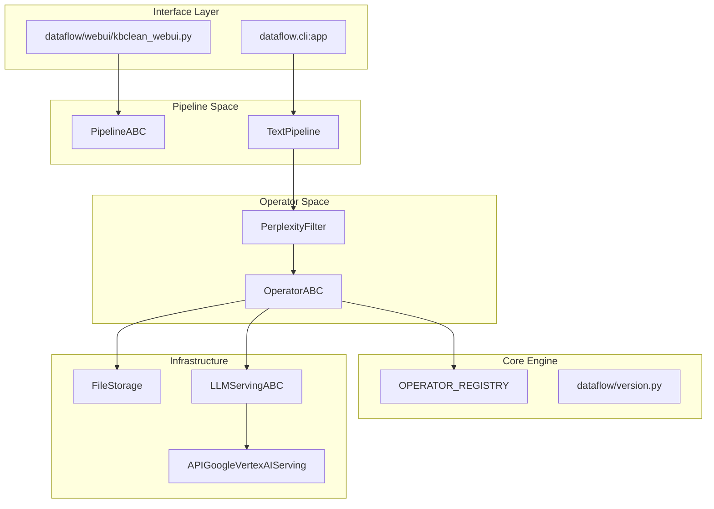
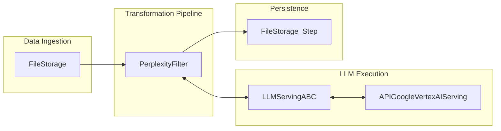

<!-- source: DeepWiki mcp.deepwiki.com · repo OpenDCAI/DataFlow · page 1 Overview · fetched 2026-11-02 -->

# Overview

Relevant source files

The following files were used as context for generating this wiki page:

- [.dockerignore](.dockerignore)
- [.gitignore](.gitignore)
- [Dockerfile](Dockerfile)
- [MANIFEST.in](MANIFEST.in)
- [README-zh.md](README-zh.md)
- [README.md](README.md)
- [dataflow/serving/api_google_vertexai_serving.py](dataflow/serving/api_google_vertexai_serving.py)
- [dataflow/version.py](dataflow/version.py)
- [pyproject.toml](pyproject.toml)
- [requirements.txt](requirements.txt)
- [static/logo/CAS.png](static/logo/CAS.png)
- [static/logo/ant_group.png](static/logo/ant_group.png)
- [static/logo/baichuan.png](static/logo/baichuan.png)
- [static/logo/hkust.png](static/logo/hkust.png)
- [static/logo/pku.png](static/logo/pku.png)
- [static/logo/shanghai_ailab.png](static/logo/shanghai_ailab.png)
- [test/test_general_text.py](test/test_general_text.py)

## Purpose and Scope

DataFlow is a comprehensive data preparation and training system designed to **generate, refine, evaluate, and filter** high-quality data for AI from noisy sources such as PDFs, plain text, and low-quality question-answer pairs [README.md:95-97](). By improving data quality, DataFlow enhances the performance of Large Language Models (LLMs) in specific domains (healthcare, finance, legal, academic) through targeted training (Pre-training, SFT, RL) or RAG systems [README-zh.md:70-72]().

The framework employs an **operator-based** design, transforming data cleaning workflows into reproducible, reusable, and shareable **pipelines** [README.md:98-99](). It serves as core infrastructure for the Data-Centric AI community, supplemented by an intelligent `DataFlow-agent` for dynamic pipeline assembly [README-zh.md:73-74]().

**For specific topics, see:**
- Installation, basic setup, and quick-start guides: [Getting Started](#1.1)
- DataFlow Suite components, ecosystem, versioning (`dataflow/version.py`), and logging: [DataFlow Suite and Ecosystem](#1.2)
- Deep dive into operators, pipelines, and storage: [Core Architecture](#3)
- Pre-built data preparation workflows: [Ready-to-Use Pipelines](#5)
- Reference documentation for all operators: [Operator Reference](#6)
- Command-line tools: [Command Line Interface](#8)
- Deployment options: [Deployment Options](#11)

Sources: [README.md:90-101](), [README-zh.md:70-76](), [dataflow/version.py:1-28]()

---

## The DataFlow Suite: Four-Layer Architecture

The DataFlow suite provides the essential infrastructure to automate and scale LLM data preparation through four tightly integrated layers [README-zh.md:109-111]().

| Layer | Component | Purpose |
|-------|-----------|---------|
| **Visual Interface** | `DataFlow-WebUI` | An intuitive interface for building complex pipelines via drag-and-drop workflows and natural language interaction [README-zh.md:113](). |
| **AI Assistant** | `DataFlow-Skills` | A collection of tutorials and skills covering operator development and best practices [README-zh.md:112](). |
| **Modular Distribution** | DataFlow-Ecosystem | A standardized distribution layer for domain-specific modules (e.g., `DataFlow-MM`, `DataFlow-AI4S`) under a unified abstraction [README-zh.md:114](). |
| **Orchestration** | `RayOrch` | A high-performance orchestration layer built on Ray for distributed computing and resource management [README-zh.md:115](). |

For detailed documentation on suite components, versioning (`dataflow/version.py`), and ecosystem mapping, see [DataFlow Suite and Ecosystem](#1.2). For initial installation and setup, see [Getting Started](#1.1).

Sources: [README-zh.md:109-117](), [dataflow/version.py:1-28]()

---

## Core Design Principles

DataFlow distinguishes itself through three foundational principles [README-zh.md:121-128]():

### 1. Operator-Based Workflow Composition
Data transformations are encapsulated as **operators** that define interaction modes and design principles [README-zh.md:99](). Over 100 domain-specific operators are available for reuse, covering generation, evaluation, filtering, and refinement [README-zh.md:100-126]().

### 2. PyTorch-like Hierarchical Management
The system follows a clear **Pipeline → Operator → Prompt** hierarchy [README-zh.md:125](). This structure allows for modular workflow control where complex logic is decomposed into discrete, manageable entities, mirroring the design of modern deep learning frameworks.

### 3. Reproducibility and Scientific Comparison
By encapsulating data governance algorithms into operator pipelines, DataFlow enables fair comparison between different strategies [README-zh.md:105](). Users can easily swap underlying LLMs while reusing the same pipeline to analyze the relationship between model performance and data quality [README-zh.md:106]().

Sources: [README-zh.md:97-107](), [README-zh.md:119-128]()

---

## System Architecture: Code-Level View

The following diagram bridges the conceptual framework to specific code entities within the repository, showing how core classes interact.

**Diagram: Code Entity Mapping**

Sources: [pyproject.toml:42](), [dataflow/version.py:1-7](), [test/test_general_text.py:1-12](), [dataflow/serving/api_google_vertexai_serving.py:173-180](), [dataflow/serving/api_google_vertexai_serving.py:14]()

---

## Data Flow: From Raw Input to Training Data

DataFlow manages the transformation of raw, noisy data into model-ready intelligence. The following diagram illustrates the execution flow using specific code components from a typical text processing pipeline.

**Diagram: Natural Language to Code Entity Flow**

Sources: [test/test_general_text.py:3-18](), [dataflow/serving/api_google_vertexai_serving.py:173-185](), [dataflow/utils/storage.py:2]()

---

## Key Components Reference

| Component | Code Reference | Description |
| :--- | :--- | :--- |
| **CLI Entry** | `dataflow.cli:app` | Main entry point for the command-line interface [pyproject.toml:42](). |
| **Storage Engine** | `FileStorage` | Handles file-based persistence and cache management for pipeline steps [test/test_general_text.py:5-10](). |
| **Filtering** | `PerplexityFilter` | A quality filter that scores text based on perplexity using a language model [test/test_general_text.py:12](). |
| **Vertex Serving** | `APIGoogleVertexAIServing` | Integration for Google Gemini models via Vertex AI with batch processing support [dataflow/serving/api_google_vertexai_serving.py:173-180](). |
| **Dependencies** | `requirements.txt` | Core library requirements including `torch`, `transformers`, and `fasttext` [requirements.txt:1-40](). |

Sources: [pyproject.toml:41-42](), [test/test_general_text.py:1-18](), [requirements.txt:1-40]()

---

## Deployment and Distribution

DataFlow is designed for flexibility across different environments:

*   **PyPI Package:** Distributed as `open-dataflow` [pyproject.toml:6]().
*   **Docker:** Official images (e.g., `molyheci/dataflow:cu124`) provide ready-to-use environments with CUDA 12.4 and vLLM [Dockerfile:1-36]().
*   **Source Management:** The `MANIFEST.in` ensures all necessary `.py`, `.json`, `.yaml`, and `.sh` files are included in distributions while excluding cache files like `__pycache__` [MANIFEST.in:1-25]().
*   **Version Control:** Versions are tracked via `__version__` in `dataflow/version.py` [dataflow/version.py:1-28]().
*   **Optional Features:** Extensive support for specialized workloads like `vllm`, `sglang`, `pdf2model`, and `vectorsql` via optional dependencies [pyproject.toml:54-97]().

Sources: [pyproject.toml:5-14](), [Dockerfile:1-39](), [MANIFEST.in:1-25](), [dataflow/version.py:1-28](), [pyproject.toml:54-97]()

---

