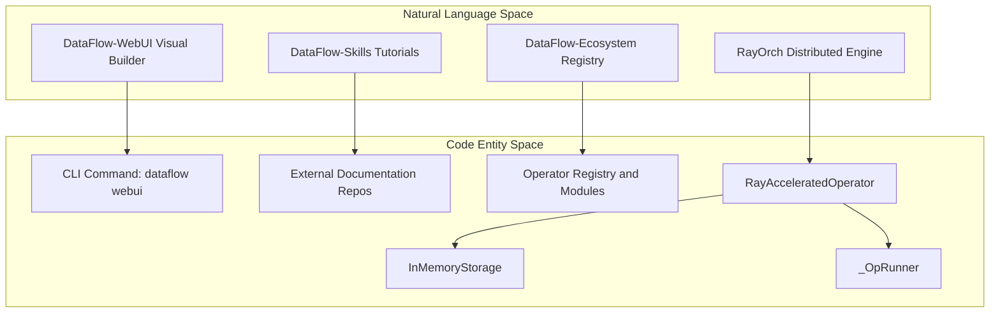
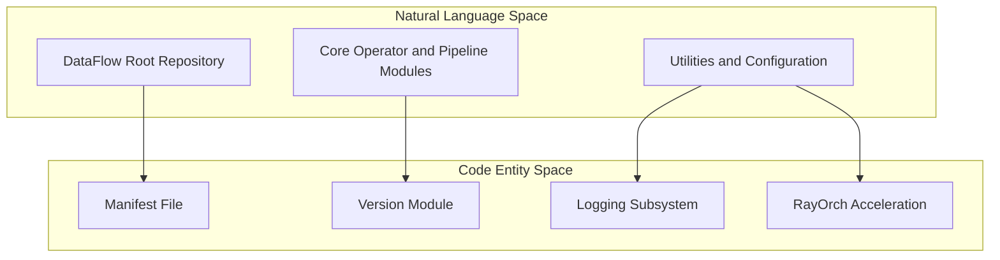

<!-- source: DeepWiki mcp.deepwiki.com · repo OpenDCAI/DataFlow · page 1.2 DataFlow Suite and Ecosystem · fetched 2026-11-02 -->

# DataFlow Suite and Ecosystem

Relevant source files

The following files were used as context for generating this wiki page:

- [.dockerignore](.dockerignore)
- [.gitignore](.gitignore)
- [Dockerfile](Dockerfile)
- [MANIFEST.in](MANIFEST.in)
- [README-zh.md](README-zh.md)
- [README.md](README.md)
- [dataflow/logger.py](dataflow/logger.py)
- [dataflow/rayorch/__init__.py](dataflow/rayorch/__init__.py)
- [dataflow/rayorch/_test_ops.py](dataflow/rayorch/_test_ops.py)
- [dataflow/rayorch/accelerated_op.py](dataflow/rayorch/accelerated_op.py)
- [dataflow/rayorch/memory_storage.py](dataflow/rayorch/memory_storage.py)
- [dataflow/version.py](dataflow/version.py)
- [test/rayorch/.gitignore](test/rayorch/.gitignore)
- [test/rayorch/README-zh.md](test/rayorch/README-zh.md)
- [test/rayorch/README.md](test/rayorch/README.md)
- [test/rayorch/test_accelerated_op.py](test/rayorch/test_accelerated_op.py)

This page details the multi-layered architecture of the DataFlow Suite and Ecosystem, mapping high-level system components (DataFlow-WebUI, DataFlow-Skills, DataFlow-Ecosystem, and RayOrch) to their underlying code entities. It also documents core repository infrastructure including package versioning (`dataflow/version.py`) and the centralized logging subsystem (`dataflow/logger.py`).

---

## 1. Architectural Layers of the DataFlow Suite

The DataFlow Suite organizes data preparation, pipeline orchestration, and execution scaling into four primary layers built around the core codebase:

1. **DataFlow-Skills**: A collection of tutorials, reference guides, and best-practice examples designed to assist developers with operator construction and pipeline composition `[README-zh.md:116-116]()`.
2. **DataFlow-WebUI**: An interactive workspace and visual pipeline builder that combines drag-and-drop orchestration with a Gradio interface and CLI launching capabilities via `dataflow webui` `[README.md:75-76]()`.
3. **DataFlow-Ecosystem**: A modular distribution layer that standardizes operator registration and enables domain-specific extensions under a unified execution interface `[README-zh.md:118-118]()`.
4. **RayOrch**: A high-performance compute acceleration layer built on Ray. It provides transparent data-parallel execution for row-independent operators using `RayAcceleratedOperator` and `InMemoryStorage` `[dataflow/rayorch/accelerated_op.py:56-110](), [dataflow/rayorch/memory_storage.py:10-26]()`.

### Diagram 1: Natural Language Space to Code Entity Space — Suite Architecture

Sources: `[README.md:71-78](), [README-zh.md:116-119](), [dataflow/rayorch/accelerated_op.py:36-110](), [dataflow/rayorch/memory_storage.py:10-26]()`

---

## 2. Repository Structure and Suite Mapping

The repository layout is structured to support both standalone Python library execution and integration with the wider DataFlow Ecosystem. Source distributions are governed by `MANIFEST.in`, which explicitly declares included Python modules, JSON configuration templates, YAML files, and static assets.

### Diagram 2: Natural Language Space to Code Entity Space — Repository Mapping

Sources: `[MANIFEST.in:1-25](), [dataflow/version.py:1-28](), [dataflow/logger.py:1-113](), [dataflow/rayorch/__init__.py:1-20]()`

---

## 3. Versioning Subsystem (`dataflow/version.py`)

The versioning subsystem manages package identification and parses version strings into structured comparison tuples for the DataFlow package.

### Core Functions and Variables

* `__version__`: Defines the active package version string (e.g., `'1.0.10'`) `[dataflow/version.py:1-1]()`.
* `get_version()`: Returns the active version string `[dataflow/version.py:5-7]()`.
* `parse_version_info(version_str)`: Splits version strings into integers and release candidate tags (e.g., parsing `"2.0.0rc1"` into `(2, 0, 0, 'rc1')`) `[dataflow/version.py:9-26]()`.

Sources: `[dataflow/version.py:1-28]()`

---

## 4. Logging Subsystem (`dataflow/logger.py`)

DataFlow implements a centralized logging configuration modeled after `loguru` behaviors, utilizing custom log levels, standard output stream splitting, and colored formatting via `colorlog` `[dataflow/logger.py:1-113]()`.

### Key Components

* **Custom SUCCESS Level**: Adds a custom `SUCCESS` logging level (numeric value `25`) with a bound `success()` method on `logging.Logger` `[dataflow/logger.py:7-14]()`.
* **Stream Splitting Filters**:
  * `MaxLevelFilter`: Restricts logs strictly below `ERROR` level to `sys.stdout` `[dataflow/logger.py:17-24]()`.
  * `MinLevelFilter`: Restricts logs at or above `ERROR` level to `sys.stderr` `[dataflow/logger.py:25-32]()`.
* **Colored Formatting**: `_make_colored_formatter()` configures a secondary color mapping for timestamps, levels, filenames, and line numbers `[dataflow/logger.py:34-77]()`.
* **Logger Initialization**: `get_logger(level)` retrieves or instantiates the singleton `"DataFlow"` logger, preventing duplicate handlers and respecting the `DF_LOGGING_LEVEL` environment variable `[dataflow/logger.py:80-113]()`.

| Filter Class | Target Stream | Condition |
| :--- | :--- | :--- |
| `MaxLevelFilter(logging.ERROR)` | `sys.stdout` | `record.levelno < 40` |
| `MinLevelFilter(logging.ERROR)` | `sys.stderr` | `record.levelno >= 40` |

Sources: `[dataflow/logger.py:1-113]()`

---

