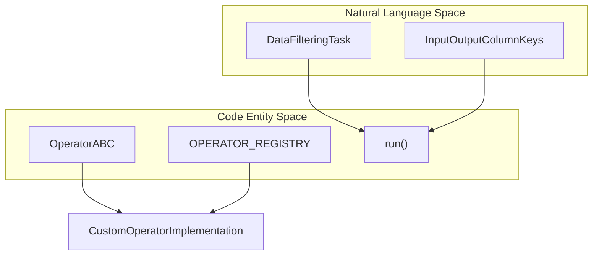
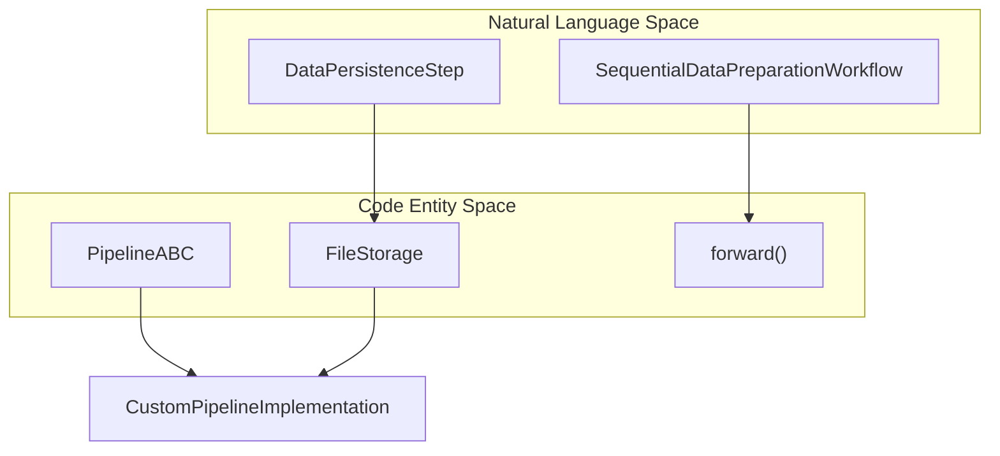

<!-- source: DeepWiki mcp.deepwiki.com · repo OpenDCAI/DataFlow · page 10 Development Guide · fetched 2026-11-02 -->

# Development Guide

Relevant source files

The following files were used as context for generating this wiki page:

- [.dockerignore](.dockerignore)
- [.gitignore](.gitignore)
- [Dockerfile](Dockerfile)
- [MANIFEST.in](MANIFEST.in)
- [README-zh.md](README-zh.md)
- [README.md](README.md)
- [dataflow/operators/__init__.py](dataflow/operators/__init__.py)
- [dataflow/version.py](dataflow/version.py)

This guide provides a high-level overview for developers contributing to DataFlow or extending its functionality with custom components, workflows, and operator implementations. DataFlow is structured as an extensible framework for LLM data preparation, supporting multi-layer architectures as outlined in `README.md` [README.md:1-104](). 

For detailed technical instructions, implementation walkthroughs, and code examples, refer to the respective child pages:
- Project Structure: [Project Structure](#10.1)
- Testing: [Testing](#10.2)
- Dependencies and Installation: [Dependencies and Installation](#10.3)
- Creating Custom Operators: [Creating Custom Operators](#10.4)
- Creating Custom Pipelines: [Creating Custom Pipelines](#10.5)

---

## 10.1 Project Structure

The DataFlow repository organizes core abstractions, operators, prompts, pipelines, and serving layers into a modular directory layout. Package distribution rules and included assets are governed by `MANIFEST.in` [MANIFEST.in:1-25](), while version metadata is centralized in `dataflow/version.py` [dataflow/version.py:1-28](). Containerized deployment configurations and build environments are managed via the `Dockerfile` [Dockerfile:1-39]().

For details, see [Project Structure](#10.1).

Sources: [MANIFEST.in:1-25](), [dataflow/version.py:1-28](), [Dockerfile:1-39]()

---

## 10.2 Testing

Testing in DataFlow ensures robustness across components using standardized test suites and configuration files. Developers validate changes and verify execution pipelines against containerized and local environments defined in the repository structure [Dockerfile:1-39]().

For details, see [Testing](#10.2).

Sources: [Dockerfile:1-39]()

---

## 10.3 Dependencies and Installation

Dependencies and package configurations support modular extensions and optional feature sets. Distribution packaging rules are maintained in `MANIFEST.in` [MANIFEST.in:1-25](), and environment setup is streamlined via container files such as the `Dockerfile` [Dockerfile:1-39]() and standard version tracking in `dataflow/version.py` [dataflow/version.py:1-28]().

For details, see [Dependencies and Installation](#10.3).

Sources: [MANIFEST.in:1-25](), [dataflow/version.py:1-28](), [Dockerfile:1-39]()

---

## 10.4 Creating Custom Operators

Custom operators implement specific data processing tasks by extending base classes and registering with component registries. The architecture maps high-level data filtering or generation concepts directly to execution methods within operators.

Title: "Operator Natural Language to Code Entity Mapping"

For details, see [Creating Custom Operators](#10.4).

Sources: [README.md:101-104]()

---

## 10.5 Creating Custom Pipelines

Pipelines manage multi-operator execution flows, composite transformations, and data staging steps. They encapsulate workflows described in `README.md` [README.md:1-104]() into reproducible execution graphs.

Title: "Pipeline Natural Language to Code Entity Mapping"

For details, see [Creating Custom Pipelines](#10.5).

Sources: [README.md:1-104]()

---

