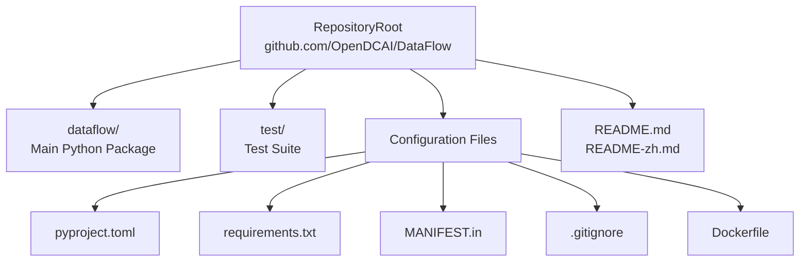
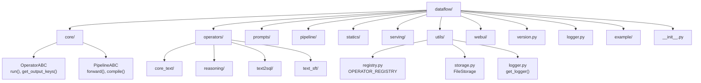
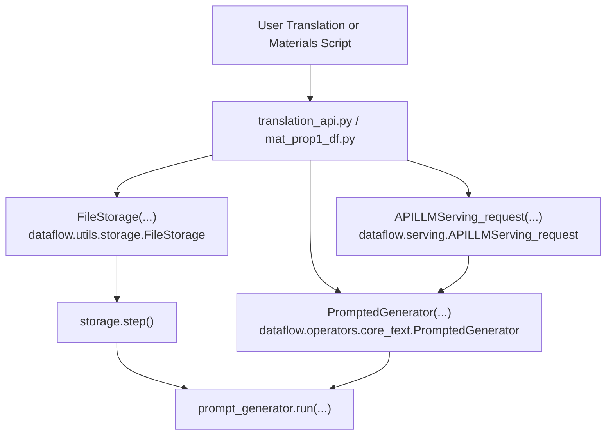
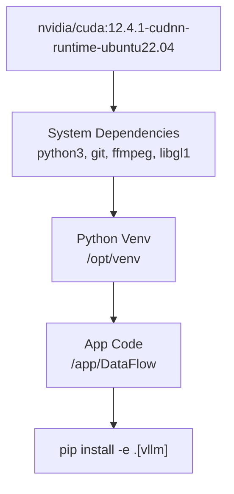

<!-- source: DeepWiki mcp.deepwiki.com · repo OpenDCAI/DataFlow · page 10.1 Project Structure · fetched 2026-11-02 -->

# Project Structure

Relevant source files

The following files were used as context for generating this wiki page:

- [.dockerignore](.dockerignore)
- [.gitignore](.gitignore)
- [Dockerfile](Dockerfile)
- [MANIFEST.in](MANIFEST.in)
- [README-zh.md](README-zh.md)
- [README.md](README.md)
- [dataflow/statics/playground/playground/materials/mat_names_df.py](dataflow/statics/playground/playground/materials/mat_names_df.py)
- [dataflow/statics/playground/playground/materials/mat_prop1_df.py](dataflow/statics/playground/playground/materials/mat_prop1_df.py)
- [dataflow/statics/playground/playground/materials/mat_recipe_df.py](dataflow/statics/playground/playground/materials/mat_recipe_df.py)
- [dataflow/statics/playground/playground/prompted_generator/abbreviation_qa_api.py](dataflow/statics/playground/playground/prompted_generator/abbreviation_qa_api.py)
- [dataflow/statics/playground/playground/prompted_generator/generate_qa_api.py](dataflow/statics/playground/playground/prompted_generator/generate_qa_api.py)
- [dataflow/statics/playground/playground/prompted_generator/translation_api.py](dataflow/statics/playground/playground/prompted_generator/translation_api.py)
- [dataflow/version.py](dataflow/version.py)
- [static/logo/CAS.png](static/logo/CAS.png)
- [static/logo/ant_group.png](static/logo/ant_group.png)
- [static/logo/baichuan.png](static/logo/baichuan.png)
- [static/logo/hkust.png](static/logo/hkust.png)
- [static/logo/pku.png](static/logo/pku.png)
- [static/logo/shanghai_ailab.png](static/logo/shanghai_ailab.png)

This page documents the directory layout, module organization, operator namespace conventions, playground/statics layout, and package distribution rules of the DataFlow codebase located at [https://github.com/OpenDCAI/DataFlow](). It explains where operators, prompts, pipelines, serving modules, and playground scripts are located within the repository, how `MANIFEST.in` controls package distribution, and how import paths map to physical files.

Related topics covered elsewhere:
- Component discovery and lazy loading: see page 3.3 (Registry and Lazy Loading)
- Testing infrastructure: see page 10.2 (Testing)
- Dependency management: see page 10.3 (Dependencies and Installation)

---

## Repository Structure

The DataFlow repository follows a standard Python project structure. This section provides an overview of the top-level directories and configuration files.

**Diagram: Top-Level Repository Layout**

Sources: [README.md:1-135](), [MANIFEST.in:1-21](), [Dockerfile:1-10](), [.gitignore:1-41]()

### Installation and Versioning

DataFlow uses a semantic versioning system managed in a dedicated version file [dataflow/version.py:1-2](). The current stable version is `1.0.10` [dataflow/version.py:1-1](). The `get_version()` and `parse_version_info()` functions handle version string processing by splitting components and identifying release candidates [dataflow/version.py:5-26]().

Sources: [dataflow/version.py:1-28](), [dataflow/version.py:5-26]()

### Configuration Files

| File | Purpose | Key Configuration |
|------|---------|-------------------|
| `pyproject.toml` | Package metadata and build system | Defines project name `open-dataflow` and optional extras like `[vllm]`, `[kbc]`, `[pdf2model]`. |
| `requirements.txt` | Core dependencies | Lists base packages required for all installations [MANIFEST.in:18-18](). |
| `MANIFEST.in` | Distribution file inclusion | Explicitly includes `.py`, `.json`, `.yaml`, `.sh`, and `.txt` files in the package [MANIFEST.in:1-7](). |
| `Dockerfile` | Containerization | Provides a reproducible environment with CUDA 12.4 support and `[vllm]` extras [Dockerfile:2-36](). |
| `.gitignore` | Version control exclusion | Excludes local caches (`dataflow_cache/`), temporary test files (`df_test/`), and virtual environments [.gitignore:1-41](). |

Sources: [MANIFEST.in:1-21](), [README.md:20-28](), [Dockerfile:2-36](), [.gitignore:1-41]()

---

## DataFlow Package Structure

The `dataflow/` package is organized into distinct modules corresponding to the framework's architectural layers. The internal logic is segmented to allow for modular scaling.

### Key Directories and Paths

The package structure is designed to separate core abstractions from domain-specific implementations.

**Diagram: DataFlow Package Module Hierarchy**

Sources: [dataflow/version.py:1-28](), [MANIFEST.in:2-10]()

---

## Module Organization and Namespaces

DataFlow uses specific directory conventions to organize its operators and prompts, allowing for clean imports and registry-based discovery.

### Operator Namespace Conventions

Operators are categorized by domain and functional role within `dataflow/operators/`. The subdirectories define the functional namespaces:

- **`core_text`**: Fundamental LLM interaction operators (e.g., `PromptedGenerator`) [README-zh.md:152-152]().
- **`general_text`**: Broad text cleaning and filtering (e.g., `PerplexityFilter`, `DeitaQualityFilter`) [README.md:98-128]().
- **`text_sft` / `text_pt`**: Specialized for Supervised Fine-Tuning and Pre-Training data synthesis (e.g., `CondorGenerator`) [README-zh.md:83-85]().
- **`reasoning`**: Mathematical and logical reasoning generation, difficulty assessment, and evaluation [README-zh.md:95-95]().
- **`text2sql`**: SQL generation, executability filtering, and correspondence checking [README-zh.md:94-94]().
- **`knowledge_base_cleaning`**: PDF/URL to Markdown conversion and multi-hop QA pair extraction [README-zh.md:88-90]().

Sources: [README.md:98-128](), [README-zh.md:121-127](), [README-zh.md:152-153]()

### Prompt Namespace Conventions

Prompts are stored in `dataflow/prompts/` and are typically grouped by the operator domain they serve. This system supports a structured hierarchy:
- `general.py`: Common instruction and refinement templates.
- `math.py`: Chain-of-Thought (CoT) templates for reasoning tasks.
- `text2sql.py`: Schema-aware SQL generation and consistency filtering templates.
- `pdf_vqa.py`: Templates for extracting visual QA pairs from documents.

Sources: [README.md:124-127](), [README-zh.md:125-126]()

### Internal Logging and Utilities

The framework uses a customized logging system defined in `dataflow/logger.py`. It implements a `SUCCESS` log level (level 25) and provides a `get_logger()` function that configures color-coded output via `colorlog`. The logger separates `stdout` (for levels below ERROR) and `stderr` (for ERROR and above) using `MaxLevelFilter` and `MinLevelFilter`.

Sources: [README.md:127-128](), [README-zh.md:127-128]()

---

## Playground and Statics Layout

The `dataflow/statics/` directory houses static assets, pipeline examples, and playground scripts that demonstrate how to wire operators, storage modules, and serving layers together.

### Playground Script Organization

Playground scripts are located under `dataflow/statics/playground/playground/` and provide concrete examples of single-operator and multi-operator execution pipelines.

- **`prompted_generator/`**: Contains translation and QA generation scripts such as `translation_api.py`, `generate_qa_api.py`, and `abbreviation_qa_api.py` which instantiate `PromptedGenerator` and `APILLMServing_request` [dataflow/statics/playground/playground/prompted_generator/translation_api.py:1-35]().
- **`materials/`**: Domain-specific scripts such as `mat_prop1_df.py`, `mat_recipe_df.py`, and `mat_names_df.py` that integrate chemistry operators like `EvaluateSmilesEquivalence` with customized multi-line system prompts [dataflow/statics/playground/playground/materials/mat_prop1_df.py:1-74]().

**Diagram: Playground Execution Flow to Code Entities**

Sources: [dataflow/statics/playground/playground/prompted_generator/translation_api.py:1-35](), [dataflow/statics/playground/playground/materials/mat_prop1_df.py:1-74]()

---

## Package Distribution and `MANIFEST.in`

To ensure that non-python assets (like JSON examples, Shell scripts, and YAML configs) are included when installing via `pip`, the `MANIFEST.in` file explicitly defines inclusion rules [MANIFEST.in:1-21]().

| Directive | Pattern | Purpose |
|-----------|---------|---------|
| `recursive-include` | `dataflow *.py` | Includes all source code [MANIFEST.in:2-2](). |
| `recursive-include` | `dataflow *.json` | Includes configuration and example data [MANIFEST.in:3-3](). |
| `recursive-include` | `dataflow *.yaml` | Includes metadata and template configs [MANIFEST.in:4-4](). |
| `recursive-include` | `dataflow/example` | Ensures the entire example suite is distributed [MANIFEST.in:10-10](). |
| `recursive-include` | `dataflow/statics` | Includes pipeline templates and assets [MANIFEST.in:13-14](). |
| `global-exclude` | `__pycache__/`, `*.so` | Prevents bloating the package with compiled or temporary files [MANIFEST.in:22-25](). |

Sources: [MANIFEST.in:1-25]()

---

## Containerization and Environment

The `Dockerfile` provides a standardized environment for running DataFlow, especially for GPU-intensive tasks like local model serving via `vllm`. It handles system-level dependencies (e.g., `ffmpeg`, `libgl1`) and sets up a clean Python environment using a virtual environment at `/opt/venv` [Dockerfile:2-36]().

**Diagram: Docker Image Composition**

Sources: [Dockerfile:2-36](), [.dockerignore:1-26]()

---

