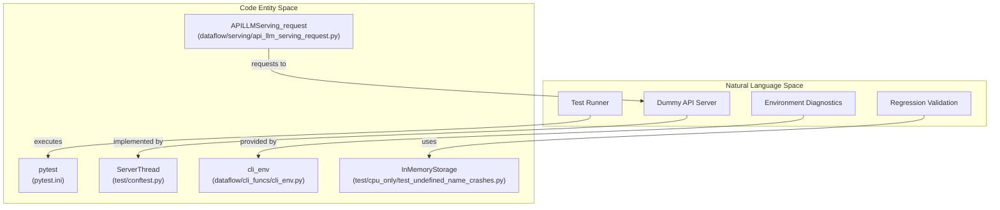
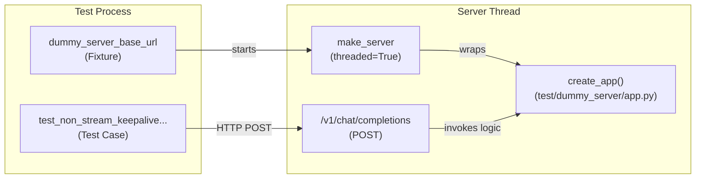

<!-- source: DeepWiki mcp.deepwiki.com · repo OpenDCAI/DataFlow · page 10.2 Testing · fetched 2026-11-02 -->

# Testing

Relevant source files

The following files were used as context for generating this wiki page:

- [.github/workflows/test.yml](.github/workflows/test.yml)
- [dataflow/operators/code/filter/code_score_filter.py](dataflow/operators/code/filter/code_score_filter.py)
- [dataflow/operators/core_text/eval/bench_dataset_evaluator_question.py](dataflow/operators/core_text/eval/bench_dataset_evaluator_question.py)
- [dataflow/serving/api_llm_serving_request.py](dataflow/serving/api_llm_serving_request.py)
- [dataflow/serving/localhost_llm_api_serving.py](dataflow/serving/localhost_llm_api_serving.py)
- [dataflow/serving/localmodel_lalm_serving.py](dataflow/serving/localmodel_lalm_serving.py)
- [dataflow/statics/playground/playground/prompted_generator/translation_api_json_schema.py](dataflow/statics/playground/playground/prompted_generator/translation_api_json_schema.py)
- [pytest.ini](pytest.ini)
- [test/auto_test_for_api_pipeline.py](test/auto_test_for_api_pipeline.py)
- [test/conftest.py](test/conftest.py)
- [test/cpu_only/test_api_llmserving.py](test/cpu_only/test_api_llmserving.py)
- [test/cpu_only/test_dummy_server.py](test/cpu_only/test_dummy_server.py)
- [test/cpu_only/test_undefined_name_crashes.py](test/cpu_only/test_undefined_name_crashes.py)
- [test/dummy_server/__init__.py](test/dummy_server/__init__.py)
- [test/dummy_server/app.py](test/dummy_server/app.py)
- [test/small_functions/generate_qa.py](test/small_functions/generate_qa.py)
- [test/small_functions/generate_qa_json_schema.py](test/small_functions/generate_qa_json_schema.py)
- [test/small_functions/translation.py](test/small_functions/translation.py)
- [test/small_functions/translation_json_schema.py](test/small_functions/translation_json_schema.py)

DataFlow's testing infrastructure provides comprehensive coverage for CPU-only operators, API-based serving, and GPU-dependent components. The system uses `pytest` with custom markers to categorize tests by resource requirements and implements a multi-threaded dummy HTTP server to simulate LLM API behavior without requiring actual API keys or external services during CI/CD. Furthermore, the repository includes a suite of standalone verification scripts under `test/small_functions/` to validate common pipeline patterns.

---

## Test Organization and Markers

DataFlow tests are organized by resource requirements using `pytest` markers defined in `pytest.ini` [pytest.ini:13-16](). These markers allow developers to filter tests based on available hardware and network access.

| Marker | Purpose | Resource Requirements |
|--------|---------|----------------------|
| `cpu` | Tests that run on CPU only | No GPU, no external API |
| `api` | Tests requiring HTTP API calls | Network access, often uses dummy server |
| `gpu` | Tests requiring GPU hardware | CUDA-capable GPU, local model serving |

The configuration also specifies directories to ignore, such as legacy tests or build artifacts, to maintain a clean testing environment [pytest.ini:7-12]().

Sources: [pytest.ini:1-16]()

---

## Test Architecture Overview

The testing suite bridges high-level pipeline logic with low-level infrastructure like `APILLMServing_request` and the `Registry` system.

### System Entity Mapping

Sources: [test/conftest.py:25-42](), [dataflow/serving/api_llm_serving_request.py:16-33](), [test/cpu_only/test_undefined_name_crashes.py:15-29](), [pytest.ini:1-16]()

---

## Small Functions and Standalone Pipeline Tests

The codebase includes a dedicated `test/small_functions/` directory containing standalone examples and verification scripts that demonstrate how operators, storage layers, and serving backends integrate in practice.

### Key Examples in Small Functions
1. **Translation Pipeline (`test/small_functions/translation.py`)**: Demonstrates initializing a `FileStorage` cache [test/small_functions/translation.py:7-12](), configuring an `APILLMServing_request` client [test/small_functions/translation.py:14-18](), and invoking `PromptedGenerator` with system instructions to process text inputs [test/small_functions/translation.py:19-29]().
2. **Dataframe Filtering (`test/small_functions/filtering.py`)**: Uses `GeneralFilter` with lambda predicate expressions over `pandas.DataFrame` columns (such as score thresholds and string matching) [test/small_functions/filtering.py:13-33]() driven by `FileStorage` [test/small_functions/filtering.py:6-11]().
3. **QA Generation (`test/small_functions/generate_qa.py`)**: Illustrates batch problem-solving configurations with higher worker limits (`max_workers=50`) feeding `PromptedGenerator` [test/small_functions/generate_qa.py:14-27]().

Sources: [test/small_functions/translation.py:1-36](), [test/small_functions/generate_qa.py:1-34]()

---

## Regression Testing and In-Memory Validation

To ensure stability without disk I/O overhead, the test suite utilizes `InMemoryStorage`, a minimal stand-in for `DataFlowStorage` [test/cpu_only/test_undefined_name_crashes.py:15-29](). This is used extensively in regression tests to verify fixes for specific crashes, such as:

*   **Import Guarding**: Verifying that `text2sql` operators and prompts import correctly on Python 3.13+ after the removal of `re.template` [test/cpu_only/test_undefined_name_crashes.py:41-61]().
*   **Audio Decoding**: Ensuring `_read_audio_base64` in `localmodel_lalm_serving` correctly handles base64 data without missing imports [test/cpu_only/test_undefined_name_crashes.py:63-80]().
*   **Operator Logic**: Validating that `CodeGenericScoreFilter` correctly raises `ValueError` for unknown filter methods instead of `NameError` [test/cpu_only/test_undefined_name_crashes.py:111-123]().
*   **Evaluator Robustness**: Testing `BenchDatasetEvaluatorQuestion` for handling missing reference columns and empty answers [test/cpu_only/test_undefined_name_crashes.py:126-175]().

Sources: [test/cpu_only/test_undefined_name_crashes.py:1-203](), [dataflow/operators/code/filter/code_score_filter.py:130-142](), [dataflow/operators/core_text/eval/bench_dataset_evaluator_question.py:71-93]()

---

## Dummy Server for API Testing

To test `APILLMServing_request` without external dependencies, DataFlow uses a multi-threaded dummy server managed by `pytest` fixtures.

### Server Lifecycle and Data Flow

Sources: [test/conftest.py:25-42](), [test/conftest.py:44-78](), [test/cpu_only/test_api_llmserving.py:7-14]()

### Key API Testing Scenarios
1. **Response Formatting**: `APILLMServing_request.format_response` is tested to ensure it correctly handles `reasoning_content` by wrapping it in `<think>` and `<answer>` tags [dataflow/serving/api_llm_serving_request.py:78-103](). It also ensures tool-call-only responses are marked as failed (returning `None`) [test/cpu_only/test_undefined_name_crashes.py:83-97]().
2. **Keep-Alive Simulation**: The dummy server can simulate high-traffic queuing by returning empty lines or SSE comments. Tests verify that the client can parse JSON correctly after these keep-alive intervals [test/cpu_only/test_api_llmserving.py:7-38]().
3. **Timeout & Retries**: Tests verify that `APILLMServing_request` correctly respects `connect_timeout` and `read_timeout` [test/cpu_only/test_api_llmserving.py:21-22](), raising `RuntimeError` on connection failures [test/cpu_only/test_api_llmserving.py:95-101]() or issuing `RuntimeWarning` when `max_wait` is exceeded [test/cpu_only/test_api_llmserving.py:66-74]().

Sources: [dataflow/serving/api_llm_serving_request.py:16-103](), [test/cpu_only/test_api_llmserving.py:1-103](), [test/conftest.py:44-78]()

---

## CI/CD Workflow with GitHub Actions

The DataFlow CI pipeline, defined in `.github/workflows/test.yml`, automates testing across multiple operating systems (Ubuntu, Windows) and Python versions (3.10 - 3.13) [.github/workflows/test.yml:25-37]().

### Workflow Execution Steps
1. **Trigger**: Runs on every push or PR to `main` involving Python files or dependency configurations [.github/workflows/test.yml:3-17]().
2. **Environment Cleanup**: On Linux runners, it deletes large pre-installed components (Android, .NET, CodeQL) and prunes Docker to maximize disk space [.github/workflows/test.yml:50-61]().
3. **Dependency Management**:
   - Installs the `uv` package manager with remote caching enabled [.github/workflows/test.yml:64-67]().
   - Installs project dependencies from `requirements.txt` and the package in editable mode with `[test]` extras using `UV_SYSTEM_PYTHON` [.github/workflows/test.yml:70-75]().
4. **Test Execution**: Runs `pytest -m "cpu or api"` for both Windows and Linux/macOS environments [.github/workflows/test.yml:77-89](). This ensures core logic and API integrations are validated while excluding resource-intensive `gpu` tests.

Sources: [.github/workflows/test.yml:1-90]()

---

