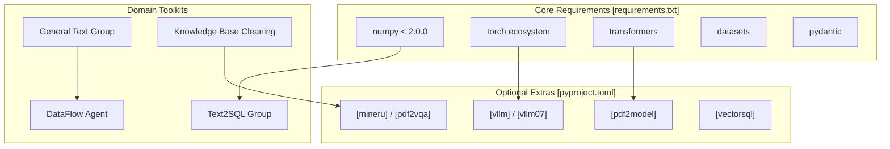
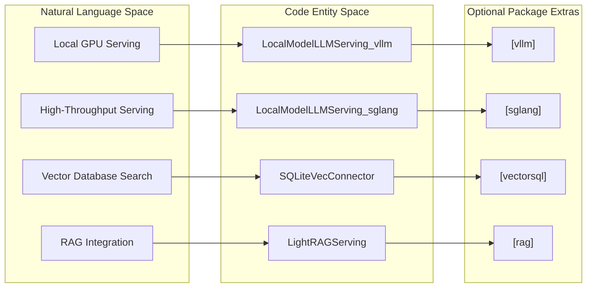
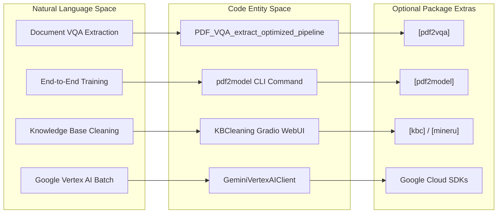

<!-- source: DeepWiki mcp.deepwiki.com · repo OpenDCAI/DataFlow · page 10.3 Dependencies and Installation · fetched 2026-11-02 -->

# Dependencies and Installation

<details>
<summary>Relevant source files</summary>

The following files were used as context for generating this wiki page:

- [.dockerignore](.dockerignore)
- [.gitignore](.gitignore)
- [Dockerfile](Dockerfile)
- [MANIFEST.in](MANIFEST.in)
- [README-zh.md](README-zh.md)
- [README.md](README.md)
- [dataflow/serving/api_google_vertexai_serving.py](dataflow/serving/api_google_vertexai_serving.py)
- [dataflow/version.py](dataflow/version.py)
- [pyproject.toml](pyproject.toml)
- [requirements.txt](requirements.txt)
- [test/test_general_text.py](test/test_general_text.py)

</details>


This page documents the dependency management, configuration files, and installation procedures for the DataFlow framework. It details the structure of `requirements.txt` [requirements.txt:1-91](), the project configuration and optional extras defined in `pyproject.toml` [pyproject.toml:1-97](), and the usage of the UV package manager for rapid environment provisioning.

---

## Purpose and Scope

The DataFlow dependency architecture bridges base Python runtime libraries, domain-specific toolkits (such as Text2SQL, Knowledge Base Cleaning, and Agent services), and heavy hardware-accelerated backends (vLLM, SGLang, and MinerU). By isolating these dependencies into modular extras via `pyproject.toml` [pyproject.toml:54-97](), DataFlow allows users to install only the components required for their specific pipeline domains.

Sources: [pyproject.toml:54-97](), [requirements.txt:1-91]()

---

## System Requirements

DataFlow requires Python as specified in the project metadata [pyproject.toml:13](). Certain package versions are strictly pinned or bounded to prevent platform and ecosystem conflicts, such as `pyarrow` locked at `20.0.0` for Python 3.10 stability [requirements.txt:27]() and `numpy < 2.0.0` for tensor framework and vLLM compatibility [requirements.txt:1]().

**Hardware Tiers:**
- **CPU-only Mode**: Minimum 8GB RAM for lightweight text preprocessing and pipeline testing [test/test_general_text.py:1-18]().
- **GPU Inference Mode**: NVIDIA GPU with CUDA 12.4+ and 16GB+ VRAM for local model execution using `vllm` or `sglang` [pyproject.toml:56-63]().
- **Document Processing**: 16GB+ system RAM for heavy PDF parsing via MinerU [pyproject.toml:60-61]().

Sources: [pyproject.toml:13](), [requirements.txt:1-27](), [test/test_general_text.py:1-18]()

---

## Dependency Architecture

DataFlow manages dependencies through a two-tiered system: base requirements defined in `requirements.txt` [requirements.txt:1-91]() and dynamically loaded optional extras defined in `pyproject.toml` [pyproject.toml:54-97]().

### Core Dependency Graph

Title: "DataFlow Dependency Hierarchy"

Sources: [requirements.txt:1-91](), [pyproject.toml:54-97]()

---

## Core Requirements & pyproject.toml Configuration

The build system utilizes `setuptools` with dynamic metadata binding [pyproject.toml:1-51](). Specifically, `pyproject.toml` delegates its version resolution to `dataflow.version.__version__` [pyproject.toml:50](), [dataflow/version.py:1-7]() and its static dependencies directly to `requirements.txt` [pyproject.toml:51]().

### Essential Packages

| Package | Constraint | Role |
|---------|-----------|------|
| `numpy` | `<2.0.0` | Array operations and tensor bridge [requirements.txt:1]() |
| `pyarrow` | `==20.0.0` | Storage schema persistence and arrow serialization [requirements.txt:27]() |
| `torch` | Latest | Deep learning runtime backbone [requirements.txt:4]() |
| `transformers` | Latest | Tokenization and model architecture parsing [requirements.txt:8]() |
| `pydantic` | Latest | Configuration parsing and operator schema validation [requirements.txt:21]() |
| `gradio` | `>5` | WebUI and interactive console support [requirements.txt:24]() |
| `cookiecutter`| Latest | CLI template scaffolding [requirements.txt:28]() |

Sources: [requirements.txt:1-30](), [pyproject.toml:44-51]()

---

## Optional Dependency Extras

To prevent heavy installations for lightweight tasks, `pyproject.toml` defines modular optional dependency groups [pyproject.toml:54-97]().

### Local Inference and Acceleration Extras

Title: "Natural Language Requirements to Code Entity Mapping for Inference Extras"

Sources: [pyproject.toml:56-66](), [pyproject.toml:93]()

### Specialized Processing Extras

Title: "Natural Language Requirements to Code Entity Mapping for Processing Extras"

Sources: [pyproject.toml:60-94](), [dataflow/serving/api_google_vertexai_serving.py:48-90]()

---

## UV Package Manager Usage

DataFlow recommends the `uv` package manager for accelerated dependency resolution and isolated virtual environment creation. 

### Provisioning Steps with UV

1. **Clone and Navigate**:
   ```bash
   git clone https://github.com/OpenDCAI/DataFlow.git
   cd DataFlow
   ```

2. **Create Virtual Environment**:
   ```bash
   uv venv --python 3.10
   source .venv/bin/activate
   ```

3. **Install Package with Extras**:
   ```bash
   # Editable core installation
   uv pip install -e .

   # Installation with vLLM and MinerU document parsing support
   uv pip install -e ".[vllm,mineru]"
   ```

Sources: [pyproject.toml:54-97](), [requirements.txt:1-91]()

---

## Summary of Installation Commands

| Deployment Target | Pip / UV Command |
|-------------------|------------------|
| **Core Framework** | `pip install open-dataflow` [pyproject.toml:5-10]() |
| **Local GPU vLLM** | `pip install "open-dataflow[vllm]"` [pyproject.toml:56]() |
| **High-Throughput SGLang** | `pip install "open-dataflow[sglang]"` [pyproject.toml:63]() |
| **PDF Processing & MinerU** | `pip install "open-dataflow[mineru]"` [pyproject.toml:61]() |
| **Vector Database & SQL** | `pip install "open-dataflow[vectorsql]"` [pyproject.toml:66]() |
| **Full Training Suite** | `pip install "open-dataflow[pdf2model]"` [pyproject.toml:68-75]() |

Sources: [pyproject.toml:54-97]()

---

