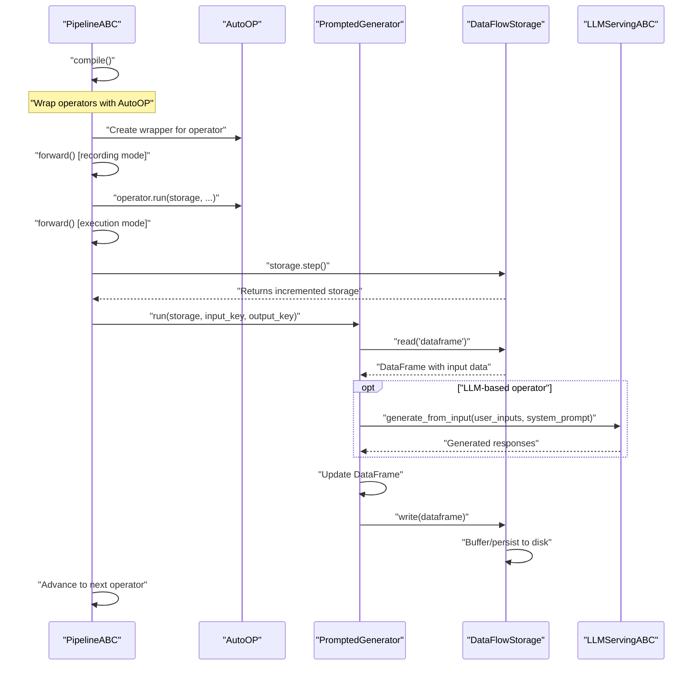
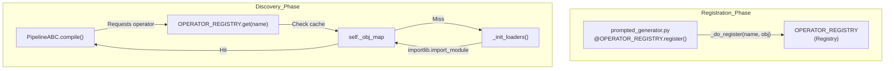

<!-- source: DeepWiki mcp.deepwiki.com · repo OpenDCAI/DataFlow · page 10.4 Creating Custom Operators · fetched 2026-11-02 -->

# Creating Custom Operators

<details>
<summary>Relevant source files</summary>

The following files were used as context for generating this wiki page:

- [dataflow/core/__init__.py](dataflow/core/__init__.py)
- [dataflow/operators/core_text/generate/format_str_prompted_generator.py](dataflow/operators/core_text/generate/format_str_prompted_generator.py)
- [dataflow/prompts/core_text.py](dataflow/prompts/core_text.py)
- [dataflow/statics/playground/simple_text_pipelines/sft_from_scratch.py](dataflow/statics/playground/simple_text_pipelines/sft_from_scratch.py)
- [dataflow/statics/scaffold/{{cookiecutter.repo_name}}/{{cookiecutter.package_name}}/operators/core/my_format_str_prompted_generator.py](dataflow/statics/scaffold/{{cookiecutter.repo_name}}/{{cookiecutter.package_name}}/operators/core/my_format_str_prompted_generator.py)
- [dataflow/statics/scaffold/{{cookiecutter.repo_name}}/{{cookiecutter.package_name}}/prompts/core.py](dataflow/statics/scaffold/{{cookiecutter.repo_name}}/{{cookiecutter.package_name}}/prompts/core.py)
- [dataflow/utils/registry.py](dataflow/utils/registry.py)
- [dataflow/wrapper/auto_op.py](dataflow/wrapper/auto_op.py)
- [test/cpu_only/test_register_whitelist.py](test/cpu_only/test_register_whitelist.py)
- [test/test_autoop.py](test/test_autoop.py)
- [test/test_copy.py](test/test_copy.py)
- [test/test_copy_weak_ref.py](test/test_copy_weak_ref.py)
- [test/test_dataframe_col.py](test/test_dataframe_col.py)

</details>


This page provides a step-by-step guide for implementing `OperatorABC`, registering custom operators with `OPERATOR_REGISTRY`, and integrating them into DataFlow pipelines.

## Overview of the Operator Pattern

DataFlow operators are Python classes that inherit from `OperatorABC` and implement a standardized `run()` method interface. Each operator represents a single data transformation step that reads input from storage, performs processing (optionally using LLM services), and writes output back to storage.

### Key Characteristics

| Aspect | Description |
|--------|-------------|
| **Base Class** | All operators must inherit from `OperatorABC` [dataflow/core/__init__.py:7-7]() |
| **Entry Point** | The `run()` method is the required interface [dataflow/core/__init__.py:12-12]() |
| **Storage Protocol** | First parameter must be `storage: DataFlowStorage` [dataflow/wrapper/auto_op.py:47-50]() |
| **Key-Based I/O** | Data columns are referenced by string keys (e.g., `input_key="raw_content"`) [test/test_autoop.py:38-39]() |
| **Registration** | Operators are registered with `OPERATOR_REGISTRY` for discovery [dataflow/utils/registry.py:85-98]() |
| **LLM Integration** | Optional LLM serving backends can be injected via constructor [dataflow/statics/scaffold/{{cookiecutter.repo_name}}/{{cookiecutter.package_name}}/pipelines/my_pipeline.py:18-21]() |

Sources: [dataflow/core/__init__.py:1-18](), [dataflow/utils/registry.py:34-129](), [dataflow/wrapper/auto_op.py:38-57]()

---

## Operator Execution Flow

The following diagram shows how operators are executed within a pipeline context, bridging the gap between high-level logic and code entities (`PipelineABC`, `AutoOP`, `PromptedGenerator`, `DataFlowStorage`, `LLMServingABC`).

**Diagram: Operator Execution in Pipeline Context**


Sources: [dataflow/wrapper/auto_op.py:38-105](), [test/test_autoop.py:35-50](), [dataflow/statics/scaffold/{{cookiecutter.repo_name}}/{{cookiecutter.package_name}}/pipelines/my_pipeline.py:34-45]()

---

## Step-by-Step Implementation

### Step 1: Define the Operator Class

Create a Python class that inherits from `OperatorABC`. Use the `@OPERATOR_REGISTRY.register()` decorator to make it discoverable [dataflow/utils/registry.py:85-98](). It is recommended to include a `get_desc` static method for documentation within the WebUI.

```python
from dataflow.core import OperatorABC, LLMServingABC
from dataflow.utils.registry import OPERATOR_REGISTRY

@OPERATOR_REGISTRY.register()
class MyCustomOperator(OperatorABC):
    def __init__(self, llm_serving: LLMServingABC = None):
        super().__init__()
        self.llm_serving = llm_serving

    @staticmethod
    def get_desc(lang: str = "en"):
        return "Description of what this operator does."
```

Sources: [dataflow/utils/registry.py:85-98](), [test/cpu_only/test_register_whitelist.py:1-15]()

---

### Step 2: Implement the `run()` Method

The `run()` method must follow the standard signature to allow the `Pipeline` to inject the `storage` object. Use `storage.read('dataframe')` to access the current data state.

```python
    def run(self, storage: DataFlowStorage, input_key: str = "input", output_key: str = "output"):
        # 1. Read input data
        dataframe = storage.read('dataframe')
        
        # 2. Prepare inputs for processing
        llm_inputs = []
        for index, row in dataframe.iterrows():
            content = row.get(input_key, '')
            llm_inputs.append(content)
            
        # 3. Perform operation (e.g., LLM generation)
        try:
            results = self.llm_serving.generate_from_input(user_inputs=llm_inputs)
        except Exception as e:
            self.logger.error(f"Generation failed: {e}")
            return
        
        # 4. Update dataframe and write back
        dataframe[output_key] = results
        storage.write(dataframe)
        return output_key
```

Sources: [test/test_autoop.py:35-50](), [dataflow/statics/scaffold/{{cookiecutter.repo_name}}/{{cookiecutter.package_name}}/pipelines/my_pipeline.py:34-45]()

---

### Step 3: Handle Advanced Logic (e.g., Chunking)

For long-context processing, operators can implement splitting logic to stay within LLM token limits or structured parsing.

| Feature | Implementation Detail |
|---------|-----------------------|
| **Token Counting** | Uses tokenizer utilities or text length checking |
| **Recursive Split** | Bisection of text until token limits are met |
| **Batching** | Collects all chunks across rows for a single concurrent `generate_from_input` call |

Sources: [dataflow/wrapper/auto_op.py:58-82](), [dataflow/utils/registry.py:104-129]()

---

## Operator Registration and Discovery Flow

The following diagram illustrates how operators are registered and discovered at runtime using `Registry` (`dataflow/utils/registry.py`) and dynamic loading mechanisms.

**Diagram: Operator Registration and Discovery Mechanism**


Sources: [dataflow/utils/registry.py:34-129](), [test/cpu_only/test_register_whitelist.py:1-15]()

---

## Using Custom Operators in Pipelines

Once implemented, the operator is instantiated in the pipeline's `__init__` and called in the `forward` method. The `storage.step()` method ensures that each operator receives a fresh storage context for its execution.

| Component | Usage Example |
|-----------|---------------|
| **Initialization** | `self.op1 = PromptedGenerator(llm_serving=self.llm_serving)` [test/test_autoop.py:22-25]() |
| **Execution** | `self.op1.run(storage=self.storage.step(), input_key="raw_content", output_key="content_cn1")` [test/test_autoop.py:36-40]() |

Sources: [test/test_autoop.py:6-50](), [dataflow/statics/scaffold/{{cookiecutter.repo_name}}/{{cookiecutter.package_name}}/pipelines/my_pipeline.py:9-45]()

---

## Storage Read/Write Patterns

### Reading Data
The `storage.read('dataframe')` method returns a Pandas DataFrame representing the state of the data at the current pipeline step.

### Writing Data
The `storage.write(dataframe)` method persists the modified DataFrame to the cache directory and returns the path to the written file.

Sources: [test/test_autoop.py:36-40](), [dataflow/wrapper/auto_op.py:99-104]()

---

## Complete Implementation Example

**File: `prompted_generator.py`**
The following snippet demonstrates a complete implementation of a standard generator operator utilizing `OperatorABC` and `OPERATOR_REGISTRY`.

```python
from dataflow.core import OperatorABC, LLMServingABC
from dataflow.utils.registry import OPERATOR_REGISTRY
from dataflow.utils.storage import DataFlowStorage

@OPERATOR_REGISTRY.register()
class PromptedGenerator(OperatorABC):
    def __init__(self, llm_serving: LLMServingABC, system_prompt: str = "You are a helpful agent."):
        super().__init__()
        self.llm_serving = llm_serving
        self.system_prompt = system_prompt
    
    def run(self, storage: DataFlowStorage, input_key: str = "raw_content", output_key: str = "generated_content"):
        dataframe = storage.read('dataframe')
        llm_inputs = [row.get(input_key, '') for _, row in dataframe.iterrows()]
        
        generated_outputs = self.llm_serving.generate_from_input(
            user_inputs=llm_inputs, 
            system_prompt=self.system_prompt
        )
        
        dataframe[output_key] = generated_outputs
        storage.write(dataframe)
        return output_key
```

Sources: [dataflow/core/__init__.py:1-18](), [dataflow/utils/registry.py:34-129](), [test/test_autoop.py:22-50]()

---

