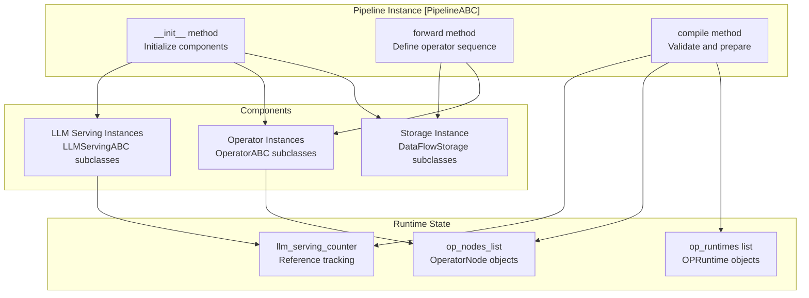
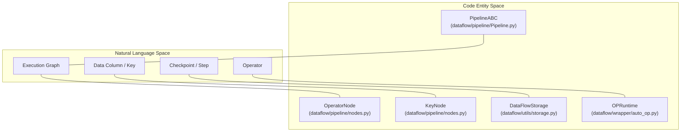
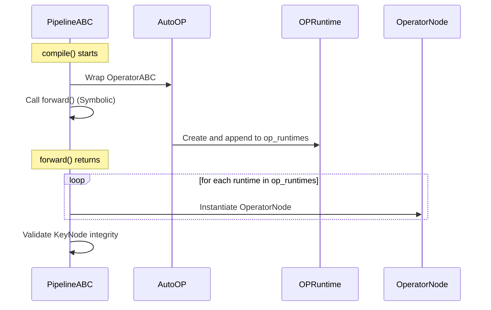

<!-- source: DeepWiki mcp.deepwiki.com · repo OpenDCAI/DataFlow · page 10.5 Creating Custom Pipelines · fetched 2026-11-02 -->

# Creating Custom Pipelines

<details>
<summary>Relevant source files</summary>

The following files were used as context for generating this wiki page:

- [dataflow/example/core_text_data/double_column_input.json](dataflow/example/core_text_data/double_column_input.json)
- [dataflow/pipeline/Pipeline.py](dataflow/pipeline/Pipeline.py)
- [dataflow/pipeline/__init__.py](dataflow/pipeline/__init__.py)
- [dataflow/pipeline/nodes.py](dataflow/pipeline/nodes.py)
- [dataflow/statics/playground/playground/format_str_prompt_generator/double_column_input.py](dataflow/statics/playground/playground/format_str_prompt_generator/double_column_input.py)
- [dataflow/statics/scaffold/{{cookiecutter.repo_name}}/README.md](dataflow/statics/scaffold/{{cookiecutter.repo_name}}/README.md)
- [dataflow/statics/scaffold/{{cookiecutter.repo_name}}/{{cookiecutter.package_name}}/data/example_data.json](dataflow/statics/scaffold/{{cookiecutter.repo_name}}/{{cookiecutter.package_name}}/data/example_data.json)
- [dataflow/statics/scaffold/{{cookiecutter.repo_name}}/{{cookiecutter.package_name}}/pipelines/my_pipeline.py](dataflow/statics/scaffold/{{cookiecutter.repo_name}}/{{cookiecutter.package_name}}/pipelines/my_pipeline.py)
- [dataflow/utils/storage.py](dataflow/utils/storage.py)
- [test/cpu_only/test_lazy_file_storage_flush.py](test/cpu_only/test_lazy_file_storage_flush.py)
- [test/cpu_only/test_remote_batch_slicing.py](test/cpu_only/test_remote_batch_slicing.py)
- [test/test_batched_pipeline.py](test/test_batched_pipeline.py)
- [test/test_batched_stream_pipeline.py](test/test_batched_stream_pipeline.py)
- [test/test_read_xlsx.py](test/test_read_xlsx.py)

</details>


This guide explains how to implement custom pipelines by extending the `PipelineABC` base class `[dataflow/pipeline/Pipeline.py:18-41]()`. Custom pipelines orchestrate operator execution, manage storage state transitions, and handle LLM serving lifecycle using a compile-forward pattern `[dataflow/pipeline/Pipeline.py:43-143]()`.

---

## Pipeline Anatomy

A DataFlow pipeline consists of four core components that work together to transform data across execution stages.

Title: Pipeline Architecture and Component Relationships

Sources: [dataflow/pipeline/Pipeline.py:18-35](), [dataflow/pipeline/Pipeline.py:36-41]()

**Pipeline Components**

| Component | Purpose | Required |
|-----------|---------|----------|
| **Storage** | Manages data state between operators via `storage.step()` | Yes |
| **Operators** | Transform data by implementing business logic | Yes |
| **LLM Serving** | Provides LLM inference capabilities to operators | No |
| **forward method** | Defines operator execution sequence | Yes |
| **compile method** | Validates key integrity and builds execution graph | Yes (inherited) |

Sources: [dataflow/pipeline/Pipeline.py:18-35](), [dataflow/pipeline/Pipeline.py:36-41]()

---

## Creating a Basic Pipeline

### Step 1: Define the Pipeline Class

Extend `PipelineABC` and initialize all components in `__init__`. You must store operators, storage, and serving instances as class attributes `[dataflow/pipeline/Pipeline.py:18-35]()`.

```python
from dataflow.pipeline import PipelineABC
from dataflow.operators.core_text import PromptedGenerator
from dataflow.serving import APILLMServing_request
from dataflow.utils.storage import FileStorage

class MyCustomPipeline(PipelineABC):
    def __init__(self):
        super().__init__()
        
        # Initialize storage
        self.storage = FileStorage(
            first_entry_file_name="input.jsonl",
            cache_path="./cache",
            file_name_prefix="my_pipeline_step",
            cache_type="jsonl"
        )
        
        # Initialize LLM serving
        self.llm_serving = APILLMServing_request(
            api_url="https://api.openai.com/v1/chat/completions",
            model_name="gpt-4o"
        )
        
        # Initialize operators as instance attributes
        self.translator = PromptedGenerator(
            llm_serving=self.llm_serving,
            system_prompt="Translate to French:"
        )
```

Sources: [test/test_batched_pipeline.py:7-33](), [dataflow/pipeline/Pipeline.py:18-35]()

### Step 2: Implement the forward Method

The `forward` method defines the operator execution sequence `[dataflow/pipeline/Pipeline.py:36-41]()`. Use `self.storage.step()` to create checkpoints between operators `[dataflow/utils/storage.py:156-156]()`.

```python
    def forward(self):
        self.translator.run(
            storage=self.storage.step(),
            input_key='text',
            output_key='translation'
        )
```

**storage.step() Pattern:**
- Each `storage.step()` call increments the internal `operator_step` counter `[dataflow/utils/storage.py:156-156]()`.
- It returns a storage instance configured for the next processing stage.
- This creates a disk-backed checkpoint between operators, enabling resume and debugging.

Sources: [test/test_batched_pipeline.py:35-50](), [dataflow/utils/storage.py:156-156]()

### Step 3: Compile and Execute

```python
if __name__ == "__main__":
    pipeline = MyCustomPipeline()
    pipeline.compile()  # Validates key integrity and builds graph
    pipeline.forward()  # Executes operators
```

Sources: [test/test_batched_pipeline.py:52-56]()

---

## The Compile-Execute Pattern

DataFlow pipelines use a symbolic execution phase to validate data flow before running expensive operations `[dataflow/pipeline/Pipeline.py:43-143]()`.

Title: DataFlow Pipeline Execution Lifecycle

Sources: [dataflow/pipeline/Pipeline.py:43-143](), [dataflow/wrapper/auto_op.py:20-105]()

### Compilation Phase

When `compile()` is called, the pipeline performs these operations `[dataflow/pipeline/Pipeline.py:43-59]()`:

1.  **Wrap Operators with AutoOP**: All operator attributes are wrapped with `AutoOP` to intercept `run()` calls `[dataflow/pipeline/Pipeline.py:45-47]()`.
2.  **Symbolic forward()**: The wrapped operators record their parameters into `OPRuntime` objects without actual execution `[dataflow/pipeline/Pipeline.py:48-49]`.
3.  **Build OperatorNode Graph**: Each `OPRuntime` is converted to an `OperatorNode` with input/output key tracking `[dataflow/pipeline/Pipeline.py:60-89]()`.
4.  **Validate Key Integrity**: The pipeline checks that every `input_key` requested by an operator exists in the initial dataset or was produced by a previous operator `[dataflow/pipeline/Pipeline.py:103-135]()`.

Sources: [dataflow/pipeline/Pipeline.py:43-143]()

### Execution Phase

After compilation, the pipeline replaces the `forward` method with `_compiled_forward`. This version iterates through the recorded `op_nodes_list` and executes the actual `operator.run()` logic `[dataflow/pipeline/Pipeline.py:50-51]()`.

Sources: [dataflow/pipeline/Pipeline.py:43-143]()

---

## Storage Management

Storage instances manage data flow between operators through the `step()` mechanism `[dataflow/utils/storage.py:14-35]()`.

### Storage Implementations

| Storage Class | Use Case | Characteristics |
|--------------|----------|-----------------|
| `DataFlowStorage` | Base Interface | Defines `read`, `write`, and `get_keys_from_dataframe` `[dataflow/utils/storage.py:14-35]()`. |
| `LazyFileStorage` | High-performance | In-memory buffering; atomic writes via `os.replace` on exit `[dataflow/utils/storage.py:70-99]()`. |
| `BatchedFileStorage` | Large datasets | Pagination support for batch-by-batch processing `[test/cpu_only/test_remote_batch_slicing.py:38-40]()`. |
| `StreamBatchedFileStorage` | Memory-constrained | Streaming iteration for very large files `[test/test_batched_stream_pipeline.py:15-20]()`. |

### LazyFileStorage Features
- **Atomic Writes**: Uses temporary files and `os.replace` to prevent data corruption `[dataflow/utils/storage.py:98-99]()`.
- **Exit Hooks**: Automatically flushes buffers to disk on `SIGINT`, `SIGTERM`, or normal exit using `atexit`.
- **Thread Safety**: Uses an `RLock` to protect memory buffers and dirty step states `[dataflow/utils/storage.py:162-162]`.

Sources: [dataflow/utils/storage.py:14-164]()

---

## Batched and Streaming Pipelines

For large-scale data processing, use `BatchedPipelineABC` or `StreamBatchedPipelineABC` `[dataflow/pipeline/Pipeline.py:1-6]()`.

### Batched Execution
`BatchedPipelineABC` processes data in chunks of `batch_size`. It maintains checkpoint tracking to support resuming interrupted jobs `[test/test_batched_pipeline.py:55-56]`.

```python
class MyBatchedPipeline(BatchedPipelineABC):
    def __init__(self, file_name_prefix="dataflow_cache_auto_run"):
        super().__init__()
        self.storage = BatchedFileStorage(
            first_entry_file_name="input.jsonl",
            cache_path="./cache",
            file_name_prefix=file_name_prefix,
            cache_type="jsonl"
        )
        self.op1 = PromptedGenerator(...)

    def forward(self):
        self.op1.run(self.storage.step(), input_key='raw', output_key='out')

# Execution with resume support
pipeline.forward(batch_size=100, resume_from_last=True)
```

Sources: [test/test_batched_pipeline.py:7-50]()

### Streaming Execution
`StreamBatchedPipelineABC` processes data without loading the entire dataset into memory, suitable for very large scale data preparation `[test/test_batched_stream_pipeline.py:11-54]()`.

Sources: [test/test_batched_stream_pipeline.py:11-54]()

---

## Visualization and Debugging

Pipelines include built-in mechanisms to inspect the operator graph and key flow during compilation and execution `[dataflow/pipeline/Pipeline.py:60-143]()`.

Sources: [dataflow/pipeline/Pipeline.py:60-143]()

---

## Key Entity Mapping

This diagram maps pipeline concepts to their corresponding code classes and data structures.

Title: Conceptual Mapping to Code Entities

Sources: [dataflow/pipeline/Pipeline.py:18-35](), [dataflow/pipeline/nodes.py:8-17](), [dataflow/pipeline/nodes.py:36-49](), [dataflow/utils/storage.py:14-24](), [dataflow/wrapper/auto_op.py:1-30]()

Title: Class Interaction Diagram

Sources: [dataflow/pipeline/Pipeline.py:43-143](), [dataflow/pipeline/nodes.py:36-49]()

---

