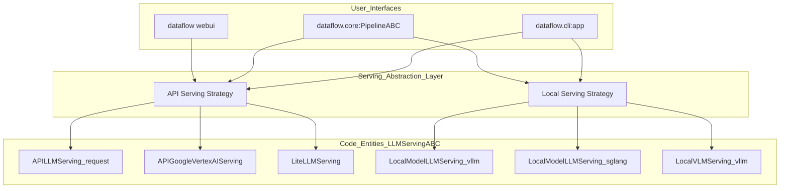
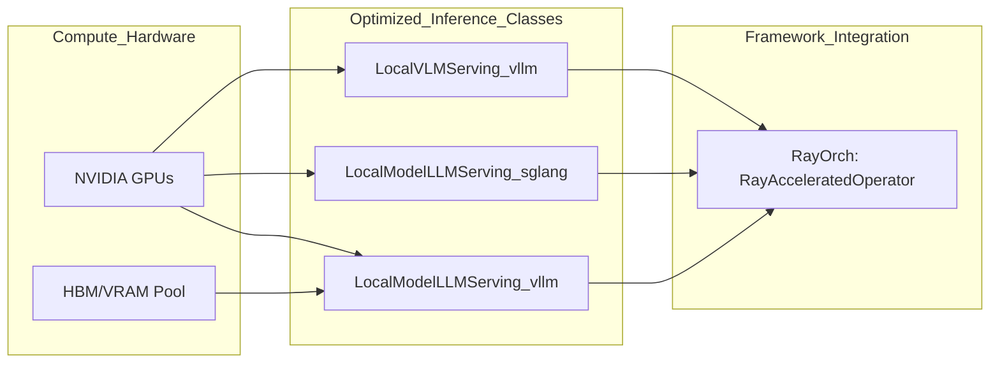

<!-- source: DeepWiki mcp.deepwiki.com · repo OpenDCAI/DataFlow · page 11 Deployment Options · fetched 2026-11-02 -->

# Deployment Options

Relevant source files

The following files were used as context for generating this wiki page:

- [.dockerignore](.dockerignore)
- [.gitignore](.gitignore)
- [Dockerfile](Dockerfile)
- [MANIFEST.in](MANIFEST.in)
- [README-zh.md](README-zh.md)
- [README.md](README.md)
- [dataflow/serving/__init__.py](dataflow/serving/__init__.py)
- [dataflow/serving/api_vlm_serving_openai.py](dataflow/serving/api_vlm_serving_openai.py)
- [dataflow/serving/local_model_vlm_serving.py](dataflow/serving/local_model_vlm_serving.py)
- [dataflow/version.py](dataflow/version.py)

DataFlow provides a versatile set of deployment strategies to accommodate various infrastructure requirements, ranging from cloud-based API services to local GPU clusters and containerized environments. This page describes the high-level deployment options and implementation paths available in the DataFlow framework.

For information about the underlying LLM serving abstractions, see [LLM Serving Architecture](#3.4). For specific pipeline implementation examples, see [Ready-to-Use Pipelines](#5).

Sources: [README.md:101-104]()

---

## Overview

DataFlow pipelines are designed to be infrastructure-agnostic, allowing users to switch between backends by modifying the `LLMServingABC` implementation used during pipeline instantiation [README.md:101-104](). The system supports a wide range of hardware and software configurations through optional dependency groups, such as vLLM and SGLang [dataflow/serving/__init__.py:1-29]().

There are three primary deployment modes:
1. **API-Based Deployment**: Leverages external LLM providers (OpenAI, DeepSeek, Google Gemini) via standard protocols [dataflow/serving/__init__.py:1-13]().
2. **Local GPU Deployment**: Utilizes high-performance local inference engines like `vLLM` or `SGLang` for maximum throughput and data privacy [dataflow/serving/__init__.py:1-29]().
3. **Docker Deployment**: Packages the entire environment into a reproducible container image for scaling and orchestration [Dockerfile:1-39]().

Sources: [Dockerfile:1-39](), [README.md:101-104](), [dataflow/serving/__init__.py:1-29]()

---

## Deployment Architecture

The following diagram maps high-level deployment strategies to the specific code entities defined in the DataFlow framework, bridging natural language entry points to concrete serving classes.

### Deployment Entity Mapping

Sources: [dataflow/serving/__init__.py:1-29](), [README.md:70-80]()

---

## API-Based Deployment

API-based deployment is the fastest way to get started with DataFlow, requiring no local GPU hardware and supporting multiple providers through standardized request handlers. 

For details, see [API-Based Deployment](#11.1).

Sources: [dataflow/serving/__init__.py:1-13]()

---

## Local GPU Deployment

For production workloads requiring high throughput or strict data privacy, DataFlow supports local model serving using inference engines like `vLLM` and `SGLang`, orchestrated via `RayOrch`.

For details, see [Local GPU Deployment](#11.2).

### Local GPU Resource Orchestration

Sources: [dataflow/serving/__init__.py:1-29](), [Dockerfile:1-39]()

---

## Docker Deployment

DataFlow provides a standardized Docker environment based on official CUDA images to eliminate configuration inconsistencies and facilitate cloud scaling. 

For details, see [Docker Deployment](#11.3).

Sources: [Dockerfile:1-39](), [README.md:26-30]()

---

## Deployment Configuration Matrix

| Deployment Mode | Requirement | Best For | Code Entity |
| :--- | :--- | :--- | :--- |
| **Cloud API** | API Key | Rapid Prototyping | `APILLMServing_request` |
| **Local vLLM** | NVIDIA GPU | High Throughput | `LocalModelLLMServing_vllm` |
| **Local SGLang** | NVIDIA GPU | Advanced Serving | `LocalModelLLMServing_sglang` |
| **Local VLM** | NVIDIA GPU | Vision Tasks | `LocalVLMServing_vllm` |
| **Containerized** | Docker Runtime | Scaling / CI-CD | `Dockerfile` |

Sources: [Dockerfile:1-39](), [dataflow/serving/__init__.py:1-29](), [README.md:26-30]()

---

