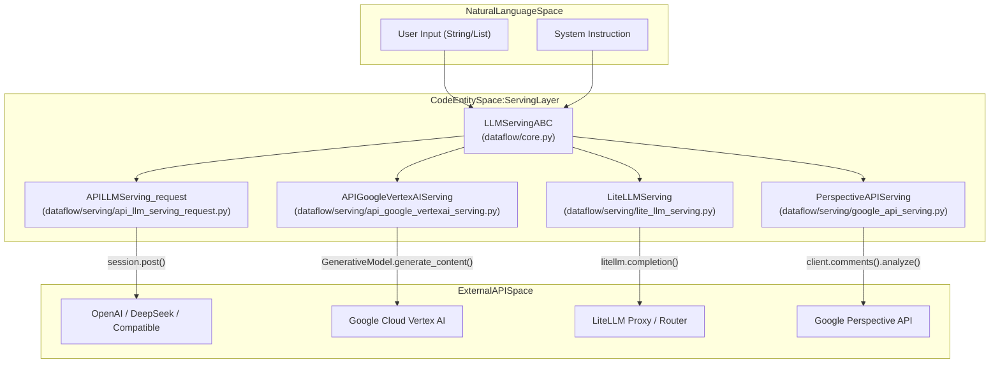
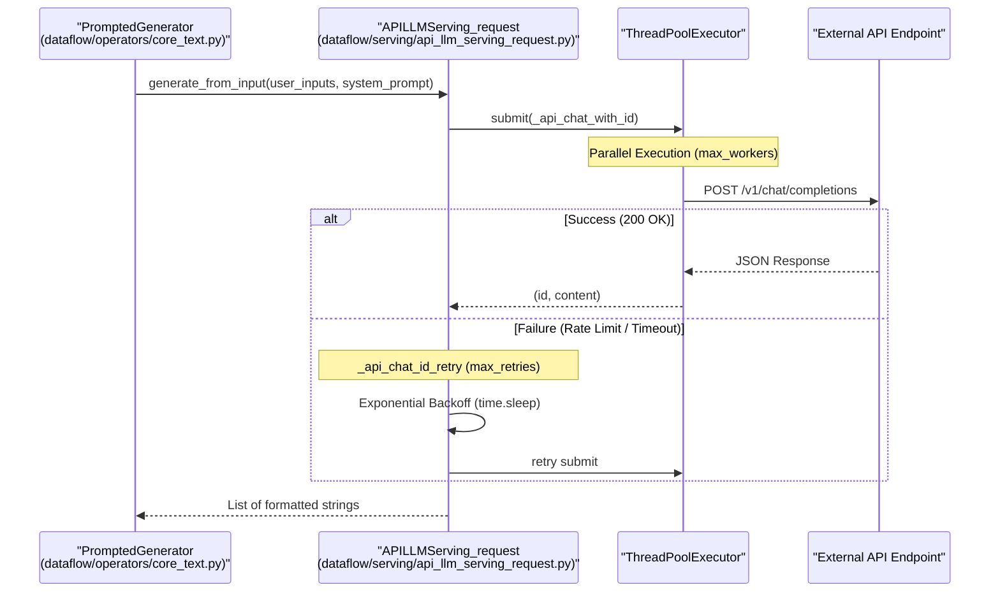

<!-- source: DeepWiki mcp.deepwiki.com · repo OpenDCAI/DataFlow · page 11.1 API-Based Deployment · fetched 2026-11-02 -->

# API-Based Deployment

Relevant source files

The following files were used as context for generating this wiki page:

- [.github/workflows/test.yml](.github/workflows/test.yml)
- [dataflow/operators/code/filter/code_score_filter.py](dataflow/operators/code/filter/code_score_filter.py)
- [dataflow/operators/core_text/eval/bench_dataset_evaluator_question.py](dataflow/operators/core_text/eval/bench_dataset_evaluator_question.py)
- [dataflow/serving/api_google_vertexai_serving.py](dataflow/serving/api_google_vertexai_serving.py)
- [dataflow/serving/api_llm_serving_request.py](dataflow/serving/api_llm_serving_request.py)
- [dataflow/serving/google_api_serving.py](dataflow/serving/google_api_serving.py)
- [dataflow/serving/lite_llm_serving.py](dataflow/serving/lite_llm_serving.py)
- [dataflow/serving/localhost_llm_api_serving.py](dataflow/serving/localhost_llm_api_serving.py)
- [dataflow/serving/localmodel_lalm_serving.py](dataflow/serving/localmodel_lalm_serving.py)
- [dataflow/statics/playground/playground/prompted_generator/translation_litellm.py](dataflow/statics/playground/playground/prompted_generator/translation_litellm.py)
- [dataflow/statics/playground/playground/prompted_generator/translation_litellm_json_schema.py](dataflow/statics/playground/playground/prompted_generator/translation_litellm_json_schema.py)
- [pyproject.toml](pyproject.toml)
- [requirements.txt](requirements.txt)
- [test/cpu_only/test_undefined_name_crashes.py](test/cpu_only/test_undefined_name_crashes.py)
- [test/test_general_text.py](test/test_general_text.py)
- [test/test_litellm.py](test/test_litellm.py)

This page provides a comprehensive technical guide to configuring and deploying DataFlow pipelines using external LLM APIs. API-based deployment offloads inference to cloud providers (OpenAI, Google Vertex AI, DeepSeek, etc.), eliminating the need for local GPU infrastructure while providing scalable processing capabilities.

## Overview of API Serving Architecture

DataFlow uses a unified abstraction layer, `LLMServingABC` [dataflow/core.py:1-10](), to interface with various API providers. This design allows operators to remain agnostic of the specific backend, whether it is a direct OpenAI request, a Google Vertex AI batch job, or a multi-provider wrapper like `LiteLLMServing` [dataflow/serving/lite_llm_serving.py:10-12]().

### Serving Hierarchy and Data Flow

The following diagram illustrates how natural language requests move from the Pipeline space into specific API implementation classes, bridging natural language inputs to concrete codebase entities.

Title: DataFlow API Serving Architecture

Sources: [dataflow/serving/api_llm_serving_request.py:16-17](), [dataflow/serving/lite_llm_serving.py:10-12](), [dataflow/serving/api_google_vertexai_serving.py:173-176](), [dataflow/serving/google_api_serving.py:7-10]()

---

## APILLMServing_request: OpenAI-Compatible Client

The `APILLMServing_request` class is the primary driver for OpenAI, DeepSeek, and other providers following the standard chat completions schema. It utilizes the `requests` library with a persistent `Session` for connection pooling.

### Key Implementation Details
- **Connection Management**: Uses `requests.Session` with an `HTTPAdapter` to manage `pool_connections` and `pool_maxsize` based on the `max_workers` parameter [dataflow/serving/api_llm_serving_request.py:61-69]().
- **Authentication**: Dynamically retrieves the API key from environment variables using a configurable `key_name_of_api_key` (defaulting to `DF_API_KEY`) [dataflow/serving/api_llm_serving_request.py:54-58]().
- **Timeout Configuration**: Separates `connect_timeout` and `read_timeout` to prevent hanging on slow model generations [dataflow/serving/api_llm_serving_request.py:30-31]().
- **Reasoning Support**: Automatically detects and formats `reasoning_content` (common in DeepSeek models) into `<think>` and `<answer>` tags [dataflow/serving/api_llm_serving_request.py:85-103]().
- **JSON Schema Support**: Supports structured output by passing a `json_schema` in the `response_format` of the payload [dataflow/serving/api_llm_serving_request.py:154-165]().

### Request Logic and Retry Mechanism

The system handles concurrency via `ThreadPoolExecutor` and implements exponential backoff for failed requests. The following sequence diagram maps runtime execution steps to internal code entities.

Title: API Request Lifecycle and Execution Flow

Sources: [dataflow/serving/api_llm_serving_request.py:133-176](), [dataflow/serving/api_llm_serving_request.py:183-205](), [dataflow/serving/api_llm_serving_request.py:207-236]()

---

## APIGoogleVertexAIServing: Google Gemini Integration

The `APIGoogleVertexAIServing` class provides specialized support for Google's Gemini models via the Vertex AI SDK. It includes support for structured JSON output and system instructions.

### Key Features
- **System Instructions**: Correctly passes `system_prompt` during the `GenerativeModel` initialization rather than at generation time [dataflow/serving/api_google_vertexai_serving.py:124-127]().
- **Structured Output**: Supports `response_schema` using Pydantic `BaseModel` or raw JSON schemas to enforce structured responses from Gemini [dataflow/serving/api_google_vertexai_serving.py:136-157]().
- **Environment Configuration**: Requires `GOOGLE_APPLICATION_CREDENTIALS` and optionally `GOOGLE_CLOUD_PROJECT` and `GOOGLE_CLOUD_LOCATION` [dataflow/serving/api_google_vertexai_serving.py:52-85]().
- **Dependencies**: Requires `google-cloud-aiplatform>=1.55`, `google-genai`, and `google-cloud-bigquery` for certain batch operations [requirements.txt:82-84](), [dataflow/serving/api_google_vertexai_serving.py:24-46]().

Sources: [dataflow/serving/api_google_vertexai_serving.py:48-170](), [dataflow/serving/api_google_vertexai_serving.py:173-180](), [requirements.txt:81-89]()

---

## LiteLLMServing: Multi-Provider Integration

DataFlow supports `LiteLLMServing` for users requiring access to a wide variety of providers (Anthropic, Bedrock, Azure, etc.) through a single configuration interface.

- **Dependency**: Requires the `litellm` library, which can be installed via the `[litellm]` extra [pyproject.toml:64](), [dataflow/serving/lite_llm_serving.py:76-83]().
- **Validation**: Includes a `_validate_setup` method to verify model and API configuration on initialization [dataflow/serving/lite_llm_serving.py:108-109]().
- **Model Switching**: Supports dynamic model switching via `switch_model` while maintaining thread safety [dataflow/serving/lite_llm_serving.py:113-156]().
- **Reasoning Support**: Like the OpenAI client, it formats reasoning content into structured tags [dataflow/serving/lite_llm_serving.py:158-181]().
- **Provider Routing**: Allows a `custom_llm_provider` for routing requests to self-hosted or private endpoints [dataflow/serving/lite_llm_serving.py:105-106]().

Sources: [dataflow/serving/lite_llm_serving.py:10-42](), [pyproject.toml:64]()

---

## Configuration Reference

### Environment Variables
| Variable | Required By | Description |
|----------|-------------|-------------|
| `DF_API_KEY` | `APILLMServing_request`, `LiteLLMServing` | The API key for LLM providers [dataflow/serving/api_llm_serving_request.py:54-58](), [dataflow/serving/lite_llm_serving.py:99-103](). |
| `GOOGLE_APPLICATION_CREDENTIALS` | `APIGoogleVertexAIServing` | Path to the GCP Service Account JSON file [dataflow/serving/api_google_vertexai_serving.py:52-63](). |
| `GOOGLE_CLOUD_PROJECT` | `APIGoogleVertexAIServing` | The GCP Project ID [dataflow/serving/api_google_vertexai_serving.py:77-80](). |
| `GOOGLE_API_KEY` | `PerspectiveAPIServing` | API key for Google Perspective toxicity analysis [dataflow/serving/google_api_serving.py:10-12](). |

### Common Parameters for `APILLMServing_request`
| Parameter | Default | Description |
|-----------|---------|-------------|
| `api_url` | OpenAI V1 | The endpoint URL for the chat completions API [dataflow/serving/api_llm_serving_request.py:24](). |
| `model_name` | `gpt-4o` | The specific model identifier to use [dataflow/serving/api_llm_serving_request.py:26](). |
| `max_workers` | `10` | Number of concurrent threads for API requests [dataflow/serving/api_llm_serving_request.py:28](). |
| `max_retries` | `5` | Number of retry attempts for failed requests [dataflow/serving/api_llm_serving_request.py:29](). |
| `connect_timeout`| `10.0` | Timeout for establishing the TCP connection [dataflow/serving/api_llm_serving_request.py:30](). |
| `read_timeout` | `120.0` | Timeout for receiving the full response [dataflow/serving/api_llm_serving_request.py:31](). |

Sources: [dataflow/serving/api_llm_serving_request.py:23-33](), [dataflow/serving/lite_llm_serving.py:28-42](), [dataflow/serving/google_api_serving.py:9-13]()

---

## Testing and Verification

API deployments can be tested using the provided test suites which include end-to-end pipeline examples and specialized serving tests.

- **Pipeline Integration**: The `GPT_generator` class in `test/test_litellm.py` demonstrates how to initialize `APILLMServing_request` with a custom `api_url` and use it within a `PromptedGenerator` [test/test_litellm.py:5-33]().
- **JSON Schema Verification**: Examples in `dataflow/statics/playground` show how to enforce structured JSON outputs when using API-based serving [dataflow/statics/playground/playground/prompted_generator/translation_litellm_json_schema.py:24-33]().
- **Toxicity Scoring**: `PerspectiveAPIServing` provides a specialized API interface for scoring text toxicity using Google's Perspective API [dataflow/serving/google_api_serving.py:7-48]().

Sources: [test/test_litellm.py:1-47](), [dataflow/statics/playground/playground/prompted_generator/translation_litellm_json_schema.py:1-47](), [dataflow/serving/google_api_serving.py:7-53]()

---

