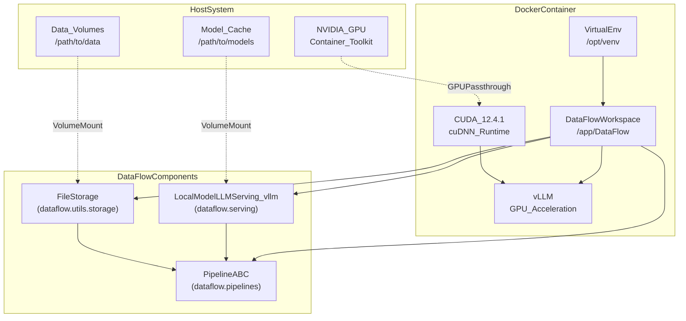
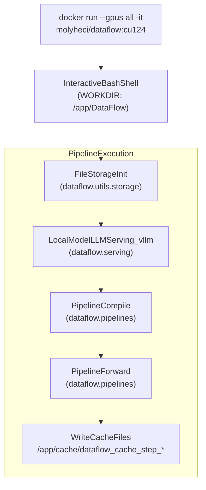

<!-- source: DeepWiki mcp.deepwiki.com · repo OpenDCAI/DataFlow · page 11.3 Docker Deployment · fetched 2026-11-02 -->

# Docker Deployment

<details>
<summary>Relevant source files</summary>

The following files were used as context for generating this wiki page:

- [.dockerignore](.dockerignore)
- [.gitignore](.gitignore)
- [Dockerfile](Dockerfile)
- [MANIFEST.in](MANIFEST.in)
- [README-zh.md](README-zh.md)
- [README.md](README.md)
- [dataflow/version.py](dataflow/version.py)

</details>


This page explains how to deploy DataFlow using Docker containers with GPU acceleration. For information about deploying DataFlow with external APIs, see [11.1 API-Based Deployment]() and for local GPU hardware without containers, see [11.2 Local GPU Deployment]().

Docker deployment provides an isolated, reproducible environment with pre-configured dependencies including CUDA 12.4.1, cuDNN, and vLLM for GPU-accelerated inference.

Sources: [README.md:26-26](), [Dockerfile:1-39]()

---

## Official Docker Image

DataFlow provides a pre-built Docker image hosted on Docker Hub at `molyheci/dataflow:cu124`. This image is designed to support the full suite of DataFlow operators and pipelines with hardware acceleration.

| Component | Version/Details |
|-----------|----------------|
| Base Image | `nvidia/cuda:12.4.1-cudnn-runtime-ubuntu22.04` [Dockerfile:2-2]() |
| Platform | `linux/amd64` [Dockerfile:2-2]() |
| CUDA | 12.4.1 [Dockerfile:2-2]() |
| cuDNN | Runtime libraries included [Dockerfile:2-2]() |
| Python Environment | Virtual environment at `/opt/venv` [Dockerfile:19-20]() |
| DataFlow Installation | Installed with `[vllm]` extras [Dockerfile:36-36]() |
| Working Directory | `/app/DataFlow` [Dockerfile:33-33]() |

The image is optimized for GPU-accelerated local inference using the `LocalModelLLMServing_vllm` and `LocalModelLLMServing_sglang` serving backends.

Sources: [README.md:26-26](), [Dockerfile:1-39]()

---

## Docker Deployment Architecture

The following diagram illustrates the relationship between the host system, the Docker container, and internal DataFlow components, bridging natural language descriptions to codebase entities such as `FileStorage`, `LocalModelLLMServing_vllm`, and execution pipelines.

Title: "DataFlow Docker Deployment Stack"


Sources: [Dockerfile:1-39](), [README.md:26-26]()

---

## Running the Pre-built Image

### Pull the Image

```bash
docker pull molyheci/dataflow:cu124
```

This downloads the official DataFlow image with CUDA 12.4 support from Docker Hub.

### Run with GPU Support

```bash
docker run --gpus all -it molyheci/dataflow:cu124
```

**Command Breakdown:**

| Flag | Purpose |
|------|---------|
| `--gpus all` | Passes all available GPUs into the container (requires NVIDIA Container Toolkit) |
| `-it` | Interactive mode with TTY allocation |
| `molyheci/dataflow:cu124` | Image name and tag |

### Verify Installation

Inside the running container, verify the DataFlow version:

```bash
dataflow -v
```

The version information is managed in `dataflow/version.py` [dataflow/version.py:1-7]().

Sources: [dataflow/version.py:1-7](), [Dockerfile:39-39]()

---

## Building Custom Images

### Using the Dockerfile

To build a custom image from the provided `Dockerfile` [Dockerfile:1-39]():

```bash
# Clone the repository
git clone https://github.com/OpenDCAI/DataFlow.git
cd DataFlow

# Build the Docker image
docker build -t dataflow:custom .

# Run the custom container
docker run --gpus all -it dataflow:custom
```

### Dockerfile Build Process

The following diagram maps the build instruction sequence defined in `Dockerfile` to target environment layers and python installation steps, associating build commands with python execution entities.

Title: "Dockerfile Build Stages and Code Integration"

```mermaid
graph LR
    BASE["nvidia/cuda:12.4.1<br/>cudnn-runtime-ubuntu22.04"]
    SYSENV["SystemEnvironment<br/>DEBIAN_FRONTEND=noninteractive"]
    SYSDEP["SystemDependencies<br/>python3 git build-essential"]
    PYENV["PythonVirtualEnv<br/>/opt/venv"]
    MIRROR["PipMirror<br/>pypi.tuna.tsinghua.edu.cn"]
    COPY["CopySource<br/>COPY . ./DataFlow/"]
    INSTALL["PipInstall<br/>pip install -e .[vllm]"]
    FINAL["CustomImage<br/>dataflow:custom"]
    
    BASE --> SYSENV
    SYSENV --> SYSDEP
    SYSDEP --> PYENV
    PYENV --> MIRROR
    MIRROR --> COPY
    COPY --> INSTALL
    INSTALL --> FINAL
```


Sources: [Dockerfile:1-39]()

### Dockerfile Structure

The build process follows these stages as defined in `Dockerfile`:

1. **Base Image Selection**: Uses `nvidia/cuda:12.4.1-cudnn-runtime-ubuntu22.04` for broad compatibility with modern LLM serving libraries [Dockerfile:2-2]().
2. **Environment Configuration**: Sets `PYTHONUNBUFFERED=1` and `PIP_NO_CACHE_DIR=1` to optimize container logging and size [Dockerfile:7-8]().
3. **System Dependencies**: Installs `ffmpeg`, `libgl1`, and `libglib2.0-0` which are required for multimodal processing and PDF parsing [Dockerfile:11-16]().
4. **Python Environment**: Creates a virtual environment at `/opt/venv` to isolate DataFlow dependencies from system packages [Dockerfile:19-20]().
5. **PyPI Mirror Configuration**: Configures the Tsinghua mirror to accelerate dependency installation [Dockerfile:24-25]().
6. **Application Installation**: Copies the entire repository into `/app/DataFlow` [Dockerfile:30-30]() and installs it in editable mode with the `[vllm]` extra [Dockerfile:36-36]().
7. **Default Command**: Launches an interactive bash shell [Dockerfile:39-39]().

Sources: [Dockerfile:1-39]()

---

## Customizing the Build

### Modifying Dependencies

To install additional DataFlow extras, modify the installation line in the Dockerfile. Available extras include `[kbc]` for Knowledge Base Cleaning and `[pdf2model]` for PDF processing.

```dockerfile
# Example: Install with knowledge base cleaning support
RUN pip install -e ".[vllm,kbc]"
```

### Excluding Files from Build Context

Files excluded from the Docker build context are defined in `.dockerignore`. This prevents large artifacts like `.git` history, `dist/`, or local `.venv` folders from being sent to the Docker daemon [.dockerignore:1-26]().

Sources: [.dockerignore:1-26]()

---

## GPU Support and NVIDIA Container Toolkit

### Requirements

Docker GPU passthrough requires the **NVIDIA Container Toolkit** installed on the host system. Without this toolkit, the `--gpus` flag will not work.

### Verification

Verify GPU access inside the container by running:

```bash
docker run --gpus all -it molyheci/dataflow:cu124 nvidia-smi
```

This should display GPU information similar to running `nvidia-smi` on the host.

Sources: [Dockerfile:1-39]()

---

## Container Configuration

### Volume Mounting for Data Persistence

Mount host directories to persist data, models, and cache files. This is critical as container storage is ephemeral.

| Host Path | Container Path | Purpose |
|-----------|----------------|---------|
| `/path/to/data` | `/app/data` | Input/output data for pipelines |
| `/path/to/models` | `/app/models` | Pre-trained model storage (HuggingFace cache) |
| `/path/to/cache` | `/app/cache` | DataFlow `FileStorage` step checkpoints |

### Environment Variables

Pass environment variables for API keys and configuration:

```bash
docker run --gpus all -it \
  -e DF_API_KEY=sk-xxx \
  -e HF_TOKEN=hf_xxx \
  molyheci/dataflow:cu124
```

Common variables include `DF_API_KEY` for API-based operators and `HF_TOKEN` for accessing gated models on Hugging Face.

Sources: [Dockerfile:1-39]()

---

## Running DataFlow Pipelines in Docker

### Container Runtime Flow

The following diagram shows the internal data flow when running a pipeline inside the container.

Title: "DataFlow Pipeline Runtime Flow in Docker"


Sources: [Dockerfile:29-39](), [README.md:90-108]()

### Example: Running a Pipeline

Inside the container at `/app/DataFlow` [Dockerfile:33-33](), you can execute a pipeline using the installed `dataflow` package.

```python
from dataflow.operators.core_text import PromptedGenerator
from dataflow.utils.storage import FileStorage
from dataflow.serving import LocalModelLLMServing_vllm

# Initialize storage with mounted cache directory
storage = FileStorage(first_entry_file_name="/app/data/input.json")

# Initialize local vLLM serving
llm_serving = LocalModelLLMServing_vllm(model_path="/app/models/Qwen2.5-7B")

# Use a standard generator operator
generator = PromptedGenerator(llm_serving=llm_serving)
```

Sources: [README.md:90-108](), [Dockerfile:36-36]()

---

## Troubleshooting

### GPU Not Detected
If `nvidia-smi` fails inside the container, verify the NVIDIA Container Toolkit installation on the host and ensure the `--gpus all` flag is used.

### Permission Issues with Volume Mounts
If encountering permission errors when writing to mounted volumes, run the container with the host user's UID/GID:
`--user $(id -u):$(id -g)`

### Out of Memory (OOM)
For large models using vLLM, ensure you have sufficient shared memory allocated to the container:
`--shm-size=16g`

Sources: [Dockerfile:1-39](), [README.md:90-108]()

---

