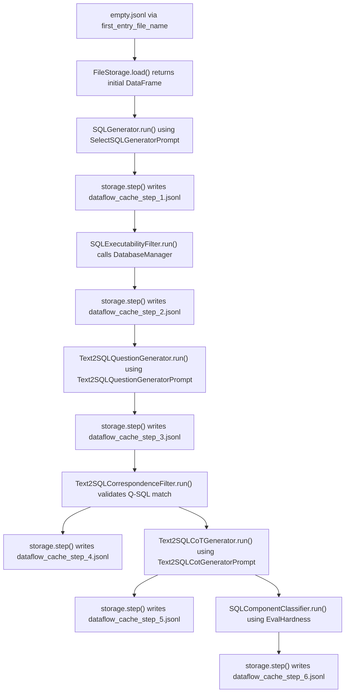
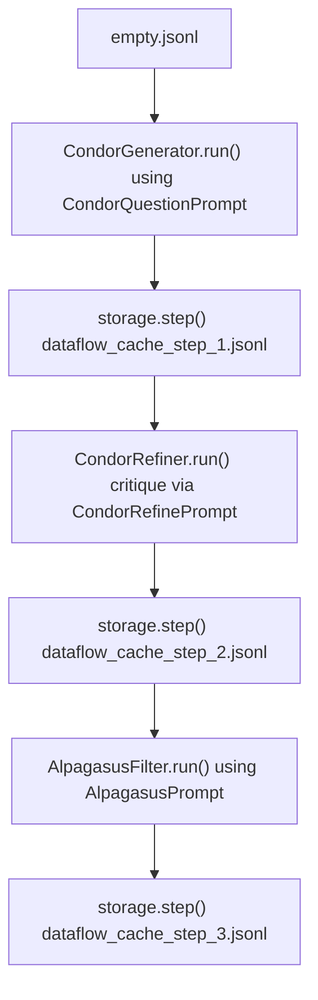
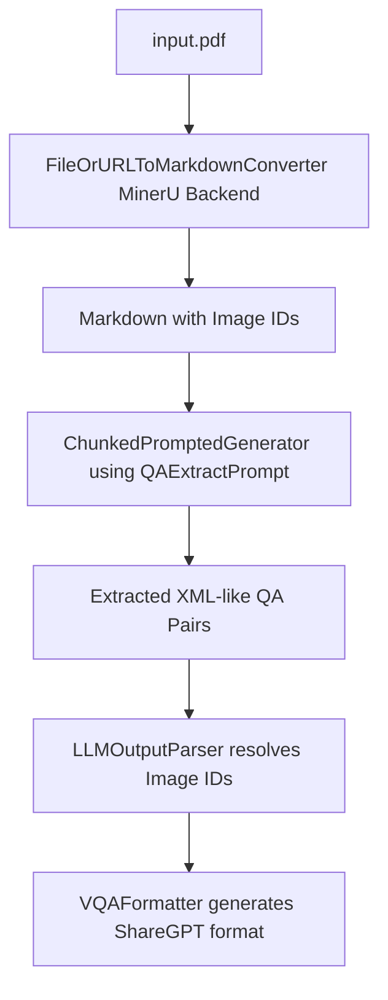

<!-- source: DeepWiki mcp.deepwiki.com · repo OpenDCAI/DataFlow · page 12 Example Workflows · fetched 2026-11-02 -->

# Example Workflows

Relevant source files

The following files were used as context for generating this wiki page:

- [dataflow/cli_funcs/cli_init.py](dataflow/cli_funcs/cli_init.py)
- [dataflow/cli_funcs/copy_funcs.py](dataflow/cli_funcs/copy_funcs.py)
- [dataflow/cli_funcs/paths.py](dataflow/cli_funcs/paths.py)
- [dataflow/example/GeneralTextPipeline/math_100.jsonl](dataflow/example/GeneralTextPipeline/math_100.jsonl)
- [dataflow/example/GeneralTextPipeline/translation.jsonl](dataflow/example/GeneralTextPipeline/translation.jsonl)
- [dataflow/statics/pipelines/api_pipelines/README.md](dataflow/statics/pipelines/api_pipelines/README.md)
- [dataflow/statics/playground/playground/mathbook_extract.py](dataflow/statics/playground/playground/mathbook_extract.py)
- [dataflow/statics/playground/playground/quick_evaluate.py](dataflow/statics/playground/playground/quick_evaluate.py)
- [dataflow/statics/playground/playground/vqa.py](dataflow/statics/playground/playground/vqa.py)
- [test/test_autoop_graph.py](test/test_autoop_graph.py)

This page provides end-to-end examples demonstrating common DataFlow use cases with actual command sequences, configuration patterns, and expected data transformations. Each workflow shows the complete data flow from input to final output, including operator sequences, storage state transitions, and key configuration points.

Playground scripts and pipeline templates are made available via CLI initialization commands `[dataflow/cli_funcs/cli_init.py:25-29]()`, allowing rapid prototyping of tasks ranging from quick evaluations `[dataflow/statics/playground/playground/quick_evaluate.py:1-28]()` to specialized PDF and math book question extraction `[dataflow/statics/playground/playground/mathbook_extract.py:1-45]()`.

For architectural details on pipelines and operators, see [Core Architecture](#3). For comprehensive operator documentation, see [Operator Reference](#6). For deployment configuration options, see [Deployment Options](#11).

---

## 12.1 Generating Text2SQL Training Data

This workflow demonstrates generating SQL training data from databases using the Text2SQL generation pipeline. The process creates SQL queries, validates their execution, generates natural language questions, adds chain-of-thought (CoT) reasoning, and classifies difficulty levels. DataFlow supports multiple variants including API-based `[dataflow/statics/pipelines/api_pipelines/text2sql_pipeline_gen.py:68]()` and local GPU-based `[dataflow/statics/pipelines/gpu_pipelines/text2sql_pipeline_gen.py:59]()` pipelines.

### Workflow Overview

The Text2SQL generation logic implements a multi-operator sequence where each operator invocation triggers `storage.step()` to advance the cache file counter. The `FileStorage` class manages sequential JSONL files `[dataflow/statics/pipelines/api_pipelines/text2sql_pipeline_gen.py:86-91]()`.

**Pipeline Execution Flow with Code Entity Mapping**

**Sources:** `[dataflow/statics/pipelines/api_pipelines/text2sql_pipeline_gen.py:127-217]()`, `[dataflow/operators/text2sql/eval/sql_component_classifier.py:42]()`.

### Step-by-Step Execution

| Step | Operator | Input Keys | Output Keys | Purpose |
|------|----------|-----------|-------------|---------|
| 1 | `SQLGenerator` | (none) | `SQL`, `db_id` | Generates SQL queries by analyzing database schemas `[dataflow/statics/pipelines/api_pipelines/text2sql_pipeline_gen.py:187-192]()`. |
| 2 | `SQLExecutabilityFilter` | `SQL`, `db_id` | (filters rows) | Validates SQL syntax against actual database `[dataflow/statics/pipelines/api_pipelines/text2sql_pipeline_gen.py:194-198]()`. |
| 3 | `Text2SQLQuestionGenerator` | `SQL`, `db_id` | `question`, `evidence` | Generates natural language questions using LLM `[dataflow/statics/pipelines/api_pipelines/text2sql_pipeline_gen.py:200-206]()`. |
| 4 | `Text2SQLCorrespondenceFilter`| `SQL`, `question`| (filters rows) | Ensures question matches SQL logic `[dataflow/statics/pipelines/api_pipelines/text2sql_pipeline_gen.py:208-212]()`. |
| 5 | `Text2SQLCoTGenerator` | `SQL`, `question` | `cot_reasoning` | Generates step-by-step reasoning for the SQL `[dataflow/statics/pipelines/api_pipelines/text2sql_pipeline_gen.py:221-226]()`. |
| 6 | `SQLComponentClassifier` | `SQL` | `sql_difficulty` | Computes difficulty via `EvalHardness` analysis `[dataflow/statics/pipelines/api_pipelines/text2sql_pipeline_gen.py:233-237]()`. |

**Sources:** `[dataflow/statics/pipelines/api_pipelines/text2sql_pipeline_gen.py:127-237]()`.

For details, see [Generating Text2SQL Training Data](#12.1).

---

## 12.2 Creating SFT Instruction Data

This workflow generates supervised fine-tuning data through synthesis, refinement, and quality filtering. It utilizes the `CondorGenerator` for initial two-stage generation `[dataflow/operators/text_sft/generate/condor_generator.py:18]()` and `CondorRefiner` for critique-based improvement `[dataflow/operators/text_sft/refine/condor_refiner.py:18]()`. Users can also leverage playground scripts and seed datasets for customized instruction synthesis.

**SFT Synthesis Pipeline Mapping**

**Sources:** `[dataflow/statics/pipelines/api_pipelines/text_sft_synthesis_pipeline.py:9-42]()`, `[dataflow/operators/text_sft/generate/condor_generator.py:87-160]()`.

For details, see [Creating SFT Instruction Data](#12.2).

---

## 12.3 Building a Reasoning Dataset

This workflow generates mathematical and logical reasoning problems with chain-of-thought solutions. The reasoning pipeline utilizes specialized prompts like `Phi4QAGeneratorPrompt` `[dataflow/prompts/general_text.py:12]()` to convert unstructured paragraphs or problem lists (such as math datasets `[dataflow/example/GeneralTextPipeline/math_100.jsonl:1-30]())` into QA formats.

**Reasoning Pipeline Components**
- **Generation**: `QuestionGenerator` and `AnswerGenerator` produce CoT steps.
- **Verification**: `AnswerMathVerifyFilter` ensures logical correctness.
- **Classification**: `QuestionDifficultyClassifier` assigns complexity levels.

**Sources:** `[dataflow/prompts/general_text.py:12-30]()`, `[dataflow/example/GeneralTextPipeline/math_100.jsonl:1-30]()`.

For details, see [Building a Reasoning Dataset](#12.3).

---

## 12.4 Evaluating Fine-tuned Models

The evaluation system benchmarks models against specific datasets using the `EvaluationPipeline` or quick evaluation wrappers such as `QuickEvaluatePipeline` `[dataflow/statics/playground/playground/quick_evaluate.py:5-28]()`. It supports both API-based evaluation (via `APILLMServing_request` `[dataflow/statics/playground/playground/quick_evaluate.py:13-16]()`) and local GPU evaluation using vLLM or SGLang backends.

**Evaluation Architecture**
1. **Answer Generation**: Pipeline generates model responses for test sets.
2. **Judging**: Uses judge models or scorers like `MetaSampleEvaluator` `[dataflow/statics/playground/playground/quick_evaluate.py:1-17]()` to score answers via semantic comparison.
3. **Reporting**: Aggregates scores into a final performance report.

**Sources:** `[dataflow/statics/playground/playground/quick_evaluate.py:1-28]()`, `[dataflow/statics/pipelines/api_pipelines/text_sft_synthesis_pipeline.py:26]()`.

For details, see [Evaluating Fine-tuned Models](#12.4).

---

## 12.5 Extracting QA Pairs from PDFs

This workflow (PDF2VQA) converts PDF documents into visual question-answering pairs using multimodal backends `[dataflow/statics/playground/playground/mathbook_extract.py:4-31]()`. Specialized operators handle math book question extraction (`MathBookQuestionExtract`) `[dataflow/statics/playground/playground/mathbook_extract.py:12-17]()` and general VQA generation (`PromptedVQAGenerator`) `[dataflow/statics/playground/playground/vqa.py:19-22]()`.

**VQA Extraction Logic with Code Entities**

**Sources:** `[dataflow/statics/playground/playground/mathbook_extract.py:4-45]()`, `[dataflow/statics/playground/playground/vqa.py:1-32]()`, `[dataflow/prompts/general_text.py:172-180]()`.

For details, see [Extracting QA Pairs from PDFs](#12.5).

---

## 12.6 Building a RAG Knowledge Base

This workflow processes raw documents into high-quality RAG components including cleaned text and multi-hop QA pairs.

**Workflow Steps:**
1. **Cleaning**: `KBCTextCleaner` removes noise and boilerplate from parsed documents.
2. **QA Generation**: `Text2MultiHopQAGenerator` creates complex questions requiring cross-section information.
3. **Web Interface**: Can be managed via the `kbclean_webui.py` Gradio interface for interactive processing.

**Sources:** `[dataflow/prompts/general_text.py:33-75]()`.

For details, see [Building a RAG Knowledge Base](#12.6).

---

**Sources:**
- `[dataflow/statics/pipelines/api_pipelines/text2sql_pipeline_gen.py:68-237]()`
- `[dataflow/statics/pipelines/api_pipelines/text_sft_synthesis_pipeline.py:9-42]()`
- `[dataflow/operators/text_sft/generate/condor_generator.py:18-160]()`
- `[dataflow/operators/text_sft/refine/condor_refiner.py:18-87]()`
- `[dataflow/operators/text2sql/eval/sql_component_classifier.py:42-210]()`
- `[dataflow/prompts/general_text.py:12-180]()`
- `[dataflow/statics/playground/playground/quick_evaluate.py:1-28]()`
- `[dataflow/statics/playground/playground/mathbook_extract.py:1-45]()`
- `[dataflow/statics/playground/playground/vqa.py:1-32]()`
- `[dataflow/cli_funcs/cli_init.py:25-29]()`
- `[dataflow/example/GeneralTextPipeline/math_100.jsonl:1-30]()`

---

