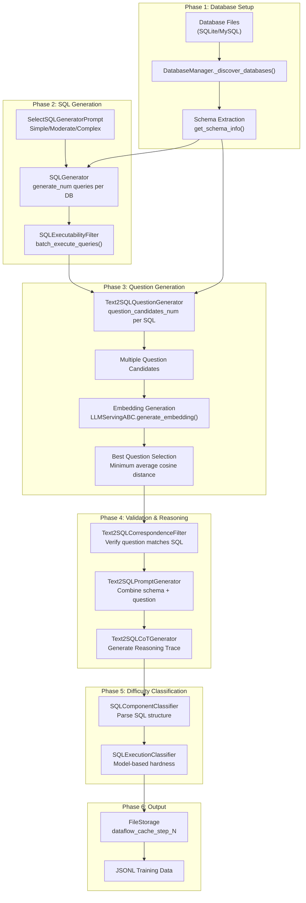
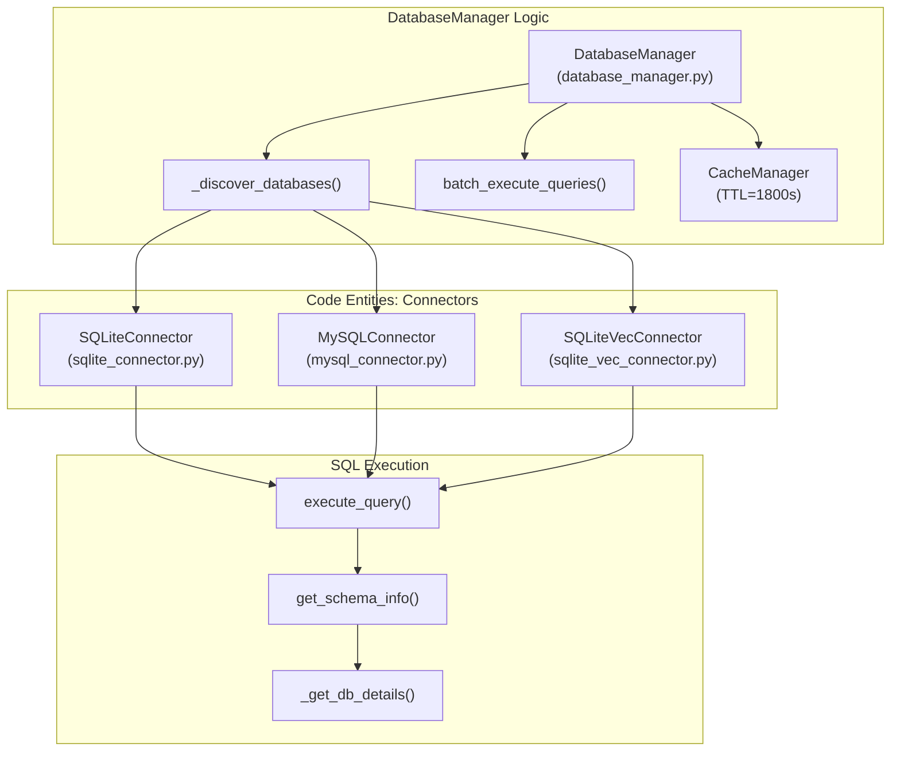
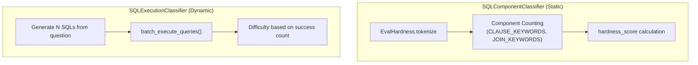

<!-- source: DeepWiki mcp.deepwiki.com · repo OpenDCAI/DataFlow · page 12.1 Generating Text2SQL Training Data · fetched 2026-11-02 -->

# Generating Text2SQL Training Data

Relevant source files

The following files were used as context for generating this wiki page:

- [dataflow/example/Text2SQLPipeline/empty.jsonl](dataflow/example/Text2SQLPipeline/empty.jsonl)
- [dataflow/operators/text2sql/eval/sql_component_classifier.py](dataflow/operators/text2sql/eval/sql_component_classifier.py)
- [dataflow/operators/text2sql/generate/sql_generator.py](dataflow/operators/text2sql/generate/sql_generator.py)
- [dataflow/operators/text2sql/generate/sql_variation_generator.py](dataflow/operators/text2sql/generate/sql_variation_generator.py)
- [dataflow/operators/text2sql/generate/text2sql_cot_generator.py](dataflow/operators/text2sql/generate/text2sql_cot_generator.py)
- [dataflow/operators/text2sql/generate/text2sql_prompt_generator.py](dataflow/operators/text2sql/generate/text2sql_prompt_generator.py)
- [dataflow/operators/text2sql/generate/text2sql_question_generator.py](dataflow/operators/text2sql/generate/text2sql_question_generator.py)
- [dataflow/prompts/text2sql.py](dataflow/prompts/text2sql.py)
- [dataflow/statics/pipelines/api_pipelines/text2sql_pipeline_gen.py](dataflow/statics/pipelines/api_pipelines/text2sql_pipeline_gen.py)
- [dataflow/statics/pipelines/api_pipelines/text2sql_pipeline_refine.py](dataflow/statics/pipelines/api_pipelines/text2sql_pipeline_refine.py)
- [dataflow/statics/pipelines/cpu_pipelines/text2sql_pipeline.py](dataflow/statics/pipelines/cpu_pipelines/text2sql_pipeline.py)
- [dataflow/statics/pipelines/gpu_pipelines/text2sql_pipeline_gen.py](dataflow/statics/pipelines/gpu_pipelines/text2sql_pipeline_gen.py)
- [dataflow/statics/pipelines/gpu_pipelines/text2sql_pipeline_refine.py](dataflow/statics/pipelines/gpu_pipelines/text2sql_pipeline_refine.py)
- [dataflow/utils/text2sql/base.py](dataflow/utils/text2sql/base.py)
- [dataflow/utils/text2sql/database_connector/mysql_connector.py](dataflow/utils/text2sql/database_connector/mysql_connector.py)
- [dataflow/utils/text2sql/database_connector/sqlite_connector.py](dataflow/utils/text2sql/database_connector/sqlite_connector.py)
- [dataflow/utils/text2sql/database_manager.py](dataflow/utils/text2sql/database_manager.py)

This page provides a complete end-to-end workflow for generating Text2SQL training data using DataFlow. The workflow starts with database discovery, generates SQL queries from database schemas, creates natural language questions, validates correspondence between questions and SQL, generates chain-of-thought (CoT) reasoning, and classifies difficulty levels.

---

## Overview

The Text2SQL generation workflow produces high-quality training data including SQL queries, natural language questions, evidence, and step-by-step reasoning. The system supports multiple database engines and provides both static and dynamic difficulty classification.

The workflow is implemented in three primary deployment variants:

- **API Pipeline**: Uses external LLM APIs (OpenAI, DeepSeek) for all generation tasks - `[dataflow/statics/pipelines/api_pipelines/text2sql_pipeline_gen.py:68-261]()`
- **GPU Pipeline**: Uses local models via vLLM/SGLang for on-premise deployment - `[dataflow/statics/pipelines/gpu_pipelines/text2sql_pipeline_gen.py:59-242]()`
- **CPU Pipeline**: Lightweight pipeline for filtering and classification only - `[dataflow/statics/pipelines/cpu_pipelines/text2sql_pipeline.py:53-151]()`

Sources: `[dataflow/statics/pipelines/api_pipelines/text2sql_pipeline_gen.py:68-261]()`, `[dataflow/statics/pipelines/gpu_pipelines/text2sql_pipeline_gen.py:59-242]`, `[dataflow/statics/pipelines/cpu_pipelines/text2sql_pipeline.py:53-151]()`

---

## Complete Workflow Architecture

The following diagram shows the complete data flow from database discovery through final training data generation:

### Text2SQL Data Generation Flow

Sources: `[dataflow/statics/pipelines/api_pipelines/text2sql_pipeline_gen.py:180-253]()`, `[dataflow/statics/pipelines/gpu_pipelines/text2sql_pipeline_gen.py:182-234]()`, `[dataflow/utils/text2sql/database_manager.py:125-128]()`

---

## Database Management and Schema Extraction

### DatabaseManager and Connectors

The `DatabaseManager` class `[dataflow/utils/text2sql/database_manager.py:84-121]()` acts as the central interface for database interactions. It uses a registry of connectors to support different SQL engines via the `CONNECTORS` dictionary `[dataflow/utils/text2sql/database_manager.py:92-98]()`. It also implements a `CacheManager` to handle query results with a default TTL of 1800 seconds `[dataflow/utils/text2sql/database_manager.py:19-27]()`.

### Database Logic to Code Mapping

Sources: `[dataflow/utils/text2sql/database_manager.py:19-121]()`, `[dataflow/utils/text2sql/database_connector/sqlite_connector.py:12-113]()`, `[dataflow/utils/text2sql/database_connector/mysql_connector.py:9-109]()`

### Schema Extraction Process

The `DatabaseManager` extracts schema information into a structured "M-Schema" format. This includes:
- **Discovery**: Locating `.db` or `.sqlite` files in a root path via `_discover_databases` `[dataflow/utils/text2sql/database_manager.py:125-128]()`.
- **Table Info**: Using `PRAGMA table_info` in `SQLiteConnector` to get columns, types, and keys `[dataflow/utils/text2sql/database_connector/sqlite_connector.py:115-147]()`.
- **Sample Data**: Fetching rows to provide examples for the LLM using `LIMIT 2` `[dataflow/utils/text2sql/database_connector/sqlite_connector.py:157-175]()`.
- **M-Schema Generation**: Formatting extracted metadata into a prompt-friendly string via `get_schema_info()` `[dataflow/utils/text2sql/database_connector/sqlite_connector.py:93-113]()`.

Sources: `[dataflow/utils/text2sql/database_connector/sqlite_connector.py:93-113]()`, `[dataflow/utils/text2sql/database_manager.py:125-128]()`

---

## SQL and Question Generation

### SQL Synthesis

The `SQLGenerator` synthesizes SQL queries using complexity-aware prompts. It utilizes `SelectSQLGeneratorPrompt` `[dataflow/prompts/text2sql.py:96-152]()` to target specific difficulty levels:
- **Simple**: Single table, no joins `[dataflow/prompts/text2sql.py:98-110]()`.
- **Moderate**: Joins, subqueries, `GROUP BY` `[dataflow/prompts/text2sql.py:112-130]()`.
- **Complex**: Window functions, CTEs, nested subqueries `[dataflow/prompts/text2sql.py:132-152]()`.

The `SQLGenerator.run()` method iterates through discovered databases and generates `generate_num` SQL queries per database `[dataflow/operators/text2sql/generate/sql_generator.py:77-91]()`.

Sources: `[dataflow/prompts/text2sql.py:96-152]()`, `[dataflow/operators/text2sql/generate/sql_generator.py:67-117]()`, `[dataflow/statics/pipelines/api_pipelines/text2sql_pipeline_gen.py:127-132]()`

### Question Generation and Selection

The `Text2SQLQuestionGenerator` `[dataflow/operators/text2sql/generate/text2sql_question_generator.py:19-26]()` generates natural language questions for the synthesized SQL.

1. **Candidate Generation**: Generates `question_candidates_num` questions (default 3 or 5 depending on pipeline) `[dataflow/statics/pipelines/api_pipelines/text2sql_pipeline_gen.py:142]()`.
2. **Embedding & Selection**: It uses `embedding_serving` to calculate embeddings for all candidates and selects the "best" question using `select_best_question()` based on the minimum average cosine distance to other candidates `[dataflow/operators/text2sql/generate/text2sql_question_generator.py:101-114]()`.

Sources: `[dataflow/operators/text2sql/generate/text2sql_question_generator.py:19-125]()`, `[dataflow/statics/pipelines/api_pipelines/text2sql_pipeline_gen.py:138-144]()`, `[dataflow/statics/pipelines/gpu_pipelines/text2sql_pipeline_gen.py:147-153]()`

---

## Validation and Reasoning (CoT)

### Correspondence Filtering

`Text2SQLCorrespondenceFilter` uses `Text2SQLCorrespondenceFilterPrompt` `[dataflow/prompts/text2sql.py:13-51]()` to verify if the generated SQL logically aligns with the natural language question. It evaluates logical alignment, schema compliance, and completeness, outputting a `YES/NO` conclusion `[dataflow/prompts/text2sql.py:31-46]()`.

Sources: `[dataflow/prompts/text2sql.py:13-51]()`, `[dataflow/statics/pipelines/api_pipelines/text2sql_pipeline_gen.py:146-150]()`

### Chain-of-Thought Generation

The `Text2SQLCoTGenerator` produces reasoning traces. It uses the `Text2SQLCotGeneratorPrompt` `[dataflow/prompts/text2sql.py:54-91]()` which provides the database schema, question, and a reference SQL solution to guide the LLM in explaining the step-by-step translation process `[dataflow/prompts/text2sql.py:64-90]()`.

Sources: `[dataflow/prompts/text2sql.py:54-91]()`, `[dataflow/statics/pipelines/api_pipelines/text2sql_pipeline_gen.py:157-161]()`

---

## Difficulty Classification

The system provides two methods for assessing SQL difficulty:

### Classification Logic Mapping

1. **SQLComponentClassifier**: A static analyzer that counts SQL components (joins, conditions, keywords) to assign labels like `easy`, `medium`, `hard`, or `extra` `[dataflow/statics/pipelines/api_pipelines/text2sql_pipeline_gen.py:167-170]()`.
2. **SQLExecutionClassifier**: A dynamic classifier that attempts to generate SQL from the question multiple times (e.g., `num_generations=10`). Difficulty is determined by the model's success rate `[dataflow/statics/pipelines/api_pipelines/text2sql_pipeline_gen.py:172-178]()`. If a model succeeds only 2/10 times, the query is labeled `extra` (hard) `[dataflow/statics/pipelines/api_pipelines/text2sql_pipeline_gen.py:177-178]()`.

Sources: `[dataflow/statics/pipelines/api_pipelines/text2sql_pipeline_gen.py:167-178]()`, `[dataflow/operators/text2sql/eval/sql_component_classifier.py:1-95]()`

---

## SQL Refinement Workflow

The `Text2SQLRefine_APIPipeline` `[dataflow/statics/pipelines/api_pipelines/text2sql_pipeline_refine.py:68-232]()` is used to improve existing datasets. It introduces the `SQLVariationGenerator` `[dataflow/operators/text2sql/generate/sql_variation_generator.py:20-33]()`, which takes an existing SQL query and generates variations by changing data filters or complexity using the `SQLVariationGeneratorPrompt` `[dataflow/operators/text2sql/generate/sql_variation_generator.py:97-102]()`.

Sources: `[dataflow/statics/pipelines/api_pipelines/text2sql_pipeline_refine.py:68-232]()`, `[dataflow/operators/text2sql/generate/sql_variation_generator.py:20-143]()`, `[dataflow/statics/pipelines/gpu_pipelines/text2sql_pipeline_refine.py:133-137]()`

---

