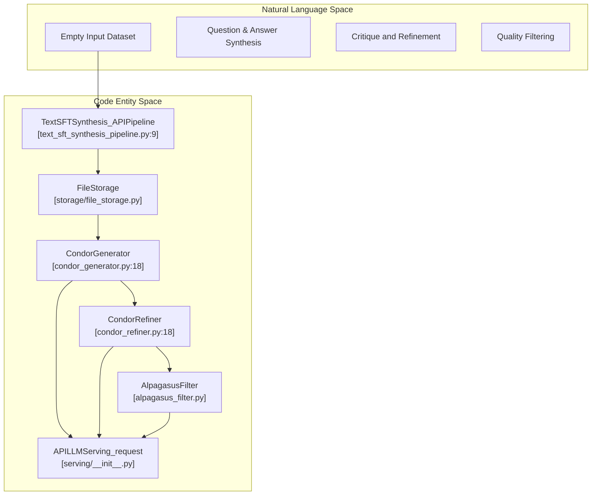
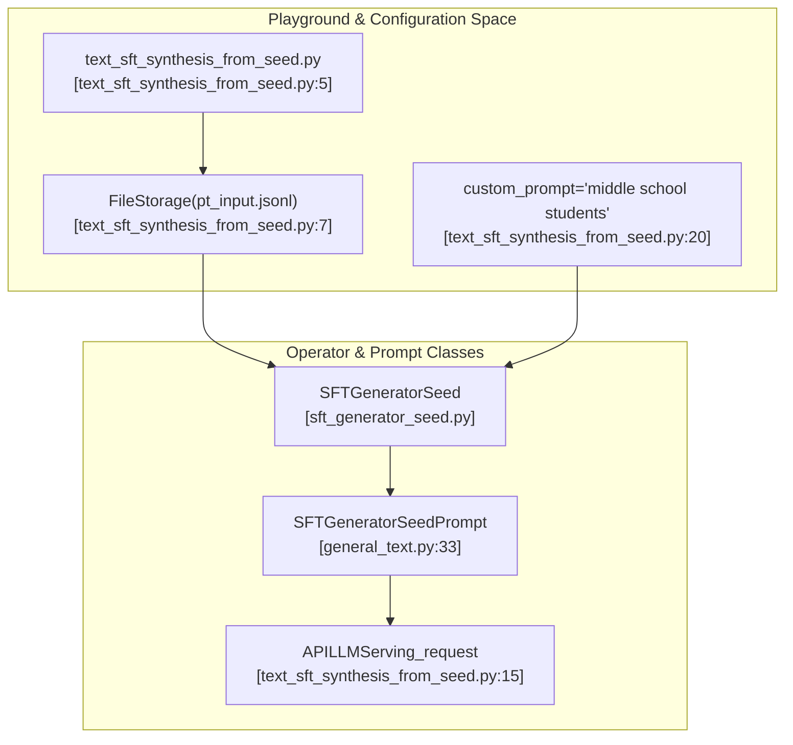

<!-- source: DeepWiki mcp.deepwiki.com · repo OpenDCAI/DataFlow · page 12.2 Creating SFT Instruction Data · fetched 2026-11-02 -->

# Creating SFT Instruction Data

Relevant source files

The following files were used as context for generating this wiki page:

- [dataflow/example/GeneralTextPipeline/empty.jsonl](dataflow/example/GeneralTextPipeline/empty.jsonl)
- [dataflow/operators/conversations/generate/consistent_chat_generator.py](dataflow/operators/conversations/generate/consistent_chat_generator.py)
- [dataflow/operators/text_sft/generate/condor_generator.py](dataflow/operators/text_sft/generate/condor_generator.py)
- [dataflow/operators/text_sft/refine/condor_refiner.py](dataflow/operators/text_sft/refine/condor_refiner.py)
- [dataflow/prompts/general_text.py](dataflow/prompts/general_text.py)
- [dataflow/statics/pipelines/api_pipelines/text_conversation_synthesis_pipeline.py](dataflow/statics/pipelines/api_pipelines/text_conversation_synthesis_pipeline.py)
- [dataflow/statics/pipelines/api_pipelines/text_sft_synthesis_pipeline.py](dataflow/statics/pipelines/api_pipelines/text_sft_synthesis_pipeline.py)
- [dataflow/statics/playground/playground/text_conversation_synthesis_pipeline.py](dataflow/statics/playground/playground/text_conversation_synthesis_pipeline.py)
- [dataflow/statics/playground/playground/text_sft_synthesis_from_scratch.py](dataflow/statics/playground/playground/text_sft_synthesis_from_scratch.py)
- [dataflow/statics/playground/playground/text_sft_synthesis_from_seed.py](dataflow/statics/playground/playground/text_sft_synthesis_from_seed.py)

This page provides an end-to-end technical workflow for generating supervised fine-tuning (SFT) instruction data using the DataFlow framework. SFT instruction data consists of structured question-answer pairs optimized for instruction-following model training. This guide details two primary generation strategies—synthesizing data from scratch via predefined knowledge taxonomies and conditioning generation on an existing corpus of seed text—as well as multi-turn conversation synthesis and playground scripts.

---

## Overview

DataFlow provides modular operator pipelines and playground scripts for creating SFT instruction data:

| Approach | Architecture / Pipeline File | Key Operators | Input Source |
|----------|------------------------------|---------------|--------------|
| **From Scratch** | `TextSFTSynthesis_APIPipeline` `[dataflow/statics/pipelines/api_pipelines/text_sft_synthesis_pipeline.py:9-46]()` | `CondorGenerator`, `CondorRefiner`, `AlpagasusFilter` | Empty JSONL `[dataflow/example/GeneralTextPipeline/empty.jsonl:1-1]()` |
| **From Seed Data** | `TextPipeline` playground script `[dataflow/statics/playground/playground/text_sft_synthesis_from_seed.py:5-28]()` | `SFTGeneratorSeed` | Seed corpus `[dataflow/example/GeneralTextPipeline/pt_input.jsonl]()` |
| **Multi-Turn Chat** | `TextConversationSynthesis_APIPipeline` `[dataflow/statics/pipelines/api_pipelines/text_conversation_synthesis_pipeline.py:6-25]()` | `ConsistentChatGenerator` | Empty JSONL |

All workflows interface with LLM endpoints via the `LLMServingABC` abstraction, supporting both remote API serving (`APILLMServing_request`) and local GPU runtimes.

Sources: `[dataflow/statics/pipelines/api_pipelines/text_sft_synthesis_pipeline.py:9-26]`, `[dataflow/operators/text_sft/generate/condor_generator.py:18-57]`, `[dataflow/operators/text_sft/refine/condor_refiner.py:18-56]`, `[dataflow/statics/playground/playground/text_sft_synthesis_from_seed.py:5-21]()`

---

## Workflow 1: Generating SFT Data from Scratch

The scratch workflow uses `CondorGenerator` `[dataflow/operators/text_sft/generate/condor_generator.py:18-18]()`, `CondorRefiner` `[dataflow/operators/text_sft/refine/condor_refiner.py:18-18]()`, and `AlpagasusFilter` `[dataflow/operators/text_sft/__init__.py]()` orchestrated inside `TextSFTSynthesis_APIPipeline` `[dataflow/statics/pipelines/api_pipelines/text_sft_synthesis_pipeline.py:9-9]()`.

### Pipeline Architecture and Code Mapping

Diagram: SFT Synthesis Pipeline Architecture

Sources: `[dataflow/statics/pipelines/api_pipelines/text_sft_synthesis_pipeline.py:9-42]`, `[dataflow/operators/text_sft/generate/condor_generator.py:18-165]`, `[dataflow/operators/text_sft/refine/condor_refiner.py:18-87]()`

### Stage 1: Question and Answer Generation (`CondorGenerator`)

`CondorGenerator` generates instruction-answer pairs at three difficulty levels (`Easy`, `Medium`, `Hard`) using a knowledge tree taxonomy `[dataflow/operators/text_sft/generate/condor_generator.py:18-25]()`.

1. **Prompt Construction**: `run()` selects random topic, domain, and theme entries from `CondorQuestionPrompt.tag`, optionally injecting task scenario descriptors via `self.use_task_diversity` `[dataflow/operators/text_sft/generate/condor_generator.py:88-121]()`.
2. **Batch Generation (Questions)**: Invokes `self.llm_serving.generate_from_input(user_inputs=prompts)` `[dataflow/operators/text_sft/generate/condor_generator.py:125]()`.
3. **Parsing**: `parse_generated_responses()` extracts structured tags (`[Easy]`, `[Medium]`, `[Hard]`) from the raw LLM output strings `[dataflow/operators/text_sft/generate/condor_generator.py:60-85]()`.
4. **Batch Generation (Answers)**: Constructs answer prompts for each parsed question and performs a second batched LLM generation pass `[dataflow/operators/text_sft/generate/condor_generator.py:130-143]()`.

Sources: `[dataflow/operators/text_sft/generate/condor_generator.py:18-165]`, `[dataflow/prompts/general_text.py:12-30]()`

### Stage 2: Answer Refinement (`CondorRefiner`)

`CondorRefiner` improves answer quality via a two-phase critique-and-rewrite loop `[dataflow/operators/text_sft/refine/condor_refiner.py:18-56]()`:
- **Phase 1 (`generate_critique`)**: Builds critique prompts using `CondorRefinePrompt` with `mode="critique"` to analyze existing `instruction` and `output` pairs `[dataflow/operators/text_sft/refine/condor_refiner.py:58-62]()`.
- **Phase 2 (`generate_refined_answer`)**: Passes the generated critique back to the LLM with `mode="refine"` to produce improved responses, stripping tags like `[Improved Answer Start]` `[dataflow/operators/text_sft/refine/condor_refiner.py:64-69]()`.

Sources: `[dataflow/operators/text_sft/refine/condor_refiner.py:18-87]()`

### Stage 3: Quality Filtering (`AlpagasusFilter`)

`AlpagasusFilter` evaluates each sample against six dimensions or an overall score using `AlpagasusPrompt` `[dataflow/prompts/general_text.py:141-167]()`, dropping entries outside the configured `min_score` and `max_score` bounds `[dataflow/statics/pipelines/api_pipelines/text_sft_synthesis_pipeline.py:26]()`.

Sources: `[dataflow/prompts/general_text.py:141-167]`, `[dataflow/statics/pipelines/api_pipelines/text_sft_synthesis_pipeline.py:26]()`

---

## Workflow 2: Generating SFT Data from Seed Data

When source documents are available (e.g., pre-training corpora), `SFTGeneratorSeed` transforms raw text chunks into instruction-tuning pairs.

### Playground Script and Prompt Architecture

Diagram: Seed Synthesis Mapping

Sources: `[dataflow/statics/playground/playground/text_sft_synthesis_from_seed.py:1-28]`, `[dataflow/prompts/general_text.py:33-75]()`

### Prompt Implementation

`SFTGeneratorSeedPrompt` wraps the raw content with strict JSON formatting requirements and custom instruction overrides `[dataflow/prompts/general_text.py:33-75]()`:
- Formats input content inside chat template boundaries (`<|im_start|>system ... <|im_end|>`) `[dataflow/prompts/general_text.py:74]()`.
- Enforces JSON output with explicit `"instruction"` and `"output"` keys `[dataflow/prompts/general_text.py:50-54]()`.

Sources: `[dataflow/prompts/general_text.py:33-75]()`

---

## Multi-Turn Conversation Synthesis

Multi-turn dialogues are generated using `ConsistentChatGenerator` `[dataflow/operators/conversations/generate/consistent_chat_generator.py:18-18]()` inside `TextConversationSynthesis_APIPipeline` `[dataflow/statics/pipelines/api_pipelines/text_conversation_synthesis_pipeline.py:6-6]()`.

- **Query Generation Phase**: `ConsistentChatPrompt(mode="query")` builds requests to generate user queries across intents `[dataflow/operators/conversations/generate/consistent_chat_generator.py:60-64]()`.
- **Response Generation Phase**: `ConsistentChatPrompt(mode="response")` generates assistant replies for each conversational turn `[dataflow/operators/conversations/generate/consistent_chat_generator.py:78-84]()`.
- **Role Formatting**: Formats conversations into alternating `user` and `assistant` message dictionaries, ensuring conversations do not terminate with a user turn `[dataflow/operators/conversations/generate/consistent_chat_generator.py:102-127]()`.

Sources: `[dataflow/operators/conversations/generate/consistent_chat_generator.py:18-143]`, `[dataflow/statics/pipelines/api_pipelines/text_conversation_synthesis_pipeline.py:6-25]()`

---

## Playground Scripts Reference

DataFlow provides executable playground scripts for testing SFT generation flows directly:

- **Scratch Synthesis**: `[dataflow/statics/playground/playground/text_sft_synthesis_from_scratch.py:1-45]()` — Executes `CondorGenerator`, `CondorRefiner`, and `AlpagasusFilter` with an empty entry storage.
- **Seed-Based Synthesis**: `[dataflow/statics/playground/playground/text_sft_synthesis_from_seed.py:1-28]()` — Reads pre-training inputs from `../example_data/GeneralTextPipeline/pt_input.jsonl` and executes `SFTGeneratorSeed`.
- **Conversation Synthesis**: `[dataflow/statics/playground/playground/text_conversation_synthesis_pipeline.py:1-33]()` — Runs `ConsistentChatGenerator` with customized API endpoints.

Sources: `[dataflow/statics/playground/playground/text_sft_synthesis_from_scratch.py:1-45]`, `[dataflow/statics/playground/playground/text_sft_synthesis_from_seed.py:1-28]`, `[dataflow/statics/playground/playground/text_conversation_synthesis_pipeline.py:1-33]()`

---

