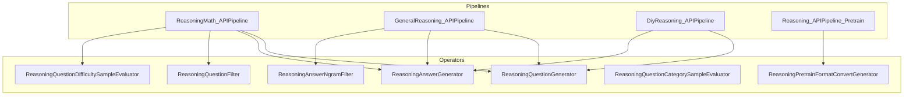
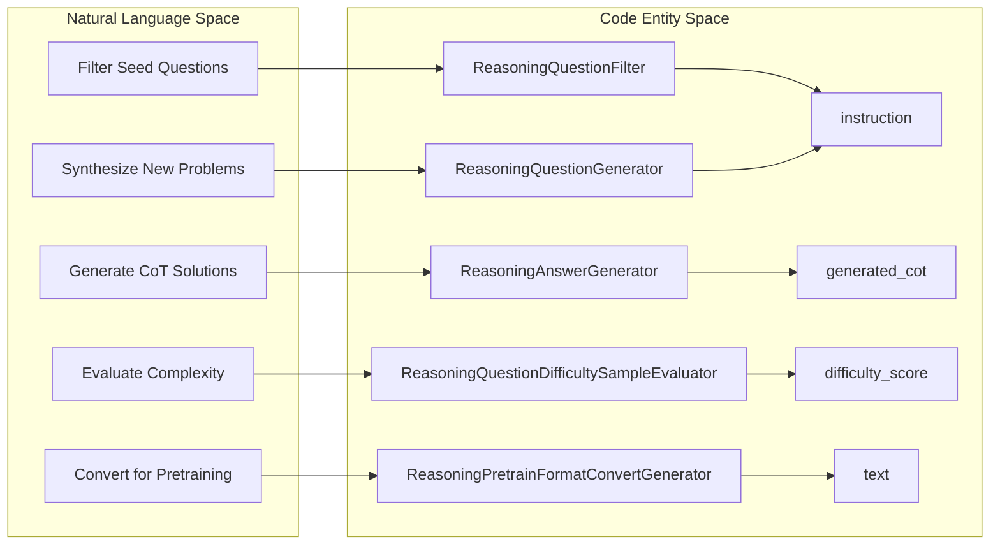

<!-- source: DeepWiki mcp.deepwiki.com · repo OpenDCAI/DataFlow · page 12.3 Building a Reasoning Dataset · fetched 2026-11-02 -->

# Building SFT and Reasoning Datasets

<details>
<summary>Relevant source files</summary>

The following files were used as context for generating this wiki page:

- [dataflow/example/ReasoningPipeline/pipeline_general.json](dataflow/example/ReasoningPipeline/pipeline_general.json)
- [dataflow/statics/pipelines/api_pipelines/reasoning_diy_pipeline.py](dataflow/statics/pipelines/api_pipelines/reasoning_diy_pipeline.py)
- [dataflow/statics/pipelines/api_pipelines/reasoning_general_pipeline.py](dataflow/statics/pipelines/api_pipelines/reasoning_general_pipeline.py)
- [dataflow/statics/pipelines/api_pipelines/reasoning_math_pipeline.py](dataflow/statics/pipelines/api_pipelines/reasoning_math_pipeline.py)
- [dataflow/statics/pipelines/api_pipelines/reasoning_pretrain_pipeline.py](dataflow/statics/pipelines/api_pipelines/reasoning_pretrain_pipeline.py)
- [dataflow/statics/pipelines/cpu_pipelines/reasoning_pipeline.py](dataflow/statics/pipelines/cpu_pipelines/reasoning_pipeline.py)
- [dataflow/statics/pipelines/gpu_pipelines/reasoning_math_pipeline.py](dataflow/statics/pipelines/gpu_pipelines/reasoning_math_pipeline.py)
- [dataflow/statics/playground/playground/reasoning_general_pipeline.py](dataflow/statics/playground/playground/reasoning_general_pipeline.py)
- [test/cpu_only/test_remote_load.py](test/cpu_only/test_remote_load.py)

</details>


This page provides an end-to-end workflow for generating mathematical and logical reasoning problems with chain-of-thought (CoT) solutions using DataFlow's reasoning pipeline. The workflow covers question generation, answer synthesis, quality filtering, and difficulty classification to produce training data suitable for reasoning-capable language models [dataflow/statics/pipelines/api_pipelines/reasoning_math_pipeline.py:27-156]().

For technical details about the reasoning pipeline architecture, see [Reasoning Pipeline](). For operator API reference, see [Reasoning Generation Operators]() and [Reasoning Filter Operators](). For prompt templates, see [Reasoning Prompts]().

Sources: [dataflow/statics/pipelines/api_pipelines/reasoning_math_pipeline.py:27-156]()

## Overview of the Reasoning Data Generation Workflow

The reasoning dataset generation process follows a multi-stage pipeline that transforms seed concepts or existing datasets into structured reasoning problems with verified solutions. DataFlow provides several specialized pipeline implementations:
*   **Math Reasoning**: Focuses on mathematical problem solving with ground truth verification [dataflow/statics/pipelines/api_pipelines/reasoning_math_pipeline.py:27-156]().
*   **General Reasoning**: Handles logical and general-purpose reasoning tasks [dataflow/statics/pipelines/api_pipelines/reasoning_general_pipeline.py:16-85]().
*   **DIY Reasoning**: Allows for custom domain-specific logic (e.g., medical or sports) via flexible prompt injection [dataflow/statics/pipelines/api_pipelines/reasoning_diy_pipeline.py:46-105]().
*   **Pretrain Pipeline**: Converts SFT-style reasoning data into long-form text formats for pre-training [dataflow/statics/pipelines/api_pipelines/reasoning_pretrain_pipeline.py:16-104]().

### Pipeline Architecture Diagram

Title: Reasoning Pipeline Code Entities and Operator Mapping

Sources: [dataflow/statics/pipelines/api_pipelines/reasoning_math_pipeline.py:1-14](), [dataflow/statics/pipelines/api_pipelines/reasoning_general_pipeline.py:1-5](), [dataflow/statics/pipelines/api_pipelines/reasoning_diy_pipeline.py:1-5](), [dataflow/statics/pipelines/api_pipelines/reasoning_pretrain_pipeline.py:1-11]()

Sources: [dataflow/statics/pipelines/api_pipelines/reasoning_math_pipeline.py:27-156](), [dataflow/statics/pipelines/api_pipelines/reasoning_general_pipeline.py:16-85](), [dataflow/statics/pipelines/api_pipelines/reasoning_diy_pipeline.py:46-105](), [dataflow/statics/pipelines/api_pipelines/reasoning_pretrain_pipeline.py:16-104]()

## Data Structure and Format

The reasoning pipeline produces structured data with primary fields per problem, stored in `.jsonl` format via `FileStorage` [dataflow/statics/pipelines/api_pipelines/reasoning_math_pipeline.py:30-35]().

| Field | Description | Example |
|-------|-------------|---------|
| `instruction` | The reasoning problem statement | "A bakery sells muffins..." |
| `output` | Chain-of-thought solution | "Let x be the number of muffins..." |
| `golden_answer` | Expected final answer for verification | "5" |
| `generated_cot` | The LLM-generated reasoning chain | "<answer>5</answer>" |
| `question_difficulty` | Numerical complexity rating (1-10) | 7.5 |

Example from input data [dataflow/example/ReasoningPipeline/pipeline_general.json:1-12]():
```json
{
    "instruction": "A recent clinical study compared two treatments for chronic back pain...",
    "output": "The study found that patients receiving Treatment A reported...",
    "golden_answer": "Treatment A led to greater pain reduction (45% vs. 30%).",
    "source": "Medical_clinical"
}
```
Sources: [dataflow/statics/pipelines/api_pipelines/reasoning_math_pipeline.py:30-35](), [dataflow/statics/pipelines/api_pipelines/reasoning_math_pipeline.py:116-120](), [dataflow/operators/reasoning/generate/reasoning_answer_generator.py:84-86](), [dataflow/example/ReasoningPipeline/pipeline_general.json:1-12]()

## Pipeline Components and Operator Flow

Reasoning pipelines utilize a symbolic forward pass where each operator's `run()` method is called sequentially, interacting with a `storage.step()` instance to manage state [dataflow/statics/pipelines/api_pipelines/reasoning_math_pipeline.py:101-156]().

### Logical Data Flow
The diagram below maps natural language reasoning steps to code-level operators and keys.

Title: Natural Language Space to Code Entity Mapping

Sources: [dataflow/statics/pipelines/api_pipelines/reasoning_math_pipeline.py:101-120](), [dataflow/statics/pipelines/api_pipelines/reasoning_general_pipeline.py:61-74](), [dataflow/statics/pipelines/api_pipelines/reasoning_pretrain_pipeline.py:99-104]()

### Operator Responsibilities

1.  **ReasoningQuestionGenerator**: Synthesizes problems, supporting multiple prompt iterations (`num_prompts=3`) [dataflow/operators/reasoning/generate/reasoning_question_generator.py:96-102]().
2.  **ReasoningAnswerGenerator**: Produces detailed chain-of-thought solutions mapping `input_key="instruction"` to `output_key="generated_cot"` [dataflow/operators/reasoning/generate/reasoning_answer_generator.py:81-86]().
3.  **ReasoningQuestionFilter**: Evaluates problem statement quality and solvability using an LLM backend [dataflow/statics/pipelines/api_pipelines/reasoning_math_pipeline.py:54-58]().
4.  **ReasoningQuestionDifficultySampleEvaluator**: Computes numerical complexity scores (1 to 10) by parsing LLM output patterns [dataflow/operators/reasoning/eval/reasoning_question_difficulty_sample_evaluator.py:40-50]() [dataflow/operators/reasoning/eval/reasoning_question_difficulty_sample_evaluator.py:93-104]().
5.  **ReasoningAnswerNgramFilter**: Calculates n-gram overlap between question and answer fields to flag repetitions [dataflow/statics/pipelines/api_pipelines/reasoning_general_pipeline.py:54-58]().

Sources: [dataflow/operators/reasoning/generate/reasoning_question_generator.py:23-163](), [dataflow/operators/reasoning/eval/reasoning_question_difficulty_sample_evaluator.py:17-110](), [dataflow/statics/pipelines/api_pipelines/reasoning_general_pipeline.py:33-58](), [dataflow/operators/reasoning/generate/reasoning_answer_generator.py:81-86]()

## Step-by-Step Workflow

### Step 1: Initialize Serving and Storage
Pipelines require an `LLMServingABC` implementation alongside a `FileStorage` checkpoint tracker [dataflow/statics/pipelines/api_pipelines/reasoning_general_pipeline.py:19-31]().

```python
from dataflow.serving import APILLMServing_request
from dataflow.utils.storage import FileStorage

llm_serving = APILLMServing_request(
    api_url="http://api.openai.com/v1/chat/completions",
    model_name="gpt-4o",
    max_workers=30
)

storage = FileStorage(
    first_entry_file_name="../example_data/ReasoningPipeline/pipeline_general.json",
    cache_path="./cache_local",
    file_name_prefix="dataflow_cache_step",
    cache_type="jsonl"
)
```
Sources: [dataflow/statics/pipelines/api_pipelines/reasoning_general_pipeline.py:19-31]()

### Step 2: Configure Operators
Operators bind specific prompts and LLM servers, leveraging decorator configurations [dataflow/operators/reasoning/generate/reasoning_question_generator.py:16-20]().

### Step 3: Execute the Forward Pass
The `forward()` method sequences operations across checkpoints using `storage.step()` [dataflow/statics/pipelines/api_pipelines/reasoning_math_pipeline.py:101-156]().

```python
def forward(self):
    self.question_filter_step1.run(
        storage = self.storage.step(),
        input_key = "instruction",
    )
    self.answer_generator_step7.run(
        storage = self.storage.step(),
        input_key = "instruction", 
        output_key = "generated_cot"
    )
```
Sources: [dataflow/statics/pipelines/api_pipelines/reasoning_math_pipeline.py:101-138]()

## Specialized Pipelines

### Math Reasoning (GPU/API)
Integrates category/difficulty sample evaluators (`ReasoningQuestionDifficultySampleEvaluator`, `ReasoningQuestionCategorySampleEvaluator`) [dataflow/statics/pipelines/api_pipelines/reasoning_math_pipeline.py:69-74]() and token-length bounds via `ReasoningAnswerTokenLengthFilter` [dataflow/statics/pipelines/api_pipelines/reasoning_math_pipeline.py:85-88]().

### DIY Reasoning
Uses custom prompt templates like `DiyQuestionFilterPrompt` and `DiyQuestionSynthesisPrompt` to enforce domain-specific constraints [dataflow/statics/pipelines/api_pipelines/reasoning_diy_pipeline.py:20-44]() [dataflow/statics/pipelines/api_pipelines/reasoning_diy_pipeline.py:63-73]().

### CPU-Only Filtering
Executes n-gram scoring and ground truth validation offline without live LLM queries [dataflow/statics/pipelines/cpu_pipelines/reasoning_pipeline.py:8-44]().

Sources: [dataflow/statics/pipelines/api_pipelines/reasoning_math_pipeline.py:69-88](), [dataflow/statics/pipelines/api_pipelines/reasoning_diy_pipeline.py:20-73](), [dataflow/statics/pipelines/cpu_pipelines/reasoning_pipeline.py:8-44]()

## Remote Data Loading
Remote datasets load seamlessly from HuggingFace (`hf:`) or ModelScope (`ms:`) sources using `FileStorage` [test/cpu_only/test_remote_load.py:11-23]().

```python
self.storage_1 = FileStorage(
    first_entry_file_name="hf:openai/gsm8k:main:train",
    cache_path="./cache",
    file_name_prefix="dataflow_cache_step_hf",
    cache_type="jsonl"
)
```
Sources: [test/cpu_only/test_remote_load.py:11-16]()

---

