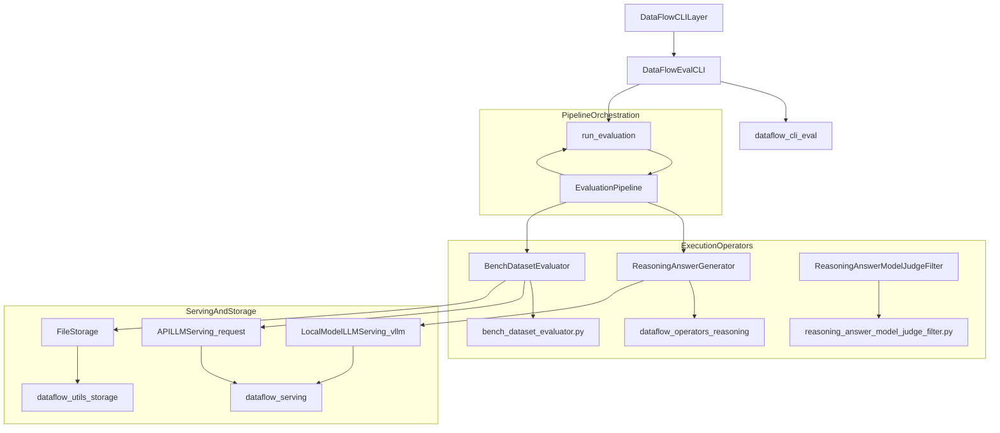
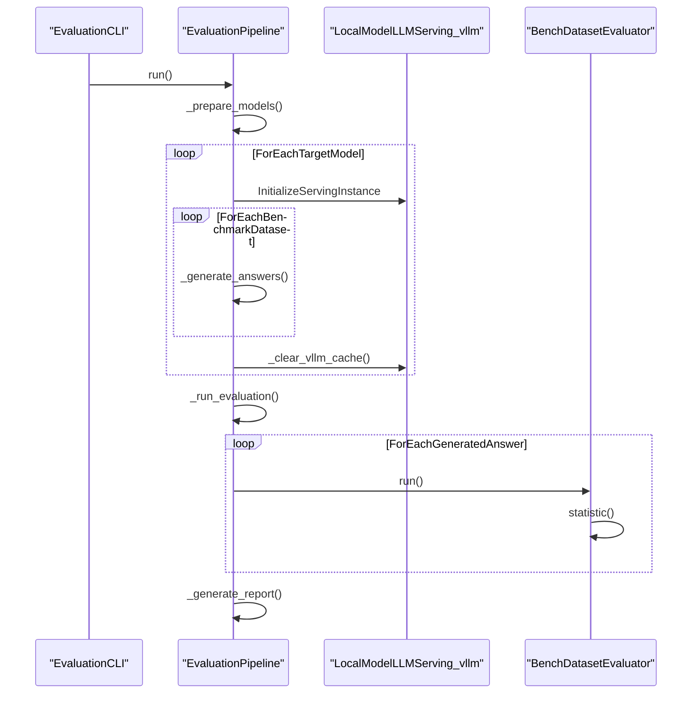

<!-- source: DeepWiki mcp.deepwiki.com · repo OpenDCAI/DataFlow · page 12.4 Evaluating Fine-tuned Models · fetched 2026-11-02 -->

# Evaluating Fine-tuned Models

<details>
<summary>Relevant source files</summary>

The following files were used as context for generating this wiki page:

- [dataflow/cli.py](dataflow/cli.py)
- [dataflow/cli_funcs/cli_eval.py](dataflow/cli_funcs/cli_eval.py)
- [dataflow/cli_funcs/cli_webui.py](dataflow/cli_funcs/cli_webui.py)
- [dataflow/cli_funcs/eval_pipeline/eval_api.py](dataflow/cli_funcs/eval_pipeline/eval_api.py)
- [dataflow/cli_funcs/eval_pipeline/eval_local.py](dataflow/cli_funcs/eval_pipeline/eval_local.py)
- [dataflow/example/core_text_data/bench_eval_data_2.jsonl](dataflow/example/core_text_data/bench_eval_data_2.jsonl)
- [dataflow/operators/core_text/eval/bench_dataset_evaluator.py](dataflow/operators/core_text/eval/bench_dataset_evaluator.py)
- [dataflow/operators/reasoning/filter/reasoning_answer_model_judge_filter.py](dataflow/operators/reasoning/filter/reasoning_answer_model_judge_filter.py)
- [dataflow/prompts/model_evaluation/general.py](dataflow/prompts/model_evaluation/general.py)
- [dataflow/statics/pipelines/api_pipelines/core_text_bencheval_semantic_pipeline.py](dataflow/statics/pipelines/api_pipelines/core_text_bencheval_semantic_pipeline.py)
- [dataflow/statics/pipelines/api_pipelines/core_text_bencheval_semantic_pipeline_question.py](dataflow/statics/pipelines/api_pipelines/core_text_bencheval_semantic_pipeline_question.py)
- [dataflow/statics/pipelines/api_pipelines/core_text_bencheval_semantic_pipeline_question_single_step.py](dataflow/statics/pipelines/api_pipelines/core_text_bencheval_semantic_pipeline_question_single_step.py)
- [dataflow/statics/pipelines/gpu_pipelines/core_text_bencheval_match_pipeline.py](dataflow/statics/pipelines/gpu_pipelines/core_text_bencheval_match_pipeline.py)
- [dataflow/statics/scaffold/{{cookiecutter.repo_name}}/{{cookiecutter.package_name}}/operators/core/__init__.py](dataflow/statics/scaffold/{{cookiecutter.repo_name}}/{{cookiecutter.package_name}}/operators/core/__init__.py)

</details>


This page documents how to evaluate fine-tuned language models using DataFlow's built-in evaluation pipeline (`EvaluationPipeline`). The workflow supports both API-based and local GPU evaluation modes, enabling benchmarking of multiple models against question-answering datasets using judge-based evaluation or exact mathematical matching.

For evaluation CLI commands and configurations, see **Section 8.1 (Model Evaluation)**. For model training workflows, see **Section 8.5 (Training Commands)**.

---

## Overview of the Evaluation Workflow

The evaluation architecture utilizes a judge-based approach where a robust LLM assesses the correctness of model-generated answers against reference answers. This approach is superior to exact string matching for complex or open-ended reasoning tasks, while retaining a deterministic `match` mode for structured or mathematical evaluations.

### Natural Language to Code Entity Space Mapping

The following diagram maps high-level evaluation concepts to their corresponding code entities within the repository.



Sources: [dataflow/cli_funcs/cli_eval.py:32-70](), [dataflow/cli_funcs/cli_eval.py:422-442]()

---

## Step 1: Initialize Evaluation Configuration

Initialize the configuration template files in the working directory using the CLI:

```bash
dataflow eval init
```

This invokes `DataFlowEvalCLI.init_eval_files()`, generating two configuration templates:
- `eval_api.py`: Configuration for API-based judging [dataflow/cli_funcs/eval_pipeline/eval_api.py:1-10]()
- `eval_local.py`: Configuration for local GPU inference with vLLM [dataflow/cli_funcs/eval_pipeline/eval_local.py:1-10]()

Sources: [dataflow/cli.py:171-184](), [dataflow/cli_funcs/cli_eval.py:422-442]()

---

## Step 2: Configure Judge Model

Configure the evaluation judge model via `JUDGE_MODEL_CONFIG`.

### API-Based Judge Configuration

In `eval_api.py`, `JUDGE_MODEL_CONFIG` is passed to `create_judge_serving()` to instantiate an `APILLMServing_request` instance.

```python
JUDGE_MODEL_CONFIG = {
    "model_name": "gpt-4o-mini",
    "api_url": "API_URL",
    "api_key_env": "DF_API_KEY",
    "max_workers": 3,
    "max_retries": 5,
}
```

Sources: [dataflow/cli_funcs/eval_pipeline/eval_api.py:58-64](), [dataflow/cli_funcs/eval_pipeline/eval_api.py:161-179]()

### Local GPU Judge Configuration

In `eval_local.py`, `LocalModelLLMServing_vllm` serves as the judge backend.

```python
JUDGE_MODEL_CONFIG = {
    "model_path": "./Qwen2.5-7B-Instruct",
    "vllm_tensor_parallel_size": 1,
    "vllm_gpu_memory_utilization": 0.9,
    "vllm_max_tokens": 512,
    "vllm_temperature": 0.9
}
```

Sources: [dataflow/cli_funcs/eval_pipeline/eval_local.py:55-67](), [dataflow/cli_funcs/eval_pipeline/eval_local.py:147-184]()

---

## Step 3: Configure Target Models

Define target models in `TARGET_MODELS`. Each configuration dict overrides `DEFAULT_MODEL_CONFIG` and supports model-specific inference arguments and custom `answer_prompt` templates.

```python
TARGET_MODELS = [
    {
        "name": "qwen_3b",
        "path": "./Qwen2.5-3B-Instruct",
        "vllm_tensor_parallel_size": 1,
        "vllm_max_tokens": 2048,
        "vllm_temperature": 0.1,
        "answer_prompt": "Please answer the following question. Put your answer in \\boxed{}."
    }
]
```

The pipeline parses these configurations through `EvaluationPipeline._prepare_models()`.

Sources: [dataflow/cli_funcs/eval_pipeline/eval_local.py:70-103](), [dataflow/cli_funcs/cli_eval.py:85-115]()

---

## Step 4: Configure Benchmark Datasets

Specify input datasets and key mappings in `BENCH_CONFIG`.

```python
BENCH_CONFIG = [
    {
        "name": "bench_name",
        "input_file": "./.cache/data/qa.json",
        "question_key": "input",
        "reference_answer_key": "output",
        "output_dir": "./eval_results/bench_name"
    }
]
```

Sources: [dataflow/cli_funcs/eval_pipeline/eval_api.py:128-143](), [dataflow/cli_funcs/eval_pipeline/eval_local.py:106-128]()

---

## Step 5: Configure Evaluation Method

The `BenchDatasetEvaluator` operator executes evaluation using one of two modes:

| Comparison Mode | Implementation Behavior | Code Reference |
| :--- | :--- | :--- |
| `match` | Applies `math_verify` to compare parsed results for mathematical equivalence. | [dataflow/operators/core_text/eval/bench_dataset_evaluator.py:54-62]() |
| `semantic` | Utilizes an LLM Judge guided by a structured prompt template. | [dataflow/operators/core_text/eval/bench_dataset_evaluator.py:167-178]() |

```python
EVAL_CONFIG = {
    "compare_method": "semantic",
}
```

Sources: [dataflow/operators/core_text/eval/bench_dataset_evaluator.py:27-30](), [dataflow/cli_funcs/eval_pipeline/eval_api.py:151-154]()

---

## Step 6: Customize Judge Prompt

The judge prompt template can be defined via classes like `FairAnswerJudgePrompt`.

```python
class FairAnswerJudgePrompt:
    def build_prompt(self, question, answer, reference_answer):
        ...
```

The `BenchDatasetEvaluator` parses the judge's JSON payload using regex matching to extract boolean results.

Sources: [dataflow/cli_funcs/eval_pipeline/eval_api.py:14-49](), [dataflow/operators/core_text/eval/bench_dataset_evaluator.py:63-81](), [dataflow/prompts/model_evaluation/general.py:9-35]()

---

## Step 7: Run Evaluation

Execute the evaluation workflow via the command-line interface:

```bash
dataflow eval api
dataflow eval local
```

### Execution Sequence Flow



Sources: [dataflow/cli_funcs/cli_eval.py:40-69](), [dataflow/cli_funcs/cli_eval.py:131-259](), [dataflow/operators/core_text/eval/bench_dataset_evaluator.py:142-178]()

---

## Step 8: Understanding Results

Metrics are computed within `BenchDatasetEvaluator.statistic()` and consolidated across all runs.

### Result Metrics
- `total_samples`: Count of items in the benchmark file.
- `valid_samples`: Count of samples yielding non-empty outputs.
- `matched_samples`: Count of correct answers verified by the judge or matcher.
- `accuracy`: Ratio of `matched_samples` to `valid_samples`.
- `empty_responses_count`: Count of generation failures or blank responses.

### Output Artifacts
1. **Answers**: `{output_dir}/{bench_name}_answers_{model_name}.json` [dataflow/cli_funcs/cli_eval.py:184]()
2. **Individual Statistics**: JSON records containing accuracy and sample counts [dataflow/operators/core_text/eval/bench_dataset_evaluator.py:119-140]()
3. **Aggregated Report**: `all_results.json` summarizing performance across all evaluated models and benchmarks [dataflow/cli_funcs/cli_eval.py:358]()

Sources: [dataflow/operators/core_text/eval/bench_dataset_evaluator.py:119-140](), [dataflow/cli_funcs/cli_eval.py:335-408]()

---

## Troubleshooting

### GPU Memory Management
The evaluation pipeline purges the vLLM cache and invokes `torch.cuda.empty_cache()` between sequential model evaluations to prevent Out-Of-Memory (OOM) errors.

Sources: [dataflow/cli_funcs/cli_eval.py:117-130](), [dataflow/cli_funcs/cli_eval.py:254-257]()

### Parsing and Empty Responses
When judge outputs deviate from standard JSON formats, fallback regex extractors parse "true" or "false" tokens. Empty responses from target models or judges increment `empty_responses_count`.

Sources: [dataflow/operators/core_text/eval/bench_dataset_evaluator.py:63-81](), [dataflow/operators/reasoning/filter/reasoning_answer_model_judge_filter.py:80-103]()

---

