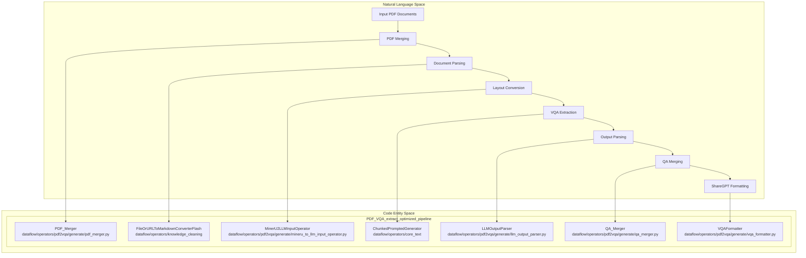
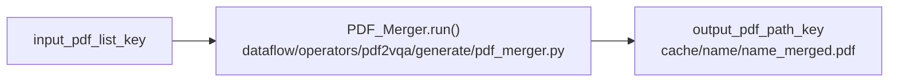
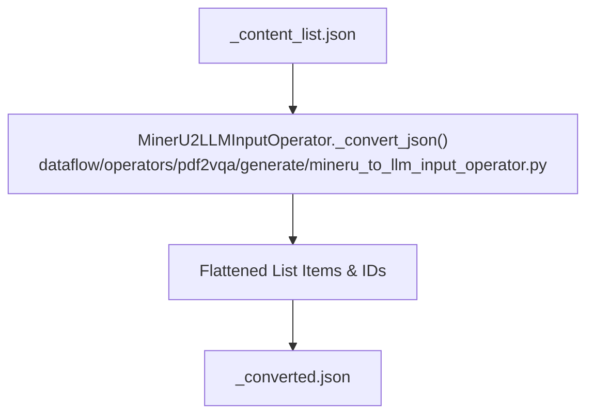
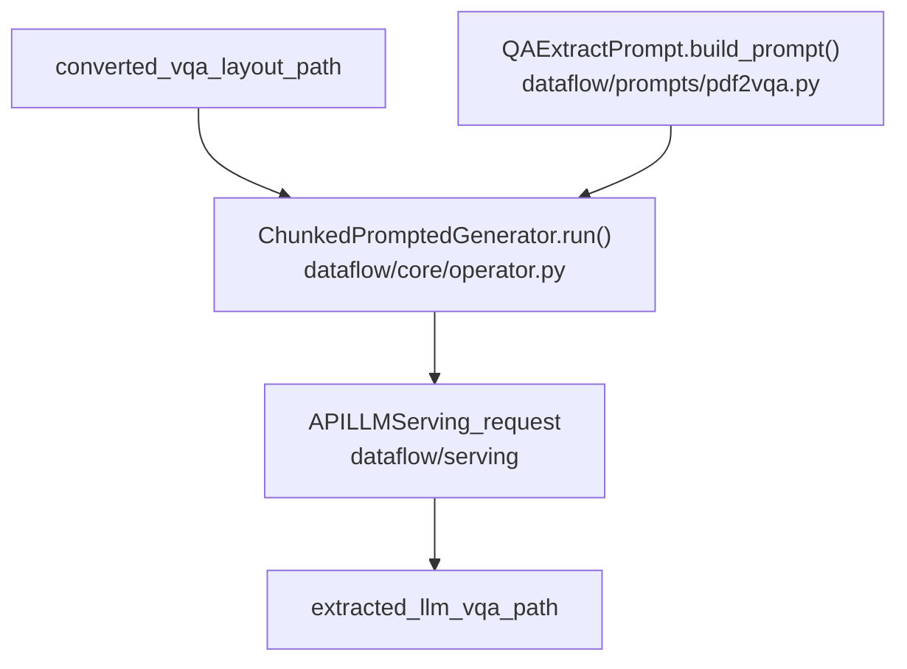
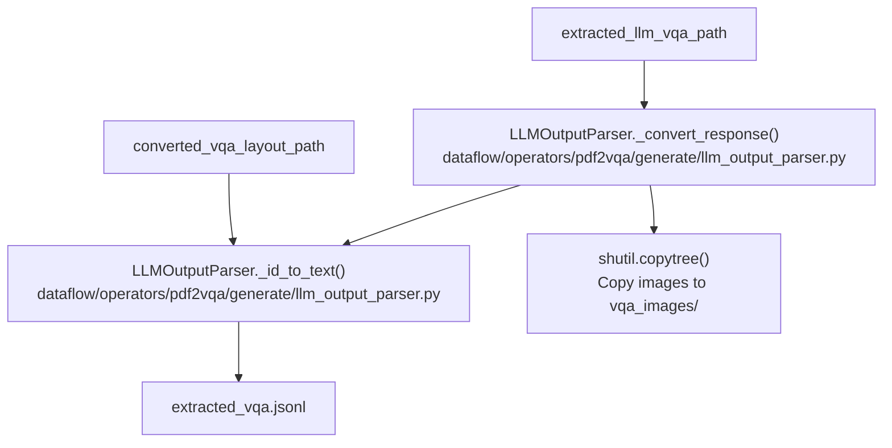
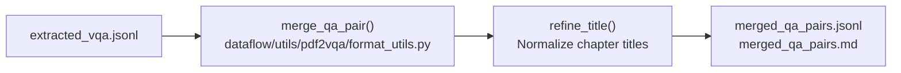

<!-- source: DeepWiki mcp.deepwiki.com · repo OpenDCAI/DataFlow · page 12.5 Extracting QA Pairs from PDFs · fetched 2026-11-02 -->

# Extracting QA Pairs from PDFs

Relevant source files

The following files were used as context for generating this wiki page:

- [dataflow/example/PDF2VQAPipeline/vqa_extract_test.jsonl](dataflow/example/PDF2VQAPipeline/vqa_extract_test.jsonl)
- [dataflow/example/VQA/pdfimages/page_0.jpg](dataflow/example/VQA/pdfimages/page_0.jpg)
- [dataflow/example/VQA/pdfimages/page_1.jpg](dataflow/example/VQA/pdfimages/page_1.jpg)
- [dataflow/example/VQA/pdfimages/page_2.jpg](dataflow/example/VQA/pdfimages/page_2.jpg)
- [dataflow/example/VQA/pic_path.json](dataflow/example/VQA/pic_path.json)
- [dataflow/operators/pdf2vqa/__init__.py](dataflow/operators/pdf2vqa/__init__.py)
- [dataflow/operators/pdf2vqa/generate/llm_output_parser.py](dataflow/operators/pdf2vqa/generate/llm_output_parser.py)
- [dataflow/operators/pdf2vqa/generate/mineru_to_llm_input_operator.py](dataflow/operators/pdf2vqa/generate/mineru_to_llm_input_operator.py)
- [dataflow/operators/pdf2vqa/generate/pdf_merger.py](dataflow/operators/pdf2vqa/generate/pdf_merger.py)
- [dataflow/operators/pdf2vqa/generate/qa_merger.py](dataflow/operators/pdf2vqa/generate/qa_merger.py)
- [dataflow/prompts/pdf2vqa.py](dataflow/prompts/pdf2vqa.py)
- [dataflow/statics/pipelines/api_pipelines/pdf_vqa_extract_pipeline.py](dataflow/statics/pipelines/api_pipelines/pdf_vqa_extract_pipeline.py)
- [dataflow/utils/pdf2vqa/format_utils.py](dataflow/utils/pdf2vqa/format_utils.py)

This document provides a technical overview of the complete end-to-end PDF2VQA workflow for extracting visual question-answering (VQA) pairs from PDF documents using `PDF_VQA_extract_optimized_pipeline` [dataflow/statics/pipelines/api_pipelines/pdf_vqa_extract_pipeline.py:13-102](). This pipeline processes educational materials such as textbooks, problem sets, and exams where questions and answers may be interleaved or located across different pages. The extracted data includes text, mathematical expressions, and images formatted for multi-modal LLM training.

Sources: [dataflow/statics/pipelines/api_pipelines/pdf_vqa_extract_pipeline.py:13-102]()

## Pipeline Overview

The pipeline transforms raw PDF documents into structured QA pairs through seven execution stages, utilizing specific operators defined in the `pdf2vqa` namespace.

**Pipeline Execution and Code Mapping**

Sources: [dataflow/statics/pipelines/api_pipelines/pdf_vqa_extract_pipeline.py:58-100](), [dataflow/operators/pdf2vqa/__init__.py:1-21]()

## Input Format and Pipeline Initialization

The pipeline accepts a JSONL file where each line specifies PDF paths and a name identifier [dataflow/statics/pipelines/api_pipelines/pdf_vqa_extract_pipeline.py:16-21](). The `input_pdf_paths` field can be a single string or a list of strings when merging multiple PDF files [dataflow/statics/pipelines/api_pipelines/pdf_vqa_extract_pipeline.py:61-63]().

The pipeline initializes `FileStorage`, `APILLMServing_request`, `QAExtractPrompt`, and MinerU executors [dataflow/statics/pipelines/api_pipelines/pdf_vqa_extract_pipeline.py:16-45]().

Sources: [dataflow/statics/pipelines/api_pipelines/pdf_vqa_extract_pipeline.py:13-45](), [dataflow/example/PDF2VQAPipeline/vqa_extract_test.jsonl:1-2](), [dataflow/prompts/pdf2vqa.py:5-9]()

## Stage 1: PDF Merging

The `PDF_Merger` operator consolidates multiple PDF files into a single document using `pypdf.PdfWriter` [dataflow/operators/pdf2vqa/generate/pdf_merger.py:61-66]().

**PDF Merging Data Flow**

Sources: [dataflow/operators/pdf2vqa/generate/pdf_merger.py:8-83](), [dataflow/statics/pipelines/api_pipelines/pdf_vqa_extract_pipeline.py:32-64]()

## Stage 2: MinerU PDF Parsing

The pipeline supports parsing via `FileOrURLToMarkdownConverterFlash` or `FileOrURLToMarkdownConverterAPI` [dataflow/statics/pipelines/api_pipelines/pdf_vqa_extract_pipeline.py:1-37](). The Flash variant uses Ray actors for local GPU-accelerated batch parsing [dataflow/statics/pipelines/api_pipelines/pdf_vqa_extract_pipeline.py:37-45]().

Sources: [dataflow/statics/pipelines/api_pipelines/pdf_vqa_extract_pipeline.py:37-45]()

## Stage 3: Layout Format Conversion

The `MinerU2LLMInputOperator` transforms MinerU content lists into an LLM-friendly schema by flattening list items and assigning sequential identifiers [dataflow/operators/pdf2vqa/generate/mineru_to_llm_input_operator.py:28-54]().

**Layout Conversion Flow**

Sources: [dataflow/operators/pdf2vqa/generate/mineru_to_llm_input_operator.py:8-54](), [dataflow/statics/pipelines/api_pipelines/pdf_vqa_extract_pipeline.py:70-74]()

## Stage 4: VQA Extraction with LLM

The `ChunkedPromptedGenerator` operator executes text generation using `APILLMServing_request` and `QAExtractPrompt` [dataflow/statics/pipelines/api_pipelines/pdf_vqa_extract_pipeline.py:23-52](). The prompt enforces structured XML-like tags (`<chapter>`, `<qa_pair>`, `<question>`, `<answer>`, `<solution>`, `<label>`) and inline image tags (`<pic>`) [dataflow/prompts/pdf2vqa.py:57-67]().

**VQA Extraction Architecture**

Sources: [dataflow/prompts/pdf2vqa.py:5-73](), [dataflow/statics/pipelines/api_pipelines/pdf_vqa_extract_pipeline.py:48-79]()

## Stage 5: Output Parsing and Image Resolution

The `LLMOutputParser` operator parses the LLM XML response via `_convert_response()`, resolves numeric ID references to text using `_id_to_text()`, and copies associated images to `vqa_images/` [dataflow/operators/pdf2vqa/generate/llm_output_parser.py:37-142]().

**Output Parsing Architecture**

Sources: [dataflow/operators/pdf2vqa/generate/llm_output_parser.py:13-145](), [dataflow/statics/pipelines/api_pipelines/pdf_vqa_extract_pipeline.py:80-86]()

## Stage 6: QA Pair Merging

The `QA_Merger` operator executes `merge_qa_pair()` and `jsonl_to_md()` from `dataflow/utils/pdf2vqa/format_utils.py` to match questions and answers across pages using refined chapter titles and labels [dataflow/utils/pdf2vqa/format_utils.py:4-124](), [dataflow/operators/pdf2vqa/generate/qa_merger.py:44-84]().

**QA Merging Logic Flow**

Sources: [dataflow/utils/pdf2vqa/format_utils.py:4-124](), [dataflow/operators/pdf2vqa/generate/qa_merger.py:11-84]()

## Stage 7: ShareGPT Format Conversion

The `VQAFormatter` operator formats merged QA pairs into ShareGPT multi-turn conversation messages, managing image placeholders and paths [dataflow/statics/pipelines/api_pipelines/pdf_vqa_extract_pipeline.py:95-100]().

Sources: [dataflow/statics/pipelines/api_pipelines/pdf_vqa_extract_pipeline.py:95-100]()

## Output Files and Directory Structure

The pipeline generates intermediate and final artifacts under the configured cache directory [dataflow/statics/pipelines/api_pipelines/pdf_vqa_extract_pipeline.py:16-21](), including `extracted_vqa.jsonl` [dataflow/operators/pdf2vqa/generate/llm_output_parser.py:123](), `merged_qa_pairs.jsonl` [dataflow/operators/pdf2vqa/generate/qa_merger.py:48](), `merged_qa_pairs.md` [dataflow/operators/pdf2vqa/generate/qa_merger.py:51](), and `qa.json` [dataflow/statics/pipelines/api_pipelines/pdf_vqa_extract_pipeline.py:56]().

Sources: [dataflow/operators/pdf2vqa/generate/llm_output_parser.py:123-142](), [dataflow/operators/pdf2vqa/generate/qa_merger.py:48-52](), [dataflow/statics/pipelines/api_pipelines/pdf_vqa_extract_pipeline.py:56]()

## Troubleshooting

- **ID Resolution Failures**: Inspect `converted_vqa_layout_path` to confirm `MinerU2LLMInputOperator` flattened content lists correctly [dataflow/operators/pdf2vqa/generate/mineru_to_llm_input_operator.py:28-54]().
- **Image Pathing Issues**: Verify that `LLMOutputParser` successfully copied images and that `QA_Merger` correctly adjusted relative image paths with the row `name` prefix [dataflow/operators/pdf2vqa/generate/llm_output_parser.py:131-142](), [dataflow/operators/pdf2vqa/generate/qa_merger.py:66-82]().

Sources: [dataflow/operators/pdf2vqa/generate/mineru_to_llm_input_operator.py:28-54](), [dataflow/operators/pdf2vqa/generate/llm_output_parser.py:131-142](), [dataflow/operators/pdf2vqa/generate/qa_merger.py:66-82]()

---

