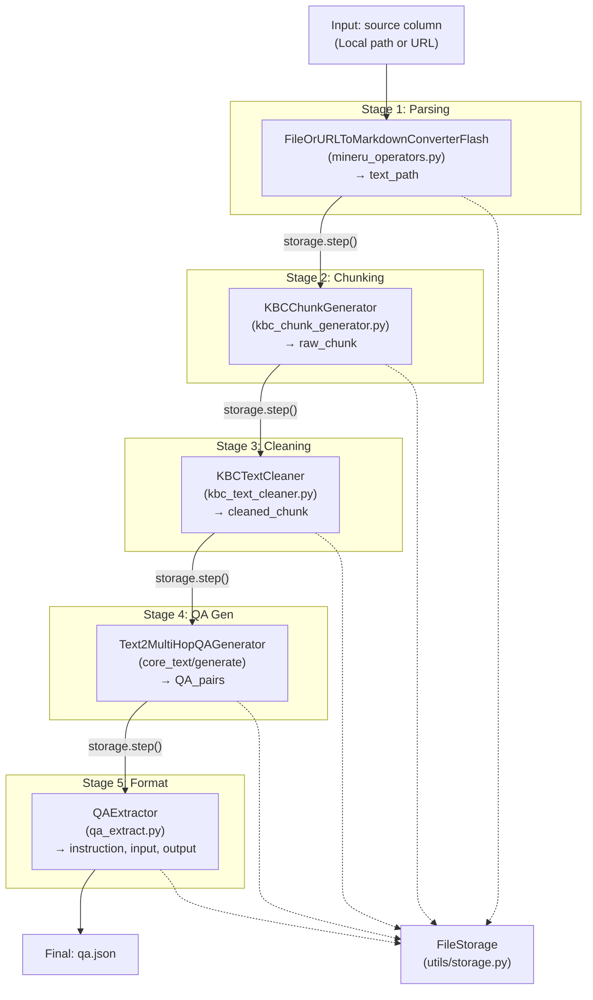
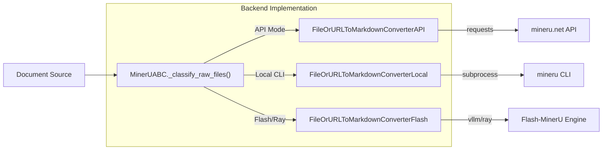

<!-- source: DeepWiki mcp.deepwiki.com · repo OpenDCAI/DataFlow · page 12.6 Building a RAG Knowledge Base · fetched 2026-11-02 -->

# Building a RAG Knowledge Base

<details>
<summary>Relevant source files</summary>

The following files were used as context for generating this wiki page:

- [dataflow/example/KBCleaningPipeline/kbc_test.jsonl](dataflow/example/KBCleaningPipeline/kbc_test.jsonl)
- [dataflow/example/KBCleaningPipeline/kbc_test_1.jsonl](dataflow/example/KBCleaningPipeline/kbc_test_1.jsonl)
- [dataflow/operators/core_text/generate/text2multihopqa_generator.py](dataflow/operators/core_text/generate/text2multihopqa_generator.py)
- [dataflow/operators/knowledge_cleaning/__init__.py](dataflow/operators/knowledge_cleaning/__init__.py)
- [dataflow/operators/knowledge_cleaning/generate/kbc_multihop_qa_generator_batch.py](dataflow/operators/knowledge_cleaning/generate/kbc_multihop_qa_generator_batch.py)
- [dataflow/operators/knowledge_cleaning/generate/kbc_text_cleaner.py](dataflow/operators/knowledge_cleaning/generate/kbc_text_cleaner.py)
- [dataflow/operators/knowledge_cleaning/generate/kbc_text_cleaner_batch.py](dataflow/operators/knowledge_cleaning/generate/kbc_text_cleaner_batch.py)
- [dataflow/operators/knowledge_cleaning/generate/mineru_operators.py](dataflow/operators/knowledge_cleaning/generate/mineru_operators.py)
- [dataflow/prompts/kbcleaning.py](dataflow/prompts/kbcleaning.py)
- [dataflow/statics/pipelines/api_pipelines/kbcleaning_pipeline.py](dataflow/statics/pipelines/api_pipelines/kbcleaning_pipeline.py)
- [dataflow/statics/pipelines/cpu_pipelines/kbcleaning_pipeline_url.py](dataflow/statics/pipelines/cpu_pipelines/kbcleaning_pipeline_url.py)
- [dataflow/statics/pipelines/gpu_pipelines/kbcleaning/kbcleaning_pipeline_sglang.py](dataflow/statics/pipelines/gpu_pipelines/kbcleaning/kbcleaning_pipeline_sglang.py)
- [dataflow/statics/pipelines/gpu_pipelines/kbcleaning/kbcleaning_pipeline_vllm.py](dataflow/statics/pipelines/gpu_pipelines/kbcleaning/kbcleaning_pipeline_vllm.py)
- [dataflow/statics/playground/playground/kbcleaning_pipeline_vllm.py](dataflow/statics/playground/playground/kbcleaning_pipeline_vllm.py)

</details>


This document provides a complete workflow for building a Retrieval Augmented Generation (RAG) knowledge base from PDF documents or URLs using the Knowledge Base Cleaning (KBCleaning) pipeline. The pipeline converts raw documents into cleaned text chunks paired with multi-hop question-answer pairs, suitable for training RAG systems or fine-tuning language models on domain-specific knowledge.

## Overview

The KBCleaning pipeline implements a 5-stage transformation process that converts unstructured documents into structured question-answer training data:

1.  **PDF/URL to Markdown Conversion**: Parses documents using MinerU integration.
2.  **Text Chunking**: Splits content into manageable segments.
3.  **Knowledge Cleaning**: Removes noise and standardizes text using LLM.
4.  **Multi-hop QA Generation**: Creates complex reasoning questions.
5.  **QA Extraction**: Formats output as instruction-response pairs.

The pipeline supports multiple deployment modes (API-based, Local vLLM, SGLang, and Flash-accelerated) and various document sources (local files, URLs, PDFs).

Sources: `[dataflow/statics/pipelines/api_pipelines/kbcleaning_pipeline.py:13-101]()`, `[dataflow/statics/pipelines/gpu_pipelines/kbcleaning/kbcleaning_pipeline_vllm.py:12-92]()`, `[dataflow/statics/pipelines/gpu_pipelines/kbcleaning/kbcleaning_pipeline_sglang.py:12-93]()`

---

## Pipeline Architecture

### Pipeline Variants and Deployment Modes

DataFlow provides several KBCleaning pipeline implementations optimized for different hardware and serving backends:

| Pipeline Class | Deployment Mode | LLM Backend | MinerU Backend | Use Case |
| :--- | :--- | :--- | :--- | :--- |
| `KBCleaningPDF_APIPipeline` | API-based | `APILLMServing_request` | `FileOrURLToMarkdownConverterAPI` | Cloud deployment with external LLM services |
| `KBCleaning_CPUPipeline` | CPU-only | N/A | `FileOrURLToMarkdownConverterAPI` | Document parsing and chunking only |
| `KBCleaning_PDFvllm_GPUPipeline` | Local GPU | `LocalModelLLMServing_vllm` | `FileOrURLToMarkdownConverterFlash` | High-performance local GPU processing |
| `KBCleaning_PDFSglang_GPUPipeline` | Local GPU | `LocalModelLLMServing_sglang` | `FileOrURLToMarkdownConverterFlash` | Local GPU processing with SGLang |

Sources: `[dataflow/statics/pipelines/api_pipelines/kbcleaning_pipeline.py:13-27]()`, `[dataflow/statics/pipelines/gpu_pipelines/kbcleaning/kbcleaning_pipeline_vllm.py:12-62]()`, `[dataflow/statics/pipelines/gpu_pipelines/kbcleaning/kbcleaning_pipeline_sglang.py:12-59]()`, `[dataflow/statics/pipelines/cpu_pipelines/kbcleaning_pipeline_url.py:6-25]()`

### Core Operator Pipeline Flow

The following diagram maps the logical stages to concrete code entities and data flow.

Title: KBCleaning Code Entity Data Flow


Sources: `[dataflow/statics/pipelines/gpu_pipelines/kbcleaning/kbcleaning_pipeline_vllm.py:43-92]()`, `[dataflow/statics/pipelines/api_pipelines/kbcleaning_pipeline.py:74-97]()`

---

## MinerU Integration Strategies

The pipeline leverages MinerU for high-quality document parsing. Three distinct converter classes are available depending on the backend requirements:

Title: Document Parsing Strategy Selection


### Backend Comparison

| Backend | Class | Performance | Dependencies |
| :--- | :--- | :--- | :--- |
| **API** | `FileOrURLToMarkdownConverterAPI` | Medium | `MINERU_API_KEY` |
| **Local** | `FileOrURLToMarkdownConverterLocal` | Low | `mineru[pipeline]` |
| **Flash** | `FileOrURLToMarkdownConverterFlash` | High | `flash_mineru`, GPU, Ray |

Sources: `[dataflow/operators/knowledge_cleaning/generate/mineru_operators.py:57-196]()`, `[dataflow/statics/pipelines/api_pipelines/kbcleaning_pipeline.py:32-55]()`

---

## Step-by-Step Workflow

### 1. Input Preparation

The pipeline expects a JSONL file with a `source` field containing local file paths or URLs.

```json
{"source": "../../example_data/KBCleaningPipeline/bitter_lesson.pdf"}
{"source": "https://arxiv.org/pdf/2505.07773"}
```

Sources: `[dataflow/example/KBCleaningPipeline/kbc_test.jsonl:1-3]()`

### 2. Document Parsing (Stage 1)

The `run()` method of the converter handles type detection and extraction.

```python
extracted=self.knowledge_cleaning_step1.run(
    storage=self.storage.step(),
    input_key="source",
    output_key="text_path"
)
```

`_classify_raw_files` [dataflow/operators/knowledge_cleaning/generate/mineru_operators.py:111-165]() automatically detects if the source is a URL (HTML or PDF) or a local file and handles downloads/classification accordingly. It supports `.pdf`, `.png`, `.jpg`, `.html`, `.xml`, `.txt`, and `.md`.

Sources: `[dataflow/operators/knowledge_cleaning/generate/mineru_operators.py:111-171]()`, `[dataflow/statics/pipelines/api_pipelines/kbcleaning_pipeline.py:75-79]()`

### 3. Text Chunking (Stage 2)

`KBCChunkGenerator` splits the extracted Markdown into segments based on token count using a specified tokenizer.

```python
self.knowledge_cleaning_step2 = KBCChunkGenerator(
    split_method="token",
    chunk_size=512,
    tokenizer_name="Qwen/Qwen2.5-7B-Instruct",
)
```

Sources: `[dataflow/statics/pipelines/gpu_pipelines/kbcleaning/kbcleaning_pipeline_vllm.py:33-37]`, `[dataflow/statics/pipelines/gpu_pipelines/kbcleaning/kbcleaning_pipeline_vllm.py:50-54]()`

### 4. Knowledge Cleaning (Stage 3)

`KBCTextCleaner` uses an LLM to remove noise, fix OCR errors, and standardize the text. It utilizes the `KnowledgeCleanerPrompt` [dataflow/prompts/kbcleaning.py:5-10]() which supports multilingual refinement (en/zh) and security processing (PII masking).

```python
self.knowledge_cleaning_step3 = KBCTextCleaner(
    llm_serving=self.llm_serving,
    lang="en"
)
```

The cleaning process is governed by the `KnowledgeCleanerPrompt` class [dataflow/prompts/kbcleaning.py:5-10](), which enforces strict rules on tag retention, character normalization, and PII masking [dataflow/prompts/kbcleaning.py:18-56](). It uses a specific output format enclosed in `<cleaned_start>` and `<cleaned_end>` tags [dataflow/prompts/kbcleaning.py:75-93]().

The `extract_cleaned_text` function in [dataflow/operators/knowledge_cleaning/generate/kbc_text_cleaner.py:60-81]() is used to post-process LLM outputs, stripping out instruction leakage and enforcing the final cleaned format.

Sources: `[dataflow/statics/pipelines/gpu_pipelines/kbcleaning/kbcleaning_pipeline_vllm.py:64-67]()`, `[dataflow/operators/knowledge_cleaning/generate/kbc_text_cleaner.py:89-100]()`, `[dataflow/prompts/kbcleaning.py:5-191]()`, `[dataflow/operators/knowledge_cleaning/generate/kbc_text_cleaner.py:60-81]()`

### 5. Multi-hop QA Generation (Stage 4)

`Text2MultiHopQAGenerator` creates complex question-answer pairs that require reasoning across multiple parts of the knowledge chunk.

```python
self.knowledge_cleaning_step4 = Text2MultiHopQAGenerator(
    llm_serving=self.llm_serving,
    lang="en",
    num_q = 5
)
```

This operator supports both single text processing and batch processing, generating a list of QA pairs containing questions, reasoning steps, answers, and supporting facts [dataflow/operators/core_text/generate/text2multihopqa_generator.py:107-116](). It utilizes the `Text2MultiHopQAGeneratorPrompt` [dataflow/operators/core_text/generate/text2multihopqa_generator.py:1-21]().

Sources: `[dataflow/statics/pipelines/gpu_pipelines/kbcleaning/kbcleaning_pipeline_vllm.py:69-73]()`, `[dataflow/operators/core_text/generate/text2multihopqa_generator.py:23-125]()`

### 6. QA Extraction and Formatting (Stage 5)

`QAExtractor` transforms the raw `QA_pairs` list into a flat instruction-following format (Alpaca/ShareGPT style) and saves it to a final JSON file.

```python
self.extract_format_qa_step5.run(
    storage=self.storage.step(),
    input_qa_key="Qa_pairs",
    output_instruction_key="instruction",
    output_question_key="input",
    output_answer_key="output"            
)
```

Sources: `[dataflow/statics/pipelines/gpu_pipelines/kbcleaning/kbcleaning_pipeline_vllm.py:39-41]()`, `[dataflow/statics/pipelines/gpu_pipelines/kbcleaning/kbcleaning_pipeline_vllm.py:86-92]()`

---

## Data Flow and Caching

The pipeline uses `FileStorage` to manage intermediate results. Each operator call consumes a `storage.step()`, which creates a new versioned cache file.

| Step | Output File Prefix | Key Data Columns Added |
| :--- | :--- | :--- |
| 0 | `knowledge_cleaning_step...` | `source` (Input) |
| 1 | `..._step_0.jsonl` | `text_path` |
| 2 | `..._step_1.jsonl` | `raw_chunk` |
| 3 | `..._step_2.jsonl` | `cleaned_chunk` |
| 4 | `..._step_3.jsonl` | `QA_pairs` |
| 5 | `..._step_4.jsonl` | `instruction`, `input`, `output` |

Sources: `[dataflow/statics/pipelines/gpu_pipelines/kbcleaning/kbcleaning_pipeline_vllm.py:15-20]()`, `[dataflow/statics/pipelines/gpu_pipelines/kbcleaning/kbcleaning_pipeline_vllm.py:44-92]()`

---

## Configuration Examples

### GPU Acceleration (vLLM)

For high-throughput local processing:

```python
self.llm_serving = LocalModelLLMServing_vllm(
    hf_model_name_or_path="Qwen/Qwen2.5-7B-Instruct",
    vllm_max_tokens=2048,
    vllm_tensor_parallel_size=4,
    vllm_gpu_memory_utilization=0.6,
    vllm_repetition_penalty=1.2
)
```

Sources: `[dataflow/statics/pipelines/gpu_pipelines/kbcleaning/kbcleaning_pipeline_vllm.py:56-62]()`

### Flash-MinerU Parallelism

Configuring the parsing stage for multiple GPUs using Ray:

```python
self.knowledge_cleaning_step1 = FileOrURLToMarkdownConverterFlash(
    mineru_model_path="path/to/model",
    batch_size=4,
    replicas=1,
    num_gpus_per_replica=0.5, # Two workers per GPU
    engine_gpu_util_rate_to_ray_cap=0.9
)
```

Sources: `[dataflow/statics/pipelines/gpu_pipelines/kbcleaning/kbcleaning_pipeline_vllm.py:23-31]()`

---

