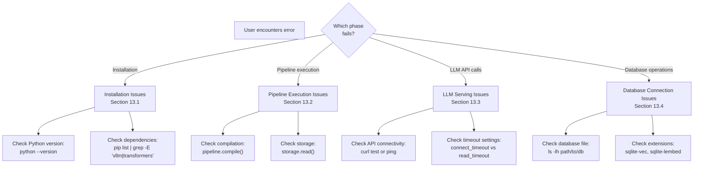

<!-- source: DeepWiki mcp.deepwiki.com · repo OpenDCAI/DataFlow · page 13 Troubleshooting · fetched 2026-11-02 -->

# Troubleshooting

Relevant source files

The following files were used as context for generating this wiki page:

- [.dockerignore](.dockerignore)
- [.gitignore](.gitignore)
- [Dockerfile](Dockerfile)
- [MANIFEST.in](MANIFEST.in)
- [README-zh.md](README-zh.md)
- [README.md](README.md)
- [dataflow/logger.py](dataflow/logger.py)
- [dataflow/version.py](dataflow/version.py)

This page provides solutions to common issues encountered when installing, configuring, and running DataFlow. It covers problems related to installation, pipeline execution, LLM serving backends, and database connections.

For general usage instructions, see [Getting Started](#1.1). For development and testing procedures, see [Development Guide](#10) and [Testing](#10.2).

---

## Issue Classification and Diagnostic Flow

The following diagram maps high-level user issues to specific diagnostic steps and the corresponding troubleshooting sections.

**Sources**: [README.md:101-104](), [README-zh.md:76-78]()

---

## 13.1 Installation Issues

Installation issues can arise from dependency conflicts, Python version mismatches, or platform-specific problems. DataFlow relies on a set of core and optional dependencies, and ensuring these are correctly installed is crucial for smooth operation. Common problems include `numpy` version conflicts, `fasttext` installation failures, and missing optional packages required for specific functionalities like vLLM or PDF processing.

For details, see [Installation Issues](#13.1).

**Sources**: [README.md:101-104](), [README-zh.md:76-78]()

---

## 13.2 Pipeline Execution Issues

Problems during pipeline execution often manifest as `KeyError` exceptions, failures in `storage.step()` operations, or unexpected behavior from individual operators. These issues can stem from incorrect data schema, misconfigured operator parameters, or problems with the underlying storage system. Debugging involves verifying input keys, checking operator configurations, and ensuring data integrity at each step of the pipeline.

For details, see [Pipeline Execution Issues](#13.2).

**Sources**: [README.md:101-104](), [README-zh.md:76-78]()

---

## 13.3 LLM Serving Issues

LLM serving issues typically involve connectivity problems with API-based LLMs or resource allocation failures with local GPU serving solutions like vLLM. Common symptoms include API rate limit errors, timeout exceptions, or GPU memory exhaustion. Troubleshooting involves verifying API keys, adjusting timeout settings, and optimizing GPU memory usage for local models.

For details, see [LLM Serving Issues](#13.3).

**Sources**: [README.md:101-104](), [README-zh.md:76-78]()

---

## 13.4 Database Connection Issues

Database connection problems can occur when DataFlow attempts to interact with SQL databases, especially when using specialized extensions like `sqlite-vec` for vector embeddings. Issues might include database discovery failures, connection pooling errors, or functions like `lembed()` not being recognized. These often relate to missing database drivers, incorrect connection strings, or uninstalled database extensions.

For details, see [Database Connection Issues](#13.4).

**Sources**: [README.md:101-104](), [README-zh.md:76-78]()

---

