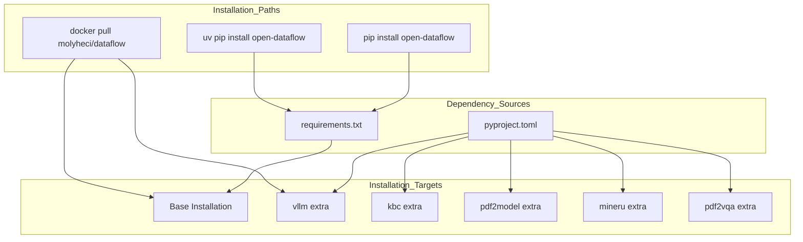
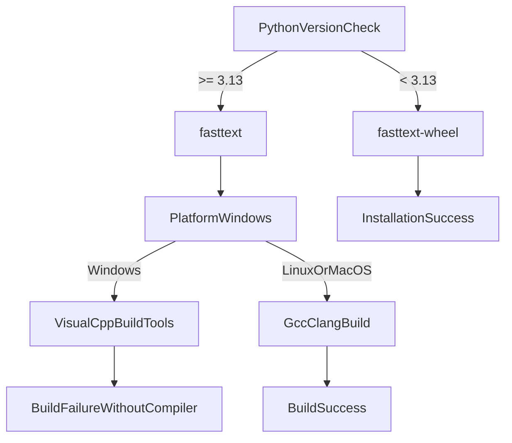
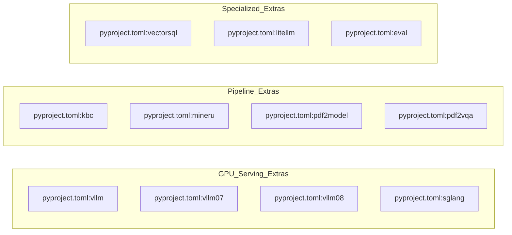
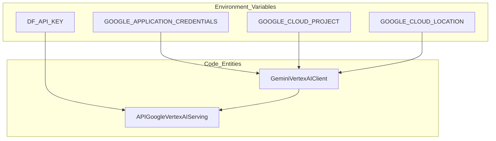

<!-- source: DeepWiki mcp.deepwiki.com · repo OpenDCAI/DataFlow · page 13.1 Installation Issues · fetched 2026-11-02 -->

# Installation Issues

<details>
<summary>Relevant source files</summary>

The following files were used as context for generating this wiki page:

- [.github/ISSUE_TEMPLATE/1-bug-reports.yaml](.github/ISSUE_TEMPLATE/1-bug-reports.yaml)
- [.github/ISSUE_TEMPLATE/2-ask-for-help.yaml](.github/ISSUE_TEMPLATE/2-ask-for-help.yaml)
- [.github/ISSUE_TEMPLATE/3-feature-request.yaml](.github/ISSUE_TEMPLATE/3-feature-request.yaml)
- [.github/workflows/python-publish.yml](.github/workflows/python-publish.yml)
- [dataflow/cli_funcs/cli_env.py](dataflow/cli_funcs/cli_env.py)
- [dataflow/serving/api_google_vertexai_serving.py](dataflow/serving/api_google_vertexai_serving.py)
- [pyproject.toml](pyproject.toml)
- [requirements.txt](requirements.txt)
- [test/test_general_text.py](test/test_general_text.py)

</details>


## Purpose and Scope

This document provides troubleshooting guidance for installation problems encountered when setting up DataFlow. It covers dependency conflicts, platform-specific issues, optional dependency installation, and environment configuration problems.

For information about deployment configuration after successful installation, see [11. Deployment Options](). For general setup instructions, see [2. Getting Started]().

---

## Installation Methods Overview

DataFlow supports three primary installation methods, each with different dependency management characteristics. The core system relies on `requirements.txt` while specialized features are enabled via `pyproject.toml` extras.

**Title: DataFlow Installation Data Flow**

Sources: [requirements.txt:1-91](), [pyproject.toml:54-97]()

---

## Common Dependency Conflicts

### NumPy Version Constraint

DataFlow strictly requires `numpy<2.0.0` due to compatibility requirements with vLLM, MinerU, and other GPU-accelerated libraries.

**Problem Symptoms:**
```
ERROR: Cannot install open-dataflow because these package versions have conflicting dependencies.
ERROR: ResolutionImpossible: for help visit https://pip.pypa.io/en/latest/topics/dependency-resolution
```

**Root Cause:**

The constraint `numpy<2.0.0` is enforced across multiple project components to ensure runtime stability:

| Location | Constraint | Reason |
|----------|-----------|--------|
| [requirements.txt:1]() | `numpy<2.0.0` | Core compatibility |
| [pyproject.toml:56]() | `vllm` extra | vLLM GPU serving compatibility |
| [pyproject.toml:60]() | `kbc` extra | KB cleaning pipeline compatibility |
| [pyproject.toml:71]() | `pdf2model` extra | Training pipeline compatibility |
| [pyproject.toml:85]() | `pdf2model-dataflex` extra | DataFlex training compatibility |

**Solution:**

```bash
# Uninstall conflicting numpy version
pip uninstall numpy

# Install DataFlow (will install compatible numpy 1.x)
pip install open-dataflow

# Verify numpy version
python -c "import numpy; print(numpy.__version__)"
# Expected output: 1.26.x or similar (< 2.0.0)
```
Sources: [requirements.txt:1](), [pyproject.toml:56-85]()

---

### fasttext Platform-Specific Installation

The `fasttext` library has different installation requirements based on Python version and platform.

**Problem Symptoms:**
```
ERROR: Could not build wheels for fasttext, which is required to install pyproject.toml-based projects
error: Microsoft Visual C++ 14.0 or greater is required
```

**Installation Logic:**

**Title: Fasttext Installation Logic**

Sources: [requirements.txt:37-38]()

**Configuration in requirements.txt:**

Conditional installation is implemented to maximize compatibility [requirements.txt:37-38]():
```python
fasttext; python_version >= "3.13" # [requirements.txt:37]()
fasttext-wheel; python_version < "3.13" # [requirements.txt:38]()
```

**Platform-Specific Solutions:**

*   **Windows (Python < 3.13):** `pip install fasttext-wheel` (uses pre-built binary).
*   **Windows (Python >= 3.13):** Requires Visual Studio Build Tools to compile `fasttext` from source.
*   **Linux/macOS:** Ensure `build-essential` (Ubuntu/Debian) or equivalent compiler tools are installed before running `pip install fasttext`.

Sources: [requirements.txt:37-38]()

---

### PyArrow Version Pinning

PyArrow is pinned to version 20.0.0 to avoid compatibility issues with Python 3.10.

**Problem:**
```
ERROR: pyarrow 21.0.0 has requirement numpy>=1.16.6, but you have numpy 1.24.0
AttributeError: module 'pyarrow' has no attribute '_parquet'
```

**Configuration:**

The pin is defined in [requirements.txt:27]():
```
pyarrow==20.0.0 # larger than this will bug on python 3.10
```

**Solution:**

The version is automatically pinned during installation. If manual intervention is needed:
```bash
pip install "pyarrow==20.0.0" --force-reinstall
```
Sources: [requirements.txt:27]()

---

## Optional Dependency Groups

DataFlow provides several optional dependency groups for specialized tasks in `pyproject.toml` [pyproject.toml:54-97]().

**Title: Optional Dependency Mapping**

Sources: [pyproject.toml:54-97]()

**Installation Commands:**

```bash
# GPU serving with vLLM
pip install "open-dataflow[vllm]"

# Knowledge base cleaning
pip install "open-dataflow[kbc]"

# PDF to model training workflow
pip install "open-dataflow[pdf2model]"

# PDF VQA extraction (ShareGPT format)
pip install "open-dataflow[pdf2vqa]"
```
Sources: [pyproject.toml:54-97]()

---

### vLLM and MinerU Version Conflicts

Different extras require specific versions of heavy dependencies, which can cause conflicts if mixed in the same environment.

| Extra | vLLM Version | MinerU Version | Purpose |
|-------|-------------|----------------|---------|
| `vllm` | `>=0.7.0,<=0.9.2` | N/A | General GPU serving [pyproject.toml:56]() |
| `kbc` | `==0.6.3` | `==2.0.6` | KB cleaning [pyproject.toml:60]() |
| `pdf2vqa` | N/A | `>=2.5.0,<2.7.0` | VQA extraction [pyproject.toml:94]() |
| `pdf2model` | `>=0.7.0,<0.9.2` | `[pipeline]` | Training workflow [pyproject.toml:68-75]() |
| `pdf2model-dataflex` | `>=0.8.0,<0.9.0` | `[pipeline]` | DataFlex training [pyproject.toml:77-89]() |

**Solution:**

Use separate virtual environments (e.g., using `conda` or `venv`) for incompatible extras like `kbc` and `pdf2model`.
Sources: [pyproject.toml:56-94]()

---

## Environment Variable Configuration Issues

### Required Environment Variables by Feature

**Title: Environment Variable Dependencies and Code Mapping**

Sources: [dataflow/serving/api_google_vertexai_serving.py:48-90]()

---

### Google Cloud Credentials Issues

The `APIGoogleVertexAIServing` class performs strict validation of the `GOOGLE_APPLICATION_CREDENTIALS` environment variable during initialization in `GeminiVertexAIClient` [dataflow/serving/api_google_vertexai_serving.py:48-90]():

```python
google_app_credentials = os.getenv("GOOGLE_APPLICATION_CREDENTIALS")
if not google_app_credentials:
    raise ValueError(
        "GOOGLE_APPLICATION_CREDENTIALS environment variable is not set. "
        "Please set it to the path of your service account key file, e.g.: "
        "export GOOGLE_APPLICATION_CREDENTIALS=\"/path/to/your/key.json\""
    )

if not os.path.exists(google_app_credentials):
    raise ValueError(
        f"GOOGLE_APPLICATION_CREDENTIALS file not found: {google_app_credentials}. "
        "Please ensure the path is correct."
    )
```

**Setup Steps:**
1.  Download your service account key JSON from the Google Cloud Console.
2.  Set the environment variable: `export GOOGLE_APPLICATION_CREDENTIALS="/path/to/key.json"`.
3.  Optional: Set `GOOGLE_CLOUD_PROJECT` and `GOOGLE_CLOUD_LOCATION` to override defaults during `vertexai.init()` [dataflow/serving/api_google_vertexai_serving.py:73-90]().
Sources: [dataflow/serving/api_google_vertexai_serving.py:52-90]()

---

## Quick Reference: Installation Error Solutions

| Error Pattern | Likely Cause | Quick Fix |
|---------------|--------------|-----------|
| `numpy.dtype size changed` | NumPy 2.x installed | `pip install "numpy<2.0.0" --force-reinstall` [requirements.txt:1]() |
| `Could not build wheels for fasttext` | Missing compiler | Use `fasttext-wheel` for Python < 3.13 [requirements.txt:38]() |
| `pyarrow... bug on python 3.10` | PyArrow version mismatch | `pip install "pyarrow==20.0.0"` [requirements.txt:27]() |
| `vllm 0.6.3 conflicts` | Extra `kbc` mismatch | Use separate venv for `kbc` [pyproject.toml:60]() |
| `GOOGLE_APPLICATION_CREDENTIALS not set` | Missing GCP credentials | Export path to JSON key [dataflow/serving/api_google_vertexai_serving.py:59]() |

Sources: [requirements.txt:1-91](), [pyproject.toml:54-97](), [dataflow/serving/api_google_vertexai_serving.py:52-90]()

---

