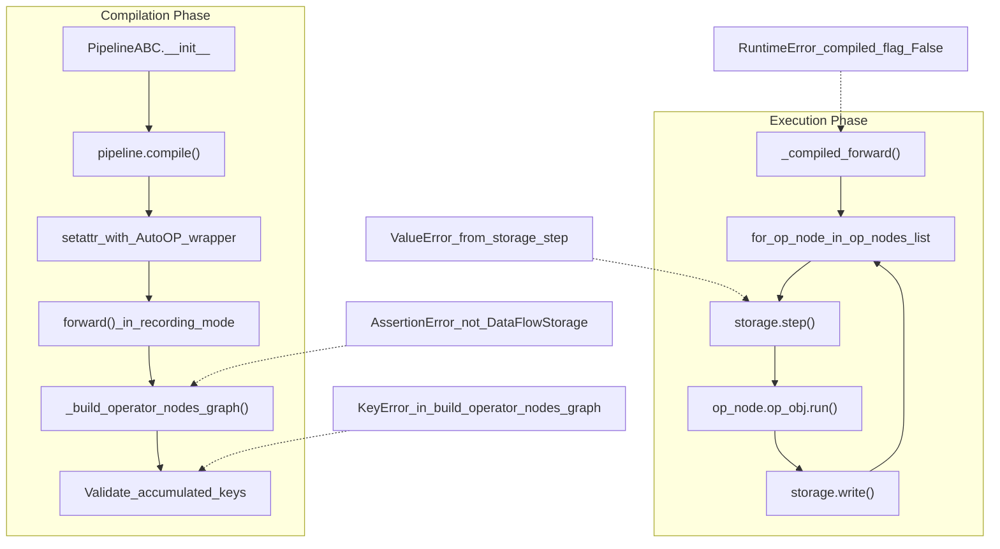
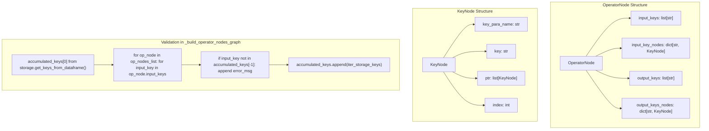
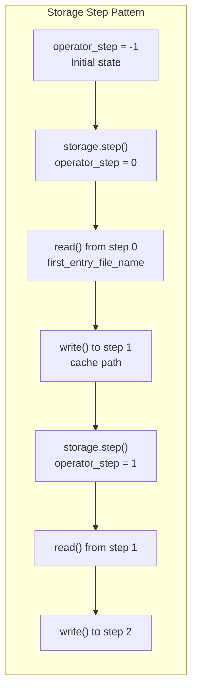
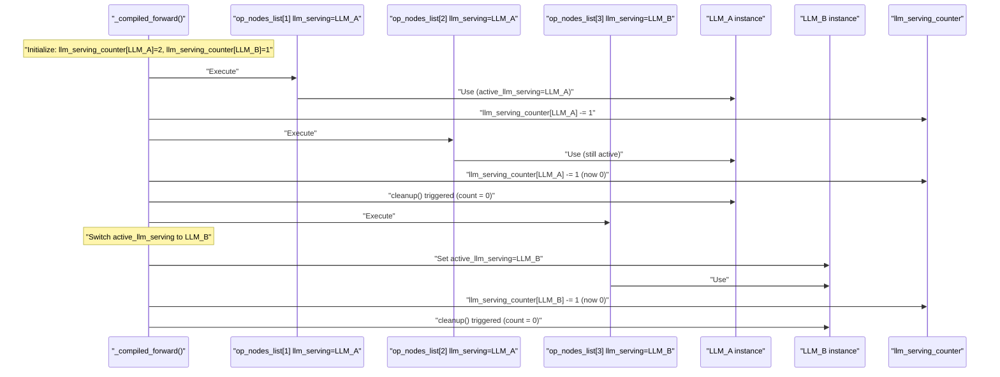

<!-- source: DeepWiki mcp.deepwiki.com · repo OpenDCAI/DataFlow · page 13.2 Pipeline Execution Issues · fetched 2026-11-02 -->

# Pipeline Execution Issues

Relevant source files

The following files were used as context for generating this wiki page:

- [dataflow/core/__init__.py](dataflow/core/__init__.py)
- [dataflow/pipeline/Pipeline.py](dataflow/pipeline/Pipeline.py)
- [dataflow/pipeline/__init__.py](dataflow/pipeline/__init__.py)
- [dataflow/pipeline/nodes.py](dataflow/pipeline/nodes.py)
- [dataflow/utils/storage.py](dataflow/utils/storage.py)
- [dataflow/wrapper/auto_op.py](dataflow/wrapper/auto_op.py)
- [test/cpu_only/test_lazy_file_storage_flush.py](test/cpu_only/test_lazy_file_storage_flush.py)
- [test/cpu_only/test_remote_batch_slicing.py](test/cpu_only/test_remote_batch_slicing.py)
- [test/test_autoop.py](test/test_autoop.py)
- [test/test_batched_pipeline.py](test/test_batched_pipeline.py)
- [test/test_batched_stream_pipeline.py](test/test_batched_stream_pipeline.py)
- [test/test_copy.py](test/test_copy.py)
- [test/test_copy_weak_ref.py](test/test_copy_weak_ref.py)
- [test/test_dataframe_col.py](test/test_dataframe_col.py)
- [test/test_read_xlsx.py](test/test_read_xlsx.py)

This page documents common problems that occur during pipeline execution and provides solutions for debugging and resolving them. Pipeline execution encompasses both the **compilation phase** (when operators are wrapped with `AutoOP` [dataflow/wrapper/auto_op.py:38-105]() and the DAG is built via `_build_operator_nodes_graph()` [dataflow/pipeline/Pipeline.py:60-143]()) and the **execution phase** (when operators process data through storage steps).

For installation-related problems, see [Installation Issues](#13.1). For LLM serving problems that occur during pipeline execution, see [LLM Serving Issues](#13.3).

---

## Overview of Pipeline Execution Flow

Understanding the execution flow helps identify where issues occur. The system uses a two-pass approach: a symbolic recording pass during `compile()` and a real data processing pass during forward execution.

### Pipeline Execution Lifecycle
Title: "Pipeline Execution Lifecycle"

Sources: [dataflow/pipeline/Pipeline.py:19-56](), [dataflow/pipeline/Pipeline.py:60-143]()

---

## Compilation Phase Issues

### KeyError: Input Key Not Found

**Symptom:** During `pipeline.compile()`, a `KeyError` is raised with details about which input key in an operator does not match any previous output keys.

**Root Cause:** The validation logic in `_build_operator_nodes_graph()` verifies that every `input_key` parameter in an operator's `run()` method exists in `accumulated_keys` derived from previous operators or initial dataset storage [dataflow/pipeline/Pipeline.py:105-135]().

### Key and Node Architecture
Title: "Key and Node Architecture"

Sources: [dataflow/pipeline/Pipeline.py:60-143](), [dataflow/pipeline/nodes.py:8-34](), [dataflow/pipeline/nodes.py:36-95]()

**Diagnostic Steps:**
1. **Check Initial Dataset Keys:** Inspect the first storage's columns via `storage.get_keys_from_dataframe()` [dataflow/utils/storage.py:19-24]().
2. **Verify Operator Key Parameters:** Ensure `input_key` and `output_key` strings in `run()` match your data schema [dataflow/pipeline/nodes.py:59-66]().
3. **Inspect Order:** Ensure operators are called in the correct sequence within `forward()` [dataflow/pipeline/Pipeline.py:37-41]().

Sources: [dataflow/pipeline/Pipeline.py:105-135](), [dataflow/utils/storage.py:19-24](), [dataflow/pipeline/nodes.py:59-66](), [dataflow/pipeline/Pipeline.py:37-41]()

### AssertionError: Invalid Storage Object

**Symptom:** During DAG construction, an assertion fails stating storage must be a `DataFlowStorage` object.

**Root Cause:** The `storage` parameter passed to `operator.run()` is not a valid `DataFlowStorage` instance [dataflow/pipeline/Pipeline.py:73]().

**Solutions:**
1. **Always pass `storage=self.storage.step()`** to every operator's `run()` method [test/test_batched_pipeline.py:36-50]().
2. **Check storage is defined** in pipeline's `__init__` method as an instance of a `DataFlowStorage` subclass [dataflow/utils/storage.py:14-36]().

Sources: [dataflow/pipeline/Pipeline.py:73](), [test/test_batched_pipeline.py:36-50](), [dataflow/utils/storage.py:14-36]()

### RuntimeError: Pipeline Not Compiled

**Symptom:** Calling execution methods before compilation raises `RuntimeError`.

**Root Cause:** The `compiled` flag remains `False`. The system requires `compile()` to wrap operators with `AutoOP` to record the execution graph [dataflow/pipeline/Pipeline.py:43-48]().

Sources: [dataflow/pipeline/Pipeline.py:43-48]()

---

## Execution Phase Issues

### ValueError: storage.step() Not Called

**Symptom:** When an operator attempts to read or write data, a `ValueError` is raised indicating that `storage.step()` must be called first.

**Root Cause:** The storage's internal `operator_step` counter is `-1`. This occurs if `read()` or `write()` is invoked before incrementing the step via `storage.step()` [dataflow/utils/storage.py:156]().

### Storage Step Mechanism
Title: "Storage Step Mechanism"

Sources: [dataflow/utils/storage.py:70-164]()

---

## LLM Serving Lifecycle Issues

**Symptom:** GPU memory allocation failures, OOM errors, or model cleanup issues during pipeline execution.

### LLM Serving Lifecycle Management
Title: "LLM Serving Lifecycle Management"

Sources: [dataflow/pipeline/Pipeline.py:28-34](), [dataflow/pipeline/Pipeline.py:64-88]()

---

## Summary Table

| Issue Category | Primary Symptom | Quick Fix |
|----------------|-----------------|-----------|
| Key Matching | `KeyError` during compile | Check operator order and key names match [dataflow/pipeline/Pipeline.py:105-135]() |
| Storage Object | `AssertionError` during compile | Add `storage=self.storage.step()` to all `run()` calls [dataflow/pipeline/Pipeline.py:73]() |
| Not Compiled | `RuntimeError` on forward | Call `pipeline.compile()` before execution [dataflow/pipeline/Pipeline.py:43-48]() |
| Step Management | `ValueError` on read/write | Call `storage.step()` before each operator [dataflow/utils/storage.py:156]() |
| Lazy Storage | Data not persisted | Set `save_on_exit=True` or call `flush_all()` [dataflow/utils/storage.py:86-87]() |
| LLM Lifecycle | GPU OOM | Ensure models trigger cleanup via reference counting [dataflow/pipeline/Pipeline.py:33-34]() |

Sources: [dataflow/pipeline/Pipeline.py:1-163](), [dataflow/utils/storage.py:1-164](), [dataflow/wrapper/auto_op.py:20-105]()

---

