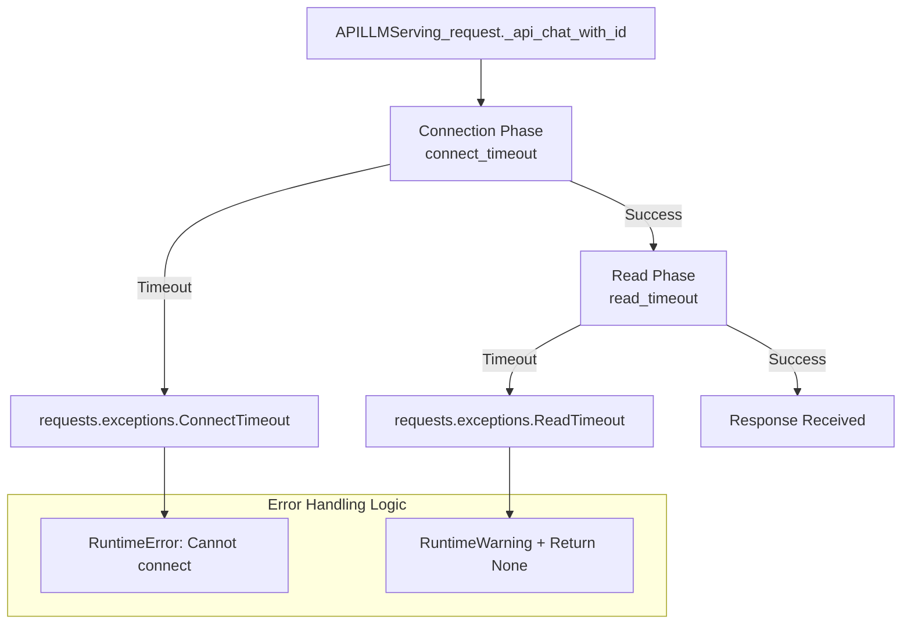
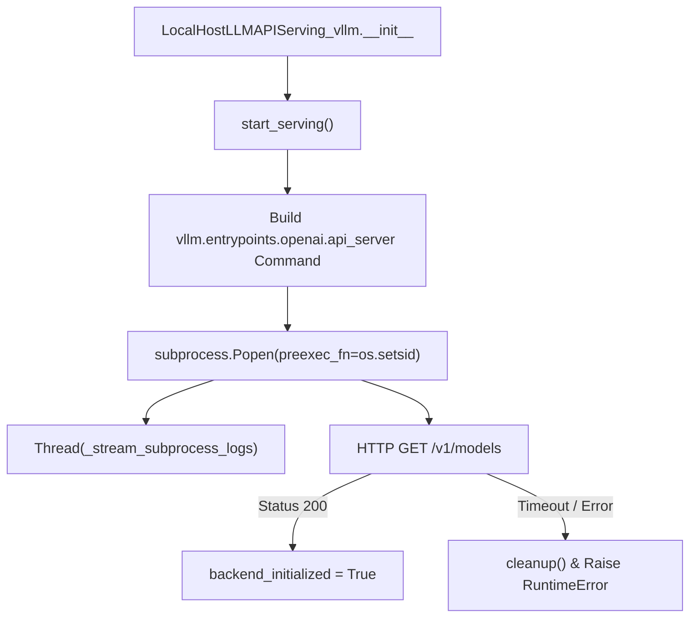

<!-- source: DeepWiki mcp.deepwiki.com · repo OpenDCAI/DataFlow · page 13.3 LLM Serving Issues · fetched 2026-11-02 -->

# LLM Serving Issues

<details>
<summary>Relevant source files</summary>

The following files were used as context for generating this wiki page:

- [.github/workflows/test.yml](.github/workflows/test.yml)
- [dataflow/operators/code/filter/code_score_filter.py](dataflow/operators/code/filter/code_score_filter.py)
- [dataflow/operators/core_text/eval/bench_dataset_evaluator_question.py](dataflow/operators/core_text/eval/bench_dataset_evaluator_question.py)
- [dataflow/serving/api_llm_serving_request.py](dataflow/serving/api_llm_serving_request.py)
- [dataflow/serving/local_model_llm_serving.py](dataflow/serving/local_model_llm_serving.py)
- [dataflow/serving/localhost_llm_api_serving.py](dataflow/serving/localhost_llm_api_serving.py)
- [dataflow/serving/localmodel_lalm_serving.py](dataflow/serving/localmodel_lalm_serving.py)
- [dataflow/statics/playground/playground/prompted_generator/translation_local_json_schema.py](dataflow/statics/playground/playground/prompted_generator/translation_local_json_schema.py)
- [pytest.ini](pytest.ini)
- [test/conftest.py](test/conftest.py)
- [test/cpu_only/test_api_llmserving.py](test/cpu_only/test_api_llmserving.py)
- [test/cpu_only/test_dummy_server.py](test/cpu_only/test_dummy_server.py)
- [test/cpu_only/test_undefined_name_crashes.py](test/cpu_only/test_undefined_name_crashes.py)
- [test/dummy_server/__init__.py](test/dummy_server/__init__.py)
- [test/dummy_server/app.py](test/dummy_server/app.py)

</details>


This page covers common problems encountered when using LLM serving backends in DataFlow and provides technical solutions. It addresses API-based serving (OpenAI, DeepSeek, Google Vertex AI), local GPU serving (vLLM, SGLang), timeout handling, rate limits, batch processing problems, and keep-alive connection configurations.

For general architecture of LLM serving layers, see **3.4 LLM Serving Architecture**. For specific serving backend configurations, see **3.4.1 API-Based Serving** and **3.4.2 Local GPU Serving**.

---

## Common Issue Categories

LLM serving issues in DataFlow typically fall into four distinct categories handled by the underlying serving classes and session managers:

| Category | Symptoms | Root Cause / Code Location |
|----------|----------|----------------------------|
| **Connection Errors** | `RuntimeError: Cannot connect to LLM server` | Network issues, wrong URL, firewall blocking, or connection timeout in `APILLMServing_request._api_chat_with_id` [dataflow/serving/api_llm_serving_request.py:133-176]() |
| **Timeout Errors** | `RuntimeWarning: API read timeout` | Server overloaded, response generation too slow, or queue delays exceeding `read_timeout` [dataflow/serving/api_llm_serving_request.py:30-31]() |
| **Authentication Errors** | `ValueError: Lack of DF_API_KEY` | Missing or invalid API keys, environment variables not set prior to initializing `APILLMServing_request` [dataflow/serving/api_llm_serving_request.py:53-58]() |
| **GPU Memory Exhaustion** | `torch.cuda.OutOfMemoryError` or server hang | Excessive `vllm_gpu_memory_utilization` or context length in `LocalModelLLMServing_vllm` [dataflow/serving/local_model_llm_serving.py:26-28]() |

Sources: [dataflow/serving/api_llm_serving_request.py:177-216](), [dataflow/serving/api_llm_serving_request.py:51-56]()

---

## API Connection and Timeout Issues

### Connection Timeout vs Read Timeout

DataFlow distinguishes between connection establishment timeouts and response reading timeouts within `APILLMServing_request` [dataflow/serving/api_llm_serving_request.py:23-48](). 

The following diagram maps the conceptual request phases to the concrete implementation method `APILLMServing_request._api_chat_with_id` [dataflow/serving/api_llm_serving_request.py:133-176]().

Title: "API Request Timeout and Error Propagation"


**Timeout Configuration:**

The `APILLMServing_request` constructor accepts granular timeout parameters [dataflow/serving/api_llm_serving_request.py:30-31](). Deprecated single `timeout` configurations trigger a warning [dataflow/serving/api_llm_serving_request.py:42-46]().

```python
# Recommended configuration
serving = APILLMServing_request(
    api_url="https://api.openai.com/v1/chat/completions",
    connect_timeout=10.0,  # Network connection establishment
    read_timeout=120.0,    # Waiting for response data
    max_retries=5
)
```

Sources: [dataflow/serving/api_llm_serving_request.py:23-48](), [dataflow/serving/api_llm_serving_request.py:170-170]()

### Keep-Alive Connection and Pool Management

To prevent resource exhaustion and connection leaks under high-concurrency batch processing, `APILLMServing_request` uses a persistent `requests.Session` bound to an `HTTPAdapter` configured with connection pooling [dataflow/serving/api_llm_serving_request.py:61-69]().

```python
self.session = requests.Session()
adapter = HTTPAdapter(
    pool_connections=self.max_workers,
    pool_maxsize=self.max_workers,
    max_retries=0,  # Manual retry handling in execution loop
    pool_block=True # Block requests when pool is full to avoid resource spikes
)
self.session.mount("https://", adapter)
self.session.mount("http://", adapter)
```

Sources: [dataflow/serving/api_llm_serving_request.py:61-69]()

---

## Local GPU Serving and Memory Issues

### vLLM Memory Allocation and Multiprocessing

Local GPU serving via `LocalModelLLMServing_vllm` [dataflow/serving/local_model_llm_serving.py:11-44] and `LocalHostLLMAPIServing_vllm` [dataflow/serving/localhost_llm_api_serving.py:14-48] requires management of GPU memory utilization and process spawning methods.

The diagram below maps local serving orchestration concepts to `LocalHostLLMAPIServing_vllm.start_serving` [dataflow/serving/localhost_llm_api_serving.py:96-147]().

Title: "Local GPU Server Initialization"


**Key Configuration Parameters:**
- `vllm_gpu_memory_utilization`: Controls the fraction of GPU memory allocated to the KV cache (default `0.9`) [dataflow/serving/local_model_llm_serving.py:27-27](). Lower this value if experiencing `torch.cuda.OutOfMemoryError`.
- `vllm_tensor_parallel_size`: Sets the tensor parallel degree across multiple GPUs [dataflow/serving/local_model_llm_serving.py:19-19]().
- `VLLM_WORKER_MULTIPROC_METHOD`: Automatically forced to `"spawn"` to ensure compatibility with CUDA multiprocessing contexts [dataflow/serving/local_model_llm_serving.py:111-111]().

Sources: [dataflow/serving/local_model_llm_serving.py:11-128](), [dataflow/serving/localhost_llm_api_serving.py:96-147]()

---

## Response Formatting and Schema Validation

### Reasoning and Thinking Tags Normalization

Modern reasoning models (such as DeepSeek-R1) often return separated `reasoning_content` alongside message content. The `format_response` method in `APILLMServing_request` normalizes these structures [dataflow/serving/api_llm_serving_request.py:78-103]().

- If responses contain raw tool calls without text content, `format_response` marks them as failed to prevent returning empty successful outputs [test/cpu_only/test_undefined_name_crashes.py:83-96]().
- When `reasoning_content` is present without main content, it encapsulates the reasoning steps inside `` and `<answer></answer>` tags [test/cpu_only/test_undefined_name_crashes.py:99-108]().

Sources: [dataflow/serving/api_llm_serving_request.py:78-103](), [test/cpu_only/test_undefined_name_crashes.py:83-108]()

### Structured Outputs and Guided Decoding

When passing a `json_schema` parameter to `LocalModelLLMServing_vllm`, vLLM's `GuidedDecodingParams` enforces strict schema adherence [dataflow/serving/local_model_llm_serving.py:151-167](). Version mismatches between `transformers` and `vllm` will raise an `ImportError` [dataflow/serving/local_model_llm_serving.py:92-106]().

Sources: [dataflow/serving/local_model_llm_serving.py:92-167](), [dataflow/statics/playground/playground/prompted_generator/translation_local_json_schema.py:19-30]()

---

## Specialized Serving Issues

### Audio and Multimodal Data Loading

`LocalModelLALMServing_vllm` processes multi-modal audio inputs via `process_audio_info` [dataflow/serving/localmodel_lalm_serving.py:37-94](). Common failures involve unsupported base64 headers or remote URL fetch errors handled via `librosa` [dataflow/serving/localmodel_lalm_serving.py:18-35]().

Sources: [dataflow/serving/localmodel_lalm_serving.py:37-94](), [test/cpu_only/test_undefined_name_crashes.py:63-81]()

---

