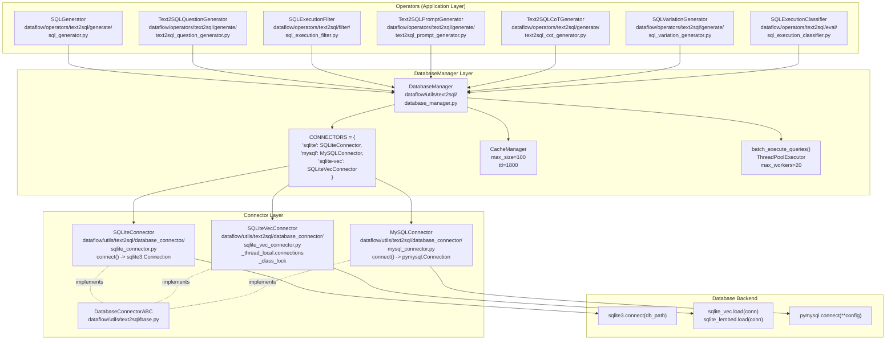
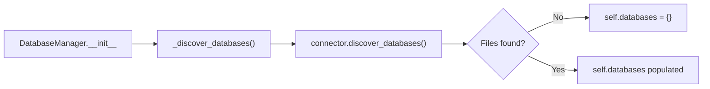
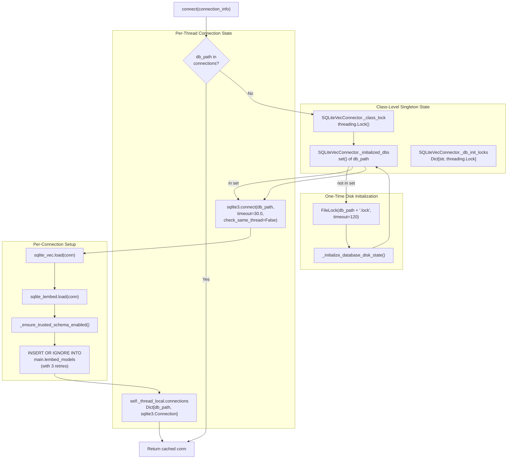
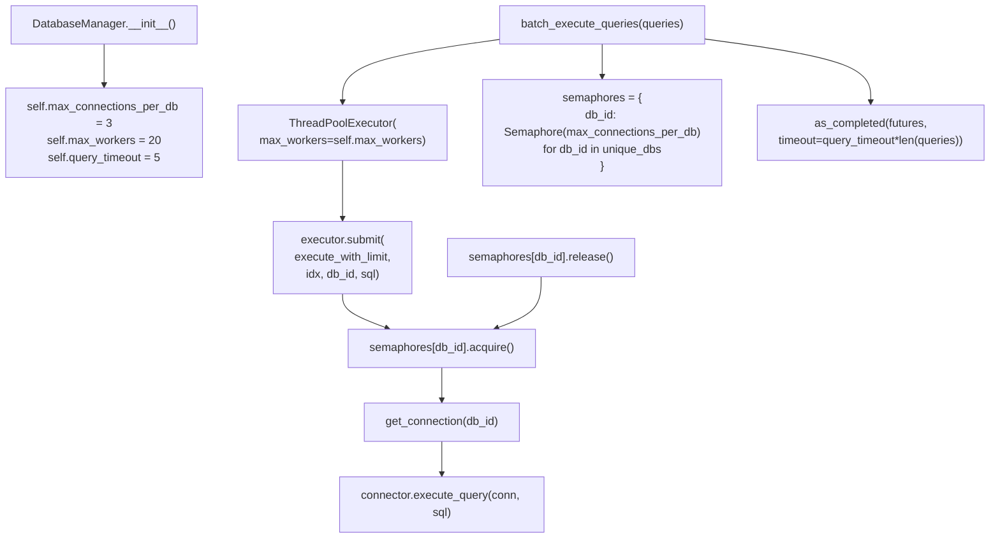
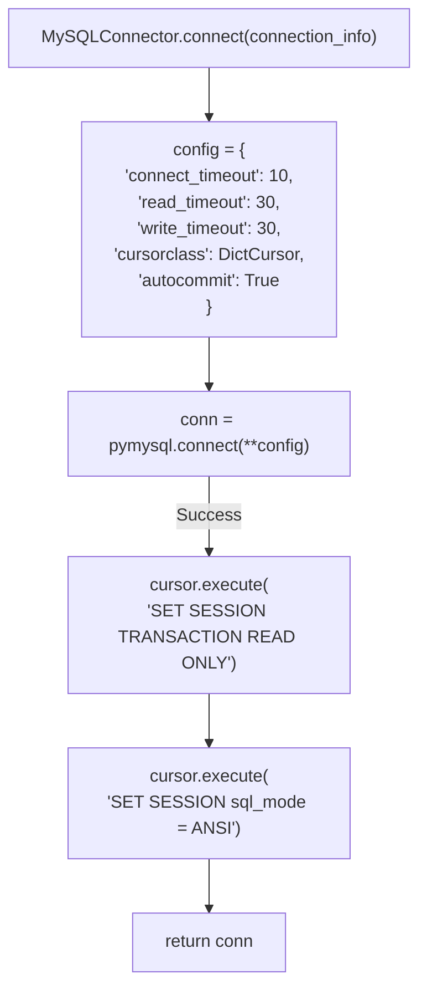
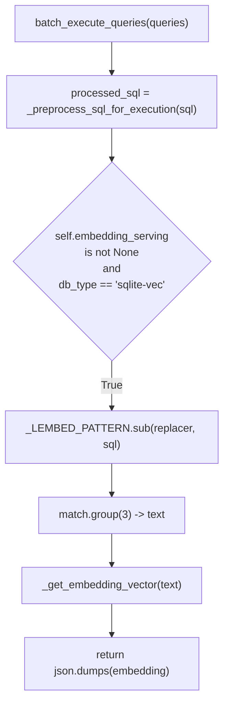

<!-- source: DeepWiki mcp.deepwiki.com · repo OpenDCAI/DataFlow · page 13.4 Database Connection Issues · fetched 2026-11-02 -->

# Database Connection Issues

<details>
<summary>Relevant source files</summary>

The following files were used as context for generating this wiki page:

- [dataflow/operators/text2sql/eval/sql_execution_classifier.py](dataflow/operators/text2sql/eval/sql_execution_classifier.py)
- [dataflow/operators/text2sql/filter/sql_execution_filter.py](dataflow/operators/text2sql/filter/sql_execution_filter.py)
- [dataflow/operators/text2sql/generate/sql_generator.py](dataflow/operators/text2sql/generate/sql_generator.py)
- [dataflow/operators/text2sql/generate/sql_variation_generator.py](dataflow/operators/text2sql/generate/sql_variation_generator.py)
- [dataflow/operators/text2sql/generate/text2sql_cot_generator.py](dataflow/operators/text2sql/generate/text2sql_cot_generator.py)
- [dataflow/operators/text2sql/generate/text2sql_prompt_generator.py](dataflow/operators/text2sql/generate/text2sql_prompt_generator.py)
- [dataflow/operators/text2sql/generate/text2sql_question_generator.py](dataflow/operators/text2sql/generate/text2sql_question_generator.py)
- [dataflow/prompts/text2sql.py](dataflow/prompts/text2sql.py)
- [dataflow/statics/pipelines/api_pipelines/text2vecsql_pipeline_gen.py](dataflow/statics/pipelines/api_pipelines/text2vecsql_pipeline_gen.py)
- [dataflow/utils/db_pool/__init__.py](dataflow/utils/db_pool/__init__.py)
- [dataflow/utils/db_pool/myscale_pool.py](dataflow/utils/db_pool/myscale_pool.py)
- [dataflow/utils/text2sql/base.py](dataflow/utils/text2sql/base.py)
- [dataflow/utils/text2sql/database_connector/mysql_connector.py](dataflow/utils/text2sql/database_connector/mysql_connector.py)
- [dataflow/utils/text2sql/database_connector/sqlite_connector.py](dataflow/utils/text2sql/database_connector/sqlite_connector.py)
- [dataflow/utils/text2sql/database_connector/sqlite_vec_connector.py](dataflow/utils/text2sql/database_connector/sqlite_vec_connector.py)
- [dataflow/utils/text2sql/database_manager.py](dataflow/utils/text2sql/database_manager.py)

</details>


This page provides troubleshooting guidance for database connection problems in DataFlow's Text2SQL system. It covers issues with the `DatabaseManager`, database connectors (`SQLiteConnector`, `SQLiteVecConnector`, `MySQLConnector`), and their usage in Text2SQL pipelines and operators.

For general Text2SQL pipeline configuration, see section 5.3. For database connector architecture details, see section 3.6.1.

---

## Overview of Database Connection Architecture

The DataFlow database system uses a three-layer architecture with the `DatabaseManager` coordinating access through pluggable `DatabaseConnectorABC` implementations.

### Database Connection Architecture with Code Entities


Sources: `dataflow/utils/text2sql/database_manager.py:84-120()`, `dataflow/utils/text2sql/database_connector/sqlite_vec_connector.py:14-23()`, `dataflow/utils/text2sql/base.py:1-20()`, `dataflow/operators/text2sql/generate/sql_generator.py:19-34()`, `dataflow/operators/text2sql/generate/text2sql_question_generator.py:19-37()`, `dataflow/operators/text2sql/filter/sql_execution_filter.py:12-16()`, `dataflow/operators/text2sql/generate/text2sql_prompt_generator.py:17-29()`, `dataflow/operators/text2sql/generate/text2sql_cot_generator.py:16-33()`, `dataflow/operators/text2sql/generate/sql_variation_generator.py:19-34()`, `dataflow/operators/text2sql/eval/sql_execution_classifier.py:15-39()`

---

## Common Connection Issues

### Issue 1: Missing Optional Dependencies

**Symptom:** `ImportError` when initializing `SQLiteVecConnector` or using vector SQL features.

```
ImportError: The 'vectorsql' optional dependencies are required but not installed.
Please run: pip install 'open-dataflow[vectorsql]'
```

**Root Cause:** The `sqlite-vec` and `sqlite-lembed` extensions are optional dependencies not installed by default.

**Solution:**

```bash
# Install vector SQL dependencies
pip install 'open-dataflow[vectorsql]'

# Or install manually
pip install sqlite-vec sqlite-lembed
```
Sources: `dataflow/utils/text2sql/database_connector/sqlite_vec_connector.py:24-46()`

---

### Issue 2: Database Path Not Found

**Symptom:** `ValueError` or empty database list when initializing `DatabaseManager`.

```
ValueError: Database 'my_db' not found
```

**Root Cause:** The `root_path` configuration doesn't point to a directory containing database files, or the file patterns don't match your database filenames.

### Database Discovery Flow


Sources: `dataflow/utils/text2sql/database_manager.py:125-127()`

**Solution:**

| Database Type | Required Config | Default Patterns |
|---------------|-----------------|------------------|
| `sqlite` | `root_path` | `['*.sqlite', '*.sqlite3', '*.db']` |
| `sqlite-vec` | `root_path`, `model_name`, `model_path` | `['*.sqlite', '*.sqlite3', '*.db']` |
| `mysql` | `host`, `user`, `password` | N/A (auto-discovery) |

Example configuration for a Text2VecSQL pipeline:

```python
database_manager = DatabaseManager(
    db_type="sqlite-vec",
    config={
        "root_path": self.db_root_path,
        "model_name": "all-MiniLM-L6-v2",
        "model_path": "./hf_cache/all-MiniLM-L6-v2.e4ce9877.q8_0.gguf",
        "enable_lembed": False
    },
    embedding_serving=embedding_serving
)
```
Sources: `dataflow/utils/text2sql/database_manager.py:125-127()`, `dataflow/utils/text2sql/database_connector/sqlite_connector.py:93-113()`, `dataflow/utils/text2sql/database_connector/sqlite_vec_connector.py:48-80()`, `dataflow/statics/pipelines/api_pipelines/text2vecsql_pipeline_gen.py:118-127()`

---

### Issue 3: SQLite-Vec Extension Loading Failures

**Symptom:** Errors during `SQLiteVecConnector.connect()` or model registration failures.

```
RuntimeError: Failed to register model 'all-MiniLM-L6-v2' for database 'my_db.sqlite' even in temp schema.
```

**Root Cause:** Multiple potential causes:
1. Model file not found at specified path.
2. `trusted_schema` pragma disabled (SQLite compiled with security restrictions).
3. Concurrent initialization race condition.
4. Thread-local connection issues.

### SQLiteVecConnector Thread-Safety Mechanism


Sources: `dataflow/utils/text2sql/database_connector/sqlite_vec_connector.py:14-23()`, `dataflow/utils/text2sql/database_connector/sqlite_vec_connector.py:48-73()`

**Solution 1: Verify Model Path**

Ensure the model path is absolute or correctly relative to the working directory. The `SQLiteVecConnector` attempts to load the model into the database using `lembed_model_from_file()` in `dataflow/utils/text2sql/database_connector/sqlite_vec_connector.py:105-112()`.

**Solution 2: Handle trusted_schema Pragma**

The connector automatically enables `trusted_schema` via `_ensure_trusted_schema_enabled()` in `dataflow/utils/text2sql/database_connector/sqlite_vec_connector.py:101-101()`. If this fails, the `lembed()` function will not work.

**Solution 3: Handle Model Registration Retry Logic**

The connector retries model registration up to 3 times with exponential backoff and falls back to `temp.lembed_models` if `main.lembed_models` is locked in `dataflow/utils/text2sql/database_connector/sqlite_vec_connector.py:113-160()`.
Sources: `dataflow/utils/text2sql/database_connector/sqlite_vec_connector.py:48-163()`, `dataflow/utils/text2sql/database_connector/sqlite_vec_connector.py:101-101()`, `dataflow/utils/text2sql/database_connector/sqlite_vec_connector.py:113-149()`, `dataflow/statics/pipelines/api_pipelines/text2vecsql_pipeline_gen.py:61-78()`

---

### Issue 4: Query Execution Timeout

**Symptom:** `TimeoutError` or warnings in logs during batch query execution.

```
WARNING: Batch execution timed out
```

**Root Cause:** The `query_timeout` setting (default 5 seconds per query) is too low. The total timeout for `as_completed()` is `query_timeout * len(queries)`.

### DatabaseManager Concurrency Configuration


Sources: `dataflow/utils/text2sql/database_manager.py:107-111()`, `dataflow/utils/text2sql/database_manager.py:181-215()`

**Solution:** Increase `query_timeout` or adjust `max_workers` in the `DatabaseManager` instance.
Sources: `dataflow/utils/text2sql/database_manager.py:107-111()`, `dataflow/utils/text2sql/database_manager.py:181-215()`

---

### Issue 5: MySQL Connection Refused

**Symptom:** `pymysql.Error` when connecting to MySQL server.

**Root Cause:** MySQL server not running, incorrect credentials, or read-only session setup failure.

### MySQLConnector.connect() Flow


Sources: `dataflow/utils/text2sql/database_connector/mysql_connector.py:15-35()`

---

### Issue 6: Vector SQL Embedding Preprocessing Fails

**Symptom:** SQL with `lembed()` function returns errors.

**Root Cause:** The `DatabaseManager` requires an `embedding_serving` instance to replace `lembed()` calls with actual embedding vectors before execution when `enable_lembed` is False or when pre-processing is required.

### _preprocess_sql_for_execution() Flow


Sources: `dataflow/utils/text2sql/database_manager.py:85-105()`, `dataflow/utils/text2sql/database_manager.py:376-400()`, `dataflow/statics/pipelines/api_pipelines/text2vecsql_pipeline_gen.py:99-127()`

---

### Issue 7: Schema Extraction Performance

**Symptom:** `DatabaseManager.get_db_details()` is slow.

**Root Cause:** Retrieving sample data for large tables. Connectors include `SELECT * FROM table LIMIT 2` by default.

**Solution:**
1. **CacheManager:** Schemas are cached with a TTL of 1800s `dataflow/utils/text2sql/database_manager.py:21-23()`.
2. **Sample Limits:** Connectors like `SQLiteConnector` limit sample data to 2 rows to minimize overhead `dataflow/utils/text2sql/database_connector/sqlite_connector.py:157-160()`.
Sources: `dataflow/utils/text2sql/database_manager.py:18-80()`, `dataflow/utils/text2sql/database_connector/sqlite_connector.py:157-175()`

---

## Debugging Checklist

| Step | Check | Failure Action |
|------|-------|----------------|
| 1. Verify files | `ls -la ./databases/*.db` | Check `config['root_path']` |
| 2. Dependencies | `pip list \| grep sqlite-vec` | `pip install 'open-dataflow[vectorsql]'` |
| 3. Model file | `ls -la ./models/*.gguf` | Download model for vector SQL |
| 4. Discovery | `db_mgr.databases.keys()` | Verify path/patterns in `_discover_databases()` |
| 5. Logs | Check `get_logger()` output | Review error stack traces |
Sources: `dataflow/utils/text2sql/database_manager.py:107-120()`, `dataflow/utils/text2sql/database_connector/sqlite_vec_connector.py:19-46()`

---

