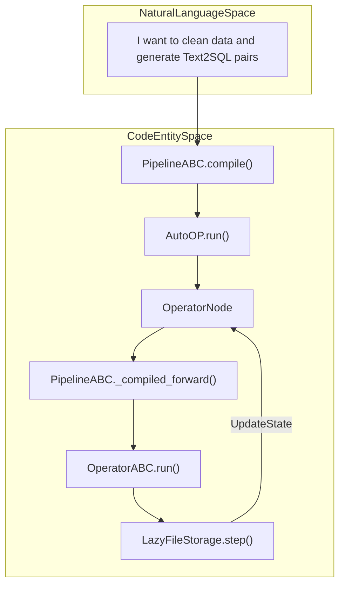
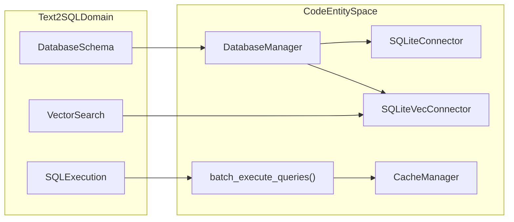

<!-- source: DeepWiki mcp.deepwiki.com · repo OpenDCAI/DataFlow · page 14 Glossary · fetched 2026-11-02 -->

# Glossary

Relevant source files

The following files were used as context for generating this wiki page:

- [.dockerignore](.dockerignore)
- [.gitignore](.gitignore)
- [Dockerfile](Dockerfile)
- [MANIFEST.in](MANIFEST.in)
- [README-zh.md](README-zh.md)
- [README.md](README.md)
- [dataflow/operators/text2sql/generate/sql_generator.py](dataflow/operators/text2sql/generate/sql_generator.py)
- [dataflow/operators/text2sql/generate/sql_variation_generator.py](dataflow/operators/text2sql/generate/sql_variation_generator.py)
- [dataflow/operators/text2sql/generate/text2sql_cot_generator.py](dataflow/operators/text2sql/generate/text2sql_cot_generator.py)
- [dataflow/operators/text2sql/generate/text2sql_prompt_generator.py](dataflow/operators/text2sql/generate/text2sql_prompt_generator.py)
- [dataflow/operators/text2sql/generate/text2sql_question_generator.py](dataflow/operators/text2sql/generate/text2sql_question_generator.py)
- [dataflow/pipeline/Pipeline.py](dataflow/pipeline/Pipeline.py)
- [dataflow/pipeline/__init__.py](dataflow/pipeline/__init__.py)
- [dataflow/pipeline/nodes.py](dataflow/pipeline/nodes.py)
- [dataflow/prompts/text2sql.py](dataflow/prompts/text2sql.py)
- [dataflow/utils/registry.py](dataflow/utils/registry.py)
- [dataflow/utils/storage.py](dataflow/utils/storage.py)
- [dataflow/utils/text2sql/base.py](dataflow/utils/text2sql/base.py)
- [dataflow/utils/text2sql/database_connector/mysql_connector.py](dataflow/utils/text2sql/database_connector/mysql_connector.py)
- [dataflow/utils/text2sql/database_connector/sqlite_connector.py](dataflow/utils/text2sql/database_connector/sqlite_connector.py)
- [dataflow/utils/text2sql/database_manager.py](dataflow/utils/text2sql/database_manager.py)
- [dataflow/version.py](dataflow/version.py)
- [test/cpu_only/test_lazy_file_storage_flush.py](test/cpu_only/test_lazy_file_storage_flush.py)
- [test/cpu_only/test_register_whitelist.py](test/cpu_only/test_register_whitelist.py)
- [test/cpu_only/test_remote_batch_slicing.py](test/cpu_only/test_remote_batch_slicing.py)
- [test/test_batched_pipeline.py](test/test_batched_pipeline.py)
- [test/test_batched_stream_pipeline.py](test/test_batched_stream_pipeline.py)
- [test/test_read_xlsx.py](test/test_read_xlsx.py)

This glossary defines technical terms, architectural components, and domain-specific jargon used within the DataFlow codebase. It serves as a comprehensive reference for onboarding engineers to understand how high-level concepts map to specific implementation details and code entities.

## Core System Abstractions

### Operator
The fundamental unit of data processing in DataFlow. Every operator is designed to be atomic, reusable, and composable within a pipeline.
*   **Implementation**: `OperatorABC` is the abstract base class for all operators `[dataflow/core/operator.py:1-28]()` (referenced via `[dataflow/pipeline/Pipeline.py:8-8]()`).
*   **Registration**: Operators are registered in the `OPERATOR_REGISTRY` for dynamic component discovery `[dataflow/utils/registry.py:34-60]()`.

### Pipeline
A directed graph of Operators that defines a complete data preparation workflow. Pipelines handle the orchestration of data flow between operators and manage execution state.
*   **Implementation**: `PipelineABC` in `[dataflow/pipeline/Pipeline.py:18-41]()`.
*   **Execution Flow**: Uses a `compile-then-forward` pattern. The `compile()` method wraps operators in `AutoOP` to record the execution graph `[dataflow/pipeline/Pipeline.py:43-55]()`.

### LLM Serving
An abstraction layer that decouples the data processing logic from the specific LLM provider (e.g., OpenAI API, vLLM, SGLang, Google Vertex AI).
*   **Base Class**: `LLMServingABC` `[dataflow/utils/text2sql/database_manager.py:15-15]()`.
*   **Common Implementation**: `APILLMServing_request` handles RESTful API calls with built-in configurations `[test/test_batched_pipeline.py:17-21]()`.

### Storage
The data persistence layer. It abstracts away file formats (JSONL, CSV, Parquet, XLSX) and provides a stepping mechanism to track data transformations through pipeline stages.
*   **Key Class**: `LazyFileStorage` manages in-memory buffers and atomic disk writes `[dataflow/utils/storage.py:70-148]()`.
*   **Stepping**: The `.step()` method increments the internal operator step counter to ensure each operator works on a fresh state `[dataflow/utils/storage.py:153-158]()`.

---

## Technical Jargon & Domain Terms

| Term | Definition | Code Pointer |
| :--- | :--- | :--- |
| **AutoOP** | A wrapper that intercepts operator calls during the `compile()` phase to record the execution graph into `op_runtimes`. | `[dataflow/pipeline/Pipeline.py:45-48]()` |
| **OPRuntime** | A data structure that stores the parameters and state of an operator execution for playback during compilation. | `[dataflow/pipeline/Pipeline.py:20-22]()` |
| **Registry** | A name-to-object mapping system that supports lazy loading and third-party plugin integration. | `[dataflow/utils/registry.py:34-130]()` |
| **CoT** | Chain-of-Thought; a prompting technique used in reasoning and SQL operators to generate intermediate logic. | `[dataflow/prompts/text2sql.py:54-91]()` |
| **Atomic Write** | Ensuring a file is fully written before replacing the target file using `os.replace` to prevent corruption. | `[dataflow/utils/storage.py:98-143]()` |
| **Whitelist** | A filtering mechanism in the Registry to restrict available operators to a specific subset. | `[dataflow/utils/registry.py:131-180]()` |
| **lembed()** | A SQL function used in vector-enhanced databases to generate embeddings for text columns. | `[dataflow/utils/text2sql/database_manager.py:85-88]()` |
| **M-Schema** | A standardized database schema format used by DataFlow to represent table structures and sample data for LLM prompts. | `[dataflow/utils/text2sql/database_connector/sqlite_connector.py:93-113]()` |

Sources: `[dataflow/pipeline/Pipeline.py:20-48]()`, `[dataflow/utils/registry.py:34-180]()`, `[dataflow/prompts/text2sql.py:54-91]()`, `[dataflow/utils/storage.py:70-158]()`, `[dataflow/utils/text2sql/database_manager.py:85-88]()`, `[dataflow/utils/text2sql/database_connector/sqlite_connector.py:93-113]()`

---

## Data Flow Architecture

The following diagram illustrates the transition from high-level "Natural Language Space" (user intent) to the "Code Entity Space" (actual classes and methods).

### Pipeline Compilation & Execution Flow
Title: "From Pipeline Definition to Operator Execution"

Sources: `[dataflow/pipeline/Pipeline.py:43-135]()`, `[dataflow/utils/storage.py:153-160]()`

---

## Database & Text2SQL Concepts

DataFlow includes a sophisticated subsystem for handling relational data and generating SQL queries.

### Database Management Entity Map
Title: "Text2SQL Domain to Code Mapping"

Sources: `[dataflow/utils/text2sql/database_manager.py:84-120]()`, `[dataflow/utils/text2sql/database_manager.py:181-200]()`, `[dataflow/utils/text2sql/database_manager.py:19-50]()`

### Key Components:
1.  **DatabaseManager**: The central hub for discovering databases and managing connections via the `CONNECTORS` registry `[dataflow/utils/text2sql/database_manager.py:84-110]()`.
2.  **CacheManager**: Implements TTL (Time-To-Live) caching for SQL query results to reduce database load `[dataflow/utils/text2sql/database_manager.py:19-28]()`.
3.  **SQLiteVecConnector**: Specialized connector for handling vector embeddings within SQLite using the `lembed()` function `[dataflow/utils/text2sql/database_connector/sqlite_connector.py:1-12]()`.

Sources: `[dataflow/utils/text2sql/database_manager.py:19-110]()`, `[dataflow/utils/text2sql/database_connector/sqlite_connector.py:1-12]()`

---

## Registry & Component Discovery

DataFlow uses a `Registry` system to manage operators and prompts without requiring hard-coded imports across modules.

### Lazy Loading Mechanism
When a user requests an object by name from a registry:
1.  The `Registry` checks its internal cache `_obj_map` `[dataflow/utils/registry.py:104-106]()`.
2.  If not found, it triggers `_init_loaders()` to import submodules dynamically `[dataflow/utils/registry.py:108-115]()`.
3.  It resolves the class attribute and caches it for subsequent calls `[dataflow/utils/registry.py:116-123]()`.

Sources: `[dataflow/utils/registry.py:34-130]()`

---

## Environment & Version Management

DataFlow manages version metadata and environment configurations cleanly.
*   **Version Definition**: The core version string is defined in `version.py` `[dataflow/version.py:1-8]()`.
*   **Parsing Utilities**: `parse_version_info` extracts version components into tuples for comparison `[dataflow/version.py:9-28]()`.

Sources: `[dataflow/version.py:1-28]()`