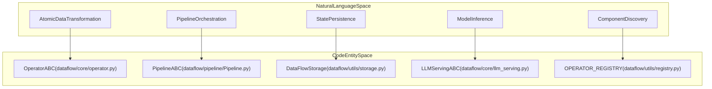
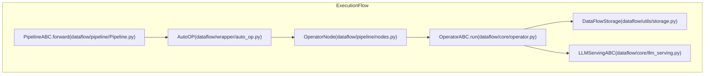

<!-- source: DeepWiki mcp.deepwiki.com · repo OpenDCAI/DataFlow · page 3 Core Architecture · fetched 2026-11-02 -->

# Core Architecture

Relevant source files

The following files were used as context for generating this wiki page:

- [dataflow/core/__init__.py](dataflow/core/__init__.py)
- [dataflow/operators/__init__.py](dataflow/operators/__init__.py)
- [dataflow/pipeline/Pipeline.py](dataflow/pipeline/Pipeline.py)
- [dataflow/pipeline/__init__.py](dataflow/pipeline/__init__.py)
- [dataflow/pipeline/nodes.py](dataflow/pipeline/nodes.py)
- [dataflow/utils/storage.py](dataflow/utils/storage.py)
- [dataflow/wrapper/auto_op.py](dataflow/wrapper/auto_op.py)
- [test/cpu_only/test_lazy_file_storage_flush.py](test/cpu_only/test_lazy_file_storage_flush.py)
- [test/cpu_only/test_remote_batch_slicing.py](test/cpu_only/test_remote_batch_slicing.py)
- [test/test_autoop.py](test/test_autoop.py)
- [test/test_batched_pipeline.py](test/test_batched_pipeline.py)
- [test/test_batched_stream_pipeline.py](test/test_batched_stream_pipeline.py)
- [test/test_copy.py](test/test_copy.py)
- [test/test_copy_weak_ref.py](test/test_copy_weak_ref.py)
- [test/test_dataframe_col.py](test/test_dataframe_col.py)
- [test/test_read_xlsx.py](test/test_read_xlsx.py)

This page provides a high-level overview of DataFlow's fundamental architecture, covering the core abstractions that enable composable, reproducible data preparation pipelines. It explains how operators, pipelines, storage systems, LLM serving backends, registries, and acceleration layers interact to transform raw data into high-quality LLM training datasets.

For detailed information about specific subsystems, refer to the following child pages:
- [Operators Framework](#3.1) — Detail the `OperatorABC` base class, operator design principles, and lifecycles [dataflow/core/__init__.py:1-18]().
- [Pipeline System](#3.2) — Explain the `PipelineABC` abstraction, pipeline composition, and the compile-execute pattern [dataflow/pipeline/Pipeline.py:18-42]().
- [Registry and Lazy Loading](#3.3) — Explain `OPERATOR_REGISTRY`, `PROMPT_REGISTRY`, and whitelist filtering for dynamic component discovery [dataflow/core/__init__.py:1-18]().
- [LLM Serving Architecture](#3.4) — Overview of `LLMServingABC` and available model serving backends [dataflow/core/__init__.py:1-18]().
- [Storage Systems](#3.5) — Explain `DataFlowStorage` implementations including file-based and database storage [dataflow/utils/storage.py:14-36]().
- [Database Management](#3.6) — Explain `DatabaseManager` for SQL database interactions, connection pooling, and batch operations [dataflow/utils/storage.py:14-36]().
- [Prompt System](#3.7) — Explain `PromptABC` base class and prompt template registration [dataflow/core/__init__.py:1-18]().
- [RayOrch Acceleration](#3.8) — Explain `RayAcceleratedOperator` for Ray-based data-parallel execution [dataflow/wrapper/auto_op.py:38-55]().

Sources: [dataflow/core/__init__.py:1-18](), [dataflow/pipeline/Pipeline.py:18-42](), [dataflow/utils/storage.py:14-36]()

---

## Architectural Overview

DataFlow implements a modular architecture separating data flow logic (operators and pipelines) from infrastructure concerns (storage, database management, and LLM serving). 

### Diagram: Component to Code Entity Mapping

The following diagram bridges the natural language concepts of the architecture to their concrete code entities within the repository.

Sources: [dataflow/core/__init__.py:1-18](), [dataflow/core/operator.py:1-28](), [dataflow/pipeline/Pipeline.py:18-42](), [dataflow/utils/storage.py:14-36]()

---

## Core Abstractions Overview

DataFlow relies on several core classes that establish standard contracts across the framework.

| Subsystem | Base Class / Manager | Primary Code Entity | Role |
|-----------|----------------------|---------------------|------|
| **Operators** | `OperatorABC` | `dataflow.core.operator.OperatorABC` | Encapsulates atomic dataset transformations via `run()` |
| **Pipelines** | `PipelineABC` | `dataflow.pipeline.Pipeline.PipelineABC` | Compiles and executes directed operator graphs |
| **Storage** | `DataFlowStorage` | `dataflow.utils.storage.DataFlowStorage` | Manages step-based state reads/writes |
| **LLM Serving** | `LLMServingABC` | `dataflow.core.llm_serving.LLMServingABC` | Handles prompt dispatch and model backends |
| **Registry** | `Registry` | `dataflow.utils.registry.Registry` | Lazy loads operators and prompts |

Sources: [dataflow/core/__init__.py:1-18](), [dataflow/pipeline/Pipeline.py:18-42](), [dataflow/utils/storage.py:14-36]()

### 3.1 Operators Framework
Operators represent atomic units of work in DataFlow. Subclasses extend `OperatorABC` and implement custom transformation logic inside their execution methods, relying on key-based data access. For details, see [Operators Framework](#3.1).
Sources: [dataflow/core/operator.py:1-28]()

### 3.2 Pipeline System
Pipelines orchestrate execution sequences through `PipelineABC` and `BatchedPipelineABC` [dataflow/pipeline/Pipeline.py:18-42](). They employ a compile-execute pattern where `AutoOP` intercepts calls during a symbolic forward pass to validate key lineage and build an `OperatorNode` graph [dataflow/pipeline/nodes.py:36-95](). For details, see [Pipeline System](#3.2).
Sources: [dataflow/pipeline/Pipeline.py:18-42](), [dataflow/wrapper/auto_op.py:38-55](), [dataflow/pipeline/nodes.py:36-95]()

### 3.3 Registry and Lazy Loading
To optimize startup times and memory overhead, DataFlow uses registries coupled with a `LazyLoader` pattern. Components are dynamically discovered and can be filtered using whitelists. For details, see [Registry and Lazy Loading](#3.3).
Sources: [dataflow/core/__init__.py:1-18]()

### 3.4 LLM Serving Architecture
The LLM serving layer abstracts inference via `LLMServingABC` [dataflow/core/__init__.py:1-2](). It supports external APIs (OpenAI, DeepSeek, Google Vertex), local inference engines (vLLM, SGLang), vision-language models, and embedding services. For details, see [LLM Serving Architecture](#3.4).
Sources: [dataflow/core/__init__.py:1-18]()

### 3.5 Storage Systems
Data persistence between pipeline steps is managed by `DataFlowStorage` [dataflow/utils/storage.py:14-36](). Implementations include standard file storage, `LazyFileStorage` with atomic buffering [dataflow/utils/storage.py:70-164](), and database-backed stores. For details, see [Storage Systems](#3.5).
Sources: [dataflow/utils/storage.py:14-164]()

### 3.6 Database Management
The database subsystem manages SQL interactions, connection pooling, and batch operations via database managers and connectors like `SQLiteConnector` and `SQLiteVecConnector`. For details, see [Database Management](#3.6).
Sources: [dataflow/utils/storage.py:14-36]()

### 3.7 Prompt System
Prompt templates inherit from `PromptABC` and are registered in prompt registries. The standard `build_prompt()` interface is used across generation operators. For details, see [Prompt System](#3.7).
Sources: [dataflow/core/__init__.py:1-18]()

### 3.8 RayOrch Acceleration
Data-parallel scaling across multiple GPUs or nodes is handled by the `RayAcceleratedOperator` wrapper, which integrates Ray actors with storage layers. For details, see [RayOrch Acceleration](#3.8).
Sources: [dataflow/wrapper/auto_op.py:38-55]()

---

## Subsystem Interaction Flow

### Diagram: Execution Flow Architecture

Sources: [dataflow/pipeline/Pipeline.py:18-42](), [dataflow/wrapper/auto_op.py:38-55](), [dataflow/pipeline/nodes.py:36-50](), [dataflow/core/operator.py:1-28](), [dataflow/utils/storage.py:14-36](), [dataflow/core/__init__.py:1-3]()

---

