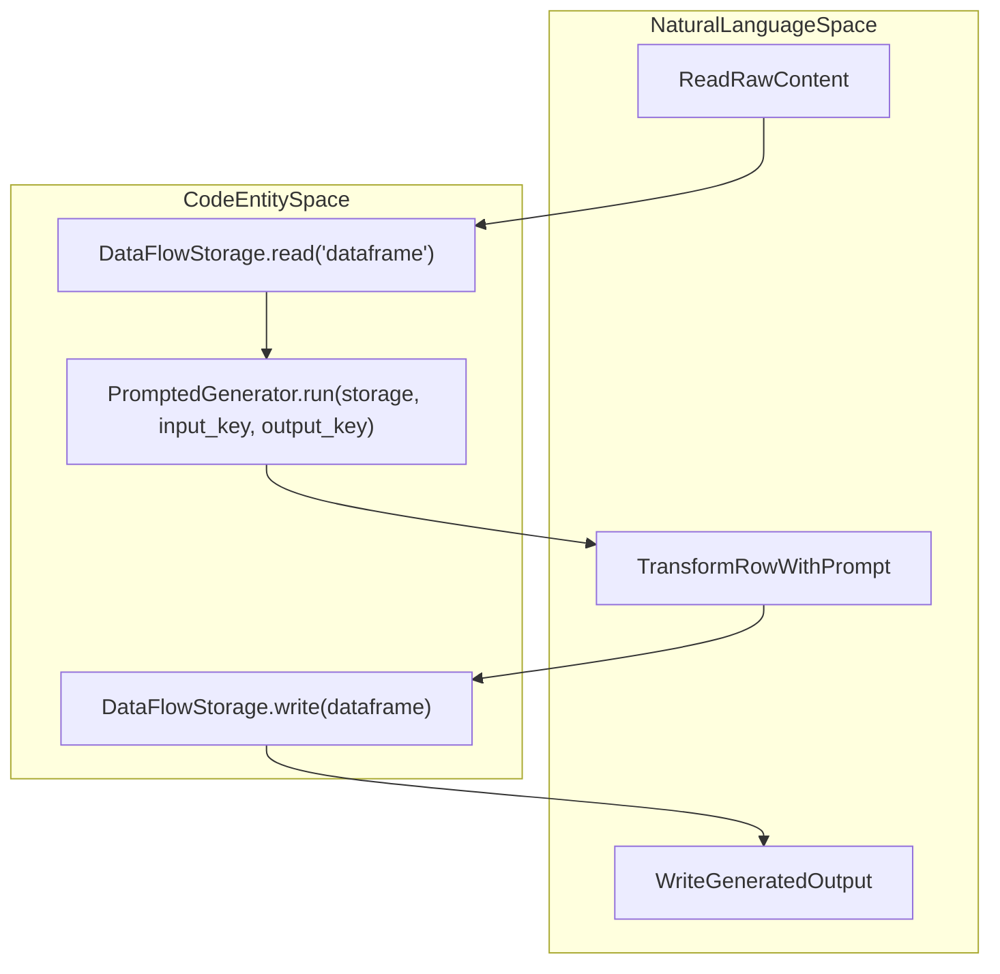
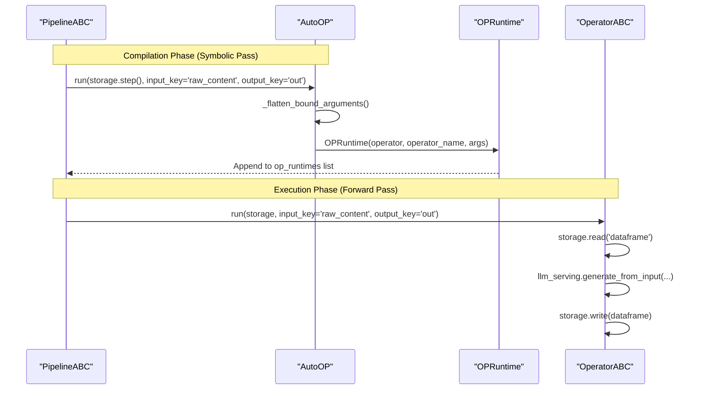

<!-- source: DeepWiki mcp.deepwiki.com · repo OpenDCAI/DataFlow · page 3.1 Operators Framework · fetched 2026-11-02 -->

# Operators Framework

<details>
<summary>Relevant source files</summary>

The following files were used as context for generating this wiki page:

- [dataflow/core/__init__.py](dataflow/core/__init__.py)
- [dataflow/operators/__init__.py](dataflow/operators/__init__.py)
- [dataflow/operators/core_text/refine/pandas_operator.py](dataflow/operators/core_text/refine/pandas_operator.py)
- [dataflow/wrapper/auto_op.py](dataflow/wrapper/auto_op.py)
- [test/test_autoop.py](test/test_autoop.py)
- [test/test_copy.py](test/test_copy.py)
- [test/test_copy_weak_ref.py](test/test_copy_weak_ref.py)
- [test/test_dataframe_col.py](test/test_dataframe_col.py)

</details>


## Purpose and Scope

The Operators Framework establishes the foundational abstraction for all data transformation, generation, filtering, and refinement tasks in DataFlow. Operators are modular, composable units that encapsulate specific processing logic, inheriting from the abstract base class `OperatorABC` [dataflow/core/__init__.py:1-14]() and communicating via a standardized key-based data flow pattern [dataflow/operators/core_text/generate/prompted_generator.py:58-90](). 

This page details:
- The `OperatorABC` core interface and class hierarchy [dataflow/core/__init__.py:1-14]().
- Operator design patterns, including key-based data access and functional categorization [dataflow/operators/core_text/__init__.py:1-30]().
- Non-LLM and custom transformation operators such as `PandasOperator` [dataflow/operators/core_text/refine/pandas_operator.py:8-52]().
- The two-stage operator lifecycle managed by the `AutoOP` and `OPRuntime` compilation-execution wrappers [dataflow/wrapper/auto_op.py:20-57]().
- Advanced implementation patterns such as recursive chunking for long-context generation [dataflow/operators/core_text/generate/chunked_prompted_generator.py:74-87]().

Sources: [dataflow/core/__init__.py:1-14](), [dataflow/wrapper/auto_op.py:20-57](), [dataflow/operators/core_text/generate/prompted_generator.py:58-90](), [dataflow/operators/core_text/refine/pandas_operator.py:8-52]()

---

## OperatorABC Base Class and Hierarchy

All data transformations in DataFlow are encapsulated by operator classes that descend from `OperatorABC` [dataflow/core/__init__.py:1-14](). Subclasses implement domain-specific logic inside the `run()` method [dataflow/operators/core_text/generate/prompted_generator.py:58](), which interacts with storage backends and LLM serving layers or directly manipulates tabular data structures.

```mermaid
classDiagram
    class "OperatorABC" {
        <<abstract>>
        +run(storage: DataFlowStorage, **kwargs) Any
        +get_desc(lang: str) str$
    }
    
    class "PromptedGenerator" {
        -llm_serving: LLMServingABC
        -system_prompt: str
        -user_prompt: str
        +run(storage, input_key, output_key)
    }
    
    class "PandasOperator" {
        -process_fn: list
        +run(storage, output_key)
    }

    "OperatorABC" <|-- "PromptedGenerator"
    "OperatorABC" <|-- "PandasOperator"
```
**Figure 1: Operator Class Hierarchy bridging Natural Language processing concepts to `OperatorABC` sub-classes (`PromptedGenerator`, `PandasOperator`)**

Sources: [dataflow/core/__init__.py:1-14](), [dataflow/operators/core_text/generate/prompted_generator.py:11-20](), [dataflow/operators/core_text/refine/pandas_operator.py:8-14]()

---

## Operator Design Patterns and Key-Based Data Access

Operators operate on tabular dataframes managed by `DataFlowStorage` instances. Rather than passing raw data frames explicitly through positional arguments in pipeline definitions, operators rely on **key-based data access** via parameter naming conventions (`input_` and `output_`) or storage read/write operations (e.g., `storage.read("dataframe")` [dataflow/operators/core_text/refine/pandas_operator.py:43]()).


**Figure 2: Mapping from Natural Language processing steps to `DataFlowStorage` and `PromptedGenerator` code entities**

### Key Parameter Conventions

During pipeline compilation and execution, keys passed to `run()` resolve columns or paths in active datasets:

| Parameter Pattern | Purpose | Code Reference Example |
|------------------|---------|------------------------|
| `input_key` | Identifies the source text column for generation or filtering | `"raw_content"` [dataflow/operators/core_text/generate/prompted_generator.py:58]() |
| `output_key` | Identifies the target column for storing operator results | `"generated_content"` [dataflow/operators/core_text/generate/prompted_generator.py:58]() |
| `input_path_key` | File path key for file-based generators | `"input_path"` [dataflow/operators/core_text/generate/chunked_prompted_generator.py:91]() |
| `output_path_key`| File path key for writing transformed file outputs | `"output_path"` [dataflow/operators/core_text/generate/chunked_prompted_generator.py:92]() |

Sources: [dataflow/operators/core_text/generate/prompted_generator.py:58-90](), [dataflow/operators/core_text/refine/pandas_operator.py:42-52]()

---

## Operator Lifecycle and AutoOP Wrapping

The execution of an operator is bifurcated into a **Compilation Phase** (symbolic recording) and an **Execution Phase** (actual processing). This is managed by the `AutoOP` wrapper and `OPRuntime` container [dataflow/wrapper/auto_op.py:20-57]().


**Figure 3: Sequence of operations through `AutoOP`, `OPRuntime`, and `OperatorABC` during compilation and execution**

### Key Runtime Components

- `AutoOP`: Intercepts method calls on operators during pipeline definition, capturing argument bindings via `_flatten_bound_arguments()` [dataflow/wrapper/auto_op.py:38-82]().
- `OPRuntime`: Records the target operator instance, operator name, and flattened keyword arguments into the pipeline's execution queue [dataflow/wrapper/auto_op.py:20-36]().

Sources: [dataflow/wrapper/auto_op.py:20-105](), [test/test_autoop.py:35-50]()

---

## Advanced Operator Implementation: Recursive Chunking and DataFrame Transformations

For operators dealing with long contexts—such as `ChunkedPromptedGenerator`—input texts are automatically decomposed into chunks if they exceed token limits [dataflow/operators/core_text/generate/chunked_prompted_generator.py:78-86](). Conversely, structural tabular cleaning is handled by operators like `PandasOperator` [dataflow/operators/core_text/refine/pandas_operator.py:8-52]().

1. **Token Counting**: Uses an encoder (e.g., `tiktoken` or a HuggingFace tokenizer) via `_count_tokens()` [dataflow/operators/core_text/generate/chunked_prompted_generator.py:74-75]().
2. **Recursive Bisection**: If text exceeds `max_chunk_len`, `_split_recursive()` halves the text recursively until all segments satisfy the threshold [dataflow/operators/core_text/generate/chunked_prompted_generator.py:78-86]().
3. **DataFrame Process Pipelines**: `PandasOperator` applies a sequence of callable functions (e.g., lambda expressions) to transform DataFrames in place before writing back to storage [dataflow/operators/core_text/refine/pandas_operator.py:44-51]().

Sources: [dataflow/operators/core_text/generate/chunked_prompted_generator.py:74-147](), [dataflow/operators/core_text/refine/pandas_operator.py:42-52]()

---

## Summary of Key Classes and Methods

| Class / Method Name | File Location | Role |
|---|---|---|
| `OperatorABC` | `dataflow/core/__init__.py` | Abstract base class enforcing the `run()` interface. |
| `AutoOP` | `dataflow/wrapper/auto_op.py` | Wrapper capturing operator invocations during compilation. |
| `OPRuntime` | `dataflow/wrapper/auto_op.py` | Metadata container storing operator execution arguments. |
| `PromptedGenerator` | `dataflow/operators/core_text/generate/prompted_generator.py` | Standard LLM text generation operator using prompt templates. |
| `PandasOperator` | `dataflow/operators/core_text/refine/pandas_operator.py` | Applies custom lambda functions and dataframe transforms. |

Sources: [dataflow/core/__init__.py:1-14](), [dataflow/wrapper/auto_op.py:20-57](), [dataflow/operators/core_text/generate/prompted_generator.py:11-20](), [dataflow/operators/core_text/refine/pandas_operator.py:8-52]()

---

