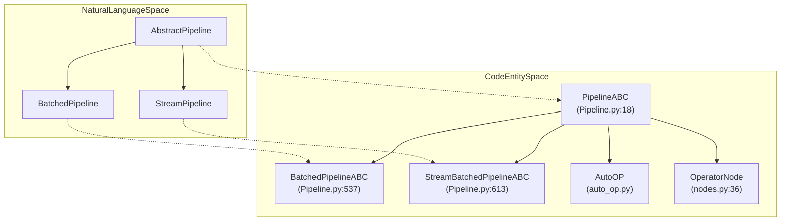
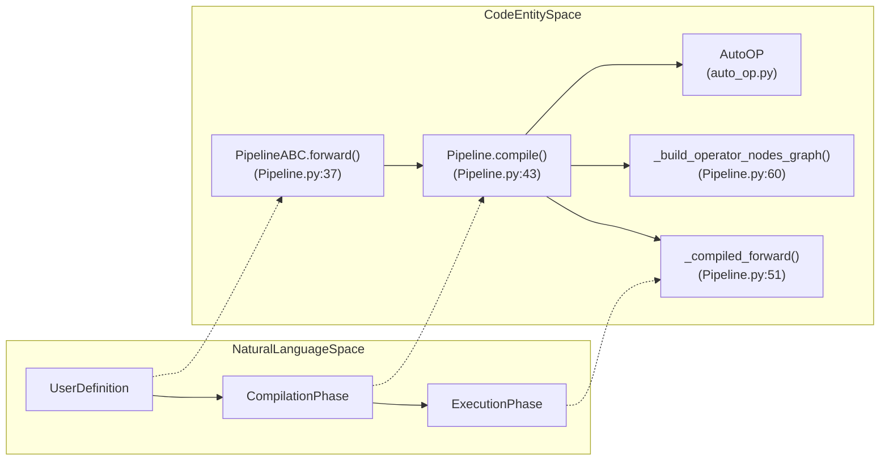

<!-- source: DeepWiki mcp.deepwiki.com · repo OpenDCAI/DataFlow · page 3.2 Pipeline System · fetched 2026-11-02 -->

# Pipeline System

Relevant source files

The following files were used as context for generating this wiki page:

- [dataflow/pipeline/Pipeline.py](dataflow/pipeline/Pipeline.py)
- [dataflow/pipeline/__init__.py](dataflow/pipeline/__init__.py)
- [dataflow/pipeline/nodes.py](dataflow/pipeline/nodes.py)
- [dataflow/utils/storage.py](dataflow/utils/storage.py)
- [dataflow/wrapper/__init__.py](dataflow/wrapper/__init__.py)
- [dataflow/wrapper/batch_wrapper.py](dataflow/wrapper/batch_wrapper.py)
- [test/cpu_only/test_lazy_file_storage_flush.py](test/cpu_only/test_lazy_file_storage_flush.py)
- [test/cpu_only/test_remote_batch_slicing.py](test/cpu_only/test_remote_batch_slicing.py)
- [test/test_batched_pipeline.py](test/test_batched_pipeline.py)
- [test/test_batched_stream_pipeline.py](test/test_batched_stream_pipeline.py)
- [test/test_batchify.py](test/test_batchify.py)
- [test/test_read_xlsx.py](test/test_read_xlsx.py)

This document provides a high-level overview of the pipeline system in DataFlow, which composes individual operators into cohesive, executable workflows using the `PipelineABC` abstraction [dataflow/pipeline/Pipeline.py:18-42](). Pipelines coordinate data flow, manage LLM serving resources, and govern execution through a distinct compile-execute pattern.

For detailed technical explanations, refer to the child pages:
- **Compilation Phase**: [Compilation Phase](#3.2.1)
- **Execution Phase**: [Execution Phase](#3.2.2)
- **Batched and Streaming Pipelines**: [Batched and Streaming Pipelines](#3.2.3)

---

## Overview and Core Abstraction

The foundation of the pipeline architecture is `PipelineABC`, located in `dataflow/pipeline/Pipeline.py` [dataflow/pipeline/Pipeline.py:18-42](). Subclasses implement the `forward()` method to define the sequence of operator invocations [dataflow/pipeline/Pipeline.py:36-41](). DataFlow provides standard and specialized pipeline variants, including `BatchedPipelineABC` and `StreamBatchedPipelineABC` [dataflow/pipeline/Pipeline.py:1-6](), designed to handle datasets ranging from small in-memory tables to massive distributed streams.

Title: Pipeline System Architecture

Sources: [dataflow/pipeline/Pipeline.py:18-35](), [dataflow/pipeline/Pipeline.py:537](), [dataflow/pipeline/Pipeline.py:613]()

---

## The Compile-Execute Pattern

DataFlow pipelines operate via a two-phase lifecycle: **Compilation** and **Execution** [dataflow/pipeline/Pipeline.py:43-58](). 

During compilation, operators are wrapped with `AutoOP` [dataflow/pipeline/Pipeline.py:10](), and calling `forward()` records operator calls into `op_runtimes` [dataflow/pipeline/Pipeline.py:21]() without running them. The pipeline builds an `OperatorNode` graph [dataflow/pipeline/Pipeline.py:60]() and validates that input keys match available output keys across all steps [dataflow/pipeline/Pipeline.py:105-135](). Once compiled, `forward()` is replaced with `_compiled_forward()` [dataflow/pipeline/Pipeline.py:51]().

For detailed information on AutoOP wrapping, runtime recording, graph construction, and key validation, see [Compilation Phase](#3.2.1).

During execution, `_compiled_forward()` iterates through the validated operator nodes, advancing storage states via `storage.step()` [dataflow/utils/storage.py:153](), managing LLM serving lifecycle reference counts [dataflow/pipeline/Pipeline.py:34](), and invoking each operator's `run()` method [dataflow/pipeline/Pipeline.py:522]().

For detailed information on operator execution order, key validation during runtime, LLM serving lifecycle management, and the `storage.step()` mechanism, see [Execution Phase](#3.2.2).

Title: Compile and Execute Flow

Sources: [dataflow/pipeline/Pipeline.py:37-60](), [dataflow/pipeline/Pipeline.py:10]()

---

## Batched and Streaming Pipelines

For large-scale datasets, standard in-memory pipelines can exhaust available system memory. DataFlow provides `BatchedPipelineABC` and `StreamBatchedPipelineABC` to process data in manageable chunks [dataflow/pipeline/Pipeline.py:1-6](). These variants integrate with `BatchedFileStorage` and `StreamBatchedFileStorage` [dataflow/utils/storage.py:70-164]() to support batch-wise iteration, progress checkpointing via progress tracking files, and automatic resume mechanisms.

For detailed documentation on batch wrappers, streaming storage implementations, and large-scale dataset resume logic, see [Batched and Streaming Pipelines](#3.2.3).

Sources: [dataflow/pipeline/Pipeline.py:1-6](), [dataflow/utils/storage.py:70-164]()

---

