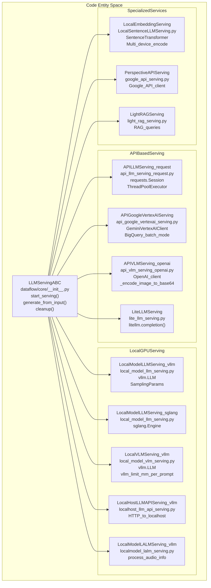

<!-- source: DeepWiki mcp.deepwiki.com · repo OpenDCAI/DataFlow · page 3.4 LLM Serving Architecture · fetched 2026-11-02 -->

# LLM Serving Architecture

Relevant source files

The following files were used as context for generating this wiki page:

- [.github/workflows/test.yml](.github/workflows/test.yml)
- [dataflow/operators/code/filter/code_score_filter.py](dataflow/operators/code/filter/code_score_filter.py)
- [dataflow/operators/core_text/eval/bench_dataset_evaluator_question.py](dataflow/operators/core_text/eval/bench_dataset_evaluator_question.py)
- [dataflow/serving/__init__.py](dataflow/serving/__init__.py)
- [dataflow/serving/api_llm_serving_request.py](dataflow/serving/api_llm_serving_request.py)
- [dataflow/serving/api_vlm_serving_openai.py](dataflow/serving/api_vlm_serving_openai.py)
- [dataflow/serving/local_model_vlm_serving.py](dataflow/serving/local_model_vlm_serving.py)
- [dataflow/serving/localhost_llm_api_serving.py](dataflow/serving/localhost_llm_api_serving.py)
- [dataflow/serving/localmodel_lalm_serving.py](dataflow/serving/localmodel_lalm_serving.py)
- [test/cpu_only/test_undefined_name_crashes.py](test/cpu_only/test_undefined_name_crashes.py)

## Purpose and Scope

This document provides an overview of DataFlow's LLM serving architecture, explaining the `LLMServingABC` abstraction layer [dataflow/core/__init__.py:6-6]() and the diverse serving implementations that enable infrastructure-agnostic pipeline execution. The architecture supports four primary categories of serving:

1.  **API-Based Serving** ([API-Based Serving](#3.4.1)): Cloud services via HTTP/HTTPS APIs (OpenAI, DeepSeek, Gemini).
2.  **Local GPU Serving** ([Local GPU Serving](#3.4.2)): On-premises inference with vLLM/SGLang for high-performance local execution.
3.  **Vision-Language and Audio Model Serving** ([Vision-Language and Audio Model Serving](#3.4.3)): Multimodal image+text processing for document extraction and VQA.
4.  **Embedding and Specialized Services** ([Embedding and Specialized Services](#3.4.4)): Sentence embeddings, provider wrappers (LiteLLM), and RAG-specific serving.

This unified abstraction allows pipelines to run on any infrastructure—from personal laptops to enterprise clusters—without modifying operator code.

**Related Pages:**
*   Pipeline orchestration of LLM lifecycle: see [Execution Phase](#3.2.2)
*   Operator integration with serving: see [Operators Framework](#3.1)

Sources: [dataflow/core/__init__.py:6-6]()

---

## Architecture Overview

DataFlow's LLM serving layer abstracts away the differences between various model serving backends through a common interface (`LLMServingABC`). This design allows operators and pipelines to remain infrastructure-agnostic.

### LLM Serving Class Hierarchy

The following diagram maps the logical serving categories to the specific code entities in the `dataflow/serving/` directory, bridging high-level architectural concepts with the codebase structure.

Sources: [dataflow/serving/__init__.py:1-29](), [dataflow/serving/api_vlm_serving_openai.py:13-23](), [dataflow/serving/local_model_vlm_serving.py:13-35](), [dataflow/serving/localmodel_lalm_serving.py:96-129](), [dataflow/serving/localhost_llm_api_serving.py:14-48]()

---

## The LLMServingABC Interface

The `LLMServingABC` abstract base class defines the contract that all serving implementations must follow. This ensures that any operator requiring an LLM can interact with any backend via a standard set of methods.

| Method | Signature | Purpose | When Called |
| :--- | :--- | :--- | :--- |
| `start_serving()` | `def start_serving(self) -> None` | Initialize/start the serving backend (e.g., load weights or setup sessions) | Before pipeline execution begins |
| `generate_from_input()` | `def generate_from_input(...) -> List[str]` | Generate responses for a batch of inputs | During operator `run()` execution |
| `cleanup()` | `def cleanup(self) -> None` | Release resources (GPUs) or close connections | After pipeline completion |

### Key Design Principles

1.  **Stateless Generation**: The `generate_from_input()` method is the primary interface. It accepts a list of user inputs and returns a list of generated responses, enabling batch parallelization regardless of whether the backend is a local GPU or a remote API.
2.  **Lifecycle Management**: Pipelines manage the serving lifecycle. Services start when the first operator needs them via `start_serving()` [dataflow/serving/local_model_vlm_serving.py:102-102]() and shut down after the last operator completes.
3.  **Backend Agnostic**: Operators receive a `LLMServingABC` instance [dataflow/operators/core_text/eval/bench_dataset_evaluator_question.py:30-30](). The pipeline configuration determines which implementation (API vs. Local) is injected.
4.  **Structured Output Support**: Implementations like `APILLMServing_request` [dataflow/serving/api_llm_serving_request.py:139-165]() and `APIVLMServing_openai` [dataflow/serving/api_vlm_serving_openai.py:114-123]() support `json_schema` for constrained generation.

Sources: [dataflow/serving/api_llm_serving_request.py:16-21](), [dataflow/serving/api_vlm_serving_openai.py:20-22](), [dataflow/serving/local_model_vlm_serving.py:102-156](), [dataflow/serving/localhost_llm_api_serving.py:96-147]()

---

## Serving Categories

### Implementation Comparison

The following diagram maps natural language serving categories and protocols directly to codebase implementations and function/method names:

```mermaid
graph TB
    subgraph "Natural Language & Infrastructure Space"
        ExtAPI["External Cloud APIs<br/>(OpenAI, DeepSeek)"]
        GoogleCloud["Google Cloud<br/>Vertex AI Platform"]
        GPU["Local CUDA Devices<br/>PagedAttention Memory"]
        CPUorGPU["CPU or GPU Device<br/>Sentence Embeddings"]
    end

    subgraph "Code Entity Space"
        subgraph APIMode["APIBasedServing"]
            APIText["APILLMServing_request<br/>api_llm_serving_request.py<br/>_api_chat_with_id()<br/>max_workers"]
            APIVLM["APIVLMServing_openai<br/>api_vlm_serving_openai.py<br/>chat_with_one_image()<br/>generate_from_input_one_image()"]
            VertexAI["APIGoogleVertexAIServing<br/>api_google_vertexai_serving.py<br/>GeminiVertexAIClient.generate()"]
        end
        
        subgraph LocalMode["LocalGPUServing"]
            VLLM["LocalModelLLMServing_vllm<br/>local_model_llm_serving.py<br/>vllm.LLM.generate()<br/>vllm_tensor_parallel_size"]
            LocalVLM["LocalVLMServing_vllm<br/>local_model_vlm_serving.py<br/>vllm_limit_mm_per_prompt"]
            LocalHost["LocalHostLLMAPIServing_vllm<br/>localhost_llm_api_serving.py<br/>subprocess.Popen"]
            LocalAudio["LocalModelLALMServing_vllm<br/>localmodel_lalm_serving.py<br/>process_audio_info()"]
        end
        
        subgraph SpecializedMode["SpecializedServices"]
            Embed["LocalEmbeddingServing<br/>LocalSentenceLLMServing.py<br/>SentenceTransformer.encode()<br/>device"]
        end
    end
    
    APIText -->|"requests.Session<br/>HTTPAdapter_pool"| ExtAPI
    APIVLM -->|"OpenAI_client<br/>base64_images"| ExtAPI
    VertexAI -->|"google.genai<br/>CreateBatchJobConfig"| GoogleCloud
    
    VLLM -->|"GPU_allocation<br/>PagedAttention"| GPU
    LocalVLM -->|"vLLM_engine<br/>image_tensors"| GPU
    LocalHost -->|"localhost:port/v1<br/>entrypoints.openai.api_server"| GPU
    LocalAudio -->|"librosa.load<br/>base64_audio"| GPU
    
    Embed -->|"parallel_encode<br/>batch_size"| CPUorGPU
```

Sources: [dataflow/serving/api_llm_serving_request.py:28-28](), [dataflow/serving/local_model_vlm_serving.py:89-98](), [dataflow/serving/localmodel_lalm_serving.py:37-44](), [dataflow/serving/LocalSentenceLLMServing.py:11-11]()

| Category | Implementations | Parallelism Strategy |
| :--- | :--- | :--- |
| **API-Based** | `APILLMServing_request`, `APIGoogleVertexAIServing`, `LiteLLMServing` | `ThreadPoolExecutor` with configurable `max_workers`. [dataflow/serving/api_llm_serving_request.py:28-28]() |
| **Local GPU** | `LocalModelLLMServing_vllm`, `LocalModelLLMServing_sglang`, `LocalHostLLMAPIServing_vllm` | Tensor parallelism (`vllm_tensor_parallel_size`) and PagedAttention via vLLM backend. [dataflow/serving/local_model_vlm_serving.py:89-98]() |
| **VLM/Audio** | `APIVLMServing_openai`, `LocalVLMServing_vllm`, `LocalModelLALMServing_vllm` | Multimodal inference with `vllm_limit_mm_per_prompt` [dataflow/serving/local_model_vlm_serving.py:31-31]() or `process_audio_info` [dataflow/serving/localmodel_lalm_serving.py:37-44](). |
| **Specialized** | `LocalEmbeddingServing`, `LightRAGServing` | Multi-device encoding via `SentenceTransformer` or graph-based retrieval. [dataflow/serving/LocalSentenceLLMServing.py:11-11]() |

Sources: [dataflow/serving/api_llm_serving_request.py:28-28](), [dataflow/serving/local_model_vlm_serving.py:89-98](), [dataflow/serving/localmodel_lalm_serving.py:37-44](), [dataflow/serving/LocalSentenceLLMServing.py:11-11]()

---

## Detailed Serving Documentation

For in-depth configuration, implementation details, and advanced usage of each serving backend, refer to the following child pages:

*   **[API-Based Serving](#3.4.1)**: Detail `APILLMServing_request` for OpenAI/DeepSeek APIs, including `requests.Session` management [dataflow/serving/api_llm_serving_request.py:61-75](), `reasoning_content` extraction [dataflow/serving/api_llm_serving_request.py:87-103](), and retry mechanisms.
*   **[Local GPU Serving](#3.4.2)**: Explain `LocalModelLLMServing_vllm` and `LocalModelLLMServing_sglang` for local inference with tensor parallelism and GPU memory management. Includes `LocalHostLLMAPIServing_vllm` for serving via subprocess [dataflow/serving/localhost_llm_api_serving.py:101-126]().
*   **[Vision-Language and Audio Model Serving](#3.4.3)**: Describe VLM support through `APIVLMServing_openai` and `LocalVLMServing_vllm`, including base64 image encoding [dataflow/serving/api_vlm_serving_openai.py:56-78]() and `vLLM` integration for multimodal prompts [dataflow/serving/local_model_vlm_serving.py:139-146]().
*   **[Embedding and Specialized Services](#3.4.4)**: Detail `LocalEmbeddingServing` with `sentence-transformers`, multi-GPU/CPU parallelization strategies, and specialized RAG serving components like `LightRAGServing`. Includes audio processing via `LocalModelLALMServing_vllm` [dataflow/serving/localmodel_lalm_serving.py:96-129]().

Sources: [dataflow/serving/__init__.py:1-29](), [dataflow/serving/api_llm_serving_request.py:16-103](), [dataflow/serving/api_vlm_serving_openai.py:13-184](), [dataflow/serving/local_model_vlm_serving.py:13-156](), [dataflow/serving/localhost_llm_api_serving.py:14-162](), [dataflow/serving/localmodel_lalm_serving.py:96-129]()

---

