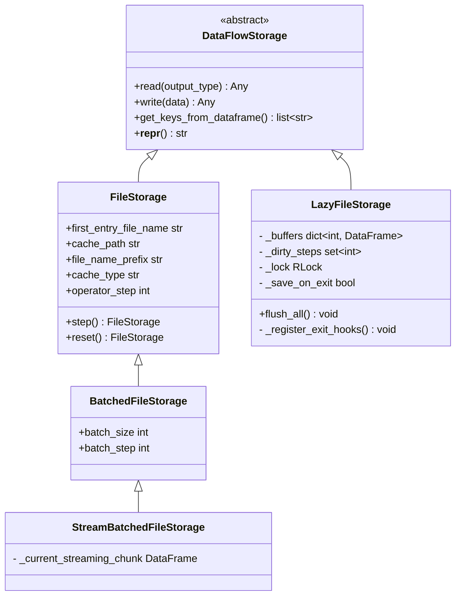

<!-- source: DeepWiki mcp.deepwiki.com · repo OpenDCAI/DataFlow · page 3.5 Storage Systems · fetched 2026-11-02 -->

# Storage Systems

<details>
<summary>Relevant source files</summary>

The following files were used as context for generating this wiki page:

- [dataflow/pipeline/Pipeline.py](dataflow/pipeline/Pipeline.py)
- [dataflow/pipeline/__init__.py](dataflow/pipeline/__init__.py)
- [dataflow/pipeline/nodes.py](dataflow/pipeline/nodes.py)
- [dataflow/utils/storage.py](dataflow/utils/storage.py)
- [test/cpu_only/test_lazy_file_storage_flush.py](test/cpu_only/test_lazy_file_storage_flush.py)
- [test/cpu_only/test_remote_batch_slicing.py](test/cpu_only/test_remote_batch_slicing.py)
- [test/test_batched_pipeline.py](test/test_batched_pipeline.py)
- [test/test_batched_stream_pipeline.py](test/test_batched_stream_pipeline.py)
- [test/test_read_xlsx.py](test/test_read_xlsx.py)

</details>


## Purpose and Scope

This document explains the storage abstraction layer in DataFlow, which manages data persistence and state transitions between operators in a pipeline. Storage implementations handle reading input data, writing output data, and maintaining checkpoints for resumable execution.

As a parent page, this section provides a high-level overview of the `DataFlowStorage` architecture and its variants [dataflow/utils/storage.py:14-36](). For comprehensive technical details on file buffering, atomic writes, remote dataset loading, and file formats, see [File-Based Storage](#3.5.1). For details on database integrations and connection pooling, see [Database Storage](#3.5.2).

---

## The DataFlowStorage Abstraction

DataFlow defines a unified interface for data persistence through the `DataFlowStorage` abstract base class [dataflow/utils/storage.py:14-36](). All storage implementations must provide core operations to interact with dataframes and manage state.

| Method | Purpose | Returns |
|--------|---------|---------|
| `read(output_type)` | Retrieve data for the current step | `Any` (e.g., `pd.DataFrame` or `List[dict]`) [dataflow/utils/storage.py:26-31]() |
| `write(data)` | Persist data for the next step | `Any` (File path or identifier) [dataflow/utils/storage.py:33-35]() |
| `get_keys_from_dataframe()` | Extract column names from stored data | `list[str]` [dataflow/utils/storage.py:18-24]() |

The storage abstraction decouples operators from the underlying persistence mechanism, allowing pipelines to switch between file-based and database-based storage without modifying operator code. The base class also includes a robust `__repr__` for inspecting large objects like DataFrames without flooding the console by displaying shape and size instead of raw content [dataflow/utils/storage.py:38-68]().

Sources: [dataflow/utils/storage.py:14-69]()

---

## Storage Step Mechanism

Storage instances maintain an internal `operator_step` counter that tracks the current position in the pipeline execution [dataflow/utils/storage.py:156](). The `step()` method is typically called within the pipeline's `forward()` pass to increment this counter and prepare the storage for the next operator [test/test_batched_pipeline.py:36-50]().

### Storage Step Lifecycle and Operator Association

The following diagram bridges the conceptual requirement for data persistence with the specific code entities that manage state transitions during pipeline execution.

```mermaid
graph TB
    subgraph "Natural Language Space"
        S1[""Initialize Storage""]
        S2[""Start Step 0 (Input)""]
        S3[""Execute Operator 1""]
        S4[""Start Step 1 (Output 1)""]
    end

    subgraph "Code Entity Space"
        C1[""DataFlowStorage subclass init<br/>operator_step = -1""]
        C2[""DataFlowStorage.step()<br/>Increments operator_step""]
        C3[""OperatorABC.run(storage, ...)<br/>Calls storage.read()""]
        C4[""DataFlowStorage.write(data)<br/>Buffers/Writes for next step""]
    end

    S1 <--> C1
    S2 <--> C2
    S3 <--> C3
    S4 <--> C4
```

Sources: [dataflow/utils/storage.py:153-154](), [dataflow/pipeline/Pipeline.py:60-138](), [dataflow/pipeline/nodes.py:36-57](), [test/test_batched_pipeline.py:36-50]()

---

## Storage Type Hierarchy and Implementation Overview

DataFlow provides multiple storage implementations optimized for different use cases, ranging from simple local files to distributed databases and streaming buffers.



Sources: [dataflow/utils/storage.py:14-148](), [test/test_batched_pipeline.py:5-16](), [test/test_batched_stream_pipeline.py:9-20]()

---

## Remote Dataset Loading Mapping

`LazyFileStorage` and other file-based storages support loading initial datasets from remote sources (`hf:` or `ms:`) or local paths [dataflow/utils/storage.py:102-109](). 

### Remote Data Loading Flow

The following diagram bridges natural language source identifiers to their corresponding class methods and execution entities.

```mermaid
graph LR
    subgraph "Natural Language Space"
        HF[""HuggingFace Dataset Identifier hf:""]
        MS[""ModelScope Dataset Identifier ms:""]
        LOCAL[""Local File Path (jsonl/csv/parquet)""]
    end

    subgraph "Code Entity Space"
        L1[""LazyFileStorage.__init__()<br/>load_dataset()""]
        L2[""LazyFileStorage.__init__()<br/>MsDataset.load()""]
        L3[""FileStorage / LazyFileStorage<br/>Pandas/Python Parsers""]
    end

    subgraph "Unified Output Space"
        DF[""pd.DataFrame""]
    end

    HF --> L1
    MS --> L2
    LOCAL --> L3
    L1 --> DF
    L2 --> DF
    L3 --> DF
```

Sources: [dataflow/utils/storage.py:102-109]()

---

## Child Page Overview

- **[File-Based Storage](#3.5.1)**: Explores `FileStorage`, `LazyFileStorage` with buffering, atomic writes via `os.replace`, remote `hf:`/`ms:` integrations, and caching across formats (`json`, `jsonl`, `csv`, `parquet`, `xlsx`) [dataflow/utils/storage.py:70-164]().
- **[Database Storage](#3.5.2)**: Details `MyScaleDBStorage` for ClickHouse and MyScale integration, tracking pipeline states, and connection pooling through `db_pool`.

Sources: [dataflow/utils/storage.py:14-164]()

---

