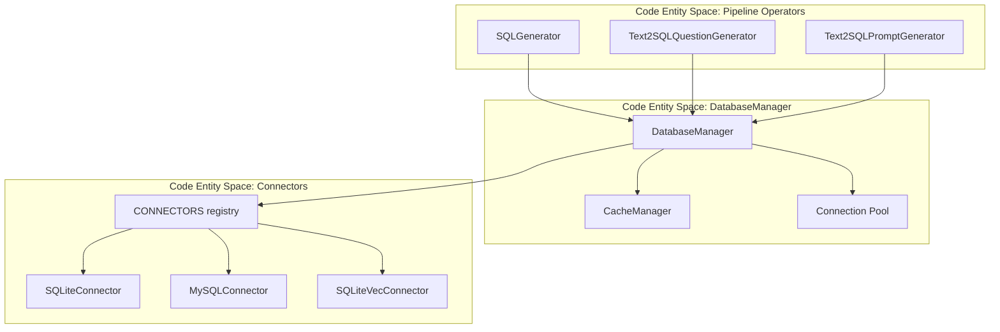
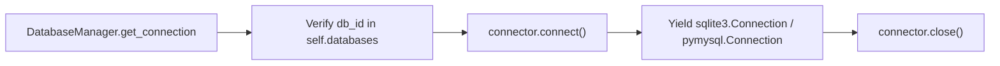

<!-- source: DeepWiki mcp.deepwiki.com · repo OpenDCAI/DataFlow · page 3.6 Database Management · fetched 2026-11-02 -->

# Database Management

Relevant source files

The following files were used as context for generating this wiki page:

- [dataflow/operators/text2sql/generate/sql_generator.py](dataflow/operators/text2sql/generate/sql_generator.py)
- [dataflow/operators/text2sql/generate/sql_variation_generator.py](dataflow/operators/text2sql/generate/sql_variation_generator.py)
- [dataflow/operators/text2sql/generate/text2sql_cot_generator.py](dataflow/operators/text2sql/generate/text2sql_cot_generator.py)
- [dataflow/operators/text2sql/generate/text2sql_prompt_generator.py](dataflow/operators/text2sql/generate/text2sql_prompt_generator.py)
- [dataflow/operators/text2sql/generate/text2sql_question_generator.py](dataflow/operators/text2sql/generate/text2sql_question_generator.py)
- [dataflow/prompts/text2sql.py](dataflow/prompts/text2sql.py)
- [dataflow/utils/text2sql/base.py](dataflow/utils/text2sql/base.py)
- [dataflow/utils/text2sql/database_connector/mysql_connector.py](dataflow/utils/text2sql/database_connector/mysql_connector.py)
- [dataflow/utils/text2sql/database_connector/sqlite_connector.py](dataflow/utils/text2sql/database_connector/sqlite_connector.py)
- [dataflow/utils/text2sql/database_manager.py](dataflow/utils/text2sql/database_manager.py)

The Database Management system provides a unified interface for interacting with SQL databases across DataFlow pipelines. It acts as the core orchestration layer for Text2SQL and database-backed tasks, managing database discovery, connection pooling, batch query execution, schema extraction, and result comparison.

This is a parent page. For deep technical details on specific connectors, see [Database Connectors](#3.6.1). For query execution patterns, comparison algorithms, schema formatting, and TTL caching, see [Query Execution and Comparison](#3.6.2).

---

## Architecture Overview

The database management architecture centers around the `DatabaseManager` facade [dataflow/utils/text2sql/database_manager.py:84](), which delegates database-specific operations to pluggable connector implementations registered in `CONNECTORS` [dataflow/utils/text2sql/database_manager.py:92-98](). Operators such as `SQLGenerator` [dataflow/operators/text2sql/generate/sql_generator.py:19](), `Text2SQLQuestionGenerator` [dataflow/operators/text2sql/generate/text2sql_question_generator.py:19](), and `Text2SQLPromptGenerator` [dataflow/operators/text2sql/generate/text2sql_prompt_generator.py:17]() interact directly with `DatabaseManager` to retrieve schemas and execute validation queries.

Title: Database Management Architecture

Sources: [dataflow/utils/text2sql/database_manager.py:84-121](), [dataflow/utils/text2sql/database_manager.py:92-98](), [dataflow/operators/text2sql/generate/sql_generator.py:19-28](), [dataflow/operators/text2sql/generate/text2sql_question_generator.py:19-30](), [dataflow/operators/text2sql/generate/text2sql_prompt_generator.py:17-28]()

---

## DatabaseManager Facade and Connection Management

The `DatabaseManager` class initializes with a specified database type, configuration dictionary, and an optional embedding service for vector operations [dataflow/utils/text2sql/database_manager.py:100-104](). It automatically discovers available databases upon instantiation via `_discover_databases()` [dataflow/utils/text2sql/database_manager.py:120-127]().

To prevent resource exhaustion during parallel processing, `DatabaseManager` implements thread-safe connection management using context managers (`get_connection`) and per-database connection tracking [dataflow/utils/text2sql/database_manager.py:132-150]().

Title: Connection Management Flow

Sources: [dataflow/utils/text2sql/database_manager.py:132-150]()

---

## Caching and Schema Management

`DatabaseManager` integrates a thread-safe `CacheManager` to cache database schemas and query results with Time-To-Live (TTL) expiration [dataflow/utils/text2sql/database_manager.py:19-81](). Schema information is extracted through connectors like `SQLiteConnector` [dataflow/utils/text2sql/database_connector/sqlite_connector.py:93-113]() and `MySQLConnector` [dataflow/utils/text2sql/database_connector/mysql_connector.py:80-110]() and formatted into structured representations.

For detailed information on schema extraction, M-Schema generation, and TTL caching, see [Query Execution and Comparison](#3.6.2).

Sources: [dataflow/utils/text2sql/database_manager.py:19-81](), [dataflow/utils/text2sql/database_connector/sqlite_connector.py:93-113](), [dataflow/utils/text2sql/database_connector/mysql_connector.py:80-110]()

---

## Child Pages

- [Database Connectors](#3.6.1) — Details `DatabaseConnectorABC`, `SQLiteConnector`, `MySQLConnector`, and `SQLiteVecConnector` with vector extension and `lembed()` support.
- [Query Execution and Comparison](#3.6.2) — Covers batch query execution, result comparison logic, schema extraction, M-Schema formatting, and `CacheManager` TTL caching.

---

