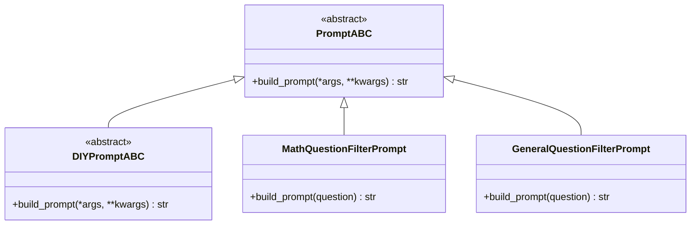

<!-- source: DeepWiki mcp.deepwiki.com · repo OpenDCAI/DataFlow · page 3.7 Prompt System · fetched 2026-11-02 -->

# Prompt System

<details>
<summary>Relevant source files</summary>

The following files were used as context for generating this wiki page:

- [dataflow/core/prompt.py](dataflow/core/prompt.py)
- [dataflow/operators/reasoning/filter/reasoning_question_filter.py](dataflow/operators/reasoning/filter/reasoning_question_filter.py)
- [dataflow/utils/registry.py](dataflow/utils/registry.py)
- [test/cpu_only/test_register_whitelist.py](test/cpu_only/test_register_whitelist.py)

</details>


The Prompt System provides a standardized framework for creating, registering, and managing LLM prompt templates in DataFlow. It defines the `PromptABC` base class, a registry mechanism for dynamic prompt discovery, type-safety enforcement via decorators, and integration patterns for operators to consume prompts across various pipelines (e.g., Code, Reasoning, and Text2SQL).

For information about operators that consume prompts, see **3.1 Operators Framework**. For LLM serving that executes the generated prompts, see **3.4 LLM Serving Architecture**.

---

## Architecture Overview

The Prompt System follows a template pattern where prompt classes transform structured inputs into formatted LLM prompts, enforced by runtime type checking and managed via registries.

**Prompt System Architecture: Natural Language to Code Entity Mapping**

```mermaid
graph TB
    subgraph "Prompt Definition (Code Space)"
        PromptABC["PromptABC<br/>(dataflow.core.prompt)"]
        ReasoningPrompts["Reasoning Prompts<br/>MathQuestionFilterPrompt<br/>GeneralQuestionFilterPrompt"]
        DIYPromptABC["DIYPromptABC<br/>(Base for custom prompts)"]
    end
    
    subgraph "Registration and Discovery"
        PROMPT_REGISTRY["PROMPT_REGISTRY<br/>(dataflow.utils.registry)"]
        RegisterDecorator["@PROMPT_REGISTRY.register()"]
    end
    
    subgraph "Type Safety Layer"
        PromptRestrict["@prompt_restrict()<br/>(dataflow.core.prompt)"]
        TypeValidation["Runtime Type Check<br/>(new_init wrapper)"]
    end
    
    subgraph "Operator Integration"
        ReasoningFilter["ReasoningQuestionFilter<br/>(dataflow.operators.reasoning)"]
        OperatorABC["OperatorABC<br/>(dataflow.core)"]
    end
    
    subgraph "Execution Flow"
        BuildPrompt["build_prompt()<br/>(Interface Method)"]
        LLMServing["LLMServingABC.generate_from_input()"]
    end
    
    PromptABC --> ReasoningPrompts
    PromptABC --> DIYPromptABC
    
    ReasoningPrompts --> RegisterDecorator
    RegisterDecorator --> PROMPT_REGISTRY
    
    PromptRestrict --> ReasoningFilter
    
    PROMPT_REGISTRY --> ReasoningFilter
    
    ReasoningFilter --> BuildPrompt
    OperatorABC <|-- ReasoningFilter
    
    BuildPrompt --> LLMServing
```

Sources: [dataflow/core/prompt.py:6-32](), [dataflow/operators/reasoning/filter/reasoning_question_filter.py:15-21](), [dataflow/utils/registry.py:34-60]()

---

## PromptABC Base Class

All prompt templates inherit from `PromptABC`, which defines the core interface for prompt generation `[dataflow/core/prompt.py:6-10]()`. The base class enforces a contract that every prompt must implement a `build_prompt` method `[dataflow/core/prompt.py:9-10]()`.

**Key Characteristics:**

| Aspect | Description |
|--------|-------------|
| **Abstract Method** | `build_prompt(*args, **kwargs) -> str` [dataflow/core/prompt.py:9-10]() |
| **Return Type** | Always returns a formatted string ready for LLM consumption |
| **Flexibility** | Accepts arbitrary arguments to support different prompt structures |
| **DIY Support** | `DIYPromptABC` provides a base for user-defined custom templates [dataflow/core/prompt.py:12-16]() |

**Prompt Class Hierarchy**



Sources: [dataflow/core/prompt.py:6-16](), [dataflow/operators/reasoning/filter/reasoning_question_filter.py:8-10]()

---

## Prompt Registration and Discovery

The `PROMPT_REGISTRY` (an instance of the `Registry` class) enables dynamic discovery and loading of prompt templates.

### Registry Mechanism
The `Registry` class manages a name-to-object mapping `[dataflow/utils/registry.py:66]()`. It supports lazy loading of modules within a specific directory and provides a whitelist mechanism to filter available components.

*   **Lazy Loading**: The registry only imports modules when `get()` is called if the object isn't already mapped `[dataflow/utils/registry.py:104-129]()`. It uses an internal `loader_map` to track sub-modules within the registry's base folder `[dataflow/utils/registry.py:68-79]()`.
*   **Whitelist Filtering**: The `apply_whitelist` method allows the system to restrict available prompts or operators to a specific subset `[dataflow/utils/registry.py:131-150]()`.

**Example Whitelist Application:**
```python
# Restricting registry to specific operators for a pipeline
OPERATOR_REGISTRY.apply_whitelist(["PromptedGenerator"])
```
Sources: [dataflow/utils/registry.py:34-150](), [test/cpu_only/test_register_whitelist.py:11-12]()

---

## Prompt Restriction with @prompt_restrict

The `@prompt_restrict` decorator enforces type safety at runtime `[dataflow/core/prompt.py:28-32]()`. It ensures that an operator's `prompt_template` argument matches one of the allowed classes or inherits from `DIYPromptABC` `[dataflow/core/prompt.py:56-67]()`.

**How it Works:**
1.  **Annotation Update**: It modifies the class's `__annotations__` to include a `Union` of allowed types, `DIYPromptABC`, and `None` `[dataflow/core/prompt.py:74-75]()`.
2.  **Runtime Validation**: It wraps the operator's `__init__` method `[dataflow/core/prompt.py:44-45]()`. Using `inspect.signature`, it binds incoming arguments and checks if the `prompt_template` provided by the user is valid `[dataflow/core/prompt.py:48-69]()`. If the type is invalid and not a subclass of `DIYPromptABC`, it raises a `TypeError` `[dataflow/core/prompt.py:62-67]()`.

**Example in Reasoning Operator:**
```python
@prompt_restrict(
    MathQuestionFilterPrompt, 
    GeneralQuestionFilterPrompt, 
    DiyQuestionFilterPrompt
)
@OPERATOR_REGISTRY.register()
class ReasoningQuestionFilter(OperatorABC):
    def __init__(self, ..., prompt_template: Union[...] = MathQuestionFilterPrompt):
        ...
```
Sources: [dataflow/core/prompt.py:28-78](), [dataflow/operators/reasoning/filter/reasoning_question_filter.py:15-21]()

---

## The build_prompt Interface

The `build_prompt` method is the core interface that transforms structured data into formatted LLM prompts `[dataflow/core/prompt.py:9-10]()`.

**Common build_prompt Usage:**
In the `ReasoningQuestionFilter.run` method, the operator iterates over input questions and calls `build_prompt` on its assigned template to prepare inputs for the LLM `[dataflow/operators/reasoning/filter/reasoning_question_filter.py:92-97]()`.

```python
def run(self, storage: DataFlowStorage, input_key: str = "math_problem") -> list:
    ...
    questions = dataframe[input_key]
    # Build prompts using the registered template
    inputs = [self.prompt_template.build_prompt(question) for question in questions]
    # Execute via LLM serving
    responses = self.llm_serving.generate_from_input(user_inputs=inputs, system_prompt=self.system_prompt)
    ...
```

Sources: [dataflow/core/prompt.py:9-10](), [dataflow/operators/reasoning/filter/reasoning_question_filter.py:92-97]()

---

## Custom Prompt Development

Users can extend the system by creating custom prompt classes.

1.  **Inherit from DIYPromptABC**: This ensures the prompt passes the `@prompt_restrict` validation in standard operators `[dataflow/core/prompt.py:57-67]()`.
2.  **Implement build_prompt**: Define the logic for string formatting `[dataflow/core/prompt.py:15-16]()`.
3.  **Register (Optional)**: Use `@PROMPT_REGISTRY.register()` if the prompt needs to be discoverable by name in configuration files.

**Implementation Example:**
```python
from dataflow.core.prompt import DIYPromptABC

class MyCustomFilterPrompt(DIYPromptABC):
    def build_prompt(self, question: str) -> str:
        return f"Please evaluate if this question is valid: {question}"
```

Sources: [dataflow/core/prompt.py:12-16](), [dataflow/operators/reasoning/filter/reasoning_question_filter.py:22-32]()

---

