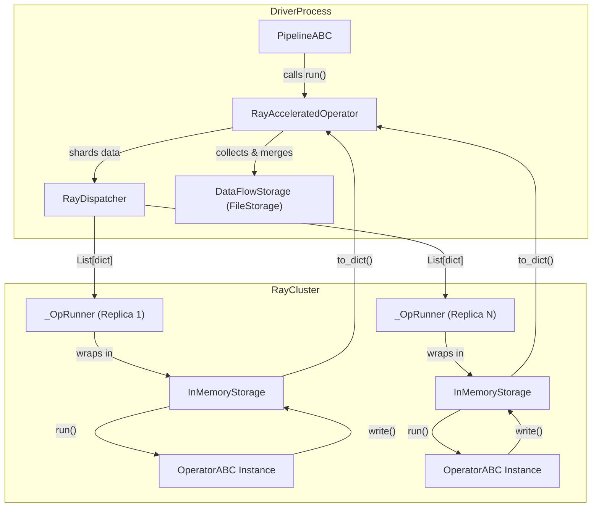

<!-- source: DeepWiki mcp.deepwiki.com · repo OpenDCAI/DataFlow · page 3.8 RayOrch Acceleration · fetched 2026-11-02 -->

# RayOrch Acceleration

<details>
<summary>Relevant source files</summary>

The following files were used as context for generating this wiki page:

- [dataflow/rayorch/__init__.py](dataflow/rayorch/__init__.py)
- [dataflow/rayorch/_test_ops.py](dataflow/rayorch/_test_ops.py)
- [dataflow/rayorch/accelerated_op.py](dataflow/rayorch/accelerated_op.py)
- [dataflow/rayorch/memory_storage.py](dataflow/rayorch/memory_storage.py)
- [test/rayorch/.gitignore](test/rayorch/.gitignore)
- [test/rayorch/README-zh.md](test/rayorch/README-zh.md)
- [test/rayorch/README.md](test/rayorch/README.md)
- [test/rayorch/test_accelerated_op.py](test/rayorch/test_accelerated_op.py)
- [test/rayorch/test_pipeline_compile.py](test/rayorch/test_pipeline_compile.py)
- [test/rayorch/test_real_operators.py](test/rayorch/test_real_operators.py)

</details>


RayOrch acceleration provides transparent data-parallel execution for row-independent (map-style) operators in the DataFlow framework. By wrapping existing operators with `RayAcceleratedOperator`, developers can distribute inference and heavy computation across multiple Ray actors, utilizing fractional GPU allocations without modifying the original operator logic or pipeline storage interfaces.

Sources: [dataflow/rayorch/accelerated_op.py:56-70](), [test/rayorch/README.md:1-7]()

## 1. Core Architecture

The RayOrch integration consists of a wrapper that manages the lifecycle of Ray actors and a specialized in-memory storage class for worker-side data handling.

### RayAcceleratedOperator
`RayAcceleratedOperator` acts as a drop-in replacement for any class inheriting from `OperatorABC` [dataflow/rayorch/accelerated_op.py:56-70](). From the perspective of a `PipelineABC`, it behaves like a standard sequential operator, but internally it shards data across multiple worker replicas [dataflow/rayorch/accelerated_op.py:60-63]().

### Actor-Side Execution (_OpRunner)
The `_OpRunner` class serves as the worker-side actor [dataflow/rayorch/accelerated_op.py:36-42](). Each replica maintains its own instance of the wrapped operator [dataflow/rayorch/accelerated_op.py:44-45](). When a chunk of data is received, the runner:
1. Converts the record list into a `pandas.DataFrame` [dataflow/rayorch/accelerated_op.py:50]().
2. Wraps the chunk in an `InMemoryStorage` instance [dataflow/rayorch/accelerated_op.py:51]().
3. Executes the inner operator's `run` method [dataflow/rayorch/accelerated_op.py:52]().
4. Returns the processed records to the driver [dataflow/rayorch/accelerated_op.py:53]().

### Memory Storage (InMemoryStorage)
`InMemoryStorage` is a lightweight implementation of `DataFlowStorage` designed specifically for use within Ray actors [dataflow/rayorch/memory_storage.py:10-26](). It avoids filesystem I/O by mutating a single `DataFrame` in-place, allowing replicas to process chunks independently of the main pipeline's `FileStorage` [dataflow/rayorch/memory_storage.py:24-26]().

### System Architecture Diagram

Title: RayOrch Data Flow and Component Mapping

Sources: [dataflow/rayorch/accelerated_op.py:36-54](), [dataflow/rayorch/accelerated_op.py:56-82](), [dataflow/rayorch/memory_storage.py:10-26]()

## 2. Key Implementation Details

### Lazy Initialization
Actors are created **lazily** during the first call to `run()` [dataflow/rayorch/accelerated_op.py:64-65](). This ensures that heavy model loading (e.g., loading a 7B LLM into GPU memory) does not occur during the `PipelineABC.compile()` phase [dataflow/rayorch/accelerated_op.py:142-159]().

### Signature Propagation
To maintain compatibility with `PipelineABC.compile()` and the `AutoOP` wrapping mechanism, `RayAcceleratedOperator` dynamically installs the inner operator's named parameters onto its own `run` method [dataflow/rayorch/accelerated_op.py:162-178](). This prevents positional-overflow arguments from being incorrectly serialized into a generic `*args` bucket during the symbolic forward pass [dataflow/rayorch/accelerated_op.py:173-178]().

### Resource Management
The wrapper supports fractional GPU allocation through `num_gpus_per_replica` [dataflow/rayorch/accelerated_op.py:80-82](). For example, setting `num_gpus_per_replica=0.25` allows four actors to share a single physical GPU [dataflow/rayorch/accelerated_op.py:81-82]().

### Entity Association Table
| Code Entity | System Role | File Reference |
|:---|:---|:---|
| `RayAcceleratedOperator` | Driver-side proxy for parallel execution | [dataflow/rayorch/accelerated_op.py:56]() |
| `_OpRunner` | Actor-side worker managing the operator instance | [dataflow/rayorch/accelerated_op.py:36]() |
| `InMemoryStorage` | Internal storage for actor-local data chunks | [dataflow/rayorch/memory_storage.py:10]() |
| `op_cls_init()` | Configures inner operator `__init__` parameters | [dataflow/rayorch/accelerated_op.py:128]() |
| `shutdown()` | Explicitly releases Ray actor and GPU resources | [dataflow/rayorch/accelerated_op.py:204]() |

Sources: [dataflow/rayorch/accelerated_op.py:56-140](), [dataflow/rayorch/accelerated_op.py:162-191](), [dataflow/rayorch/memory_storage.py:10-26]()

## 3. Usage and Lifecycle

### Basic Implementation
To parallelize an operator, wrap it during pipeline initialization and provide the desired replica count and GPU resources.

```python
from dataflow.rayorch import RayAcceleratedOperator
from dataflow.operators.text_pt.eval import FineWebEduSampleEvaluator

# 1. Wrap and initialize the operator
scorer = RayAcceleratedOperator(
    FineWebEduSampleEvaluator,
    replicas=4,
    num_gpus_per_replica=0.25
).op_cls_init(device="cuda")

# 2. Execute as a normal operator
scorer.run(storage, input_key="text", output_key="edu_score")
```
Sources: [dataflow/rayorch/__init__.py:5-12](), [dataflow/rayorch/accelerated_op.py:90-99]()

### Shutdown Requirements
Manual resource management is critical when multiple accelerated operators are used in a sequence.
*   **Automatic:** When using `PipelineABC.compile()`, the `_compiled_forward` method automatically calls `shutdown()` after each stage completes [test/rayorch/README.md:52]().
*   **Manual:** If running operators outside of a compiled pipeline, `shutdown()` must be called to release GPU reservations. Failure to do so may cause subsequent stages to hang indefinitely while waiting for resources [test/rayorch/README.md:48-50]().

### Performance Characteristics
Benchmark results on A800 GPUs demonstrate that while scheduling overhead exists, significant speedups are achieved as data volume increases:
*   **Superfiltering (GPT-2):** ~6.1x speedup with 8 GPUs for 4096 rows [test/rayorch/README.md:134]().
*   **Scaling:** Heavier models (e.g., Llama-based Deita 7B) show more linear scaling because computation time dominates Ray's serialization overhead [test/rayorch/README.md:138-139]().

Sources: [test/rayorch/README.md:44-52](), [test/rayorch/README.md:125-139]()

---

