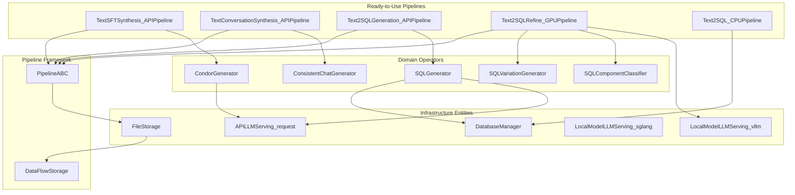
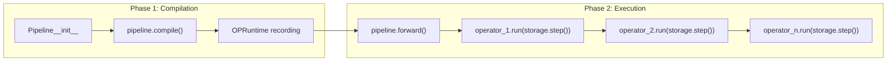

<!-- source: DeepWiki mcp.deepwiki.com · repo OpenDCAI/DataFlow · page 5 Ready-to-Use Pipelines · fetched 2026-11-02 -->

# Ready-to-Use Pipelines

Relevant source files

The following files were used as context for generating this wiki page:

- [dataflow/cli_funcs/cli_init.py](dataflow/cli_funcs/cli_init.py)
- [dataflow/cli_funcs/copy_funcs.py](dataflow/cli_funcs/copy_funcs.py)
- [dataflow/cli_funcs/paths.py](dataflow/cli_funcs/paths.py)
- [dataflow/example/GeneralTextPipeline/math_100.jsonl](dataflow/example/GeneralTextPipeline/math_100.jsonl)
- [dataflow/example/GeneralTextPipeline/translation.jsonl](dataflow/example/GeneralTextPipeline/translation.jsonl)
- [dataflow/statics/pipelines/api_pipelines/README.md](dataflow/statics/pipelines/api_pipelines/README.md)
- [dataflow/statics/pipelines/core_text/prompted_eval.py](dataflow/statics/pipelines/core_text/prompted_eval.py)
- [dataflow/statics/pipelines/core_text/prompted_filter.py](dataflow/statics/pipelines/core_text/prompted_filter.py)
- [dataflow/statics/pipelines/core_text/prompted_refine.py](dataflow/statics/pipelines/core_text/prompted_refine.py)

DataFlow provides a comprehensive suite of pre-built pipeline families that compose operators into complete data preparation workflows for common LLM training tasks. These pipelines handle specific data transformation scenarios, from mining QA pairs from raw text to extracting visual questions from PDFs and generating complex reasoning datasets.

**Purpose**: This page provides a high-level overview of the pipeline domains available, their input/output characteristics, and common architectural patterns. For detailed implementation guides of individual pipelines, see the child pages listed below.

**Related Pages**: For information about the pipeline execution system, see [Pipeline System](#3.2). For pipeline compilation mechanics, see [Compilation Phase](#3.2.1). For creating custom pipelines, see [Creating Custom Pipelines](#10.5).

---

## Pipeline Categories

DataFlow pipelines are organized by their primary data transformation objective. Each pipeline type has multiple implementation variants optimized for different serving backends (API, GPU, CPU).

| Pipeline Domain | Key Components | Input Format | Output Format | Primary Use Case |
|:---|:---|:---|:---|:---|
| **Text Pipeline** | `CondorGenerator`, `AlpagasusFilter` | `.jsonl` (text), `.txt` | `.jsonl` (SFT/Conv) | SFT/RL training data synthesis |
| **Reasoning Pipeline** | `ReasoningQuestionGenerator`, `ReasoningAnswerGenerator` | `.jsonl` (seed QA) | `.jsonl` (CoT, scores) | Math/Logic dataset enhancement |
| **Text2SQL Pipeline** | `SQLGenerator`, `SQLVariationGenerator` | `.db` (SQLite/MySQL) | `.jsonl` (SQL, CoT) | Text-to-SQL model training |
| **Knowledge Base** | `KBCChunkGenerator`, `KBCTextCleaner` | `.pdf`, `.docx`, `.url` | `.jsonl` (cleaned text) | RAG knowledge base construction |
| **Agentic RAG** | `MultiHopQAGenerator` | `.jsonl` (QA pairs) | `.jsonl` (multihop QA) | Agentic RAG system training |
| **PDF VQA** | `MinerU`, `QA_Merger` | `.pdf` files | `.jsonl` (Image+QA) | Multimodal VQA training |
| **Code Pipeline** | `CodeInstructionToCodeGenerator` | Seed code/instructions | `.jsonl` (verified code) | Code generation training |
| **Function Call** | `ScenarioExtractGenerator` | API docs/scenarios | `.jsonl` (multi-turn) | Tool-use/Agent training |

Sources: [dataflow/statics/pipelines/api_pipelines/text2sql_pipeline_gen.py:6-21](), [dataflow/statics/pipelines/api_pipelines/text_sft_synthesis_pipeline.py:2-7](), [dataflow/statics/pipelines/api_pipelines/text_conversation_synthesis_pipeline.py:1-4]()

---

## Architecture Overview

**Title**: "PipelineClassHierarchyAndComponentIntegration"

All pipelines follow a common execution pattern with automatic operator interception and storage management. They are typically instantiated with specific `LLMServing` backends like `APILLMServing_request` or `LocalModelLLMServing_vllm`.

Sources: [dataflow/statics/pipelines/api_pipelines/text2sql_pipeline_gen.py:68-178](), [dataflow/statics/pipelines/api_pipelines/text_sft_synthesis_pipeline.py:9-43](), [dataflow/statics/pipelines/cpu_pipelines/text2sql_pipeline.py:53-117]()

**Key Code Components**:

- **`PipelineABC`**: The base abstraction defining the compile-execute pattern.
- **`FileStorage`**: Manages step-based caching, creating files like `dataflow_cache_step_N.jsonl` [dataflow/statics/pipelines/api_pipelines/text_sft_synthesis_pipeline.py:11-16]().
- **`DatabaseManager`**: Orchestrates database connections for Text2SQL pipelines, supporting `sqlite` and `mysql` [dataflow/statics/pipelines/api_pipelines/text2sql_pipeline_gen.py:120-125]().
- **`Text2SQLGeneration_APIPipeline`**: A specialized pipeline for SQL synthesis using API backends [dataflow/statics/pipelines/api_pipelines/text2sql_pipeline_gen.py:68-97]().
- **`TextSFTSynthesis_APIPipeline`**: A specialized pipeline for SFT data synthesis using `CondorGenerator` [dataflow/statics/pipelines/api_pipelines/text_sft_synthesis_pipeline.py:9-26]().

Sources: [dataflow/statics/pipelines/api_pipelines/text2sql_pipeline_gen.py:68-178](), [dataflow/statics/pipelines/api_pipelines/text_sft_synthesis_pipeline.py:9-43](), [dataflow/statics/pipelines/cpu_pipelines/text2sql_pipeline.py:53-117]()

---

## Pipeline Execution Lifecycle

**Title**: "TwoPhaseExecutionModelWithStepBasedCaching"

Pipelines separate logic definition (Compilation) from data processing (Execution), enabling automatic optimization and resumption.

Sources: [dataflow/statics/pipelines/api_pipelines/text_sft_synthesis_pipeline.py:28-42](), [dataflow/statics/pipelines/api_pipelines/text2sql_pipeline_gen.py:180-210]()

**Resume Support**: Pipelines support resumption via the `storage.step()` mechanism. When a pipeline is executed, each operator's output is saved to a unique step file (e.g., `dataflow_cache_step_1.jsonl`). If execution is interrupted, the pipeline can skip completed steps by detecting existing cache files [dataflow/statics/pipelines/api_pipelines/text2sql_pipeline_gen.py:187-188]().

Sources: [dataflow/statics/pipelines/api_pipelines/text_sft_synthesis_pipeline.py:28-42](), [dataflow/statics/pipelines/api_pipelines/text2sql_pipeline_gen.py:180-210]()

---

## Ready-to-Use Pipeline Domains

For detailed documentation on each pipeline type, refer to the following child pages:

### [Text Pipeline](#5.1)
Focuses on mining high-quality SFT and RL training data from raw text. It includes variants for single-turn synthesis (`TextSFTSynthesis_APIPipeline`) using `CondorGenerator` and `CondorRefiner`, and multi-turn conversation generation (`TextConversationSynthesis_APIPipeline`) using `ConsistentChatGenerator`. For details, see [Text Pipeline](#5.1).

Sources: [dataflow/statics/pipelines/api_pipelines/text_sft_synthesis_pipeline.py:9-43](), [dataflow/statics/pipelines/api_pipelines/text_conversation_synthesis_pipeline.py:6-25]()

### [Reasoning Pipeline](#5.2)
Designed for generating mathematical and logical reasoning problems. It uses Chain-of-Thought (CoT) generation and includes rigorous quality filtering. For details, see [Reasoning Pipeline](#5.2).

Sources: [dataflow/statics/pipelines/api_pipelines/text2sql_pipeline_gen.py:6-21]()

### [Text2SQL Pipeline](#5.3)
A complete workflow for Text-to-SQL tasks, covering database schema extraction, SQL generation, and refinement. Supports API-based (`Text2SQLGeneration_APIPipeline`), GPU-based (`Text2SQLGeneration_GPUPipeline`), and CPU-based execution (`Text2SQL_CPUPipeline`). For details, see [Text2SQL Pipeline](#5.3).

Sources: [dataflow/statics/pipelines/api_pipelines/text2sql_pipeline_gen.py:68-178](), [dataflow/statics/pipelines/gpu_pipelines/text2sql_pipeline_gen.py:59-179](), [dataflow/statics/pipelines/cpu_pipelines/text2sql_pipeline.py:53-117]()

### [Knowledge Base Cleaning Pipeline](#5.4)
Converts unstructured documents (PDFs, URLs) into cleaned, structured text and generates multi-hop QA pairs. Variants support API, vLLM, and SGLang backends. For details, see [Knowledge Base Cleaning Pipeline](#5.4).

Sources: [dataflow/statics/pipelines/api_pipelines/text2sql_pipeline_gen.py:6-21]()

### [Agentic RAG Pipeline](#5.5)
Identifies and generates QA pairs that specifically require external knowledge or multi-step tool usage, targeting the training of Agentic RAG models. For details, see [Agentic RAG Pipeline](#5.5).

Sources: [dataflow/statics/pipelines/api_pipelines/text2sql_pipeline_gen.py:6-21]()

### [PDF VQA Extraction Pipeline](#5.6)
An optimized pipeline for extracting visual question-answering pairs from PDF documents. It integrates layout analysis and LLM-based extraction. For details, see [PDF VQA Extraction Pipeline](#5.6).

Sources: [dataflow/statics/pipelines/api_pipelines/text2sql_pipeline_gen.py:6-21]()

### [Code Pipeline](#5.7)
Generates code datasets using instruction enhancement and verifies them through sandbox execution and quality evaluation operators. For details, see [Code Pipeline](#5.7).

Sources: [dataflow/statics/pipelines/api_pipelines/text2sql_pipeline_gen.py:6-21]()

### [Function Call Pipeline](#5.8)
Generates multi-turn function-calling conversations. It uses `ScenarioExtractGenerator` to identify potential tool-use cases and `FunctionGenerator` to synthesize API definitions. For details, see [Function Call Pipeline](#5.8).

Sources: [dataflow/statics/pipelines/api_pipelines/text2sql_pipeline_gen.py:6-21]()

### [Specialized Domain Pipelines](#5.9)
Includes pipelines for niche domains such as Chemistry (SMILES extraction), Speech Transcription, and the RARE retrieval-augmented reasoning workflow. For details, see [Specialized Domain Pipelines](#5.9).

Sources: [dataflow/statics/pipelines/api_pipelines/text2sql_pipeline_gen.py:6-21](), [dataflow/statics/pipelines/api_pipelines/text_sft_synthesis_pipeline.py:2-7](), [dataflow/statics/pipelines/gpu_pipelines/text2sql_pipeline_refine.py:6-26]()

---

