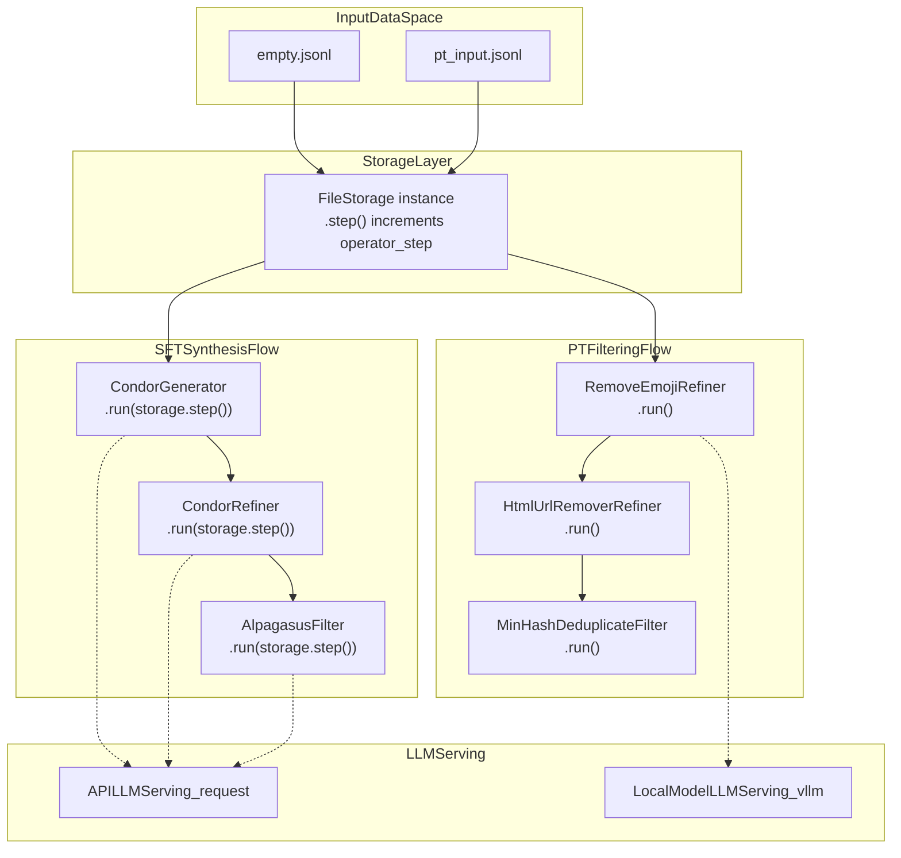
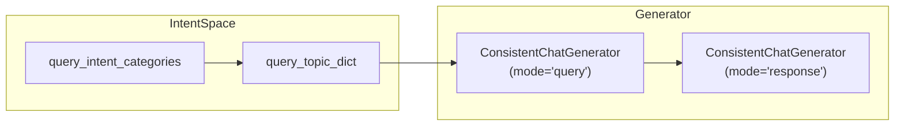

<!-- source: DeepWiki mcp.deepwiki.com · repo OpenDCAI/DataFlow · page 5.1 Text Pipeline · fetched 2026-11-02 -->

# Text Pipeline

<details>
<summary>Relevant source files</summary>

The following files were used as context for generating this wiki page:

- [dataflow/example/GeneralTextPipeline/empty.jsonl](dataflow/example/GeneralTextPipeline/empty.jsonl)
- [dataflow/operators/conversations/generate/consistent_chat_generator.py](dataflow/operators/conversations/generate/consistent_chat_generator.py)
- [dataflow/operators/text_sft/filter/superfiltering_filter.py](dataflow/operators/text_sft/filter/superfiltering_filter.py)
- [dataflow/operators/text_sft/generate/condor_generator.py](dataflow/operators/text_sft/generate/condor_generator.py)
- [dataflow/operators/text_sft/refine/condor_refiner.py](dataflow/operators/text_sft/refine/condor_refiner.py)
- [dataflow/prompts/general_text.py](dataflow/prompts/general_text.py)
- [dataflow/statics/pipelines/api_pipelines/text_conversation_synthesis_pipeline.py](dataflow/statics/pipelines/api_pipelines/text_conversation_synthesis_pipeline.py)
- [dataflow/statics/pipelines/api_pipelines/text_sft_synthesis_pipeline.py](dataflow/statics/pipelines/api_pipelines/text_sft_synthesis_pipeline.py)
- [dataflow/statics/pipelines/cpu_pipelines/text_pt_filter.py](dataflow/statics/pipelines/cpu_pipelines/text_pt_filter.py)
- [dataflow/statics/pipelines/cpu_pipelines/text_sft_filter.py](dataflow/statics/pipelines/cpu_pipelines/text_sft_filter.py)
- [dataflow/statics/pipelines/gpu_pipelines/text_pt_filter.py](dataflow/statics/pipelines/gpu_pipelines/text_pt_filter.py)
- [dataflow/statics/pipelines/gpu_pipelines/text_pt_synthetic.py](dataflow/statics/pipelines/gpu_pipelines/text_pt_synthetic.py)
- [dataflow/statics/pipelines/gpu_pipelines/text_sft_filter.py](dataflow/statics/pipelines/gpu_pipelines/text_sft_filter.py)
- [dataflow/statics/pipelines/gpu_pipelines/text_sft_synthetic.py](dataflow/statics/pipelines/gpu_pipelines/text_sft_synthetic.py)
- [dataflow/statics/playground/playground/text_conversation_synthesis_pipeline.py](dataflow/statics/playground/playground/text_conversation_synthesis_pipeline.py)

</details>


## Purpose and Scope

The Text Pipeline mines question-answer pairs and instruction-response data from plain text for supervised fine-tuning (SFT) and reinforcement learning (RL) training. It processes noisy, unstructured text and applies a series of operators to synthesize, refine, and filter high-quality training data.

This page explains the core Text Pipeline architecture, including three primary workflows:

1.  **Pre-training (PT) Filtering**: Uses statistical and heuristic filters (e.g., `WordNumberFilter`, `MinHashDeduplicateFilter`, `LanguageFilter`) to select coherent text from raw corpora. [dataflow/statics/pipelines/cpu_pipelines/text_pt_filter.py:32-156]()
2.  **SFT Data Synthesis**: Uses `CondorGenerator` → `CondorRefiner` → `AlpagasusFilter` to create instruction-response pairs from scratch using predefined knowledge tags. [dataflow/statics/pipelines/api_pipelines/text_sft_synthesis_pipeline.py:9-43]()
3.  **Conversation Synthesis**: Uses `ConsistentChatGenerator` to generate multi-turn dialogues based on intent categories and topics to ensure thematic consistency. [dataflow/statics/pipelines/api_pipelines/text_conversation_synthesis_pipeline.py:6-25]()

This is a **PARENT page**. For detailed coverage of specific sub-pipelines and filtering implementations, refer to the child pages:
*   [SFT Data Synthesis](#5.1.1) — Detail `TextSFTSynthesis_APIPipeline` with `CondorGenerator`, `CondorRefiner`, `SFTGeneratorFromSeed`, and `AlpagasusFilter` for quality control.
*   [Conversation Synthesis](#5.1.2) — Explain `TextConversationSynthesis_APIPipeline` with `ConsistentChatGenerator` for multi-turn dialogue creation using intent categories and topics.
*   [Text Quality Filtering](#5.1.3) — Detail `PerplexityFilter`, `AlpagasusFilter`, `SuperfilteringFilter`, `DeitaQualityFilter`, ngram and rule-based filters for SFT and PT data.

Sources: [dataflow/statics/pipelines/api_pipelines/text_sft_synthesis_pipeline.py:9-43](), [dataflow/statics/pipelines/api_pipelines/text_conversation_synthesis_pipeline.py:6-25](), [dataflow/statics/pipelines/gpu_pipelines/text_sft_synthetic.py:38-104]()

---

## Overview

The Text Pipeline implements workflows that transform plain text or empty seeds into structured training data. It supports both API-based and local GPU-based (vLLM/SGLang) execution variants.

| Workflow | Implementation | Core Operators | Input | Output |
| :--- | :--- | :--- | :--- | :--- |
| **SFT Synthesis** | `TextSFTSynthesis_APIPipeline` | `CondorGenerator`, `CondorRefiner` | `empty.jsonl` | Instruction-Response pairs |
| **Conversation** | `TextConversationSynthesis_APIPipeline` | `ConsistentChatGenerator` | `empty.jsonl` | Multi-turn dialogues |
| **GPU SFT Filter** | `SFTTextFilter_GPUPipeline` | `SuperfilteringFilter`, `DeitaQualityFilter` | SFT JSONL | High-quality SFT data |
| **PT Filtering** | `PTTextFilter_CPUPipeline` | `WordNumberFilter`, `MinHashDeduplicateFilter` | Raw JSONL | Cleaned pre-train text |
| **PT Synthetic** | `PTTextSynthetic_GPUPipeline` | `Phi4QAGenerator`, `QuratingFilter` | Raw JSONL | SFT pairs from PT content |

### Key Implementation Files
*   **Pipeline Classes**: [dataflow/statics/pipelines/api_pipelines/text_sft_synthesis_pipeline.py:9-43](), [dataflow/statics/pipelines/gpu_pipelines/text_sft_synthetic.py:38-104](), [dataflow/statics/pipelines/gpu_pipelines/text_pt_synthetic.py:37-94]()
*   **SFT Operators**: `dataflow/operators/text_sft/`
*   **PT Operators**: `dataflow/operators/text_pt/`
*   **Conversation Operators**: `dataflow/operators/conversations/`
*   **Prompts**: [dataflow/prompts/general_text.py:1-171]()

Sources: [dataflow/statics/pipelines/api_pipelines/text_sft_synthesis_pipeline.py:1-46](), [dataflow/statics/pipelines/gpu_pipelines/text_sft_filter.py:11-58](), [dataflow/statics/pipelines/cpu_pipelines/text_pt_filter.py:32-156](), [dataflow/statics/pipelines/gpu_pipelines/text_pt_synthetic.py:37-94]()

---

## Architecture

### Text Pipeline Execution Flow

The following diagram bridges natural language processing intents with the specific code entities used in the execution flow.

Title: "Text Pipeline Execution Flow"


Sources: [dataflow/statics/pipelines/api_pipelines/text_sft_synthesis_pipeline.py:9-43](), [dataflow/statics/pipelines/cpu_pipelines/text_pt_filter.py:32-156](), [dataflow/statics/pipelines/gpu_pipelines/text_sft_synthetic.py:48-60]()

---

## Core Components and Child Pages

### 5.1.1 SFT Data Synthesis
The SFT Data Synthesis sub-pipeline creates instruction-following data from scratch or seeds. It relies on operators such as `CondorGenerator` for structured multi-difficulty question generation, `CondorRefiner` for critique-based answer improvement, and `AlpagasusFilter` for quality thresholding [dataflow/statics/pipelines/api_pipelines/text_sft_synthesis_pipeline.py:9-43](), [dataflow/operators/text_sft/generate/condor_generator.py:18-158](), [dataflow/operators/text_sft/refine/condor_refiner.py:18-87](). 

For full architectural details, code examples, and prompt configurations, see [SFT Data Synthesis](#5.1.1).

Sources: [dataflow/statics/pipelines/api_pipelines/text_sft_synthesis_pipeline.py:9-43](), [dataflow/operators/text_sft/generate/condor_generator.py:18-158]()

### 5.1.2 Conversation Synthesis
Conversation synthesis handles multi-turn dialogue generation. Using `ConsistentChatGenerator`, the pipeline maps user intents and topic hierarchies into coherent conversational turns [dataflow/statics/pipelines/api_pipelines/text_conversation_synthesis_pipeline.py:6-25]().

Title: "Conversation Synthesis Flow"


For detailed multi-turn generation parameters and execution flows, see [Conversation Synthesis](#5.1.2).

Sources: [dataflow/statics/pipelines/api_pipelines/text_conversation_synthesis_pipeline.py:1-25](), [dataflow/operators/conversations/generate/consistent_chat_generator.py:1-20]()

### 5.1.3 Text Quality Filtering
Text quality filtering encompasses both rule-based heuristic filters (e.g., `WordNumberFilter`, `MinHashDeduplicateFilter`) and model-based scoring filters (`SuperfilteringFilter`, `DeitaQualityFilter`, `AlpagasusFilter`) [dataflow/statics/pipelines/gpu_pipelines/text_sft_synthetic.py:38-104](), [dataflow/statics/pipelines/gpu_pipelines/text_sft_filter.py:11-58]().

For comprehensive documentation on filter thresholds, model scoring backends, and pipeline integration, see [Text Quality Filtering](#5.1.3).

Sources: [dataflow/statics/pipelines/gpu_pipelines/text_sft_synthetic.py:38-104](), [dataflow/statics/pipelines/gpu_pipelines/text_sft_filter.py:11-58]()

---

## Usage Example: SFT from Scratch

Below is an outline of an SFT synthesis workflow combining `CondorGenerator`, `CondorRefiner`, and `AlpagasusFilter`:

```python
class SFT_From_Scratch():
    def __init__(self):
        self.storage = FileStorage(first_entry_file_name="empty.jsonl")
        self.llm_serving = APILLMServing_request(api_url="...", model_name="gpt-4o")
        
        self.instruction_generator = CondorGenerator(
            llm_serving=self.llm_serving, 
            prompt_template=CondorQuestionPrompt()
        )
        self.refiner = CondorRefiner(
            llm_serving=self.llm_serving, 
            prompt_template=CondorRefinePrompt()
        )
        self.filter = AlpagasusFilter(
            min_score=3, 
            llm_serving=self.llm_serving
        )

    def forward(self):
        self.instruction_generator.run(storage=self.storage.step())
        self.refiner.run(storage=self.storage.step(), input_instruction_key='instruction', input_output_key='output')
        self.filter.run(storage=self.storage.step(), input_instruction_key='instruction', input_output_key='output')
```

Sources: [dataflow/statics/pipelines/api_pipelines/text_sft_synthesis_pipeline.py:9-43](), [dataflow/operators/text_sft/generate/condor_generator.py:18-158](), [dataflow/operators/text_sft/refine/condor_refiner.py:18-87]()

---

