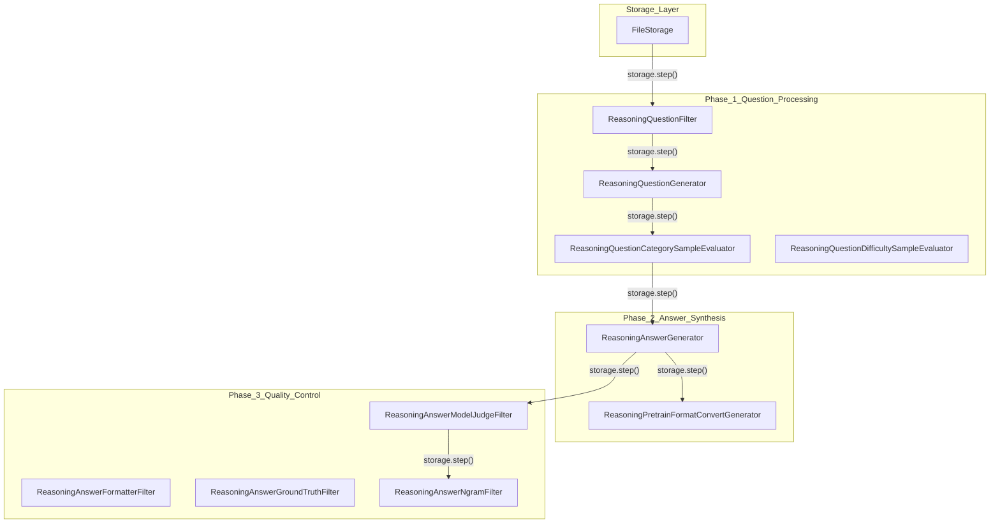
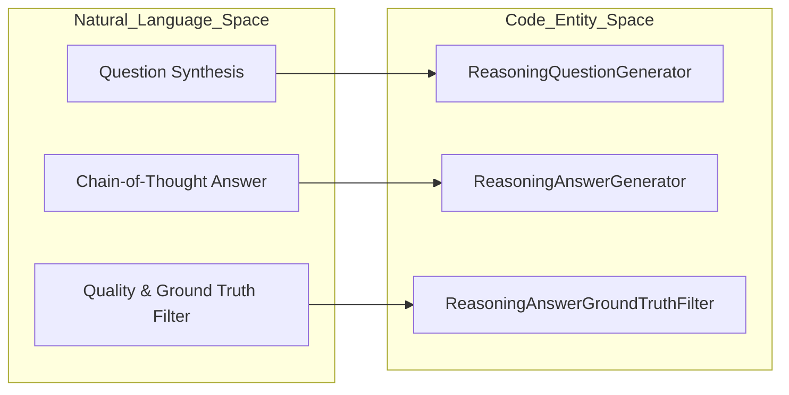
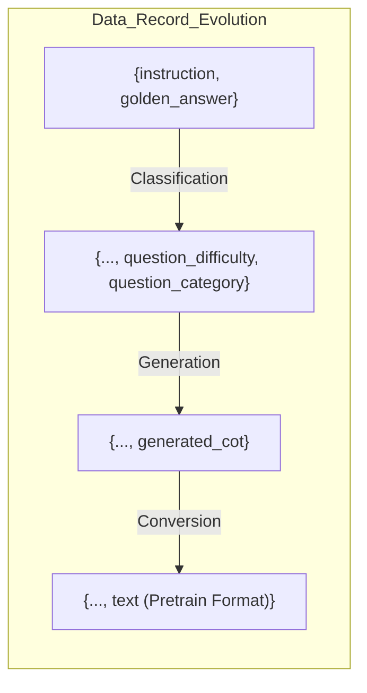

<!-- source: DeepWiki mcp.deepwiki.com · repo OpenDCAI/DataFlow · page 5.2 Reasoning Pipeline · fetched 2026-11-02 -->

# Reasoning Pipeline

Relevant source files

The following files were used as context for generating this wiki page:

- [dataflow/example/ReasoningPipeline/pipeline_math_short.json](dataflow/example/ReasoningPipeline/pipeline_math_short.json)
- [dataflow/statics/pipelines/api_pipelines/reasoning_diy_pipeline.py](dataflow/statics/pipelines/api_pipelines/reasoning_diy_pipeline.py)
- [dataflow/statics/pipelines/api_pipelines/reasoning_general_pipeline.py](dataflow/statics/pipelines/api_pipelines/reasoning_general_pipeline.py)
- [dataflow/statics/pipelines/api_pipelines/reasoning_math_pipeline.py](dataflow/statics/pipelines/api_pipelines/reasoning_math_pipeline.py)
- [dataflow/statics/pipelines/api_pipelines/reasoning_pretrain_pipeline.py](dataflow/statics/pipelines/api_pipelines/reasoning_pretrain_pipeline.py)
- [dataflow/statics/pipelines/cpu_pipelines/reasoning_pipeline.py](dataflow/statics/pipelines/cpu_pipelines/reasoning_pipeline.py)
- [dataflow/statics/pipelines/gpu_pipelines/reasoning_math_pipeline.py](dataflow/statics/pipelines/gpu_pipelines/reasoning_math_pipeline.py)
- [dataflow/statics/playground/playground/reasoning_general_pipeline.py](dataflow/statics/playground/playground/reasoning_general_pipeline.py)
- [test/cpu_only/test_remote_load.py](test/cpu_only/test_remote_load.py)

## Overview

The Reasoning Pipeline is a specialized pipeline family for generating training datasets focused on mathematical and logical problem-solving. It supports multiple reasoning domains through specialized prompt templates and operators:

- **Mathematical Reasoning**: Calculus, algebra, geometry, combinatorics, and number theory [dataflow/statics/pipelines/api_pipelines/reasoning_math_pipeline.py:16-20]().
- **General Reasoning**: Algorithm analysis, code debugging, logic puzzles, and proof construction [dataflow/statics/pipelines/api_pipelines/reasoning_general_pipeline.py:9-13]().
- **DIY Reasoning**: Customizable reasoning tasks (e.g., medical or sports-specific) using user-defined prompts [dataflow/statics/pipelines/api_pipelines/reasoning_diy_pipeline.py:10-14]().
- **Pretrain Reasoning**: Pipelines optimized for generating raw text data in pretraining formats from SFT-style reasoning pairs [dataflow/statics/pipelines/api_pipelines/reasoning_pretrain_pipeline.py:67-104]().

The pipeline orchestrates three main phases: **question generation and classification** ([Question Generation and Classification](#5.2.1)), **answer generation with chain-of-thought** ([Answer Generation with CoT](#5.2.2)), and **quality filtering** ([Quality Filtering](#5.2.3)).

Sources: [dataflow/statics/pipelines/api_pipelines/reasoning_math_pipeline.py:1-20](), [dataflow/statics/pipelines/api_pipelines/reasoning_general_pipeline.py:1-14](), [dataflow/statics/pipelines/api_pipelines/reasoning_diy_pipeline.py:1-14]()

---

## Architecture and Components

The Reasoning Pipeline follows a modular architecture where specialized reasoning operators are composed to form complex data synthesis workflows.

### Pipeline Execution Flow

**Diagram: Standard reasoning pipeline flow across generation and filtering phases.**

Sources: [dataflow/statics/pipelines/api_pipelines/reasoning_math_pipeline.py:54-96](), [dataflow/statics/pipelines/api_pipelines/reasoning_general_pipeline.py:33-58](), [dataflow/statics/pipelines/api_pipelines/reasoning_pretrain_pipeline.py:72-104]()

### Mapping Natural Language Space to Code Entity Space

The pipeline bridges high-level reasoning tasks to specific code entities in the `dataflow.operators.reasoning` and `dataflow.prompts.reasoning` modules.

**Diagram: Mapping reasoning tasks to operator classes.**

| Reasoning Task | Code Operator (Entity) | Prompt Template (Entity) |
| :--- | :--- | :--- |
| **Question Synthesis** | `ReasoningQuestionGenerator` [dataflow/statics/pipelines/api_pipelines/reasoning_math_pipeline.py:4]() | `MathQuestionSynthesisPrompt` [dataflow/prompts/reasoning/math.py:19](), `GeneralQuestionSynthesisPrompt` [dataflow/prompts/reasoning/general.py:12]() |
| **Answer Generation** | `ReasoningAnswerGenerator` [dataflow/statics/pipelines/api_pipelines/reasoning_math_pipeline.py:5]() | `MathAnswerGeneratorPrompt` [dataflow/prompts/reasoning/math.py:18](), `GeneralAnswerGeneratorPrompt` [dataflow/prompts/reasoning/general.py:11]() |
| **Content Filtering** | `ReasoningQuestionFilter` [dataflow/statics/pipelines/api_pipelines/reasoning_math_pipeline.py:9]() | `MathQuestionFilterPrompt` [dataflow/prompts/reasoning/math.py:17](), `GeneralQuestionFilterPrompt` [dataflow/prompts/reasoning/general.py:10]() |
| **N-gram Overlap** | `ReasoningAnswerNgramFilter` [dataflow/statics/pipelines/api_pipelines/reasoning_math_pipeline.py:13]() | N/A (Algorithmic) |
| **Model Judging** | `ReasoningAnswerModelJudgeFilter` [dataflow/statics/pipelines/api_pipelines/reasoning_general_pipeline.py:5]() | `AnswerJudgePrompt` [dataflow/statics/pipelines/api_pipelines/reasoning_general_pipeline.py:14]() |

Sources: [dataflow/statics/pipelines/api_pipelines/reasoning_math_pipeline.py:1-20](), [dataflow/statics/pipelines/api_pipelines/reasoning_general_pipeline.py:1-14]()

---

## Pipeline Variants

### Mathematical Reasoning Pipeline
Available in API, GPU, and CPU flavors. It focuses on math-specific validation and difficulty assessment.
- **Key Operator**: `ReasoningAnswerGroundTruthFilter` for verifying generated answers against `golden_answer` [dataflow/statics/pipelines/api_pipelines/reasoning_math_pipeline.py:90-96]().
- **Difficulty & Category**: Uses `ReasoningQuestionDifficultySampleEvaluator` and `ReasoningQuestionCategorySampleEvaluator` for fine-grained classification [dataflow/statics/pipelines/api_pipelines/reasoning_math_pipeline.py:69-74]().
- **CPU Variant**: The `Reasoning_CPUPipeline` provides a lightweight path for formatting and ground truth filtering without LLM dependencies [dataflow/statics/pipelines/cpu_pipelines/reasoning_pipeline.py:8-26]().
- **Details**: For details, see [Question Generation and Classification](#5.2.1).

Sources: [dataflow/statics/pipelines/api_pipelines/reasoning_math_pipeline.py:54-96](), [dataflow/statics/pipelines/cpu_pipelines/reasoning_pipeline.py:8-44]()

### General Reasoning Pipeline
Designed for logic and algorithmic problems where a strict ground truth may not exist.
- **Key Operator**: `ReasoningAnswerModelJudgeFilter` to evaluate the quality of the Chain-of-Thought (CoT) using a judge model [dataflow/statics/pipelines/api_pipelines/reasoning_general_pipeline.py:49-53]().
- **Details**: For details, see [Answer Generation with CoT](#5.2.2).

Sources: [dataflow/statics/pipelines/api_pipelines/reasoning_general_pipeline.py:33-58]()

### DIY Reasoning Pipeline
Allows users to inject custom logic into the reasoning pipeline by passing raw strings to DIY prompt templates.
- **Example**: `DiyQuestionFilterPrompt(DIY_PROMPT_QUESTION)` where `DIY_PROMPT_QUESTION` is a user-defined string for domain-specific filtering (e.g., medical data) [dataflow/statics/pipelines/api_pipelines/reasoning_diy_pipeline.py:20-32, 63-67]().
- **Customization**: Supports `DiyQuestionSynthesisPrompt` and `DiyAnswerGeneratorPrompt` for specialized task creation [dataflow/statics/pipelines/api_pipelines/reasoning_diy_pipeline.py:69-78]().

Sources: [dataflow/statics/pipelines/api_pipelines/reasoning_diy_pipeline.py:20-78]()

### Pretrain Reasoning Pipeline
Converts instruction-response pairs into a unified text format suitable for pretraining.
- **Key Operator**: `ReasoningPretrainFormatConvertGenerator` which maps `instruction` and `generated_cot` to a single `text` field [dataflow/statics/pipelines/api_pipelines/reasoning_pretrain_pipeline.py:67-104]().

Sources: [dataflow/statics/pipelines/api_pipelines/reasoning_pretrain_pipeline.py:67-104]()

---

## Data Model and Storage

Reasoning pipelines primarily operate on JSON/JSONL records managed via `FileStorage` [dataflow/statics/pipelines/api_pipelines/reasoning_math_pipeline.py:30-35]().

**Diagram: Evolution of data records through pipeline steps.**

Sources: [dataflow/statics/pipelines/api_pipelines/reasoning_math_pipeline.py:116-156](), [dataflow/statics/pipelines/api_pipelines/reasoning_pretrain_pipeline.py:99-104]()

---

## Integration with LLM Serving

Reasoning pipelines require an LLM backend for generation and classification. They support:
- **API Serving**: `APILLMServing_request` for OpenAI-compatible endpoints [dataflow/statics/pipelines/api_pipelines/reasoning_math_pipeline.py:38-42]().
- **Local GPU Serving**: `LocalModelLLMServing_vllm` or `LocalModelLLMServing_sglang` for high-throughput local inference [dataflow/statics/pipelines/gpu_pipelines/reasoning_math_pipeline.py:36-48]().

For detailed serving configuration, see [LLM Serving Architecture](#3.4).

Sources: [dataflow/statics/pipelines/api_pipelines/reasoning_math_pipeline.py:38-42](), [dataflow/statics/pipelines/gpu_pipelines/reasoning_math_pipeline.py:36-48]()

---

## Child Pages

- [Question Generation and Classification](#5.2.1) — Detail reasoning question generation operators, category classification, difficulty assessment, and question fusion.
- [Answer Generation with CoT](#5.2.2) — Explain answer generation with chain-of-thought, pseudo-answers, QwenMathEval extraction, and pretrain format conversion.
- [Quality Filtering](#5.2.3) — Detail question and answer filtering based on token length, ngram overlap, ground truth matching, model judging, and math verification.

---

