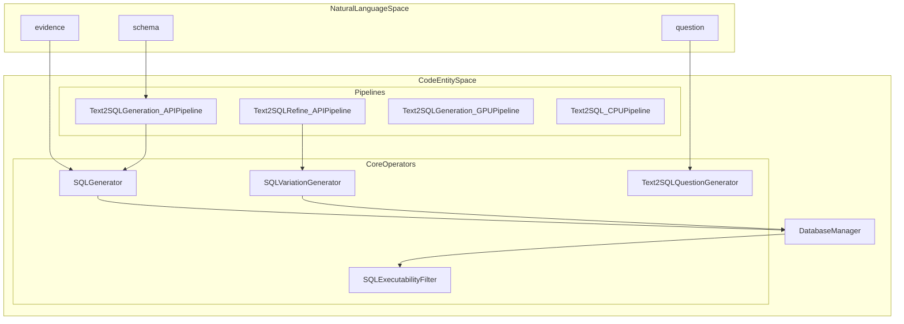
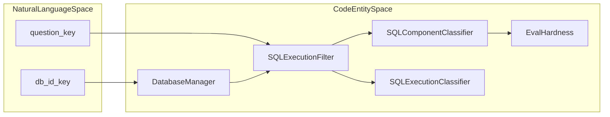

<!-- source: DeepWiki mcp.deepwiki.com · repo OpenDCAI/DataFlow · page 5.3 Text2SQL Pipeline · fetched 2026-11-02 -->

# Text2SQL Pipeline

Relevant source files

The following files were used as context for generating this wiki page:

- [dataflow/example/Text2SQLPipeline/empty.jsonl](dataflow/example/Text2SQLPipeline/empty.jsonl)
- [dataflow/operators/text2sql/eval/sql_component_classifier.py](dataflow/operators/text2sql/eval/sql_component_classifier.py)
- [dataflow/statics/pipelines/api_pipelines/text2sql_pipeline_gen.py](dataflow/statics/pipelines/api_pipelines/text2sql_pipeline_gen.py)
- [dataflow/statics/pipelines/api_pipelines/text2sql_pipeline_refine.py](dataflow/statics/pipelines/api_pipelines/text2sql_pipeline_refine.py)
- [dataflow/statics/pipelines/cpu_pipelines/text2sql_pipeline.py](dataflow/statics/pipelines/cpu_pipelines/text2sql_pipeline.py)
- [dataflow/statics/pipelines/gpu_pipelines/text2sql_pipeline_gen.py](dataflow/statics/pipelines/gpu_pipelines/text2sql_pipeline_gen.py)
- [dataflow/statics/pipelines/gpu_pipelines/text2sql_pipeline_refine.py](dataflow/statics/pipelines/gpu_pipelines/text2sql_pipeline_refine.py)

The Text2SQL pipeline system provides a comprehensive framework for generating, refining, and validating SQL training data from relational databases. This system synthesizes natural language questions from SQL queries, generates chain-of-thought (CoT) reasoning traces, classifies difficulty levels, and supports API, local GPU, and CPU execution variants.

**Scope**: This page provides a high-level overview of the Text2SQL pipeline variants, database management infrastructure, and evaluation operators. For granular details, see the child pages:
- [SQL Generation Pipeline](#5.3.1) — Detailed text-to-SQL generation, question generation, and CoT workflows.
- [SQL Refinement Pipeline](#5.3.2) — SQL variation generation and executability/consistency filtering.
- [Vector SQL (Text2VecSQL)](#5.3.3) — Vector-enhanced queries using `sqlite_vec` and `sqlite_lembed`.

---

## Architecture Overview

The Text2SQL system coordinates natural language inputs, database schema extraction, LLM serving backends, and database managers across multiple pipeline execution modes.

### Text2SQL Pipeline Architecture

Sources: [dataflow/statics/pipelines/api_pipelines/text2sql_pipeline_gen.py:68-180](), [dataflow/statics/pipelines/api_pipelines/text2sql_pipeline_refine.py:68-182](), [dataflow/statics/pipelines/cpu_pipelines/text2sql_pipeline.py:53-117]()

---

## Pipeline Variants

The DataFlow codebase implements Text2SQL pipelines across several deployment profiles:

- **Generation Pipeline**: Starts from database schemas to synthesize SQL-question pairs. For full details, see [SQL Generation Pipeline](#5.3.1). Key operators include `SQLGenerator` [dataflow/statics/pipelines/api_pipelines/text2sql_pipeline_gen.py:127-132](), `Text2SQLQuestionGenerator` [dataflow/statics/pipelines/api_pipelines/text2sql_pipeline_gen.py:138-144](), and `Text2SQLCoTGenerator` [dataflow/statics/pipelines/api_pipelines/text2sql_pipeline_gen.py:157-161]().
- **Refinement Pipeline**: Starts from existing SQL queries and generates variations to improve dataset diversity and robustness. For details, see [SQL Refinement Pipeline](#5.3.2). Key operators include `SQLVariationGenerator` [dataflow/statics/pipelines/api_pipelines/text2sql_pipeline_refine.py:131-136]() and `SQLConsistencyFilter` [dataflow/statics/pipelines/gpu_pipelines/text2sql_pipeline_refine.py:133-137]().
- **Vector SQL (Text2VecSQL)**: Enhances query execution and retrieval using vector database extensions. For details, see [Vector SQL (Text2VecSQL)](#5.3.3).
- **Execution Hardware Profiles**:
  - **API-based**: Uses `APILLMServing_request` with remote endpoints like OpenAI or DeepSeek [dataflow/statics/pipelines/api_pipelines/text2sql_pipeline_gen.py:93-97]().
  - **GPU-based**: Uses `LocalModelLLMServing_vllm` or `LocalModelLLMServing_sglang` for local accelerated inference [dataflow/statics/pipelines/gpu_pipelines/text2sql_pipeline_gen.py:84-97]().
  - **CPU-based**: Executes lightweight validation, parsing, and rule-based classification without active LLM generation using `SQLExecutionFilter` and `SQLComponentClassifier` [dataflow/statics/pipelines/cpu_pipelines/text2sql_pipeline.py:53-117]().

Sources: [dataflow/statics/pipelines/api_pipelines/text2sql_pipeline_gen.py:68-180](), [dataflow/statics/pipelines/api_pipelines/text2sql_pipeline_refine.py:68-182](), [dataflow/statics/pipelines/gpu_pipelines/text2sql_pipeline_gen.py:59-181](), [dataflow/statics/pipelines/cpu_pipelines/text2sql_pipeline.py:53-117]()

---

## Database Management System

The `DatabaseManager` class provides a unified interface for interacting with SQLite and MySQL backends, handling connection pooling, timeouts, and automated dataset downloading from HuggingFace via `download_and_extract_database` [dataflow/statics/pipelines/api_pipelines/text2sql_pipeline_gen.py:34-125]().

### Database and Execution Mapping

Sources: [dataflow/statics/pipelines/api_pipelines/text2sql_pipeline_gen.py:34-125](), [dataflow/operators/text2sql/eval/sql_component_classifier.py:42-95]()

---

## Evaluation and Classification

DataFlow includes specialized evaluators to categorize SQL query difficulty and verify correctness:

- `SQLComponentClassifier`: Uses the `EvalHardness` helper class to tokenize queries, inspect clause keywords (`select`, `from`, `where`, `group`, `order`, `limit`, `intersect`, `union`, `except`), join keywords, and aggregate operations to assign difficulty tiers (`easy`, `medium`, `hard`, `extra`) [dataflow/operators/text2sql/eval/sql_component_classifier.py:42-95]().
- `SQLExecutionClassifier`: Measures runtime success rates and execution consistency across multiple generation attempts (`num_generations=10`) to assign empirical difficulty scores [dataflow/statics/pipelines/api_pipelines/text2sql_pipeline_gen.py:172-178]().

Sources: [dataflow/operators/text2sql/eval/sql_component_classifier.py:42-190](), [dataflow/statics/pipelines/api_pipelines/text2sql_pipeline_gen.py:167-178]()

---

