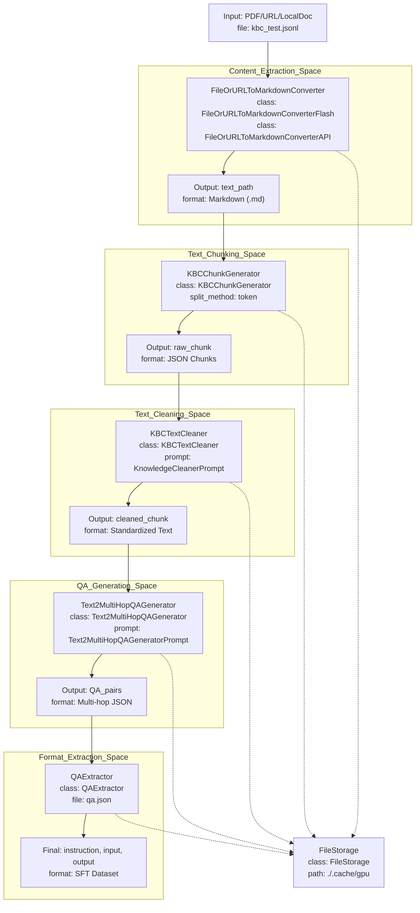
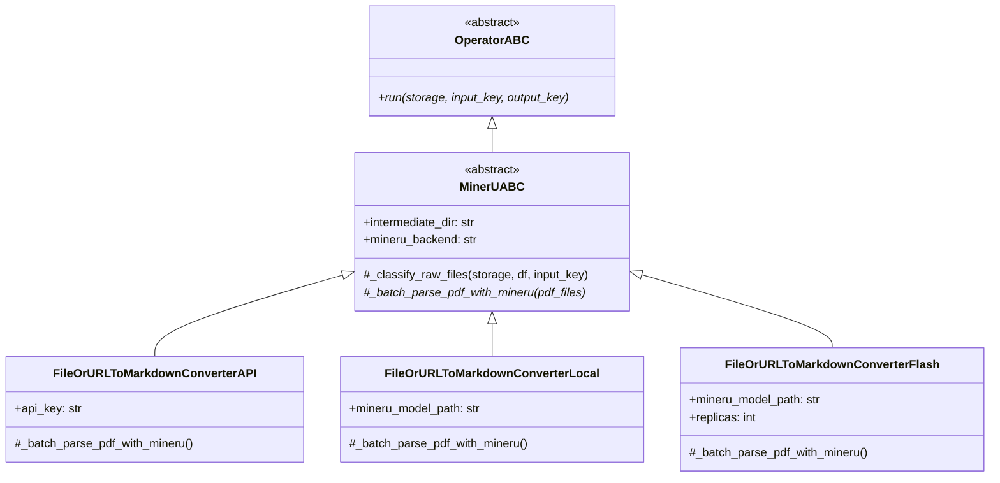

<!-- source: DeepWiki mcp.deepwiki.com · repo OpenDCAI/DataFlow · page 5.4 Knowledge Base Cleaning Pipeline · fetched 2026-11-02 -->

# Knowledge Base Cleaning Pipeline

Relevant source files

The following files were used as context for generating this wiki page:

- [dataflow/example/KBCleaningPipeline/kbc_test.jsonl](dataflow/example/KBCleaningPipeline/kbc_test.jsonl)
- [dataflow/example/KBCleaningPipeline/kbc_test_1.jsonl](dataflow/example/KBCleaningPipeline/kbc_test_1.jsonl)
- [dataflow/operators/core_text/generate/text2multihopqa_generator.py](dataflow/operators/core_text/generate/text2multihopqa_generator.py)
- [dataflow/operators/knowledge_cleaning/__init__.py](dataflow/operators/knowledge_cleaning/__init__.py)
- [dataflow/operators/knowledge_cleaning/generate/kbc_multihop_qa_generator_batch.py](dataflow/operators/knowledge_cleaning/generate/kbc_multihop_qa_generator_batch.py)
- [dataflow/operators/knowledge_cleaning/generate/kbc_text_cleaner.py](dataflow/operators/knowledge_cleaning/generate/kbc_text_cleaner.py)
- [dataflow/operators/knowledge_cleaning/generate/kbc_text_cleaner_batch.py](dataflow/operators/knowledge_cleaning/generate/kbc_text_cleaner_batch.py)
- [dataflow/operators/knowledge_cleaning/generate/mineru_operators.py](dataflow/operators/knowledge_cleaning/generate/mineru_operators.py)
- [dataflow/prompts/kbcleaning.py](dataflow/prompts/kbcleaning.py)
- [dataflow/statics/pipelines/api_pipelines/kbcleaning_pipeline.py](dataflow/statics/pipelines/api_pipelines/kbcleaning_pipeline.py)
- [dataflow/statics/pipelines/cpu_pipelines/kbcleaning_pipeline_url.py](dataflow/statics/pipelines/cpu_pipelines/kbcleaning_pipeline_url.py)
- [dataflow/statics/pipelines/gpu_pipelines/kbcleaning/kbcleaning_pipeline_sglang.py](dataflow/statics/pipelines/gpu_pipelines/kbcleaning/kbcleaning_pipeline_sglang.py)
- [dataflow/statics/pipelines/gpu_pipelines/kbcleaning/kbcleaning_pipeline_vllm.py](dataflow/statics/pipelines/gpu_pipelines/kbcleaning/kbcleaning_pipeline_vllm.py)
- [dataflow/statics/playground/playground/kbcleaning_pipeline_vllm.py](dataflow/statics/playground/playground/kbcleaning_pipeline_vllm.py)

## Purpose and Scope

The Knowledge Base Cleaning (KBC) Pipeline is a multi-stage data preparation framework designed to convert raw unstructured data—including PDFs, URLs, and local documents—into high-quality, cleaned text and multi-hop question-answer pairs `[dataflow/statics/pipelines/api_pipelines/kbcleaning_pipeline.py:1-13]()`. This pipeline prepares specialized knowledge bases for Retrieval-Augmented Generation (RAG) and fine-tuning language models `[dataflow/operators/knowledge_cleaning/generate/kbc_text_cleaner.py:90-92]()`. It manages the entire lifecycle from document parsing via `MinerUABC` `[dataflow/operators/knowledge_cleaning/generate/mineru_operators.py:57-60]()` to LLM-based refinement via `KBCTextCleaner` `[dataflow/operators/knowledge_cleaning/generate/kbc_text_cleaner.py:89-92]()` and structured QA synthesis via `Text2MultiHopQAGenerator` `[dataflow/operators/core_text/generate/text2multihopqa_generator.py:23-30]`.

This page details the KBC pipeline architecture, the specialized operators involved, and the different deployment variants (`API`, `vLLM`, and `SGLang`) `[dataflow/statics/pipelines/api_pipelines/kbcleaning_pipeline.py:1-101]`, `[dataflow/statics/pipelines/gpu_pipelines/kbcleaning/kbcleaning_pipeline_vllm.py:1-96]`, `[dataflow/statics/pipelines/gpu_pipelines/kbcleaning/kbcleaning_pipeline_sglang.py:1-93]()`.

Sources: `[dataflow/statics/pipelines/api_pipelines/kbcleaning_pipeline.py:1-13]`, `[dataflow/operators/knowledge_cleaning/generate/kbc_text_cleaner.py:90-92]`, `[dataflow/operators/core_text/generate/text2multihopqa_generator.py:23-30]`

---

## Pipeline Architecture

The KBC pipeline follows a modular design where each step is encapsulated in an operator inheriting from `OperatorABC`. The execution flow is orchestrated through a `forward()` method utilizing `storage.step()` for intermediate data persistence `[dataflow/statics/pipelines/gpu_pipelines/kbcleaning/kbcleaning_pipeline_vllm.py:12-92]()`.

### Knowledge Base Data Flow & Code Mapping

Sources: `[dataflow/statics/pipelines/gpu_pipelines/kbcleaning/kbcleaning_pipeline_vllm.py:15-92]`, `[dataflow/operators/knowledge_cleaning/generate/kbc_text_cleaner_batch.py:110-150]`

### Storage Step Chaining

The pipeline relies on `FileStorage.step()` to create isolated execution contexts, enabling resume capabilities and clear data lineage:

| Step | Input Key | Output Key | Implementation Class | File Location |
|------|-----------|------------|----------------------|---------------|
| 1 | `source` | `text_path` | `FileOrURLToMarkdownConverterFlash` | `[dataflow/statics/pipelines/gpu_pipelines/kbcleaning/kbcleaning_pipeline_vllm.py:23-31]()` |
| 2 | `text_path` | `raw_chunk` / `chunk_path` | `KBCChunkGenerator` | `[dataflow/statics/pipelines/gpu_pipelines/kbcleaning/kbcleaning_pipeline_vllm.py:33-37]()` |
| 3 | `raw_chunk` / `chunk_path` | `cleaned_chunk` | `KBCTextCleaner` | `[dataflow/statics/pipelines/gpu_pipelines/kbcleaning/kbcleaning_pipeline_vllm.py:64-67]()` |
| 4 | `cleaned_chunk` | `QA_pairs` | `Text2MultiHopQAGenerator` | `[dataflow/statics/pipelines/gpu_pipelines/kbcleaning/kbcleaning_pipeline_vllm.py:69-73]()` |
| 5 | `QA_pairs` | `instruction`, `input`, `output` | `QAExtractor` | `[dataflow/statics/pipelines/gpu_pipelines/kbcleaning/kbcleaning_pipeline_vllm.py:86-92]()` |

Sources: `[dataflow/statics/pipelines/gpu_pipelines/kbcleaning/kbcleaning_pipeline_vllm.py:15-92]`, `[dataflow/statics/pipelines/api_pipelines/kbcleaning_pipeline.py:75-97]`

---

## MinerU Integration

MinerU is the primary engine for document-to-markdown conversion. The `MinerUABC` base class provides shared logic for file classification, downloading, and backend routing.

### MinerU Operator Hierarchy & Code Mapping

Sources: `[dataflow/operators/knowledge_cleaning/__init__.py:8-10]`, `[dataflow/statics/pipelines/api_pipelines/kbcleaning_pipeline.py:32-55]`

### Input Classification and Routing

The `MinerUABC._classify_raw_files()` method handles asset detection:
1. **URL Detection**: Identifies remote web pages or files using URL regex patterns.
2. **PDF Caching**: Downloads remote PDFs to local temporary storage.
3. **Format Routing**:
   - PDFs/Images → MinerU parsing engines (`pipeline`, `vlm`, or `Flash-MinerU`).
   - HTML/XML → Trafilatura markdown parser via `_parse_xml_to_md()` `[dataflow/operators/knowledge_cleaning/generate/mineru_operators.py:66-90]()`.
   - Text/Markdown → Direct pass-through.

Sources: `[dataflow/operators/knowledge_cleaning/generate/mineru_operators.py:57-170]`

---

## Core Operators

### KBCChunkGenerator and KBCChunkGeneratorBatch
These operators split large documents into manageable segments. `KBCChunkGenerator` supports token-based chunking `[dataflow/statics/pipelines/api_pipelines/kbcleaning_pipeline.py:57-61]()` using `AutoTokenizer` to respect model-specific token constraints `[dataflow/operators/knowledge_cleaning/generate/kbc_chunk_generator_batch.py:35-36]()`. The batch variant `KBCChunkGeneratorBatch` supports `token`, `sentence`, `semantic`, and `recursive` splitting strategies `[dataflow/operators/knowledge_cleaning/generate/kbc_chunk_generator_batch.py:57-76]()`.

Sources: `[dataflow/statics/pipelines/api_pipelines/kbcleaning_pipeline.py:57-61]`, `[dataflow/operators/knowledge_cleaning/generate/kbc_chunk_generator_batch.py:20-76]`

### KBCTextCleaner and KBCTextCleanerBatch
These LLM-driven operators utilize `KnowledgeCleanerPrompt` to standardize raw text `[dataflow/prompts/kbcleaning.py:5-94]()`, `[dataflow/operators/knowledge_cleaning/generate/kbc_text_cleaner.py:89-92]()`.
- **Cleaning Rules**: Removes redundant HTML tags while preserving semantic elements (`<table>`, `<code>`), normalizes quotes and dashes, preserves footnote URLs, and masks PII (e.g., phone numbers, email addresses) `[dataflow/prompts/kbcleaning.py:18-55]()`.
- **Leakage Prevention**: The helper function `extract_cleaned_text()` uses regex (`_CLEANED_BLOCK_RE`) to strip internal model "thinking" and processing steps, extracting strictly what lies between `<cleaned_start>` and `<cleaned_end>` `[dataflow/operators/knowledge_cleaning/generate/kbc_text_cleaner.py:16-81]()`.
- **Batch Processing**: `KBCTextCleanerBatch` iterates over chunk paths, sends prompts to `llm_serving`, extracts cleaned text, and updates JSON files `[dataflow/operators/knowledge_cleaning/generate/kbc_text_cleaner_batch.py:124-144]()`.

Sources: `[dataflow/prompts/kbcleaning.py:5-94]`, `[dataflow/operators/knowledge_cleaning/generate/kbc_text_cleaner.py:16-92]`, `[dataflow/operators/knowledge_cleaning/generate/kbc_text_cleaner_batch.py:110-150]`

### Text2MultiHopQAGenerator and KBCMultiHopQAGeneratorBatch
These operators generate multi-hop question-answer pairs requiring cross-sentence inference `[dataflow/operators/core_text/generate/text2multihopqa_generator.py:23-30]()`.
- **Structure**: Outputs a dictionary containing `question`, `reasoning_steps`, `answer`, `supporting_facts`, and `metadata` `[dataflow/operators/core_text/generate/text2multihopqa_generator.py:104-124]()`.
- **Configurability**: Accepts `num_q` to control the number of generated QA pairs per text unit `[dataflow/operators/core_text/generate/text2multihopqa_generator.py:32-38]()`.

Sources: `[dataflow/operators/core_text/generate/text2multihopqa_generator.py:23-124]`

### QAExtractor and MathBookQuestionExtract
- `QAExtractor`: Flattens nested QA dictionary structures into flat JSON fields (`instruction`, `input`, `output`) suitable for training frameworks `[dataflow/statics/pipelines/gpu_pipelines/kbcleaning/kbcleaning_pipeline_vllm.py:39-41]`, `[86-92]()`.
- `MathBookQuestionExtract`: A specialized vision operator for math textbooks that extracts multi-page exercises and resolves figure references using `MathbookQuestionExtractPrompt` `[dataflow/prompts/kbcleaning.py:205-228]()`.

Sources: `[dataflow/prompts/kbcleaning.py:205-228]`, `[dataflow/statics/pipelines/gpu_pipelines/kbcleaning/kbcleaning_pipeline_vllm.py:39-41]`, `[86-92]`

---

## Pipeline Variants

The KBC framework provides distinct execution pipelines tailored to different inference backends:

### vLLM GPU Pipeline
Optimized for high-throughput local GPU inference using `LocalModelLLMServing_vllm` with tensor parallelism (`vllm_tensor_parallel_size`) and `FileOrURLToMarkdownConverterFlash` for GPU-accelerated PDF parsing `[dataflow/statics/pipelines/gpu_pipelines/kbcleaning/kbcleaning_pipeline_vllm.py:23-62]()`.

Sources: `[dataflow/statics/pipelines/gpu_pipelines/kbcleaning/kbcleaning_pipeline_vllm.py:12-96]`

### SGLang GPU Pipeline
Alternative local GPU pipeline utilizing `LocalModelLLMServing_sglang` with configurable data parallelism (`sgl_dp_size`) and tensor parallelism (`sgl_tp_size`) `[dataflow/statics/pipelines/gpu_pipelines/kbcleaning/kbcleaning_pipeline_sglang.py:54-59]()`.

Sources: `[dataflow/statics/pipelines/gpu_pipelines/kbcleaning/kbcleaning_pipeline_sglang.py:12-93]`

### API-Based Pipeline
Designed for cloud-native setups or environments without local accelerators, using `APILLMServing_request` (e.g., OpenAI or DeepSeek) and `FileOrURLToMarkdownConverterAPI` `[dataflow/statics/pipelines/api_pipelines/kbcleaning_pipeline.py:23-36]()`.

Sources: `[dataflow/statics/pipelines/api_pipelines/kbcleaning_pipeline.py:13-101]`

### CPU-Based Pipeline
A lightweight pipeline for URL/document conversion and token chunking without resource-intensive LLM cleaning steps `[dataflow/statics/pipelines/cpu_pipelines/kbcleaning_pipeline_url.py:6-38]()`.

Sources: `[dataflow/statics/pipelines/cpu_pipelines/kbcleaning_pipeline_url.py:6-42]`

---

## Implementation Comparison

| Feature | vLLM Pipeline | SGLang Pipeline | API Pipeline | CPU Pipeline |
| :--- | :--- | :--- | :--- | :--- |
| **MinerU Class** | `ConverterFlash` `[dataflow/statics/pipelines/gpu_pipelines/kbcleaning/kbcleaning_pipeline_vllm.py:23]()` | `ConverterFlash` `[dataflow/statics/pipelines/gpu_pipelines/kbcleaning/kbcleaning_pipeline_sglang.py:22]()` | `ConverterAPI` `[dataflow/statics/pipelines/api_pipelines/kbcleaning_pipeline.py:32]()` | `ConverterAPI` `[dataflow/statics/pipelines/cpu_pipelines/kbcleaning_pipeline_url.py:16]()` |
| **Serving Class** | `LocalModelLLMServing_vllm` `[dataflow/statics/pipelines/gpu_pipelines/kbcleaning/kbcleaning_pipeline_vllm.py:56]()` | `LocalModelLLMServing_sglang` `[dataflow/statics/pipelines/gpu_pipelines/kbcleaning/kbcleaning_pipeline_sglang.py:54]()` | `APILLMServing_request` `[dataflow/statics/pipelines/api_pipelines/kbcleaning_pipeline.py:23]()` | None (CPU Only) |
| **Cleaning Class** | `KBCTextCleaner` `[dataflow/statics/pipelines/gpu_pipelines/kbcleaning/kbcleaning_pipeline_vllm.py:64]()` | `KBCTextCleaner` `[dataflow/statics/pipelines/gpu_pipelines/kbcleaning/kbcleaning_pipeline_sglang.py:61]()` | `KBCTextCleaner` `[dataflow/statics/pipelines/api_pipelines/kbcleaning_pipeline.py:63]()` | None |
| **QA Gen Class** | `Text2MultiHopQAGenerator` `[dataflow/statics/pipelines/gpu_pipelines/kbcleaning/kbcleaning_pipeline_vllm.py:69]()` | `Text2MultiHopQAGenerator` `[dataflow/statics/pipelines/gpu_pipelines/kbcleaning/kbcleaning_pipeline_sglang.py:66]()` | `Text2MultiHopQAGenerator` `[dataflow/statics/pipelines/api_pipelines/kbcleaning_pipeline.py:68]()` | None |

Sources: `[dataflow/statics/pipelines/gpu_pipelines/kbcleaning/kbcleaning_pipeline_vllm.py:1-96]`, `[dataflow/statics/pipelines/gpu_pipelines/kbcleaning/kbcleaning_pipeline_sglang.py:1-93]`, `[dataflow/statics/pipelines/api_pipelines/kbcleaning_pipeline.py:1-101]`, `[dataflow/statics/pipelines/cpu_pipelines/kbcleaning_pipeline_url.py:1-42]`

---

