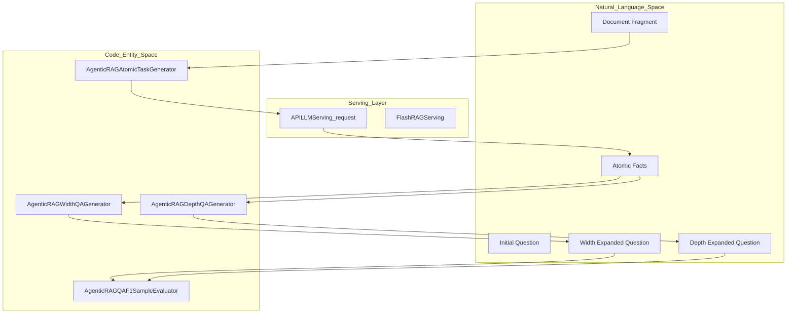
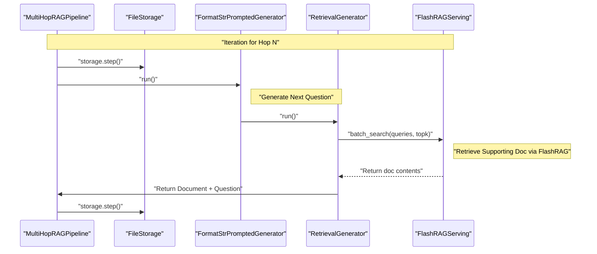

<!-- source: DeepWiki mcp.deepwiki.com · repo OpenDCAI/DataFlow · page 5.5 Agentic RAG Pipeline · fetched 2026-11-02 -->

# Agentic RAG Pipeline

<details>
<summary>Relevant source files</summary>

The following files were used as context for generating this wiki page:

- [dataflow/example/AgenticRAGPipeline/multihop_pipeline_data.jsonl](dataflow/example/AgenticRAGPipeline/multihop_pipeline_data.jsonl)
- [dataflow/operators/agentic_rag/__init__.py](dataflow/operators/agentic_rag/__init__.py)
- [dataflow/operators/agentic_rag/eval/agenticrag_qaf1_sample_evaluator.py](dataflow/operators/agentic_rag/eval/agenticrag_qaf1_sample_evaluator.py)
- [dataflow/operators/agentic_rag/generate/agenticrag_atomic_task_generator.py](dataflow/operators/agentic_rag/generate/agenticrag_atomic_task_generator.py)
- [dataflow/operators/agentic_rag/generate/agenticrag_depth_qa_generator.py](dataflow/operators/agentic_rag/generate/agenticrag_depth_qa_generator.py)
- [dataflow/operators/agentic_rag/generate/agenticrag_width_qa_generator.py](dataflow/operators/agentic_rag/generate/agenticrag_width_qa_generator.py)
- [dataflow/operators/core_text/filter/kcentergreedy_filter.py](dataflow/operators/core_text/filter/kcentergreedy_filter.py)
- [dataflow/prompts/agenticrag.py](dataflow/prompts/agenticrag.py)
- [dataflow/serving/flash_rag_serving.py](dataflow/serving/flash_rag_serving.py)
- [dataflow/statics/pipelines/api_pipelines/agentic_rag_multihop_core_pipeline.py](dataflow/statics/pipelines/api_pipelines/agentic_rag_multihop_core_pipeline.py)
- [dataflow/statics/pipelines/api_pipelines/agentic_rag_pipeline.py](dataflow/statics/pipelines/api_pipelines/agentic_rag_pipeline.py)

</details>


The Agentic RAG Pipeline is a specialized data preparation pipeline designed to identify and extract question-answer (QA) pairs from existing datasets or knowledge bases that require external knowledge retrieval to answer correctly. These curated QA pairs are used for training large language models to perform Agentic Retrieval-Augmented Generation (RAG) tasks, where the model must recognize when it needs to fetch external information and formulate appropriate retrieval queries.

**Scope**: This page covers the Agentic RAG Pipeline's architecture, workflow, and implementation details, specifically focusing on the Multi-hop Core Pipeline, Width/Depth expansion strategies, and evaluation mechanisms.

---

## Purpose and Motivation

Traditional RAG systems retrieve documents based on simple similarity matching. **Agentic RAG** extends this by enabling models to:
- **Recognize knowledge gaps**: Determine when a question cannot be answered with parametric knowledge alone.
- **Formulate retrieval queries**: Generate effective search queries to find missing information.
- **Synthesize multi-source answers**: Integrate retrieved information with existing knowledge through multi-hop reasoning.

The Agentic RAG Pipeline in DataFlow automates the generation of these complex training examples by decomposing documents into atomic facts and synthesizing multi-hop questions through both horizontal (width) and vertical (depth) expansion.

**Sources**: [dataflow/prompts/agenticrag.py:4-6](), [dataflow/statics/pipelines/api_pipelines/agentic_rag_multihop_core_pipeline.py:193-198]()

---

## Core Pipeline Architecture

The pipeline bridges the "Natural Language Space" (raw text/questions) to the "Code Entity Space" by utilizing specific operators and serving backends.

### System Entity Mapping



**Diagram: Mapping Pipeline Logic to Code Entities**

**Sources**: [dataflow/operators/agentic_rag/__init__.py:7-11](), [dataflow/serving/flash_rag_serving.py:20-25](), [dataflow/statics/pipelines/api_pipelines/agentic_rag_multihop_core_pipeline.py:11-12]()

---

## Implementation Details

### 1. Atomic Task Generation
The pipeline begins by breaking down information into "Atomic Tasks". This is driven by prompts that enforce strict rules on fact extraction. The `AgenticRAGAtomicTaskGenerator` orchestrates this process [dataflow/operators/agentic_rag/generate/agenticrag_atomic_task_generator.py:36-43]().

*   **Identifier Extraction**: The `AtomicTaskGeneratorGetIdentifierPrompt` identifies the main subject or noun phrase (e.g., "Avatar series") [dataflow/prompts/agenticrag.py:9-36]().
*   **Conclusion Extraction**: The `AtomicTaskGeneratorGetConlcusionPrompt` ensures facts are indivisible and verifiable (e.g., "Humpback65B achieved 59.0% accuracy") [dataflow/prompts/agenticrag.py:46-180]().

| Class | Purpose | File |
|-------|---------|------|
| `AtomicTaskGeneratorGetIdentifierPrompt` | Extracts subjects/proper nouns from questions. | [dataflow/prompts/agenticrag.py:9-13]() |
| `AtomicTaskGeneratorGetConlcusionPrompt` | Extracts atomic, verifiable facts from documents. | [dataflow/prompts/agenticrag.py:46-51]() |

**Sources**: [dataflow/prompts/agenticrag.py:9-180](), [dataflow/operators/agentic_rag/generate/agenticrag_atomic_task_generator.py:36-43]()

### 2. Width and Depth Expansion
To create complex Agentic RAG scenarios, the pipeline expands simple QA pairs:

*   **Width Expansion (`AgenticRAGWidthQAGenerator`)**: Combines two distinct QA pairs to generate a new, more complex question. It uses `WidthQAGeneratorMergePrompt` to synthesize tasks and `WidthQAGeneratorRecallScorePrompt` for validation [dataflow/operators/agentic_rag/generate/agenticrag_width_qa_generator.py:26-55](), [dataflow/operators/agentic_rag/generate/agenticrag_width_qa_generator.py:102-109]().
*   **Depth Expansion (`AgenticRAGDepthQAGenerator`)**: Generates deeper questions based on an existing pair over multiple rounds. It uses `DepthQAGeneratorBackwardTaskPrompt` and `DepthQAGeneratorSupersetCheckPrompt` to drive the iterative logic [dataflow/operators/agentic_rag/generate/agenticrag_depth_qa_generator.py:28-55](), [dataflow/operators/agentic_rag/generate/agenticrag_depth_qa_generator.py:78-89]().

**Sources**: [dataflow/operators/agentic_rag/generate/agenticrag_width_qa_generator.py:26-109](), [dataflow/operators/agentic_rag/generate/agenticrag_depth_qa_generator.py:28-89]()

### 3. Multi-hop Synthesis Logic
The `MultiHopRAGPipeline` facilitates the creation of multi-step reasoning chains by iterating through "hops" and retrieving context [dataflow/statics/pipelines/api_pipelines/agentic_rag_multihop_core_pipeline.py:193-198]().



**Diagram: Multi-hop Execution Flow with FlashRAG**

**Key Functions**:
*   `prepare_retrieval_query`: Extracts the answer from the previous hop to use as a search query for the next [dataflow/statics/pipelines/api_pipelines/agentic_rag_multihop_core_pipeline.py:71-73]().
*   `format_history_string`: Aggregates questions, answers, and documents from previous hops into a single context string [dataflow/statics/pipelines/api_pipelines/agentic_rag_multihop_core_pipeline.py:75-85]().
*   `build_multihop_prompt_str`: Constructs the prompt for the current hop by concatenating previous QA pairs and supporting documents [dataflow/statics/pipelines/api_pipelines/agentic_rag_multihop_core_pipeline.py:164-187]().

**Sources**: [dataflow/statics/pipelines/api_pipelines/agentic_rag_multihop_core_pipeline.py:71-187](), [dataflow/serving/flash_rag_serving.py:106-121]()

---

## Evaluation and Filtering

### F1 Score Evaluation
The `AgenticRAGQAF1SampleEvaluator` computes the token-based F1 score between predicted answers and ground truth [dataflow/operators/agentic_rag/eval/agenticrag_qaf1_sample_evaluator.py:13-18](). It includes a `normalize_answer` method to handle punctuation, articles, and case sensitivity [dataflow/operators/agentic_rag/eval/agenticrag_qaf1_sample_evaluator.py:54-68]().

**Sources**: [dataflow/operators/agentic_rag/eval/agenticrag_qaf1_sample_evaluator.py:13-68]()

### Representative Sampling
The `KCenterGreedyFilter` uses the K-Center Greedy algorithm to select a representative "coreset" of document fragments [dataflow/operators/core_text/filter/kcentergreedy_filter.py:140-170](). This ensures that the generated QA pairs cover a diverse range of topics within the knowledge base.

**Sources**: [dataflow/operators/core_text/filter/kcentergreedy_filter.py:140-170]()

### Retrieval Serving
The pipeline integrates `FlashRAGServing` for document retrieval [dataflow/serving/flash_rag_serving.py:20-32](). It supports multiple methods including `e5` and `bm25`.

*   **Initialization**: Configures paths for the model, index, and corpus in `rag_config_dict` [dataflow/serving/flash_rag_serving.py:47-58]().
*   **Batch Search**: Uses `retriever.batch_search` to find relevant documents for generated queries [dataflow/serving/flash_rag_serving.py:106-110]().

**Sources**: [dataflow/serving/flash_rag_serving.py:20-110]()

---

## Example Data Structure

The output of the pipeline is typically stored in JSONL format, representing a structured multi-hop retrieval chain.

```json
{
  "hop_1": {
    "question": "Where did Emily M. Danforth earn her Ph.D.?",
    "answer": "University of Nebraska–Lincoln",
    "doc": "\"Emily M. Danforth\"...received a Master of Fine Arts degree...earned her Ph.D. at the University of Nebraska–Lincoln.",
    "final_question": "Where did Emily M. Danforth earn her Ph.D.?",
    "final_answer": "University of Nebraska–Lincoln",
    "refined_answer": "University of Nebraska–Lincoln"
  }
}
```

**Sources**: [dataflow/example/AgenticRAGPipeline/multihop_pipeline_data.jsonl:1]()

---

## Summary of Prompts

The pipeline relies on a comprehensive set of prompts registered in the `PROMPT_REGISTRY`:

| Prompt Class | Purpose | File |
|--------------|---------|------|
| `AtomicTaskGeneratorQuestionPrompt` | Generates a single-hop QA pair from a document. | [dataflow/prompts/agenticrag.py:189]() |
| `WidthQAGeneratorMergePrompt` | Merges two questions for width expansion. | [dataflow/operators/agentic_rag/generate/agenticrag_width_qa_generator.py:19]() |
| `DepthQAGeneratorBackwardTaskPrompt` | Generates a backward task for depth expansion. | [dataflow/operators/agentic_rag/generate/agenticrag_depth_qa_generator.py:21]() |
| `DepthQAGeneratorSupersetCheckPrompt` | Checks if a new identifier is a superset of the original. | [dataflow/operators/agentic_rag/generate/agenticrag_depth_qa_generator.py:22]() |
| `InferenceCheckPrompt` | Validates if a question can be logically derived from previous hops. | [dataflow/statics/pipelines/api_pipelines/agentic_rag_multihop_core_pipeline.py:30]() |

**Sources**: [dataflow/prompts/agenticrag.py:189-191](), [dataflow/operators/agentic_rag/generate/agenticrag_width_qa_generator.py:18-24](), [dataflow/operators/agentic_rag/generate/agenticrag_depth_qa_generator.py:19-26](), [dataflow/statics/pipelines/api_pipelines/agentic_rag_multihop_core_pipeline.py:24-38]()

---

