<!-- source: DeepWiki mcp.deepwiki.com · repo OpenDCAI/DataFlow · page 5.6 PDF VQA Extraction Pipeline · fetched 2026-11-02 -->

# PDF VQA Extraction Pipeline

Relevant source files

The following files were used as context for generating this wiki page:

- [dataflow/example/PDF2VQAPipeline/vqa_extract_test.jsonl](dataflow/example/PDF2VQAPipeline/vqa_extract_test.jsonl)
- [dataflow/example/VQA/pdfimages/page_0.jpg](dataflow/example/VQA/pdfimages/page_0.jpg)
- [dataflow/example/VQA/pdfimages/page_1.jpg](dataflow/example/VQA/pdfimages/page_1.jpg)
- [dataflow/example/VQA/pdfimages/page_2.jpg](dataflow/example/VQA/pdfimages/page_2.jpg)
- [dataflow/example/VQA/pic_path.json](dataflow/example/VQA/pic_path.json)
- [dataflow/operators/pdf2vqa/__init__.py](dataflow/operators/pdf2vqa/__init__.py)
- [dataflow/operators/pdf2vqa/generate/llm_output_parser.py](dataflow/operators/pdf2vqa/generate/llm_output_parser.py)
- [dataflow/operators/pdf2vqa/generate/mineru_to_llm_input_operator.py](dataflow/operators/pdf2vqa/generate/mineru_to_llm_input_operator.py)
- [dataflow/operators/pdf2vqa/generate/pdf_merger.py](dataflow/operators/pdf2vqa/generate/pdf_merger.py)
- [dataflow/operators/pdf2vqa/generate/qa_merger.py](dataflow/operators/pdf2vqa/generate/qa_merger.py)
- [dataflow/prompts/pdf2vqa.py](dataflow/prompts/pdf2vqa.py)
- [dataflow/statics/pipelines/api_pipelines/pdf_vqa_extract_pipeline.py](dataflow/statics/pipelines/api_pipelines/pdf_vqa_extract_pipeline.py)
- [dataflow/utils/pdf2vqa/format_utils.py](dataflow/utils/pdf2vqa/format_utils.py)

The PDF VQA Extraction Pipeline extracts structured visual question-answering (VQA) pairs from PDF documents such as textbooks, problem sets, and educational materials. The pipeline handles both interleaved PDFs (questions and answers in the same document) and separate PDFs (questions in one file, answers in another). It utilizes **MinerU** for high-quality PDF-to-markdown conversion, Large Language Models (LLMs) for content extraction with layout awareness, and custom parsing logic to merge and format the results into training-ready datasets.

For general text-based QA extraction from plain text, see [Text Pipeline](#5.1). For knowledge extraction from PDFs for RAG systems, see [Knowledge Base Cleaning Pipeline](#5.4).

## Pipeline Architecture

The `PDF_VQA_extract_optimized_pipeline` [dataflow/statics/pipelines/api_pipelines/pdf_vqa_extract_pipeline.py:13-101]() implements a multi-stage sequential workflow that processes PDFs through merging, conversion, layout transformation, extraction, parsing, and final formatting.

### System Flow Diagram
The following diagram bridges natural language functional concepts to code entities within the codebase.

```mermaid
graph TB
    subgraph "NaturalLanguageSpace"
        Input["PDFInputDataset"]
        Merging["PDFMergingStage"]
        Conversion["LayoutConversionStage"]
        Extraction["VQAExtractionStage"]
        Parsing["OutputParsingStage"]
        MergingQA["QAMergingStage"]
        Formatting["ShareGPTFormattingStage"]
    end

    subgraph "CodeEntitySpace"
        Storage["FileStorage\n[dataflow/utils/storage.py]"]
        PMerge["PDF_Merger\n[dataflow/operators/pdf2vqa/generate/pdf_merger.py:8]"]
        MConv["FileOrURLToMarkdownConverterFlash\n[dataflow/statics/pipelines/api_pipelines/pdf_vqa_extract_pipeline.py:37]"]
        IFormat["MinerU2LLMInputOperator\n[dataflow/operators/pdf2vqa/generate/mineru_to_llm_input_operator.py:9]"]
        VExtract["ChunkedPromptedGenerator\n[dataflow/statics/pipelines/api_pipelines/pdf_vqa_extract_pipeline.py:48]"]
        Prompt["QAExtractPrompt\n[dataflow/prompts/pdf2vqa.py:5]"]
        OParse["LLMOutputParser\n[dataflow/operators/pdf2vqa/generate/llm_output_parser.py:13]"]
        QAMerge["QA_Merger\n[dataflow/operators/pdf2vqa/generate/qa_merger.py:11]"]
        VFormat["VQAFormatter\n[dataflow/statics/pipelines/api_pipelines/pdf_vqa_extract_pipeline.py:56]"]
    end

    Input --> Storage
    Merging --> PMerge
    Conversion --> MConv
    Conversion --> IFormat
    Extraction --> VExtract
    Extraction -.-> Prompt
    Parsing --> OParse
    MergingQA --> QAMerge
    Formatting --> VFormat
```

Sources: [dataflow/statics/pipelines/api_pipelines/pdf_vqa_extract_pipeline.py:13-100](), [dataflow/operators/pdf2vqa/__init__.py:4-8]()

### Data Transformation Flow Diagram
The following diagram illustrates the sequence of state transformations across operators.

Sources: [dataflow/statics/pipelines/api_pipelines/pdf_vqa_extract_pipeline.py:58-100](), [dataflow/operators/pdf2vqa/generate/pdf_merger.py:34-46]()

## Core Components

### MinerU Integration and Layout Conversion
The pipeline begins by normalizing input PDFs. If multiple files are provided (e.g., a question PDF and an answer PDF as seen in `math2` example [dataflow/example/PDF2VQAPipeline/vqa_extract_test.jsonl:2]()), the `PDF_Merger` [dataflow/operators/pdf2vqa/generate/pdf_merger.py:8-15]() combines them using `pypdf.PdfWriter` [dataflow/operators/pdf2vqa/generate/pdf_merger.py:61-72](). 

The conversion stage uses `FileOrURLToMarkdownConverterFlash` [dataflow/statics/pipelines/api_pipelines/pdf_vqa_extract_pipeline.py:37-45]() to parse the PDF into Markdown and a structured layout JSON (`_content_list.json`). The `MinerU2LLMInputOperator` [dataflow/operators/pdf2vqa/generate/mineru_to_llm_input_operator.py:9-11]() then transforms this into a format where text blocks and images are assigned unique IDs [dataflow/operators/pdf2vqa/generate/mineru_to_llm_input_operator.py:33-50](), allowing the LLM to refer to specific layout elements precisely.

For details, see [MinerU Integration and Layout Conversion](#5.6.1).

Sources: [dataflow/statics/pipelines/api_pipelines/pdf_vqa_extract_pipeline.py:32-47](), [dataflow/operators/pdf2vqa/generate/pdf_merger.py:8-72](), [dataflow/operators/pdf2vqa/generate/mineru_to_llm_input_operator.py:9-50]()

### VQA Extraction and Parsing
Extraction is performed by the `ChunkedPromptedGenerator` [dataflow/statics/pipelines/api_pipelines/pdf_vqa_extract_pipeline.py:48-52](), which utilizes the `QAExtractPrompt` [dataflow/prompts/pdf2vqa.py:5-9](). This prompt instructs the LLM to output XML-tagged structures containing question labels, text, and image references using the IDs generated in the previous step [dataflow/prompts/pdf2vqa.py:57-67]().

The `LLMOutputParser` [dataflow/operators/pdf2vqa/generate/llm_output_parser.py:13-15]() then processes the LLM's raw response. It resolves the layout IDs back into actual text and image markdown syntax [dataflow/operators/pdf2vqa/generate/llm_output_parser.py:37-68]() and physically copies referenced images to the output directory [dataflow/operators/pdf2vqa/generate/llm_output_parser.py:130-143]().

For details, see [VQA Extraction and Parsing](#5.6.2).

Sources: [dataflow/statics/pipelines/api_pipelines/pdf_vqa_extract_pipeline.py:48-53](), [dataflow/prompts/pdf2vqa.py:5-67](), [dataflow/operators/pdf2vqa/generate/llm_output_parser.py:13-143]()

### QA Merging and Output Formatting
Since questions and answers may be extracted from different parts of a document (or different files), the `QA_Merger` [dataflow/operators/pdf2vqa/generate/qa_merger.py:11-12]() aligns them. It uses `merge_qa_pair` [dataflow/utils/pdf2vqa/format_utils.py:21-24]() to match pairs based on chapter titles and labels, employing a `refine_title` logic [dataflow/utils/pdf2vqa/format_utils.py:4-19]() to handle variations in section naming.

Finally, the `VQAFormatter` [dataflow/statics/pipelines/api_pipelines/pdf_vqa_extract_pipeline.py:56]() converts the merged pairs into a standard format (e.g., ShareGPT) for model training. The `QA_Merger` includes logic to fix image paths by prepending the document `name` to the markdown image links [dataflow/operators/pdf2vqa/generate/qa_merger.py:67-82]().

For details, see [QA Merging and Output Formatting](#5.6.3).

Sources: [dataflow/statics/pipelines/api_pipelines/pdf_vqa_extract_pipeline.py:54-56](), [dataflow/operators/pdf2vqa/generate/qa_merger.py:11-84](), [dataflow/utils/pdf2vqa/format_utils.py:4-24]()

## Data Entity Mapping
The following table maps pipeline logical stages to the specific code classes and the data keys they manipulate within the `DataFlowStorage`.

| Stage | Code Entity | Primary Input Key | Primary Output Key |
| :--- | :--- | :--- | :--- |
| **PDF Merging** | `PDF_Merger` [dataflow/operators/pdf2vqa/generate/pdf_merger.py:8]() | `input_pdf_paths` | `merged_pdf_path` |
| **PDF Parsing** | `FileOrURLToMarkdownConverterFlash` [dataflow/statics/pipelines/api_pipelines/pdf_vqa_extract_pipeline.py:37]() | `merged_pdf_path` | `vqa_markdown_path` |
| **ID Assignment** | `MinerU2LLMInputOperator` [dataflow/operators/pdf2vqa/generate/mineru_to_llm_input_operator.py:9]() | `vqa_markdown_path` | `converted_vqa_layout_path` |
| **VQA Extraction** | `ChunkedPromptedGenerator` [dataflow/statics/pipelines/api_pipelines/pdf_vqa_extract_pipeline.py:48]() | `converted_vqa_layout_path` | `extracted_llm_vqa_path` |
| **ID Resolution** | `LLMOutputParser` [dataflow/operators/pdf2vqa/generate/llm_output_parser.py:13]() | `extracted_llm_vqa_path` | `extracted_vqa_path` |
| **QA Alignment** | `QA_Merger` [dataflow/operators/pdf2vqa/generate/qa_merger.py:11]() | `extracted_vqa_path` | `output_merged_vqalist_path` |
| **Final Format** | `VQAFormatter` [dataflow/operators/pdf2vqa/__init__.py:8]() | `vqa_pair` | `messages`, `images` |

Sources: [dataflow/statics/pipelines/api_pipelines/pdf_vqa_extract_pipeline.py:58-100](), [dataflow/operators/pdf2vqa/generate/pdf_merger.py:34-46]()

## Execution and Resumption
The pipeline is executed via the `forward()` method [dataflow/statics/pipelines/api_pipelines/pdf_vqa_extract_pipeline.py:58](). It utilizes `self.storage.step()` [dataflow/statics/pipelines/api_pipelines/pdf_vqa_extract_pipeline.py:60]() to maintain state between operators. This allows the pipeline to resume from the last successful operator if an error occurs, as intermediate results are cached in JSONL format [dataflow/statics/pipelines/api_pipelines/pdf_vqa_extract_pipeline.py:16-21]().

Sources: [dataflow/statics/pipelines/api_pipelines/pdf_vqa_extract_pipeline.py:13-101]()

---

