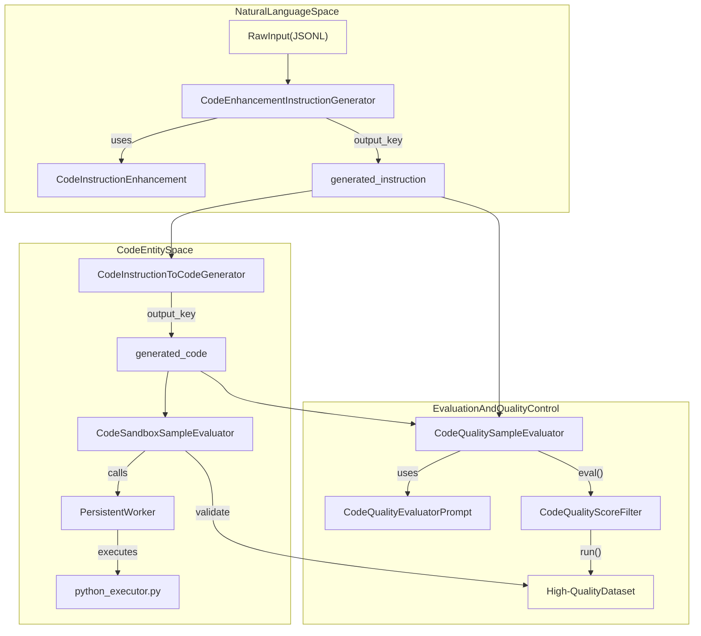
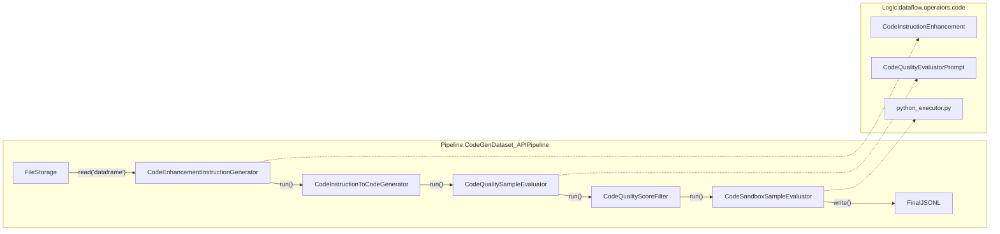

<!-- source: DeepWiki mcp.deepwiki.com · repo OpenDCAI/DataFlow · page 5.7 Code Pipeline · fetched 2026-11-02 -->

# Code Pipeline

Relevant source files

The following files were used as context for generating this wiki page:

- [dataflow/example/CodePipeline/raw_code.jsonl](dataflow/example/CodePipeline/raw_code.jsonl)
- [dataflow/operators/code/__init__.py](dataflow/operators/code/__init__.py)
- [dataflow/operators/code/eval/code_quality_sample_evaluator.py](dataflow/operators/code/eval/code_quality_sample_evaluator.py)
- [dataflow/operators/code/eval/python_executor.py](dataflow/operators/code/eval/python_executor.py)
- [dataflow/operators/code/filter/code_quality_score_filter.py](dataflow/operators/code/filter/code_quality_score_filter.py)
- [dataflow/operators/code/generate/code_code_to_instruction_generator.py](dataflow/operators/code/generate/code_code_to_instruction_generator.py)
- [dataflow/operators/code/generate/code_gen_instruction.py](dataflow/operators/code/generate/code_gen_instruction.py)
- [dataflow/operators/code/generate/code_instruction_enhancement.py](dataflow/operators/code/generate/code_instruction_enhancement.py)
- [dataflow/operators/code/generate/code_instruction_to_code_generator.py](dataflow/operators/code/generate/code_instruction_to_code_generator.py)
- [dataflow/operators/knowledge_cleaning/generate/mathbook_question_extract.py](dataflow/operators/knowledge_cleaning/generate/mathbook_question_extract.py)
- [dataflow/operators/text_pt/eval/Qurating/modeling/modeling_flash_llama.py](dataflow/operators/text_pt/eval/Qurating/modeling/modeling_flash_llama.py)
- [dataflow/prompts/code.py](dataflow/prompts/code.py)
- [dataflow/statics/pipelines/api_pipelines/code_code_to_sft_data_pipeline.py](dataflow/statics/pipelines/api_pipelines/code_code_to_sft_data_pipeline.py)
- [dataflow/statics/pipelines/api_pipelines/code_gen_dataset_pipeline.py](dataflow/statics/pipelines/api_pipelines/code_gen_dataset_pipeline.py)

The Code Pipeline is a specialized data preparation workflow designed to generate, enhance, and validate code datasets for Supervised Fine-Tuning (SFT) and instruction-following tasks. It utilizes a "self-instruct" style synthesis approach, reverse-engineering instructions from raw code or expanding existing instruction pools, followed by rigorous quality evaluation, score-based filtering, and secure sandbox execution.

Sources: [dataflow/statics/pipelines/api_pipelines/code_gen_dataset_pipeline.py:14-14](), [dataflow/statics/pipelines/api_pipelines/code_code_to_sft_data_pipeline.py:12-12]()

---

## Pipeline Architecture

The code generation process is primarily implemented via orchestration pipelines such as `CodeGenDataset_APIPipeline` [dataflow/statics/pipelines/api_pipelines/code_gen_dataset_pipeline.py:14-14]() and `CodeSFTSynthesis_APIPipeline` [dataflow/statics/pipelines/api_pipelines/code_code_to_sft_data_pipeline.py:12-12](). It follows a multi-stage execution flow where data flows from raw inputs or code pools through sequential operators.

### Data Flow Overview

1.  **Instruction Enhancement / Generation**: Standardizes raw input or code into a consistent English instruction and Python function signature template format.
2.  **Code Generation**: Uses an LLM serving backend to generate code implementations matching the structured instructions.
3.  **Quality Evaluation**: An LLM-based reviewer evaluates the generated instruction-code pair against predefined correctness, completeness, and clarity criteria.
4.  **Score Filtering**: Filters out samples that fail to meet numerical score boundaries or parsing constraints.
5.  **Sandbox Execution**: Validates the generated code via a isolated worker process to guarantee runtime correctness.

### Pipeline Diagram: Natural Language to Code Entity Space

Sources: [dataflow/statics/pipelines/api_pipelines/code_gen_dataset_pipeline.py:58-94](), [dataflow/operators/code/generate/code_instruction_enhancement.py:18-23](), [dataflow/operators/code/eval/code_quality_sample_evaluator.py:20-25](), [dataflow/operators/code/eval/python_executor.py:82-121](), [dataflow/prompts/code.py:106-110]()

---

## Key Operators

### Generation Operators

*   **`CodeEnhancementInstructionGenerator`**: Standardizes and normalizes human instructions or raw messages into a uniform Python function template format containing docstrings and type annotations [dataflow/operators/code/generate/code_instruction_enhancement.py:18-23]().
*   **`CodeInstructionGenerator`**: A self-instruct operator that samples few-shot examples from a data pool via `_sample_few_shot_examples` [dataflow/operators/code/generate/code_gen_instruction.py:80-101]() to generate new, diverse programming instructions of comparable difficulty [dataflow/operators/code/generate/code_gen_instruction.py:19-25]().
*   **`CodeInstructionToCodeGenerator`**: Generates concrete Python code implementations from instructions using an LLM serving instance [dataflow/statics/pipelines/api_pipelines/code_gen_dataset_pipeline.py:37-39]().
*   **`CodeCodeToInstructionGenerator`**: Reverse-engineers a concise natural language instruction from an existing source code snippet [dataflow/operators/code/generate/code_code_to_instruction_generator.py:15-18]().

Sources: [dataflow/operators/code/generate/code_instruction_enhancement.py:18-23](), [dataflow/operators/code/generate/code_gen_instruction.py:19-101](), [dataflow/operators/code/generate/code_code_to_instruction_generator.py:15-18](), [dataflow/statics/pipelines/api_pipelines/code_gen_dataset_pipeline.py:37-39]()

### Evaluation and Filtering Operators

*   **`CodeQualitySampleEvaluator`**: Acts as an automated reviewer. It queries an LLM to evaluate the alignment between an instruction and its generated code, parsing the textual response for numerical scores and feedback strings using regex patterns `r"Score:\s*(\d+)"` and `r"Feedback:\s*(.*)"` [dataflow/operators/code/eval/code_quality_sample_evaluator.py:118-124]().
*   **`CodeQualityScoreFilter`**: Filters datasets based on the scores assigned by `CodeQualitySampleEvaluator` [dataflow/operators/code/filter/code_quality_score_filter.py:13-22](). It retains samples within a specified score range (e.g., `min_score=7.0`, `max_score=10.0`) while preserving samples where score parsing failed (`score = 0`) to prevent aggressive truncation [dataflow/operators/code/filter/code_quality_score_filter.py:24-29]().
*   **`CodeSandboxSampleEvaluator`**: Executes generated code snippets inside a secure sandbox runner to ensure syntax and runtime validity [dataflow/statics/pipelines/api_pipelines/code_gen_dataset_pipeline.py:54-56]().

Sources: [dataflow/operators/code/eval/code_quality_sample_evaluator.py:106-129](), [dataflow/operators/code/filter/code_quality_score_filter.py:24-104](), [dataflow/statics/pipelines/api_pipelines/code_gen_dataset_pipeline.py:54-56]()

---

## Implementation Details

### Operator Integration Diagram

Sources: [dataflow/statics/pipelines/api_pipelines/code_gen_dataset_pipeline.py:14-56](), [dataflow/operators/code/eval/python_executor.py:1-14](), [dataflow/prompts/code.py:7-110]()

### Sandbox Execution and `PersistentWorker`

Code validation and execution are managed by the `PersistentWorker` class [dataflow/operators/code/eval/python_executor.py:82-82](). This component instantiates a separate `multiprocessing.Process` [dataflow/operators/code/eval/python_executor.py:129-129]() to execute untrusted code snippets with timeout safeguards [dataflow/operators/code/eval/python_executor.py:133-133](). Inter-process communication relies on `multiprocessing.Queue` [dataflow/operators/code/eval/python_executor.py:122-123](). 

Key features of `PersistentWorker` include:
*   **Standard Output Capture**: Intercepts `stdout` using `redirect_stdout` [dataflow/operators/code/eval/python_executor.py:139-144]() or specific variable evaluation expressions [dataflow/operators/code/eval/python_executor.py:145-157]().
*   **Runtime Environment Registry**: Uses `RUNTIME_REGISTRY` to support execution contexts such as `ImageRuntime`, `DateRuntime`, and `ColorObjectRuntime` [dataflow/operators/code/eval/python_executor.py:86-91]().
*   **Figure Capture**: Monitors `_captured_figures` in global variables to safely collect and extract `matplotlib` plots generated during execution [dataflow/operators/code/eval/python_executor.py:137-168]().

Sources: [dataflow/operators/code/eval/python_executor.py:82-178]()

### Prompt Customization and Restriction

To maintain structural consistency across pipeline runs, code operators use the `@prompt_restrict` decorator to validate prompt template compatibility during initialization [dataflow/operators/code/generate/code_instruction_enhancement.py:13-16](). For instance, `CodeQualitySampleEvaluator` restricts its prompt template parameter to instances of `CodeQualityEvaluatorPrompt` or `DiyCodePrompt` [dataflow/operators/code/eval/code_quality_sample_evaluator.py:15-18]().

Sources: [dataflow/operators/code/generate/code_instruction_enhancement.py:13-16](), [dataflow/operators/code/eval/code_quality_sample_evaluator.py:15-18]()

### Quality Scoring Schema

The evaluation schema enforced by `CodeQualityEvaluatorPrompt` assesses code across three main dimensions [dataflow/prompts/code.py:28-31]():
1.  **Correctness & Completeness**: Functional accuracy, edge case handling, and presence of necessary imports (e.g., `typing` types) [dataflow/prompts/code.py:29-29]().
2.  **Clarity & Best Practices**: Readability and adherence to coding style standards like PEP 8 [dataflow/prompts/code.py:30-30]().
3.  **Efficiency**: Algorithmic performance suitability [dataflow/prompts/code.py:31-31]().

| Output Field Name | Data Type | Description |
| :--- | :--- | :--- |
| `quality_score` | Integer | Numerical rating from 1 to 10 extracted from LLM review [dataflow/operators/code/eval/code_quality_sample_evaluator.py:118-121]() |
| `quality_feedback` | String | Constructive review explanation provided by the LLM [dataflow/operators/code/eval/code_quality_sample_evaluator.py:119-122]() |
| `quality_score_filter_label` | Integer | Binary flag (`1` for pass, `0` for drop) set by `CodeQualityScoreFilter` [dataflow/operators/code/filter/code_quality_score_filter.py:133-133]() |

Sources: [dataflow/operators/code/eval/code_quality_sample_evaluator.py:106-129](), [dataflow/operators/code/filter/code_quality_score_filter.py:109-139](), [dataflow/prompts/code.py:18-36](), [dataflow/operators/code/eval/python_executor.py:135-178]()

---

