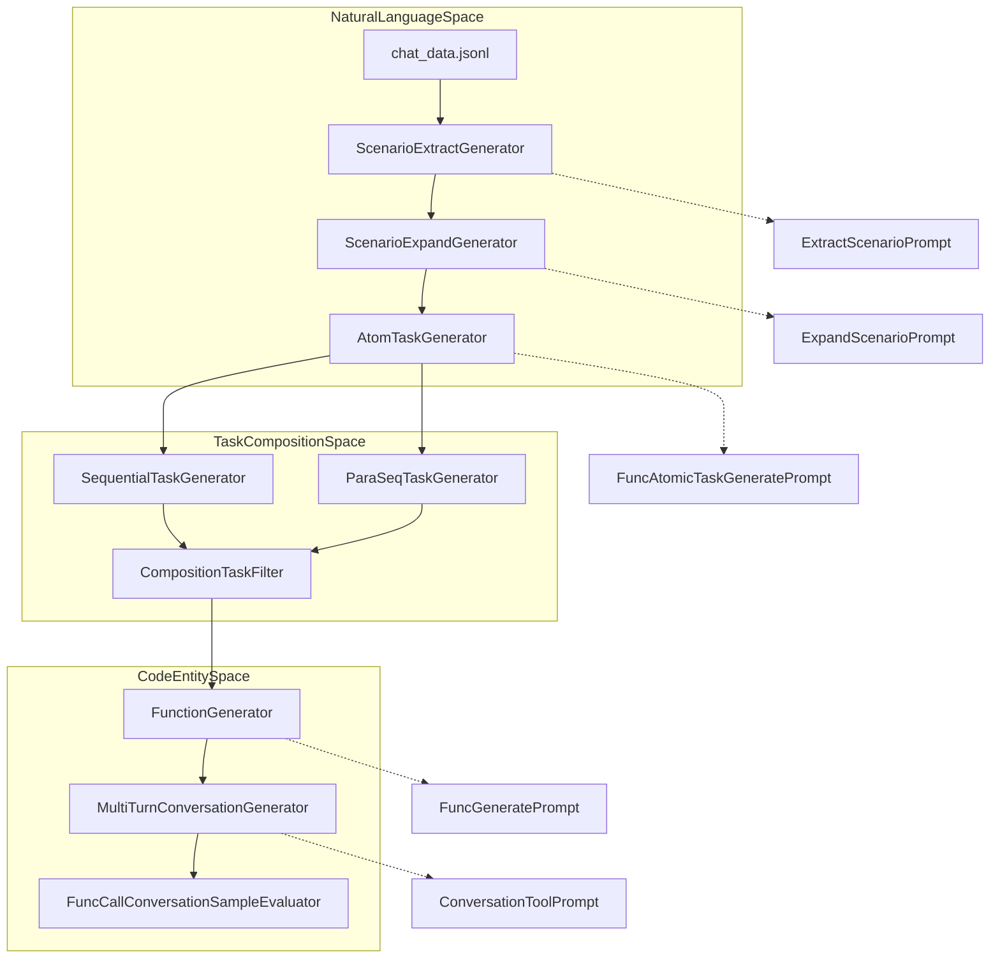
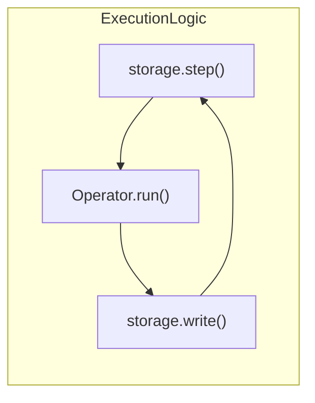

<!-- source: DeepWiki mcp.deepwiki.com · repo OpenDCAI/DataFlow · page 5.8 Function Call Pipeline · fetched 2026-11-02 -->

# Function Call Pipeline

<details>
<summary>Relevant source files</summary>

The following files were used as context for generating this wiki page:

- [dataflow/example/FuncCallPipeline/chat_data.jsonl](dataflow/example/FuncCallPipeline/chat_data.jsonl)
- [dataflow/operators/conversations/__init__.py](dataflow/operators/conversations/__init__.py)
- [dataflow/operators/conversations/eval/func_call_conversation_sample_evaluator.py](dataflow/operators/conversations/eval/func_call_conversation_sample_evaluator.py)
- [dataflow/operators/conversations/filter/composition_task_filter.py](dataflow/operators/conversations/filter/composition_task_filter.py)
- [dataflow/operators/conversations/generate/func_call_generators.py](dataflow/operators/conversations/generate/func_call_generators.py)
- [dataflow/prompts/func_call.py](dataflow/prompts/func_call.py)
- [dataflow/statics/pipelines/__init__.py](dataflow/statics/pipelines/__init__.py)
- [dataflow/statics/pipelines/api_pipelines/func_call_synthesis.py](dataflow/statics/pipelines/api_pipelines/func_call_synthesis.py)
- [test/test_API_conversations.py](test/test_API_conversations.py)

</details>


The **Function Call Pipeline** (`FuncCall_APIPipeline`) is a specialized data preparation workflow designed to generate high-quality, multi-turn conversations centered around function calling (tool use). It implements a "Bottom-Up Then Top-Down" (BUTTON) approach: extracting scenarios from existing data, expanding them into new contexts, generating complex task compositions, and finally synthesizing complete dialogues with tool definitions and responses.

Sources: [dataflow/statics/pipelines/api_pipelines/func_call_synthesis.py:15-87](), [dataflow/prompts/func_call.py:1-3]()

---

## Pipeline Architecture

The pipeline is implemented in [dataflow/statics/pipelines/api_pipelines/func_call_synthesis.py:15-87](). It orchestrates a series of LLM-based generators and filters to transform simple chat seeds into sophisticated agentic training data. It utilizes `FileStorage` [dataflow/statics/pipelines/api_pipelines/func_call_synthesis.py:18-23]() for incremental data persistence and `APILLMServing_request` [dataflow/statics/pipelines/api_pipelines/func_call_synthesis.py:25-29]() for high-throughput LLM generation.

### Technical Workflow Diagram
The following diagram illustrates the data flow from initial chat seeds to the final evaluated conversation dataset, bridging natural language spaces with code entity and task composition spaces.

**FuncCall_APIPipeline Data Flow**

Sources: [dataflow/statics/pipelines/api_pipelines/func_call_synthesis.py:41-86](), [dataflow/operators/conversations/generate/func_call_generators.py:27-170](), [dataflow/prompts/func_call.py:7-89]()

---

## Key Components and Implementation

### 1. Scenario Management
The pipeline begins by abstracting specific conversations into general life scenarios to ensure diversity.
*   **ScenarioExtractGenerator**: Analyzes seed conversations (e.g., "book a flight to London") and identifies the general scenario type (e.g., "booking flights") [dataflow/operators/conversations/generate/func_call_generators.py:27-76](). It uses the `ExtractScenarioPrompt` [dataflow/prompts/func_call.py:8-26]().
*   **ScenarioExpandGenerator**: Takes an extracted scenario and creatively generates a new, realistic daily life scenario to expand the dataset's breadth [dataflow/operators/conversations/generate/func_call_generators.py:83-131](). It utilizes `ExpandScenarioPrompt` [dataflow/prompts/func_call.py:29-51]().

Sources: [dataflow/operators/conversations/generate/func_call_generators.py:27-131](), [dataflow/prompts/func_call.py:8-51]()

### 2. Task Generation and Filtering
Once scenarios are established, the pipeline generates structured tasks of varying complexity.
*   **AtomTaskGenerator**: Creates single-step "atomic" tasks that require a single function call [dataflow/operators/conversations/generate/func_call_generators.py:138-171](). It uses `FuncAtomicTaskGeneratePrompt` [dataflow/prompts/func_call.py:54-89]().
*   **SequentialTaskGenerator**: Adds subsequent steps to an atomic task to create multi-step dependencies where the output of one task serves as the input for the next [dataflow/prompts/func_call.py:92-143]().
*   **ParaSeqTaskGenerator**: Generates tasks that involve both parallel and sequential dependencies [dataflow/operators/conversations/__init__.py:9]().
*   **CompositionTaskFilter**: A critical validation step that uses an LLM to evaluate if the generated multi-step task is feasible and complete. It filters out unexecutable tasks by looking for `<ans>yes</ans>` in the LLM output [dataflow/operators/conversations/filter/composition_task_filter.py:17-82]().

Sources: [dataflow/operators/conversations/generate/func_call_generators.py:138-171](), [dataflow/operators/conversations/filter/composition_task_filter.py:17-82](), [dataflow/prompts/func_call.py:54-143]()

### 3. Function and Conversation Synthesis
This stage bridges natural language tasks with executable code definitions.
*   **FunctionGenerator**: Generates JSON-schema style function definitions (tools) required to solve the composition tasks [dataflow/statics/pipelines/api_pipelines/func_call_synthesis.py:37](). It uses `FuncGeneratePrompt` [dataflow/prompts/func_call.py:13]().
*   **MultiTurnConversationGenerator**: Synthesizes the full dialogue, including `USER` queries, `ASSISTANT` thoughts, `<functioncall>` blocks, and `FUNCTION RESPONSE` blocks [dataflow/statics/pipelines/api_pipelines/func_call_synthesis.py:38]().

Sources: [dataflow/statics/pipelines/api_pipelines/func_call_synthesis.py:37-38](), [dataflow/prompts/func_call.py:7-170]()

### 4. Quality Evaluation
*   **FuncCallConversationSampleEvaluator**: The final stage where an LLM scores the generated sample based on `ConversationEvalPrompt` [dataflow/operators/conversations/eval/func_call_conversation_sample_evaluator.py:17-22](). It parses a JSON response from the LLM via `clean_json_block` and `json_validate` to extract a `score` field [dataflow/operators/conversations/eval/func_call_conversation_sample_evaluator.py:66-87]().

Sources: [dataflow/operators/conversations/eval/func_call_conversation_sample_evaluator.py:17-99]()

---

## Data Transformation Mapping

The pipeline relies on specific prompt templates to transition between the "Natural Language Space" (user intents) and the "Code Entity Space" (API calls/JSON schemas).

| Pipeline Step | Operator Class | Input Key | Output Key | Prompt Entity |
| :--- | :--- | :--- | :--- | :--- |
| Scenario Extraction | `ScenarioExtractGenerator` | `chat` | `scenario` | `ExtractScenarioPrompt` |
| Task Generation | `AtomTaskGenerator` | `scenario` | `atom_task` | `FuncAtomicTaskGeneratePrompt` |
| Complexity Expansion | `SequentialTaskGenerator` | `atom_task` | `composition_task` | `SequentialTaskGeneratePrompt` |
| Tool Creation | `FunctionGenerator` | `composition_task` | `functions` | `FuncGeneratePrompt` |
| Dialogue Synthesis | `MultiTurnConversationGenerator` | `functions` | `conversations` | `ConversationToolPrompt` |

Sources: [dataflow/statics/pipelines/api_pipelines/func_call_synthesis.py:42-82](), [dataflow/prompts/func_call.py:7-170]()

---

## Execution and Configuration

The pipeline uses `FileStorage` for checkpointing and `APILLMServing_request` for inference.

### Initialization Example
The pipeline is typically initialized with a specific API endpoint and model (e.g., GPT-4o) to handle the complex reasoning required for task composition.

```python
# From dataflow/statics/pipelines/api_pipelines/func_call_synthesis.py:25-29
self.llm_serving = APILLMServing_request(
        api_url="http://123.129.219.111:3000/v1/chat/completions",
        model_name="gpt-4o",
        max_workers=128
)
```

### Execution Flow
The `forward()` method defines the sequence of execution. Each `self.storage.step()` call ensures that the results of the previous operator are persisted and passed as the input to the next [dataflow/statics/pipelines/api_pipelines/func_call_synthesis.py:41-86]().

**Pipeline Step Logic**


Sources: [dataflow/statics/pipelines/api_pipelines/func_call_synthesis.py:41-86](), [dataflow/operators/conversations/filter/composition_task_filter.py:79-82]()

---

