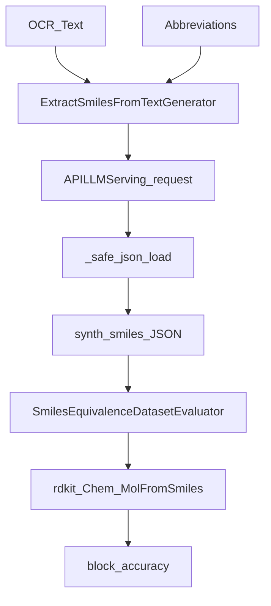
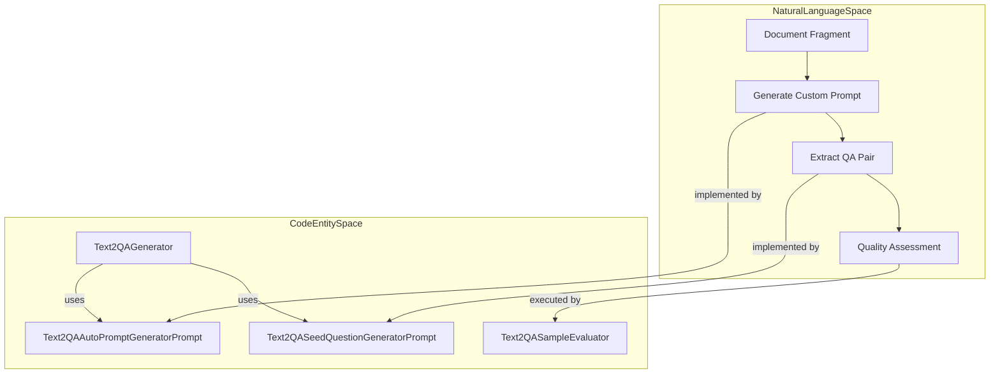
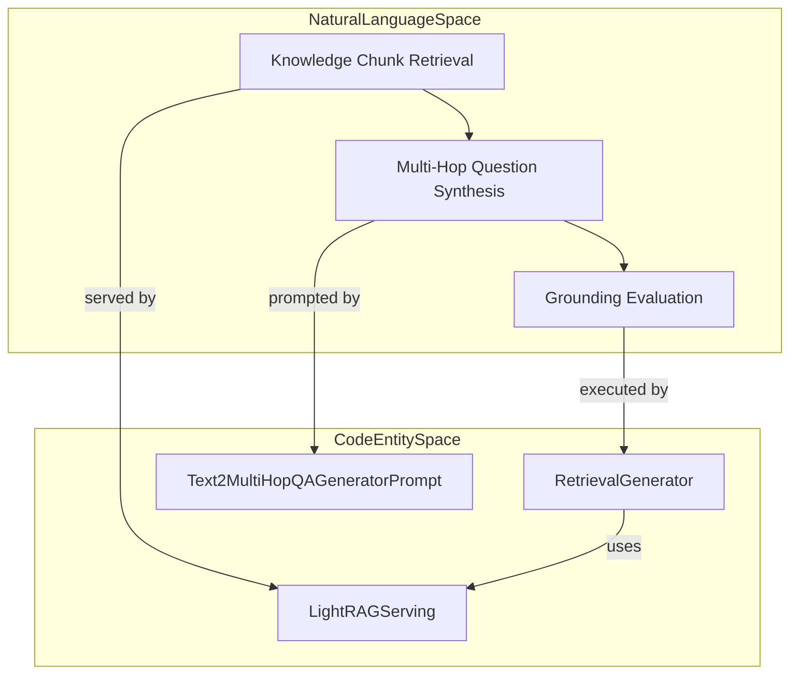

<!-- source: DeepWiki mcp.deepwiki.com · repo OpenDCAI/DataFlow · page 5.9 Specialized Domain Pipelines · fetched 2026-11-02 -->

# Specialized Domain Pipelines

Relevant source files

The following files were used as context for generating this wiki page:

- [dataflow/example/SpeechTranscription/audio/test.wav](dataflow/example/SpeechTranscription/audio/test.wav)
- [dataflow/example/SpeechTranscription/pipeline_speechtranscription.jsonl](dataflow/example/SpeechTranscription/pipeline_speechtranscription.jsonl)
- [dataflow/operators/chemistry/__init__.py](dataflow/operators/chemistry/__init__.py)
- [dataflow/operators/chemistry/eval/smiles_equivalence_dataset_evaluator.py](dataflow/operators/chemistry/eval/smiles_equivalence_dataset_evaluator.py)
- [dataflow/operators/chemistry/generate/extract_smiles_from_text_generator.py](dataflow/operators/chemistry/generate/extract_smiles_from_text_generator.py)
- [dataflow/operators/core_text/eval/text2qa_sample_evaluator.py](dataflow/operators/core_text/eval/text2qa_sample_evaluator.py)
- [dataflow/operators/core_text/generate/text2qa_generator.py](dataflow/operators/core_text/generate/text2qa_generator.py)
- [dataflow/prompts/text2qa.py](dataflow/prompts/text2qa.py)
- [dataflow/statics/pipelines/api_pipelines/chemistry_smiles.py](dataflow/statics/pipelines/api_pipelines/chemistry_smiles.py)
- [dataflow/statics/pipelines/api_pipelines/text2qa_pipeline.py](dataflow/statics/pipelines/api_pipelines/text2qa_pipeline.py)
- [dataflow/statics/pipelines/gpu_pipelines/speechtranscription_pipeline.py](dataflow/statics/pipelines/gpu_pipelines/speechtranscription_pipeline.py)
- [test/cpu_only/test_text2qa_source_alignment.py](test/cpu_only/test_text2qa_source_alignment.py)

Specialized Domain Pipelines in DataFlow provide tailored workflows for high-precision tasks such as chemical structure extraction, audio transcription, retrieval-augmented reasoning (RARE), and high-quality Question-Answering (QA) pair generation. These pipelines leverage domain-specific operators and prompts to handle non-textual, multi-modal, or highly structured data formats.

Sources: `dataflow/statics/pipelines/api_pipelines/chemistry_smiles.py:1-111()`, `dataflow/statics/pipelines/gpu_pipelines/speechtranscription_pipeline.py:1-32()`, `dataflow/statics/pipelines/api_pipelines/text2qa_pipeline.py:1-70()`

## Chemistry SMILES Extraction Pipeline

The Chemistry pipeline is designed to extract chemical monomer and small molecule information from OCR-processed text or scientific papers. It specifically targets the extraction of **SMILES** (Simplified Molecular Input Line Entry System) notations, abbreviations, and full chemical names [dataflow/statics/pipelines/api_pipelines/chemistry_smiles.py:8-34]().

### Implementation and Data Flow
The pipeline utilizes a two-step process: extraction via an LLM and validation via a specialized chemical informatics evaluator.

1.  **Extraction**: The `ExtractSmilesFromTextGenerator` uses a structured JSON schema to force the LLM to output a list of chemical objects containing `abbreviation`, `full_name`, and `smiles` [dataflow/statics/pipelines/api_pipelines/chemistry_smiles.py:36-68](). It uses robust JSON parsing (`_safe_json_load`) to handle markdown fences and trailing text [dataflow/operators/chemistry/generate/extract_smiles_from_text_generator.py:72-135]().
2.  **Evaluation**: The `SmilesEquivalenceDatasetEvaluator` compares the synthesized SMILES against a ground truth ("golden label"). It uses **RDKit** to canonicalize the SMILES strings before comparison via `_are_smiles_equivalent` to ensure that different but valid representations of the same molecule are marked as equivalent [dataflow/operators/chemistry/eval/smiles_equivalence_dataset_evaluator.py:39-62]().

### Key Entities
| Entity | Type | Role |
| :--- | :--- | :--- |
| `ExtractSmilesFromTextGenerator` | Operator | Calls LLM to parse text into structured chemical JSON [dataflow/operators/chemistry/generate/extract_smiles_from_text_generator.py:22-25](). |
| `SmilesEquivalenceDatasetEvaluator` | Operator | Calculates block-level and overall accuracy using RDKit [dataflow/operators/chemistry/eval/smiles_equivalence_dataset_evaluator.py:11-18](). |
| `ExtractSmilesFromTextPrompt` | Prompt | Provides few-shot examples and strict formatting rules for chemical extraction [dataflow/operators/chemistry/generate/extract_smiles_from_text_generator.py:18-20](). |

**Chemistry System Flow**

Sources: `dataflow/statics/pipelines/api_pipelines/chemistry_smiles.py:72-104()`, `dataflow/operators/chemistry/generate/extract_smiles_from_text_generator.py:149-180()`, `dataflow/operators/chemistry/eval/smiles_equivalence_dataset_evaluator.py:107-165()`

## Speech Transcription Pipeline

The Speech Transcription pipeline (`SpeechTranscription_GPUPipeline`) converts audio data into text using large audio-language models (LALMs) [dataflow/statics/pipelines/gpu_pipelines/speechtranscription_pipeline.py:5]().

### Implementation
This pipeline is optimized for local GPU execution, specifically using the **vLLM** backend to serve multimodal models like `Qwen/Qwen2-Audio-7B-Instruct` [dataflow/statics/pipelines/gpu_pipelines/speechtranscription_pipeline.py:14-18]().

*   **Serving**: Uses `LocalModelLALMServing_vllm` for high-throughput inference [dataflow/statics/pipelines/gpu_pipelines/speechtranscription_pipeline.py:14]().
*   **Generation**: The `Speech2TextGenerator` takes an `input_key` (containing the audio path or URL) and produces the transcribed text [dataflow/statics/pipelines/gpu_pipelines/speechtranscription_pipeline.py:19-28]().

Sources: `dataflow/statics/pipelines/gpu_pipelines/speechtranscription_pipeline.py:5-29()`, `dataflow/example/SpeechTranscription/pipeline_speechtranscription.jsonl:1-2()`

## Text2QA Pipeline

The Text2QA pipeline is a sophisticated workflow for generating high-quality seed QA pairs from document fragments, intended for training Reinforcement Learning (RL) or SFT models [dataflow/operators/core_text/generate/text2qa_generator.py:19-22]().

### Multi-Stage Generation Logic
Unlike simple prompting, this pipeline employs an "Auto-Prompting" strategy implemented in `Text2QAGenerator.run()` [dataflow/operators/core_text/generate/text2qa_generator.py:92-100]():
1.  **Prompt Generation**: The operator first generates a specific instruction prompt tailored to the input text using `Text2QAAutoPromptGeneratorPrompt` [dataflow/operators/core_text/generate/text2qa_generator.py:67-77]().
2.  **QA Extraction**: It then uses the generated prompt to extract the actual Question and Answer pairs using `Text2QASeedQuestionGeneratorPrompt` and `_parse_qa()` [dataflow/operators/core_text/generate/text2qa_generator.py:72-84]().
3.  **Diversity Filtering**: Integration with `KCenterGreedyFilter` ensures that document fragments chosen for QA generation are diverse in the embedding space [dataflow/statics/pipelines/api_pipelines/text2qa_pipeline.py:34-45]().
4.  **Evaluation**: The `Text2QASampleEvaluator` scores the results across four dimensions: Clarity, Alignment, Verifiability, and Downstream Value [dataflow/operators/core_text/eval/text2qa_sample_evaluator.py:117-131]().

### System Mapping: Natural Language to Code
The following diagram bridges the conceptual "QA Synthesis" task to the specific code entities in the `Text2QA` domain.

**Text2QA Entity Mapping**

Sources: `dataflow/operators/core_text/generate/text2qa_generator.py:105-146()`, `dataflow/prompts/text2qa.py:8-50()`, `dataflow/operators/core_text/eval/text2qa_sample_evaluator.py:24-33()`, `test/cpu_only/test_text2qa_source_alignment.py:51-79()`

## Retrieval-Augmented Reasoning (RARE) and LightRAG Integration

The DataFlow system includes specialized pipelines and serving components for retrieval-augmented reasoning, multi-hop reasoning, and knowledge base-backed generation.

### Multi-Hop QA Generation
The `Text2MultiHopQAGeneratorPrompt` is used to instruct LLMs to create complex, multi-step questions from provided knowledge chunks [dataflow/prompts/text2qa.py:167-180](). This is critical for training models to navigate complex information retrieval and multi-hop reasoning tasks.

### LightRAG Serving Integration
The `LightRAGServing` backend and `RetrievalGenerator` operator enable knowledge-grounded text generation [dataflow/serving/light_rag_serving.py:48-58](), [dataflow/operators/core_text/generate/retrieval_generator.py:11-18]().

### System Mapping: Retrieval-Augmented Reasoning Space to Code
**RARE Entity Mapping**

Sources: `dataflow/prompts/text2qa.py:167-180()`, `dataflow/serving/light_rag_serving.py:48-64()`, `dataflow/operators/core_text/generate/retrieval_generator.py:11-59()`

## Domain-Specific Operators, Prompts, and Evaluation Metrics

### Chemical Extraction Robustness
The `ExtractSmilesFromTextGenerator` includes robust JSON parsing logic via `_safe_json_load()` to handle LLM outputs that might be wrapped in markdown code fences or contain trailing conversational text [dataflow/operators/chemistry/generate/extract_smiles_from_text_generator.py:72-135]().

Sources: `dataflow/operators/chemistry/generate/extract_smiles_from_text_generator.py:149-180()`, `dataflow/operators/chemistry/eval/smiles_equivalence_dataset_evaluator.py:39-62()`

### QA Evaluation Metrics Table
The `Text2QASampleEvaluator` utilizes a suite of specialized prompts to provide multi-dimensional feedback [dataflow/prompts/text2qa.py:54-160]():

| Metric | Prompt Class | Criteria |
| :--- | :--- | :--- |
| **Question Quality** | `Text2QAQuestionQualityPrompt` | Clarity, meaningfulness, and lack of ambiguity [dataflow/prompts/text2qa.py:62-76](). |
| **Answer Alignment** | `Text2QAAnswerAlignmentPrompt` | Whether the answer directly addresses the question [dataflow/prompts/text2qa.py:89-103](). |
| **Verifiability** | `Text2QAAnswerVerifiabilityPrompt` | How easily the answer can be objectively judged [dataflow/prompts/text2qa.py:116-130](). |
| **Downstream Value** | `Text2QADownstreamValuePrompt` | Usefulness for classification, retrieval, or RL tasks [dataflow/prompts/text2qa.py:143-157](). |

Sources: `dataflow/operators/core_text/eval/text2qa_sample_evaluator.py:80-107()`, `dataflow/prompts/text2qa.py:54-160()`

### Diversity Filtering in Text2QA
The `Text2QA_APIPipeline` integrates `KCenterGreedyFilter` to ensure that document fragments chosen for QA generation are diverse in the embedding space [dataflow/statics/pipelines/api_pipelines/text2qa_pipeline.py:34-45](). This prevents the synthesis of redundant training data and maintains high dataset variance.

Sources: `dataflow/statics/pipelines/api_pipelines/text2qa_pipeline.py:11-65()`

---

