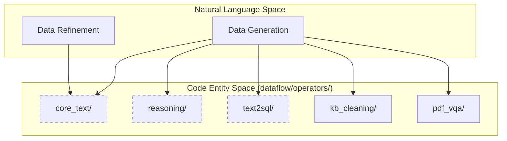
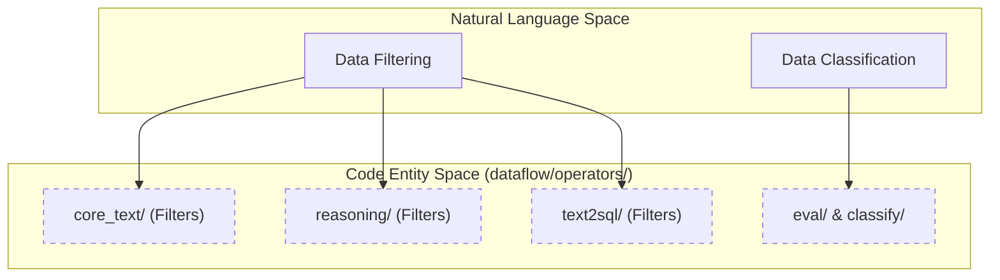
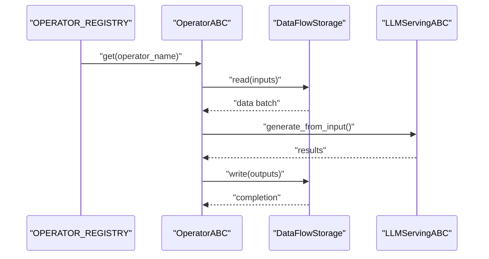

<!-- source: DeepWiki mcp.deepwiki.com · repo OpenDCAI/DataFlow · page 6 Operator Reference · fetched 2026-11-02 -->

# Operator Reference

Relevant source files

The following files were used as context for generating this wiki page:

- [dataflow/operators/__init__.py](dataflow/operators/__init__.py)
- [dataflow/utils/registry.py](dataflow/utils/registry.py)
- [test/cpu_only/test_register_whitelist.py](test/cpu_only/test_register_whitelist.py)

The DataFlow framework provides a rich library of modular operators designed for large-scale data preparation, synthesis, and evaluation for Large Language Models (LLMs). These operators are organized into specialized domains such as core text processing, reasoning, Text2SQL, and PDF extraction.

All operators inherit from the base `OperatorABC` class and follow a standardized execution lifecycle [dataflow/utils/registry.py:34-58](). They are registered in the `OPERATOR_REGISTRY` [dataflow/utils/registry.py:34-58]() for dynamic discovery and pipeline compilation.

### Operator Architecture Mapping

The following diagrams bridge natural language operational concepts to their corresponding code modules within the `dataflow/operators/` directory.

**Generation and Refinement Domain to Code Entity Space**

Sources: [dataflow/operators/__init__.py:1-4](), [dataflow/utils/registry.py:34-58]()

**Filtering and Classification Domain to Code Entity Space**

Sources: [dataflow/operators/__init__.py:1-4](), [dataflow/utils/registry.py:34-58]()

---

### 6.1. Generation Operators

Generation operators utilize `LLMServingABC` backends to synthesize new data, refine existing instructions, or transform formats. They range from simple prompted generators to complex recursive chunking systems for long-context documents.

*   **Core Generators:** Includes `PromptedGenerator` and `ChunkedPromptedGenerator` for basic LLM calls and recursive text splitting [dataflow/operators/__init__.py:1-4]().
*   **Specialized Domain Generators:** Includes domain-specific generators for Text2SQL, reasoning, SFT, conversation, and PDF VQA synthesis.

For a complete reference of generation operators, their parameters, and child pages by domain, see [Generation Operators](#6.1).

Sources: [dataflow/operators/__init__.py:1-4](), [dataflow/utils/registry.py:34-58]()

---

### 6.2. Filter Operators

Filter operators are used to ensure the quality, safety, and relevance of datasets. They typically evaluate a specific criterion (e.g., perplexity, executability, or model-based judgment) and remove samples that fail to meet the threshold.

*   **General and Quality Filtering:** Flexible interfaces for logic-based or LLM-based data exclusion and diversity filtering [dataflow/operators/__init__.py:1-4]().
*   **Domain-Specific Filtering:** Specialized filters for Text2SQL executability, reasoning verification, and text quality.

For details on filtering logic and domain-specific filters, see [Filter Operators](#6.2).

Sources: [dataflow/operators/__init__.py:1-4](), [dataflow/utils/registry.py:34-58]()

---

### 6.3. Classification and Evaluation Operators

Classification operators label data to facilitate balanced dataset construction or difficulty-based curriculum learning. Evaluation operators assess the quality of model-generated answers against benchmarks.

*   **Classification:** Operators for SQL component analysis, question categorization, and difficulty scoring [dataflow/operators/__init__.py:1-4]().
*   **Benchmark Evaluation:** Unified evaluators for assessing dataset and model performance.

For a comprehensive reference on classification and evaluation operators, see [Evaluation and Classification Operators](#6.3).

Sources: [dataflow/operators/__init__.py:1-4](), [dataflow/utils/registry.py:34-58]()

---

### Operator Execution Flow

The following diagram illustrates how operators interact with the storage and serving layers using the registry pattern during execution.

**Operator Registry and Execution Flow**

Sources: [dataflow/utils/registry.py:76-129]()

---

