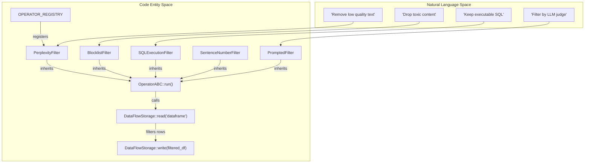
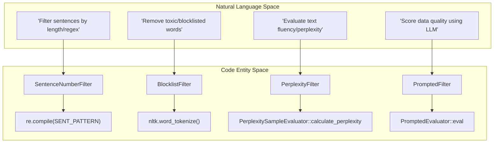

<!-- source: DeepWiki mcp.deepwiki.com · repo OpenDCAI/DataFlow · page 6.2 Filter Operators · fetched 2026-11-02 -->

# Filter Operators

Relevant source files

The following files were used as context for generating this wiki page:

- [dataflow/example/chemistry/matched_sample_10.json](dataflow/example/chemistry/matched_sample_10.json)
- [dataflow/example/core_text_data/eval_data.json](dataflow/example/core_text_data/eval_data.json)
- [dataflow/operators/core_text/eval/prompted_eval.py](dataflow/operators/core_text/eval/prompted_eval.py)
- [dataflow/operators/core_text/filter/prompted_filter.py](dataflow/operators/core_text/filter/prompted_filter.py)
- [dataflow/operators/core_text/refine/prompted_refiner.py](dataflow/operators/core_text/refine/prompted_refiner.py)
- [dataflow/prompts/chemistry.py](dataflow/prompts/chemistry.py)

Filter operators in DataFlow are specialized components designed to evaluate, score, and prune datasets based on quality, relevance, or safety criteria. These operators implement the `OperatorABC` interface [dataflow/core.py:1-20]() and typically modify the underlying `DataFlowStorage` [dataflow/utils/storage.py:1-10]() by removing rows that do not meet specified thresholds.

### Filter Architecture and Lifecycle

Filter operators generally follow a pattern of reading a dataframe from storage via `storage.read("dataframe")` [dataflow/operators/general_text/filter/rule_based_filter.py:50](), calculating a metric or boolean flag for each row, and then writing a subset of the data back to storage using `storage.write(filtered_dataframe)` [dataflow/operators/general_text/filter/rule_based_filter.py:61](). All filters are registered in the `OPERATOR_REGISTRY` [dataflow/utils/registry.py:1-15]() to allow for dynamic pipeline composition.

Title: Filter Operator Execution Architecture

Sources: [dataflow/core.py:1-20](), [dataflow/operators/general_text/filter/rule_based_filter.py:12-63](), [dataflow/utils/registry.py:1-15](), [dataflow/operators/core_text/filter/prompted_filter.py:11-102]()

---

## 6.2.1 Text2SQL Filter Operators

Text2SQL filters ensure the validity and consistency of generated SQL queries. These operators interact with a `DatabaseManager` to verify if a query can actually execute or if the results match expected outputs against target schemas.

Key operators include:
*   `SQLExecutionFilter`: Filters items based on whether the SQL can be executed in the database [dataflow/operators/text2sql/filter/sql_execution_filter.py:13-96]().
*   `SQLExecutabilityFilter`: Checks if the SQL syntax is valid against a target database schema.
*   `SQLConsistencyFilter`: Compares results from multiple generated SQL variants to ensure stable output.
*   `Text2SQLCorrespondenceFilter`: Verifies if the generated SQL correctly reflects the intent of the natural language question.

For details, see [Text2SQL Filter Operators](#6.2.1).

Sources: [dataflow/operators/text2sql/filter/sql_execution_filter.py:13-96]()

---

## 6.2.2 Text Quality Filters

Text quality filters focus on the linguistic and structural integrity of natural language data. These range from simple rule-based checks to complex model-based evaluations.

### Rule-Based and Statistical Filters
These operators use regex, token counts, or blocklists to prune data.
*   `ColonEndFilter`: Identifies incomplete questions by checking if text ends with a colon [dataflow/operators/general_text/filter/rule_based_filter.py:12-63]().
*   `SentenceNumberFilter`: Limits data to a specific range of sentence counts (default 3 to 7500) using a regex `SENT_PATTERN` [dataflow/operators/general_text/filter/rule_based_filter.py:66-128]().
*   `BlocklistFilter`: Uses language-specific files (e.g., `en.txt`, `zh.txt`) loaded via `DataFlowPath.get_dataflow_dir()` [dataflow/operators/general_text/filter/blocklist_filter.py:68-74](). It supports optional word-level filtering via `nltk.tokenize.word_tokenize` [dataflow/operators/general_text/filter/blocklist_filter.py:84-88]().
*   `RemoveStopwordsRefiner`: While primarily a refiner, it is used in quality pipelines to increase feature density by removing English stopwords using `nltk.corpus.stopwords` [dataflow/operators/general_text/refine/remove_stopwords_refiner.py:11-84]().

### Model-Based Quality Filters
These utilize external models or LLM-based evaluators to score text.
*   `PerplexityFilter`: Uses a `PerplexitySampleEvaluator` [dataflow/operators/text_pt/eval/perplexity_sample_evaluator.py:10-26]() (wrapping HuggingFace models like GPT-2) to calculate text fluency via `calculate_perplexity` [dataflow/operators/text_pt/eval/perplexity_sample_evaluator.py:61-72](). It filters rows based on `min_score` and `max_score` thresholds [dataflow/operators/text_pt/filter/perplexity_filter.py:9-60]().
*   `PromptedFilter`: Leverages a `PromptedEvaluator` [dataflow/operators/core_text/eval/prompted_eval.py:10-48]() and an `LLMServingABC` instance to assign numeric scores and filters rows based on qualitative criteria [dataflow/operators/core_text/filter/prompted_filter.py:11-102]().

Title: Text Quality Filtering Logic Mapping

Sources: [dataflow/operators/general_text/filter/rule_based_filter.py:112-117](), [dataflow/operators/general_text/filter/blocklist_filter.py:84-88](), [dataflow/operators/text_pt/filter/perplexity_filter.py:14-15](), [dataflow/operators/text_pt/eval/perplexity_sample_evaluator.py:61-72](), [dataflow/operators/core_text/filter/prompted_filter.py:18-20](), [dataflow/operators/core_text/eval/prompted_eval.py:10-48]()

For details, see [Text Quality Filters](#6.2.2).

---

## 6.2.3 Reasoning Filter Operators

Reasoning filters are tailored for Mathematical and Logical datasets, ensuring that the steps taken to reach an answer are sound and the final output matches ground truth.

*   `AnswerMathVerifyFilter`: Uses symbolic math solvers or specific extraction rules to verify numeric answers.
*   `AnswerModelJudgeFilter`: Employs a "Judge LLM" to evaluate the reasoning chain of a "Student LLM."
*   `AnswerTokenLengthFilter`: Prunes answers that are too short to contain a valid Chain-of-Thought (CoT) or excessively long.
*   `AnswerGroundTruthFilter`: Compares the generated answer against a known ground truth value.

For details, see [Reasoning Filter Operators](#6.2.3).

Sources: [dataflow/operators/reasoning/filter/]()

---

## Summary Table of Core Filters

| Operator Class | Domain | Primary Mechanism | File Path |
| :--- | :--- | :--- | :--- |
| `PromptedFilter` | General | LLM Scoring via `PromptedEvaluator` | [dataflow/operators/core_text/filter/prompted_filter.py:11]() |
| `PerplexityFilter` | Pre-training | HF Model Perplexity Score | [dataflow/operators/text_pt/filter/perplexity_filter.py:9]() |
| `BlocklistFilter` | Safety/Quality | Keyword matching (`nltk.word_tokenize`) | [dataflow/operators/general_text/filter/blocklist_filter.py:13]() |
| `SentenceNumberFilter` | Structure | Regex `SENT_PATTERN` count | [dataflow/operators/general_text/filter/rule_based_filter.py:66]() |
| `ColonEndFilter` | Cleanliness | Suffix check `text.endswith(':')` | [dataflow/operators/general_text/filter/rule_based_filter.py:12]() |

Sources: [dataflow/operators/general_text/filter/rule_based_filter.py:1-128](), [dataflow/operators/general_text/filter/blocklist_filter.py:1-97](), [dataflow/operators/text_pt/filter/perplexity_filter.py:1-60](), [dataflow/operators/text_pt/eval/perplexity_sample_evaluator.py:1-80](), [dataflow/operators/core_text/filter/prompted_filter.py:1-102]()

---

