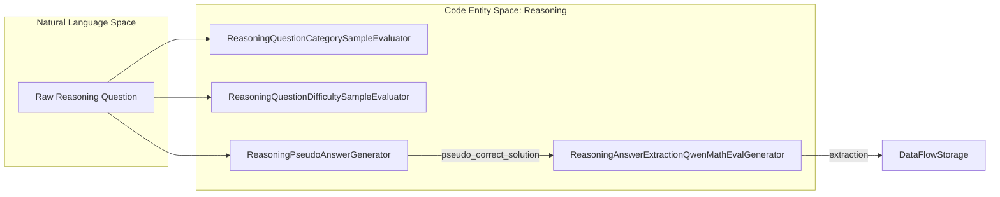

<!-- source: DeepWiki mcp.deepwiki.com · repo OpenDCAI/DataFlow · page 6.3 Evaluation and Classification Operators · fetched 2026-11-02 -->

# Evaluation and Classification Operators

<details>
<summary>Relevant source files</summary>

The following files were used as context for generating this wiki page:

- [dataflow/example/core_text_data/bench_eval_data_2.jsonl](dataflow/example/core_text_data/bench_eval_data_2.jsonl)
- [dataflow/operators/core_text/eval/bench_dataset_evaluator.py](dataflow/operators/core_text/eval/bench_dataset_evaluator.py)
- [dataflow/operators/reasoning/filter/reasoning_answer_model_judge_filter.py](dataflow/operators/reasoning/filter/reasoning_answer_model_judge_filter.py)
- [dataflow/prompts/model_evaluation/general.py](dataflow/prompts/model_evaluation/general.py)
- [dataflow/statics/pipelines/api_pipelines/core_text_bencheval_semantic_pipeline.py](dataflow/statics/pipelines/api_pipelines/core_text_bencheval_semantic_pipeline.py)
- [dataflow/statics/pipelines/api_pipelines/core_text_bencheval_semantic_pipeline_question.py](dataflow/statics/pipelines/api_pipelines/core_text_bencheval_semantic_pipeline_question.py)
- [dataflow/statics/pipelines/api_pipelines/core_text_bencheval_semantic_pipeline_question_single_step.py](dataflow/statics/pipelines/api_pipelines/core_text_bencheval_semantic_pipeline_question_single_step.py)
- [dataflow/statics/pipelines/gpu_pipelines/core_text_bencheval_match_pipeline.py](dataflow/statics/pipelines/gpu_pipelines/core_text_bencheval_match_pipeline.py)

</details>


Classification and evaluation operators in DataFlow are specialized components designed to evaluate, categorize, and assess the complexity and correctness of data. These operators are critical for building high-quality datasets for LLM training, performing curriculum learning, and benchmarking model outputs across diverse domains like Text2SQL, mathematical reasoning, and general evaluation benchmarks.

As a parent page, this document provides a high-level overview. For deep technical details, implementation specifics, and configuration parameters, please refer to the child pages:
- [SQL Classification Operators](#6.3.1)
- [Reasoning Classification Operators](#6.3.2)
- [Benchmark Dataset Evaluators](#6.3.3)

---

## SQL Classification Operators

SQL classification operators focus on assessing the complexity of SQL queries and the difficulty of the Text2SQL task through structural analysis and execution-based entropy.

*   **Structural Classification**: The `SQLComponentClassifier` [dataflow/operators/text2sql/eval/sql_component_classifier.py:113-116]() analyzes SQL syntax to assign difficulty labels, evaluating joins, subqueries, and complex clauses based on configured thresholds [dataflow/operators/text2sql/eval/sql_component_classifier.py:121-124]().
*   **Execution Classification**: The `SQLExecutionClassifier` [dataflow/operators/text2sql/eval/sql_execution_classifier.py:15-16]() measures the consistency of execution results across multiple SQL candidates using a `DatabaseManager` [dataflow/utils/text2sql/database_manager.py:31-35]().
*   **Validity Filtering**: The `SQLExecutionFilter` [dataflow/operators/text2sql/filter/sql_execution_filter.py:13-13]() acts as a binary classifier, filtering out invalid or non-executable SQL statements [dataflow/operators/text2sql/filter/sql_execution_filter.py:37-48]().

For complete details, see [SQL Classification Operators](#6.3.1).

### SQL Classification Flow

```mermaid
graph TD
    subgraph "Natural Language Space"
        Question[""question" (str)"]
    end

    subgraph "Code Entity Space: SQL Classification"
        DBM[""DatabaseManager""]
        SCC[""SQLComponentClassifier""]
        SEC[""SQLExecutionClassifier""]
        SEF[""SQLExecutionFilter""]
    end

    Question --> SCC
    SCC -- "Structural Analysis" --> Result1[""easy"/"hard""]

    Question --> SEC
    SEC --> DBM
    DBM -- "batch_compare_queries" --> SEC
    SEC -- "Result Consistency Analysis" --> Result2[""medium"/"extra""]

    Question --> SEF
    SEF --> DBM
    DBM -- "batch_execute_queries" --> SEF
    SEF -- "Boolean Filter" --> Result3["Valid/Invalid"]
```
Sources: [dataflow/operators/text2sql/eval/sql_component_classifier.py:113-150](), [dataflow/operators/text2sql/eval/sql_execution_classifier.py:83-102](), [dataflow/operators/text2sql/filter/sql_execution_filter.py:56-91](), [dataflow/utils/text2sql/database_manager.py:31-35]()

---

## Reasoning Classification Operators

Reasoning classification operators handle mathematical and logical problem datasets by categorizing questions into specific domains and assessing reasoning complexity.

Key components include:
*   **Category Classification**: The `ReasoningQuestionCategorySampleEvaluator` [dataflow/operators/reasoning/eval/reasoning_question_category_sample_evaluator.py:19-19]() performs hierarchical classification using `MathQuestionCategoryPrompt` [dataflow/operators/reasoning/eval/reasoning_question_category_sample_evaluator.py:25-25]().
*   **Difficulty Assessment**: The `ReasoningQuestionDifficultySampleEvaluator` [dataflow/operators/reasoning/eval/reasoning_question_difficulty_sample_evaluator.py:17-17]() outputs numerical difficulty scores from 1 to 10 [dataflow/operators/reasoning/eval/reasoning_question_difficulty_sample_evaluator.py:93-104]().
*   **Pseudo-Answer Consistency**: The `ReasoningPseudoAnswerGenerator` [dataflow/operators/reasoning/generate/reasoning_pseudo_answer_generator.py:18-18]() classifies correct answers through multi-solution voting [dataflow/operators/reasoning/generate/reasoning_pseudo_answer_generator.py:127-136]().

For complete details, see [Reasoning Classification Operators](#6.3.2).

### Reasoning Data Flow


Sources: [dataflow/operators/reasoning/eval/reasoning_question_category_sample_evaluator.py:79-88](), [dataflow/operators/reasoning/eval/reasoning_question_difficulty_sample_evaluator.py:79-91](), [dataflow/operators/reasoning/generate/reasoning_pseudo_answer_generator.py:95-123](), [dataflow/operators/reasoning/generate/reasoning_answer_extraction_qwenmatheval_generator.py:59-74]()

---

## Benchmark Dataset Evaluators

Benchmark dataset evaluators provide standardized model evaluation across diverse task structures. 

*   **`BenchDatasetEvaluator`**: Compares predicted answers against ground truth using either string matching (`match` mode with `math_verify` parsing) or semantic evaluation (`semantic` mode using an LLM judge) [dataflow/operators/core_text/eval/bench_dataset_evaluator.py:24-50]().
*   **`UnifiedBenchDatasetEvaluator`**: Manages unified benchmark evaluation supporting multiple evaluation types (e.g., text scoring, QA, multiple choice, and rejection tasks) with configurable metrics [dataflow/operators/core_text/eval/unified_bench_dataset_evaluator.py:31-66]().

For complete details, see [Benchmark Dataset Evaluators](#6.3.3).

---

## General Evaluation and Scoring Summary

| Operator | Input | Output | Purpose |
| :--- | :--- | :--- | :--- |
| `SQLComponentClassifier` | SQL Query | Difficulty Label | Structural complexity assessment [dataflow/operators/text2sql/eval/sql_component_classifier.py:113-125]() |
| `SQLExecutionClassifier` | Question + DB | Difficulty Label | Execution-based uncertainty measurement [dataflow/operators/text2sql/eval/sql_execution_classifier.py:15-30]() |
| `ReasoningQuestionCategorySampleEvaluator` | Question | Category Code | Hierarchical domain classification [dataflow/operators/reasoning/eval/reasoning_question_category_sample_evaluator.py:28-53]() |
| `BenchDatasetEvaluator` | Pred + Ground Truth | Match Result (Bool) | Accuracy or semantic correctness evaluation [dataflow/operators/core_text/eval/bench_dataset_evaluator.py:142-162]() |
| `UnifiedBenchDatasetEvaluator` | Dataset Record | Score / Match | Unified multi-type benchmark evaluation [dataflow/operators/core_text/eval/unified_bench_dataset_evaluator.py:31-66]() |

Sources: [dataflow/operators/text2sql/eval/sql_component_classifier.py:113-125](), [dataflow/operators/text2sql/eval/sql_execution_classifier.py:15-30](), [dataflow/operators/reasoning/eval/reasoning_question_category_sample_evaluator.py:28-53](), [dataflow/operators/core_text/eval/bench_dataset_evaluator.py:142-162](), [dataflow/operators/core_text/eval/unified_bench_dataset_evaluator.py:31-66]()

---

